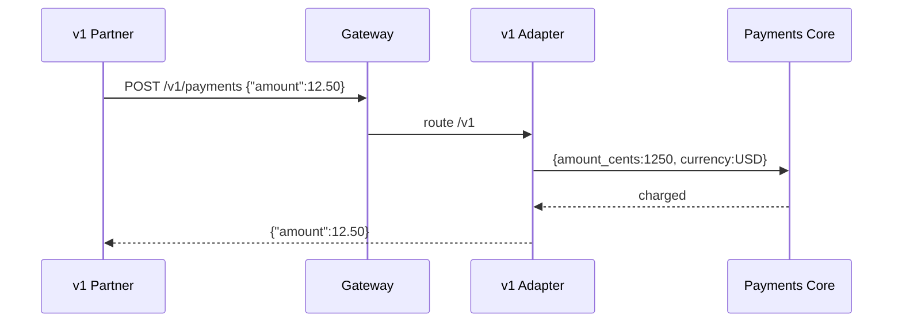
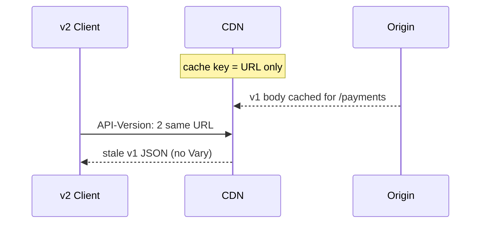

# Lesson 06: API Versioning Without Breaking Clients — URL vs Header vs Date

> **Prerequisites:** [Lesson 05: API Resource Modeling & URI Design](../05-api-resource-modeling-uri-design/README.md).  
> **Estimated Reading Time:** 33 minutes  
> **Target Audience:** Engineers evolving public APIs with live partner integrations—additive change, adapters, deprecation, and brownouts.  
> **Free PDF Notes:** [Download SD-C-006.pdf](https://backendroadmap.com/notes/system-design/SD-C-006.pdf)

> [!NOTE]
> **In one line:** Evolve additively so you rarely need a new version; when you must break, run the new version side by side (one shared core, thin adapters) and retire the old one with notice, `Deprecation`/`Sunset` headers, usage tracking, and brownouts.

> [!TIP]
> **The Golden Rule of Versioning:** Prefer **tolerant readers** and additive fields. Never copy-paste a second codebase for v2. Never “fix” behavior inside an existing version. Never flip the kill switch without usage data and brownouts.

---

## Words You'll Meet Today

| Word | Meaning | Role |
| :--- | :--- | :--- |
| **Breaking change** | Existing clients fail without code changes | Triggers a new version |
| **Additive change** | Optional field/endpoint/param | Usually safe |
| **Tolerant reader** | Ignores unknown fields | Enables additive evolution |
| **URL versioning** | `/v2/payments` | Visible, common for public APIs |
| **Header / media-type** | `API-Version` / `Accept: vnd…` | Clean URLs; cache `Vary` risk |
| **Date versioning** | Stripe-style pin | Many small breaks |
| **Adapter** | Thin old↔new translator | One core logic |
| **Brownout** | Planned old-version errors | Find forgotten cron jobs |

---

## Core Definition & Taxonomic Comparison

Payments example: `"amount": 12.50` → `"amount_cents": 1250, "currency":"USD"`.

| Term | Precise Meaning | Example |
| :--- | :--- | :--- |
| **Safe (additive)** | Old clients keep working | Add optional `currency` beside `amount` |
| **Breaking** | Remove/rename/retype/require | `12.50` → `1250` type change |
| **URL vs header vs date** | Where the contract pin lives | `/v2`, `API-Version:2`, `Stripe-Version:2024-06-20` |
| **Dual codebase** vs **adapter** | Two logics vs one core + translate | Adapter: dollars↔cents |

---

## Component Anatomy & The Observability Gap

```text
 Old partners ──/v1──► Gateway ──► v1 adapter ──► Core (v2 model)
 New clients  ──/v2──────────────►──────────────► Core
```

| Vantage | Captures | Hides |
| :--- | :--- | :--- |
| Gateway path/version label | Per-version RPS by API key | Whether client can migrate (org process) |
| Adapter metrics | Translation errors, p99 map time | Semantic drift if someone “fixed” v1 |
| CDN cache | URL hits | Header-version mix-ups without `Vary` |

---

## Mathematical Model: Adapter Cost & Retirement

### 1. Adapter load

If total $\lambda=10{,}000$ RPS and $f_{v1}=0.30$:

$$\lambda_{\text{adapter}} = f_{v1}\cdot\lambda = 3{,}000\ \text{RPS}$$

Field mapping is microseconds; **two full codebases** doubles every security patch.

### 2. Deprecation window

Typical public API: **12 months**. Brownouts: $1\,\text{h}$ → $4\,\text{h}$ → $24\,\text{h}$.

### 3. Cache poison with header versioning

Without `Vary: API-Version`, probability a CDN serves wrong version rises with mixed traffic share $f$:

$$\text{risk} \propto f_{v1}\cdot f_{v2} \cdot \text{(shared URL cache key)}$$

URL versioning avoids this class of bug.

### 4. Worked adapter

`POST /v1/payments {"amount":12.50}` → parse decimal → $\times 100$ → `{amount_cents:1250,currency:USD}` → core → respond `amount:12.50`.

---

## Metrics, Percentiles & Distributions

| Metric | Use |
| :--- | :--- |
| Requests by version × API key | Who to email |
| Adapter error rate | Mapping bugs |
| Brownout-discovered unique keys | Forgotten jobs |
| Time-to-migrate p50/p90 | Partner enablement health |

---

## Compounding Effects

Supporting $K$ major versions:

$$\text{test matrix} \propto K \cdot E \cdot C$$

($E$ endpoints, $C$ client SDKs). Cap at **two** live majors.

---

## Numbers Every Backend Engineer Must Know

| Practice | Value |
| :--- | :--- |
| Max live majors | 2 |
| Deprecation notice | 6–12 months |
| Brownouts | escalating windows |
| Sunset response | `410 Gone` |

---

## Protocol Deep Dive



Deprecation headers example:

```http
HTTP/1.1 200 OK
Deprecation: @1782864000
Sunset: Wed, 30 Jun 2027 23:59:59 GMT
Link: <https://docs.acme.com/migrate-v2>; rel="deprecation"
```

---

## Hierarchical Budgets

| Phase | Goal |
| :--- | :--- |
| Month 0 | Ship v2 + migration guide |
| Months 1–10 | Headers + track + email |
| Months 10–11 | Brownouts |
| Month 12 | `410 Gone` on v1 |

---

## Top Engineering Mitigation Techniques

1. Additive-first; tolerant readers.
2. Shared core + thin adapters.
3. At most two majors.
4. Never change behavior inside a version.
5. Version SDKs with the API.
6. Log version every request; brownout before kill.

---

## Production War Story: CDN Mixes Header Versions

- **Severity:** SEV-1
- **Impact:** Partners parsing cents as dollars → wrong charges displayed; 2 hours to purge



### Fix

`Vary: API-Version` or include version in cache key; prefer URL versioning for public cacheable GETs.

---

## Multi-Language Production Implementation

````carousel
```go
package payadapt

import "math"

type V2Payment struct {
	AmountCents int64
	Currency    string
}

func V1AmountToV2(dollars float64, currency string) V2Payment {
	// use decimal in prod — float shown for brevity
	cents := int64(math.Round(dollars * 100))
	return V2Payment{AmountCents: cents, Currency: currency}
}

func V2ToV1Amount(p V2Payment) float64 {
	return float64(p.AmountCents) / 100.0
}
```

<!-- slide -->

```typescript
export type V2Payment = { amountCents: number; currency: string };

export function v1AmountToV2(dollars: string, currency: string): V2Payment {
  // dollars as string to avoid binary float issues
  const [w, f = "0"] = dollars.split(".");
  const frac = (f + "00").slice(0, 2);
  const amountCents = Number(w) * 100 + Number(frac);
  return { amountCents, currency };
}

export function v2ToV1Amount(p: V2Payment): string {
  const neg = p.amountCents < 0;
  const n = Math.abs(p.amountCents);
  const s = `${Math.floor(n / 100)}.${String(n % 100).padStart(2, "0")}`;
  return neg ? `-${s}` : s;
}
```

<!-- slide -->

```python
from dataclasses import dataclass
from decimal import Decimal, ROUND_HALF_UP


@dataclass
class V2Payment:
    amount_cents: int
    currency: str


def v1_amount_to_v2(dollars: str, currency: str) -> V2Payment:
    cents = int((Decimal(dollars) * 100).quantize(Decimal("1"), rounding=ROUND_HALF_UP))
    return V2Payment(cents, currency)


def v2_to_v1_amount(p: V2Payment) -> str:
    return f"{Decimal(p.amount_cents) / 100:.2f}"
```

<!-- slide -->

```csharp
public sealed record V2Payment(long AmountCents, string Currency);

public static class PaymentAdapter
{
    public static V2Payment V1AmountToV2(decimal dollars, string currency)
        => new((long)decimal.Round(dollars * 100m, 0, MidpointRounding.AwayFromZero), currency);

    public static decimal V2ToV1Amount(V2Payment p) => p.AmountCents / 100m;
}
```
````

---

## Hands-On CLI Verification

```bash
curl -i https://api.example.com/v1/payments/demo \
  -H "Authorization: Bearer $TOKEN"
# Expect Deprecation + Sunset headers during retirement
```

---

## Common Mistakes to Avoid

- Version bump for additive-only changes.
- Copy-pasted v2 codebase.
- Silent behavior fixes inside v1.
- Kill switch with no usage data / brownouts.
- Header versioning behind CDN without `Vary`.

---

## Key Terms Glossary

| Term | Definition |
| :--- | :--- |
| **Sunset header** | When the resource becomes unavailable |
| **Brownout** | Intentional short old-version outage |
| **Date versioning** | Account pinned to API-as-of date |

---

## Interview Practice Questions

<details>
<summary><strong>Q1. How do you version without breaking clients? [BASIC]</strong></summary>

Prefer additive changes. When breaking: v2 beside v1, shared core + adapter, long notice, Deprecation/Sunset, usage tracking, brownouts.

</details>

<details>
<summary><strong>Q2. Which changes are breaking? [BASIC]</strong></summary>

Remove/rename fields, change types/meanings, make params required. Additive optional fields/endpoints are usually safe if clients ignore unknowns.

</details>

<details>
<summary><strong>Q3. Pros/cons of URL versioning? [BASIC]</strong></summary>

Pros: visible, easy curl/gateway/cache. Cons: versions whole API, clients change URLs, purist URI concerns, encourages big bangs.

</details>

<details>
<summary><strong>Q4. What is a tolerant reader? [BASIC]</strong></summary>

A client that ignores unknown fields/enum values so servers can add fields safely.

</details>

<details>
<summary><strong>Q5. Need v2 of 1 endpoint out of 80. What do you do? [SCENARIO]</strong></summary>

Try additive first. Else header/date version that change; with URL versioning, `/v2` can still route 79 endpoints to the same handlers.

</details>

<details>
<summary><strong>Q6. v1 off in 2 months, 40 clients remain. Plan? [SCENARIO]</strong></summary>

Per-key usage, contact top callers, headers, brownouts 1h/4h/24h; extend only with written exceptions.

</details>

<details>
<summary><strong>Q7. Design dollars→cents migration. [SCENARIO]</strong></summary>

Core on cents+currency; v1 adapter maps both ways; dual-run 12 months; SDK bump; track v1 share to zero.

</details>

<details>
<summary><strong>Q8. How do brownouts help? [SCENARIO]</strong></summary>

They surface forgotten cron/jobs before final shutdown by returning errors in planned windows.

</details>

<details>
<summary><strong>Q9. Teammate fixes v1 rounding by 1 cent. Problem? [TRICKY]</strong></summary>

Yes—clients may reconcile against old behavior. Put fix in v2 or opt-in flag; document it.

</details>

<details>
<summary><strong>Q10. Header versioning + CDN — what goes wrong? [TRICKY]</strong></summary>

CDN keys by URL → v1 body served to v2 client. Send `Vary` or versioned cache keys; URL versioning avoids it.

</details>

<details>
<summary><strong>Q11. Why not support five majors forever? [TRICKY]</strong></summary>

Test/support matrix explodes; security fixes multiply; adapters drift. Cap at two and force migration.

</details>

<details>
<summary><strong>Q12. When is date versioning worth it? [TRICKY]</strong></summary>

Large platforms with continuous small breaks (Stripe). Accounts pin at signup and opt into newer dates—high product discipline required.

</details>

---

## One-Page Master Cheat Sheet

```text
====================================================================================================
                 API VERSIONING WITHOUT BREAKING CLIENTS  —  CHEAT SHEET
====================================================================================================
FIRST            additive fields + tolerant readers → rarely need v2
BREAKING         remove/rename/retype/require
SHIP BREAK       shared core + thin adapter | ≤2 majors live
SIGNAL           URL /v2  |  header API-Version  |  date pin (Stripe)
RETIRE           announce → Deprecation+Sunset → track keys → brownouts → 410 Gone

CDN TRAP         header versioning needs Vary / cache key includes version

ANTI-PATTERNS    X bump for additive  X dual codebases  X silent v1 behavior change  X hard cutover
====================================================================================================
```

---

## Free PDF notes

[SD-C-006.pdf](https://backendroadmap.com/notes/system-design/SD-C-006.pdf)

---

## Sources

- [RFC 8594: The Sunset Header Field](https://www.rfc-editor.org/rfc/rfc8594)
- [Stripe API versioning](https://stripe.com/docs/api/versioning)

---

## Next

Next: [Lesson 07: API Pagination](../07-api-pagination/README.md).
