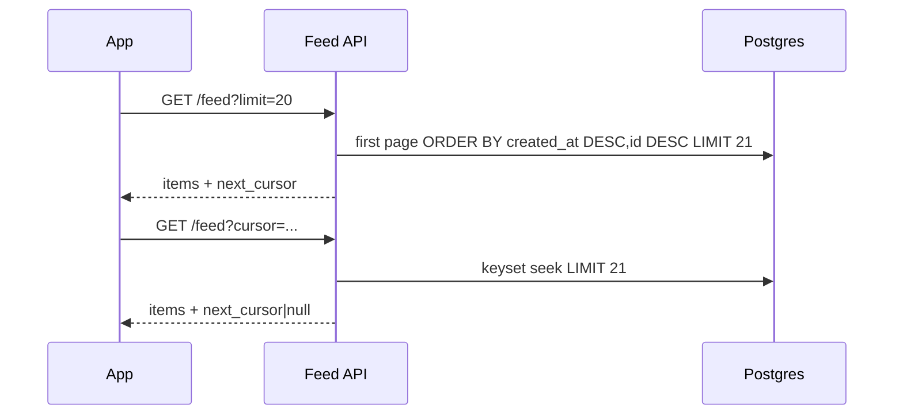
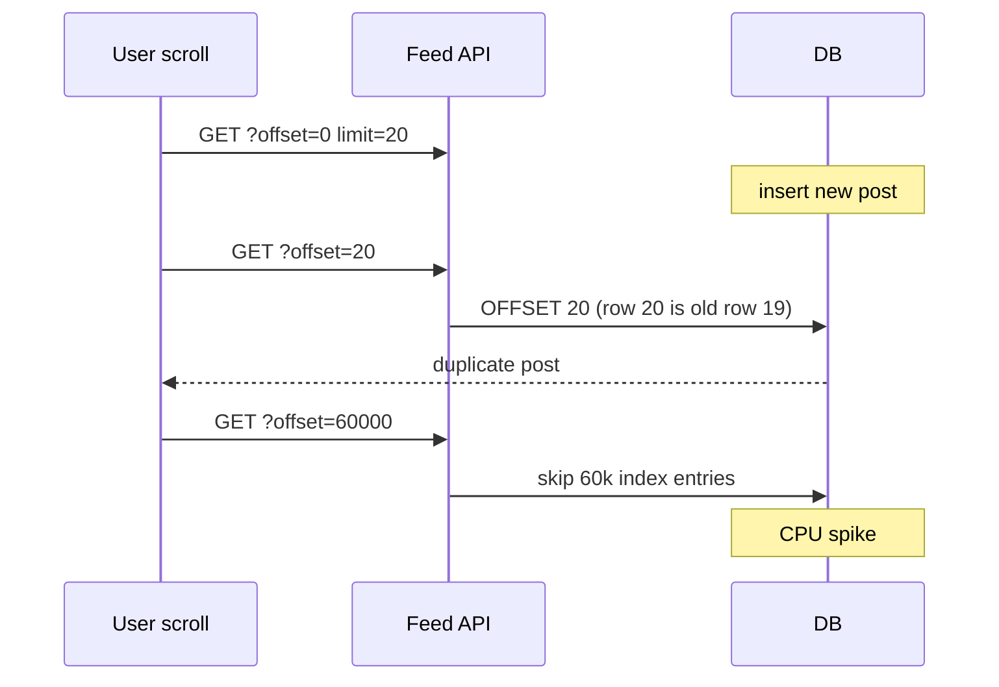

# Lesson 07: API Pagination — Offset vs Cursor & Why Deep Pages Are Slow

> **Prerequisites:** [Lesson 06: API Versioning](../06-api-versioning-without-breaking-clients/README.md) and database index basics.  
> **Estimated Reading Time:** 32 minutes  
> **Target Audience:** Backend engineers building feeds, admin tables, and list APIs where page 500 must not take seconds.  
> **Free PDF Notes:** [Download SD-C-007.pdf](https://backendroadmap.com/notes/system-design/SD-C-007.pdf)

> [!NOTE]
> **In one line:** Offset pagination makes the database read and discard every skipped row, so deep pages get slow and shift when data changes; cursor (keyset) pagination seeks to the last key through an index, so page 500 costs the same as page 1.

> [!TIP]
> **The Golden Rule of Pagination:** For large, changing lists use **opaque signed cursors** over a **unique sort key** `(created_at, id)` with a matching composite index. Cap `limit` (default 20, max 100). Prefer `has_more` over `COUNT(*)` on 50M rows.

---

## Words You'll Meet Today

| Word | Meaning | Role |
| :--- | :--- | :--- |
| **Offset pagination** | `LIMIT M OFFSET N` | Simple page numbers; deep = slow |
| **Keyset / cursor** | Continue after last sort key | Stable feeds |
| **Opaque cursor** | Encoded token clients echo | Evolve internals safely |
| **Tie-breaker** | Unique column in `ORDER BY` | No skip/dup at ties |
| **Composite index** | `(created_at, id)` | Seek without sort |
| **`has_more`** | Fetch M+1, return M | Avoid full counts |

---

## Core Definition & Taxonomic Comparison

| Term | Precise Meaning | Example |
| :--- | :--- | :--- |
| **Offset** vs **cursor** | Skip N rows vs seek after key | `OFFSET 9980` vs `(t,id) < cursor` |
| **Stable** vs **unstable page** | Inserts don’t reshuffle boundary | Feed scroll vs admin page jump |
| **Opaque** vs **raw `after_id`** | Signed blob vs public columns | Clients can’t forge probes |
| **Exact total** vs **`has_more`** | `COUNT(*)` vs LIMIT+1 trick | 50M row tables |

---

## Component Anatomy & The Observability Gap

```text
GET /feed?limit=20&cursor=eyJ0Ijoi...sig
        │
        ▼ decode+verify → WHERE (created_at,id)<(?,?) ORDER BY ... LIMIT 21
        │
        ▼ return 20 items + next_cursor (null if <21)
```

| Vantage | Captures | Hides |
| :--- | :--- | :--- |
| API latency by page depth | Offset cliffs | Whether index used |
| DB `EXPLAIN` | Seq scan / sort | Client duplicate reports |
| Client analytics “dup posts” | UX symptom | Inserts between offset pages |

---

## Mathematical Model: Deep Offset Cost

### 1. Rows touched

$$\text{rows examined} \approx \text{OFFSET} + \text{LIMIT}$$

Page $500$, size $20$: $\text{OFFSET}=9{,}980$. Page $50{,}000$: $\text{OFFSET}=999{,}980$.

### 2. Worked timing (PDF)

If each index entry touch $\approx 5\,\mu s$:

| Page | Offset | Touches | Time |
| :--- | :--- | :--- | :--- |
| 1 | 0 | 20 | $\sim 0.1\,\text{ms}$ |
| 500 | 9,980 | ~10,000 | $\sim 50\,\text{ms}$ |
| 50,000 | ~1e6 | ~1e6 | $\sim 5\,\text{s}$ |

Cursor: $\sim 20$ entries + B-tree descent (height 3–4) → **&lt; $5\,\text{ms}$** at any depth.

### 3. Instability probability

With insert rate $\lambda$ while user reads pages:

$$P(\text{dup or skip on next offset page}) \approx 1 - e^{-\lambda \Delta t}$$

Keyset boundaries don’t slide when new rows appear at the top.

### 4. `has_more` trick

`LIMIT 21`, return 20; `has_more = (len==21)`. Cost $+1$ row, not a full count.

---

## Metrics, Percentiles & Distributions

| Metric | Healthy |
| :--- | :--- |
| List $p_{99}$ vs cursor depth | Flat for keyset |
| Offset $p_{99}$ vs page | Linear climb = smell |
| Duplicate-item client events | Should ≈0 with cursors |

---

## Compounding Effects

Export jobs that walk offset pages on a hot table: each deeper page slower → job overrun → overlapping jobs → DB meltdown. Cursor exports stay $O(1)$ per page.

---

## Numbers Every Backend Engineer Must Know

| Item | Value |
| :--- | :--- |
| Default / max page size | 20 / 100 |
| Prefer cursor when | rows ≫ 10k or churning |
| Offset OK when | tiny admin tables + page jump |
| Tie-breaker | always include unique `id` |

---

## Protocol Deep Dive

```sql
SELECT * FROM posts
WHERE (created_at, id) < ($t, $id)
ORDER BY created_at DESC, id DESC
LIMIT 20;
-- INDEX (created_at DESC, id DESC)
-- OR: created_at < $t OR (created_at = $t AND id < $id)
```



---

## Hierarchical Budgets

| List type | $p_{99}$ target | Strategy |
| :--- | :--- | :--- |
| Feed / timeline | ≤ 25 ms | Cursor + index |
| Admin 2k rows | ≤ 50 ms | Offset OK |
| Full export | throughput | Cursor walk |

---

## Top Engineering Mitigation Techniques

1. Keyset + composite index matching `ORDER BY`.
2. Opaque HMAC-signed cursors.
3. Unique tie-breaker in sort.
4. Cap page size; reject huge `limit`.
5. `has_more` / approx counts, not `COUNT(*)` every page.
6. Cap max offset if you must keep offset for legacy UI.

---

## Production War Story: Offset Feed Duplicates + Slow Page 3000

- **Severity:** SEV-2 UX + SEV-1 DB during viral spike
- **Impact:** Users saw duplicate posts; page 3000 at $3\,\text{s}$; primary CPU $95\%$



### Fix

Migrated to keyset cursors; capped offset at 10k with message to filter; composite index `(created_at, id)`.

---

## Multi-Language Production Implementation

````carousel
```go
package cursorpage

import (
	"crypto/hmac"
	"crypto/sha256"
	"encoding/base64"
	"encoding/json"
	"fmt"
	"time"
)

type Cursor struct {
	T  time.Time `json:"t"`
	ID int64     `json:"id"`
}

func Encode(c Cursor, secret []byte) string {
	raw, _ := json.Marshal(c)
	mac := hmac.New(sha256.New, secret)
	mac.Write(raw)
	return base64.RawURLEncoding.EncodeToString(raw) + "." + base64.RawURLEncoding.EncodeToString(mac.Sum(nil))
}

func Decode(token string, secret []byte) (Cursor, error) {
	var zero Cursor
	parts := split2(token)
	if parts == nil {
		return zero, fmt.Errorf("bad cursor")
	}
	raw, err := base64.RawURLEncoding.DecodeString(parts[0])
	if err != nil {
		return zero, err
	}
	mac := hmac.New(sha256.New, secret)
	mac.Write(raw)
	sig, _ := base64.RawURLEncoding.DecodeString(parts[1])
	if !hmac.Equal(mac.Sum(nil), sig) {
		return zero, fmt.Errorf("bad signature")
	}
	var c Cursor
	return c, json.Unmarshal(raw, &c)
}

func split2(s string) []string {
	for i := 0; i < len(s); i++ {
		if s[i] == '.' {
			return []string{s[:i], s[i+1:]}
		}
	}
	return nil
}
```

<!-- slide -->

```typescript
import crypto from "crypto";

export type Cursor = { t: string; id: number };

export function encodeCursor(c: Cursor, secret: string): string {
  const raw = Buffer.from(JSON.stringify(c));
  const sig = crypto.createHmac("sha256", secret).update(raw).digest();
  return `${raw.toString("base64url")}.${sig.toString("base64url")}`;
}

export function decodeCursor(token: string, secret: string): Cursor {
  const [payload, sig] = token.split(".");
  const raw = Buffer.from(payload, "base64url");
  const expect = crypto.createHmac("sha256", secret).update(raw).digest();
  if (!crypto.timingSafeEqual(Buffer.from(sig, "base64url"), expect)) {
    throw Object.assign(new Error("bad cursor"), { status: 400 });
  }
  return JSON.parse(raw.toString()) as Cursor;
}
```

<!-- slide -->

```python
import base64
import hashlib
import hmac
import json
from dataclasses import dataclass


@dataclass(frozen=True)
class Cursor:
    t: str
    id: int


def encode_cursor(c: Cursor, secret: bytes) -> str:
    raw = json.dumps({"t": c.t, "id": c.id}, separators=(",", ":")).encode()
    sig = hmac.new(secret, raw, hashlib.sha256).digest()
    return base64.urlsafe_b64encode(raw).decode().rstrip("=") + "." + base64.urlsafe_b64encode(sig).decode().rstrip("=")


def decode_cursor(token: str, secret: bytes) -> Cursor:
    payload, sig = token.split(".", 1)
    pad = lambda s: s + "=" * (-len(s) % 4)
    raw = base64.urlsafe_b64decode(pad(payload))
    expect = hmac.new(secret, raw, hashlib.sha256).digest()
    if not hmac.compare_digest(expect, base64.urlsafe_b64decode(pad(sig))):
        raise ValueError("400: bad cursor")
    data = json.loads(raw)
    return Cursor(t=data["t"], id=int(data["id"]))
```

<!-- slide -->

```csharp
using System.Security.Cryptography;
using System.Text;
using System.Text.Json;

public sealed record Cursor(string T, long Id);

public static class CursorCodec
{
    public static string Encode(Cursor c, byte[] secret)
    {
        var raw = JsonSerializer.SerializeToUtf8Bytes(c);
        var sig = HMACSHA256.HashData(secret, raw);
        return $"{Base64Url(raw)}.{Base64Url(sig)}";
    }

    public static Cursor Decode(string token, byte[] secret)
    {
        var parts = token.Split('.', 2);
        var raw = FromBase64Url(parts[0]);
        var sig = FromBase64Url(parts[1]);
        var expect = HMACSHA256.HashData(secret, raw);
        if (!CryptographicOperations.FixedTimeEquals(expect, sig))
            throw new ArgumentException("400: bad cursor");
        return JsonSerializer.Deserialize<Cursor>(raw)!;
    }

    static string Base64Url(byte[] b) => Convert.ToBase64String(b).TrimEnd('=').Replace('+', '-').Replace('/', '_');
    static byte[] FromBase64Url(string s)
    {
        s = s.Replace('-', '+').Replace('_', '/');
        switch (s.Length % 4) { case 2: s += "=="; break; case 3: s += "="; break; }
        return Convert.FromBase64String(s);
    }
}
```
````

---

## Hands-On CLI Verification

```bash
# Contrast plans (Postgres)
psql -c "EXPLAIN SELECT * FROM posts ORDER BY created_at DESC LIMIT 20 OFFSET 100000;"
psql -c "EXPLAIN SELECT * FROM posts WHERE (created_at, id) < (NOW(), 0) ORDER BY created_at DESC, id DESC LIMIT 20;"
```

---

## Common Mistakes to Avoid

- Sort only by non-unique `created_at`.
- No index matching the sort.
- Raw `after_id` clients depend on forever.
- Exact `COUNT(*)` on huge tables every page.
- Unbounded `limit`.
- Assuming offset pages are stable under inserts.

---

## Key Terms Glossary

| Term | Definition |
| :--- | :--- |
| **Keyset pagination** | Seek by last sort key |
| **Opaque cursor** | Client-uninterpreted token |
| **Tie-breaker** | Makes order total/unique |

---

## Interview Practice Questions

<details>
<summary><strong>Q1. Why is offset slow for deep pages? [BASIC]</strong></summary>

DB reads/discards skipped rows; `OFFSET 1_000_000` touches ~1M entries to return 20. Cost grows with page number.

</details>

<details>
<summary><strong>Q2. How does cursor pagination work? [BASIC]</strong></summary>

Client sends opaque cursor of last `(created_at,id)`; server seeks with matching index `WHERE (created_at,id)<(?,?) ORDER BY ... LIMIT 20` and returns `next_cursor`.

</details>

<details>
<summary><strong>Q3. Why add `id` to ORDER BY? [BASIC]</strong></summary>

Timestamps collide. Without a unique tie-breaker, equal `created_at` at boundaries skip or repeat.

</details>

<details>
<summary><strong>Q4. What is `has_more`? [BASIC]</strong></summary>

Fetch limit+1; if extra row exists, more pages remain—avoids expensive totals.

</details>

<details>
<summary><strong>Q5. Users see the same post twice while scrolling. Cause? [SCENARIO]</strong></summary>

Offset + inserts shifting rows. Switch to keyset.

</details>

<details>
<summary><strong>Q6. Admin UI needs page numbers on 2,000 rows. [SCENARIO]</strong></summary>

Offset is fine—small table, jump to page 7, show total. Cursors shine on large churning data.

</details>

<details>
<summary><strong>Q7. Page 1 is 4 ms, page 3,000 is 3 s. Fix? [SCENARIO]</strong></summary>

Offset depth ($3{,}000\times20$). Add `(created_at,id)` index and cursors; cap max offset for legacy links.

</details>

<details>
<summary><strong>Q8. Design export of 50M rows. [SCENARIO]</strong></summary>

Cursor walk with stable order, capped page size, checkpoint cursor in job state; never deep offsets.

</details>

<details>
<summary><strong>Q9. Why opaque signed cursors vs `?after_id=`? [TRICKY]</strong></summary>

Opaque lets you change contents; signing stops forged cursors that bypass filters or probe data.

</details>

<details>
<summary><strong>Q10. How to show totals on 50M rows? [TRICKY]</strong></summary>

Often don’t—use `has_more`. Else approximate planner stats or cached counters labeled “about N”.

</details>

<details>
<summary><strong>Q11. Can cursors support “previous page”? [TRICKY]</strong></summary>

Yes with reverse keyset (`>` and flipped order) or storing a prev cursor stack—more complex than offset page numbers.

</details>

<details>
<summary><strong>Q12. Changing sort order mid-scroll? [TRICKY]</strong></summary>

Cursor is tied to one order; changing sort starts a new cursor chain. Document that clearly.

</details>

---

## One-Page Master Cheat Sheet

```text
====================================================================================================
                    API PAGINATION — OFFSET vs CURSOR  —  CHEAT SHEET
====================================================================================================
OFFSET     LIMIT M OFFSET N     deep cost ≈ OFFSET     unstable under inserts/deletes
CURSOR     WHERE (t,id)<(?,?)   cost ≈ M (flat)        stable; needs index (t,id)

API        next_cursor opaque+HMAC     has_more via LIMIT M+1     cap limit 20..100

MATH       page 500 → offset 9980 touches ~10k; page 50k → ~1e6 (~5s @5µs) vs cursor <5ms

WHEN       offset: small admin + page jump     cursor: feeds, APIs, exports

ANTI-PATTERNS  X sort without tie-breaker  X no index  X raw after_id  X COUNT(*) every page
====================================================================================================
```

---

## Free PDF notes

[SD-C-007.pdf](https://backendroadmap.com/notes/system-design/SD-C-007.pdf)

---

## Sources

- [Use the Index, Luke — “Paging Through Results”](https://use-the-index-luke.com/no-offset)
- PostgreSQL `ROW` comparison / keyset patterns

---

## Next

Next: [Lesson 08: Filtering, Sorting & Field Selection](../08-api-filtering-sorting-field-selection-without-table-scans/README.md).
