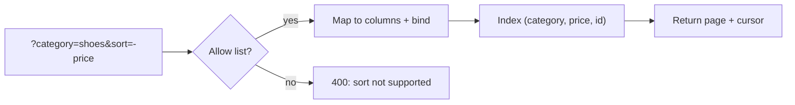
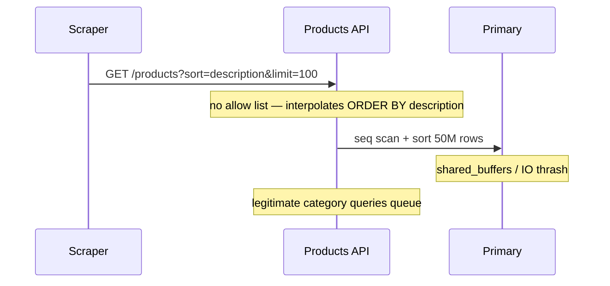

# Lesson 08: API Filtering, Sorting & Field Selection Without Table Scans

> **Prerequisites:** [Lesson 07: API Pagination](../07-api-pagination/README.md) (cursors + composite indexes).  
> **Estimated Reading Time:** 33 minutes  
> **Target Audience:** Backend engineers exposing list APIs with filters/sorts/sparse fieldsets who must keep 50M-row tables fast and injection-safe.  
> **Free PDF Notes:** [Download SD-C-008.pdf](https://backendroadmap.com/notes/system-design/SD-C-008.pdf)

> [!NOTE]
> **In one line:** Give clients consistent `filter`/`sort`/`fields` parameters, but only on an allow list of indexed fields; reject anything else with `400`, use parameterized SQL, cap page sizes, and send fuzzy search to a search engine.

> [!TIP]
> **The Golden Rule of List Query Design:** Allow-list → map to columns → bind values as parameters → composite index matching equality-then-sort → cursor pagination. Never concatenate column names from the query string into `ORDER BY`.

---

## Words You'll Meet Today

| Word | Meaning | Role |
| :--- | :--- | :--- |
| **Filter** | Exact structured condition | `category=shoes` |
| **Range operator** | `gte/gt/lte/lt` | `price[gte]=50` |
| **Sparse fieldset** | Client picks fields | `fields=id,name` |
| **Allow list** | Only permitted filter/sort fields | Blocks table scans |
| **Composite index** | Multi-column index order matters | `(category, price, id)` |
| **Full table scan** | Read every row | Melts CPU/IO |
| **Parameterized query** | Values bound separately | Stops SQL injection |
| **Search engine** | Inverted index, fuzzy, ranked | Not `LIKE '%x%'` |

---

## Core Definition & Taxonomic Comparison

Example request:

`GET /products?category=shoes&price[gte]=50&sort=-price&fields=id,name`

| Term | Precise Meaning | Example |
| :--- | :--- | :--- |
| **Filtering** vs **search** | Exact yes/no vs fuzzy relevance | `category=shoes` vs `q=red runing shoes` |
| **Allow list** vs **any column** | Controlled surface vs scan risk | `sort=price` OK; `sort=description` → 400 |
| **Composite** vs **single-column indexes** | Serves filter+sort together | `(category,price)` vs `price` alone |
| **Sparse fieldsets** vs **GraphQL** | Fixed REST param vs arbitrary graph | Mobile list of 2 fields without GraphQL |

---

## Component Anatomy & The Observability Gap

```text
Query params → Allow list → Map public name→column → Bind $1,$2 → Index scan
     │                                                              │
     └─ unknown sort/filter → 400 with allowed list ───────────────┘
```

| Vantage | Captures | Hides |
| :--- | :--- | :--- |
| Gateway 400 rate | Bad clients / typos | Silent ignore bugs (if you ignore unknowns) |
| DB `EXPLAIN` | Index vs seq scan | Which API field mapped wrong |
| `pg_stat_statements` | Slow `ORDER BY` | Whether allow list was bypassed |

---

## Mathematical Model: Scan vs Index Seek

### 1. Worked example (PDF) — 50M products, 2M shoes

`category=shoes&sort=-price&limit=20`

| Indexing | Work | Ballpark |
| :--- | :--- | :--- |
| No index | Scan 50M, keep 2M, sort 2M, take 20 | Seconds |
| `(category)` only | Find 2M fast, still sort 2M | Still heavy |
| `(category, price[, id])` | Seek + read ~20 entries | ~1 ms |

### 2. Selectivity

$$\text{rows matched} \approx N \cdot s$$

If $s$ (selectivity) is high (e.g. $0.5$), even an indexed equality may need a large sort unless the sort column is in the same composite index.

### 3. Field selection bandwidth

42 fields × $200\,\text{B}$ ≈ $8.4\,\text{KB}$/row vs 2 fields × $40\,\text{B}$ ≈ $80\,\text{B}$:

$$\text{bytes} \approx L \cdot \sum_{f \in fields} |f|$$

At $L=20$: ~$168\,\text{KB}$ vs ~$1.6\,\text{KB}$ per page on cellular.

### 4. Saturation

One unindexed sort at $ρ → 0.95$ on the primary makes everyone else’s $p_{99}$ cliff—same $M/M/1$ intuition as earlier lessons.

| Utilization | Latency multiplier |
| :--- | :--- |
| 50% | 2× |
| 90% | 10× |
| 95% | 20× |

---

## Metrics, Percentiles & Distributions

| Metric | Action |
| :--- | :--- |
| 400s for unknown sort/filter | Docs + SDK fix |
| Query p99 by filter shape | Missing composite index |
| Seq-scan count | Alert on list endpoints |

---

## Compounding Effects

Allowing 30 free-form attributes with independent B-trees still fails for arbitrary combinations—query planner can’t magically AND everything selectively. Faceted search belongs in Elasticsearch/OpenSearch.

---

## Numbers Every Backend Engineer Must Know

| Rule | Value |
| :--- | :--- |
| Page default/max | 20 / 100 |
| Equality column in composite | First |
| Sort column | Second (+ `id` tie-break) |
| Reject unknown params | 400, not silent |

---

## Protocol Deep Dive



```text
SORTABLE = {price: price_cents, created_at: created_at}
FILTERABLE = {category, status, brand}
# values always bound: WHERE category = $1 AND price_cents >= $2
```

Filtering vs search:

```text
GET /products?category=shoes&price[lt]=100   → database B-tree
GET /search?q=red runing shoes               → search engine (typo-tolerant)
```

---

## Hierarchical Budgets

| Endpoint | Requirement |
| :--- | :--- |
| `/products` list | Must include selective filter or capped unfiltered browse |
| Sort/filter combo | Composite index exists before shipping |
| `/search` | Separate service + sync pipeline |

---

## Top Engineering Mitigation Techniques

1. Allow-list filterable and sortable fields.
2. Reject unknowns with helpful 400s.
3. Map public names → columns in code.
4. Parameterize values; never string-build SQL.
5. Composite indexes: equality, then sort, then id.
6. Sparse `fields=`; cursor pagination; search engine for fuzzy text.

---

## Production War Story: `sort=description` Table Scan

- **Severity:** SEV-1
- **Impact:** 11 minutes primary IO saturation; checkout timeouts 7%



### Fix

Allow list + 400; composite indexes for real traffic; WAF rate limits; moved text “sort by relevance” to `/search`.

---

## Multi-Language Production Implementation

````carousel
```go
package listq

import (
	"fmt"
	"strings"
)

var sortable = map[string]string{"price": "price_cents", "created_at": "created_at"}
var filterable = map[string]string{"category": "category", "status": "status", "brand": "brand"}

func BuildOrderBy(sortParams []string) (string, error) {
	if len(sortParams) == 0 {
		return "created_at DESC, id DESC", nil
	}
	parts := make([]string, 0, len(sortParams))
	for _, raw := range sortParams {
		desc := strings.HasPrefix(raw, "-")
		name := strings.TrimPrefix(raw, "-")
		col, ok := sortable[name]
		if !ok {
			return "", fmt.Errorf("400: cannot sort by %q; allowed: price, created_at", name)
		}
		if desc {
			parts = append(parts, col+" DESC")
		} else {
			parts = append(parts, col+" ASC")
		}
	}
	parts = append(parts, "id DESC")
	return strings.Join(parts, ", "), nil
}
```

<!-- slide -->

```typescript
const SORTABLE: Record<string, string> = {
  price: "price_cents",
  created_at: "created_at",
};
const FILTERABLE: Record<string, string> = {
  category: "category",
  status: "status",
  brand: "brand",
};

export function buildOrderBy(sortParams: string[]): string {
  if (!sortParams.length) return "created_at DESC, id DESC";
  const parts: string[] = [];
  for (const raw of sortParams) {
    const desc = raw.startsWith("-");
    const name = desc ? raw.slice(1) : raw;
    const col = SORTABLE[name];
    if (!col) {
      throw Object.assign(
        new Error(`cannot sort by ${name}; allowed: ${Object.keys(SORTABLE).join(", ")}`),
        { status: 400 }
      );
    }
    parts.push(`${col} ${desc ? "DESC" : "ASC"}`);
  }
  parts.push("id DESC");
  return parts.join(", ");
}

export function mapFilter(field: string): string {
  const col = FILTERABLE[field];
  if (!col) throw Object.assign(new Error(`cannot filter by ${field}`), { status: 400 });
  return col;
}
```

<!-- slide -->

```python
SORTABLE = {"price": "price_cents", "created_at": "created_at"}
FILTERABLE = {"category": "category", "status": "status", "brand": "brand"}


def build_order_by(sort_params: list[str]) -> str:
    if not sort_params:
        return "created_at DESC, id DESC"
    parts: list[str] = []
    for raw in sort_params:
        desc = raw.startswith("-")
        name = raw[1:] if desc else raw
        col = SORTABLE.get(name)
        if col is None:
            allowed = ", ".join(SORTABLE)
            raise ValueError(f"400: cannot sort by {name}; allowed: {allowed}")
        parts.append(f"{col} {'DESC' if desc else 'ASC'}")
    parts.append("id DESC")
    return ", ".join(parts)


def bind_filters(query: dict) -> tuple[str, list]:
    clauses, args = [], []
    for key, val in query.items():
        if key in ("sort", "fields", "limit", "cursor"):
            continue
        # price[gte] style left as exercise — core idea: allow-list + bind
        col = FILTERABLE.get(key)
        if col is None:
            raise ValueError(f"400: cannot filter by {key}")
        args.append(val)
        clauses.append(f"{col} = ${len(args)}")
    return (" AND ".join(clauses) if clauses else "TRUE"), args
```

<!-- slide -->

```csharp
public static class ListQuery
{
    static readonly Dictionary<string, string> Sortable = new()
    {
        ["price"] = "price_cents",
        ["created_at"] = "created_at",
    };

    public static string BuildOrderBy(IEnumerable<string> sortParams)
    {
        var list = sortParams.ToList();
        if (list.Count == 0) return "created_at DESC, id DESC";
        var parts = new List<string>();
        foreach (var raw in list)
        {
            var desc = raw.StartsWith('-');
            var name = desc ? raw[1..] : raw;
            if (!Sortable.TryGetValue(name, out var col))
                throw new ArgumentException($"400: cannot sort by {name}; allowed: price, created_at");
            parts.Add($"{col} {(desc ? "DESC" : "ASC")}");
        }
        parts.Add("id DESC");
        return string.Join(", ", parts);
    }
}
```
````

---

## Hands-On CLI Verification

```bash
# Should 400
curl -i "https://api.example.com/v1/products?sort=description"

# Index-friendly shape
curl -s "https://api.example.com/v1/products?category=shoes&sort=-price&fields=id,name&limit=20"
```

Local cost intuition:

```bash
python -c "print('scan+sort 2e6 rows vs read 20 index entries')"
```

---

## Common Mistakes to Avoid

- Accepting any column for filter/sort.
- Silently ignoring typos (`categroy=shoes` returns everything).
- String-concatenating SQL from params (injection).
- Separate single-column indexes when you need a composite.
- `LIKE '%term%'` as “search” on big tables.
- Unbounded page size.

---

## Key Terms Glossary

| Term | Definition |
| :--- | :--- |
| **Sparse fieldset** | `fields=` projection |
| **Allow list** | Server-side permitted names |
| **Selective filter** | Condition matching few rows |

---

## Interview Practice Questions

<details>
<summary><strong>Q1. How do you prevent filters from causing table scans? [BASIC]</strong></summary>

Allow-list fields, index for real patterns (e.g. `(category, price)`), 400 unknowns, parameterized SQL, cap page size, cursor pagination.

</details>

<details>
<summary><strong>Q2. Filtering vs search? [BASIC]</strong></summary>

Filtering: exact structured DB predicates with B-trees. Search: fuzzy full-text relevance via a search engine.

</details>

<details>
<summary><strong>Q3. What are sparse fieldsets and why? [BASIC]</strong></summary>

`fields=id,name` returns only needed fields—smaller payloads, faster parse, sometimes skipped joins.

</details>

<details>
<summary><strong>Q4. Why reject unknown params instead of ignoring? [BASIC]</strong></summary>

Silent ignore makes typos look like API bugs (returns unfiltered data). A 400 teaches the client immediately.

</details>

<details>
<summary><strong>Q5. `category=shoes&sort=-price` slow on 50M rows — which index? [SCENARIO]</strong></summary>

Composite `(category, price)` with equality first, sort second, plus `id` for cursors. Seek and read 20 entries.

</details>

<details>
<summary><strong>Q6. Client sends `sort=description`. What should happen? [SCENARIO]</strong></summary>

`400` listing allowed sorts. Never pass through to `ORDER BY`.

</details>

<details>
<summary><strong>Q7. Design `/products` for mobile list + web facets. [SCENARIO]</strong></summary>

DB allow-listed filters/sorts + fieldsets for lists; `/search` or search-backed facet API for free-form text/facets.

</details>

<details>
<summary><strong>Q8. Orders endpoint without customer/date filter gets slow. [SCENARIO]</strong></summary>

Require a selective filter (customer id or date range); reject unbounded scans with 400; index `(customer_id, created_at, id)`.

</details>

<details>
<summary><strong>Q9. Why can’t you parameterize the sort column? [TRICKY]</strong></summary>

Placeholders bind values, not identifiers. Map allow-listed names to known columns in code.

</details>

<details>
<summary><strong>Q10. Product wants filter on any of 30 attributes. How? [TRICKY]</strong></summary>

Index/allow-list the few hot ones. For arbitrary combos, index the catalog in a search engine; keep the DB API narrow.

</details>

<details>
<summary><strong>Q11. Index on `(price, category)` for `category=&sort=price`? [TRICKY]</strong></summary>

Wrong order—equality on `category` won’t use a leading `price` efficiently for this pattern. Need `(category, price)`.

</details>

<details>
<summary><strong>Q12. Can sparse fieldsets replace GraphQL? [TRICKY]</strong></summary>

For known projections, yes they’re a cheap win. They don’t give arbitrary nested graphs or client-defined deep shapes—GraphQL/BFF still wins there.

</details>

---

## One-Page Master Cheat Sheet

```text
====================================================================================================
           FILTERING, SORTING & FIELD SELECTION WITHOUT SCANS  —  CHEAT SHEET
====================================================================================================
REQUEST      GET /products?category=shoes&price[gte]=50&sort=-price&fields=id,name

PIPELINE     allow-list → map names→columns → bind values → composite index → cursor page
REJECT       unknown filter/sort → 400 with allowed list (never silent ignore)

INDEX        (equality, sort, id)   e.g. (category, price, id)
MATH         50M scan+sort 2M shoes = seconds; index seek 20 rows ≈ 1 ms

SEARCH       fuzzy/typos/relevance → Elasticsearch/OpenSearch /search
             X LIKE '%term%' on big tables

ANTI-PATTERNS  X any-column sort  X SQL string concat  X wrong composite order  X unbounded limit
====================================================================================================
```

---

## Free PDF notes

[SD-C-008.pdf](https://backendroadmap.com/notes/system-design/SD-C-008.pdf)

---

## Sources

- [Use the Index, Luke — composite indexes](https://use-the-index-luke.com/sql/where-clause/the-equals-operator/searching-for-ranges)
- JSON:API sparse fieldsets / common REST conventions

---

## Next

Next: [Lesson 09: Idempotency Keys](../09-idempotency-keys/README.md). Track overview: [API Design](../README.md).
