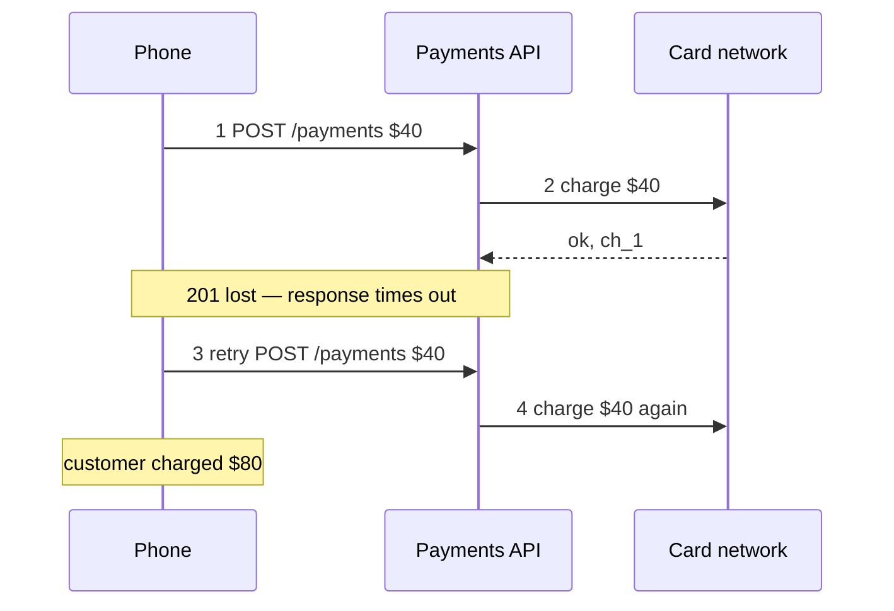
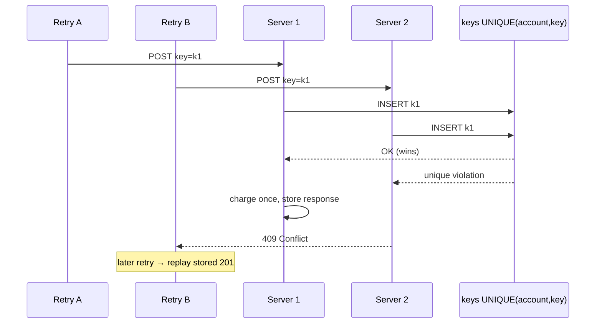

# Lesson 09: Idempotency Keys — How Payment APIs Never Charge Twice on Retry

> **Prerequisites:** [Lesson 08: API Filtering, Sorting & Field Selection](../08-api-filtering-sorting-field-selection-without-table-scans/README.md), [Lesson 01: REST Principles](../01-rest-principles/README.md).  
> **Estimated Reading Time:** 32 minutes  
> **Target Audience:** Backend engineers building payment, checkout, and mutation APIs that must survive client retries, load-balancer retries, and queue redelivery without double side effects.  
> **Free PDF Notes:** [Download SD-C-009.pdf](https://backendroadmap.com/notes/system-design/SD-C-009.pdf)

> [!NOTE]
> **In one line:** The client sends one unique `Idempotency-Key` per logical operation and reuses it on every retry; the server atomically records the key, processes once, stores the response, and replays it for duplicates—so a retry can never charge twice.

> [!TIP]
> **The Golden Rule of Idempotency Keys:** Generate the key **once per business operation** (one checkout, not one HTTP attempt), claim it with an **atomic insert** (`UNIQUE` / `SET NX`), fingerprint the body, and store a **final** response for replay. Without the atomic claim, two concurrent retries both charge—even if your “check then insert” logic looks correct in a single-threaded test.

---

## 1. Core Definition & Taxonomic Comparison

Networks give you **at-least-once** delivery: timeouts, client retries, load-balancer retries, and queue redelivery mean the same logical request can arrive more than once. An operation is **idempotent** if doing it once or many times leaves the same server-side result. `GET`, `PUT`, and `DELETE` are idempotent by definition; `POST /payments` is not—every successful call can create a new charge.

| Term | Precise Meaning | Production Example |
| :--- | :--- | :--- |
| **Idempotent operation** | Once or many times → same server state | `PUT /profiles/42` with the same body twice; second `DELETE` may be `404`, state is still deleted |
| **Idempotency key** | Client-made unique ID for one logical operation | `Idempotency-Key: 7c9e6679-7425-40de-944b-e07fc1f90ae7` reused on every retry of one $40 checkout |
| **Request fingerprint** | Hash of method + path + body bound to the key | Same key with `$40` then `$90` body → `422`, not a silent wrong replay |
| **At-least-once delivery** | Message or HTTP attempt may arrive >1 time | Phone times out after charge succeeds; app retries; without a key, card is charged twice |

What it is **not:** deduplicating on `(card, amount)` within a minute (blocks two real $40 purchases; misses a retry at second 61), or generating a fresh UUID on every retry (the key then protects nothing).

---

## 2. Component Breakdown, Anatomy & Observability Gap

### The retry that charges twice

A customer taps Pay. Your API charges the card, but the `201` times out on the way back to the phone. The app cannot tell whether the charge happened, so it retries. Without protection, the customer pays $80 for a $40 order.



*Figure 1. The first request succeeded; only its response was lost. The retry looks like a brand-new payment.*

### Server flow anatomy

| Step | What happens | Outcome |
| :--- | :--- | :--- |
| **1. Claim** | Atomic insert of `(account_id, key)` with status `in_progress` + body hash | Only one winner under concurrency |
| **2. Process** | Charge once; write payment row | Side effect happens exactly once for this key |
| **3. Complete** | Store status + body; mark `completed` | Future retries can replay |
| **4. Duplicate** | Same key + same hash + completed | Replay stored `201` / body — **no second charge** |
| **5. In flight** | Same key still `in_progress` | `409 Conflict` — client retries later |
| **6. Mismatch** | Same key, different fingerprint | `422` — client bug, do not replay wrong payment |

```
Request
Idempotency-Key: k1, body hash h1
        │
        ▼
   Look up k1 ──► new? ──► insert in_progress → charge once → store response
        │
        ├── done, hash=h1 ──► replay stored status + body
        ├── in_progress ────► 409 Conflict (retry later)
        └── hash ≠ h1 ──────► 422 Unprocessable Entity
```

> [!WARNING]
> **The Observability Gap:** Your payment-processor dashboard shows **two successful charges** while your API access log shows **two `POST /payments` with different request IDs**. Without correlating on `Idempotency-Key` (and forwarding that key downstream), on-call sees “two requests” and misses that they were one logical checkout. Metric the right thing: **unique keys processed**, **replay hit rate**, **stuck `in_progress` age**, and **fingerprint conflicts**—not only HTTP QPS.

---

## 3. Mathematical Model & Capacity

### Worked storage math (Stripe-style 24 h retention)

Peak $2{,}000$ payments/s; average over a day closer to $500$/s. Keys kept $24$ h:

$$
N_{\text{live}} = 500 \times 86{,}400 = 43{,}200{,}000 \approx 43\ \text{million keys}
$$

At $\sim 1$ KB each (key, hash, stored response):

$$
\text{Storage} \approx 43 \times 10^{6} \times 1\ \text{KB} \approx 43\ \text{GB}
$$

Fine for a Postgres table pruned by `created_at`, or Redis with `EX 86400`. Retries are a small fraction of traffic, so most lookups miss and cost one index probe.

| Utilization of retry path | Typical share of POSTs | Engineering implication |
| :--- | :--- | :--- |
| Healthy | $1$–$3\%$ | Replay cache mostly cold; optimize insert path |
| Flaky mobile / LB | $5$–$15\%$ | Replay hit rate rises; watch `in_progress` collisions |
| Outage recovery storm | $30\%$+ | Dedup store must survive thundering herd; TTL + processor-side keys |

### Headroom rule

Size the dedup store for **peak × retention**, not average × retention. If peak is $4\times$ average for an hour, transient key count can spike by that factor before prune catches up—budget ~$2\times$ the steady-state GB estimate.

---

## 4. Metrics, Percentiles & Distributions

| Metric | Who it describes | Healthy signal |
| :--- | :--- | :--- |
| **Unique keys / s** | True payment attempts | Tracks business volume |
| **Replay ratio** | Retries vs first attempts | Rises during client/network pain |
| **`409 in_progress` rate** | Concurrent duplicate arrivals | Spikes under double-submit / LB retry |
| **Fingerprint `422` rate** | Client key reuse bugs | Should be ~0; page on sudden rise |
| **Stuck `in_progress` age p95** | Crash after claim before complete | Alert if age ≫ payment latency p99 |

Averages deceive: “2,000 charges/s” can hide “1,980 unique keys + 20 double charges” if you only count processor successes. Prefer **charges per unique idempotency key** as the SEV-defining metric.

---

## 5. Compounding Effects at Scale

Each hop that retries amplifies duplicate risk. If the phone, the API gateway, and a queue consumer each retry once independently:

$$
P(\text{at least one duplicate delivery}) = 1 - (1 - p)^{k}
$$

With per-hop retry probability $p = 0.05$ and $k = 3$ independent retry sources:

$$
1 - 0.95^{3} \approx 0.14
$$

About **14%** of checkouts see more than one delivery attempt somewhere in the chain. Without end-to-end keys (API **and** processor), that fraction becomes double-charge risk.

| Downstream hops that can retry ($N$) | Approx. $P(\geq 1$ duplicate) at $p=0.02$ |
| :--- | :--- |
| 1 | $2.0\%$ |
| 5 | $9.6\%$ |
| 10 | $18.3\%$ |
| 20 | $33.2\%$ |

---

## 6. Numbers Every Backend Engineer Must Know

| Operation / Fact | Typical value | Implication |
| :--- | :--- | :--- |
| Stripe key retention | ≥ 24 h | Cover slow mobile / offline retries |
| Redis `SET NX` + TTL | Sub-ms in-zone | Fast claim; needs crash recovery |
| Postgres unique insert | ~1–5 ms | Durable claim; same TX as payment |
| Fingerprint (SHA-256 of body) | Microseconds | Cheap vs charging the card |
| Payment processor latency p99 | 200–800 ms | Stuck-key timeout must exceed this |
| Key size budget | ~1 KB with response | 43M keys ≈ 43 GB at 500/s × 24 h |

---

## 7. Protocol & Network Deep Dive

Clients send the key on mutating requests:

```http
POST /payments
Idempotency-Key: 7c9e6679-7425-40de-944b-e07fc1f90ae7
Content-Type: application/json

{"amount_cents": 4000, "currency": "USD", "card": "tok_visa"}
```



*Figure 2. Concurrent duplicates: only the atomic claim winner charges.*

Pass the same key **downstream** to the card processor so the whole chain is idempotent, not just your edge API.

---

## 8. Hierarchical Budgets & Capacity Sizing

| Budget layer | Target | Derivation |
| :--- | :--- | :--- |
| Client retry window | ≤ 24 h | Matches key TTL (Stripe-class) |
| Atomic claim latency | ≤ 5 ms p99 | Redis or local Postgres |
| Payment + persist | ≤ 800 ms p99 | Processor SLA + DB write |
| Stuck-key reclaim | 2–5 × payment p99 | e.g. expire `in_progress` after 3–5 min, then reconcile |
| Fingerprint mismatch | Immediate `422` | Do not consume payment budget |

Scope keys per account: `PRIMARY KEY (account_id, key)` so two customers never collide or read each other's stored responses.

---

## 9. Top Engineering Mitigation Techniques

1. **Atomic claim** — `UNIQUE (account_id, key)` or Redis `SET … NX EX`.
2. **Same-transaction write** — key + payment row commit together (strongest consistency).
3. **Request fingerprint** — reject same key / different body with `422`.
4. **Downstream keys** — forward idempotency to the processor.
5. **Stuck-key recovery** — TTL / reclaim + reconcile with processor before recharging.
6. **Replay only finals** — do not permanently store transient `500`s that had no side effect; release the key so a clean retry can run.

---

## 10. Production War Story (SEV-1 Post-Mortem)

**Severity & Impact:** SEV-1 payment incident. Detection ~8 min (processor dispute spike). Resolution ~45 min. ~1,200 customers double-charged during a mobile timeout storm after a deploy that raised API p99 from 300 ms to 2.1 s.

**What Happened:** The idempotency middleware did “GET key → if missing, charge → SET key.” Under concurrent retries from the same phone:

```python
# BROKEN: check-then-act race
existing = redis.get(f"idem:{acct}:{key}")
if existing:
    return replay(existing)
charge_card(...)          # two servers both reach here
redis.set(f"idem:{acct}:{key}", response, ex=86400)
```

**Mermaid — failure propagation:**

```mermaid
sequenceDiagram
    participant App
    participant GW1
    participant GW2
    participant Redis
    participant Card

    App->>GW1: POST k1 (timeout path)
    App->>GW2: POST k1 (retry 5 ms later)
    GW1->>Redis: GET idem:k1 → miss
    GW2->>Redis: GET idem:k1 → miss
    GW1->>Card: charge $40
    GW2->>Card: charge $40
    Note over App: $80 charged; two ch_* IDs
```

**RCA:** Non-atomic claim under at-least-once retries. Secondary: keys not forwarded to the processor, so the network could not dedupe either.

**Fix & Hardening:**
1. Replace with `SET NX` / unique insert before any charge.
2. Forward `Idempotency-Key` to the processor; reconcile stuck keys.
3. Alert on `charges_per_unique_key > 1.001` and fingerprint `422` spikes.

---

## 11. Multi-Language Production Code

````carousel
```go
package payments

import (
	"context"
	"crypto/sha256"
	"encoding/hex"
	"encoding/json"
	"errors"
	"time"

	"github.com/redis/go-redis/v9"
)

var ErrInProgress = errors.New("idempotency key in progress")
var ErrFingerprint = errors.New("idempotency key reused with different body")

type Store struct{ Rdb *redis.Client }

func (s *Store) Claim(ctx context.Context, acct, key string, body []byte) (claimed bool, err error) {
	sum := sha256.Sum256(body)
	fp := hex.EncodeToString(sum[:])
	redisKey := "idem:" + acct + ":" + key
	ok, err := s.Rdb.SetNX(ctx, redisKey, "in_progress:"+fp, 24*time.Hour).Result()
	if err != nil {
		return false, err
	}
	if ok {
		return true, nil
	}
	val, err := s.Rdb.Get(ctx, redisKey).Result()
	if err != nil {
		return false, err
	}
	if len(val) >= 12 && val[:12] == "in_progress:" {
		if val[12:] != fp {
			return false, ErrFingerprint
		}
		return false, ErrInProgress
	}
	// completed payload stored as JSON — caller replays
	return false, nil
}

func (s *Store) Complete(ctx context.Context, acct, key string, status int, body any) error {
	b, _ := json.Marshal(map[string]any{"status": status, "body": body})
	return s.Rdb.Set(ctx, "idem:"+acct+":"+key, b, 24*time.Hour).Err()
}
```
<!-- slide -->
```typescript
import { createHash } from "node:crypto";
import type Redis from "ioredis";

export class IdempotencyStore {
  constructor(private redis: Redis) {}

  fingerprint(method: string, path: string, body: Buffer): string {
    return createHash("sha256").update(method).update(path).update(body).digest("hex");
  }

  async claim(accountId: string, key: string, fp: string): Promise<"claimed" | "in_progress" | "replay" | "conflict"> {
    const redisKey = `idem:${accountId}:${key}`;
    const ok = await this.redis.set(redisKey, `in_progress:${fp}`, "EX", 86400, "NX");
    if (ok === "OK") return "claimed";
    const val = await this.redis.get(redisKey);
    if (!val) return "claimed"; // rare race after expiry
    if (val.startsWith("in_progress:")) {
      return val.slice(12) === fp ? "in_progress" : "conflict";
    }
    return "replay";
  }
}
```
<!-- slide -->
```python
import hashlib
import json
from typing import Any

import asyncpg


async def handle_payment(
    conn: asyncpg.Connection,
    account_id: int,
    idem_key: str,
    method: str,
    path: str,
    body: bytes,
    charge_fn,
) -> tuple[int, Any]:
    fp = hashlib.sha256(f"{method}{path}".encode() + body).hexdigest()
    try:
        await conn.execute(
            """
            INSERT INTO idempotency_keys (account_id, key, request_hash, status)
            VALUES ($1, $2, $3, 'in_progress')
            """,
            account_id,
            idem_key,
            fp,
        )
    except asyncpg.UniqueViolationError:
        row = await conn.fetchrow(
            "SELECT status, request_hash, response_code, response_body FROM idempotency_keys WHERE account_id=$1 AND key=$2",
            account_id,
            idem_key,
        )
        if row["request_hash"] != fp:
            return 422, {"error": "idempotency_key_reused"}
        if row["status"] == "in_progress":
            return 409, {"error": "in_progress"}
        return row["response_code"], json.loads(row["response_body"])

    result = await charge_fn()
    await conn.execute(
        """
        UPDATE idempotency_keys
        SET status='completed', response_code=$3, response_body=$4::jsonb
        WHERE account_id=$1 AND key=$2
        """,
        account_id,
        idem_key,
        201,
        json.dumps(result),
    )
    return 201, result
```
<!-- slide -->
```csharp
using System.Security.Cryptography;
using System.Text;
using StackExchange.Redis;

public sealed class IdempotencyGuard
{
    private readonly IDatabase _db;
    public IdempotencyGuard(IConnectionMultiplexer mux) => _db = mux.GetDatabase();

    public static string Fingerprint(string method, string path, ReadOnlySpan<byte> body)
    {
        var prefix = Encoding.UTF8.GetBytes(method + path);
        var data = new byte[prefix.Length + body.Length];
        prefix.CopyTo(data, 0);
        body.CopyTo(data.AsSpan(prefix.Length));
        return Convert.ToHexString(SHA256.HashData(data));
    }

    public async Task<bool> TryClaimAsync(string accountId, string key, string fp, TimeSpan ttl)
    {
        var redisKey = $"idem:{accountId}:{key}";
        return await _db.StringSetAsync(redisKey, $"in_progress:{fp}", ttl, When.NotExists);
    }
}
```
````

Schema for the durable path:

```sql
CREATE TABLE idempotency_keys (
  account_id    BIGINT NOT NULL,
  key           TEXT   NOT NULL,
  request_hash  TEXT   NOT NULL,
  status        TEXT   NOT NULL,          -- 'in_progress' | 'completed'
  response_code INT,
  response_body JSONB,
  created_at    TIMESTAMPTZ NOT NULL DEFAULT now(),
  PRIMARY KEY (account_id, key)
);
```

---

## 12. Hands-On CLI Verification Workflows

### 1. Simulate atomic claim with Redis

```bash
redis-cli SET idem:acct42:k1 in_progress NX EX 86400
redis-cli SET idem:acct42:k1 in_progress NX EX 86400
# second call returns (nil) — only one winner
```

### 2. Fingerprint two bodies

```bash
python -c "import hashlib; print(hashlib.sha256(b'{\"amount_cents\":4000}').hexdigest()); print(hashlib.sha256(b'{\"amount_cents\":9000}').hexdigest())"
```

### 3. Curl twice with the same key (against your local API)

```bash
KEY=$(uuidgen)
curl -sS -D - -o /tmp/p1.json -X POST http://localhost:8080/payments \
  -H "Idempotency-Key: $KEY" -H "Content-Type: application/json" \
  -d '{"amount_cents":4000,"currency":"USD","card":"tok_visa"}'
curl -sS -D - -o /tmp/p2.json -X POST http://localhost:8080/payments \
  -H "Idempotency-Key: $KEY" -H "Content-Type: application/json" \
  -d '{"amount_cents":4000,"currency":"USD","card":"tok_visa"}'
diff /tmp/p1.json /tmp/p2.json   # bodies should match on replay
```

---

## 13. Common Mistakes to Avoid

- Generating a **new key on every retry** — protects nothing.
- **Check-then-insert** without a unique constraint / `SET NX`.
- Ignoring the **request fingerprint** — wrong payment replayed under a reused key.
- **Global keys** not scoped per account.
- Redis for the key and Postgres for the payment **with no crash recovery**.
- Not sending the key to the **downstream processor**.
- Permanently replaying a transient **`500` with no side effect**.
- Treating `(card, amount, minute)` as a substitute for a client key.

---

## 14. Key Terms Glossary

| Term | Interview-ready definition |
| :--- | :--- |
| **Idempotent** | Once or many times → same result |
| **At-least-once** | A message may arrive more than once |
| **Idempotency key** | Client-made unique ID per logical operation |
| **Dedup store** | Table or cache of seen keys + responses |
| **Request fingerprint** | Hash of method, path, and body |
| **Replay** | Return the stored original response |
| **Atomic claim** | Unique insert / `SET NX` — one winner |
| **TTL** | How long a key is kept (often 24 h) |
| **Key scope** | Uniqueness per account (or tenant) |

---

## 15. Complete 12 System Design Interview Q&As

### Basic Conceptual Questions (Q1–Q4)

<details>
<summary><strong>Q1. How do you make a payment API idempotent? [BASIC]</strong></summary>

The client sends a unique `Idempotency-Key` per operation and reuses it on retries. The server atomically inserts the key with a request fingerprint, processes once, stores the response, and replays it for duplicates: `409` while in progress, `422` for a different body.

</details>

<details>
<summary><strong>Q2. Which HTTP methods are idempotent? [BASIC]</strong></summary>

`GET`, `HEAD`, `PUT`, `DELETE`, and `OPTIONS`. `POST` is not, and `PATCH` is not guaranteed. That is why `POST /payments` needs an idempotency key.

</details>

<details>
<summary><strong>Q3. Where do you store keys, and for how long? [BASIC]</strong></summary>

In a durable store, ideally in the same transaction as the payment, or Redis with a TTL; scoped per account; for at least the retry window—typically 24 hours (Stripe keeps them at least 24 h).

</details>

<details>
<summary><strong>Q4. What is a request fingerprint and why keep one? [BASIC]</strong></summary>

A hash of method, path, and body bound to the key. It detects client bugs that reuse a key for a different payment so you return `422` instead of replaying the wrong charge or executing a second one under the old key.

</details>

### Scenario-Based Architecture Questions (Q5–Q8)

<details>
<summary><strong>Q5. Two identical retries hit different servers 5 ms apart. What prevents a double charge? [SCENARIO]</strong></summary>

An atomic claim: a unique constraint on `(account_id, key)` or Redis `SET NX`. Exactly one insert succeeds; the other gets a conflict, returns `409`, and its next retry replays the stored response.

</details>

<details>
<summary><strong>Q6. A client reuses the same key for a $40 and then a $90 payment. What happens? [SCENARIO]</strong></summary>

The fingerprint differs, so the server rejects the second with `422` instead of replaying the $40 result or charging $90 under the old key.

</details>

<details>
<summary><strong>Q7. Your server crashes after charging the card but before saving the response. What then? [SCENARIO]</strong></summary>

The key is stuck `in_progress`. If the key and payment are in one transaction, the payment row tells you the outcome. Otherwise pass the key to the processor so a retried charge is deduplicated there, and reconcile stuck keys after a timeout.

</details>

<details>
<summary><strong>Q8. Peak is 2,000 payments/s; you keep keys 24 h. How much storage? [SCENARIO]</strong></summary>

Use average rate for steady-state: $500/\text{s} \times 86{,}400 \approx 43$ M keys. At ~1 KB each ≈ 43 GB. Size for peak spikes with headroom; prune by `created_at` or Redis TTL.

</details>

### Advanced & Tricky Interview Questions (Q9–Q12)

<details>
<summary><strong>Q9. Why not just deduplicate on (card, amount) within a minute? [TRICKY]</strong></summary>

Two real $40 purchases a minute apart are legal and would be blocked; a slow retry after 61 s would still double charge. Only the client knows which attempts are the same operation, so it must say so with a key.

</details>

<details>
<summary><strong>Q10. Should a replayed response come from the cache even if the original was a 500? [TRICKY]</strong></summary>

Store only responses that reflect a final outcome. If the first attempt failed before any side effect, release the key so a retry can run again; replaying a transient `500` forever would block the payment.

</details>

<details>
<summary><strong>Q11. Is returning 409 for in-progress keys enough under a thundering herd? [TRICKY]</strong></summary>

It prevents double charge, but clients must back off with jitter. Also consider a short wait-and-replay (or long poll) once the winner completes, and ensure the claim TTL exceeds processor p99 so winners are not reclaimed mid-flight.

</details>

<details>
<summary><strong>Q12. Redis claim succeeded, Postgres payment insert failed, and you release the Redis key. Risk? [TRICKY]</strong></summary>

If the card was already charged in an earlier partial path, releasing the key allows a second charge. Prefer forwarding the key to the processor and/or writing the payment intent before calling the network; never “unlock and retry blindly” after an ambiguous processor outcome.

</details>

---

## 16. One-Page Master Cheat Sheet

```text
====================================================================================================
                    IDEMPOTENCY KEYS (SD-C-009)  —  MASTER CHEAT SHEET
====================================================================================================
ONE LINE   Client: one key per operation, reuse on retry
           Server: atomic claim → process once → store response → replay

HTTP       Idempotent: GET HEAD PUT DELETE OPTIONS | Not: POST (PATCH unclear)
HEADER     Idempotency-Key: <uuid>     Scope: PRIMARY KEY (account_id, key)

FLOW       new key → in_progress → charge → completed (store status+body)
           same key + same hash + done → REPLAY
           same key + in_progress → 409
           same key + different hash → 422

ATOMICITY  UNIQUE insert | Redis SET key val NX EX 86400
           NEVER check-then-insert without a constraint

STORAGE    ~1 KB/key × rate × TTL     500/s × 86400 × 1KB ≈ 43 GB / day-window
TTL        ≥ retry window (Stripe ≥ 24 h)

MATH       P(dup delivery) ≈ 1-(1-p)^k across retrying hops
METRICS    unique_keys/s | replay_ratio | 409_rate | 422_fingerprint | stuck_in_progress_age

MITIGATE   same TX as payment | fingerprint | forward key downstream | reclaim stuck keys
ANTI       X new key per retry   X (card,amount) dedupe   X global keys
           X replay transient 500 forever   X Redis+PG with no reconcile
====================================================================================================
```

---

## Free PDF notes

Download the printable study notes: [SD-C-009.pdf](https://backendroadmap.com/notes/system-design/SD-C-009.pdf).

---

## Sources

- [Stripe: Idempotent Requests](https://stripe.com/docs/api/idempotent_requests) — production retention and header conventions.
- [RFC 9110: HTTP Semantics](https://www.rfc-editor.org/rfc/rfc9110) — method idempotency definitions.
- [IETF draft: The Idempotency-Key HTTP Header Field](https://datatracker.ietf.org/doc/draft-ietf-httpapi-idempotency-key-header/) — emerging header standardization.

---

## Next

Next comes [Lesson 10: API Request Validation — Pydantic, 422, Unknown Fields & Size Limits](../10-api-request-validation/README.md): layered validation that stops bad bodies before they touch payments or business logic. See [the track overview](../README.md) for the whole series.
