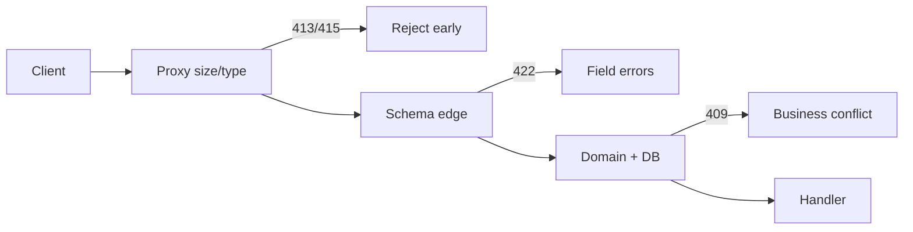
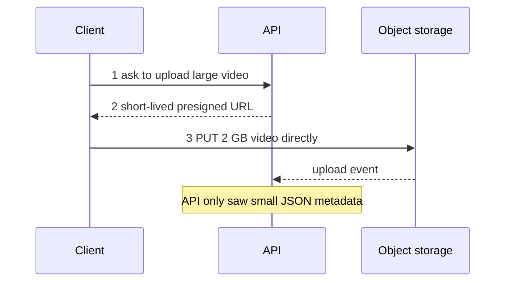
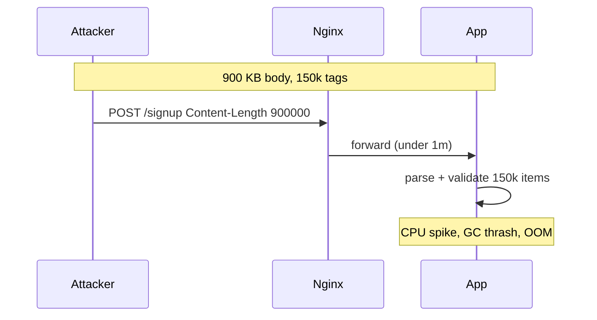

# Lesson 10: API Request Validation — Pydantic, 422, Unknown Fields & Size Limits

> **Prerequisites:** [Lesson 09: Idempotency Keys](../09-idempotency-keys/README.md), [Lesson 01: REST Principles](../01-rest-principles/README.md).  
> **Estimated Reading Time:** 30 minutes  
> **Target Audience:** Backend engineers hardening public APIs against malformed bodies, mass assignment, and memory-exhausting payloads.  
> **Free PDF Notes:** [Download SD-C-010.pdf](https://backendroadmap.com/notes/system-design/SD-C-010.pdf)

> [!NOTE]
> **In one line:** Validate in layers, as early and cheaply as possible: coarse size and type limits at the proxy (`413`), schema rules at the service edge (`422`), and business rules in the domain layer (`409`); reject unknown fields, use strict types for money and IDs, and cap every size.

> [!TIP]
> **The Golden Rule of Request Validation:** The server is the security boundary—client-side checks are UX only. Forbid extras (`extra="forbid"`), put **max length / max items / max depth** in the schema, and never put database lookups inside schema validators (those are `409` business rules).

---

## 1. Core Definition & Taxonomic Comparison

A signup body arrives with `email: bob@nowhere`, `age: -5`, a 50 MB `name`, and `is_admin: true`. Every one of these must die before business logic runs. That is **request validation**.

| Term | Precise Meaning | Production Example |
| :--- | :--- | :--- |
| **Schema validation** | Types, required fields, formats, ranges—no DB | `age` must be 13–120 → `422` |
| **Business rule** | Allowed *right now*—usually needs DB | Email already registered → `409 EMAIL_TAKEN` |
| **Mass assignment** | Client sets fields you never meant to expose | `is_admin: true` copied into a User row |
| **Type coercion (lax)** | Silent conversion of wrong JSON types | `"1"` → `True`, `"1000"` → int amount |

What it is **not:** trusting the browser form, or returning `422` for “email already taken.”

---

## 2. Component Breakdown, Anatomy & Observability Gap

```
POST /signup
   │
   ▼
Gateway / proxy ── body ≤ 1 MB, Content-Type JSON ──► 413 / 415
   │
   ▼
Schema (service edge) ── types, required, formats, ranges ──► 422
   │
   ▼
Domain layer ── is it allowed now? (DB) ──► 409
   │
   ▼
OK — only valid, permitted data arrives
```

| Layer | Cheap check | Status | What never runs |
| :--- | :--- | :--- | :--- |
| Proxy | Size, media type | `413` / `415` | App process |
| Schema | Shape & ranges | `422` | Business logic |
| Domain | Uniqueness, balance | `409` | Side effects on conflict |

> [!WARNING]
> **The Observability Gap:** Nginx `413` counts live in the **proxy** access log; Pydantic `422`s live in the **app**. If you only alert on app 5xx, a body-bomb attack that never reaches the process looks like “healthy traffic.” Correlate proxy `client_max_body_size` rejects with app `422` field-error rates and CPU during parse.



---

## 3. Mathematical Model & Attack Economics

Without limits, an attacker sends $100$ RPS × $50$ MB names:

$$
100 \times 50\ \text{MB} = 5\ \text{GB/s}
$$

A few seconds exhausts memory. With `client_max_body_size 1m`, nginx answers `413` from `Content-Length` (or once a stream exceeds 1 MB) and the app never sees the request.

Inside the limit, `max_length=100` on `name` and `max_length=20` on `tags` caps meaningful data to a few KB.

| Cap | Formula / effect | Result |
| :--- | :--- | :--- |
| Proxy body | $B_{\max}=1$ MB | Hard ceiling on ingress bytes |
| String field | $L_{\max}=100$ | Bounds parse + DB column |
| Array items | $N_{\max}=20$ | Bounds CPU on validation loops |
| Nesting depth | $D_{\max}\approx 5$–$10$ | Blocks JSON bomb trees |

**Headroom rule:** Set proxy limit **above** the largest legitimate JSON API body, but **far below** what would OOM a worker. Schema caps should make a “valid” body tiny even when under the proxy limit.

---

## 4. Metrics, Percentiles & Distributions

| Metric | Audience | Signal |
| :--- | :--- | :--- |
| Proxy `413` rate | Edge / SRE | Body bombs or misconfigured clients |
| App `422` rate by `loc` | API owners | Field-level client bugs |
| Parse CPU p95 | Platform | Arrays under 1 MB still expensive |
| `409` vs `422` ratio | Product | Domain vs schema mix |

Averages deceive: “p50 body size 2 KB” hides the 50 MB attack that never appears in app histograms because the proxy dropped it.

---

## 5. Compounding Effects at Scale

$N$ services each accepting unbounded arrays amplify memory:

$$
M_{\text{fleet}} \approx N \times RPS \times \text{avg\_array\_items} \times \text{bytes\_per\_item}
$$

With $N=40$ services, $RPS=200$, $150{,}000$ items × $32$ B ≈ **38 GB/s** of transient allocations fleet-wide if every service trusts “body < 1 MB.”

| Services $N$ | Items/request | Relative parse cost |
| :--- | :--- | :--- |
| 1 | 100 | $1\times$ |
| 1 | 150,000 | $\sim 1{,}500\times$ |
| 40 | 150,000 | $\sim 60{,}000\times$ fleet |

---

## 6. Numbers Every Backend Engineer Must Know

| Limit / fact | Typical value | Why |
| :--- | :--- | :--- |
| JSON API body cap | 100 KB–1 MB | Most APIs never need more |
| Name / title string | 100–255 chars | Matches DB + UX |
| Tag list | ≤ 20–50 items | Bounds indexing cost |
| Money | integer cents / `Decimal` | Avoid float & lax coerce |
| Presigned upload | minutes TTL | Large files skip the API |
| nginx directive | `client_max_body_size 1m` | `413` before app read |

---

## 7. Protocol & Network Deep Dive

```http
HTTP/1.1 422 Unprocessable Entity
Content-Type: application/json

{"detail": [
  {"type": "greater_than_equal", "loc": ["body", "age"],
   "msg": "Input should be greater than or equal to 13", "input": -5},
  {"type": "extra_forbidden", "loc": ["body", "is_admin"],
   "msg": "Extra inputs are not permitted", "input": true}
]}
```



*Figure. Large files never enter the API process.*

---

## 8. Hierarchical Budgets & Capacity Sizing

| Budget | Value | Derives |
| :--- | :--- | :--- |
| Proxy body | 1 MB | Worker RAM headroom |
| Schema string | 100–255 | Column + index size |
| Schema array | ≤ 100 | Validation CPU budget (~ms) |
| Domain checks | after schema | DB round-trip budget |

---

## 9. Top Engineering Mitigation Techniques

1. **Layered validation** — proxy → schema → domain.
2. **`extra="forbid"`** — block mass assignment & typos.
3. **Strict types** for money, IDs, booleans.
4. **Schema size caps** — strings, arrays, depth.
5. **Presigned uploads** for large blobs.
6. **Separate input DTO vs DB model** — never map request → ORM blindly.

---

## 10. Production War Story (SEV-1 Post-Mortem)

**Severity & Impact:** SEV-1. API p99 → 12 s, OOM kills on 30% of pods. Detection 6 min. Fix 25 min. Root: signup accepted unbounded `tags: string[]` with only a 1 MB proxy limit.

**Flaw:**

```python
class SignupRequest(BaseModel):
    email: EmailStr
    tags: list[str] = []  # no max_length — 150k strings fit under 1 MB
```



**Fix:** `tags: list[str] = Field(default=[], max_length=20)`; add nesting depth limits; alert on validation CPU.

---

## 11. Multi-Language Production Code

````carousel
```go
package api

import (
	"encoding/json"
	"fmt"
	"net/http"
)

type SignupRequest struct {
	Email string   `json:"email"`
	Age   int      `json:"age"`
	Name  string   `json:"name"`
	Tags  []string `json:"tags"`
}

func DecodeSignup(r *http.Request) (SignupRequest, error) {
	dec := json.NewDecoder(http.MaxBytesReader(nil, r.Body, 1<<20))
	dec.DisallowUnknownFields()
	var req SignupRequest
	if err := dec.Decode(&req); err != nil {
		return req, err
	}
	if req.Age < 13 || req.Age > 120 {
		return req, fmt.Errorf("age out of range")
	}
	if len(req.Name) < 1 || len(req.Name) > 100 || len(req.Tags) > 20 {
		return req, fmt.Errorf("field size limit")
	}
	return req, nil
}
```
<!-- slide -->
```typescript
import { z } from "zod";

export const SignupSchema = z
  .object({
    email: z.string().email(),
    age: z.number().int().gte(13).lte(120),
    name: z.string().min(1).max(100),
    tags: z.array(z.string().max(40)).max(20).default([]),
  })
  .strict(); // unknown fields → error

export type SignupRequest = z.infer<typeof SignupSchema>;
```
<!-- slide -->
```python
from pydantic import BaseModel, ConfigDict, EmailStr, Field, StrictInt

class SignupRequest(BaseModel):
    model_config = ConfigDict(extra="forbid")
    email: EmailStr
    age: StrictInt = Field(ge=13, le=120)
    name: str = Field(min_length=1, max_length=100)
    tags: list[str] = Field(default=[], max_length=20)

# FastAPI: def signup(req: SignupRequest): ...
# invalid → automatic 422 with per-field errors
```
<!-- slide -->
```csharp
using System.ComponentModel.DataAnnotations;
using System.Text.Json.Serialization;

public sealed class SignupRequest
{
    [Required, EmailAddress]
    public required string Email { get; init; }

    [Range(13, 120)]
    public int Age { get; init; }

    [Required, MinLength(1), MaxLength(100)]
    public required string Name { get; init; }

    [MaxLength(20)]
    public List<string> Tags { get; init; } = new();
}

// Program.cs: options.JsonSerializerOptions.UnmappedMemberHandling =
//   JsonUnmappedMemberHandling.Disallow;
```
````

---

## 12. Hands-On CLI Verification Workflows

```bash
# Oversized body → expect 413 at proxy
dd if=/dev/zero bs=1024 count=2048 2>/dev/null | curl -sS -o /dev/null -w "%{http_code}\n" \
  -X POST http://localhost/signup -H "Content-Type: application/json" --data-binary @-

# Unknown field → expect 422
curl -sS -X POST http://localhost:8000/signup -H "Content-Type: application/json" \
  -d '{"email":"a@b.co","age":20,"name":"Ada","is_admin":true}'

# Lax coercion demo
python -c "from pydantic import BaseModel; class M(BaseModel): flag: bool
print(M(flag='1'))  # lax may coerce — prefer StrictBool in prod"
```

---

## 13. Common Mistakes to Avoid

- Trusting **client-side** validation as security.
- Leaving **extra fields allowed** (Pydantic default) + copying into ORM.
- **Lax coercion** for money and IDs.
- No proxy body limit and no `max_length` on strings/arrays.
- DB lookups inside schema validators; `422` for “email taken.”
- Uploading multi-GB files through the API process.

---

## 14. Key Terms Glossary

| Term | Definition |
| :--- | :--- |
| **Schema validation** | Types, required, formats, ranges |
| **422** | Well-formed JSON, invalid fields |
| **413** | Body exceeds size limit |
| **`extra="forbid"`** | Unknown fields fail validation |
| **Mass assignment** | Client sets fields it shouldn't |
| **Type coercion** | Lax conversion, e.g. `"42"` → `42` |
| **Strict mode** | Value must already have the type |
| **Presigned URL** | Short-lived direct upload link |
| **Business rule** | Context check, often needs the DB |

---

## 15. Complete 12 System Design Interview Q&As

<details>
<summary><strong>Q1. Where should validation happen? [BASIC]</strong></summary>

In layers: coarse limits at the gateway (body size, content type), schema validation at the service edge (`422`), and business rules in the domain layer (`409`). Cheapest checks first.

</details>

<details>
<summary><strong>Q2. How do you protect against oversized payloads? [BASIC]</strong></summary>

Cap the body at the proxy (e.g. 1 MB) for `413`; limit string lengths, array sizes, and nesting depth in the schema; send large files to object storage with presigned URLs.

</details>

<details>
<summary><strong>Q3. 400 vs 422 vs 409? [BASIC]</strong></summary>

`400`: malformed / unparsable. `422`: valid JSON but fields fail validation. `409`: valid shape, conflicts with current state (email taken). Consistency matters more than the exact split.

</details>

<details>
<summary><strong>Q4. What is mass assignment? [BASIC]</strong></summary>

When a client includes unexpected fields (e.g. `is_admin`) and the server copies the body into a persistence model. Fix with `extra="forbid"` and separate input vs storage models.

</details>

<details>
<summary><strong>Q5. A user sends is_admin: true in a signup body. What stops it? [SCENARIO]</strong></summary>

`extra="forbid"` → `422`. Also keep separate input and database models so even an allowed field cannot map to `is_admin`.

</details>

<details>
<summary><strong>Q6. amount_cents: "1000" and flag: "1" are both accepted. Problem? [SCENARIO]</strong></summary>

Lax coercion. For money, IDs, and flags use strict types so wrong types get `422` and the client fixes its bug.

</details>

<details>
<summary><strong>Q7. A 900 KB request with a 150,000-item array spikes CPU. Proxy limit is 1 MB. Why? [SCENARIO]</strong></summary>

Body passes size limit; nothing caps the array. Add `max_length` on lists and nesting depth limits.

</details>

<details>
<summary><strong>Q8. Design validation for a public image upload API. [SCENARIO]</strong></summary>

API accepts small JSON metadata only; returns a presigned URL; client PUTs to object storage; virus scan / size checks happen on the bucket notification path—not inside the request worker.

</details>

<details>
<summary><strong>Q9. Should “email already registered” be checked in a Pydantic validator? [TRICKY]</strong></summary>

No. It needs the database and can race between check and insert. Domain layer + unique constraint → `409 EMAIL_TAKEN`.

</details>

<details>
<summary><strong>Q10. Why is a 1 MB proxy limit not enough alone? [TRICKY]</strong></summary>

A body under 1 MB can still hold huge arrays or deep trees that dominate CPU and memory during parse/validate. Schema-level cardinalities are mandatory.

</details>

<details>
<summary><strong>Q11. FastAPI returns 422 for bad JSON. Is that wrong? [TRICKY]</strong></summary>

Strict RFC fans prefer `400` for unparsable bodies and `422` for semantic field errors. Many frameworks collapse both to `422`. Pick one convention, document it, and keep field-level codes stable.

</details>

<details>
<summary><strong>Q12. Can OpenAPI gateway validation replace service-edge validation? [TRICKY]</strong></summary>

It can enforce coarse JSON Schema early, but services should still validate with their native models (types, strict money, domain objects). Gateway schemas drift; defense in depth wins.

</details>

---

## 16. One-Page Master Cheat Sheet

```text
====================================================================================================
                 API REQUEST VALIDATION (SD-C-010)  —  MASTER CHEAT SHEET
====================================================================================================
LAYERS     Proxy: size/type → 413/415
           Schema: types/ranges/extras → 422
           Domain: DB rules → 409

RULES      extra=forbid | StrictInt/Bool for money & IDs | max_length / max items / max depth
UPLOADS    Presigned URL → object storage (API stays small JSON)

MATH       100 RPS × 50 MB = 5 GB/s without proxy cap
ANTI       X trust client validation  X lax money coerce  X DB in schema validators
           X unbounded arrays under 1 MB body cap
====================================================================================================
```

---

## Free PDF notes

[SD-C-010.pdf](https://backendroadmap.com/notes/system-design/SD-C-010.pdf)

---

## Sources

- [Pydantic v2 Validators](https://docs.pydantic.dev/) — `extra="forbid"`, strict types.
- [RFC 9110](https://www.rfc-editor.org/rfc/rfc9110) — `413` / `415` semantics.
- [OWASP Mass Assignment](https://owasp.org/www-community/vulnerabilities/Mass_Assignment_Cheat_Sheet)

---

## Next

Next: [Lesson 11: API Error Handling](../11-api-error-handling/README.md). Track: [API Design overview](../README.md).
