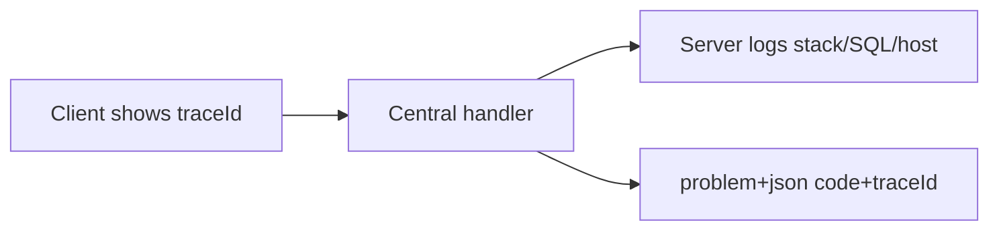
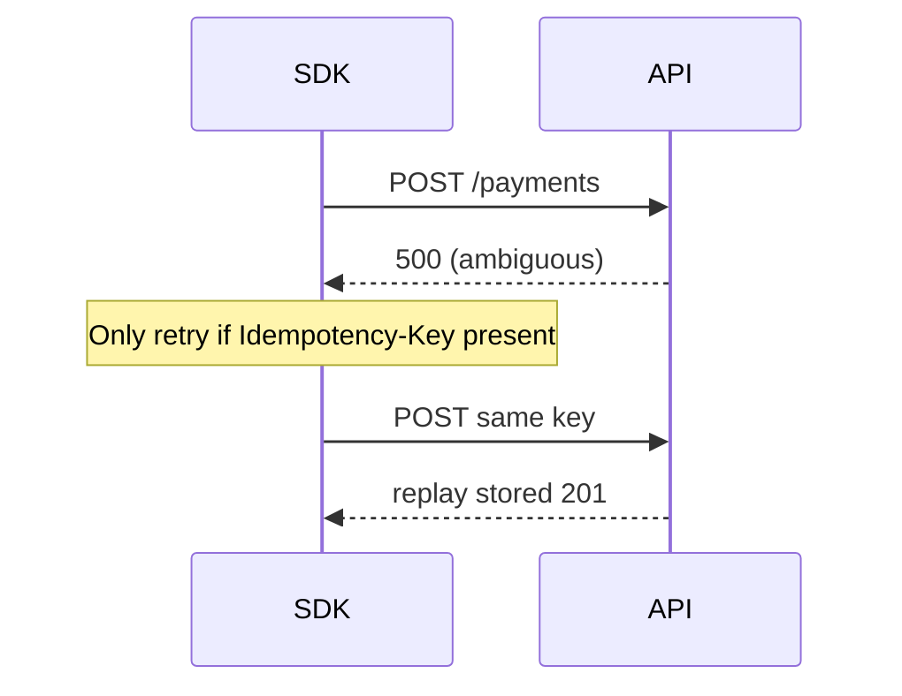
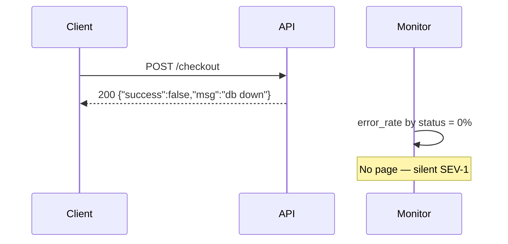

# Lesson 11: API Error Handling — 4xx vs 5xx, Problem Details & Retryable Errors

> **Prerequisites:** [Lesson 10: API Request Validation](../10-api-request-validation/README.md), [Lesson 09: Idempotency Keys](../09-idempotency-keys/README.md).  
> **Estimated Reading Time:** 32 minutes  
> **Target Audience:** Backend and SDK engineers designing client-actionable errors, retry policy, and secure failure responses.  
> **Free PDF Notes:** [Download SD-C-011.pdf](https://backendroadmap.com/notes/system-design/SD-C-011.pdf)

> [!NOTE]
> **In one line:** Pick the right status class (`4xx` = client's fault, `5xx` = server's fault), return one consistent Problem Details body with a stable machine-readable `code` and a `traceId`, retry only transient errors, and never leak internals.

> [!TIP]
> **The Golden Rule of API Errors:** Clients switch on a **stable `code`**, never on human `detail` text. Monitoring switches on the **HTTP status**. A `200` with `"error": true` is invisible to both—and is an outage you will not page on.

---

## 1. Core Definition & Taxonomic Comparison

Errors are part of the API contract. Every client needs three answers: **what kind** (status), **which error** (stable code), **what next** (fix, retry, or support).

| Term | Precise Meaning | Production Example |
| :--- | :--- | :--- |
| **4xx** | Client fault; same request won't help | `422` age = −5; `409` email taken |
| **5xx** | Server fault; may work later | `503` overload; `504` upstream timeout |
| **Problem Details** | RFC 9457 error envelope | `application/problem+json` + extensions |
| **Transient error** | Likely succeeds on retry | `502`/`503`/`504`, connection reset |

Anti-patterns: `200` hiding failure, `500` with stack traces, plain-text “Something went wrong.”

---

## 2. Component Breakdown, Anatomy & Observability Gap

| Code | Meaning | Typical cause |
| :--- | :--- | :--- |
| 400 | Bad Request | Invalid JSON / unparsable |
| 401 | Unauthorized | Missing/expired token |
| 403 | Forbidden | Authenticated but not allowed |
| 404 | Not Found | Wrong ID or hidden from caller |
| 409 | Conflict | Duplicate email, version mismatch |
| 422 | Unprocessable | Well-formed but invalid content |
| 429 | Too Many Requests | Rate limited; see `Retry-After` |
| 500 | Internal Server Error | Bug / unhandled exception |
| 502 | Bad Gateway | Upstream bad answer |
| 503 | Service Unavailable | Overload / no healthy backends |
| 504 | Gateway Timeout | Upstream too slow |



> [!WARNING]
> **The Observability Gap:** Status codes are counted at the **edge**; stack traces live in **server logs**; the client only sees `traceId`. If the handler does not propagate the same ID into logs and the Problem Details body, support cannot join “user report” to “root cause span.”

---

## 3. Mathematical Model & Retry Amplification

Blind retries turn a blip into an outage. With $r$ retries and no jitter, synchronized clients produce:

$$
\lambda_{\text{effective}} \approx \lambda \times (1 + r)
$$

During a 30% `503` event, if every SDK retries 3 times immediately:

$$
\lambda_{\text{peak}} \approx \lambda \times 4
$$

**Backoff with jitter:** wait $U(0, b \cdot 2^{k})$ after attempt $k$, cap attempts (e.g. 3).

| Attempt | Base delay | With full jitter example |
| :--- | :--- | :--- |
| 1 | 200 ms | $U(0,200)$ |
| 2 | 400 ms | $U(0,400)$ |
| 3 | 800 ms | $U(0,800)$ |

**Headroom rule:** Retry budget × error rate must stay under remaining capacity, or retries starve healthy traffic.

---

## 4. Metrics, Percentiles & Distributions

| Metric | Meaning |
| :--- | :--- |
| Error rate by status class | 4xx vs 5xx split |
| `code` cardinality | Stable enum health |
| Retry success after `503` | Transient vs persistent |
| Time-to-find by `traceId` | Support SLO |

Never average “success=true in body” into availability—HTTP status is the contract monitors use.

---

## 5. Compounding Effects at Scale

$$
P(\text{user sees error}) = 1 - \prod_{i=1}^{N}(1 - e_i)
$$

With $N=20$ dependencies each at $0.5\%$ failure:

$$
1 - 0.995^{20} \approx 9.5\%
$$

Central Problem Details + consistent retry policy matter more as fan-out grows.

| $N$ deps @ 0.5% fail | User-visible failure chance |
| :--- | :--- |
| 1 | 0.5% |
| 5 | 2.5% |
| 20 | ~9.5% |
| 50 | ~22% |

---

## 6. Numbers Every Backend Engineer Must Know

| Item | Value |
| :--- | :--- |
| Problem Details CT | `application/problem+json` |
| RFC | 9457 (replaces 7807) |
| Typical retry cap | 3 attempts |
| `Retry-After` | seconds (or HTTP date) |
| Trace ID in body | required for support |

---

## 7. Protocol & Network Deep Dive

```http
HTTP/1.1 409 Conflict
Content-Type: application/problem+json

{
  "type": "https://api.x.com/errors/conflict",
  "title": "Email already registered",
  "status": 409,
  "detail": "Try logging in instead.",
  "instance": "/v1/signups",
  "code": "email_already_registered",
  "traceId": "4bf92f35"
}
```

**Retry matrix:**

| Retry with backoff | Conditional retry | Do not retry unchanged |
| :--- | :--- | :--- |
| 502, 503, 504, timeout, reset | 429 after `Retry-After`; 500 if idempotent / has idempotency key | 400, 403, 404, 409, 422 (401: refresh token once) |



---

## 8. Hierarchical Budgets & Capacity Sizing

| Layer | Error budget action |
| :--- | :--- |
| Gateway | Map upstream failures → 502/503/504; attach `traceId` |
| Service | Domain → 4xx Problem Details; bugs → 500 + log |
| SDK | Retry only transient; honor `Retry-After` |
| Support | Resolve via `traceId` < 60 s |

---

## 9. Top Engineering Mitigation Techniques

1. One **central exception → Problem Details** mapper.
2. Stable **`code`** + optional `errors[]` field list.
3. **Retry policy** table in the SDK.
4. **Existence leak** discipline: prefer `404` over `403` for cross-tenant IDs.
5. Log internals server-side only; return `traceId`.

---

## 10. Production War Story (SEV-1 Post-Mortem)

**Impact:** Checkout “0% errors” on the dashboard during a total payment outage—handlers returned `200 { "success": false }`. Detection delayed 40 minutes (revenue chart, not alerts).



**Fix:** Map failures to real 5xx/4xx; alert on `success=false` debt until removed; SDK switches on `code`.

---

## 11. Multi-Language Production Code

````carousel
```go
package errors

import (
	"encoding/json"
	"net/http"
)

type Problem struct {
	Type     string `json:"type"`
	Title    string `json:"title"`
	Status   int    `json:"status"`
	Detail   string `json:"detail,omitempty"`
	Instance string `json:"instance,omitempty"`
	Code     string `json:"code"`
	TraceID  string `json:"traceId"`
}

func WriteProblem(w http.ResponseWriter, p Problem) {
	w.Header().Set("Content-Type", "application/problem+json")
	w.WriteHeader(p.Status)
	_ = json.NewEncoder(w).Encode(p)
}
```
<!-- slide -->
```typescript
export type Problem = {
  type: string;
  title: string;
  status: number;
  detail?: string;
  instance?: string;
  code: string;
  traceId: string;
  errors?: { field: string; code: string }[];
};

export function sendProblem(res: import("express").Response, p: Problem) {
  res.status(p.status).type("application/problem+json").json(p);
}

export function shouldRetry(status: number, idempotent: boolean): boolean {
  if ([502, 503, 504].includes(status)) return true;
  if (status === 500) return idempotent;
  return false;
}
```
<!-- slide -->
```python
from fastapi import FastAPI, Request
from fastapi.responses import JSONResponse

app = FastAPI()

class EmailTaken(Exception):
    pass

@app.exception_handler(EmailTaken)
async def email_taken_handler(request: Request, exc: EmailTaken):
    trace = request.headers.get("x-request-id", "unknown")
    return JSONResponse(
        status_code=409,
        media_type="application/problem+json",
        content={
            "type": "https://api.x.com/errors/conflict",
            "title": "Email already registered",
            "status": 409,
            "detail": "Try logging in instead.",
            "instance": str(request.url.path),
            "code": "email_already_registered",
            "traceId": trace,
        },
    )
```
<!-- slide -->
```csharp
using Microsoft.AspNetCore.Mvc;

public sealed class ProblemDetailsExceptionFilter : IExceptionFilter
{
    public void OnException(ExceptionContext context)
    {
        var traceId = context.HttpContext.TraceIdentifier;
        var problem = new ProblemDetails
        {
            Type = "https://api.x.com/errors/internal",
            Title = "Internal Server Error",
            Status = StatusCodes.Status500InternalServerError,
            Detail = "Unexpected failure. Provide the trace id to support.",
            Instance = context.HttpContext.Request.Path,
        };
        problem.Extensions["code"] = "internal_error";
        problem.Extensions["traceId"] = traceId;
        context.Result = new ObjectResult(problem)
        {
            StatusCode = problem.Status,
            ContentTypes = { "application/problem+json" },
        };
        context.ExceptionHandled = true;
    }
}
```
````

---

## 12. Hands-On CLI Verification Workflows

```bash
curl -sS -D - http://localhost:8000/v1/signups -H "Content-Type: application/json" \
  -d '{"email":"taken@x.com","password":"long-enough-pass"}' | head

# Retry-After awareness
curl -sS -D - -o /dev/null http://localhost:8000/v1/burst | tr -d '\r' | grep -i retry
```

---

## 13. Common Mistakes to Avoid

- `200` with `"success": false`.
- Clients parsing `detail` text instead of `code`.
- Returning `500` for bad input.
- Retrying every error, including `400`/`403`, or non-idempotent `POST` after `500`.
- Stack traces / SQL / hostnames in bodies.
- `403` for other tenants' IDs (existence leak).

---

## 14. Key Terms Glossary

| Term | Definition |
| :--- | :--- |
| **4xx** | Client error: fix the request |
| **5xx** | Server error: may work later |
| **Problem Details** | RFC 9457 error format |
| **Error code** | Stable machine-readable string |
| **Trace ID** | Links response to log line |
| **Transient error** | May succeed on retry |
| **Retry-After** | Wait before retrying |
| **Existence leak** | `403` reveals a hidden resource |

---

## 15. Complete 12 System Design Interview Q&As

<details>
<summary><strong>Q1. Difference between 4xx and 5xx? [BASIC]</strong></summary>

`4xx`: client sent something wrong; resending unchanged won't help. `5xx`: server failed; it may work later.

</details>

<details>
<summary><strong>Q2. What should an error response contain? [BASIC]</strong></summary>

Right status + Problem Details: `type`, `title`, `status`, `detail`, `instance`, plus extensions like stable `code`, field errors, and `traceId`. No stack traces.

</details>

<details>
<summary><strong>Q3. What is application/problem+json? [BASIC]</strong></summary>

The media type for RFC 9457 Problem Details—the standard error envelope for HTTP APIs.

</details>

<details>
<summary><strong>Q4. Why never return 200 with an error flag? [BASIC]</strong></summary>

Monitors, caches, CDNs, and retry logic key off status codes. A `200` error looks healthy and may be cached.

</details>

<details>
<summary><strong>Q5. Client gets 500 on payment POST. Retry? [SCENARIO]</strong></summary>

Only if idempotent or protected by `Idempotency-Key`. Blind retry risks double charge.

</details>

<details>
<summary><strong>Q6. SDK automatic retries—which errors and how? [SCENARIO]</strong></summary>

`502`/`503`/`504`, timeouts, resets with exponential backoff + jitter (e.g. 3 tries). `429` only after `Retry-After`. `500` only if idempotent. Never `400`/`403`/`404`/`422`.

</details>

<details>
<summary><strong>Q7. Is rewording an error message a breaking change? [SCENARIO]</strong></summary>

Not if clients switch on stable `code`. Renaming `code` is breaking.

</details>

<details>
<summary><strong>Q8. Design errors for a multi-field signup form. [SCENARIO]</strong></summary>

One `422` with `errors: [{field, code}, …]` so the user fixes everything in one round trip.

</details>

<details>
<summary><strong>Q9. Another tenant's invoice: 403 or 404? [TRICKY]</strong></summary>

Usually `404`—`403` confirms existence. Use `403` when the caller may know it exists but lacks this action.

</details>

<details>
<summary><strong>Q10. 400 or 422 for validation failure? [TRICKY]</strong></summary>

`400` for unparsable; `422` for well-formed content failing rules. Many APIs use `400` for both—be consistent and return field codes.

</details>

<details>
<summary><strong>Q11. Should 500 always be retried with backoff? [TRICKY]</strong></summary>

No. `500` is ambiguous for mutations. Retry only with idempotency; otherwise fail and surface the `traceId`.

</details>

<details>
<summary><strong>Q12. How do existence leaks interact with login errors? [TRICKY]</strong></summary>

Return the same message for unknown email vs wrong password (“wrong email or password”) to avoid account enumeration—same idea as `404` vs `403` on resources.

</details>

---

## 16. One-Page Master Cheat Sheet

```text
====================================================================================================
                    API ERROR HANDLING (SD-C-011)  —  MASTER CHEAT SHEET
====================================================================================================
CLASS      4xx client fix now | 5xx maybe later | NEVER 200+error

ENVELOPE   application/problem+json (RFC 9457)
           type title status detail instance + code + traceId + errors[]

RETRY      YES: 502 503 504 timeout reset (+ jitter, cap)
           MAYBE: 429 after Retry-After | 500 if idempotent
           NO: 400 403 404 409 422

SECURITY   no stacks/SQL/hosts in body | 404 over 403 for hidden IDs
ANTI       X parse detail text  X 500 for validation  X blind POST retry
====================================================================================================
```

---

## Free PDF notes

[SD-C-011.pdf](https://backendroadmap.com/notes/system-design/SD-C-011.pdf)

---

## Sources

- [RFC 9457: Problem Details for HTTP APIs](https://www.rfc-editor.org/rfc/rfc9457)
- [RFC 9110: HTTP Semantics](https://www.rfc-editor.org/rfc/rfc9110)

---

## Next

Next: [Lesson 12: Rate Limiting Algorithms](../12-rate-limiting-algorithms/README.md). Track: [API Design overview](../README.md).
