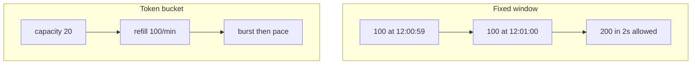
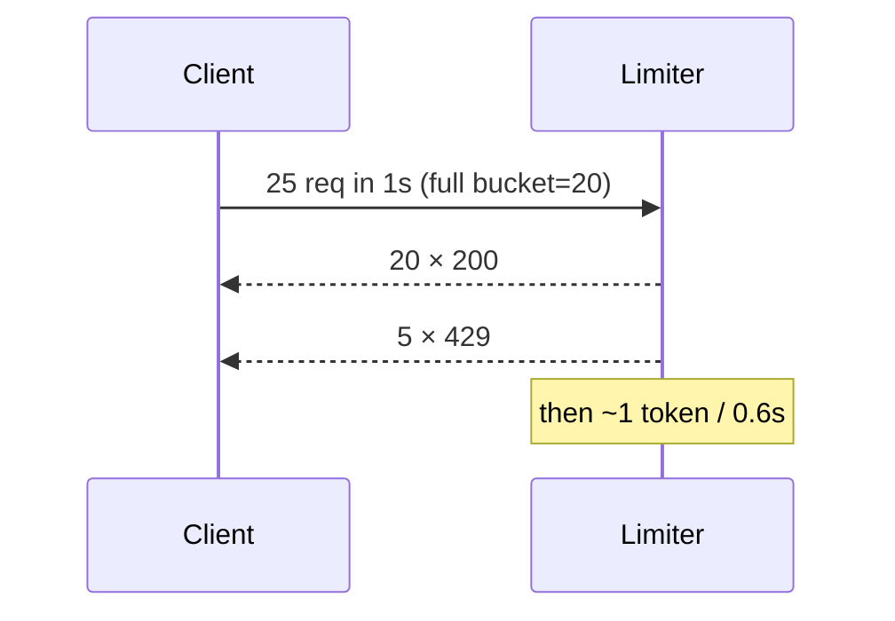
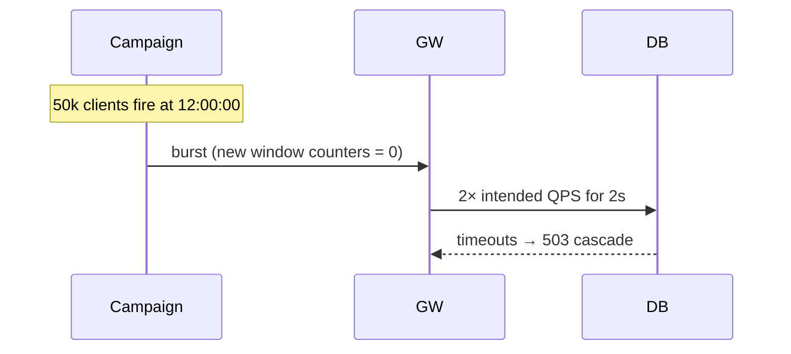

# Lesson 12: Rate Limiting Algorithms — Token Bucket vs Sliding Window vs Fixed Window

> **Prerequisites:** [Lesson 11: API Error Handling](../11-api-error-handling/README.md).  
> **Estimated Reading Time:** 33 minutes  
> **Target Audience:** Backend and platform engineers choosing how to count and enforce per-key API limits.  
> **Free PDF Notes:** [Download SD-C-012.pdf](https://backendroadmap.com/notes/system-design/SD-C-012.pdf)

> [!NOTE]
> **In one line:** Fixed window is cheap but allows double bursts at the boundary; sliding windows are stricter (exact with a log, approximate with two counters); token bucket allows controlled bursts with two numbers per key; leaky bucket smooths traffic to a steady rate. For a public API, a **token bucket per key** is the usual choice.

> [!TIP]
> **The Golden Rule of Rate Algorithms:** Document limits as **rate + burst**, implement refill **lazily** from elapsed time (no background timer per key), and never claim a fixed window is “exact”—clients can get **2×** across a boundary.

---

## 1. Core Definition & Taxonomic Comparison

Your public API allows 100 requests/minute per API key with short bursts up to 20. Enforcement depends on **how you count**.

| Term | Precise Meaning | Production Example |
| :--- | :--- | :--- |
| **Fixed window** | One counter per key per wall-clock window | `rl:key42:12:00` INCR; resets at `:01` |
| **Sliding window log** | Timestamp per request; count last $N$ seconds | Exact; memory ∝ limit |
| **Sliding window counter** | Two weighted counters | Approx; 2 ints per key |
| **Token bucket** | Refill rate + capacity (burst) | Stripe / AWS API Gateway style |
| **Leaky bucket** | Queue drained at fixed rate | Smooth SMS provider egress |

---

## 2. Component Breakdown, Anatomy & Observability Gap

**Fixed window boundary problem:** 100 at `12:00:59` + 100 at `12:01:00` ⇒ **200 in ~2 seconds**, yet each window says ≤ 100.

**Sliding counter estimate** at $t$ seconds into the window:

$$
\text{estimate} = C_{\text{curr}} + C_{\text{prev}} \times \left(1 - \frac{t}{W}\right)
$$

Example: previous 80, current 30, $t=15$, $W=60$:

$$
30 + 80 \times (1 - 15/60) = 30 + 60 = 90 \quad (\text{allow if limit } 100)
$$

**Token bucket lazy refill:**

$$
tokens = \min(C,\ tokens + \Delta t \times rate)
$$

> [!WARNING]
> **The Observability Gap:** Gateway `429` counts show rejects; they do **not** show boundary double-burst *allows*. Measure **requests in rolling 1 s / 10 s** histograms per key, not only per-minute counters, or you will bless a fixed-window design that still melts origin.



---

## 3. Mathematical Model & Saturation

Token bucket after idle (full): first minute max throughput:

$$
N_{\max}(T) = C + rate \times T
$$

With $C=20$, $rate=100/\text{min}$, $T=1\text{ min}$: up to **120** requests in that minute; long-run average = rate.

| Algorithm | State/key | Accuracy | Burst behavior |
| :--- | :--- | :--- | :--- |
| Fixed window | 1 counter | Up to 2× at edges | Double burst |
| Sliding log | 1 ts / request | Exact | None beyond limit |
| Sliding counter | 2 counters | Within a few % | None beyond limit |
| Token bucket | tokens + ts | Exact rate | Up to capacity |
| Leaky bucket | queue / level | Exact output rate | Queued, not served |

**Headroom:** Prefer token bucket for public APIs; sliding counter when you need strict per-minute without 2× edges.

---

## 4. Metrics, Percentiles & Distributions

| Metric | Use |
| :--- | :--- |
| `429` rate per key | Abuse vs mis-tuned clients |
| Tokens remaining p50 | Burst headroom |
| Rolling 1 s RPS p99 | Catch boundary spikes |
| Memory / key | Log vs bucket cost |

---

## 5. Compounding Effects at Scale

Sliding log memory for $K$ keys at limit $L$:

$$
M \approx K \times L \times \text{sizeof(timestamp)}
$$

$K=10^{6}$, $L=1000$, 8 B → **8 billion bytes ≈ 8 GB** just for timestamps (plus Redis overhead → tens of GB). Token bucket: ~2 numbers × $10^{6}$ → tens of MB.

| Keys | Algorithm | Order of memory |
| :--- | :--- | :--- |
| 1M @ 1k/min | Sliding log | Tens of GB |
| 1M | Token bucket | Tens of MB |
| 1M | Sliding counter | Tens of MB |

---

## 6. Numbers Every Backend Engineer Must Know

| Fact | Value |
| :--- | :--- |
| Common public default | 100/min + burst 20 |
| Refill interval @ 100/min | 1 token / 0.6 s |
| Fixed-window worst case | 2× limit |
| AWS API GW / Stripe | Token bucket family |

---

## 7. Protocol & Network Deep Dive

Reject with `429 Too Many Requests`. Compare burst under each algorithm (limit 100/min, bucket 20, leak 1/0.6 s)—idle client sends 60 at once; first 6 seconds:

| Algorithm | Through in first 6 s |
| :--- | :--- |
| Fixed window | Up to 60 (or 200 across boundary) |
| Sliding window | Up to 60; never >100 in any 60 s |
| Token bucket | 20 + ~10 refill ≈ 30; rest 429 |
| Leaky bucket | ~10 served; others wait/drop |



---

## 8. Hierarchical Budgets & Capacity Sizing

| Knob | Budget |
| :--- | :--- |
| Sustained rate | Protect origin RPS / DB |
| Burst capacity | One page-load fan-out (5–20) |
| State memory | Prefer O(1) per key |
| Decision latency | Sub-ms local; ms if Redis |

---

## 9. Top Engineering Mitigation Techniques

1. Token bucket for public APIs (rate + burst).
2. Sliding counter when strict per-minute matters.
3. Leaky bucket toward fragile downstreams (SMS).
4. Lazy refill from timestamps.
5. Avoid sliding logs at high limits.

---

## 10. Production War Story (SEV-1 Post-Mortem)

**Impact:** Origin DB CPU 95% every minute boundary. Fixed-window limiter allowed 2× marketing blast at `:00`.



**Fix:** Token bucket with burst 20; rolling RPS alerts; document rate+burst in developer docs.

---

## 11. Multi-Language Production Code

````carousel
```go
package ratelimit

import "time"

type TokenBucket struct {
	Capacity float64
	Rate     float64 // tokens per second
	Tokens   float64
	Last     time.Time
}

func (b *TokenBucket) Allow(now time.Time) bool {
	elapsed := now.Sub(b.Last).Seconds()
	b.Tokens = min(b.Capacity, b.Tokens+elapsed*b.Rate)
	b.Last = now
	if b.Tokens < 1 {
		return false
	}
	b.Tokens--
	return true
}
```
<!-- slide -->
```typescript
export class TokenBucket {
  constructor(
    private capacity: number,
    private ratePerSec: number,
    private tokens = capacity,
    private last = Date.now(),
  ) {}

  allow(now = Date.now()): boolean {
    const elapsed = (now - this.last) / 1000;
    this.tokens = Math.min(this.capacity, this.tokens + elapsed * this.ratePerSec);
    this.last = now;
    if (this.tokens < 1) return false;
    this.tokens -= 1;
    return true;
  }
}

export function slidingEstimate(prev: number, curr: number, elapsedSec: number, windowSec: number) {
  return curr + prev * (1 - elapsedSec / windowSec);
}
```
<!-- slide -->
```python
import time

class TokenBucket:
    def __init__(self, capacity: float, rate_per_sec: float):
        self.capacity = capacity
        self.rate = rate_per_sec
        self.tokens = capacity
        self.ts = time.monotonic()

    def allow(self) -> bool:
        now = time.monotonic()
        self.tokens = min(self.capacity, self.tokens + (now - self.ts) * self.rate)
        self.ts = now
        if self.tokens < 1:
            return False
        self.tokens -= 1
        return True

def sliding_estimate(prev: float, curr: float, elapsed: float, window: float) -> float:
    return curr + prev * (1 - elapsed / window)
```
<!-- slide -->
```csharp
public sealed class TokenBucket
{
    private readonly double _capacity;
    private readonly double _ratePerSec;
    private double _tokens;
    private long _lastTicks = Environment.TickCount64;

    public TokenBucket(double capacity, double ratePerSec)
    {
        _capacity = capacity;
        _ratePerSec = ratePerSec;
        _tokens = capacity;
    }

    public bool Allow()
    {
        var now = Environment.TickCount64;
        var elapsed = (now - _lastTicks) / 1000.0;
        _tokens = Math.Min(_capacity, _tokens + elapsed * _ratePerSec);
        _lastTicks = now;
        if (_tokens < 1) return false;
        _tokens -= 1;
        return true;
    }
}
```
````

---

## 12. Hands-On CLI Verification Workflows

```bash
python -c "
from math import inf
prev,curr,t,W,limit=80,30,15,60,100
est=curr+prev*(1-t/W)
print(est, 'allow' if est<limit else 'deny')
"

python -c "
class TB:
  def __init__(s,c,r): s.c=c; s.r=r; s.t=c; s.ts=0
  def allow(s,now):
    s.t=min(s.c,s.t+(now-s.ts)*s.r); s.ts=now
    if s.t<1: return False
    s.t-=1; return True
b=TB(20,100/60)
print(sum(b.allow(0) for _ in range(25)), 'of 25 at t=0')
"
```

---

## 13. Common Mistakes to Avoid

- Quoting fixed window as exact.
- Sliding log at high limits (memory blowup).
- Background job to refill every bucket.
- No separate burst knob for token bucket.
- Using leaky bucket when users expect low latency bursts.

---

## 14. Key Terms Glossary

| Term | Definition |
| :--- | :--- |
| **Fixed window** | One counter per key per window |
| **Boundary burst** | 2× limit across a window edge |
| **Sliding log** | Exact; one timestamp per request |
| **Sliding counter** | Two weighted counters |
| **Token bucket** | Refill rate + bucket size |
| **Leaky bucket** | Queue drained at fixed rate |
| **Lazy refill** | Compute tokens from elapsed time |
| **429** | Too Many Requests |

---

## 15. Complete 12 System Design Interview Q&As

<details>
<summary><strong>Q1. Compare token bucket and sliding window. [BASIC]</strong></summary>

Token bucket stores tokens + timestamp, refills steadily, allows bursts up to capacity. Sliding window counts requests in the last N seconds (exact log or approx two counters)—stricter, no separate burst allowance.

</details>

<details>
<summary><strong>Q2. Which for a public API, and why? [BASIC]</strong></summary>

Token bucket per API key (e.g. 100/min, burst 20). Real clients are bursty; two numbers per key; “rate + burst” is easy to document.

</details>

<details>
<summary><strong>Q3. What is the fixed-window boundary problem? [BASIC]</strong></summary>

Clients can spend the full limit at the end of one window and again at the start of the next—up to 2× in a short span.

</details>

<details>
<summary><strong>Q4. What does lazy refill mean? [BASIC]</strong></summary>

On each request, add `elapsed × rate` tokens up to capacity—no per-key timer thread.

</details>

<details>
<summary><strong>Q5. Sliding counter: prev 80, curr 30, 15 s in, limit 100. Allow? [SCENARIO]</strong></summary>

$30 + 80 × (1 - 15/60) = 90$ → under 100 → allow.

</details>

<details>
<summary><strong>Q6. Full token bucket capacity 20, refill 100/min, 25 requests in 1 s? [SCENARIO]</strong></summary>

First 20 succeed, 5 get `429`; then ~1 token every 0.6 s.

</details>

<details>
<summary><strong>Q7. Downstream SMS accepts 10 msg/s. Which algorithm? [SCENARIO]</strong></summary>

Leaky bucket draining at 10/s—bursts queue; drop only when queue is full.

</details>

<details>
<summary><strong>Q8. Marketing blast hits every minute boundary. Fix? [SCENARIO]</strong></summary>

Replace fixed window with token bucket or sliding counter; stagger campaign traffic; alert on rolling 1 s RPS.

</details>

<details>
<summary><strong>Q9. Memory for 1M keys at 1k/min: sliding log vs token bucket? [TRICKY]</strong></summary>

Log: up to 1B timestamps → tens of GB. Bucket: ~2M numbers → tens of MB.

</details>

<details>
<summary><strong>Q10. Can a token bucket exceed the stated per-minute rate? [TRICKY]</strong></summary>

Yes in a single minute: $C + rate×T$ (e.g. 120). Long-run average equals refill rate.

</details>

<details>
<summary><strong>Q11. Is sliding counter fair under highly skewed previous-minute traffic? [TRICKY]</strong></summary>

It assumes even spread in the previous window, so it can over/under-estimate by a few percent. For strict fairness use a log (if limit small) or token bucket.

</details>

<details>
<summary><strong>Q12. Why not only leaky bucket for a public HTTP API? [TRICKY]</strong></summary>

Leaky bucket queues/smooths—page loads that need 10 parallel calls feel slow. Token bucket serves the burst immediately up to capacity, which matches browser/mobile fan-out.

</details>

---

## 16. One-Page Master Cheat Sheet

```text
====================================================================================================
               RATE LIMITING ALGORITHMS (SD-C-012)  —  MASTER CHEAT SHEET
====================================================================================================
PICK       Public API → token bucket (rate + burst)
           Strict /min → sliding counter | Exact low limit → sliding log
           Smooth egress → leaky bucket | Approx OK → fixed window

MATH       sliding: est = curr + prev*(1 - t/W)
           token: tokens = min(C, tokens + dt*rate); Nmax = C + rate*T

MEMORY     log O(K*L) vs bucket O(K)     1M×1000 ts >> 1M×2 floats
ANTI       X fixed window as exact   X background refill   X sliding log at high L
====================================================================================================
```

---

## Free PDF notes

[SD-C-012.pdf](https://backendroadmap.com/notes/system-design/SD-C-012.pdf)

---

## Sources

- [AWS API Gateway throttling](https://docs.aws.amazon.com/apigateway/latest/developerguide/api-gateway-request-throttling.html)
- [Stripe rate limits](https://stripe.com/docs/rate-limits)

---

## Next

Next: [Lesson 13: Distributed Rate Limiting](../13-distributed-rate-limiting/README.md). Track: [API Design overview](../README.md).
