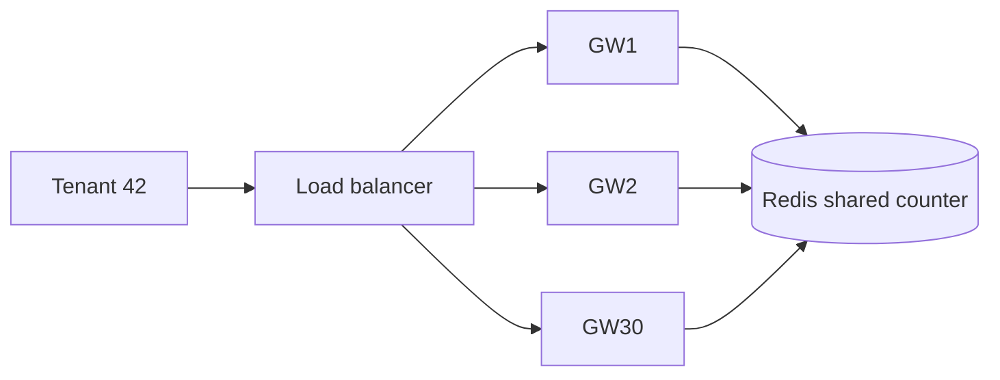
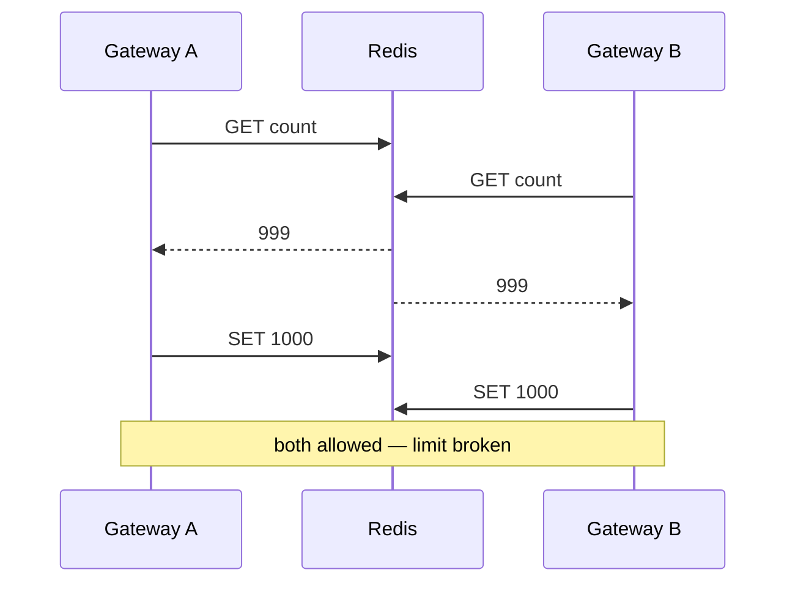
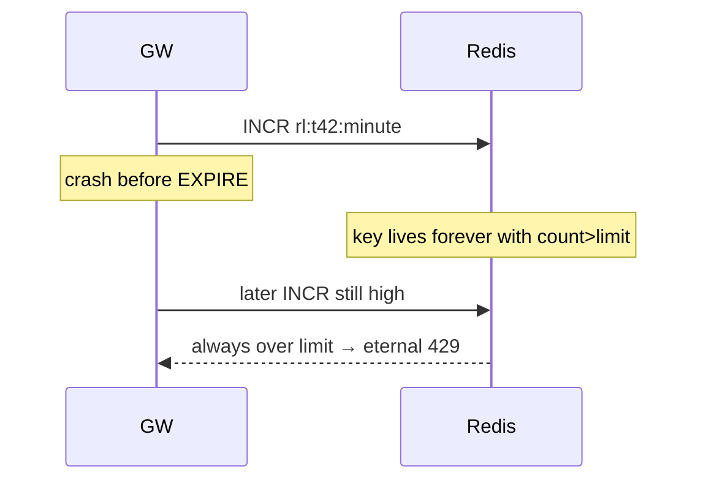

# Lesson 13: Distributed Rate Limiting — Redis, Lua Scripts, 429 Headers & Fail-Open

> **Prerequisites:** [Lesson 12: Rate Limiting Algorithms](../12-rate-limiting-algorithms/README.md).  
> **Estimated Reading Time:** 34 minutes  
> **Target Audience:** Platform and gateway engineers enforcing one per-tenant limit across many replicas, with Redis failure modes designed deliberately.  
> **Free PDF Notes:** [Download SD-C-013.pdf](https://backendroadmap.com/notes/system-design/SD-C-013.pdf)

> [!NOTE]
> **In one line:** Keep per-tenant counters in a shared store like Redis, update them atomically with a Lua script (optionally with local buckets that sync in batches), reject with `429` plus `Retry-After` and rate-limit headers, and decide deliberately whether to **fail open** or **fail closed** when Redis is down.

> [!TIP]
> **The Golden Rule of Distributed Limiting:** `INCR` alone is not enough—wrap **read → refill → take → EXPIRE** in one **Lua** (or `INCR`+`EXPIRE` in one script) so you never leave a forever-blocking key, and put a **few-millisecond timeout + circuit breaker** around Redis so a slow Redis cannot become a worse outage than a dead one.

---

## 1. Core Definition & Taxonomic Comparison

Thirty gateway instances each allowing 1,000 req/min locally ⇒ a tenant can do **30,000**. Limits only work with **shared state**.

| Term | Precise Meaning | Production Example |
| :--- | :--- | :--- |
| **Shared counter** | One logical limit all replicas see | Redis `rl:tenant42:…` |
| **Lua atomicity** | Script runs as one Redis operation | Token bucket in `EVALSHA` |
| **Hybrid limiter** | Local buckets + batched Redis claims | Claim 50 tokens at a time |
| **Fail open / closed** | Allow vs reject when store is down | Public API vs SMS/login |

---

## 2. Component Breakdown, Anatomy & Observability Gap



**Races without Lua:**
1. `INCR` then separate `EXPIRE` — crash between ⇒ key never expires ⇒ tenant blocked forever.
2. App read-then-write — two gateways read `999`, both allow ⇒ counter lies.

> [!WARNING]
> **The Observability Gap:** App `429` metrics do not show **Redis p99** or **circuit-open** time. A Redis at 200 ms “works” but multiplies every request's latency (Little's Law). Monitor Redis limiter RTT, timeout rate, fail-open events, and stuck keys without TTL separately from HTTP 429s.

---

## 3. Mathematical Model & Cost

Redis RTT $r = 0.5$–$1$ ms in-zone. At fleet RPS $\lambda$:

$$
\text{Redis QPS} \approx \lambda \quad \text{(naive per-request)}
$$

Hybrid with batch size $B=50$:

$$
\text{Redis QPS} \approx \frac{\lambda}{B}
$$

At $\lambda = 60{,}000$: $60{,}000$ → **1,200** Redis calls/s.

Parked tokens upper bound with $G$ gateways:

$$
T_{\text{parked}} \leq G \times B = 30 \times 50 = 1{,}500
$$

| Mode | Redis QPS @ 60k RPS | Accuracy |
| :--- | :--- | :--- |
| Per request | 60,000 | Exact |
| Batch 50 | ~1,200 | Blurred by parked tokens |
| Split limit /30 | 0 | Exact only if LB perfect |

**Headroom:** Timeout Redis at ~5 ms; trip circuit → local fallback.

---

## 4. Metrics, Percentiles & Distributions

| Metric | Why |
| :--- | :--- |
| Limiter Redis p50/p99 | Slow vs down |
| `EVALSHA` error rate | NOSCRIPT / cluster slot issues |
| Fail-open count | Availability vs protection trade |
| `Retry-After` distribution | Client backoff quality |

---

## 5. Compounding Effects at Scale

If Redis slows to $200$ ms and every request waits:

$$
L = \lambda W \quad \Rightarrow \quad \text{in-flight} \uparrow\ \text{by}\ \lambda \times 0.2
$$

At $10{,}000$ RPS → **+2,000** extra in-flight requests—pools exhaust, cascading `503`.

| Redis latency | Extra in-flight @ 10k RPS |
| :--- | :--- |
| 1 ms | +10 |
| 50 ms | +500 |
| 200 ms | +2,000 |

---

## 6. Numbers Every Backend Engineer Must Know

| Item | Typical |
| :--- | :--- |
| In-zone Redis RTT | 0.5–1 ms |
| Limiter timeout | 3–5 ms |
| Batch claim | 10–50 tokens |
| Headers | `Retry-After`, `X-RateLimit-*` / IETF `RateLimit` |

---

## 7. Protocol & Network Deep Dive

```http
HTTP/1.1 429 Too Many Requests
Retry-After: 12
X-RateLimit-Limit: 1000
X-RateLimit-Remaining: 0
X-RateLimit-Reset: 1762257660

RateLimit-Policy: "default";q=1000;w=60
RateLimit: "default";r=0;t=12
```



*Figure. Read-then-write race—why Lua exists.*

---

## 8. Hierarchical Budgets & Capacity Sizing

| Budget | Target |
| :--- | :--- |
| Decision path | ≤ 1–2 ms added p99 |
| Redis timeout | 5 ms then fallback |
| Cluster shard | Hash tag `{tenant}` one slot |
| Idle TTL | `ceil(capacity/rate)` |

---

## 9. Top Engineering Mitigation Techniques

1. Lua token bucket / fixed window with TTL.
2. `SCRIPT LOAD` + `EVALSHA`.
3. Hybrid local + batch claim.
4. Rate-limit response headers + `Retry-After`.
5. Fail open (most public APIs) or fail closed (login/SMS); always circuit-break.

---

## 10. Production War Story (SEV-1 Post-Mortem)

**Impact:** After a Redis blip, thousands of tenants stuck at limit for hours—`INCR` succeeded, process died before `EXPIRE`.



**Fix:** Single Lua for INCR+PEXPIRE; TTL scanner; alert on keys without TTL.

---

## 11. Multi-Language Production Code

````carousel
```go
package distlimit

// Lua: KEYS[1]=bucket  ARGV=capacity, tokensPerMs, nowMs
const tokenBucketLua = `
local cap, rate, now = tonumber(ARGV[1]), tonumber(ARGV[2]), tonumber(ARGV[3])
local b = redis.call('HMGET', KEYS[1], 'tokens', 'ts')
local tokens = tonumber(b[1]) or cap
local ts = tonumber(b[2]) or now
tokens = math.min(cap, tokens + math.max(0, now - ts) * rate)
local allowed = 0
if tokens >= 1 then tokens = tokens - 1; allowed = 1 end
redis.call('HSET', KEYS[1], 'tokens', tokens, 'ts', now)
redis.call('PEXPIRE', KEYS[1], math.ceil(cap / rate))
return {allowed, math.floor(tokens)}
`
```
<!-- slide -->
```typescript
export const TOKEN_BUCKET_LUA = `
local cap, rate, now = tonumber(ARGV[1]), tonumber(ARGV[2]), tonumber(ARGV[3])
local b = redis.call('HMGET', KEYS[1], 'tokens', 'ts')
local tokens = tonumber(b[1]) or cap
local ts = tonumber(b[2]) or now
tokens = math.min(cap, tokens + math.max(0, now - ts) * rate)
local allowed = 0
if tokens >= 1 then tokens = tokens - 1; allowed = 1 end
redis.call('HSET', KEYS[1], 'tokens', tokens, 'ts', now)
redis.call('PEXPIRE', KEYS[1], math.ceil(cap / rate))
return {allowed, math.floor(tokens)}
`;

export async function allow(redis: { evalsha: Function }, sha: string, key: string, cap: number, tokensPerMs: number, now: number) {
  const [allowed] = await redis.evalsha(sha, 1, key, cap, tokensPerMs, now);
  return allowed === 1;
}
```
<!-- slide -->
```python
TOKEN_BUCKET_LUA = r"""
local cap, rate, now = tonumber(ARGV[1]), tonumber(ARGV[2]), tonumber(ARGV[3])
local b = redis.call('HMGET', KEYS[1], 'tokens', 'ts')
local tokens = tonumber(b[1]) or cap
local ts = tonumber(b[2]) or now
tokens = math.min(cap, tokens + math.max(0, now - ts) * rate)
local allowed = 0
if tokens >= 1 then tokens = tokens - 1; allowed = 1 end
redis.call('HSET', KEYS[1], 'tokens', tokens, 'ts', now)
redis.call('PEXPIRE', KEYS[1], math.ceil(cap / rate))
return {allowed, math.floor(tokens)}
"""

def allow(redis, sha: str, tenant: str, cap: float, rate_per_ms: float, now_ms: int) -> bool:
    allowed, _ = redis.evalsha(sha, 1, f"rl:{{{tenant}}}", cap, rate_per_ms, now_ms)
    return int(allowed) == 1
```
<!-- slide -->
```csharp
public static class DistributedLimiter
{
    public const string TokenBucketLua = @"
local cap, rate, now = tonumber(ARGV[1]), tonumber(ARGV[2]), tonumber(ARGV[3])
local b = redis.call('HMGET', KEYS[1], 'tokens', 'ts')
local tokens = tonumber(b[1]) or cap
local ts = tonumber(b[2]) or now
tokens = math.min(cap, tokens + math.max(0, now - ts) * rate)
local allowed = 0
if tokens >= 1 then tokens = tokens - 1; allowed = 1 end
redis.call('HSET', KEYS[1], 'tokens', tokens, 'ts', now)
redis.call('PEXPIRE', KEYS[1], math.ceil(cap / rate))
return {allowed, math.floor(tokens)}";
}
```
````

---

## 12. Hands-On CLI Verification Workflows

```bash
redis-cli SCRIPT LOAD "$(cat token_bucket.lua)"
redis-cli EVALSHA <sha> 1 'rl:{tenant42}' 20 0.001666 1730000000000

# Simulate eternal block without TTL
redis-cli INCR rl:bad:demo
redis-cli TTL rl:bad:demo   # -1 means no expiry — the footgun
```

---

## 13. Common Mistakes to Avoid

- Per-instance memory limits called “global.”
- Separate `INCR` + `EXPIRE` without recovery.
- `429` without `Retry-After`.
- No timeout/circuit on Redis.
- Hybrid batches so large accuracy is meaningless.

---

## 14. Key Terms Glossary

| Term | Definition |
| :--- | :--- |
| **Shared state** | One counter all instances see |
| **INCR** | Atomic Redis increment |
| **Lua script** | Runs atomically inside Redis |
| **EVALSHA** | Call loaded script by hash |
| **Hash tag** | `{…}` keeps keys in one cluster slot |
| **Hybrid limiter** | Local buckets + batched sync |
| **Fail open** | Allow when limiter is down |
| **Fail closed** | Reject when limiter is down |

---

## 15. Complete 12 System Design Interview Q&As

<details>
<summary><strong>Q1. How do you rate limit across many servers? [BASIC]</strong></summary>

Shared store (Redis) per tenant, updated atomically with Lua; optional local batching; reject with `429`, `Retry-After`, and rate-limit headers.

</details>

<details>
<summary><strong>Q2. Why Lua instead of separate commands? [BASIC]</strong></summary>

Atomic read-refill-take-write in one RTT; avoids dual-allow races and missing TTLs after crashes between `INCR` and `EXPIRE`.

</details>

<details>
<summary><strong>Q3. What headers should a 429 include? [BASIC]</strong></summary>

`Retry-After` plus limit/remaining/reset (`X-RateLimit-*` or IETF `RateLimit` / `RateLimit-Policy`).

</details>

<details>
<summary><strong>Q4. What is a Redis hash tag here? [BASIC]</strong></summary>

`{tenant42}` forces related keys into one cluster hash slot so a Lua script may touch them together.

</details>

<details>
<summary><strong>Q5. Can't afford Redis per request—options? [SCENARIO]</strong></summary>

Hybrid: claim batches (e.g. 50) and spend locally (~50× fewer calls), or split limit across instances if LB is even. Accept blurred accuracy.

</details>

<details>
<summary><strong>Q6. Redis is down—what happens? [SCENARIO]</strong></summary>

Usually fail open with local limits + alert + short timeout/circuit. Fail closed for login/SMS/payments where abuse cost dominates.

</details>

<details>
<summary><strong>Q7. Tenant blocked for hours after stopping traffic. Why? [SCENARIO]</strong></summary>

Counter key without TTL after `INCR` without `EXPIRE`. Fix: Lua does both; scan for TTL −1.

</details>

<details>
<summary><strong>Q8. Design limiter for 30 gateways, 1k/min/tenant. [SCENARIO]</strong></summary>

Redis Cluster token-bucket Lua keyed by `{tenant}`; headers on every response; 5 ms timeout; fail open with per-instance 50/min backstop; optional batch claims under load.

</details>

<details>
<summary><strong>Q9. Redis is slow (200 ms) but not down. What breaks? [TRICKY]</strong></summary>

Every request waits +200 ms → in-flight explodes (Little's Law), pools dry. Tight timeout turns slow into unavailable so fail-open/local path engages.

</details>

<details>
<summary><strong>Q10. Is hybrid batching exact? [TRICKY]</strong></summary>

Long-run total holds, but up to $G×B$ tokens can park; one GW may 429 while another holds spare; later bursts possible. Smaller/expiring batches trade accuracy vs Redis QPS.

</details>

<details>
<summary><strong>Q11. Why pass time from the gateway into Lua? [TRICKY]</strong></summary>

Avoid depending on skewed gateway clocks inconsistently; alternatively use `redis.call('TIME')` inside the script so refill uses Redis's clock.

</details>

<details>
<summary><strong>Q12. Split limit by instance count—when does it fail? [TRICKY]</strong></summary>

When sticky sessions or uneven LB send most of a tenant to one GW—that instance's local 33/min starves them while others sit idle. Prefer shared Redis or hybrid claims.

</details>

---

## 16. One-Page Master Cheat Sheet

```text
====================================================================================================
              DISTRIBUTED RATE LIMITING (SD-C-013)  —  MASTER CHEAT SHEET
====================================================================================================
PROBLEM    N gateways × local limit = N× intended

FIX        Redis + Lua atomic bucket | EVALSHA | hash tag {tenant}
OPTIMIZE   Hybrid claim B tokens  RedisQPS ≈ λ/B   parked ≤ G*B

HTTP       429 + Retry-After + X-RateLimit-* / RateLimit
FAILURE    timeout ~5ms + circuit | fail-open (public) / fail-closed (SMS/login)
ANTI       X INCR||EXPIRE split   X read-then-write   X no Retry-After   X wait on slow Redis
====================================================================================================
```

---

## Free PDF notes

[SD-C-013.pdf](https://backendroadmap.com/notes/system-design/SD-C-013.pdf)

---

## Sources

- [Redis EVAL](https://redis.io/commands/eval/) — atomic scripts.
- [IETF RateLimit header fields](https://datatracker.ietf.org/doc/draft-ietf-httpapi-ratelimit-headers/)

---

## Next

Next: [Lesson 14: Throttling vs Rate Limiting vs Quotas](../14-throttling-vs-rate-limiting-vs-quotas/README.md). Track: [API Design overview](../README.md).
