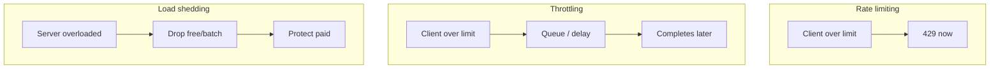
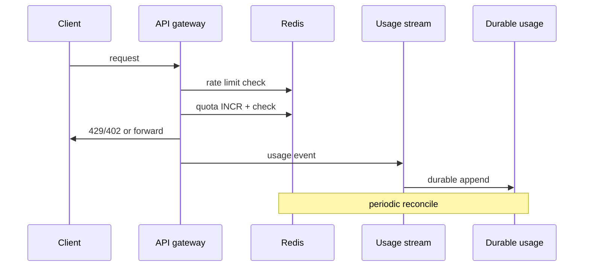
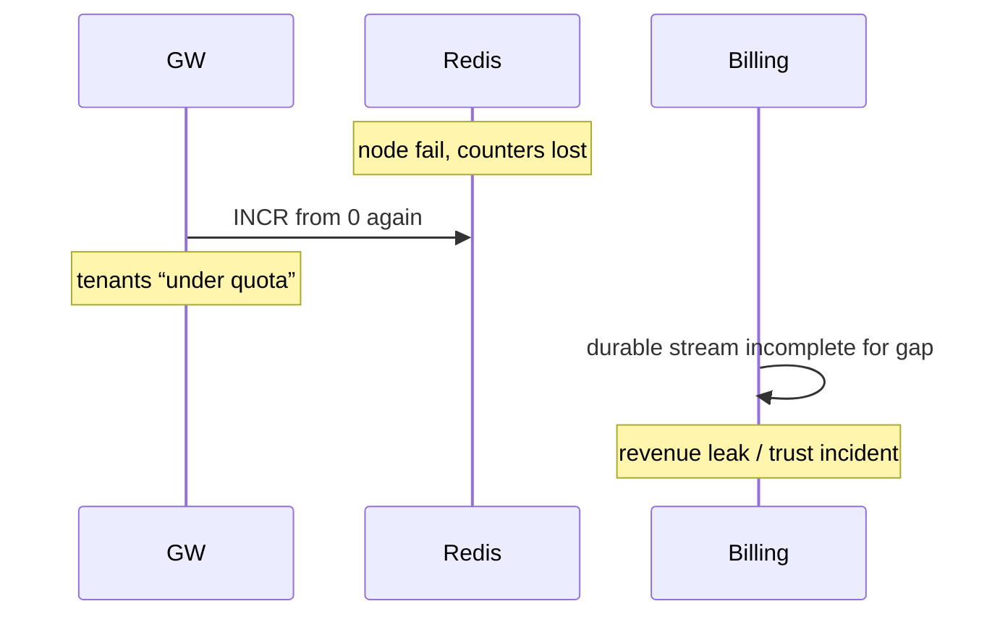

# Lesson 14: Throttling vs Rate Limiting vs Quotas — Free & Paid Tiers, Monthly Limits

> **Prerequisites:** [Lesson 13: Distributed Rate Limiting](../13-distributed-rate-limiting/README.md), [Lesson 12: Rate Limiting Algorithms](../12-rate-limiting-algorithms/README.md).  
> **Estimated Reading Time:** 31 minutes  
> **Target Audience:** Backend and product engineers designing free/paid API tiers with fair multi-tenant enforcement and billing-grade usage accounting.  
> **Free PDF Notes:** [Download SD-C-014.pdf](https://backendroadmap.com/notes/system-design/SD-C-014.pdf)

> [!NOTE]
> **In one line:** Rate limiting rejects requests above a short-term rate with `429`; throttling slows or queues them instead; load shedding drops low-priority work when the **server** is overloaded; quotas are long-term per-plan budgets that need durable, billing-grade counting.

> [!TIP]
> **The Golden Rule of Tiers & Quotas:** A per-second limit shapes **speed**; a quota caps **total consumption**. Without a daily/monthly quota, a free user at 5 RPS burns $5 \times 86{,}400 = 432{,}000$ requests/day while “within rate limit.” Keep Redis for **fast checks** and a durable event store as the **billing source of truth**, reconciled periodically.

---

## 1. Core Definition & Taxonomic Comparison

| Term | Precise Meaning | Production Example |
| :--- | :--- | :--- |
| **Rate limiting** | Reject above short-term rate (`429`) | 100 req/min → excess denied now |
| **Throttling** | Slow/queue excess; work still completes | Delay bursts; drain steadily |
| **Load shedding** | Drop low-priority when **server** unhealthy | CPU 95% → drop free/batch first |
| **Quota** | Long-term plan budget (day/month) | Free 1,000/day; paid 1M/month |

People often say “throttling” for rate limiting—**say which you mean**.

---

## 2. Component Breakdown, Anatomy & Observability Gap



Gateway path: **(1) rate limit → (2) quota → (3) forward**. Redis `usage:t42:2026-11` for fast INCR; Kafka/stream → durable usage store → billing; reconcile Redis from store.

> [!WARNING]
> **The Observability Gap:** Redis quota gauges show “soft” usage; invoices use the **durable store**. If you only graph Redis, a node failover that resets counters looks like “customers under quota” while billing later surprises them—or vice versa. Alert on **reconcile lag** and **Redis vs store delta**, not only on `429`s.

---

## 3. Mathematical Model & Worked Example

**Free tier:** 5 RPS rate limit, 1,000 req/day hard quota.

Time to burn daily quota at cap:

$$
t = \frac{1000}{5} = 200\ \text{s} \approx 3\ \text{min } 20\ \text{s}
$$

Without quota, same 5 RPS all day:

$$
5 \times 86{,}400 = 432{,}000\ \text{req/day}
$$

**Paid tier:** 100 RPS, 1,000,000/month soft quota:

$$
t_{1M} = \frac{1{,}000{,}000}{100} = 10{,}000\ \text{s} \approx 2.8\ \text{hours}
$$

| | Free | Paid |
| :--- | :--- | :--- |
| Quota | 1,000 / day | 1,000,000 / month |
| Rate | 5 / s | 100 / s + bursts |
| Over quota | Hard `429`/`402` + upgrade | Soft: overage billing |

**Headroom:** Warn at 80% and 100% via email + headers.

---

## 4. Metrics, Percentiles & Distributions

| Metric | Meaning |
| :--- | :--- |
| Rate-limit `429` vs quota `402`/`429` | Speed vs budget exhaustion |
| Usage % of quota p50/p95 | Plan fit |
| Reconcile lag | Billing risk |
| Shed counts by tier | Fairness under load |

---

## 5. Compounding Effects at Scale

Shared queue across tiers: free burst fills workers → paid p99 explodes.

$$
\text{Paid latency} \uparrow\ \text{as}\ \rho_{\text{shared}} \to 1
$$

Isolate pools: e.g. 40 paid workers / 10 free workers so free can only saturate its slice.

| Isolation | Free spike effect on paid |
| :--- | :--- |
| Shared queue | Severe |
| Separate queues | Contained |
| Separate worker pools | Strong |
| Shed free first | Protects paid SLO |

---

## 6. Numbers Every Backend Engineer Must Know

| Item | Value |
| :--- | :--- |
| Warn thresholds | 80%, 100% |
| Hard vs soft | Free hard; paid soft often |
| Reset | Per-tenant **billing anchor**, not global 1st |
| 402 | Payment Required (upgrade) vs 429 “retry later” |

---

## 7. Protocol & Network Deep Dive



Rate limit vs quota:

| | Rate limit | Quota |
| :--- | :--- | :--- |
| Time scale | Seconds–minutes | Days–months |
| Purpose | Protect from bursts | Enforce business plan |
| Counting | Fast, approx OK | Durable, exact |
| Exceeded | `429`, retry seconds | `429`/`402` or overage until next period |

---

## 8. Hierarchical Budgets & Capacity Sizing

| Layer | Budget |
| :--- | :--- |
| Edge rate | Per-tier RPS + burst |
| Period quota | Plan entitlement |
| Worker pools | Paid vs free capacity split |
| Shed order | Background → free → paid last |

---

## 9. Top Engineering Mitigation Techniques

1. Stack rate limit + quota + shedding.
2. Redis fast path + durable events + reconcile.
3. Billing-anchor resets.
4. 80/100% warnings; hard free / soft paid.
5. Separate queues/pools per tier.

---

## 10. Production War Story (SEV-1 Post-Mortem)

**Impact:** Redis quota node died; all free-tier counters reset to 0 → customers got a free full day; paid soft limits under-counted → six-figure unbilled usage.



**Fix:** Durable usage stream always on the write path; rebuild Redis from store; never treat Redis as billing SoT.

---

## 11. Multi-Language Production Code

````carousel
```go
package quotas

type Decision int

const (
	Allow Decision = iota
	RateLimited
	QuotaExceeded
)

func Check(rateOK, underQuota, soft bool) Decision {
	if !rateOK {
		return RateLimited
	}
	if underQuota || soft {
		return Allow // soft: allow overage, bill later
	}
	return QuotaExceeded
}
```
<!-- slide -->
```typescript
export type Tier = "free" | "paid";

export function overQuotaResponse(tier: Tier): { status: number; code: string } {
  if (tier === "free") return { status: 402, code: "quota_exceeded_upgrade" };
  return { status: 200, code: "quota_overage_billing" }; // soft: still serve
}

export function warnThreshold(used: number, limit: number): 0 | 80 | 100 {
  const pct = (used / limit) * 100;
  if (pct >= 100) return 100;
  if (pct >= 80) return 80;
  return 0;
}
```
<!-- slide -->
```python
from dataclasses import dataclass

@dataclass
class Plan:
    rps: float
    quota: int
    soft: bool
    billing_anchor_day: int  # 1-28

FREE = Plan(rps=5, quota=1_000, soft=False, billing_anchor_day=1)
PAID = Plan(rps=100, quota=1_000_000, soft=True, billing_anchor_day=14)

def decide(rate_ok: bool, used: int, plan: Plan) -> str:
    if not rate_ok:
        return "429_rate"
    if used < plan.quota:
        return "allow"
    return "allow_overage" if plan.soft else "402_quota"
```
<!-- slide -->
```csharp
public sealed record Plan(double Rps, long Quota, bool SoftLimit, int BillingAnchorDay);

public static class QuotaDecision
{
    public static string Decide(bool rateOk, long used, Plan plan) =>
        !rateOk ? "429_rate"
        : used < plan.Quota ? "allow"
        : plan.SoftLimit ? "allow_overage"
        : "402_quota";
}
```
````

---

## 12. Hands-On CLI Verification Workflows

```bash
python -c "print('burn seconds', 1000/5); print('day without quota', 5*86400)"
python -c "print('hours for 1M at 100/s', 1_000_000/100/3600)"
```

---

## 13. Common Mistakes to Avoid

- Quota only in Redis (failover resets / loses billable usage).
- Resetting everyone on the 1st, not billing anchors.
- Cutting paid customers with bare `429` and no warning.
- One shared queue for all tiers.
- Rate limit alone without quota on free tier.

---

## 14. Key Terms Glossary

| Term | Definition |
| :--- | :--- |
| **Rate limiting** | Reject above short-term rate |
| **Throttling** | Slow or queue instead of reject |
| **Load shedding** | Drop low-priority when overloaded |
| **Quota** | Long-term budget per plan |
| **Billing anchor** | Tenant's own period start |
| **Reconcile** | Correct fast counter from durable store |
| **Hard / soft limit** | Stop vs overage bill |
| **402** | Payment Required |

---

## 15. Complete 12 System Design Interview Q&As

<details>
<summary><strong>Q1. Throttling vs rate limiting? [BASIC]</strong></summary>

Rate limiting rejects with `429`. Throttling slows/queues so work completes later. Load shedding drops low-priority based on server health.

</details>

<details>
<summary><strong>Q2. Quotas vs rate limits? [BASIC]</strong></summary>

Rate limits: seconds, protect bursts, approx OK. Quotas: days/months, enforce plan/billing, need durable exact counts.

</details>

<details>
<summary><strong>Q3. What is load shedding? [BASIC]</strong></summary>

When the server is overloaded, drop low-priority work (batch/free) even if clients are within their limits—to protect the rest.

</details>

<details>
<summary><strong>Q4. Hard vs soft quota? [BASIC]</strong></summary>

Hard: stop (`429`/`402`). Soft: keep serving and bill overage—typical for paid.

</details>

<details>
<summary><strong>Q5. Enforce 1,000,000 req/month? [SCENARIO]</strong></summary>

Redis per-tenant per-period counter at gateway; stream usage to durable store (billing SoT); reconcile; reset on billing anchor; warn 80/100%; hard/soft per plan.

</details>

<details>
<summary><strong>Q6. Redis quota node fails. Customers? [SCENARIO]</strong></summary>

With reconcile, rebuild from durable store—no reset to zero. Gap usage still in the stream; at worst slight overage before catch-up.

</details>

<details>
<summary><strong>Q7. Free users slow paid during spikes. Fix? [SCENARIO]</strong></summary>

Isolate tiers (queues/pools + per-tier rates). Under overload, shed background and free first.

</details>

<details>
<summary><strong>Q8. Design free 1k/day + paid 1M/month API. [SCENARIO]</strong></summary>

Free: 5 RPS + hard daily quota + `402` upgrade. Paid: 100 RPS + soft monthly quota + overage. Separate pools; headers for remaining quota.

</details>

<details>
<summary><strong>Q9. Free user at 5 RPS—why still need daily quota? [TRICKY]</strong></summary>

$5 × 86{,}400 = 432{,}000$/day. Rate shapes speed; quota caps consumption.

</details>

<details>
<summary><strong>Q10. When 402 instead of 429? [TRICKY]</strong></summary>

`429` = too fast, retry later (rate). Monthly quota exhausted → waiting seconds won't help; `402` + upgrade link. Some APIs use `429` for both with a clear `code`.

</details>

<details>
<summary><strong>Q11. Why billing anchors not calendar months? [TRICKY]</strong></summary>

Fairness and invoicing: a user who subscribed on the 14th expects a period from the 14th; a global 1st reset creates thundering herds and mid-cycle surprises.

</details>

<details>
<summary><strong>Q12. Can throttling replace quotas? [TRICKY]</strong></summary>

No. Throttling changes latency/shape of traffic; it does not bind total monthly cost. Abusive clients can still consume huge volume slowly.

</details>

---

## 16. One-Page Master Cheat Sheet

```text
====================================================================================================
         THROTTLING vs RATE LIMITING vs QUOTAS (SD-C-014)  —  MASTER CHEAT SHEET
====================================================================================================
RATE       short-term → 429 now
THROTTLE   queue/delay → completes later
SHED       server health → drop low priority
QUOTA      day/month plan → durable count → 402/429 or overage

STACK      rate check → quota check → forward
DATA       Redis fast | stream+store billing SoT | reconcile | billing anchor

MATH       5 RPS × 86400 = 432k/day without quota
ANTI       X Redis-only quotas  X shared queue all tiers  X silent paid cutoff
====================================================================================================
```

---

## Free PDF notes

[SD-C-014.pdf](https://backendroadmap.com/notes/system-design/SD-C-014.pdf)

---

## Sources

- [Stripe billing & usage](https://stripe.com/docs/billing) — anchors and metered ideas.
- [Google Cloud quotas](https://cloud.google.com/docs/quota) — rate vs quota mental model.

---

## Next

Next: [Lesson 15: API Authentication](../15-api-authentication/README.md). Track: [API Design overview](../README.md).
