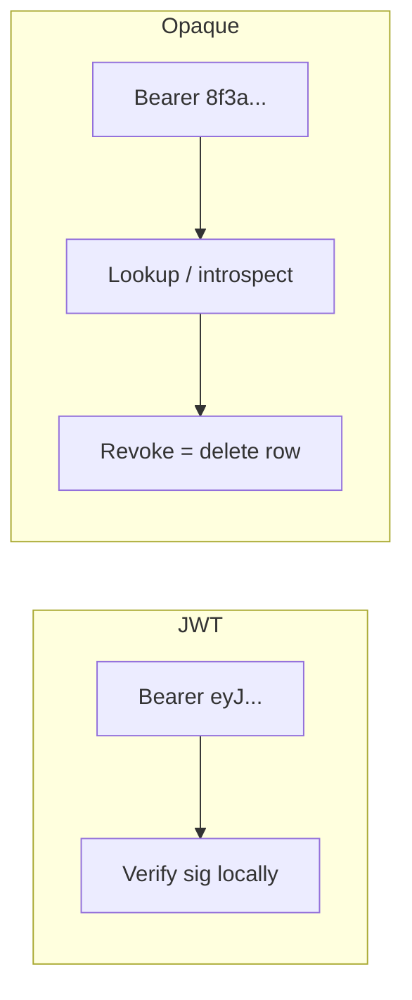
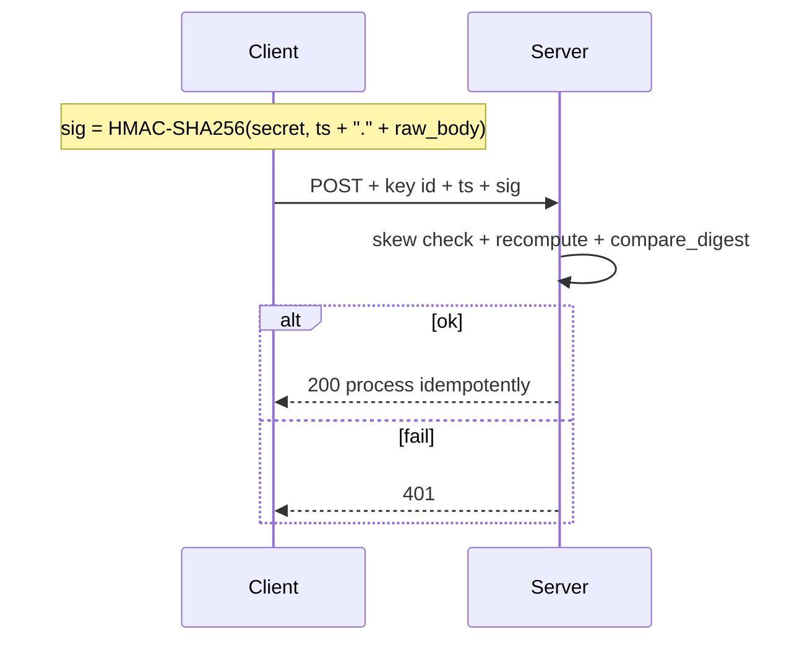
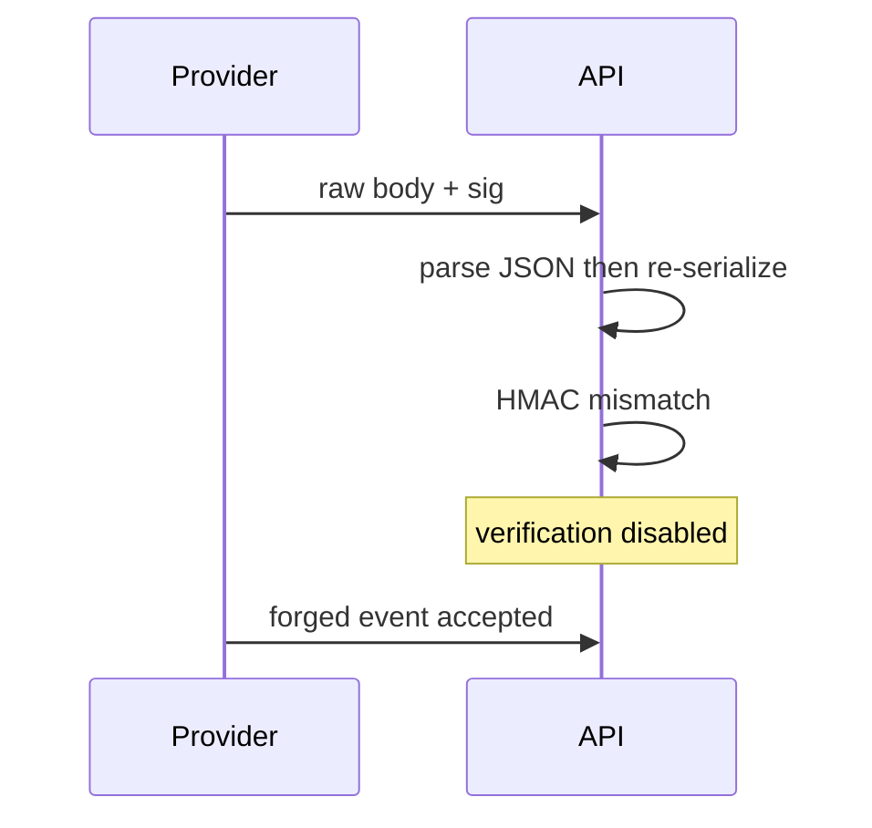

# Lesson 15: API Authentication — API Keys vs JWT vs HMAC Signatures vs mTLS

> **Prerequisites:** [Lesson 14: Throttling vs Rate Limiting vs Quotas](../14-throttling-vs-rate-limiting-vs-quotas/README.md), [Lesson 11: API Error Handling](../11-api-error-handling/README.md).  
> **Estimated Reading Time:** 34 minutes  
> **Target Audience:** Backend and security engineers choosing how callers prove identity for browsers, mobile apps, partners, webhooks, and service meshes.  
> **Free PDF Notes:** [Download SD-C-015.pdf](https://backendroadmap.com/notes/system-design/SD-C-015.pdf)

> [!NOTE]
> **In one line:** API keys identify an app but are long-lived bearer secrets; session cookies suit browsers; bearer tokens (JWT or opaque) suit users and services; HMAC signing proves the sender and the body without sending the secret; mutual TLS proves service identity at the connection level.

> [!TIP]
> **The Golden Rule of API Authentication:** Match the proof to the caller—**never ship API keys in mobile/JS**, keep JWTs **short-lived**, verify webhooks on the **raw body** with **constant-time** compare and a timestamp window, and remember **mTLS ≠ authorization**.

---

## 1. Core Definition & Taxonomic Comparison

| Method | Identifies | Secret sent? | Revocation | Best for |
| :--- | :--- | :--- | :--- | :--- |
| **API key** | Calling app | Yes, every request | Delete key | Simple public APIs, usage tracking |
| **Session cookie** | Browser user | Session ID | Instant delete | Web apps |
| **JWT** | User/service + claims | Token | Hard until expiry | Many services verifying locally |
| **Opaque token** | User/service | Token | Instant | When revocation matters |
| **HMAC signing** | Key holder + body integrity | No—only signature | Rotate secret | Webhooks, partner APIs |
| **mTLS** | Calling service | No—private key local | Short-lived certs | Internal service-to-service |

---

## 2. Component Breakdown, Anatomy & Observability Gap



HMAC flow: sign `method + path + timestamp + SHA256(body)`; server recomputes; reject stale timestamps (replay).

> [!WARNING]
> **The Observability Gap:** Authn failures often appear as generic `401` at the edge while the real cause (bad sig, skew, wrong key id, expired JWT) lives in **auth service logs**. Emit reason codes internally (`sig_mismatch`, `ts_skew`, `unknown_kid`) without leaking them to attackers; metric `auth_fail_reason` separately from HTTP 401 rate.

---

## 3. Mathematical Model & Worked Security Windows

Replay window for webhooks: reject if

$$
|t_{\text{now}} - t_{\text{header}}| > 300\ \text{s}
$$

JWT access-token lifetime trade-off: expected stolen-token abuse window ≈ TTL. With TTL $= 15$ min vs $7$ days:

$$
\frac{7 \times 24 \times 60}{15} = 672\times\ \text{longer exposure}
$$

| Design | Exposure if leaked |
| :--- | :--- |
| JWT 15 min + refresh | Minutes |
| JWT 7 days | Days |
| Opaque + revoke | Until detection + delete |
| mTLS daily certs | ≤ cert lifetime |

**Headroom:** Prefer client-credentials short tokens over static keys for server-to-server.

---

## 4. Metrics, Percentiles & Distributions

| Metric | Signal |
| :--- | :--- |
| `401`/`403` rate | Authn vs authz mix |
| JWT verify p99 | CPU / key fetch |
| Webhook sig fail rate | Clock skew vs attacks |
| Key rotation dual-active | Zero-downtime readiness |

---

## 5. Compounding Effects at Scale

$N$ microservices each hitting introspection:

$$
\text{auth QPS} \approx \lambda \times N
$$

JWT local verify keeps auth QPS ≈ 0 beyond JWKS cache refresh; opaque needs cache or becomes a bottleneck.

| Pattern | Auth dependency per request |
| :--- | :--- |
| JWT + cached JWKS | Near zero |
| Opaque no cache | 1 lookup |
| Opaque + 30 s cache | ≪ 1 |
| mTLS | Handshake amortized |

---

## 6. Numbers Every Backend Engineer Must Know

| Item | Typical |
| :--- | :--- |
| Access JWT TTL | 5–15 min |
| Webhook skew | 5 min |
| Cookie flags | `HttpOnly`, `Secure`, `SameSite` |
| Mesh cert lifetime | ~24 h default |
| Compare | `hmac.compare_digest` / `CryptographicOperations.FixedTimeEquals` |

---

## 7. Protocol & Network Deep Dive



mTLS: both sides present certificates during handshake—identity known **before** HTTP bytes (`spiffe://…`).

---

## 8. Hierarchical Budgets & Capacity Sizing

| Layer | Choice |
| :--- | :--- |
| Browser | Session cookie or OAuth code+PKCE |
| Mobile | OAuth PKCE user tokens—not API keys |
| Partner HTTP | HMAC or OAuth client credentials |
| Webhook ingress | HMAC + idempotent event IDs |
| Mesh east-west | mTLS (+ still authorize) |

---

## 9. Top Engineering Mitigation Techniques

1. Hash API keys at rest; show once; dual-key rotation.
2. Short JWT + refresh; opaque when revoke-critical.
3. HMAC with timestamp + raw body + constant-time compare.
4. mTLS for internal services via mesh.
5. Never put secrets in URLs or mobile binaries.

---

## 10. Production War Story (SEV-1 Post-Mortem)

**Impact:** Payment webhooks “verified” after `json.dumps(parsed)`—whitespace drift ⇒ intermittent `401`, then engineers disabled verification “temporarily.” Attackers forged `payment.succeeded`.



**Fix:** Sign raw bytes; staging canary on sig fail rate; idempotent event IDs.

---

## 11. Multi-Language Production Code

````carousel
```go
package webhook

import (
	"crypto/hmac"
	"crypto/sha256"
	"encoding/hex"
	"math"
	"strconv"
	"time"
)

func Verify(raw []byte, ts int64, sigHex string, secret []byte, now time.Time) bool {
	if math.Abs(now.Sub(time.Unix(ts, 0)).Seconds()) > 300 {
		return false
	}
	mac := hmac.New(sha256.New, secret)
	mac.Write([]byte(strconv.FormatInt(ts, 10)))
	mac.Write([]byte("."))
	mac.Write(raw)
	expected := hex.EncodeToString(mac.Sum(nil))
	return hmac.Equal([]byte(expected), []byte(sigHex))
}
```
<!-- slide -->
```typescript
import { createHmac, timingSafeEqual } from "node:crypto";

export function verifyWebhook(raw: Buffer, ts: string, sig: string, secret: Buffer, now = Date.now()): boolean {
  if (Math.abs(now / 1000 - Number(ts)) > 300) return false;
  const expected = createHmac("sha256", secret).update(`${ts}.`).update(raw).digest("hex");
  const a = Buffer.from(expected);
  const b = Buffer.from(sig);
  return a.length === b.length && timingSafeEqual(a, b);
}
```
<!-- slide -->
```python
import hmac, hashlib, time

def verify_webhook(raw_body: bytes, ts: str, sig: str, secret: bytes) -> bool:
    if abs(time.time() - int(ts)) > 300:
        return False
    signed = ts.encode() + b"." + raw_body  # BEFORE JSON parsing
    expected = hmac.new(secret, signed, hashlib.sha256).hexdigest()
    return hmac.compare_digest(expected, sig)
# then: if event_id already processed -> 200 skip (idempotent)
```
<!-- slide -->
```csharp
using System.Security.Cryptography;
using System.Text;

public static class WebhookVerifier
{
    public static bool Verify(ReadOnlySpan<byte> raw, long ts, string sigHex, byte[] secret, DateTimeOffset now)
    {
        if (Math.Abs((now.ToUnixTimeSeconds() - ts)) > 300) return false;
        var prefix = Encoding.UTF8.GetBytes(ts + ".");
        var data = new byte[prefix.Length + raw.Length];
        prefix.CopyTo(data, 0);
        raw.CopyTo(data.AsSpan(prefix.Length));
        var hash = HMACSHA256.HashData(secret, data);
        var expected = Convert.ToHexString(hash);
        return CryptographicOperations.FixedTimeEquals(
            Encoding.ASCII.GetBytes(expected),
            Encoding.ASCII.GetBytes(sigHex.ToUpperInvariant()));
    }
}
```
````

---

## 12. Hands-On CLI Verification Workflows

```bash
python -c "
import hmac,hashlib,time
secret=b'whsec_test'; body=b'{\"id\":\"evt_1\"}'; ts=str(int(time.time()))
sig=hmac.new(secret,(ts+'.').encode()+body,hashlib.sha256).hexdigest()
print(ts, sig)
"

# Decode JWT header/payload without verifying (debug only)
python -c "import base64,sys; p=sys.argv[1].split('.')[1]+'=='; print(base64.urlsafe_b64decode(p))" eyJhbGciOiJIUzI1NiIsInR5cCI6IkpXVCJ9.eyJzdWIiOiIxMjMifQ.x
```

---

## 13. Common Mistakes to Avoid

- API key in mobile app or JS bundle.
- Long-lived JWTs without revocation strategy.
- Webhook HMAC over re-serialized JSON; `==` compare.
- Signing without timestamp (infinite replay).
- Treating mTLS as sufficient authorization.

---

## 14. Key Terms Glossary

| Term | Definition |
| :--- | :--- |
| **Bearer secret** | Whoever holds it can use it |
| **JWT** | Signed, self-contained token |
| **Opaque token** | Random reference, looked up |
| **Client credentials** | OAuth 2 flow for services |
| **HMAC** | Keyed hash proving sender + integrity |
| **Replay attack** | Resending a captured request |
| **Constant-time compare** | Same time on any mismatch |
| **mTLS** | Both sides present certificates |

---

## 15. Complete 12 System Design Interview Q&As

<details>
<summary><strong>Q1. Authenticate server-to-server how? [BASIC]</strong></summary>

mTLS, OAuth 2 client credentials with short-lived tokens, or HMAC—preferable to long-lived static API keys alone. Inside a mesh, mTLS is usually automatic.

</details>

<details>
<summary><strong>Q2. Why HMAC-sign requests? [BASIC]</strong></summary>

Proves sender and body integrity without sending the secret; with a timestamp window (e.g. 5 min) blocks replay.

</details>

<details>
<summary><strong>Q3. JWT vs opaque token? [BASIC]</strong></summary>

JWT: local verify, hard to revoke early. Opaque: lookup each time (or introspect), instant revoke.

</details>

<details>
<summary><strong>Q4. Cookie security flags? [BASIC]</strong></summary>

`HttpOnly` (no JS), `Secure` (HTTPS), `SameSite` (CSRF blunt). Sessions revoke by deleting the row.

</details>

<details>
<summary><strong>Q5. Mobile app—API key? [SCENARIO]</strong></summary>

No—extractable. User login via OAuth authorization code + PKCE; short-lived user access tokens. API keys only for server-side callers.

</details>

<details>
<summary><strong>Q6. Verify payment webhook? [SCENARIO]</strong></summary>

Raw body → HMAC-SHA256(ts + body) → constant-time compare → reject skew >5 min → process idempotently by event ID.

</details>

<details>
<summary><strong>Q7. API key leaked on GitHub—design already supports? [SCENARIO]</strong></summary>

Hashed storage, instant revoke, two active keys for rotation, per-key scopes, per-key usage logs.

</details>

<details>
<summary><strong>Q8. Internal services in Kubernetes—authn choice? [SCENARIO]</strong></summary>

Mesh mTLS for service identity; still pass user context (token/JWT) for user-scoped authorization on data planes.

</details>

<details>
<summary><strong>Q9. Why constant-time HMAC compare? [TRICKY]</strong></summary>

Normal `==` returns early; timing leaks matching prefix length—byte-by-byte guess. `compare_digest` / fixed-time equals closes it.

</details>

<details>
<summary><strong>Q10. mTLS everywhere—still need authorization? [TRICKY]</strong></summary>

Yes. mTLS proves which service; not what it may do or on behalf of which user. Need policies + user context.

</details>

<details>
<summary><strong>Q11. Why not put API keys in query strings? [TRICKY]</strong></summary>

URLs land in access logs, browser history, Referer headers, and crash dumps. Use `Authorization` / `X-API-Key` headers only.

</details>

<details>
<summary><strong>Q12. Can you revoke a JWT before expiry? [TRICKY]</strong></summary>

Not without extra state (denylist/version/`jti` store)—which reintroduces lookups. Prefer short TTL + refresh, or opaque tokens when instant revoke is mandatory.

</details>

---

## 16. One-Page Master Cheat Sheet

```text
====================================================================================================
                  API AUTHENTICATION (SD-C-015)  —  MASTER CHEAT SHEET
====================================================================================================
PICK       Browser: cookie/OAuth | Mobile: PKCE tokens | Partner: HMAC/OAuth
           Webhook: HMAC raw+ts | Mesh: mTLS | Public simple: hashed API keys

JWT        short TTL (≈15m) + refresh | opaque when revoke-critical
HMAC       raw body | ts window 300s | compare_digest | idempotent event ids
KEYS       hash at rest | show once | dual-key rotate | never in app/URL

ANTI       X key in mobile  X week-long JWT  X HMAC on re-serialized JSON
           X mTLS implies authz  X == for secrets
====================================================================================================
```

---

## Free PDF notes

[SD-C-015.pdf](https://backendroadmap.com/notes/system-design/SD-C-015.pdf)

---

## Sources

- [OAuth 2.1 draft / RFC 6749](https://datatracker.ietf.org/doc/html/rfc6749)
- [RFC 7519: JWT](https://www.rfc-editor.org/rfc/rfc7519)
- [Stripe webhooks signatures](https://stripe.com/docs/webhooks/signatures)

---

## Next

Next: [Lesson 16: API Authorization & BOLA](../16-api-authorization-bola/README.md). Track: [API Design overview](../README.md).
