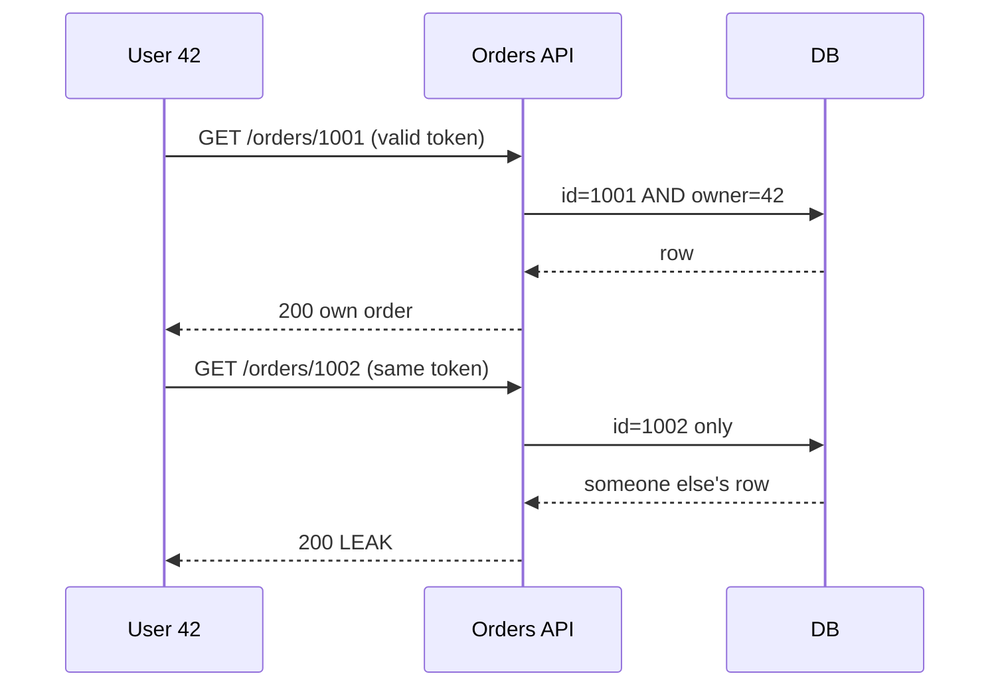
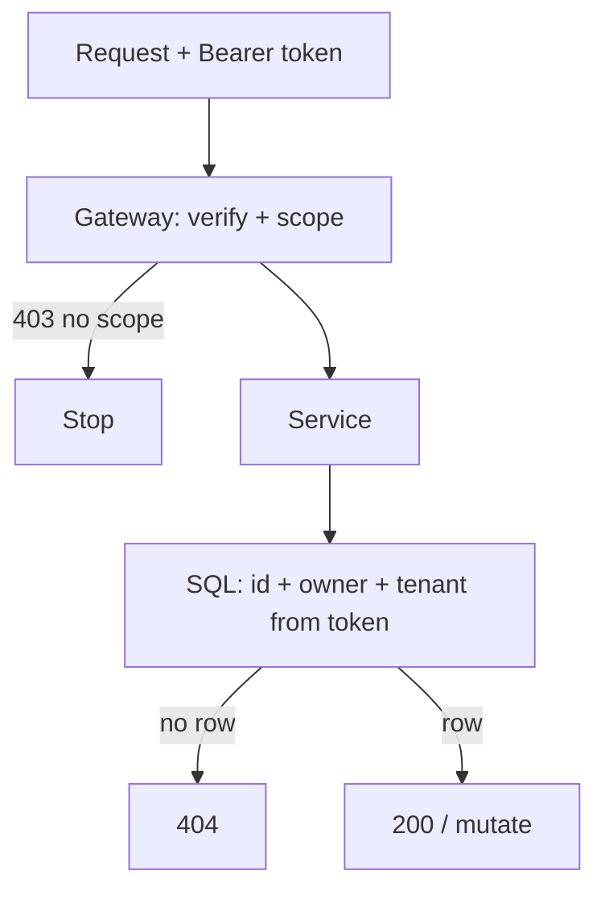
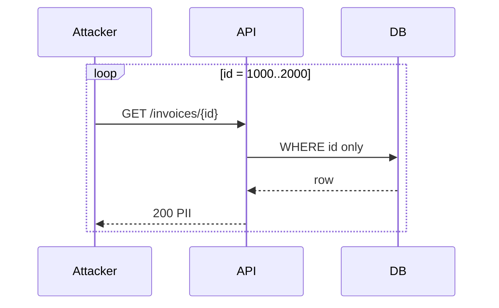

# Lesson 16: API Authorization & BOLA — Scopes, Ownership Checks and Where They Live

> **Prerequisites:** [Lesson 15: API Authentication](../15-api-authentication/README.md), [Lesson 11: API Error Handling](../11-api-error-handling/README.md).  
> **Estimated Reading Time:** 33 minutes  
> **Target Audience:** Backend engineers closing IDOR/BOLA holes in multi-tenant HTTP APIs and placing the right checks at gateway vs service.  
> **Free PDF Notes:** [Download SD-C-016.pdf](https://backendroadmap.com/notes/system-design/SD-C-016.pdf)

> [!NOTE]
> **In one line:** A valid token proves who the caller is, not what they may touch; check scopes at the gateway, but check that the caller **owns this object** in the service, **in the query itself**, on every request.

> [!TIP]
> **The Golden Rule of Object Authorization:** Take `user_id` / `tenant_id` from the **verified token**, never from the body. Filter every read/write with `AND owner_id = :token_user AND tenant_id = :token_tenant`. Missing that `AND` **is** BOLA. UUIDs are defense in depth—not a fix. Prefer **`404`** over **`403`** for cross-user IDs.

---

## 1. Core Definition & Taxonomic Comparison

User 42’s token is valid for `GET /orders/1001` (theirs). Changing the ID to `1002` returns someone else’s order. **Authentication worked; authorization failed.** That is **BOLA** (Broken Object Level Authorization), #1 in the OWASP API Security Top 10—also called **IDOR**.

| Term | Precise Meaning | Production Example |
| :--- | :--- | :--- |
| **Authentication** | Who are you? | Valid JWT for user 42 |
| **Authorization** | May you do **this** to **this** resource? | Own order 1001, not 1002 |
| **Scope** | Coarse action class on a token | `orders:read` |
| **BOLA / IDOR** | Object ID trusted without ownership check | `/orders/{id}` by id alone |

Scopes narrow *kinds* of actions; they never answer “is this order yours?”

---

## 2. Component Breakdown, Anatomy & Observability Gap

```
GATEWAY · COARSE                    SERVICE · OBJECT-LEVEL
Is token valid?                     Does caller own this order?
Does it carry orders:read?          owner_id = token user
no scope → 403                      tenant_id = token tenant
                                    no row → 404
```

| Vulnerable | Fixed |
| :--- | :--- |
| `SELECT * FROM orders WHERE id = :order_id` | `… WHERE id = :id AND owner_id = :token_user AND tenant_id = :token_tenant` |

> [!WARNING]
> **The Observability Gap:** Gateway metrics show “auth success + scope OK” while BOLA succeeds quietly as **`200`**. You will not see it in `401`/`403` dashboards. Detect with **cross-user integration tests**, access logs joining `(actor_id, resource_owner_id)` mismatch rates, and canary IDs only owners should hit.



---

## 3. Mathematical Model & Attack Economics

Sequential ID probing: attacker tries $N$ IDs.

$$
P(\text{hit at least one accessible foreign object without check}) \to 1\ \text{as enumeration proceeds}
$$

With checks, hit rate for foreign objects = 0 (always `404`). Random UUIDs reduce guess probability (~$2^{-122}$) but **leaked** IDs (email links, logs, referrers) remain fully usable without ownership filters.

| Defense | Stops blind guessing | Stops leaked ID abuse |
| :--- | :---: | :---: |
| Sequential IDs only | No | No |
| UUIDs only | Mostly | **No** |
| Ownership in query | Yes | **Yes** |
| RLS / repo filter | Yes | **Yes** |

**Headroom:** Structural filters (RLS/repository) beat per-handler discipline alone.

---

## 4. Metrics, Percentiles & Distributions

| Metric | Meaning |
| :--- | :--- |
| Cross-tenant `404` rate | Expected deny path |
| Owner mismatch attempts | Attack / bug signal |
| Endpoints without owner filter (code scan) | Debt |
| Internal service “god” account usage | Blast radius |

---

## 5. Compounding Effects at Scale

$M$ microservices; if **one** skips ownership on internal calls, compromise of a peer yields global read:

$$
\text{Blast radius} \approx \text{union of all data that peer can fetch}
$$

Pass end-user identity on internal calls; least-privilege service accounts.

| Trust model | BOLA risk |
| :--- | :--- |
| “Internal = trusted” | Critical |
| Forward user token | Contained |
| Signed internal token + tenant | Contained |
| Per-service god role | High |

---

## 6. Numbers Every Backend Engineer Must Know

| Item | Note |
| :--- | :--- |
| OWASP API #1 | BOLA |
| Deny shape | Prefer `404` for hidden objects |
| Scope example | `orders:read` / `orders:write` |
| Models | RBAC + ownership; ABAC; ReBAC/Zanzibar |

---

## 7. Protocol & Network Deep Dive



Policy models as rules grow: **RBAC** (roles), **ABAC** (attributes), **ReBAC** (relationships, Zanzibar). Centralize policy (e.g. OPA) but **enforce in every service**.

---

## 8. Hierarchical Budgets & Capacity Sizing

| Layer | Responsibility |
| :--- | :--- |
| Gateway | Authn, audience, scopes |
| Service | Object ownership / tenant |
| DB | RLS optional enforcement |
| Tests | User B × User A’s IDs → 404 |

---

## 9. Top Engineering Mitigation Techniques

1. Ownership + tenant predicates in every query.
2. IDs from token only.
3. `404` for not-yours.
4. Repo layer / RLS so engineers cannot forget.
5. Cross-user tests on every ID’d endpoint.
6. No god internal accounts without user context.

---

## 10. Production War Story (SEV-1 Post-Mortem)

**Impact:** Support tool scraped `/invoices/{id}` for “prefetch”—any logged-in user could read any invoice by incrementing IDs. Detected via customer privacy complaint.



**Fix:** Add owner/tenant filters; return `404`; add cross-user tests; block sequential scrape with rate limits (defense in depth only).

---

## 11. Multi-Language Production Code

````carousel
```go
package orders

import (
	"context"
	"database/sql"
	"errors"
)

var ErrNotFound = errors.New("not found")

func GetOrder(ctx context.Context, db *sql.DB, orderID, userID, tenantID string) (Order, error) {
	var o Order
	err := db.QueryRowContext(ctx, `
		SELECT id, total_cents FROM orders
		WHERE id = $1 AND owner_id = $2 AND tenant_id = $3`,
		orderID, userID, tenantID,
	).Scan(&o.ID, &o.TotalCents)
	if errors.Is(err, sql.ErrNoRows) {
		return o, ErrNotFound // map to 404
	}
	return o, err
}
```
<!-- slide -->
```typescript
export async function getOrder(
  db: { oneOrNone: Function },
  orderId: string,
  userId: string,
  tenantId: string,
) {
  const row = await db.oneOrNone(
    `SELECT id, total_cents FROM orders
     WHERE id = $1 AND owner_id = $2 AND tenant_id = $3`,
    [orderId, userId, tenantId],
  );
  if (!row) {
    const err = new Error("not_found");
    (err as any).status = 404;
    throw err;
  }
  return row;
}
```
<!-- slide -->
```python
from fastapi import APIRouter, Depends, HTTPException

router = APIRouter()

@router.get("/orders/{order_id}")
def get_order(order_id: str, user=Depends(current_user), db=Depends(get_db)):
    row = db.fetch_one(
        """
        SELECT id, total_cents FROM orders
        WHERE id = :id AND owner_id = :owner AND tenant_id = :tenant
        """,
        {"id": order_id, "owner": user.id, "tenant": user.tenant_id},
    )
    if row is None:
        raise HTTPException(status_code=404, detail="Not found")
    return row
```
<!-- slide -->
```csharp
public sealed class OrdersService
{
    private readonly IDbConnection _db;
    public OrdersService(IDbConnection db) => _db = db;

    public async Task<Order?> GetAsync(string orderId, string userId, string tenantId)
    {
        return await _db.QuerySingleOrDefaultAsync<Order>(
            @"SELECT id, total_cents FROM orders
              WHERE id = @orderId AND owner_id = @userId AND tenant_id = @tenantId",
            new { orderId, userId, tenantId });
        // Controller: null → NotFound()  // 404, not Forbid()
    }
}
```
````

---

## 12. Hands-On CLI Verification Workflows

```bash
# Pseudo integration test with two tokens
curl -sS -o /dev/null -w "%{http_code}\n" -H "Authorization: Bearer $TOKEN_A" \
  http://localhost:8000/orders/$ORDER_A_ID    # expect 200
curl -sS -o /dev/null -w "%{http_code}\n" -H "Authorization: Bearer $TOKEN_B" \
  http://localhost:8000/orders/$ORDER_A_ID    # expect 404
```

---

## 13. Common Mistakes to Avoid

- Valid token / correct scope ⇒ access any record.
- User/tenant ID from request body.
- Object checks only at the gateway (it lacks ownership data).
- Skipping checks on internal calls.
- “We use UUIDs” as the BOLA fix.
- Returning `403` for other users’ objects (existence leak).

---

## 14. Key Terms Glossary

| Term | Definition |
| :--- | :--- |
| **Authorization** | May this caller do this action on this resource |
| **Scope** | Coarse token permission (`orders:read`) |
| **BOLA / IDOR** | Object ID trusted without ownership check |
| **OWASP API Top 10** | BOLA is #1 |
| **Row-level security** | DB adds tenant/owner filter |
| **RBAC / ABAC / ReBAC** | Roles / attributes / relationships |

---

## 15. Complete 12 System Design Interview Q&As

<details>
<summary><strong>Q1. What is BOLA? [BASIC]</strong></summary>

Broken Object Level Authorization: API accepts an object ID and acts on it without checking the caller may access it (e.g. change 1001→1002). OWASP API Top 10 #1; also called IDOR.

</details>

<details>
<summary><strong>Q2. Authentication vs authorization? [BASIC]</strong></summary>

Authn proves identity. Authz decides whether that identity may perform this action on this specific resource. Passing the first does not imply passing the second.

</details>

<details>
<summary><strong>Q3. Token has orders:read—any order? [BASIC]</strong></summary>

Only if the service lets it. Scopes describe action kinds, not records. Still check ownership (and tenant).

</details>

<details>
<summary><strong>Q4. Where do checks live with a gateway? [BASIC]</strong></summary>

Token validity + scopes at the gateway. Object-level checks in the service at the data layer on every request—including internal calls.

</details>

<details>
<summary><strong>Q5. /invoices/{id} returns any invoice. Fix and prevent recurrence? [SCENARIO]</strong></summary>

Add owner/tenant filters; `404` on miss. Structuralize via repository/RLS; cross-user tests for every ID endpoint.

</details>

<details>
<summary><strong>Q6. Why 404 instead of 403 for another user's order? [SCENARIO]</strong></summary>

`403` confirms existence (enumeration). `404` makes “missing” and “not yours” identical.

</details>

<details>
<summary><strong>Q7. Support agent needs cross-user read. Design? [SCENARIO]</strong></summary>

Separate audited path checking `support` role + tenant (or ticket scope)—not the customer's ownership path, and not a silent bypass of filters for everyone.

</details>

<details>
<summary><strong>Q8. GraphQL node(id) API—BOLA angle? [SCENARIO]</strong></summary>

Global ID resolvers must apply the same ownership/tenant checks per type; a single `node` entry point is a classic BOLA magnet if unchecked.

</details>

<details>
<summary><strong>Q9. Switched to UUIDs—BOLA solved? [TRICKY]</strong></summary>

No. UUIDs hinder guessing; IDs still leak. Ownership checks remain mandatory.

</details>

<details>
<summary><strong>Q10. Internal reporting service uses a god service account. Risk? [TRICKY]</strong></summary>

Bypasses per-user checks; compromise exposes all customers. Forward end-user identity; narrow the service account.

</details>

<details>
<summary><strong>Q11. Can the gateway do object-level authz with a central policy service? [TRICKY]</strong></summary>

Only if the gateway can resolve resource attributes (owner/tenant) for every request—usually an extra fetch that recreates the service. Prefer service-side enforcement; gateway stays coarse.

</details>

<details>
<summary><strong>Q12. RBAC alone enough for multi-tenant SaaS? [TRICKY]</strong></summary>

No. Roles don’t express “only your rows.” Combine RBAC with ownership/tenant predicates or ReBAC relationships.

</details>

---

## 16. One-Page Master Cheat Sheet

```text
====================================================================================================
               API AUTHORIZATION & BOLA (SD-C-016)  —  MASTER CHEAT SHEET
====================================================================================================
AUTHN ≠ AUTHZ     token valid ≠ may touch this row
SCOPE             coarse (orders:read) at gateway
OBJECT CHECK      service query: id AND owner AND tenant from TOKEN
DENY              404 for not-yours (avoid existence leak)

BOLA              OWASP API #1 / IDOR — missing ownership AND
FIX               RLS / repo always filters | cross-user tests | no god internal accounts
UUID              defense in depth ONLY — not the fix

ANTI              X trust scope alone  X IDs from body  X gateway-only object checks
                  X skip internal authz  X 403 for hidden objects
====================================================================================================
```

---

## Free PDF notes

[SD-C-016.pdf](https://backendroadmap.com/notes/system-design/SD-C-016.pdf)

---

## Sources

- [OWASP API Security Top 10 — API1 BOLA](https://owasp.org/API-Security/)
- [Google Zanzibar paper](https://research.google/pubs/pub48190/) — ReBAC at scale.
- [OPA](https://www.openpolicyagent.org/) — centralized policy, distributed enforcement.

---

## Next

Next comes [Lesson 17: API Gateway Explained](../17-api-gateway-explained/README.md) (still on the track roadmap). See [the track overview](../README.md) for the whole series.
