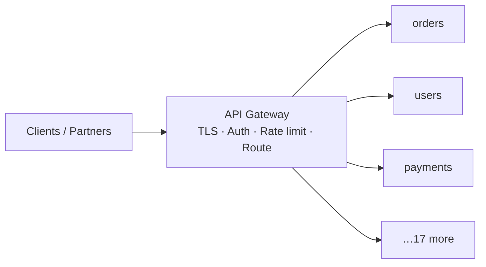
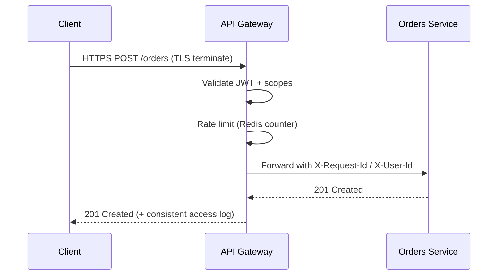
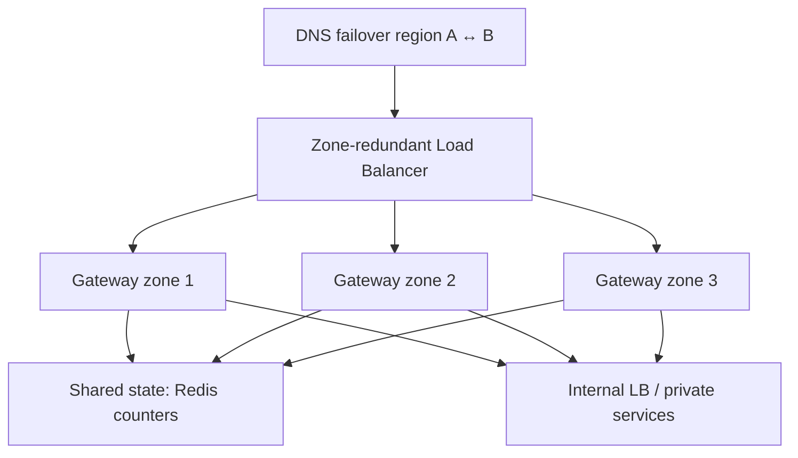
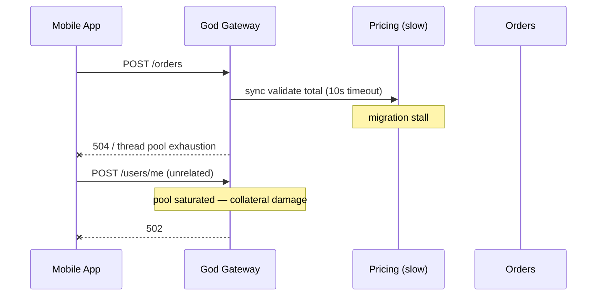

# Lesson 17: API Gateway Explained — What Belongs in It, BFFs & Avoiding a SPOF

> **Prerequisites:** [Lesson 15: API Authentication](../15-api-authentication/README.md), [Lesson 16: API Authorization & BOLA](../16-api-authorization-bola/README.md), and [API Design Overview](../README.md) (Lesson 17 of 23).  
> **Estimated Reading Time:** 30–35 minutes  
> **Target Audience:** Backend and platform engineers designing the public edge of a microservice fleet, choosing gateway vs BFF vs mesh boundaries, and hardening the edge so it never becomes a single point of failure.  
> **Free PDF Notes:** [Download SD-C-017.pdf](https://backendroadmap.com/notes/system-design/SD-C-017.pdf)

> [!NOTE]
> **In one line:** an API gateway is one front door that handles the cross-cutting work every request needs (TLS, auth, rate limits, routing, observability); keep business logic out of it, and run it as redundant stateless instances so it never becomes a single point of failure.

> [!TIP]
> **The Golden Rule of API Gateways:** If a rule would be the same for *any* API (validate a token, limit to `100 req/min`, add a trace ID), it can live in the gateway. If it mentions a business noun (order total, discount, stock level, “owns order `1002`”), it belongs in a service. Keep the gateway thin, generic, multi-instance, and config-canaried.

---

## Words You'll Meet Today

| Word | In Plain Words | Role in a Live Backend System |
| :--- | :--- | :--- |
| **API gateway** | Single public entry point that applies API-aware policies before traffic reaches services. | Terminates TLS, authenticates, rate-limits, routes, and emits consistent telemetry for every north-south call. |
| **Cross-cutting concern** | Work every request needs regardless of which domain service handles it. | Authn, TLS, quotas, transforms, and tracing belong at the edge so each service does not re-implement them. |
| **BFF** | Backend-for-frontend: a thin API layer owned by one client team (mobile, web). | Aggregates several service calls into the shape one screen needs without polluting the shared gateway. |
| **God gateway** | A gateway overloaded with pricing, workflows, and domain validation. | Becomes a release bottleneck and a blast-radius amplifier—one bad policy breaks every API. |
| **North-south** | Traffic from outside the system into the perimeter. | Gateway territory: partners, mobile apps, browsers hitting the public hostname. |
| **East-west** | Traffic between internal services. | Usually a service mesh (mTLS, retries, telemetry), not the public API gateway. |
| **SPOF** | Single point of failure: if it dies, everything dies. | A lone gateway instance, or rate-limit state only in one process’s memory, is a classic SPOF. |
| **Fail open / fail closed** | What to do when shared state (Redis counters) is unreachable. | Fail open keeps the product up with coarse local limits; fail closed protects expensive/abuse-prone routes. |

---

## Visual Mental Models & Architecture

### The Question: Why Not Twenty Public Hostnames?

Your company runs twenty Python microservices: orders, users, payments, and more. Mobile apps and partners need to call them. Exposing twenty hostnames—each doing its own TLS, authentication, and rate limiting—means twenty certificate renewals, twenty auth bugs, and twenty public attack surfaces. Put **one front door** in front of them: an API gateway. Services stay private; clients learn one hostname.



*Figure 1. Without a gateway every service repeats edge work and is internet-exposed. With one, services stay private behind a single hostname.*

### Everyday Picture: One Building Lobby, Many Floors

Think of a secure office tower. Visitors do not wander to every floor’s fire exit. They enter through **one lobby** (gateway): badge check (auth), metal detector throughput limit (rate limit), directory (routing), and cameras (observability). Floor teams still decide who may enter a specific office (object-level authorization)—the lobby cannot know every desk assignment.

### Policy Chain Anatomy & Observability Gap

A gateway is a **policy chain**. Each step is generic—it works the same for every API behind it:

1. **TLS terminate** — certificates live in one place.
2. **Auth** — validate API keys or JWTs (signature, expiry, audience) and check scopes.
3. **Rate limit / quota** — per key, user, or partner.
4. **Route** — `/orders` → orders service (path or host based).
5. **Transform** — add headers, or translate REST ↔ gRPC.
6. **Observe** — logs, metrics, and traces in one consistent format.

**The Observability Gap:** Client RUM sees total latency including DNS + TLS + gateway hop. Gateway dashboards show policy latency and upstream status. Service handlers see only post-gateway time and often miss that a `15 ms` JWT JWKS miss or Redis rate-limit call is eating the budget. Always track **gateway p99 separately** from service p99, and tag spans with `gateway.policy` so a slow auth plugin is visible.



*Figure 2. Typical north-south path: edge policies first, then private service hop.*

### Aggregation vs BFF

Some gateways also **aggregate**: one client call fans out to several services and merges results so a mobile screen needs one round trip. That pattern often lives in a separate **backend for frontend (BFF)**—one per client type—owned by the client team so it can change at their pace without touching the platform gateway. Keep the shared gateway for generic policies; put screen-shaped aggregation in the BFF.

### Concrete Setup: Azure API Management (and Kin)

Clients call one public hostname. Azure API Management validates the JWT issued by Entra ID, applies a rate limit per subscription key, and routes to FastAPI services running privately inside a VNet or Kubernetes behind an internal load balancer. Developers get a portal with docs and keys. Similar options: Kong, AWS API Gateway, Apigee, and Envoy-based gateways.

---

## Systematic Reference & Comparison Grid

### Don't Confuse the Gateway with Its Neighbours

| Term | Precise Meaning | Production Example |
| :--- | :--- | :--- |
| **Load balancer** | Spreads connections across servers; knows little about APIs. | Azure LB / NLB distributing TCP to gateway pods. |
| **Reverse proxy (NGINX)** | Forwards requests; can do some gateway work (TLS, routing). | Path-based proxy to one monolith without JWT quotas. |
| **API gateway** | API-aware policies: keys, JWTs, quotas, transforms, developer portal. | Kong validating JWT then routing `/v1/orders` privately. |
| **Service mesh** | mTLS, retries, and telemetry between services (east-west). | Istio sidecars between orders ↔ inventory. |

### What Belongs vs What Does Not

| In the Gateway (generic) | In the Service / BFF (domain) |
| :--- | :--- |
| TLS termination, mTLS to upstream | Order validation, pricing rules |
| JWT / API-key validation + scopes | Object-level auth (“owns order `1002`”) |
| Rate limits & partner quotas | Orchestrating multi-step business workflows |
| Path/host routing, header injection | Screen-specific aggregation (prefer BFF) |
| Consistent access logs & tracing | Domain metrics (orders placed, GMV) |

---

## Mathematical Model: Edge Hop Cost & Blast Radius

Every request pays the gateway hop. If gateway policy latency is $L_g$ and service latency is $L_s$:

$$L_{\text{client}} \approx L_g + L_s + L_{\text{network}}$$

If a bad config takes the gateway down, availability of the public API collapses to the gateway’s availability—not the average of twenty services:

$$A_{\text{public}} \approx A_{\text{gateway}}$$

With $N$ independent gateway instances behind a healthy LB (assuming independent failure probability $p$):

$$P(\text{all down}) = p^N$$

| Instances ($N$) | Instance failure $p=1\%$ | $P(\text{all down})$ |
| :--- | :--- | :--- |
| 1 | 1% | $10^{-2}$ |
| 2 | 1% | $10^{-4}$ |
| 3 | 1% | $10^{-6}$ |
| 6 (2 per AZ × 3 AZ) | 1% | $\approx 10^{-12}$ |

**Rule of thumb:** run **≥3** stateless instances across **≥2** availability zones; prefer a zone-redundant managed tier, or multi-region DNS failover for regional loss.

### Utilization vs Added Latency at the Edge

Gateway plugins that call Redis or JWKS synchronously sit on the critical path. Under $M/M/1$-style saturation, mean wait scales as $\frac{1}{1-\rho}$:

| Utilization $\rho$ | Queue multiplier $\frac{1}{1-\rho}$ | Meaning for gateway p99 |
| :--- | :--- | :--- |
| 50% | 2× | Comfortable headroom |
| 70% | ~3.3× | Typical ops target band |
| 85% | ~6.7× | Policy latency starts climbing |
| 95% | 20× | SEV territory—JWKS/Redis blips amplify |
| 99% | 100× | Collapse |

Keep edge CPU/connection utilization in the **60–70%** band and **cache JWKS** aggressively.

---

## Metrics, Percentiles & Who Feels Them

| Percentile | Who it describes | Gateway implication |
| :--- | :--- | :--- |
| $p_{50}$ | Typical healthy call | Should stay near local RTT + cheap policy |
| $p_{95}$ | Slow-but-common | Often JWKS refresh or Redis hiccup |
| $p_{99}$ | Tail the SLO cares about | Budget this hop explicitly (e.g. ≤`15–20 ms`) |
| $p_{99.9}$ | Rare spikes | Canary config rollouts and cold starts |

**Worked example — averages lie:** Suppose `90%` of gateway calls add `4 ms`, `9%` add `40 ms` (JWKS miss), `1%` add `800 ms` (Redis stall). Arithmetic mean ≈ `0.9×4 + 0.09×40 + 0.01×800 = 15.2 ms`, but $p_{99}$ is already near `800 ms`. Alert on **gateway p99**, not mean.

---

## Compounding Effects at Fleet Scale

If each of $N$ independent edge policies has success probability $0.999$:

$$P(\text{request succeeds all policies}) = 0.999^N$$

| Policies $N$ | Success rate | Failures per 1M requests |
| :--- | :--- | :--- |
| 1 | 99.90% | 1,000 |
| 5 | 99.50% | ~5,000 |
| 10 | 99.00% | ~10,000 |
| 20 | 98.02% | ~19,800 |

**Implication:** every extra synchronous policy (authz webhook, custom Lua, remote config fetch) compounds failure and latency. Prefer local/cached decisions at the edge.

---

## Numbers Every Backend Engineer Must Know

| Operation | Layer | Typical Cost | Architectural Implication |
| :--- | :--- | :--- | :--- |
| Local JWT verify (cached JWKS) | Gateway CPU | `0.1–1 ms` | Safe on every request |
| JWKS fetch cold | HTTPS to IdP | `50–200 ms` | Cache aggressively; never sync-fetch per request |
| Redis INCR rate-limit | Same AZ | `0.5–2 ms` | Fine; set timeout + fail-open/closed policy |
| Redis down (no timeout) | Edge | **hangs forever** | Hard SPOF—always bound the call |
| Extra gateway hop same region | Network | `1–5 ms` | Usually acceptable vs SLO |
| Extra hop cross-region | Network | `30–80+ ms` | Keep gateway co-located with services |
| God-gateway config push (all at once) | Ops | blast radius = **100% APIs** | Canary + one-click rollback |

---

## Protocol & Network Deep Dive

North-south traffic: client → public LB → gateway pods → internal LB / cluster DNS → service. East-west stays on the mesh. Services must **not** have public IPs; otherwise attackers bypass the gateway entirely (same class of failure as CDN origin bypass).



*Figure 3. Redundant at every level. Instances share no memory—any pod can serve any request. Decide fail-open vs fail-closed when Redis is down.*

---

## Hierarchical Budgets & Capacity Sizing

Example endpoint SLO: **300 ms p99**. Suggested edge budget:

| Tier | Budget | Notes |
| :--- | :--- | :--- |
| Gateway policies (TLS already done) | `10–20 ms` | Cached JWT + Redis limit |
| Service logic | `80–120 ms` | Domain work |
| Downstream deps | `100–150 ms` | With their own deadlines |
| Headroom / retries | `30–50 ms` | Do not spend at the edge |
| **Total** | **≤300 ms** | |

Derive: if gateway alone adds `15 ms` median but `80 ms` p99, either slim policies or raise the SLO honestly—you cannot hide an unbounded edge hop.

---

## Top Engineering Mitigation Techniques

1. **Thin generic policies only** — authn, limits, routing, transforms, telemetry.
2. **Stateless multi-AZ instances** — no per-process rate-limit memory as sole truth.
3. **External shared state with explicit fallback** — Redis counters; fail open or closed by route class.
4. **Canary config + instant rollback** — never push a route change to 100% at once.
5. **BFF for aggregation** — keep screen-shaped mashups out of the shared platform gateway.
6. **Origin/service lockdown** — private networking so nothing bypasses the front door.

---

## Production War Story (SEV-1 Post-Mortem)

**Severity & Impact:** SEV-1, ~18 minutes. All mobile checkout APIs returned `401`/`500`. Detection via gateway error-rate page; ~40% of checkouts failed.

**What Happened:** A platform engineer embedded a “reject orders over `$10,000`” rule as a gateway policy that called the pricing service synchronously. Pricing deployed a slow migration; gateway threads blocked; rate-limit Redis timeouts stacked; every API behind the gateway saturated.

```python
# Anti-pattern: business rule + sync dependency inside gateway policy
if float(body.get("total", 0)) > 10_000:
    pricing = http.get("http://pricing/validate", json=body, timeout=10)  # unbounded blast radius
    if not pricing.ok:
        return 500
```



**RCA:** Domain logic and a synchronous dependency in the shared edge turned one service’s latency into a fleet-wide outage (god gateway + SPOF behavior).

**Fix & Hardening:**
1. Moved the `$10k` rule into the orders service; gateway only checks `orders:write` scope.
2. Capped all gateway plugin egress at `50 ms` with fail-closed only on abuse routes.
3. Canary config to 5% of instances; alert on gateway p99 and upstream wait separately.

---

## Multi-Language Production Patterns

Edge policy illustration: validate a bearer JWT with cached JWKS material and reject missing scopes—generic, no business nouns.

````carousel
```go
package gateway

import (
	"context"
	"errors"
	"net/http"
	"strings"
)

type TokenClaims struct {
	Sub    string
	Scopes map[string]struct{}
}

type Verifier interface {
	Verify(ctx context.Context, raw string) (TokenClaims, error)
}

func RequireScope(v Verifier, scope string) func(http.Handler) http.Handler {
	return func(next http.Handler) http.Handler {
		return http.HandlerFunc(func(w http.ResponseWriter, r *http.Request) {
			raw := strings.TrimPrefix(r.Header.Get("Authorization"), "Bearer ")
			if raw == "" || raw == r.Header.Get("Authorization") {
				http.Error(w, "missing bearer token", http.StatusUnauthorized)
				return
			}
			claims, err := v.Verify(r.Context(), raw)
			if err != nil {
				http.Error(w, "invalid token", http.StatusUnauthorized)
				return
			}
			if _, ok := claims.Scopes[scope]; !ok {
				http.Error(w, "insufficient scope", http.StatusForbidden)
				return
			}
			next.ServeHTTP(w, r.WithContext(context.WithValue(r.Context(), "sub", claims.Sub)))
		})
	}
}

var ErrRedisTimeout = errors.New("rate limit store timeout")
```
<!-- slide -->
```typescript
import type { IncomingMessage, ServerResponse } from "node:http";

export type Claims = { sub: string; scopes: Set<string> };

export type Verifier = (token: string) => Promise<Claims>;

export function requireScope(verify: Verifier, scope: string) {
  return async (req: IncomingMessage, res: ServerResponse, next: () => void) => {
    const header = req.headers.authorization ?? "";
    const token = header.startsWith("Bearer ") ? header.slice(7) : "";
    if (!token) {
      res.statusCode = 401;
      res.end("missing bearer token");
      return;
    }
    try {
      const claims = await verify(token);
      if (!claims.scopes.has(scope)) {
        res.statusCode = 403;
        res.end("insufficient scope");
        return;
      }
      (req as IncomingMessage & { sub?: string }).sub = claims.sub;
      next();
    } catch {
      res.statusCode = 401;
      res.end("invalid token");
    }
  };
}
```
<!-- slide -->
```python
from collections.abc import Callable
from dataclasses import dataclass

from fastapi import HTTPException, Request


@dataclass(frozen=True)
class Claims:
    sub: str
    scopes: frozenset[str]


Verifier = Callable[[str], Claims]


def require_scope(verify: Verifier, scope: str):
    async def dependency(request: Request) -> Claims:
        auth = request.headers.get("Authorization", "")
        if not auth.startswith("Bearer "):
            raise HTTPException(status_code=401, detail="missing bearer token")
        try:
            claims = verify(auth.removeprefix("Bearer ").strip())
        except Exception as exc:
            raise HTTPException(status_code=401, detail="invalid token") from exc
        if scope not in claims.scopes:
            raise HTTPException(status_code=403, detail="insufficient scope")
        return claims

    return dependency
```
<!-- slide -->
```csharp
using System.Security.Claims;
using Microsoft.AspNetCore.Http;

public static class GatewayAuth
{
    public static async Task RequireScopeAsync(
        HttpContext ctx,
        Func<string, Task<ClaimsPrincipal>> verify,
        string scope)
    {
        var header = ctx.Request.Headers.Authorization.ToString();
        if (!header.StartsWith("Bearer ", StringComparison.OrdinalIgnoreCase))
        {
            ctx.Response.StatusCode = StatusCodes.Status401Unauthorized;
            await ctx.Response.WriteAsync("missing bearer token");
            return;
        }

        var token = header["Bearer ".Length..].Trim();
        ClaimsPrincipal principal;
        try
        {
            principal = await verify(token);
        }
        catch
        {
            ctx.Response.StatusCode = StatusCodes.Status401Unauthorized;
            await ctx.Response.WriteAsync("invalid token");
            return;
        }

        if (!principal.FindAll("scope").Any(c => c.Value == scope) &&
            !principal.FindAll("scp").Any(c => c.Value.Split(' ').Contains(scope)))
        {
            ctx.Response.StatusCode = StatusCodes.Status403Forbidden;
            await ctx.Response.WriteAsync("insufficient scope");
            return;
        }

        ctx.User = principal;
    }
}
```
````

---

## Practical Hands-On Verification CLI Workflows

### 1. Confirm the public hostname terminates TLS at the gateway

```bash
curl -sS -o /dev/null -w "tls:%{time_appconnect}s ttfb:%{time_starttransfer}s code:%{http_code}\n" https://api.example.com/healthz
```

### 2. Prove a missing scope is rejected at the edge

```bash
curl -sS -o /dev/null -w "%{http_code}\n" -H "Authorization: Bearer $TOKEN_WITHOUT_ORDERS_WRITE" -X POST https://api.example.com/orders
```

**Expected:** `403` (or `401` if token invalid)—before the orders service log line appears.

### 3. Simulate Redis failure mindset (timeout must exist)

```bash
python -c "import socket; s=socket.create_connection(('127.0.0.1',6379),2); s.close(); print('redis reachable')"
```

If your gateway has no timeout around Redis, a blackhole route will hang workers—fix that in staging with a fault injection proxy.

---

## Pause and Think

> [!exercise] A team wants the shared gateway to reject orders over `$10,000` by calling pricing. List three concrete failure modes this creates before opening the answer.

<details><summary>Answer</summary>

1. **God gateway / release bottleneck** — every pricing-rule tweak waits on the platform team and risks every API.  
2. **Latency coupling** — pricing slowness becomes gateway thread exhaustion and collateral `502`s on unrelated routes.  
3. **Wrong layer for BOLA-adjacent checks** — “is this total allowed for this customer?” needs domain data; the gateway can check `orders:write`, not business nouns.

</details>

---

## Common Mistakes & Troubleshooting

- Putting pricing, validation, or workflows in gateway policies (god gateway).
- Trusting the gateway for **object-level** authorization.
- A single gateway instance, or rate-limit counters only in one process’s memory.
- Pushing a config change to all instances at once with no rollback.
- Services still reachable from the internet, bypassing the gateway.
- Unbounded synchronous calls from policies (IdP, pricing, feature flags).
- Ignoring gateway-own p99 while only watching service dashboards.

| Symptom | Root Cause | Fix |
| :--- | :--- | :--- |
| All APIs 5xx after one config push | Non-canaried gateway config | Canary + automatic rollback |
| Random 401 storms | JWKS cache expiry thundering herd | Long JWKS TTL + soft refresh |
| Product down when Redis blips | Fail-closed globally / no timeout | Per-route fallback; bound Redis RTT |

---

## Key Terms Glossary

| Term | Interview-ready definition |
| :--- | :--- |
| **API gateway** | Single entry point for cross-cutting API concerns on north-south traffic. |
| **Cross-cutting concern** | Work every request needs: auth, TLS, limits, routing, telemetry. |
| **BFF** | Backend for frontend—one thin API per client type for aggregation. |
| **God gateway** | Gateway overloaded with business logic and domain dependencies. |
| **North-south** | Outside → inside traffic through the public perimeter. |
| **East-west** | Service ↔ service traffic, usually mesh-managed. |
| **Fail open** | Allow traffic (often with coarse local limits) when shared state is down. |
| **Fail closed** | Reject traffic when shared state is down—used for abuse-prone routes. |

---

## Interview Practice Questions

Each question is tagged by kind: **Basic**, **Scenario**, and **Tricky**. Answer out loud before opening the solution.

<details>
<summary><strong>1. What belongs in an API gateway, and what doesn't? [BASIC]</strong></summary>

<strong>What a strong answer covers:</strong>
Cross-cutting concerns: routing, TLS, authentication, rate limiting, transformations, and observability. Not business logic, domain validation, or object-level authorization—those stay in the services (or a BFF for aggregation).

</details>

<details>
<summary><strong>2. API gateway vs load balancer vs service mesh? [BASIC]</strong></summary>

<strong>What a strong answer covers:</strong>
A load balancer spreads connections and knows little about APIs. A gateway applies API-aware policies to north-south traffic from outside. A mesh handles east-west traffic between services with mutual TLS, retries, and telemetry.

</details>

<details>
<summary><strong>3. What is a backend for frontend? [BASIC]</strong></summary>

<strong>What a strong answer covers:</strong>
A thin API layer per client type (mobile, web) that aggregates several service calls into the shape that client needs, so one screen needs one round trip. Owned by the client team, not the platform team.

</details>

<details>
<summary><strong>4. What is a “god gateway,” and why is it dangerous? [BASIC]</strong></summary>

<strong>What a strong answer covers:</strong>
A gateway stuffed with business rules and domain calls. It creates a platform release bottleneck, couples every API to unrelated dependencies, and turns one bad policy into a fleet-wide outage.

</details>

<details>
<summary><strong>5. How do you keep the gateway from being a single point of failure? [SCENARIO]</strong></summary>

<strong>What a strong answer covers:</strong>
Several stateless instances across zones (or regions with DNS failover) behind a load balancer; shared state such as rate-limit counters in an external store with a clear fallback; gradual config rollout with canaries and rollback; alerts on gateway latency and errors.

</details>

<details>
<summary><strong>6. A team wants the gateway to reject orders over $10,000. Good idea? [SCENARIO]</strong></summary>

<strong>What a strong answer covers:</strong>
No. That is a business rule; it needs domain data and changes with the business. Put it in the orders service. Otherwise every rule change waits on the platform team and one bad policy can break every API.

</details>

<details>
<summary><strong>7. Rate-limit counters live in Redis and Redis goes down. What should the gateway do? [SCENARIO]</strong></summary>

<strong>What a strong answer covers:</strong>
Decide in advance. Fail open (allow traffic, maybe with a coarse local per-instance limit) to keep the product up, or fail closed for expensive or abuse-prone endpoints. Never block on Redis with no timeout.

</details>

<details>
<summary><strong>8. Services are still reachable on public IPs “for debugging.” What is the risk? [SCENARIO]</strong></summary>

<strong>What a strong answer covers:</strong>
Attackers and misconfigured clients bypass TLS/auth/rate-limit policies entirely. Lock services to private networks; only the gateway (or mesh ingress) should be public. Treat bypass paths as SEV-worthy findings.

</details>

<details>
<summary><strong>9. The gateway adds 15 ms to every call. Is that a problem? [TRICKY]</strong></summary>

<strong>What a strong answer covers:</strong>
It depends on the SLO, but it is paid on every request, so measure it. Keep policies cheap (cache JWKS keys, avoid synchronous calls to other services in policies), keep the gateway in the same region as the services, and track its own p99 separately.

</details>

<details>
<summary><strong>10. The gateway already validated the JWT. Can services skip all checks? [TRICKY]</strong></summary>

<strong>What a strong answer covers:</strong>
They can trust the gateway for token validity if the network guarantees all traffic passes through it, but they must still do object-level authorization, which needs their data. Many teams also re-verify the token in the service as defense in depth.

</details>

<details>
<summary><strong>11. Should request aggregation live in the shared gateway or a BFF? [TRICKY]</strong></summary>

<strong>What a strong answer covers:</strong>
Prefer a BFF owned by the client team for screen-shaped fan-out/merge. Putting every mobile-specific aggregate in the shared gateway couples platform releases to UI iteration and recreates the god-gateway problem.

</details>

<details>
<summary><strong>12. How do you roll out a risky route change safely? [TRICKY]</strong></summary>

<strong>What a strong answer covers:</strong>
Canary the config to a small fraction of gateway instances or traffic, watch gateway and upstream error rates plus p99, and keep one-click rollback. Never push to all instances simultaneously—the gateway’s blast radius is every public API.

</details>

---

## One-Page Master Cheat Sheet

```text
====================================================================================================
                         API GATEWAY EXPLAINED  —  CHEAT SHEET
====================================================================================================
IN ONE LINE   One front door for TLS/auth/limits/routing/telemetry; no business logic; multi-instance

BELONGS       TLS, JWT/API-key + scopes, rate limits, routing, transforms, consistent logs/traces
DOESN'T       Pricing, workflows, domain validation, object-level auth ("owns order 1002")
RULE          Generic for any API → gateway | Mentions business noun → service / BFF

VS OTHERS     LB = connections | Reverse proxy = forward/TLS | Gateway = API policies (N-S)
              Mesh = mTLS/retries/telemetry (E-W)
BFF           Per client type aggregation; owned by client team; keep shared gateway thin

SPOF MATH     P(all down) ≈ p^N   Run ≥3 instances across ≥2 AZs; shared state outside process
REDIS DOWN    Decide fail-open vs fail-closed per route; NEVER hang without timeout
LATENCY       L_client ≈ L_gateway + L_service   Track gateway p99 separately (budget ~10–20 ms)

HARDENING     Private services (no public bypass) | Canary config + rollback | Cache JWKS
ANTI-PATTERNS X god gateway   X authz-by-gateway-only   X single instance memory counters
              X big-bang config   X sync domain calls in policies   X public service IPs
====================================================================================================
```

---

## Free PDF notes

Download these notes as a printable PDF with the policy-chain diagrams and interview answers: [SD-C-017.pdf](https://backendroadmap.com/notes/system-design/SD-C-017.pdf).

---

## Sources

- [Azure API Management overview](https://learn.microsoft.com/en-us/azure/api-management/api-management-key-concepts) — managed gateway, policies, developer portal.
- [Kong Gateway documentation](https://docs.konghq.com/) — plugin model for auth, rate limiting, and routing.
- [Envoy Gateway / API gateway patterns](https://gateway.envoyproxy.io/) — Envoy-based north-south ingress.
- [Microsoft REST API Guidelines — API gateway concerns](https://github.com/microsoft/api-guidelines) — cross-cutting edge responsibilities.

---

## Next

Next comes [Lesson 18: Retries, Exponential Backoff & Jitter](../18-retries-exponential-backoff-jitter/README.md): why naive retries turn blips into outages, how full jitter spreads load, and how retry budgets stop amplification. See [the track overview](../README.md) for the whole series.
