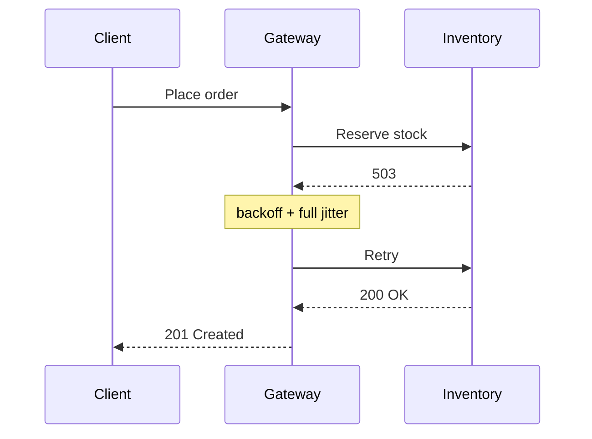
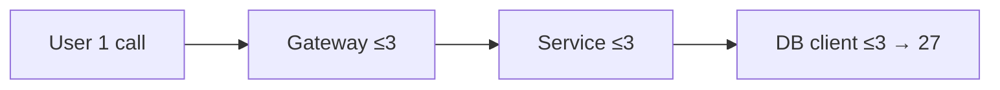
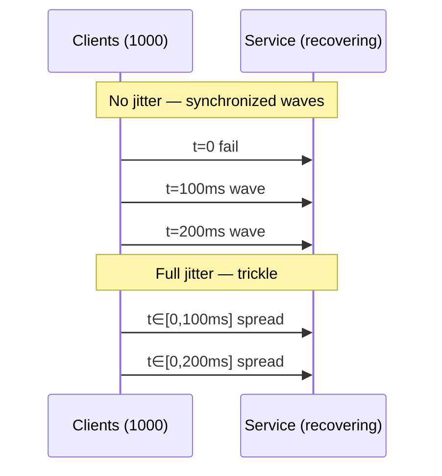
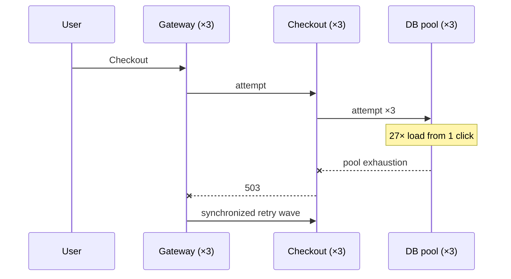

# Lesson 18: Retries, Exponential Backoff & Jitter — How Retries Cause Outages

> **Prerequisites:** [Lesson 11: API Error Handling](../11-api-error-handling/README.md), [Lesson 17: API Gateway Explained](../17-api-gateway-explained/README.md), and [API Design Overview](../README.md) (Lesson 18 of 23).  
> **Estimated Reading Time:** 30–35 minutes  
> **Target Audience:** Backend engineers wiring HTTP/gRPC clients, SREs fighting thundering-herd retries, and interview candidates who must explain why “just retry” can take down a dependency.  
> **Free PDF Notes:** [Download SD-C-018.pdf](https://backendroadmap.com/notes/system-design/SD-C-018.pdf)

> [!NOTE]
> **In one line:** retry only transient failures on safe operations, wait with exponential backoff plus random jitter, cap attempts and total time with a deadline and a retry budget, and retry at one layer only.

> [!TIP]
> **The Golden Rule of Retries:** Retries add load at exactly the moment the dependency has the least capacity to spare. If you cannot name (1) why the failure is transient, (2) why the op is safe to repeat, (3) your backoff+jitter schedule, and (4) which single layer retries—you are not ready to enable retries in production.

---

## Words You'll Meet Today

| Word | In Plain Words | Role in a Live Backend System |
| :--- | :--- | :--- |
| **Transient failure** | An error likely to succeed if tried again soon. | Connection errors, timeouts, `502`/`503`/`504`, and `429` after `Retry-After`. |
| **Exponential backoff** | Delay doubles each attempt, up to a cap. | Gives a struggling service room instead of hammering harder. |
| **Jitter** | Random component of the wait. | Breaks synchronized retry waves across thousands of clients. |
| **Full jitter** | `sleep = random(0, backoff(n))`. | AWS analysis: spreads load best and finishes work with fewest total calls. |
| **Retry budget** | Cap retries as a share of normal traffic (e.g. 10%). | Stops retries from doubling load during an outage. |
| **Retry amplification** | Retries multiply across stacked layers. | Gateway×service×DB client = `3×3×3 = 27` downstream calls. |
| **Idempotent op** | Safe to repeat: same effect as doing it once. | Reads, status sets, or writes guarded by an idempotency key. |
| **Circuit breaker** | Stops calling a dependency that is clearly down. | Complements retries: retries fix blips; breakers protect during outages. |

---

## Visual Mental Models & Architecture

### The Question: Why Did One 503 Become a Twenty-Minute Outage?

Your checkout service calls inventory, which briefly returns `503`. One retry would have fixed it. But a thousand clients retrying instantly, all at the same moment, can turn a two-second blip into a twenty-minute outage. Retries are powerful—and dangerous.

### Everyday Picture: Everyone Redials the Busy Restaurant

When a restaurant line is busy, if every caller redials every second in lockstep, the phone never frees for a completed booking. Staggered redials (backoff + jitter) let the line clear. A “retry budget” is the policy: only 10% of staff may be on redial duty at once.

### The Two Questions Before Any Retry

```text
Retry (transient)                         Don't retry (will fail again)
connection errors, timeouts               400 bad request · 422 validation
502, 503, 504                             401 / 403 auth · 404 not found
429, after the Retry-After delay

…and only if the operation is safe to repeat:
a read, an idempotent write, or a write with an idempotency key
```

**Observability gap:** Client dashboards show “success after retry” as green while upstream QPS has already doubled. Export `retry_attempts_total`, `retry_budget_exhausted_total`, and distinguish **user-visible errors** from **upstream attempt errors**. A rising retry rate is often the first sign of downstream trouble.



---

## Systematic Reference & Comparison Grid

| Term | Precise Meaning | Production Example |
| :--- | :--- | :--- |
| **Retry** | Re-issue a failed call under policy. | HTTP client retries `503` up to 3 times. |
| **Backoff** | Wait that grows between attempts. | `100 → 200 → 400 → …` ms. |
| **Jitter** | Randomization of that wait. | Full jitter spreads 1,000 clients over `[0, backoff]`. |
| **Hedging** | Send a parallel speculative request after a delay. | Different from retries; can also amplify load—use sparingly. |

| Retry? | Status / error | Why |
| :--- | :--- | :--- |
| Yes (after wait) | `429` | Honor `Retry-After` |
| Yes | `502`, `503`, `504`, connect/timeout | Transient |
| No | `400`, `401`, `403`, `404`, `422` | Request is wrong |
| Only if idempotent / keyed | Timed-out `POST /charge` | Unknown whether work completed |

---

## Mathematical Model: Exponential Backoff

$$\text{backoff}(n) = \min(\text{cap},\; \text{base} \times 2^{n-1}) \quad n = 1, 2, 3, \ldots$$

With `base = 100 ms`, `cap = 10 s`:

| Attempt $n$ | Raw backoff | Capped |
| :--- | :--- | :--- |
| 1 | 100 ms | 100 ms |
| 2 | 200 ms | 200 ms |
| 3 | 400 ms | 400 ms |
| 4 | 800 ms | 800 ms |
| 5 | 1.6 s | 1.6 s |
| 6 | 3.2 s | 3.2 s |
| 7 | 6.4 s | 6.4 s |
| 8 | 12.8 s | **10 s** |

Without a cap, attempt 11 waits $100 \times 2^{10} = 102{,}400\text{ ms} \approx 102\text{ s}$.

### Full Jitter vs Equal Jitter

- **Full jitter:** $\text{sleep} = U(0, \text{backoff}(n))$
- **Equal jitter:** $\text{sleep} = \frac{\text{backoff}(n)}{2} + U(0, \frac{\text{backoff}(n)}{2})$

AWS’s Architecture Blog (“Exponential Backoff and Jitter”) found **full jitter** spreads load best.

**Worked example:** Base `100 ms`, cap `10 s`, full jitter. Attempt 3 waits uniform `0–400 ms`. 1,000 clients that failed together now retry spread over a 400 ms window ≈ **2.5 per ms** instead of 1,000 in the same instant.

---

## Metrics, Percentiles & Saturation Under Retry Storms

If steady traffic is $\lambda$ and each request retries until success with mean attempts $A$:

$$\lambda_{\text{upstream}} \approx \lambda \times A$$

During an outage, without a budget, $A$ can jump from `1.05` to `3+` and $\rho$ crosses the cliff:

| Utilization $\rho$ | Latency multiplier $\frac{1}{1-\rho}$ |
| :--- | :--- |
| 50% | 2× |
| 70% | ~3.3× |
| 90% | 10× |
| 95% | 20× |
| 99% | 100× |

Retries that push a dependency from 70% → 95% utilization turn a blip into collapse.

| Percentile of user wait | Meaning with retries |
| :--- | :--- |
| $p_{50}$ | Often still first-attempt success |
| $p_{95}$ | Includes one backoff sleep |
| $p_{99}$ | Multiple attempts; watch deadline |
| $p_{99.9}$ | Budget/deadline exhaustion |

---

## Compounding: Retry Amplification Across Layers

If each of $L$ layers retries up to $R$ attempts:

$$\text{worst-case downstream calls} = R^{L}$$

| Layers | Attempts each | Downstream calls |
| :--- | :--- | :--- |
| 1 | 3 | 3 |
| 2 | 3 | 9 |
| 3 | 3 | **27** |
| 4 | 3 | 81 |



*Figure: Retries multiply across layers. Retry at **one** layer only; inner layers fail fast.*

---

## Numbers Every Backend Engineer Must Know

| Concept | Number | Implication |
| :--- | :--- | :--- |
| Typical max attempts | 2–3 | Enough for blips; not infinite hope |
| Base delay | 50–200 ms | Start small relative to SLO |
| Cap | 5–30 s | Bound tail wait |
| Retry budget | ~10% of RPS | At 2,000 RPS → ≤200 retries/s fleet-wide |
| `Retry-After` | Server-specified | Ignoring it is an anti-pattern |
| Amplification | $R^L$ | One retry layer |

---

## Protocol & Network Deep Dive

Honor protocol hints: HTTP `429`/`503` with `Retry-After`, gRPC `UNAVAILABLE`/`DEADLINE_EXCEEDED` (usually do **not** retry after deadline). Pair with circuit breakers: open after e.g. 50% errors over 10 s; half-open probe; close on success.



---

## Hierarchical Budgets & Sizing

Parent deadline $D$. Each attempt timeout $T$, pause $J$:

$$n_{\max} \cdot T + \sum J_i \le D$$

**Worked fit check:** SLO 300 ms; dependency p99 80 ms; timeout $1.5\times80=120$ ms; one retry after ~20 ms jitter → $120+20+120=260$ ms + 40 ms own work. Fits. If dependency p99 were 150 ms, timeout 225 ms leaves **no** retry room—drop the retry or renegotiate the SLO.

---

## Top Engineering Mitigation Techniques

1. Retry only transient + safe/idempotent operations.  
2. Exponential backoff **with full jitter**.  
3. Cap attempts, honor deadlines, enforce a **retry budget**.  
4. Retry at **one layer**; fail fast inside.  
5. Pair with **circuit breakers** and idempotency keys for writes.

---

## Production War Story (SEV-1 Post-Mortem)

**Severity & Impact:** SEV-1, 22 minutes. Inventory CPU pegged; checkout success rate fell from 99.2% → 41%.

**What Happened:** Gateway, checkout service, and DB client each retried 3 times with **zero jitter** on all errors including `400`-class timeouts misclassified as transient.



**RCA:** Retry amplification $3^3=27$ plus lockstep backoff without jitter.

**Fix:** Single retry layer at checkout with full jitter; max 3 attempts; 10% retry budget; inner clients fail-fast; circuit breaker on inventory; idempotency keys on reserve/charge.

---

## Multi-Language Production Patterns

````carousel
```go
package retry

import (
	"context"
	"math/rand"
	"time"
)

func Do(ctx context.Context, attempts int, base, cap time.Duration, fn func(context.Context) error) error {
	var err error
	for n := 1; n <= attempts; n++ {
		if err = ctx.Err(); err != nil {
			return err
		}
		err = fn(ctx)
		if err == nil || n == attempts || !IsTransient(err) {
			return err
		}
		backoff := base << (n - 1)
		if backoff > cap {
			backoff = cap
		}
		sleep := time.Duration(rand.Int63n(int64(backoff) + 1))
		timer := time.NewTimer(sleep)
		select {
		case <-ctx.Done():
			timer.Stop()
			return ctx.Err()
		case <-timer.C:
		}
	}
	return err
}
```
<!-- slide -->
```typescript
export function fullJitter(backoffMs: number): number {
  return Math.floor(Math.random() * (backoffMs + 1));
}

export async function withRetry<T>(
  fn: (signal: AbortSignal) => Promise<T>,
  opts: { attempts: number; baseMs: number; capMs: number; signal?: AbortSignal; isTransient: (e: unknown) => boolean }
): Promise<T> {
  let last: unknown;
  for (let n = 1; n <= opts.attempts; n++) {
    if (opts.signal?.aborted) throw opts.signal.reason ?? new Error("aborted");
    try {
      return await fn(opts.signal ?? new AbortController().signal);
    } catch (e) {
      last = e;
      if (n === opts.attempts || !opts.isTransient(e)) throw e;
      const backoff = Math.min(opts.capMs, opts.baseMs * 2 ** (n - 1));
      await new Promise((r) => setTimeout(r, fullJitter(backoff)));
    }
  }
  throw last;
}
```
<!-- slide -->
```python
from tenacity import (
    retry,
    stop_after_attempt,
    wait_random_exponential,
    retry_if_exception_type,
    before_sleep_log,
)
import logging
import httpx

log = logging.getLogger("retry")


class Transient503(Exception):
    pass


@retry(
    stop=stop_after_attempt(3),
    wait=wait_random_exponential(multiplier=0.5, max=10),
    retry=retry_if_exception_type((Transient503, httpx.TimeoutException)),
    before_sleep=before_sleep_log(log, logging.WARNING),
)
def get_stock(sku: str) -> dict:
    ...
```
<!-- slide -->
```csharp
public static class RetryFullJitter
{
    public static async Task<T> RunAsync<T>(
        Func<CancellationToken, Task<T>> action,
        int attempts,
        TimeSpan baseDelay,
        TimeSpan cap,
        Func<Exception, bool> isTransient,
        CancellationToken ct)
    {
        Exception? last = null;
        for (var n = 1; n <= attempts; n++)
        {
            ct.ThrowIfCancellationRequested();
            try { return await action(ct); }
            catch (Exception ex) when (isTransient(ex) && n < attempts)
            {
                last = ex;
                var backoff = TimeSpan.FromTicks(Math.Min(cap.Ticks, baseDelay.Ticks * (1L << (n - 1))));
                var jitter = TimeSpan.FromTicks(Random.Shared.NextInt64(0, backoff.Ticks + 1));
                await Task.Delay(jitter, ct);
            }
        }
        throw last!;
    }
}
```
````

---

## Practical Hands-On Verification CLI Workflows

### 1. Print a backoff schedule

```bash
python -c "base=0.1; cap=10
for n in range(1,9):
 b=min(cap, base*2**(n-1)); print(n, round(b,3))"
```

### 2. Simulate full jitter spread for 1,000 clients on attempt 3

```bash
python -c "import random; xs=[random.random()*0.4 for _ in range(1000)]; print(min(xs), max(xs), sum(xs)/len(xs))"
```

### 3. Confirm Retry-After handling idea

```bash
curl -sS -D - -o /dev/null https://httpbin.org/status/429 | findstr /I "Retry-After HTTP"
```

---

## Common Mistakes & Troubleshooting

- Instant retries in a tight loop.  
- Backoff with no jitter (lockstep waves).  
- Retrying 4xx or non-idempotent writes without an idempotency key.  
- Retries at every layer (`3×3×3=27`).  
- No attempt cap, deadline, or budget.  
- Ignoring `Retry-After` on `429`/`503`.

---

## Key Terms Glossary

| Term | Interview-ready definition |
| :--- | :--- |
| **Transient failure** | Likely to succeed if tried again. |
| **Exponential backoff** | Delay doubles each attempt, up to a cap. |
| **Full jitter** | Uniform random wait in `[0, backoff]`. |
| **Retry budget** | Retries capped at a share of traffic (e.g. 10%). |
| **Retry amplification** | Retries multiply across layers. |
| **Circuit breaker** | Stops calling a dependency that is clearly down. |

---

## Interview Practice Questions

<details>
<summary><strong>1. Which failures should you retry? [BASIC]</strong></summary>

<strong>What a strong answer covers:</strong>
Transient ones: connection errors, timeouts, `502`, `503`, `504`, and `429` after `Retry-After`. Not `400`, `401`, `403`, `404`, or `422`. And only for safe operations: reads, idempotent writes, or writes with an idempotency key.

</details>

<details>
<summary><strong>2. Why add jitter to backoff? [BASIC]</strong></summary>

<strong>What a strong answer covers:</strong>
Without it, clients that failed together retry together in synchronized waves that keep overloading the recovering service. Jitter spreads retries randomly. Full jitter: `random(0, backoff)`.

</details>

<details>
<summary><strong>3. Write the backoff schedule for base 100 ms, cap 10 s. [BASIC]</strong></summary>

<strong>What a strong answer covers:</strong>
100, 200, 400, 800 ms, 1.6, 3.2, 6.4 s, then 10 s (12.8 capped). With full jitter each is the upper bound of a random wait.

</details>

<details>
<summary><strong>4. What is a retry budget? [BASIC]</strong></summary>

<strong>What a strong answer covers:</strong>
A fleet-wide cap on retry traffic as a fraction of normal RPS (often ~10%). Beyond the budget, calls fail fast instead of retrying so an outage cannot multiply load without bound.

</details>

<details>
<summary><strong>5. How can retries make an outage worse? [SCENARIO]</strong></summary>

<strong>What a strong answer covers:</strong>
They multiply traffic exactly when a service is struggling: instant retries, no limits, and multi-layer amplification (`3×3×3=27`). Use backoff with jitter, attempt caps, budgets, one retry layer, and circuit breakers.

</details>

<details>
<summary><strong>6. A payment call timed out. Should the client retry? [SCENARIO]</strong></summary>

<strong>What a strong answer covers:</strong>
Only with an idempotency key. The timeout doesn't say whether the charge happened. With the same key, the server returns the first result; without one, check payment status first.

</details>

<details>
<summary><strong>7. Normal traffic is 2,000 RPS. What does a 10% retry budget mean? [SCENARIO]</strong></summary>

<strong>What a strong answer covers:</strong>
At most about 200 retries per second across the fleet. Beyond that, fail fast so a dependency outage adds at most 10% extra load instead of doubling or tripling it.

</details>

<details>
<summary><strong>8. Inventory returns 429 with Retry-After: 30. Your client uses 100 ms backoff. What do you do? [SCENARIO]</strong></summary>

<strong>What a strong answer covers:</strong>
Honor `Retry-After` (wait ~30 s or fail within deadline). Ignoring it wastes attempts, burns the retry budget, and aggravates rate limiting.

</details>

<details>
<summary><strong>9. Gateway, service and DB client all retry 3 times. What do you change? [TRICKY]</strong></summary>

<strong>What a strong answer covers:</strong>
Keep retries at one layer—usually the outermost or the one with the most context—and set inner layers to fail fast. Add a deadline so retries stop when the user's budget is gone.

</details>

<details>
<summary><strong>10. Retries vs circuit breaker: why use both? [TRICKY]</strong></summary>

<strong>What a strong answer covers:</strong>
Retries handle brief, random failures. A circuit breaker notices a dependency is clearly down (e.g. 50% errors over 10 s) and stops calling it so retries don't keep hammering. Retries fix blips; breakers protect during outages.

</details>

<details>
<summary><strong>11. Is hedging the same as retrying? [TRICKY]</strong></summary>

<strong>What a strong answer covers:</strong>
No. Hedging sends a speculative parallel request after a delay; retries are sequential after failure. Both can amplify load. Prefer retries with budgets first; hedge only for read-heavy, idempotent, capacity-proven paths.

</details>

<details>
<summary><strong>12. Why can “success rate after retries” look healthy while the dependency is melting? [TRICKY]</strong></summary>

<strong>What a strong answer covers:</strong>
User-visible success hides multiplied upstream attempts. Watch upstream QPS, retry rate, budget exhaustion, and dependency saturation—not only client success after retry.

</details>

---

## One-Page Master Cheat Sheet

```text
====================================================================================================
                    RETRIES, BACKOFF & JITTER  —  CHEAT SHEET
====================================================================================================
IN ONE LINE   Transient + safe only; exp backoff + full jitter; cap attempts/deadline/budget; ONE layer

RETRY         502/503/504, connect/timeout, 429 after Retry-After
DON'T         400/401/403/404/422; non-idempotent writes without idempotency key

BACKOFF       backoff(n)=min(cap, base×2^(n-1))   e.g. 100ms…→10s cap
FULL JITTER   sleep=U(0,backoff)   breaks synchronized waves (prefer over equal jitter)
AMPLIFY       R^L attempts   3 layers × 3 = 27   → retry at ONE layer; inner fail-fast

BUDGET        ~10% of normal RPS   2000 RPS → ≤200 retries/s then fail fast
DEADLINE      all attempts + sleeps must fit parent budget (next lesson)
BREAKER       retries = blips; breaker = outage protection

ANTI-PATTERNS X instant loop   X no jitter   X retry 4xx   X every layer retries
              X no cap/budget   X ignore Retry-After   X charge without idempotency key
====================================================================================================
```

---

## Free PDF notes

Download these notes as a printable PDF: [SD-C-018.pdf](https://backendroadmap.com/notes/system-design/SD-C-018.pdf).

---

## Sources

- [AWS Architecture Blog: Exponential Backoff and Jitter](https://aws.amazon.com/blogs/architecture/exponential-backoff-and-jitter/)
- [Google SRE: Handling Overload / Client-side throttling](https://sre.google/sre-book/handling-overload/)
- [tenacity (Python)](https://tenacity.readthedocs.io/) — production retry helpers.

---

## Next

Next comes [Lesson 19: API Timeouts & Deadline Propagation](../19-api-timeouts-deadline-propagation/README.md): budgets, absolute deadlines, gRPC cancellation, and why abandoned queries keep burning CPU. See [the track overview](../README.md).
