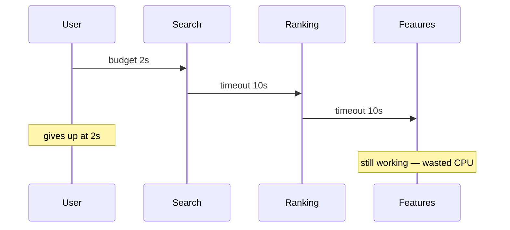
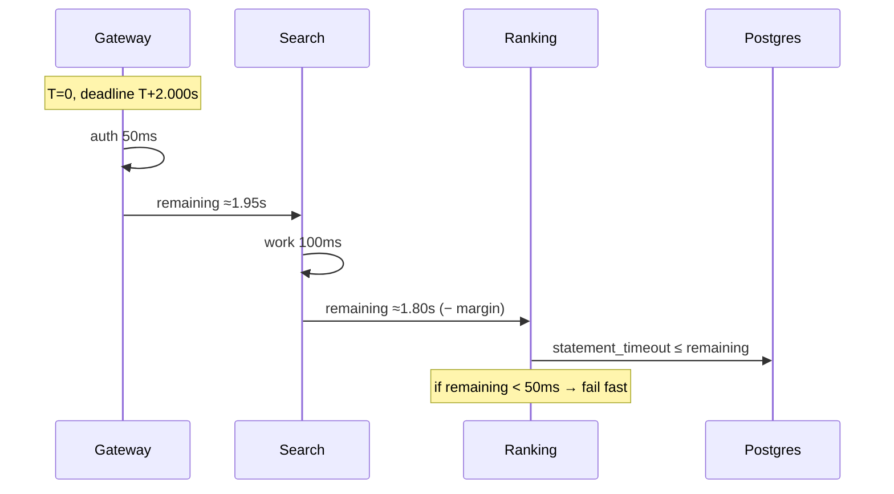
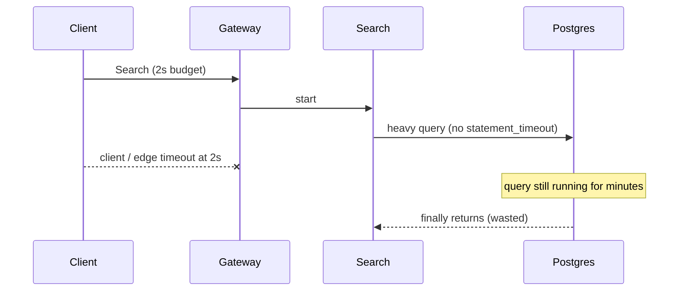

# Lesson 19: API Timeouts & Deadline Propagation — Budgets, gRPC & Cancellation

> **Prerequisites:** [Lesson 18: Retries, Exponential Backoff & Jitter](../18-retries-exponential-backoff-jitter/README.md), [Lesson 03: gRPC & Protocol Buffers](../03-grpc-protocol-buffers/README.md), and [API Design Overview](../README.md) (Lesson 19 of 23).  
> **Estimated Reading Time:** 30–35 minutes  
> **Target Audience:** Backend engineers setting client/server timeouts, propagating deadlines across HTTP/gRPC call chains, and ensuring cancellation reaches the database.  
> **Free PDF Notes:** [Download SD-C-019.pdf](https://backendroadmap.com/notes/system-design/SD-C-019.pdf)

> [!NOTE]
> **In one line:** set each timeout a little above the dependency's measured p99 and inside your own SLO, then pass one absolute deadline down the whole call chain so every hop knows how much time is left, fails fast when it runs out, and cancels work nobody is waiting for.

> [!TIP]
> **The Golden Rule of Deadlines:** A child call should never get more time than the parent has left. Prefer an **absolute deadline** (“stop at `T+2.000s`”) over a fresh “10 s timeout” at every hop, and when the caller gives up, **cancel all the way down**—including `statement_timeout` on the database.

---

## Words You'll Meet Today

| Word | In Plain Words | Role in a Live Backend System |
| :--- | :--- | :--- |
| **Timeout** | Max duration you will wait for one attempt. | Derived from dependency p99 and remaining budget. |
| **Deadline** | Absolute moment the answer becomes useless. | Propagated down the chain; every hop computes time left. |
| **Budget** | Total time a request may spend end-to-end. | Owned by the edge/SLO; retries consume the same budget. |
| **p99** | Latency 99% of requests beat. | Baseline for sizing timeouts (~1.5–2× p99). |
| **SLO** | Latency/error target the endpoint promises. | Caps every downstream timeout. |
| **DEADLINE_EXCEEDED** | gRPC status when time runs out. | Prefer over a vague `500`. |
| **Cancellation** | Stop in-flight work when the caller leaves. | gRPC propagates; asyncio cancels tasks; DB needs `statement_timeout`. |
| **Clock skew** | Servers’ clocks disagree. | Absolute timestamps over HTTP are risky; prefer remaining-ms headers. |

---

## Visual Mental Models & Architecture

### The Problem: Independent Timeouts

A user taps Search. The API gateway gives the whole request **2 seconds**. Behind it, search calls ranking, which calls a feature store. If each hop sets its own independent **10-second** timeout, the user gives up long before the backend does—and servers keep working on an answer nobody will ever see. That wasted work holds threads, connections, and database time that real users need.



### Everyday Picture: A Train You Must Catch

If your train leaves at noon, telling each taxi leg “you have 10 minutes” after you’ve already spent 8 minutes is nonsense. You hand each driver the **deadline: noon** and they decide whether the remaining minutes are enough to start the trip.

### Choosing a Timeout from the Distribution

Start from data, not guesses. Set timeout ≈ **1.5–2× dependency p99**, inside your SLO, leaving room for retries.

```text
p50 80 ms    p99 200 ms    timeout ≈ 360 ms (1.8 × p99)
|-------- normal slow OK --------|-- stuck: fail fast --→
```

**Observability gap:** Server handlers often measure only handler time *after* accepting the request, missing queue wait. Clients measure full RTT. Deadlines must account for **queueing + network + handler**. Log `deadline_remaining_ms` at each hop and which hop returned `504` / `DEADLINE_EXCEEDED`.

---

## Systematic Reference & Comparison Grid

| Term | Precise Meaning | Production Example |
| :--- | :--- | :--- |
| **Per-attempt timeout** | Cap on one try. | HTTP client `timeout=120ms`. |
| **Deadline** | Absolute end time for the whole logical RPC. | gRPC deadline; `X-Request-Deadline-Ms` remaining. |
| **SLO** | User-facing latency promise. | Search `p99 ≤ 300 ms`. |
| **Idle timeout (proxy)** | LB closes quiet connections. | Often 60 s—irrelevant if you hold work after the user left. |

| Approach | Behavior | Risk |
| :--- | :--- | :--- |
| No timeout | Client waits forever | Thread/conn exhaustion |
| Fixed 10 s every hop | Ignores time already spent | Wasted work after user gone |
| Absolute deadline | Each hop sees true remaining | Correct; watch clock skew on raw timestamps |
| Remaining-ms header | Receiver sets local deadline | Avoids skew; common over HTTP |

---

## Mathematical Model: Budgets & Child Timeouts

$$\text{child timeout} = \min(\text{own timeout},\; \text{parent remaining} - \text{safety margin})$$

**Worked example — does a retry fit?**  
Endpoint SLO `300 ms` p99. Pricing p99 = `80 ms`. Timeout `1.5×80 = 120 ms` leaves `180 ms`. One retry after `20 ms` jitter: `120 + 20 + 120 = 260 ms`, leaving `40 ms` for own work. Tight, but fits.  
If pricing p99 = `150 ms`, timeout `225 ms` leaves **no** retry room—drop the retry or fix the dependency/SLO mismatch.

### Utilization Reminder

Stuck calls without timeouts drive utilization $\rho \to 1$ and latency $\propto \frac{1}{1-\rho}$:

| $\rho$ | Multiplier |
| :--- | :--- |
| 70% | ~3.3× |
| 90% | 10× |
| 95% | 20× |
| 99% | 100× |

Failing fast is a **capacity** tool, not only a UX tool.

---

## Metrics, Percentiles & Statistical Distributions

| Percentile | Timeout placement |
| :--- | :--- |
| Near $p_{50}$ | Too tight—fails healthy traffic |
| ~1.5–2× $p_{99}$ | Sweet spot for stuck detection |
| ≫ SLO | Useless—user already left |
| Average latency | Lies; never size timeouts from the mean |

**Averages deceive:** 90×40 ms + 9×300 ms + 1×2,000 ms → mean ≈ `83 ms`, but a `100 ms` timeout fails ~10% of healthy-ish traffic while a `10 s` timeout lets stuck calls pile up. Use the **histogram**, not the mean.

---

## Compounding Effects Across Hops

If each of $N$ hops independently exceeds its local “looks fine” timeout with probability $0.01$:

$$P(\text{somewhere slow}) = 1 - 0.99^N$$

| $N$ hops | $P(\ge 1$ slow$)$ |
| :--- | :--- |
| 1 | 1% |
| 5 | ~5% |
| 10 | ~10% |
| 20 | ~18% |

Deadline propagation ensures the **sum** of work still respects the user budget even when hops vary.

---

## Numbers Every Backend Engineer Must Know

| Item | Typical value | Note |
| :--- | :--- | :--- |
| Timeout vs p99 | 1.5–2× | Room for normal slow |
| Safety margin | 10–50 ms | Network + serialization |
| Default many HTTP clients | **∞ / very large** | Always set explicitly |
| Proxy idle timeout | ~60 s | Does not cancel DB work |
| Postgres `statement_timeout` | match remaining budget | Backstop for abandoned queries |
| gRPC deadline | first-class metadata | Prefer over ad-hoc headers |

---

## Protocol & Network Deep Dive

**gRPC:** client sets a deadline; it travels with the call; servers use `context.time_remaining()` (Python) / `ctx.Deadline()` (Go) and pass a smaller deadline downstream. On expiry → `DEADLINE_EXCEEDED`. Cancellation propagates automatically.

**HTTP:** send remaining milliseconds (or a deadline header your fleet agrees on). Each service converts to a local absolute time using **its** clock. Prefer remaining-ms over wall-clock timestamps to reduce **clock skew** risk.



*Figure: One deadline, many hops. Solid = time spent; each hop forwards remaining budget.*

---

## Hierarchical Budgets & Capacity Sizing

Example gateway budget **2.0 s**:

| Hop | Spend | Remaining passed down |
| :--- | :--- | :--- |
| Gateway auth | 50 ms | 1.95 s |
| Search own work | 100 ms | ~1.80 s (minus margin) |
| Ranking | ≤ remaining | may fail fast if &lt; 50 ms |
| Feature store | ≤ ranking remaining | |
| Retries | must fit same 2.0 s | 3×1 s attempts **do not fit** |

---

## Top Engineering Mitigation Techniques

1. Size timeouts from **measured p99**, not folklore.  
2. Propagate **one absolute deadline** (or remaining-ms).  
3. Cap children by parent remaining − safety margin.  
4. **Cancel** on caller abandon (gRPC, asyncio, context).  
5. Set DB **`statement_timeout`** as backstop.  
6. Return **`504` / `DEADLINE_EXCEEDED`**, not vague `500`; never retry after deadline.

---

## Production War Story (SEV-1 Post-Mortem)

**Severity & Impact:** SEV-2 escalating to SEV-1. Users saw timeouts at 2 s; Postgres CPU stayed &gt;90% for 12 more minutes; connection pool saturation blocked healthy traffic.

**What Happened:** Edge timed out and returned `504`, but search did not cancel the ranking RPC, and Postgres had no `statement_timeout`. Abandoned analytical-ish queries kept running.



**RCA:** Timeout without cancellation = lie to the user while still paying full backend cost.

**Fix:** Propagate gRPC deadlines + cancellation; wrap async work in `asyncio.timeout`; `SET statement_timeout`; emit `504` with `deadline_hop=ranking`; refuse retries once deadline passed.

---

## Multi-Language Production Patterns

````carousel
```go
package deadlines

import (
	"context"
	"time"
)

func CallDownstream(ctx context.Context, safety time.Duration, call func(context.Context) error) error {
	deadline, ok := ctx.Deadline()
	if !ok {
		return call(ctx)
	}
	remaining := time.Until(deadline) - safety
	if remaining <= 0 {
		return context.DeadlineExceeded
	}
	child, cancel := context.WithTimeout(ctx, remaining)
	defer cancel()
	return call(child)
}
```
<!-- slide -->
```typescript
export function childTimeoutMs(parentDeadlineMs: number, nowMs: number, safetyMs = 20): number {
  const remaining = parentDeadlineMs - nowMs - safetyMs;
  if (remaining <= 0) throw Object.assign(new Error("deadline exceeded"), { code: "DEADLINE_EXCEEDED" });
  return remaining;
}

export async function withDeadline<T>(ms: number, fn: (signal: AbortSignal) => Promise<T>): Promise<T> {
  const ac = new AbortController();
  const t = setTimeout(() => ac.abort(), ms);
  try {
    return await fn(ac.signal);
  } finally {
    clearTimeout(t);
  }
}
```
<!-- slide -->
```python
import asyncio
from datetime import datetime, timezone


async def call_with_remaining(parent_deadline: datetime, safety_s: float, coro_factory):
    remaining = (parent_deadline - datetime.now(timezone.utc)).total_seconds() - safety_s
    if remaining <= 0:
        raise TimeoutError("DEADLINE_EXCEEDED")
    async with asyncio.timeout(remaining):
        return await coro_factory()


# Postgres backstop (SQL):
# SET statement_timeout = '1500ms';
```
<!-- slide -->
```csharp
public static async Task<T> CallWithRemainingAsync<T>(
    DateTimeOffset deadlineUtc,
    TimeSpan safety,
    Func<CancellationToken, Task<T>> call,
    CancellationToken outer)
{
    var remaining = deadlineUtc - DateTimeOffset.UtcNow - safety;
    if (remaining <= TimeSpan.Zero)
        throw new TimeoutException("DEADLINE_EXCEEDED");

    using var linked = CancellationTokenSource.CreateLinkedTokenSource(outer);
    linked.CancelAfter(remaining);
    return await call(linked.Token);
}
```
````

---

## Practical Hands-On Verification CLI Workflows

### 1. Prove a client timeout fires

```bash
curl -sS -m 1 https://httpbin.org/delay/5 -w "code:%{http_code} time:%{time_total}\n" -o NUL
```

### 2. Compute child remaining

```bash
python -c "budget=2.0; auth=0.05; search=0.1; margin=0.05; print(budget-auth-search-margin)"
```

### 3. Sanity-check timeout vs p99

```bash
python -c "p99=0.2; print('timeout', round(1.8*p99,3), 's')"
```

---

## Common Mistakes & Troubleshooting

- No timeout at all (many HTTP clients wait forever by default).  
- Inner timeouts longer than outer ones.  
- Retrying after the deadline has already passed.  
- Timing out the caller but leaving the downstream query running.  
- Returning a vague `500` instead of `504` / `DEADLINE_EXCEEDED`.  
- Shipping absolute wall-clock deadlines over HTTP without skew controls.

---

## Key Terms Glossary

| Term | Interview-ready definition |
| :--- | :--- |
| **Budget** | Total time a request may spend. |
| **Deadline** | Absolute moment the answer becomes useless. |
| **DEADLINE_EXCEEDED** | gRPC status when the deadline passes. |
| **statement_timeout** | Postgres limit on one query’s run time. |
| **Cancellation** | Stopping downstream work when the caller gives up. |

---

## Interview Practice Questions

<details>
<summary><strong>1. How do you choose a timeout value? [BASIC]</strong></summary>

<strong>What a strong answer covers:</strong>
From measured latency: about 1.5–2× the dependency's p99, within your own SLO, and within the caller's remaining budget, leaving room for any retries. A dependency with p99 = 200 ms gets roughly 300–400 ms.

</details>

<details>
<summary><strong>2. What is deadline propagation? [BASIC]</strong></summary>

<strong>What a strong answer covers:</strong>
Passing an absolute deadline down the call chain (a gRPC deadline or a deadline/remaining header) so every service knows how much time remains, gives its children less, fails fast when time is up, and cancels work nobody needs anymore.

</details>

<details>
<summary><strong>3. Why an absolute deadline instead of a fixed duration per hop? [BASIC]</strong></summary>

<strong>What a strong answer covers:</strong>
A fixed 10 s per hop ignores time already spent upstream. With an absolute deadline every hop computes the true remaining time, so the chain as a whole never exceeds the user's budget.

</details>

<details>
<summary><strong>4. What should you return when time runs out? [BASIC]</strong></summary>

<strong>What a strong answer covers:</strong>
`504 Gateway Timeout` at the HTTP edge or `DEADLINE_EXCEEDED` in gRPC—not a vague `500`—and log which hop ran out of time.

</details>

<details>
<summary><strong>5. Your endpoint's SLO is 300 ms p99 and a dependency has a 2 s timeout. What's wrong? [SCENARIO]</strong></summary>

<strong>What a strong answer covers:</strong>
That one call alone can take ~6× the whole SLO. Reduce it to fit, e.g. 1.5× the dependency's p99, and cap it by the request's remaining time.

</details>

<details>
<summary><strong>6. Gateway budget 2 s, auth takes 50 ms, search takes 100 ms. What does ranking get? [SCENARIO]</strong></summary>

<strong>What a strong answer covers:</strong>
About `2.0 − 0.05 − 0.1 = 1.85 s`, minus a safety margin, so roughly 1.8 s. If ranking sees under ~50 ms left, it returns `DEADLINE_EXCEEDED` at once.

</details>

<details>
<summary><strong>7. Users time out but database CPU stays high for minutes afterwards. Why? [SCENARIO]</strong></summary>

<strong>What a strong answer covers:</strong>
The work isn't cancelled: queries keep running after the caller left. Propagate cancellation (gRPC, asyncio task cancellation), and set a `statement_timeout` so abandoned queries are killed.

</details>

<details>
<summary><strong>8. Can three 1 s attempts fit in a 2 s budget? [SCENARIO]</strong></summary>

<strong>What a strong answer covers:</strong>
No—retries share the same budget. Either shorten attempt timeouts, reduce attempts, or drop retries when remaining time cannot cover another try.

</details>

<details>
<summary><strong>9. Over HTTP, what is risky about sending an absolute timestamp? [TRICKY]</strong></summary>

<strong>What a strong answer covers:</strong>
Clock skew: if servers differ by 300 ms, the budget is wrong by 300 ms. Sending remaining milliseconds, which each receiver turns into a local deadline, avoids that; gRPC sends remaining timeout on the wire for this reason.

</details>

<details>
<summary><strong>10. Should you retry after DEADLINE_EXCEEDED? [TRICKY]</strong></summary>

<strong>What a strong answer covers:</strong>
No—nobody is waiting for the answer, and another attempt still consumes capacity. Fail fast and surface the deadline error.

</details>

<details>
<summary><strong>11. Where should statement_timeout sit relative to the RPC deadline? [TRICKY]</strong></summary>

<strong>What a strong answer covers:</strong>
At or below the remaining RPC budget (minus a tiny margin). Longer than the RPC deadline leaves abandoned queries running after the API has already failed.

</details>

<details>
<summary><strong>12. Client timeout vs server deadline—must both exist? [TRICKY]</strong></summary>

<strong>What a strong answer covers:</strong>
Yes. Client timeout protects the caller UX; server deadline/cancellation protects capacity. Either alone leaves a gap (orphaned work or stuck clients).

</details>

---

## One-Page Master Cheat Sheet

```text
====================================================================================================
                 API TIMEOUTS & DEADLINE PROPAGATION  —  CHEAT SHEET
====================================================================================================
IN ONE LINE   Timeout ≈ 1.5–2× p99 inside SLO; one absolute deadline down the chain; cancel to the DB

SIZE          timeout = f(p99, SLO, remaining, retries)   never from the mean
CHILD         min(own, parent_remaining − safety)   if remaining < floor → fail fast
PROPAGATE     gRPC deadline | HTTP remaining-ms header (skew-safe vs raw timestamps)

CANCEL        gRPC auto | asyncio.timeout / context | Postgres statement_timeout backstop
STATUS        HTTP 504 | gRPC DEADLINE_EXCEEDED   log which hop   no retry after deadline

BUDGET MATH   auth+search+ranking+retries ≤ edge budget   3×1s attempts ⊄ 2s
ANTI-PATTERNS X no timeout   X inner > outer   X timeout without cancel   X vague 500
              X retry past deadline   X wall-clock deadline + skew
====================================================================================================
```

---

## Free PDF notes

[SD-C-019.pdf](https://backendroadmap.com/notes/system-design/SD-C-019.pdf)

---

## Sources

- [gRPC Deadline documentation](https://grpc.io/blog/deadlines/)
- [Postgres statement_timeout](https://www.postgresql.org/docs/current/runtime-config-client.html)
- [asyncio timeouts (Python)](https://docs.python.org/3/library/asyncio-task.html#timeouts)

---

## Next

Next comes [Lesson 20: Webhooks](../20-webhooks/README.md): outbox delivery, HMAC signing, retries for days, and idempotent receivers. See [the track overview](../README.md).
