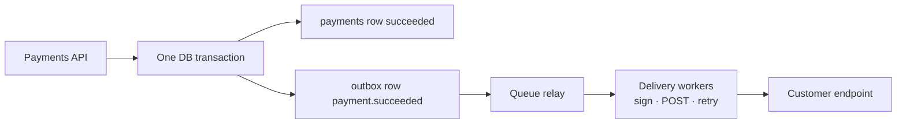
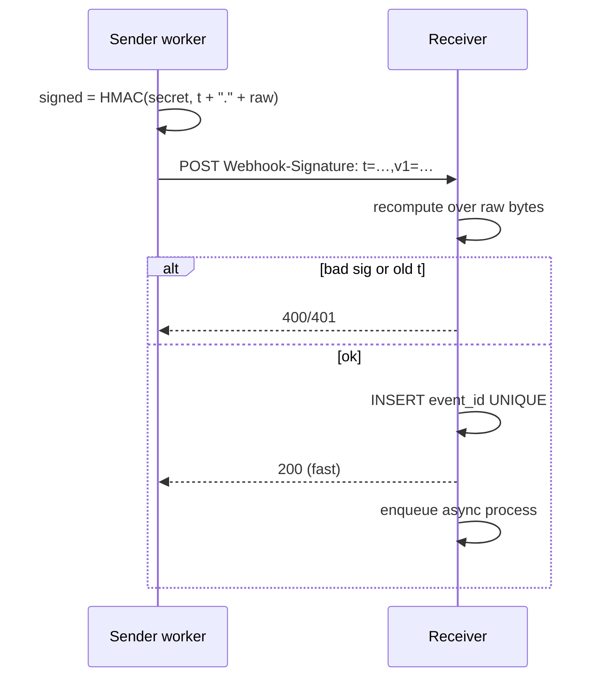
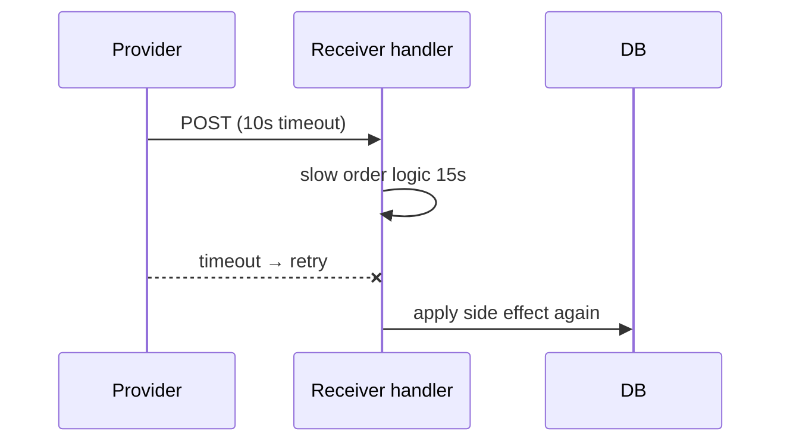

# Lesson 20: Webhooks — Reliable Delivery, HMAC Signing, Retries & Duplicates

> **Prerequisites:** [Lesson 18: Retries, Exponential Backoff & Jitter](../18-retries-exponential-backoff-jitter/README.md), [Lesson 09: Idempotency Keys](../09-idempotency-keys/README.md), and [API Design Overview](../README.md) (Lesson 20 of 23).  
> **Estimated Reading Time:** 32–35 minutes  
> **Target Audience:** Backend engineers building provider-side webhook delivery or receiver endpoints that must verify signatures, dedupe events, and survive at-least-once delivery.  
> **Free PDF Notes:** [Download SD-C-020.pdf](https://backendroadmap.com/notes/system-design/SD-C-020.pdf)

> [!NOTE]
> **In one line:** a webhook is the provider calling your URL when an event happens; the sender queues events from an outbox, signs them with HMAC and retries for days, and the receiver verifies, records the event ID, answers `200` fast and processes idempotently without trusting order.

> [!TIP]
> **The Golden Rule of Webhooks:** Deliver **asynchronously from an outbox**, sign the **raw body + timestamp**, and on the receive path do only **verify → dedupe → 200**; slow work belongs in a worker. Delivery is **at-least-once**—design for duplicates and out-of-order events, not perfect pipes.

---

## Words You'll Meet Today

| Word | In Plain Words | Role in a Live Backend System |
| :--- | :--- | :--- |
| **Webhook** | Server-to-server HTTP POST when an event happens. | Provider pushes `payment.succeeded` to your URL instead of you polling. |
| **Outbox** | Event row written in the same DB transaction as the business write. | Guarantees the event exists iff the payment committed. |
| **HMAC-SHA256** | Keyed hash proving sender + integrity. | Per-endpoint secret; signature header verified in constant time. |
| **At-least-once** | Every event arrives; maybe more than once. | Timeouts and retries create duplicates by design. |
| **Idempotent receiver** | Same event twice → one effect. | Unique `event_id` table; still return `200` on duplicates. |
| **SSRF** | Tricking a server into calling internal addresses. | Block `10.0.0.0/8`, `169.254.169.254`, etc. on URL registration. |
| **Replay attack** | Captured valid request resent later. | Reject timestamps older than ~5 minutes. |
| **Delivery log** | Per-attempt status, latency, snippet. | Enables customer replay and debugging. |

---

## Visual Mental Models & Architecture

### What a Webhook Is

A customer pays on your site. Your payment provider must tell your backend right away—without you polling every few seconds. It `POST`s to a URL you registered. Simple idea; reliable delivery is a classic system design problem with **two sides**: sender and receiver.

### Everyday Picture: Certified Mail with a Receipt Book

The post office (sender) does not wait at your porch during checkout. It logs the letter in the outbox, sends a courier later, gets a signature (`2xx`), and retries for days if nobody answers. You (receiver) check the wax seal (HMAC), stamp the tracking number once (dedupe), wave “got it” quickly, and open the package later (async process).

### Sender: Outbox → Queue → Workers



*Figure 1. Payment and event commit together. A slow customer endpoint never slows the core API.*

Sign every delivery: HMAC-SHA256 over `timestamp + "." + raw body` with a per-endpoint secret. Payload includes `id`, `type`, `created`, `api_version`, and `data`.

**Observability gap:** Provider success metrics can look green while a customer’s endpoint silently drops unsigned payloads. Track delivery success **per endpoint**, age of oldest undelivered outbox row, signature-failure rate on the receiver, and duplicate skips.

---

## Systematic Reference & Comparison Grid

| Term | Precise Meaning | Production Example |
| :--- | :--- | :--- |
| **Polling** | Client repeatedly asks for new events. | `GET /events?since=` |
| **Webhook** | Server pushes events to a registered URL. | Stripe `POST` to your HTTPS endpoint |
| **Outbox** | Transactional event staging table. | Same txn as `payments` update |
| **Inbox / event store** | Receiver’s dedupe table. | `UNIQUE(event_id)` |

| Success? | Response | Next action |
| :--- | :--- | :--- |
| Yes | Any `2xx` within ~10 s | Mark delivered |
| No | Timeout, `5xx`, network error | Retry with backoff + jitter |
| No | `4xx` (often) | May retry limited times; alert on persistent `401` |

---

## Mathematical Model: Retry Schedules & Fan-out Load

Typical schedule (not to scale): first try, then ~1 min, 5 min, 30 min, then hourly for up to **3 days** (Stripe-like).

Expected attempts if the endpoint is down for $H$ hours with hourly retries after the initial ramp ≈ $O(H)$ deliveries once in the hourly phase.

**Receiver SLO coupling:** If processing before `200` takes $T_p$ and sender timeout is $T_s=10\text{s}$, whenever $T_p > T_s$ the sender retries and duplicates ≈ grow as:

$$\text{duplicate factor} \approx 1 + \left\lfloor \frac{T_{\text{outage}}}{\text{mean backoff}} \right\rfloor$$

Ack in **1–2 s**; process asynchronously.

---

## Metrics, Percentiles & Distributions

| Metric | Healthy signal |
| :--- | :--- |
| Delivery latency p50 | Seconds, not minutes, when endpoint up |
| Delivery success rate | High within 3-day window |
| Signature failures | Near zero; spikes = wrong secret / body buffering |
| Dedupe skip rate | Non-zero under retries—expected |
| Outbox lag p99 | Should not climb unbounded |

Averages hide “endpoint disabled after 3 days”—watch **oldest pending age**.

---

## Compounding Effects

With $E$ events/s and average $A$ delivery attempts under partial outage:

$$\lambda_{\text{POST}} \approx E \times A$$

10k events during a bad hour with $A=5$ → 50k POSTs. Cap concurrency per endpoint; exponential backoff protects both sides.

---

## Numbers Every Backend Engineer Must Know

| Item | Typical | Why |
| :--- | :--- | :--- |
| Ack deadline | 1–2 s receiver / ~10 s sender | Avoid retry storms |
| Timestamp skew window | ~5 min | Replay protection |
| Retry horizon | up to ~3 days | Survive weekends |
| Compare | `hmac.compare_digest` | Not `==` |
| SSRF blocks | RFC1918 + link-local metadata | Mandatory on register |

---

## Protocol & Network Deep Dive



Verify URL on registration (challenge/test event). Block private ranges and cloud metadata (`169.254.169.254`) to prevent SSRF.

---

## Hierarchical Budgets

| Stage | Budget |
| :--- | :--- |
| Sender HTTP timeout | ~10 s |
| Receiver verify+dedupe+enqueue | ≤1–2 s |
| Async processing | minutes OK |
| Retry horizon | hours–days |

---

## Top Engineering Mitigation Techniques

1. Transactional **outbox** + async workers.  
2. **HMAC** + timestamp + constant-time compare on **raw bytes**.  
3. Long **backoff + jitter** retries, delivery log, replay API, auto-disable dead endpoints.  
4. Receiver: verify → unique event id → **200** → async process.  
5. **Fetch latest state** (or version vectors) instead of trusting order.  
6. SSRF-safe URL allowlisting / private-IP denial.

---

## Production War Story (SEV-1 Post-Mortem)

**Severity & Impact:** Duplicate charges / wrong order state for ~2% of webhooks during a receiver deploy. Customer support spike.

**What Happened:** Receiver parsed JSON, re-serialized for HMAC (signature failures), then fell back to “trust unsigned in staging config” left on. Separately, handler took 15 s before `200`, so the provider retried and the non-idempotent processor applied refunds twice.



**Fix:** Raw-body HMAC; `INSERT … ON CONFLICT`; return 200 in &lt;1 s; process in worker; fetch provider state before mutating.

---

## Multi-Language Production Patterns

````carousel
```go
package webhooks

import (
	"crypto/hmac"
	"crypto/sha256"
	"encoding/hex"
	"fmt"
	"time"
)

func Sign(secret []byte, t time.Time, raw []byte) string {
	mac := hmac.New(sha256.New, secret)
	mac.Write([]byte(fmt.Sprintf("%d.", t.Unix())))
	mac.Write(raw)
	return hex.EncodeToString(mac.Sum(nil))
}

func Verify(secret []byte, tUnix int64, raw []byte, sigHex string, maxSkew time.Duration) bool {
	if time.Since(time.Unix(tUnix, 0)) > maxSkew || time.Until(time.Unix(tUnix, 0)) > maxSkew {
		return false
	}
	expected := Sign(secret, time.Unix(tUnix, 0), raw)
	return hmac.Equal([]byte(expected), []byte(sigHex))
}
```
<!-- slide -->
```typescript
import { createHmac, timingSafeEqual } from "node:crypto";

export function sign(secret: string, tSec: number, raw: Buffer): string {
  return createHmac("sha256", secret).update(`${tSec}.`).update(raw).digest("hex");
}

export function verify(secret: string, tSec: number, raw: Buffer, sigHex: string, maxSkewSec = 300): boolean {
  const now = Math.floor(Date.now() / 1000);
  if (Math.abs(now - tSec) > maxSkewSec) return false;
  const expected = Buffer.from(sign(secret, tSec, raw), "hex");
  const got = Buffer.from(sigHex, "hex");
  return expected.length === got.length && timingSafeEqual(expected, got);
}
```
<!-- slide -->
```python
import hmac
import json
import time
from hashlib import sha256

from fastapi import FastAPI, HTTPException, Request

app = FastAPI()
SECRET = b"endpoint_secret"


@app.post("/webhooks/payments")
async def hook(request: Request):
    raw = await request.body()  # bytes, not parsed JSON
    header = request.headers["Webhook-Signature"]  # t=…,v1=…
    t_str, sig = header.split(",")[0].split("=", 1)[1], header.split("v1=", 1)[1]
    t = int(t_str)
    expected = hmac.new(SECRET, f"{t}.".encode() + raw, sha256).hexdigest()
    if not hmac.compare_digest(expected, sig) or abs(time.time() - t) > 300:
        raise HTTPException(400)
    event = json.loads(raw)
    inserted = await db.insert_ignore("webhook_events", id=event["id"], body=raw)
    if inserted:
        await queue.enqueue("process_event", event["id"])
    return {"ok": True}  # 200 either way
```
<!-- slide -->
```csharp
using System.Security.Cryptography;
using System.Text;

public static class WebhookHmac
{
    public static string Sign(string secret, long tUnix, byte[] raw)
    {
        var key = Encoding.UTF8.GetBytes(secret);
        var prefix = Encoding.UTF8.GetBytes($"{tUnix}.");
        var payload = new byte[prefix.Length + raw.Length];
        Buffer.BlockCopy(prefix, 0, payload, 0, prefix.Length);
        Buffer.BlockCopy(raw, 0, payload, prefix.Length, raw.Length);
        return Convert.ToHexString(HMACSHA256.HashData(key, payload)).ToLowerInvariant();
    }

    public static bool Verify(string secret, long tUnix, byte[] raw, string sigHex, int maxSkewSec = 300)
    {
        if (Math.Abs(DateTimeOffset.UtcNow.ToUnixTimeSeconds() - tUnix) > maxSkewSec) return false;
        var expected = Sign(secret, tUnix, raw);
        return CryptographicOperations.FixedTimeEquals(
            Encoding.UTF8.GetBytes(expected),
            Encoding.UTF8.GetBytes(sigHex.ToLowerInvariant()));
    }
}
```
````

---

## Practical Hands-On Verification CLI Workflows

### 1. Compute a local HMAC

```bash
python -c "import hmac,hashlib; t=1730700000; raw=b'{\"id\":\"evt_9\"}'; print(hmac.new(b'secret', f'{t}.'.encode()+raw, hashlib.sha256).hexdigest())"
```

### 2. Show why re-serialized JSON breaks signatures

```bash
python -c "import json; print(json.dumps({'b':1,'a':2})); print(json.dumps({'a':2,'b':1}))"
```

### 3. SSRF mindset check on a registered URL

```bash
python -c "import ipaddress; print(ipaddress.ip_address('169.254.169.254').is_link_local)"
```

---

## Common Mistakes & Troubleshooting

- Calling the customer URL synchronously inside the API request.  
- Hashing re-serialized JSON instead of raw bytes; comparing with `==`.  
- No timestamp check → replays.  
- Slow work before `200`.  
- No event-ID dedupe; assuming order.  
- Allowing internal URLs (SSRF).

---

## Key Terms Glossary

| Term | Interview-ready definition |
| :--- | :--- |
| **Outbox** | Event row committed with the business write. |
| **At-least-once** | Guaranteed delivery with possible duplicates. |
| **Idempotent receiver** | Duplicate delivery has one effect. |
| **SSRF** | Server tricked into calling internal addresses. |

---

## Interview Practice Questions

<details>
<summary><strong>1. How do you design a reliable webhook delivery system? [BASIC]</strong></summary>

<strong>What a strong answer covers:</strong>
Write events to an outbox in the same transaction, deliver asynchronously with a queue and workers, sign every payload with HMAC, retry failures with exponential backoff and jitter for days, and keep delivery logs with replay, endpoint verification, and auto-disable for dead endpoints.

</details>

<details>
<summary><strong>2. How should a receiver handle duplicates? [BASIC]</strong></summary>

<strong>What a strong answer covers:</strong>
Verify the signature, record the event ID with a unique constraint, skip events already processed (still returning 200), respond fast, process asynchronously, and never rely on ordering.

</details>

<details>
<summary><strong>3. Why sign webhooks with HMAC, and why include a timestamp? [BASIC]</strong></summary>

<strong>What a strong answer covers:</strong>
Anyone can POST to a public URL. The HMAC proves the request came from someone holding the endpoint's secret and wasn't altered. Signing the timestamp lets the receiver reject requests older than ~5 minutes, blocking replays.

</details>

<details>
<summary><strong>4. What belongs in the webhook payload envelope? [BASIC]</strong></summary>

<strong>What a strong answer covers:</strong>
Stable `id`, `type`, `created` timestamp, `api_version`, and `data`. The `id` drives dedupe; `type` drives routing; version enables evolution.

</details>

<details>
<summary><strong>5. Why not call the customer's URL inside the payment request? [SCENARIO]</strong></summary>

<strong>What a strong answer covers:</strong>
Their endpoint might take 10 s or be down; your API would slow or fail with it, and a crash between commit and call would lose the event. The outbox records the event atomically; workers deliver independently.

</details>

<details>
<summary><strong>6. A customer's endpoint is down for 6 hours. What happens? [SCENARIO]</strong></summary>

<strong>What a strong answer covers:</strong>
Deliveries fail and are retried on a backoff schedule (1 min, 5 min, 30 min, then hourly); within the 3-day window they succeed once it's back. The customer can also replay from the dashboard or fetch missed events from a list endpoint.

</details>

<details>
<summary><strong>7. The receiver's handler takes 15 s to process an order. What goes wrong? [SCENARIO]</strong></summary>

<strong>What a strong answer covers:</strong>
The sender's ~10 s timeout fires, counts the delivery as failed, and retries—so the work runs again and again. Store the event, return 200 in 1–2 s, and process in a background worker.

</details>

<details>
<summary><strong>8. How do you prevent SSRF when users register webhook URLs? [SCENARIO]</strong></summary>

<strong>What a strong answer covers:</strong>
Verify with a challenge, resolve DNS carefully, deny private/link-local/metadata IPs (`10.0.0.0/8`, `169.254.169.254`), require HTTPS, and re-check on each delivery if DNS can change (rebinding).

</details>

<details>
<summary><strong>9. Your signature check fails for valid events. Likely cause? [TRICKY]</strong></summary>

<strong>What a strong answer covers:</strong>
Hashing parsed/re-serialized JSON instead of raw request bytes (key order/spacing change), a framework that consumed the body, or the wrong per-endpoint secret. Hash the exact raw body.

</details>

<details>
<summary><strong>10. payment.refunded arrives before payment.succeeded. How do you stay correct? [TRICKY]</strong></summary>

<strong>What a strong answer covers:</strong>
Don't apply events by arrival order. Compare event timestamps or object versions, ignore older ones, or fetch the latest state from the provider's API before acting.

</details>

<details>
<summary><strong>11. Should persistent 401 from a customer endpoint be retried for 3 days? [TRICKY]</strong></summary>

<strong>What a strong answer covers:</strong>
Usually not at full schedule—alert quickly, mark endpoint failing, and disable after repeated auth failures. Unlimited retries on clear config errors waste capacity and hide the real fix (rotate secret / fix URL).

</details>

<details>
<summary><strong>12. Why return 200 for a duplicate event_id? [TRICKY]</strong></summary>

<strong>What a strong answer covers:</strong>
A non-2xx makes the sender keep retrying forever. Acknowledging duplicates stops the storm while idempotent processing preserves correctness.

</details>

---

## One-Page Master Cheat Sheet

```text
====================================================================================================
                              WEBHOOKS  —  CHEAT SHEET
====================================================================================================
IN ONE LINE   Outbox+workers+HMAC; receiver verify→dedupe→200 fast; at-least-once ⇒ idempotent + no order

SENDER        txn outbox → queue → workers | sign t+"."+raw | retry days | logs+replay | SSRF-safe register
RECEIVER      raw HMAC + skew check | UNIQUE event_id | 200 in 1–2s | async worker | fetch latest state

MATH          if process > sender timeout → retry storm   duplicate factor grows with outage/backoff
ORDERING      refund before succeed is normal   use version/timestamp or GET latest resource

ANTI-PATTERNS X sync call in API   X re-serialize before HMAC   X == compare   X no timestamp
              X slow before 200   X no dedupe   X trust order   X allow 169.254.169.254
====================================================================================================
```

---

## Free PDF notes

[SD-C-020.pdf](https://backendroadmap.com/notes/system-design/SD-C-020.pdf)

---

## Sources

- [Stripe Webhooks documentation](https://docs.stripe.com/webhooks) — signatures, retries, best practices.
- [Transactional Outbox pattern](https://microservices.io/patterns/data/transactional-outbox.html)

---

## Next

Next comes [Lesson 21: Async APIs for Long Jobs](../21-async-apis-for-long-jobs/README.md): `202 Accepted`, job resources, polling vs callbacks. See [the track overview](../README.md).
