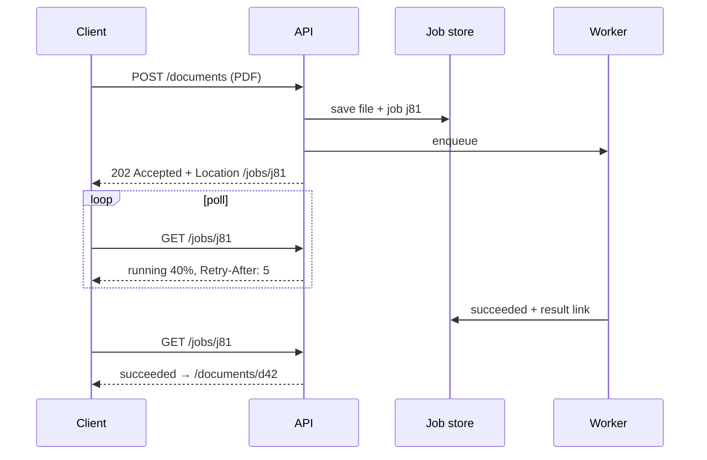
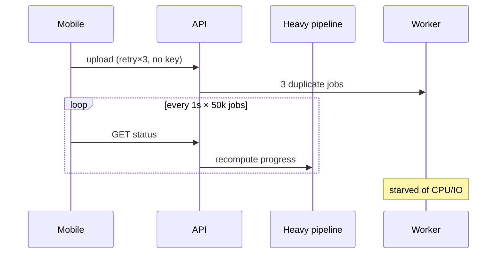

# Lesson 21: Async APIs for Long Jobs — 202 Accepted, Job Status, Polling vs Callbacks

> **Prerequisites:** [Lesson 19: API Timeouts & Deadline Propagation](../19-api-timeouts-deadline-propagation/README.md), [Lesson 20: Webhooks](../20-webhooks/README.md), [Lesson 09: Idempotency Keys](../09-idempotency-keys/README.md), and [API Design Overview](../README.md) (Lesson 21 of 23).  
> **Estimated Reading Time:** 30–35 minutes  
> **Target Audience:** Backend engineers designing document ingestion, video processing, ML batch, and any API whose work exceeds proxy/client timeouts.  
> **Free PDF Notes:** [Download SD-C-021.pdf](https://backendroadmap.com/notes/system-design/SD-C-021.pdf)

> [!NOTE]
> **In one line:** for work that takes minutes, accept the request, enqueue the job and return `202 Accepted` with a job ID and a status URL; the job becomes a resource clients poll or get a webhook for.

> [!TIP]
> **The Golden Rule of Long-Running APIs:** Never hold an HTTP request open for ten minutes. Validate → store → create job → enqueue → **`202` + `Location`**. Make submit **idempotent**, status reads **cheap**, workers **checkpointed**, and every job subject to a **timeout/heartbeat** so nothing stays `running` forever.

---

## Words You'll Meet Today

| Word | In Plain Words | Role in a Live Backend System |
| :--- | :--- | :--- |
| **202 Accepted** | Request taken; work not finished yet. | Honest status for async start—not `200`/`201`. |
| **Location** | Header pointing at the status URL. | `/jobs/j81` for polling. |
| **Operation / job** | Resource representing long work. | Status, progress, result or error. |
| **Polling** | Client repeatedly GETs status. | Guided by `Retry-After`; works everywhere. |
| **Callback / webhook** | Server notifies client when done. | Efficient; keep polling as fallback. |
| **Idempotency key** | Makes retried submit return the same job. | Stops duplicate 10-minute pipelines. |
| **Checkpoint** | Saved progress a worker can resume from. | Crash mid-embed restarts after chunking. |
| **Retention** | How long job records are kept. | Often 7–30 days, then expire. |

---

## Visual Mental Models & Architecture

### Why You Can't Do It Inside the Request

A user uploads a 300-page PDF. Parsing, chunking, embedding, and indexing take ~10 minutes. Holding HTTP open fails because:

- Load balancers/proxies time out idle requests (often ~60 s).
- Mobile connections drop on network change/sleep.
- A retry restarts the whole job—doubling cost and maybe data.



### Everyday Picture: Dry Cleaning Ticket

You drop off a suit (upload), get a ticket with a number (`job_id`), and either come back to check the board (poll) or get a text when ready (webhook). The clerk does not make you stand at the counter for three hours.

### Job Lifecycle

```text
queued → running (0–100%) → succeeded | failed | cancelled
         cancel while queued              error/timeout
terminal states are final — the job never leaves them
```

**Observability gap:** Worker CPU can be fine while clients stampede a status endpoint that recomputes progress from the pipeline. Emit job-state transitions as metrics; serve status from a **cache/small row**, never from the heavy pipeline. Track `jobs_running`, `jobs_stuck_past_timeout`, poll QPS, and callback success.

---

## Systematic Reference & Comparison Grid

| Term | Precise Meaning | Production Example |
| :--- | :--- | :--- |
| **Synchronous API** | Result in the response. | `POST /login` → `200` + token |
| **Async job API** | Accept now; result later. | `POST /documents` → `202` + job |
| **LRO** | Long-running operation pattern. | Google AIP-151; Azure `Operation-Location` |
| **Queue worker** | Executes the job offline. | Parses PDF stages with checkpoints |

| Signal | Polling | Callback |
| :--- | :--- | :--- |
| Client needs | Nothing special | Reachable HTTPS endpoint + HMAC |
| Cost | Repeated GETs | One POST when done |
| Reliability | Always available | Can be lost—keep polling fallback |
| Live progress | Easy | Often SSE/WebSocket for browsers |

---

## Mathematical Model: Polling Cost

For $J$ in-flight jobs polled every $I$ seconds:

$$\lambda_{\text{status}} = \frac{J}{I}$$

| Jobs $J$ | Interval $I$ | Status QPS |
| :--- | :--- | :--- |
| 10,000 | 1 s | 10,000 |
| 10,000 | 5 s | **2,000** |
| 50,000 | 1 s | 50,000 |
| 50,000 | 5 s | 10,000 |

A 10-minute job polled every 5 s ≈ **120** status calls; with a webhook ≈ **1** completion call (+ optional progress channel).

---

## Metrics, Percentiles & Distributions

| Metric | Why |
| :--- | :--- |
| Submit p99 | Must stay milliseconds—not minutes |
| Status p99 | Must stay cheap under poll storms |
| Job duration p50/p99 | SLO for workers; set job timeout above p99 |
| Stuck `running` count | Missing heartbeat/timeout design |

Mean job time hides a stuck worker; alert on **heartbeat age**.

---

## Compounding Effects

Without idempotency, each client retry under flaky mobile creates another job:

$$\text{duplicate work} \propto \text{submit retries}$$

With checkpoints, restart cost is remaining stages only—not full $T_{\text{job}}$.

---

## Numbers Every Backend Engineer Must Know

| Item | Typical |
| :--- | :--- |
| Submit latency | &lt; 100–200 ms |
| Proxy idle timeout | ~60 s (why sync fails) |
| `Retry-After` | 5–15 s common |
| Job timeout | &gt; p99 duration (e.g. 30–60 min for 10 min jobs) |
| Heartbeat stale | e.g. 30 min → mark failed/requeue |
| Retention | 7–30 days |

---

## Protocol & Network Deep Dive

```http
HTTP/1.1 202 Accepted
Location: /jobs/j81

{"job_id": "j81", "status": "queued"}
```

```http
GET /jobs/j81 → 200 OK
Retry-After: 5

{"id":"j81","status":"running","progress":40,
 "created_at":"…","updated_at":"…","result":null,"error":null}
```

Cancel: `POST /jobs/j81:cancel` or `DELETE /jobs/j81`; workers check a flag between stages.

---

## Hierarchical Budgets

| Concern | Budget |
| :--- | :--- |
| HTTP submit | milliseconds |
| Per-stage worker SLA | minutes |
| Whole job deadline | &gt; expected p99 |
| Status read | sub-ms–few ms from store |
| Callback delivery | webhook retry policy (lesson 20) |

---

## Top Engineering Mitigation Techniques

1. `202` + job resource + `Location`.  
2. Idempotent submit (idempotency key → same job).  
3. Cheap status + `Retry-After`; offer webhooks/SSE.  
4. Checkpoints + cancellation + retention.  
5. Per-job timeout/heartbeat sweeper.  

---

## Production War Story (SEV-1 Post-Mortem)

**Severity & Impact:** Document ingestion cluster meltdown; 50k jobs; clients polling every 1 s; status endpoint queried Elasticsearch pipeline; workers starved.

**What Happened:** Sync-style code path still existed for “small PDFs” with raised LB timeout to 15 min; mobile retries without idempotency created duplicate jobs; status handler ran aggregation queries.



**Fix:** Always async; idempotency keys; status from Redis/row only; `Retry-After: 5`; webhooks; checkpoints; job timeout sweeper.

---

## Multi-Language Production Patterns

````carousel
```go
package jobs

import (
	"net/http"
	"time"
)

type Job struct {
	ID       string    `json:"id"`
	Status   string    `json:"status"`
	Progress int       `json:"progress"`
	Result   *string   `json:"result"`
	Error    *string   `json:"error"`
	Updated  time.Time `json:"updated_at"`
}

func WriteAccepted(w http.ResponseWriter, jobID string) {
	w.Header().Set("Location", "/jobs/"+jobID)
	w.WriteHeader(http.StatusAccepted)
	_, _ = w.Write([]byte(`{"job_id":"` + jobID + `","status":"queued"}`))
}
```
<!-- slide -->
```typescript
import type { ServerResponse } from "node:http";

export type JobStatus = "queued" | "running" | "succeeded" | "failed" | "cancelled";

export function sendAccepted(res: ServerResponse, jobId: string): void {
  res.statusCode = 202;
  res.setHeader("Location", `/jobs/${jobId}`);
  res.setHeader("Content-Type", "application/json");
  res.end(JSON.stringify({ job_id: jobId, status: "queued" }));
}

export function sendStatus(res: ServerResponse, body: object, retryAfterSec = 5): void {
  res.statusCode = 200;
  res.setHeader("Retry-After", String(retryAfterSec));
  res.setHeader("Content-Type", "application/json");
  res.end(JSON.stringify(body));
}
```
<!-- slide -->
```python
from fastapi import FastAPI, Header, Response
from pydantic import BaseModel

app = FastAPI()


class Job(BaseModel):
    id: str
    status: str
    progress: int = 0
    result: str | None = None
    error: str | None = None


@app.post("/documents", status_code=202)
async def submit(response: Response, idempotency_key: str | None = Header(default=None)):
    job = await create_or_get_job(idempotency_key)
    response.headers["Location"] = f"/jobs/{job.id}"
    return {"job_id": job.id, "status": job.status}


@app.get("/jobs/{job_id}")
async def status(job_id: str, response: Response):
    job = await load_job(job_id)  # cheap store
    response.headers["Retry-After"] = "5"
    return job
```
<!-- slide -->
```csharp
using Microsoft.AspNetCore.Mvc;

[ApiController]
public class JobsController : ControllerBase
{
    [HttpPost("/documents")]
    public async Task<IActionResult> Submit([FromHeader(Name = "Idempotency-Key")] string? key)
    {
        var job = await _jobs.CreateOrGetAsync(key);
        Response.Headers.Location = $"/jobs/{job.Id}";
        return Accepted(new { job_id = job.Id, status = "queued" });
    }

    [HttpGet("/jobs/{id}")]
    public async Task<IActionResult> Status(string id)
    {
        var job = await _jobs.GetAsync(id);
        Response.Headers["Retry-After"] = "5";
        return Ok(job);
    }
}
```
````

---

## Practical Hands-On Verification CLI Workflows

### 1. Polling QPS math

```bash
python -c "J=10000; I=5; print(J/I)"
```

### 2. Simulate 202 + Location with httpbin-style thinking

```bash
curl -sS -D - -o NUL -X POST https://httpbin.org/status/202
```

### 3. Count polls for a 10-minute job

```bash
python -c "print(int(10*60/5))"
```

---

## Common Mistakes & Troubleshooting

- Doing ten minutes of work inside the request / raising every timeout.  
- Returning `200`/`201` on submit.  
- No idempotency key → duplicate jobs.  
- Status endpoint that queries the heavy pipeline.  
- No timeout → `running` forever.  
- Webhooks only, no polling fallback.

---

## Key Terms Glossary

| Term | Interview-ready definition |
| :--- | :--- |
| **202 Accepted** | Accepted for processing; not done yet. |
| **Operation** | Resource that represents a long job. |
| **Checkpoint** | Saved progress a worker can resume from. |
| **Retention** | How long job records are kept. |

---

## Interview Practice Questions

<details>
<summary><strong>1. How do you design an API for a task that takes ten minutes? [BASIC]</strong></summary>

<strong>What a strong answer covers:</strong>
Validate, store the input, create a job record, enqueue the work, and return `202 Accepted` with a job ID and a `Location` header for the status URL. Expose the job as an operation with status, progress, and a result or error. Clients poll (guided by `Retry-After`) or get a webhook.

</details>

<details>
<summary><strong>2. Why 202 and not 200 or 201? [BASIC]</strong></summary>

<strong>What a strong answer covers:</strong>
`200`/`201` claim the work is done or the resource exists. `202` says “accepted for processing, not finished.” The status endpoint later returns `200` with the job's state and links to the created result.

</details>

<details>
<summary><strong>3. What fields does a job status resource need? [BASIC]</strong></summary>

<strong>What a strong answer covers:</strong>
ID, status (`queued`, `running`, `succeeded`, `failed`, `cancelled`), progress percentage, created/updated timestamps, and when finished either a result link or an error with code and message.

</details>

<details>
<summary><strong>4. Polling vs callbacks—when each? [BASIC]</strong></summary>

<strong>What a strong answer covers:</strong>
Polling is simple and universal; callbacks/webhooks are efficient when the client has a reachable endpoint. Offer both: callbacks for efficiency, polling as reliable fallback (and for browsers, SSE/WebSocket for live progress).

</details>

<details>
<summary><strong>5. Mobile clients retry the upload when the network drops and you see duplicate jobs. Fix it. [SCENARIO]</strong></summary>

<strong>What a strong answer covers:</strong>
Make submit idempotent: the client sends an idempotency key; the server stores key → job ID (e.g. for 24 h) and returns the existing job on retry instead of enqueuing a second one.

</details>

<details>
<summary><strong>6. 50,000 jobs run at once and clients poll every second. What happens and what do you change? [SCENARIO]</strong></summary>

<strong>What a strong answer covers:</strong>
That is 50,000 status reads/s. Send `Retry-After: 5` to cut to 10,000/s, serve status from a cache or small indexed table, and offer webhooks or SSE so most clients don't poll at all.

</details>

<details>
<summary><strong>7. A worker crashes 8 minutes into a 10-minute job. What should happen? [SCENARIO]</strong></summary>

<strong>What a strong answer covers:</strong>
The queue redelivers after the visibility timeout, and the new worker resumes from the last checkpoint (e.g. after chunking) instead of re-parsing all 300 pages. A job timeout marks it failed if retries run out.

</details>

<details>
<summary><strong>8. How do you implement cancellation safely? [SCENARIO]</strong></summary>

<strong>What a strong answer covers:</strong>
Expose `POST …:cancel` / `DELETE`; set a cancel flag the worker checks between stages; don't leave half-written results without a clear failed/cancelled terminal state.

</details>

<details>
<summary><strong>9. If you offer webhooks, why keep polling? [TRICKY]</strong></summary>

<strong>What a strong answer covers:</strong>
Webhooks can be lost: client endpoint down, firewall, retries exhausted. Polling is the reliable fallback and lets a client recover state after restart.

</details>

<details>
<summary><strong>10. A job has shown “running” for 3 hours; normal jobs take 10 minutes. What design is missing? [TRICKY]</strong></summary>

<strong>What a strong answer covers:</strong>
A per-job timeout or heartbeat. Workers update a heartbeat; a sweeper marks jobs with no update for e.g. 30 minutes as failed (or re-queues them) so clients get a final answer.

</details>

<details>
<summary><strong>11. Why must the status endpoint never touch the heavy pipeline? [TRICKY]</strong></summary>

<strong>What a strong answer covers:</strong>
Poll traffic scales with jobs×frequency and can exceed worker work. If status competes for the same heavy resources, polling becomes a self-DoS. Status must be a cheap read of denormalized state.

</details>

<details>
<summary><strong>12. Is returning 201 with a job body on submit acceptable? [TRICKY]</strong></summary>

<strong>What a strong answer covers:</strong>
Some APIs create the *job* resource and use `201` for “job created.” Prefer `202` when the *primary work product* (document, video) is not ready—interviewers expect you to justify honesty about completion. Many style guides use `202` + `Location` for LROs.

</details>

---

## One-Page Master Cheat Sheet

```text
====================================================================================================
                      ASYNC APIs FOR LONG JOBS  —  CHEAT SHEET
====================================================================================================
IN ONE LINE   Validate→store→job→queue→202+Location; poll cheap status or webhook; never hold HTTP 10min

STATUS        queued|running|succeeded|failed|cancelled   progress %   result XOR error
POLL MATH     λ_status = J / I    10k jobs / 5s = 2k QPS    10min @5s ≈ 120 polls vs 1 webhook
ROBUST        idempotency key on submit | checkpoints | cancel flag | retention | job timeout/heartbeat

HEADERS       202 + Location:/jobs/id    status GET + Retry-After
ANTI-PATTERNS X sync 10min in request   X 200 on submit   X no idempotency   X heavy status query
              X running forever   X webhooks without polling fallback
====================================================================================================
```

---

## Free PDF notes

[SD-C-021.pdf](https://backendroadmap.com/notes/system-design/SD-C-021.pdf)

---

## Sources

- [Google AIP-151: Long-running operations](https://google.aip.dev/151)
- [RFC 9110 — 202 Accepted](https://www.rfc-editor.org/rfc/rfc9110#name-202-accepted)

---

## Next

Next comes [Lesson 22: API Contracts & OpenAPI](../22-api-contracts-openapi/README.md): contract-first design, typed clients, oasdiff, and Pact. See [the track overview](../README.md).
