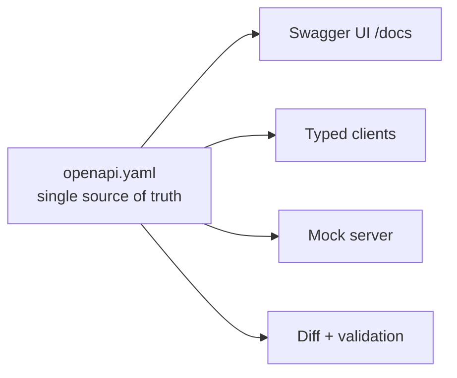
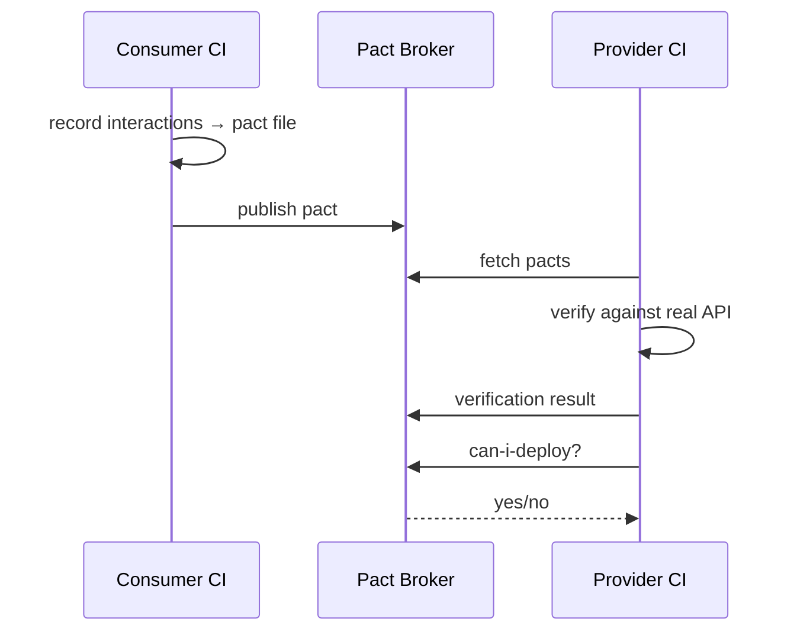
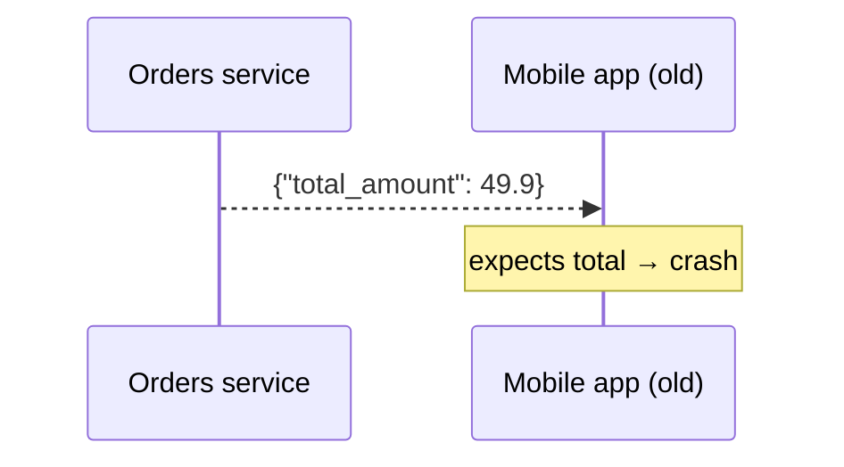

# Lesson 22: API Contracts & OpenAPI — Contract-First, Typed Clients & Pact

> **Prerequisites:** [Lesson 01: REST Principles](../01-rest-principles/README.md), [Lesson 10: API Request Validation](../10-api-request-validation/README.md), and [API Design Overview](../README.md) (Lesson 22 of 23).  
> **Estimated Reading Time:** 30–35 minutes  
> **Target Audience:** Backend and platform engineers preventing silent contract breaks between services and clients with OpenAPI, generated clients, CI diffs, and consumer-driven contracts.  
> **Free PDF Notes:** [Download SD-C-022.pdf](https://backendroadmap.com/notes/system-design/SD-C-022.pdf)

> [!NOTE]
> **In one line:** an API contract (usually an OpenAPI file) says exactly what the API accepts and returns; generate docs, mocks and typed clients from it, diff it in CI, and use consumer-driven contract tests so a breaking change fails a build instead of a release.

> [!TIP]
> **The Golden Rule of API Contracts:** A rename that “passes all unit tests” can still brick every mobile user. Treat OpenAPI as enforceable truth: **diff against production**, regenerate typed clients, and let **Pact can-i-deploy** block providers from shipping breaks consumers still need.

---

## Words You'll Meet Today

| Word | In Plain Words | Role in a Live Backend System |
| :--- | :--- | :--- |
| **API contract** | Exact promise of accept/return shapes. | Paths, schemas, status codes, auth. |
| **OpenAPI** | Standard YAML/JSON HTTP contract format. | Formerly “Swagger” before v3. |
| **Code-first** | Spec generated from code. | FastAPI `/openapi.json` from Pydantic. |
| **Contract-first** | Spec agreed before code. | PR review → mock → parallel build. |
| **Typed client** | Generated SDK that fails compile on mismatch. | `openapi-typescript` / OpenAPI Generator. |
| **oasdiff** | Diffs two OpenAPI files for breaks. | CI fails on removed fields / new required params. |
| **Pact** | Consumer-driven contract testing. | Consumer records needs; provider verifies. |
| **can-i-deploy** | Broker check: safe to release? | Gates provider deploy on all pacts green. |

---

## Visual Mental Models & Architecture

### The Bug No Test Caught

The mobile team builds against your orders API. A backend engineer renames `total` → `total_amount`. All tests pass; the release goes out; that night the app crashes for every user. Nobody tested the **contract**—the promise between API and callers.



### Everyday Picture: A Building Blueprint

If electricians and plumbers each invent their own blueprint from memory, the pipes miss the walls. One reviewed blueprint (OpenAPI) lets both trades work in parallel; changing a load-bearing wall fails the inspection (oasdiff/Pact) before tenants move in (production).

### Code-First vs Contract-First

| | Code-first | Contract-first |
| :--- | :--- | :--- |
| Source of truth | The code | The spec file |
| Speed to start | Fast | Slower: design/review first |
| Parallel work | Frontend waits | Frontend starts on mock day one |
| Best for | Internal, one team | Public, partner, cross-team APIs |

**Observability gap:** Serving `/docs` does not mean the spec matches production responses. Without response validation and consumer pacts, the spec is a brochure. Track contract-diff CI failures, Pact verification failures, and “spec vs shadow traffic” validation error rates.

---

## Systematic Reference & Comparison Grid

| Term | Precise Meaning | Production Example |
| :--- | :--- | :--- |
| **OpenAPI** | Machine-readable HTTP API description. | `openapi: 3.1.0` YAML in repo |
| **Protobuf contract** | RPC schema for gRPC. | `.proto` + compatibility rules |
| **E2E test** | Full stack scenario. | Slow/flaky; weak field coverage |
| **CDC (Pact)** | Per consumer–provider pair contract. | Seconds; pinpoints broken consumer |

Minimal shape:

```yaml
openapi: 3.1.0
info: {title: Orders API, version: 1.4.0}
paths:
  /orders/{id}:
    get:
      parameters: [{name: id, in: path, required: true, schema: {type: string}}]
      responses:
        '200': {content: {application/json: {schema: {$ref: '#/components/schemas/Order'}}}}
        '404': {description: Order not found}
components:
  schemas:
    Order: {type: object, required: [id, total],
            properties: {id: {type: string}, total: {type: number}}}
```

---

## Mathematical Model: Break Detection Cost

Cost of catching a break in CI vs production:

$$\text{Expected loss} \approx P(\text{break escapes}) \times \text{users} \times \text{cost/user}$$

If oasdiff runs in ~10 s on every PR and catches renames with probability ≈1 for declared fields, while E2E catches them with probability $p \ll 1$:

$$\frac{\text{CI catch value}}{\text{runtime}} \gg \text{E2E}$$

**Worked example:** 3 consumers; mobile pact reads `id`, `status`, `total`. PR renames `total` → `total_amount`.

- oasdiff: “property `total` removed” → fail ~10 s.  
- Pact: mobile verification fails; `can-i-deploy` = no.  
- Fix: add `total_amount`, **keep** `total` (additive). Remove later via expand-contract (next lesson).

---

## Metrics, Percentiles & Distributions

| Signal | Healthy |
| :--- | :--- |
| OpenAPI diff job duration | Seconds |
| Breaking-change PR fail rate | &gt;0 means gates work |
| Pact verify time | Seconds per provider |
| Generate-client `tsc` failures | Catch renames pre-merge |

Average “API uptime” can be 100% while 100% of mobile sessions crash on a field rename—contract health is a **separate** SLO.

---

## Compounding Effects Across Consumers

With $C$ consumers each depending on a field:

$$P(\text{someone breaks}) = 1 - (1 - p)^{C}$$

| Consumers $C$ | If each has 2% chance of relying on a changed field |
| :--- | :--- |
| 1 | 2% |
| 3 | ~6% |
| 12 | ~21% |

More consumers ⇒ higher value of Pact + oasdiff.

---

## Numbers Every Backend Engineer Must Know

| Item | Note |
| :--- | :--- |
| OpenAPI 3.x | Current mainstream |
| FastAPI docs | `/openapi.json`, `/docs` |
| oasdiff | Breaking vs additive classification |
| Pact Broker | Stores pacts; `can-i-deploy` |
| Typed client regen | In CI on every spec change |

---

## Protocol & Network Deep Dive



Generate clients:

```bash
npx openapi-typescript https://api.example.com/openapi.json -o src/api/schema.d.ts
```

After a rename, `order.total` fails `tsc` instead of crashing at runtime.

---

## Hierarchical Budgets & Capacity Sizing

| Gate | Time budget | Blocks |
| :--- | :--- | :--- |
| oasdiff vs **production** spec | &lt; 1 min | Merge |
| Typed client compile | minutes | Merge |
| Pact verify | minutes | Deploy |
| Full E2E | longer | Supplement, not replace |

Diff against **production**, not only `main`, or you miss what’s actually live.

---

## Top Engineering Mitigation Techniques

1. Single OpenAPI source of truth.  
2. Choose code-first vs contract-first deliberately.  
3. Generate typed clients—don’t hand-write models.  
4. CI oasdiff vs production.  
5. Pact + can-i-deploy between microservices.  
6. Enforce response validation in tests/staging.

---

## Production War Story (SEV-1 Post-Mortem)

**Severity & Impact:** SEV-1 mobile crash loop overnight after orders deploy; ~100% session failure on order details.

**What Happened:** Engineer renamed `total` → `total_amount` for “clarity.” Unit tests updated. Spec regenerated code-first but CI diffed against `main` which already contained the rename from a previous failed attempt—**not** against production. No Pact. Typed client not regenerated in the mobile pipeline.



**Fix:** oasdiff vs production artifact; Pact for mobile/web/billing; expand-contract (send both fields); regenerate clients in CI.

---

## Multi-Language Production Patterns

````carousel
```go
//go:generate oapi-codegen -package api -generate types,client -o client.gen.go openapi.yaml
package api

// After codegen, removing Order.Total from the spec fails compilation at call sites.
type Order struct {
	ID    string  `json:"id"`
	Total float64 `json:"total"`
}
```
<!-- slide -->
```typescript
// npx openapi-typescript ./openapi.yaml -o schema.d.ts
import type { components } from "./schema";

type Order = components["schemas"]["Order"];

export function amount(order: Order): number {
  // After rename total → total_amount without updating clients:
  // Property 'total' does not exist on type 'Order'.
  return order.total;
}
```
<!-- slide -->
```python
from fastapi import FastAPI
from pydantic import BaseModel, Field

app = FastAPI(title="Orders API", version="1.4.0")


class Order(BaseModel):
    id: str
    total: float = Field(..., description="Order total in major currency units")


@app.get("/orders/{order_id}", response_model=Order, responses={404: {"description": "Not found"}})
def get_order(order_id: str) -> Order:
    ...
# OpenAPI at /openapi.json — feed oasdiff + openapi-typescript in CI
```
<!-- slide -->
```csharp
// Use NSwag / OpenAPI generator to emit a typed client from openapi.yaml.
// Example assertion helper for CI contract smoke tests:
public sealed record Order(string Id, decimal Total);

public static class ContractAssert
{
    public static void HasRequiredTotal(Order order)
    {
        if (string.IsNullOrEmpty(order.Id)) throw new InvalidOperationException("id required");
        // Presence of Total is enforced by deserialization + required schema in OpenAPI tests
        _ = order.Total;
    }
}
```
````

---

## Practical Hands-On Verification CLI Workflows

### 1. Fetch a live OpenAPI document

```bash
curl -sS https://petstore3.swagger.io/api/v3/openapi.json | python -c "import sys,json; d=json.load(sys.stdin); print(d['openapi'], d['info']['title'])"
```

### 2. Illustrate a breaking rename detection mindset

```bash
python -c "old={'required':['id','total']}; new={'required':['id','total_amount']}; print('breaking', 'total' in old['required'] and 'total' not in new['required'])"
```

### 3. Remember: generate clients

```bash
npx --yes openapi-typescript https://petstore3.swagger.io/api/v3/openapi.json -o petstore.d.ts
```

---

## Common Mistakes & Troubleshooting

- Spec as after-the-fact docs that drift.  
- Hand-written client models.  
- Testing only provider unit behavior.  
- Diffing against `main` instead of **production**.  
- Spec not enforced on responses.  

---

## Key Terms Glossary

| Term | Interview-ready definition |
| :--- | :--- |
| **Contract-first** | Agree OpenAPI before implementation; generate mocks/clients. |
| **oasdiff** | Diffs specs; flags breaking changes. |
| **Pact** | Consumer-driven contract testing tool. |
| **can-i-deploy** | Broker check that release won’t break consumers. |

---

## Interview Practice Questions

<details>
<summary><strong>1. What is contract-first design? [BASIC]</strong></summary>

<strong>What a strong answer covers:</strong>
Designing and agreeing on the API spec (usually OpenAPI) before writing the implementation, then generating mocks, stubs, clients, and docs from it so teams work in parallel against one source of truth.

</details>

<details>
<summary><strong>2. What does an OpenAPI document contain? [BASIC]</strong></summary>

<strong>What a strong answer covers:</strong>
Paths and methods, parameters, request/response schemas, status codes (`200`, `404`, …), and security schemes such as bearer tokens. YAML or JSON and machine-readable.

</details>

<details>
<summary><strong>3. Code-first or contract-first: when each? [BASIC]</strong></summary>

<strong>What a strong answer covers:</strong>
Code-first (e.g. FastAPI generating `/openapi.json`) for internal APIs where one team owns both sides and speed matters. Contract-first for public, partner, and cross-team APIs where agreeing early is cheaper than changing later.

</details>

<details>
<summary><strong>4. What is a typed client and why generate it? [BASIC]</strong></summary>

<strong>What a strong answer covers:</strong>
Generated code from the spec so field renames/type changes fail at compile time instead of crashing in production. Hand-written models silently drift.

</details>

<details>
<summary><strong>5. How do you catch breaking changes before release? [SCENARIO]</strong></summary>

<strong>What a strong answer covers:</strong>
Diff OpenAPI against production in CI (oasdiff fails on removed fields, new required params, type changes); generate typed clients; run Pact with can-i-deploy gating the provider release.

</details>

<details>
<summary><strong>6. Frontend waits 3 weeks for backend. How do you fix that? [SCENARIO]</strong></summary>

<strong>What a strong answer covers:</strong>
Contract-first: agree OpenAPI in a PR in a day or two, generate a mock server, let frontend build against the mock while backend implements the same spec.

</details>

<details>
<summary><strong>7. You have 12 microservices. Why Pact if you have E2E tests? [SCENARIO]</strong></summary>

<strong>What a strong answer covers:</strong>
E2E needs all 12 deployed, is slow/flaky, and rarely covers every field. Pact tests each consumer–provider pair in isolation in seconds and names which consumer a change breaks.

</details>

<details>
<summary><strong>8. CI diffs OpenAPI only against main. What’s wrong? [SCENARIO]</strong></summary>

<strong>What a strong answer covers:</strong>
`main` may already include undeployed breaks, or diverge from production hotfixes. Diff against the spec artifact that production actually serves.

</details>

<details>
<summary><strong>9. Spec says total is required, but server sometimes omits it. Tests pass. Why? [TRICKY]</strong></summary>

<strong>What a strong answer covers:</strong>
Nothing checks responses against the spec. Add response validation in tests/staging and contract tests asserting fields consumers read are present. An unenforced spec is just documentation.

</details>

<details>
<summary><strong>10. Is adding a new required field to a request body breaking? To a response? [TRICKY]</strong></summary>

<strong>What a strong answer covers:</strong>
Request: yes—old clients don’t send it and get `400`. Response: usually safe for tolerant readers (they ignore it); oasdiff treats new optional request fields and new response fields as non-breaking.

</details>

<details>
<summary><strong>11. Can code-first still be safe for public APIs? [TRICKY]</strong></summary>

<strong>What a strong answer covers:</strong>
Yes if you still review the generated spec in PRs, freeze compatibility via oasdiff vs production, and run consumer contracts—but contract-first usually forces design review earlier when mistakes are cheaper.

</details>

<details>
<summary><strong>12. How do additive fixes unblock a rename? [TRICKY]</strong></summary>

<strong>What a strong answer covers:</strong>
Publish both `total` and `total_amount` (expand), migrate consumers, measure, then remove `total` (contract)—covered fully in the next lesson.

</details>

---

## One-Page Master Cheat Sheet

```text
====================================================================================================
                       API CONTRACTS & OPENAPI  —  CHEAT SHEET
====================================================================================================
IN ONE LINE   OpenAPI = truth; generate docs/mocks/clients; oasdiff vs prod; Pact can-i-deploy

CODE-FIRST    Spec from code (FastAPI) — fast, internal
CONTRACT-FIRST Spec PR first → mock → parallel — public/cross-team

CI GATES      oasdiff (removed field / new required / type change = fail)
              typed client compile   Pact verify   can-i-deploy
DIFF TARGET   Production spec artifact — not only main

BREAKING      remove/rename field, type change, new required request param
SAFE          optional response fields, new endpoints, optional request fields (+ defaults)

ANTI-PATTERNS X docs-only drifting spec   X hand-written clients   X provider-only unit tests
              X diff vs main only   X unenforced response schemas
====================================================================================================
```

---

## Free PDF notes

[SD-C-022.pdf](https://backendroadmap.com/notes/system-design/SD-C-022.pdf)

---

## Sources

- [OpenAPI Specification](https://spec.openapis.org/oas/latest.html)
- [oasdiff](https://github.com/Tufin/oasdiff)
- [Pact docs](https://docs.pact.io/)

---

## Next

Next comes [Lesson 23: API Backward Compatibility](../23-api-backward-compatibility/README.md): breaking vs safe changes, tolerant readers, and expand-contract. See [the track overview](../README.md).
