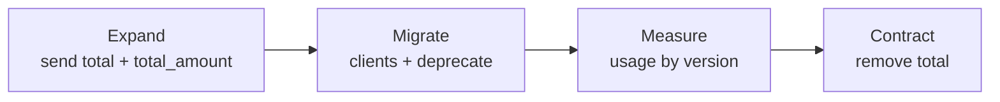
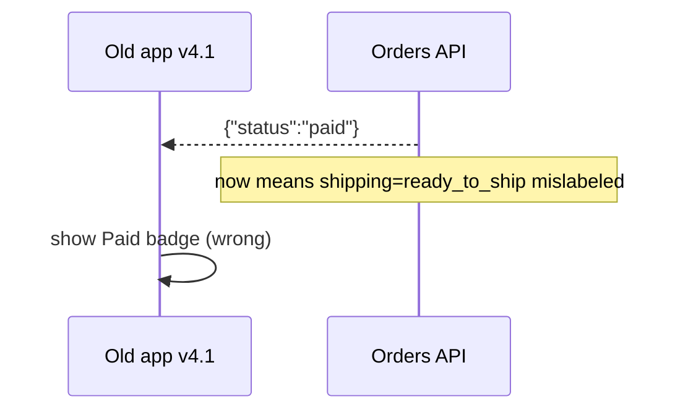

# Lesson 23: API Backward Compatibility — Breaking Changes & Expand-Contract

> **Prerequisites:** [Lesson 06: API Versioning Without Breaking Clients](../06-api-versioning-without-breaking-clients/README.md), [Lesson 22: API Contracts & OpenAPI](../22-api-contracts-openapi/README.md), and [API Design Overview](../README.md) (Lesson 23 of 23).  
> **Estimated Reading Time:** 30–35 minutes  
> **Target Audience:** Backend engineers shipping APIs consumed by long-lived mobile clients, partner integrations, and multi-version fleets that cannot force upgrades.  
> **Free PDF Notes:** [Download SD-C-023.pdf](https://backendroadmap.com/notes/system-design/SD-C-023.pdf)

> [!NOTE]
> **In one line:** every response must still work for every client version in the wild; make only additive changes, keep clients tolerant, never repurpose a field, and remove things with expand-contract.

> [!TIP]
> **The Golden Rule of Backward Compatibility:** The **oldest supported client** decides what you may still change. Prefer additive evolution; teach clients to be **tolerant readers** (Postel's law); never silently reuse a field's meaning; remove only via **expand → migrate → measure → contract**.

---

## Words You'll Meet Today

| Word | In Plain Words | Role in a Live Backend System |
| :--- | :--- | :--- |
| **Backward compatible** | New server still works for old clients. | Non-negotiable for mobile fleets. |
| **Breaking change** | Change that can break an existing client. | Rename, type change, new required input, … |
| **Additive change** | Adds without removing or altering meaning. | Optional response fields, new endpoints. |
| **Tolerant reader** | Ignores unknown fields; soft-handles enums. | Makes additive server changes safe. |
| **Expand-contract** | Add new, migrate, measure, then remove old. | Safe field replacement pattern. |
| **Deprecation** | Marking a field as going away. | `deprecated: true` in OpenAPI. |
| **Minimum supported version** | Oldest app version still served. | Below it → force-update screen. |
| **Postel's law** | Conservative in what you send; liberal in what you accept. | Server + client discipline. |

---

## Visual Mental Models & Architecture

### Why It Matters

Your mobile app has five versions in the wild; some users never update. The server ships whenever it likes—the **oldest client** decides what may still change.

```text
v5.2 46% · this week
v5.0 24%
v4.7 14%
v4.1 10%
v3.0  6% · 2 years old
        ↓
   Orders API — one response, five readers
```

### Everyday Picture: Road Signs for Old Drivers

You can add a new sign (optional field). You must not remove “STOP” or redefine it to mean “speed up” (repurpose). When replacing a sign, put up the new one beside the old (expand), wait until nobody navigates by the old one (measure), then take the old one down (contract).

### Breaking vs Safe

| Breaking | Example |
| :--- | :--- |
| Remove/rename field | `total` → `total_amount` |
| Change type | `"id": 17` → `"id": "17"` |
| Change meaning/units | duration seconds → milliseconds |
| Make optional input required | old clients omit → `400` |
| Tighten validation | name max 100 → 50 |
| Add enum value (strict clients) | `status: "on_hold"` crashes switch |

**Safe:** optional response fields, new endpoints, new optional parameters (with defaults), loosening validation (with downstream capacity checks).

**Observability gap:** Error rates may stay low when you **repurpose** a field—clients don’t crash; they make wrong decisions. Log field usage by `X-App-Version`, track deprecated-field read/write rates, and contract-test every supported version.

---

## Systematic Reference & Comparison Grid

| Term | Precise Meaning | Production Example |
| :--- | :--- | :--- |
| **Additive evolution** | Only add; never remove/repurpose. | Add `delivery_eta` optional |
| **Versioned break** | Intentional incompatible cut. | `/v2` or major app release |
| **Expand-contract** | Parallel run old+new fields. | Send `total` and `total_amount` |
| **Force update** | Block below min version. | Gate screen for &lt; v4.0 |

| Client behavior | On unknown field | On unknown enum |
| :--- | :--- | :--- |
| Tolerant reader | Ignore | Map to “other” |
| Strict parser | Crash / fail decode | Crash on exhaustive switch |

---

## Mathematical Model: Fleet Exposure

If fraction $f_v$ of traffic still reads a deprecated field, removing it breaks approximately that fraction:

$$\text{Break impact} \approx f_v \times \text{sessions}$$

| App version | Share | Still reads `total`? |
| :--- | :--- | :--- |
| v5.2 | 46% | no |
| v5.0 | 24% | no |
| v4.7 | 14% | yes |
| v4.1 | 10% | yes |
| v3.0 | 6% | yes |

Here $f_v = 0.14+0.10+0.06 = 30\%$—**do not contract yet**. After force-update moves min to v5.0, $f_v \to 0$.

### Expand-Contract Timeline

```text
1 Expand: add total_amount, send both
2 Migrate: clients switch; deprecate total
3 Measure: log reads by app version
4 Contract: remove total when usage ≈ 0
```

---

## Metrics, Percentiles & Distributions

| Metric | Use |
| :--- | :--- |
| Requests by `X-App-Version` | Know the fleet |
| Deprecated field presence in requests | Who still sends old shape |
| Client crash rate by version after deploy | Detect strict parsers |
| Wrong-business-metric spikes | Silent repurpose damage |

Averages across versions hide a 6% cohort on v3.0—always slice by version.

---

## Compounding Effects

Shipping $K$ independent breaking changes without expand-contract compounds survivor probability for an old client:

$$P(\text{old client still works}) = \prod_i (1 - b_i)$$

One rename ($b=1$ for that client) → works with probability 0. Prefer $b_i=0$ via additive changes.

---

## Numbers Every Backend Engineer Must Know

| Item | Practice |
| :--- | :--- |
| Header | `X-App-Version: 4.1.0` on every request |
| Deprecation window | Weeks–months (data-driven, not a guessed date) |
| Enum default branch | Mandatory in clients |
| JSON unknown keys | `ignoreUnknownKeys = true` (or equivalent) |
| Units in names | `duration_ms` vs ambiguous `duration` |

---

## Protocol & Network Deep Dive



Tolerant reader sketch:

```kotlin
val json = Json { ignoreUnknownKeys = true }
when (order.status) {
  "paid" -> showPaid()
  "shipped" -> showShipped()
  else -> showGeneric() // on_hold and anything added later
}
```

Never repurpose: if `status` meant payment status, don’t reuse it for shipping—add `shipping_status`. For units, add `duration_ms` and keep `duration` in seconds until contract.

---

## Hierarchical Budgets & Compatibility Windows

| Layer | Compatibility duty |
| :--- | :--- |
| Wire JSON | Additive fields; dual-write during expand |
| OpenAPI | Mark `deprecated: true`; oasdiff gates |
| Mobile | Min supported version + force update |
| Flags | New behavior only for versions ≥ threshold |
| Tests | Contract tests per supported version |

---

## Top Engineering Mitigation Techniques

1. Only additive changes by default.  
2. Tolerant readers on all clients.  
3. Never repurpose fields/enums/units.  
4. Expand-contract with measurement.  
5. Version headers + min supported version + flags.  
6. Contract tests for every supported client generation.

---

## Production War Story (SEV-1 Post-Mortem)

**Severity & Impact:** Not a crash SEV—worse. Support tickets: “order says paid but warehouse didn’t ship.” 3 days silent corruption on v4.x after `status` was reused for shipping states.



**RCA:** Repurposing breaks **silently**; removal would have broken loudly.

**Fix:** Introduced `shipping_status`; restored payment `status`; feature-flagged new enum `on_hold` by `X-App-Version`; expand-contract plan with usage dashboards; mandatory `else` branches in client lint rules.

---

## Multi-Language Production Patterns

````carousel
```go
package compat

type OrderV1 struct {
	ID           string  `json:"id"`
	Total        float64 `json:"total"`                  // deprecated
	TotalAmount  float64 `json:"total_amount"`           // new
	Status       string  `json:"status"`
	ShippingStatus string `json:"shipping_status,omitempty"`
}

func DualWriteTotals(amount float64) OrderV1 {
	return OrderV1{Total: amount, TotalAmount: amount}
}
```
<!-- slide -->
```typescript
export type Order = {
  id: string;
  /** @deprecated use total_amount */
  total: number;
  total_amount: number;
  status: string;
  shipping_status?: string;
};

export function displayTotal(o: Order): number {
  return o.total_amount ?? o.total;
}

export function mapStatus(status: string): "paid" | "shipped" | "other" {
  if (status === "paid" || status === "shipped") return status;
  return "other"; // tolerant enum
}
```
<!-- slide -->
```python
from pydantic import BaseModel, Field


class OrderResponse(BaseModel):
    id: str
    total: float = Field(..., description="Deprecated: use total_amount")
    total_amount: float
    status: str
    shipping_status: str | None = None

    @classmethod
    def from_amount(cls, id: str, amount: float, status: str, shipping: str | None = None):
        return cls(id=id, total=amount, total_amount=amount, status=status, shipping_status=shipping)
```
<!-- slide -->
```csharp
public sealed record OrderResponse(
    string Id,
    [property: Obsolete("Use TotalAmount")] decimal Total,
    decimal TotalAmount,
    string Status,
    string? ShippingStatus = null)
{
    public static OrderResponse FromAmount(string id, decimal amount, string status, string? shipping = null)
        => new(id, amount, amount, status, shipping);
}

public static string MapStatus(string status) => status switch
{
    "paid" or "shipped" => status,
    _ => "other"
};
```
````

---

## Practical Hands-On Verification CLI Workflows

### 1. Fleet break impact

```bash
python -c "shares={'5.2':0.46,'5.0':0.24,'4.7':0.14,'4.1':0.10,'3.0':0.06}; still={'4.7','4.1','3.0'}; print(sum(shares[v] for v in still))"
```

### 2. Dual-write equality check

```bash
python -c "total=49.9; total_amount=49.9; assert total==total_amount; print('expand ok')"
```

### 3. Unknown enum fallback

```bash
python -c "s='on_hold'; print(s if s in {'paid','shipped'} else 'other')"
```

---

## Common Mistakes & Troubleshooting

- Renaming a field because the old name was “ugly.”  
- Reusing a field or enum for a new meaning.  
- Strict JSON parsing in clients.  
- Removing a deprecated field on a calendar date without usage≈0.  
- Changing units silently without a new field name.  
- Loosening validation without checking DB/column/downstream limits.

---

## Key Terms Glossary

| Term | Interview-ready definition |
| :--- | :--- |
| **Backward compatible** | New server still works for old clients. |
| **Tolerant reader** | Ignores unknown fields; soft-handles unknown enums. |
| **Expand-contract** | Add new, migrate, measure, remove old. |
| **Minimum supported version** | Oldest app version still served. |

---

## Interview Practice Questions

<details>
<summary><strong>1. Which API changes are breaking? [BASIC]</strong></summary>

<strong>What a strong answer covers:</strong>
Removing or renaming fields; changing types, meanings, or units; making inputs required; tightening validation; and adding enum values old clients can't handle. Adding optional fields and endpoints is safe if clients are tolerant readers.

</details>

<details>
<summary><strong>2. How do you remove a field safely? [BASIC]</strong></summary>

<strong>What a strong answer covers:</strong>
Expand and contract: add the replacement and send both, deprecate the old field in the spec, measure who still uses it by app version, and remove it only when usage is near zero or in a new major version.

</details>

<details>
<summary><strong>3. What is a tolerant reader? [BASIC]</strong></summary>

<strong>What a strong answer covers:</strong>
A client that ignores unknown fields, doesn't depend on field order, and maps unknown enum values to a fallback like “other.” That is what makes additive server changes safe.

</details>

<details>
<summary><strong>4. What is Postel's law in API design? [BASIC]</strong></summary>

<strong>What a strong answer covers:</strong>
Be conservative in what you send and liberal in what you accept—servers evolve additively; clients tolerate extras.

</details>

<details>
<summary><strong>5. You must change duration from seconds to milliseconds. How? [SCENARIO]</strong></summary>

<strong>What a strong answer covers:</strong>
Don't change it in place. Add `duration_ms`, keep `duration` in seconds, send both, migrate clients, measure, and remove `duration` only when no client reads it. Same value, two names: `90` and `90000`.

</details>

<details>
<summary><strong>6. Logs show 3% of requests still come from app v3.0, which reads the old field. What do you do? [SCENARIO]</strong></summary>

<strong>What a strong answer covers:</strong>
Keep sending the field. Decide whether v3.0 is below your minimum supported version; if so, show a force-update screen, wait until usage falls near 0%, then remove the field.

</details>

<details>
<summary><strong>7. You add status = "on_hold" and old Android apps crash. What went wrong and what is the fix now? [SCENARIO]</strong></summary>

<strong>What a strong answer covers:</strong>
Old parser had no default branch for unknown enums. Short term: stop sending `on_hold` to old app versions (map by `X-App-Version` or flag). Long term: ship tolerant enum handling and contract-test old versions.

</details>

<details>
<summary><strong>8. How do feature flags help compatibility? [SCENARIO]</strong></summary>

<strong>What a strong answer covers:</strong>
Server-side flags make new behavior opt-in per app version (e.g. only 5.2+ gets new checkout), reducing blast radius while old clients keep the old path.

</details>

<details>
<summary><strong>9. Why is repurposing a field worse than removing it? [TRICKY]</strong></summary>

<strong>What a strong answer covers:</strong>
Removing breaks loudly (crash/missing value in logs). Repurposing breaks silently: old clients read `status: paid` as payment status when it now means shipping and make wrong decisions nobody notices.

</details>

<details>
<summary><strong>10. Is loosening validation always safe? [TRICKY]</strong></summary>

<strong>What a strong answer covers:</strong>
For old clients, yes—everything they sent before is still accepted. But check downstream: if you raise a name limit from 50 to 200, the DB column, other services, and old clients that display the value must handle 200 too.

</details>

<details>
<summary><strong>11. Can you rely on “clients should update” instead of expand-contract? [TRICKY]</strong></summary>

<strong>What a strong answer covers:</strong>
Not for mobile/partner fleets. You can raise minimum supported version deliberately, but until usage is gone you must keep compatibility. Hope is not a migration strategy.

</details>

<details>
<summary><strong>12. How do OpenAPI deprecation and oasdiff interact with expand-contract? [TRICKY]</strong></summary>

<strong>What a strong answer covers:</strong>
During expand, both fields appear (additive—passes oasdiff). Mark old field `deprecated: true`. Contract (removal) is breaking—only merge when metrics/Pact say no consumer remains, or ship behind a major version cut.

</details>

---

## One-Page Master Cheat Sheet

```text
====================================================================================================
                    API BACKWARD COMPATIBILITY  —  CHEAT SHEET
====================================================================================================
IN ONE LINE   Oldest client wins; additive only; tolerant readers; never repurpose; expand→migrate→measure→contract

BREAKING      remove/rename | type/meaning/units change | new required input | tighter validation | new enum (strict)
SAFE          optional response fields | new endpoints | optional params + defaults | looser validation*

TOLERANT      ignore unknown fields | no field-order deps | enum else → "other"
EXPAND        send old+new | deprecate old | log by X-App-Version | remove at usage≈0 / major

MOBILE        X-App-Version | min supported + force-update | flags per version | contract-test old gens
WORSE SILENT  repurposing fields/enums/units   (crashes are kinder than wrong business decisions)

ANTI-PATTERNS X vanity renames   X reuse status meaning   X strict parsers   X calendar deprecation
              X silent unit change   X loosen validation without downstream capacity
====================================================================================================
```

---

## Free PDF notes

[SD-C-023.pdf](https://backendroadmap.com/notes/system-design/SD-C-023.pdf)

---

## Sources

- [Postel's Law / Robustness Principle](https://en.wikipedia.org/wiki/Robustness_principle)
- [Microsoft REST API Guidelines — versioning & compatibility](https://github.com/microsoft/api-guidelines)
- [OpenAPI `deprecated` field](https://spec.openapis.org/oas/latest.html)

---

## Next

This completes the API Design track short-lecture set for lessons 17–23. Return to [the track overview](../README.md), or continue into databases with the next phase when published (SD-E series). For versioning tactics that pair with expand-contract, revisit [Lesson 06: API Versioning](../06-api-versioning-without-breaking-clients/README.md).
