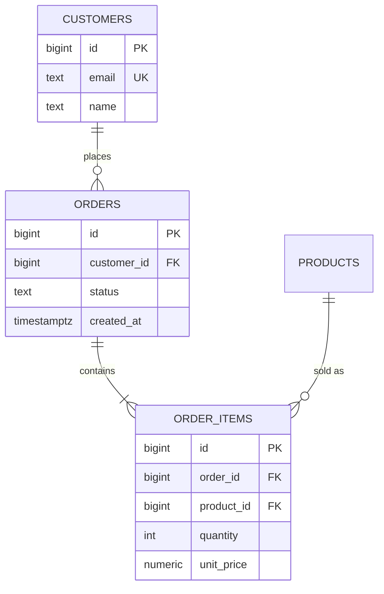

# Lesson 01: Relational Model & SQL Basics — Keys, Constraints, Join Types & Why SQL

> **Prerequisites:** [Track: Databases](../README.md) overview.  
> **Estimated Reading Time:** 30–35 minutes  
> **Target Audience:** Backend engineers designing schemas, writing joins, and deciding when Postgres/MySQL is the right default versus reaching for NoSQL.  
> **Free PDF Notes:** [Download SD-E-001.pdf](https://backendroadmap.com/notes/system-design/SD-E-001.pdf)

> [!NOTE]
> **In one line:** Relational databases store data in typed tables linked by keys, protect it with constraints and ACID transactions, and answer questions you did not plan for with joins—making them the right default for most business data.

> [!TIP]
> **The Golden Rule of the Relational Model:** Put integrity in the database (`PRIMARY KEY`, `FOREIGN KEY`, `NOT NULL`, `UNIQUE`, `CHECK`) and ask questions with declarative SQL; the optimizer picks the plan. Enforce rules only in app code and the next script or service will skip them.

---

## Words You'll Meet Today

| Word | In Plain Words | Role in a Live Backend System |
| :--- | :--- | :--- |
| **Table / row / column** | Record set / one record / typed attribute | Schema of `customers`, `orders`, `order_items` |
| **Primary key (PK)** | Uniquely identifies a row | `orders.id` |
| **Foreign key (FK)** | References a row in another table | `order_items.order_id → orders.id` |
| **Constraint** | Rule the database enforces on every write | `CHECK (quantity > 0)`, `UNIQUE (email)` |
| **Inner / left / anti join** | Matching rows / all left + NULLs / left with no match | Revenue reports; customers who never ordered |
| **Query optimizer** | Chooses join order, scans, and indexes | Turns `SELECT … JOIN …` into a plan |
| **ACID** | Atomic, consistent, isolated, durable | Place-order: insert + stock decrement all-or-nothing |

---

## Visual Mental Models & Architecture

### The Question: Why Is SQL Still the Default?

An online shop has customers, orders, and order items. Finance asks: revenue per product last month? Product asks: which customers never ordered? Both are one SQL query away—if the data lives in a relational database. Nobody had to predict those questions when the schema was designed.



*Figure 1. Shop schema: each table holds one kind of thing; foreign keys connect them. The database rejects an item whose `order_id` does not exist.*

---

## Core Definition & Taxonomic Comparison

**What it is:** The relational model stores data in relations (tables) of typed tuples (rows), linked by keys, queried with relational algebra expressed as SQL. **What it isn't:** “SQL = no scale” (a single Postgres node routinely handles hundreds of GB to a few TB and thousands of TPS), and “NoSQL = automatically better for microservices.”

| Term | Precise Meaning | Production Example |
| :--- | :--- | :--- |
| **Relational DB** | Typed tables + keys + constraints + declarative SQL + ACID | Postgres for orders, inventory, billing |
| **Document store** | Nested JSON documents; limited cross-doc joins | Product catalog with flexible attributes |
| **Key-value store** | Opaque value by key; O(1) get/set | Session tokens, rate-limit counters |
| **Wide-column** | Partition + clustering keys; write-heavy | IoT time series in Cassandra |
| **Primary key** | Unique row identity in *this* table | `orders.id` |
| **Foreign key** | Must match a PK (or unique) in another table | `order_items.order_id` |

**Business implication:** Most business data is structured, related, and asked unpredictable questions. Start relational; reach for NoSQL for a *specific* need (massive write scale, flexible schema, or simple KV at huge volume).

---

## Component Breakdown & Anatomy

### Tables, Keys, and Constraints

```sql
CREATE TABLE orders (
  id          bigint PRIMARY KEY,
  customer_id bigint NOT NULL REFERENCES customers(id),
  status      text   NOT NULL CHECK (status IN ('pending','paid','cancelled')),
  created_at  timestamptz NOT NULL DEFAULT now()
);
-- order_items: CHECK (quantity > 0) the same way
INSERT INTO orders (id, customer_id, status) VALUES (501, 999, 'paid');
-- ERROR: violates foreign key constraint
```

`NOT NULL`, `UNIQUE`, `CHECK`, and foreign keys hold no matter which service, script, or engineer writes. Bugs in application code cannot sneak bad data past them—the write fails.

### Joins Combine Tables

| Join | Returns | Example |
| :--- | :--- | :--- |
| **INNER** | Only matching rows | Orders that have customers |
| **LEFT** | All left rows; NULL if no match | All customers, orders if any |
| **ANTI** | Left rows with no match | Customers who never ordered (`NOT EXISTS` / `LEFT … IS NULL`) |

```sql
-- customers who never ordered (anti join)
SELECT c.id, c.email
FROM customers c
WHERE NOT EXISTS (SELECT 1 FROM orders o WHERE o.customer_id = c.id);
-- or: LEFT JOIN orders o ON o.customer_id = c.id WHERE o.id IS NULL;
```

### The Observability Gap: Who Sees Data Integrity Failures?

| Measurement Point | What It Captures | What It Hides |
| :--- | :--- | :--- |
| **App error rate** | Constraint violations as 500s/400s | Which constraint; silent wrong data if no constraint |
| **DB logs / `pg_stat_database`** | Conflicts, deadlocks, rollbacks | Business-rule drift not expressed as constraints |
| **ORM layer** | Mapped entity errors | Raw SQL scripts and admin tools bypassing ORM |
| **Data quality monitors** | Orphans, nulls, CHECK breaches after the fact | Root cause writer |

Integrity failures are cheap to prevent at write time and expensive to detect later. Prefer database constraints as the source of truth.

---

## Mathematical Model & Worked Scale

### When Is Relational Enough?

A shop with **1 million orders/month** averages:

$$\lambda_{\text{orders}} = \frac{10^6}{30 \times 24 \times 3600} \approx 0.39 \text{ orders/s}$$

Even peak at **20×** average ≈ **8 orders/s**—far inside what Postgres/MySQL handle (thousands of TPS on one node with read replicas for more reads).

| Workload | Rough capacity (single well-tuned node) | Implication |
| :--- | :--- | :--- |
| OLTP TPS | Thousands of short transactions/s | Most SaaS shops fit one primary |
| Data size | Hundreds of GB → few TB | Partition/shard only when measured |
| Ad hoc joins | Optimizer + indexes | Prefer SQL over rebuilding joins in app |

### Compounding: Unconstrained Writes

If each of $N$ writers has probability $p$ of skipping an app-only validation:

$$P(\text{at least one bad write}) = 1 - (1-p)^N$$

| $N$ writers | $p=0.01$ | $p=0.05$ |
| :--- | :--- | :--- |
| 5 | 4.9% | 23% |
| 20 | 18% | 64% |
| 50 | 39% | 92% |

A `CHECK` or FK makes $p \approx 0$ for that rule.

---

## Metrics, Percentiles & Numbers Engineers Must Know

| Operation | Typical latency | Relative | Implication |
| :--- | :--- | :--- | :--- |
| In-memory PK lookup | ~0.01–0.1 ms | 1× | Hot path OK |
| Indexed disk lookup | ~0.1–1 ms | ~10× | Still fine for OLTP |
| Sequential scan 1M rows | tens–hundreds ms | 1000×+ | Needs index or limit |
| Cross-DC RTT | ~30–100 ms | — | Don't chatty-join over WAN |

| Percentile | Who feels it | DB meaning |
| :--- | :--- | :--- |
| $p_{50}$ | Typical user | Index hit, warm cache |
| $p_{95}$ | Bad day for 1/20 | Cold pages, lock waits |
| $p_{99}$ | Worst users / bots | Vacuum, checkpoints, spills |

---

## Hierarchical Budgets & Mitigations

| Tier | Latency budget (example 200 ms API) | Role |
| :--- | :--- | :--- |
| Gateway / auth | 10–20 ms | JWT, rate limit |
| Service logic | 20–40 ms | Validation, orchestration |
| Cache | 1–5 ms | Hot reads |
| Database | 30–80 ms | Primary query + 1–2 lookups |
| Headroom | ~40 ms | Spikes, GC, retries |

**Top mitigations:** (1) constraints at the source, (2) indexes for real predicates, (3) transactions for multi-write units, (4) `NOT EXISTS` not `NOT IN` for anti joins, (5) don't pick NoSQL “for scale” before you have a scale problem.

---

## Production War Story: Half-Written Orders After a Crash

- **Severity:** SEV-1 (checkout corruption during deploy window)
- **Detection / Resolution:** 18 minutes to halt traffic; 2 hours to reconcile orphaned rows
- **Impact:** ~1,200 orders with items but no stock decrement; inventory oversold on 40 SKUs

### What Happened

Place-order did three writes **without a transaction**: insert order, insert items, decrement stock. A process kill after step 2 left orders with items and unchanged stock.

```mermaid
sequenceDiagram
    participant App as Checkout Service
    participant DB as Postgres
    App->>DB: INSERT order o-501 (autocommit)
    App->>DB: INSERT 3 items (autocommit)
    Note over App: Process killed / OOM
    App--xDB: UPDATE stock (never ran)
    Note over DB: Orphaned order with items; stock wrong
```

### Root Cause & Fix

1. **No transaction boundary** around the three writes.  
2. **Stock integrity only in app code**—no `CHECK (stock >= 0)`.  
3. **Fix:** `BEGIN` … insert order + items + `UPDATE stock` … `COMMIT`; add `CHECK`; reconciliation job for historical orphans.

---

## Multi-Language Production Implementation

Idempotent place-order with constraints and a single transaction—Go, TypeScript, Python, C#:

````carousel
```go
package shop

import (
	"context"
	"database/sql"
	"fmt"
)

func PlaceOrder(ctx context.Context, db *sql.DB, customerID int64, items []LineItem) (int64, error) {
	tx, err := db.BeginTx(ctx, nil)
	if err != nil {
		return 0, err
	}
	defer tx.Rollback()

	var orderID int64
	err = tx.QueryRowContext(ctx,
		`INSERT INTO orders (customer_id, status) VALUES ($1, 'pending') RETURNING id`,
		customerID).Scan(&orderID)
	if err != nil {
		return 0, err
	}
	for _, it := range items {
		if it.Quantity <= 0 {
			return 0, fmt.Errorf("quantity must be > 0")
		}
		_, err = tx.ExecContext(ctx,
			`INSERT INTO order_items (order_id, product_id, quantity, unit_price)
			 VALUES ($1,$2,$3,$4)`, orderID, it.ProductID, it.Quantity, it.UnitPrice)
		if err != nil {
			return 0, err
		}
		res, err := tx.ExecContext(ctx,
			`UPDATE products SET stock = stock - $1
			 WHERE id = $2 AND stock >= $1`, it.Quantity, it.ProductID)
		if err != nil {
			return 0, err
		}
		n, _ := res.RowsAffected()
		if n == 0 {
			return 0, fmt.Errorf("insufficient stock for product %d", it.ProductID)
		}
	}
	_, err = tx.ExecContext(ctx, `UPDATE orders SET status = 'paid' WHERE id = $1`, orderID)
	if err != nil {
		return 0, err
	}
	return orderID, tx.Commit()
}
```
<!-- slide -->
```typescript
import { Pool, PoolClient } from "pg";

type LineItem = { productId: number; quantity: number; unitPrice: number };

export async function placeOrder(
  pool: Pool,
  customerId: number,
  items: LineItem[],
): Promise<number> {
  const client = await pool.connect();
  try {
    await client.query("BEGIN");
    const { rows } = await client.query(
      `INSERT INTO orders (customer_id, status) VALUES ($1, 'pending') RETURNING id`,
      [customerId],
    );
    const orderId: number = rows[0].id;
    for (const it of items) {
      if (it.quantity <= 0) throw new Error("quantity must be > 0");
      await client.query(
        `INSERT INTO order_items (order_id, product_id, quantity, unit_price)
         VALUES ($1,$2,$3,$4)`,
        [orderId, it.productId, it.quantity, it.unitPrice],
      );
      const upd = await client.query(
        `UPDATE products SET stock = stock - $1
         WHERE id = $2 AND stock >= $1`,
        [it.quantity, it.productId],
      );
      if (upd.rowCount === 0) throw new Error(`insufficient stock for ${it.productId}`);
    }
    await client.query(`UPDATE orders SET status = 'paid' WHERE id = $1`, [orderId]);
    await client.query("COMMIT");
    return orderId;
  } catch (e) {
    await client.query("ROLLBACK");
    throw e;
  } finally {
    client.release();
  }
}
```
<!-- slide -->
```python
from __future__ import annotations
import psycopg


def place_order(conn: psycopg.Connection, customer_id: int, items: list[dict]) -> int:
    with conn.transaction():
        with conn.cursor() as cur:
            cur.execute(
                "INSERT INTO orders (customer_id, status) VALUES (%s, 'pending') RETURNING id",
                (customer_id,),
            )
            order_id = cur.fetchone()[0]
            for it in items:
                if it["quantity"] <= 0:
                    raise ValueError("quantity must be > 0")
                cur.execute(
                    """INSERT INTO order_items (order_id, product_id, quantity, unit_price)
                       VALUES (%s,%s,%s,%s)""",
                    (order_id, it["product_id"], it["quantity"], it["unit_price"]),
                )
                cur.execute(
                    """UPDATE products SET stock = stock - %s
                       WHERE id = %s AND stock >= %s""",
                    (it["quantity"], it["product_id"], it["quantity"]),
                )
                if cur.rowcount == 0:
                    raise RuntimeError(f"insufficient stock for {it['product_id']}")
            cur.execute("UPDATE orders SET status = 'paid' WHERE id = %s", (order_id,))
            return order_id
```
<!-- slide -->
```csharp
using System.Data;
using Npgsql;

public static class ShopOrders
{
    public static async Task<long> PlaceOrderAsync(
        NpgsqlDataSource ds, long customerId, IReadOnlyList<LineItem> items, CancellationToken ct)
    {
        await using var conn = await ds.OpenConnectionAsync(ct);
        await using var tx = await conn.BeginTransactionAsync(ct);
        await using (var cmd = new NpgsqlCommand(
            "INSERT INTO orders (customer_id, status) VALUES (@c, 'pending') RETURNING id",
            conn, tx))
        {
            cmd.Parameters.AddWithValue("c", customerId);
            var orderId = (long)(await cmd.ExecuteScalarAsync(ct))!;
            foreach (var it in items)
            {
                if (it.Quantity <= 0) throw new ArgumentException("quantity must be > 0");
                await using var ins = new NpgsqlCommand(
                    @"INSERT INTO order_items (order_id, product_id, quantity, unit_price)
                      VALUES (@o,@p,@q,@u)", conn, tx);
                ins.Parameters.AddWithValue("o", orderId);
                ins.Parameters.AddWithValue("p", it.ProductId);
                ins.Parameters.AddWithValue("q", it.Quantity);
                ins.Parameters.AddWithValue("u", it.UnitPrice);
                await ins.ExecuteNonQueryAsync(ct);

                await using var upd = new NpgsqlCommand(
                    @"UPDATE products SET stock = stock - @q WHERE id = @p AND stock >= @q",
                    conn, tx);
                upd.Parameters.AddWithValue("q", it.Quantity);
                upd.Parameters.AddWithValue("p", it.ProductId);
                if (await upd.ExecuteNonQueryAsync(ct) == 0)
                    throw new InvalidOperationException($"insufficient stock for {it.ProductId}");
            }
            await using (var paid = new NpgsqlCommand(
                "UPDATE orders SET status = 'paid' WHERE id = @o", conn, tx))
            {
                paid.Parameters.AddWithValue("o", orderId);
                await paid.ExecuteNonQueryAsync(ct);
            }
            await tx.CommitAsync(ct);
            return orderId;
        }
    }
}

public record LineItem(long ProductId, int Quantity, decimal UnitPrice);
```
````

---

## Practical Hands-On CLI Verification

```bash
# Anti-join: customers with no orders
psql -c "SELECT c.id, c.email FROM customers c
WHERE NOT EXISTS (SELECT 1 FROM orders o WHERE o.customer_id = c.id) LIMIT 5;"

# Revenue per product last calendar month
psql -c "
SELECT oi.product_id, SUM(oi.quantity * oi.unit_price) AS revenue
FROM order_items oi
JOIN orders o ON o.id = oi.order_id
WHERE o.status = 'paid'
  AND o.created_at >= date_trunc('month', now()) - interval '1 month'
  AND o.created_at <  date_trunc('month', now())
GROUP BY oi.product_id
ORDER BY revenue DESC
LIMIT 10;"
```

```bash
python3 -c "print(1e6/(30*24*3600))"  # ~0.385 orders/s average
```

---

## Common Mistakes to Avoid

1. Enforcing rules only in application code.  
2. Using `NOT IN (subquery)` for anti joins—any `NULL` in the subquery yields zero rows; prefer `NOT EXISTS`.  
3. Putting a filter on the right table in `WHERE` after a `LEFT JOIN` (silently becomes an inner join)—put it in `ON`.  
4. Choosing NoSQL “for scale” before measuring, then rebuilding joins and constraints by hand.  
5. Multi-step writes without a transaction.  
6. Assuming `SELECT *` joins are free at millions of rows.

---

## Key Terms Glossary

| Term | Interview-ready definition |
| :--- | :--- |
| Table / row / column | Record set / one record / typed attribute |
| Primary key | Uniquely identifies a row |
| Foreign key | References a row in another table; orphans rejected |
| Constraint | Rule the database enforces on every write |
| Inner / left / anti join | Matching / all left / left with no match |
| Query optimizer | Picks how to execute a declarative query |
| ACID | Atomic, consistent, isolated, durable transactions |

---

## Interview Practice Questions

### Basic Conceptual Questions (Q1–Q4)

<details>
<summary><strong>Q1: When is a relational database the right default? [BASIC]</strong></summary>

<strong>What a strong answer covers:</strong>
For structured, related data that needs transactions, constraints, and flexible querying—most business data. Choose something else only for a specific need: massive write scale, very flexible schemas, or simple key-value access at huge volume.

</details>

<details>
<summary><strong>Q2: Explain the join types (inner, left, anti). [BASIC]</strong></summary>

<strong>What a strong answer covers:</strong>
Inner returns only matching rows. Left keeps all left rows with NULLs where nothing matches. Anti returns left rows with no match (`NOT EXISTS` or `LEFT JOIN … WHERE right.id IS NULL`).

</details>

<details>
<summary><strong>Q3: Primary key vs foreign key? [BASIC]</strong></summary>

<strong>What a strong answer covers:</strong>
PK uniquely identifies a row in its own table (`orders.id`). FK must match a PK/unique in another table (`order_items.order_id → orders.id`), so orphan rows are rejected.

</details>

<details>
<summary><strong>Q4: What do constraints buy you that app validation doesn't? [BASIC]</strong></summary>

<strong>What a strong answer covers:</strong>
They run on *every* writer—ORMs, admin SQL, migrations, scripts, other services. App validation is advisory; constraints are the last line of defense.

</details>

### Scenario-Based Architecture Questions (Q5–Q8)

<details>
<summary><strong>Q5: Write a query for customers who never placed an order. [SCENARIO]</strong></summary>

<strong>What a strong answer covers:</strong>
`SELECT c.* FROM customers c WHERE NOT EXISTS (SELECT 1 FROM orders o WHERE o.customer_id = c.id)`. Or `LEFT JOIN` + `WHERE o.id IS NULL`. Index `orders(customer_id)`.

</details>

<details>
<summary><strong>Q6: A bug wrote order items with quantity 0 and −3. How do you stop it for good? [SCENARIO]</strong></summary>

<strong>What a strong answer covers:</strong>
Clean bad rows, then `CHECK (quantity > 0)`. Every writer—including scripts—gets an error instead of corrupting data.

</details>

<details>
<summary><strong>Q7: Placing an order needs 3 writes. The server crashes after the second. What happens? [SCENARIO]</strong></summary>

<strong>What a strong answer covers:</strong>
Inside one transaction, nothing is committed—rollback on restart. Without a transaction you get an order with items but stock never decremented.

</details>

<details>
<summary><strong>Q8: Finance wants revenue per product last month. Sketch the SQL. [SCENARIO]</strong></summary>

<strong>What a strong answer covers:</strong>
Join `order_items` to `orders`, filter `status='paid'` and last calendar month, `GROUP BY product_id`, `SUM(quantity * unit_price)`, order by revenue. Index e.g. `orders(status, created_at)`.

</details>

### Advanced & Tricky Interview Questions (Q9–Q12)

<details>
<summary><strong>Q9: A LEFT JOIN returns fewer customers than expected. Why? [TRICKY]</strong></summary>

<strong>What a strong answer covers:</strong>
A condition on the right table in `WHERE` (e.g. `WHERE o.status = 'paid'`) removes NULL rows, turning it into an inner join. Move the condition into `ON`.

</details>

<details>
<summary><strong>Q10: Why can NOT IN return zero rows when you expect many? [TRICKY]</strong></summary>

<strong>What a strong answer covers:</strong>
If the subquery returns a NULL, `x NOT IN (…, NULL)` is never true (unknown). `NOT EXISTS` does not have this problem.

</details>

<details>
<summary><strong>Q11: Is “we use microservices” a reason to abandon relational joins? [TRICKY]</strong></summary>

<strong>What a strong answer covers:</strong>
No. Split *services* for deploy/ownership boundaries; keep strongly related data in one database when you need joins and ACID. Cross-service joins become distributed sagas—use them when ownership requires it, not as a default.

</details>

<details>
<summary><strong>Q12: When would you *not* put a foreign key in the database? [TRICKY]</strong></summary>

<strong>What a strong answer covers:</strong>
Cross-database/service references (no FK possible), or extreme write paths where FK checks dominate and integrity is enforced via careful dual-write/CDC—rare, and you own reconciliation. Prefer FKs for same-database business entities.

</details>

---

## One-Page Master Cheat Sheet

```text
====================================================================================================
              RELATIONAL MODEL & SQL BASICS — CHEAT SHEET (SD-E-001)
====================================================================================================
MODEL
  Tables of typed rows · PK identifies · FK references · constraints on every write
  Joins answer questions you didn't design for  →  SQL is the default for business data

JOINS
  INNER  = matching only
  LEFT   = all left + NULLs
  ANTI   = left with no match  →  NOT EXISTS  (avoid NOT IN with nullable subqueries)

CONSTRAINTS
  NOT NULL | UNIQUE | CHECK | FOREIGN KEY   — app code alone WILL be skipped by a script

TRANSACTIONS
  BEGIN … multi-write … COMMIT/ROLLBACK     crash mid-txn → nothing committed

WHEN RELATIONAL
  Structured + related + ACID + ad hoc queries
  1M orders/mo ≈ 0.4/s avg — single node is fine; NoSQL for a SPECIFIC need

ANTI-PATTERNS
  x rules only in app     x NOT IN for anti-join     x WHERE filter after LEFT JOIN
  x NoSQL "for scale" early     x multi-write without a transaction
====================================================================================================
```

---

## Free PDF notes

[SD-E-001.pdf](https://backendroadmap.com/notes/system-design/SD-E-001.pdf)

---

## Sources

- Codd, E. F. — A Relational Model of Data for Large Shared Data Banks (1970).  
- PostgreSQL docs — Constraints, Joins, Transactions.  
- SQL:2016 — Join types and referential integrity.

---

## Next

Next: [Lesson 02: Database Normalization](../02-database-normalization/README.md). Track overview: [Databases](../README.md).
