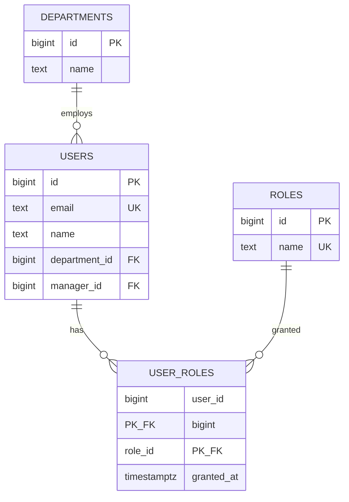
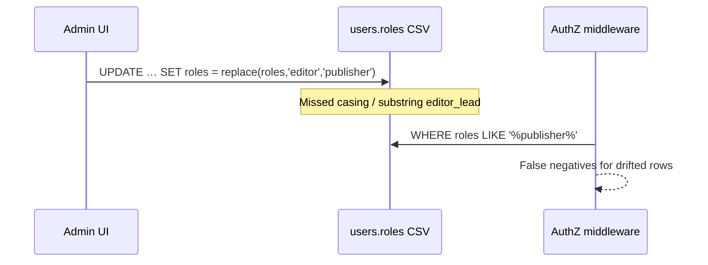

# Lesson 02: Database Normalization — 1NF, 2NF, 3NF, Anomalies & Junction Tables

> **Prerequisites:** [Lesson 01: Relational Model & SQL Basics](../01-relational-model-sql-basics/README.md).  
> **Estimated Reading Time:** 28–35 minutes  
> **Target Audience:** Backend engineers designing schemas that stay consistent under updates and model many-to-many relationships correctly.  
> **Free PDF Notes:** [Download SD-E-002.pdf](https://backendroadmap.com/notes/system-design/SD-E-002.pdf)

> [!NOTE]
> **In one line:** Normalization stores each fact in exactly one place, which removes update, insert, and delete anomalies; aim for third normal form and model many-to-many with a junction table.

> [!TIP]
> **The Golden Rule of Normalization:** *The key, the whole key, and nothing but the key*—atomic columns (1NF), full composite-key dependence (2NF), no transitive dependence on non-keys (3NF). Copying `manager_email` into 500 rows guarantees drift.

---

## Words You'll Meet Today

| Word | In Plain Words | Role in a Live Backend System |
| :--- | :--- | :--- |
| **Normalization** | Store each fact once | Role rename = one-row update |
| **Anomaly** | Update / insert / delete pain from duplication | Stale manager emails; can't insert a role alone |
| **1NF / 2NF / 3NF** | Atomic → whole key → key only | CSV roles → junction; product_name off order line |
| **Junction table** | Links many-to-many | `user_roles (user_id, role_id)` |
| **BCNF** | Stricter 3NF | Rare edge cases; aim for 3NF in practice |
| **Denormalization** | Deliberate duplication for reads | Next lesson—only after measuring |

---

## Visual Mental Models & Architecture

### The Table That Drifts

A startup stores everything in one `users` table: name, email, roles as a comma-separated string, and the manager's email copied into every row. Then a role gets renamed, a manager changes email, and data quietly drifts.

| id | name | email | roles | manager_email |
| :--- | :--- | :--- | :--- | :--- |
| 1 | Asha | asha@co.io | admin,editor | ravi@co.io |
| 2 | Ben | ben@co.io | editor | ravi@co.io |
| 3 | Chen | chen@co.io | viewer,editor | ravi.k@co.io |
| 4 | Dina | dina@co.io | Editor | ravi@co.io |

Orange: list in one column (breaks 1NF). Pink: copies that drifted (`Editor` vs `editor`, `ravi.k@co.io`).



*Figure 1. Normalized schema: each fact once—role name in `roles`, department name in `departments`, membership in `user_roles`.*

---

## Core Definition & Taxonomic Comparison

**What it is:** A disciplined way to place attributes so each non-key fact depends on the key alone. **What it isn't:** “Normalize until joins are impossible to write,” or “never store price on an order line” (point-in-time facts are different facts).

| Term | Precise Meaning | Production Example |
| :--- | :--- | :--- |
| **1NF** | Atomic values; no repeating groups | Split `roles='admin,editor'` → `user_roles` rows |
| **2NF** | Non-key attrs depend on *whole* composite key | Move `product_name` off `(order_id, product_id)` |
| **3NF** | Non-key attrs depend only on the key | Move `department_name` off `users` |
| **BCNF** | Every determinant is a candidate key | Tighten rare 3NF edge cases |
| **Junction** | M:N link table with composite uniqueness | `PRIMARY KEY (user_id, role_id)` |

---

## Component Breakdown & Anatomy

### Three Anomalies

| Anomaly | Symptom | Cause |
| :--- | :--- | :--- |
| **Update** | Manager email in 40 rows; update 39 → one stale | One fact, many rows |
| **Insert** | Can't record role `auditor` until some user has it | Two facts, one row |
| **Delete** | Delete last admin → “admin role exists” disappears | Two facts, one row |

### Normal Forms at a Glance

| Form | Violation | Fix |
| :--- | :--- | :--- |
| 1NF | `users.roles = 'admin,editor'` | One row per user–role in `user_roles` |
| 2NF | Key `(order_id, product_id)` + `product_name` | Move name to `products` |
| 3NF | `users.department_name` depends on `department_id` | Move to `departments` |

### Relationships

- **One-to-many:** “many” side holds the FK (`orders.user_id`).  
- **Many-to-many:** neither side holds a list—add a junction table.

```sql
CREATE TABLE user_roles (
  user_id    bigint NOT NULL REFERENCES users(id),
  role_id    bigint NOT NULL REFERENCES roles(id),
  granted_at timestamptz NOT NULL DEFAULT now(),
  PRIMARY KEY (user_id, role_id)
);
UPDATE roles SET name = 'publisher' WHERE name = 'editor';  -- 1 row; every user sees it
```

### The Observability Gap

| Signal | Captures | Hides |
| :--- | :--- | :--- |
| Duplicate `(user_id, role_id)` counts | Missing unique/PK on junction | How they got in |
| `LIKE '%editor%'` full scans | 1NF CSV design | False matches (`editor_lead`) |
| Orphan FKs if FKs disabled | Referential drift | Writer path |

---

## Mathematical Model & Worked Example

For **10,000 users** averaging **2 roles** each:

$$N_{\text{user\_roles}} = 10{,}000 \times 2 = 20{,}000 \text{ small rows}$$

| Design | Rename “editor” → “publisher” | Find all editors |
| :--- | :--- | :--- |
| CSV in `users` | Rewrite string in ~thousands of rows | `LIKE '%editor%'` full scan + false positives |
| Normalized | **1-row** `UPDATE roles` | Indexed join on `user_roles(role_id)` |

Selectivity of a false CSV match: if 5% of roles contain substring collisions, error rate compounds with user count—normalization removes the class of bug.

---

## Numbers & Budgets

| Operation | Cost class | Implication |
| :--- | :--- | :--- |
| Single-row fact update (normalized) | O(1) row | Prefer |
| Propagating copy to 50k rows | O(n) writes + lock time | Avoid unless denormalizing deliberately |
| Indexed M:N lookup | Few pages | Fine for OLTP |
| `LIKE '%x%'` on CSV | Seq scan | Never for authZ |

**Read budget trade-off:** joins cost nanoseconds–milliseconds with indexes; duplicated facts cost *consistency engineering* forever.

---

## Production War Story: Role Rename Broke AuthZ

- **Severity:** SEV-2 (intermittent permission denials for “editor”)
- **Impact:** ~12% of editors still had `Editor` / `editor,` variants after a rename script



**Fix:** Migrate to `roles` + `user_roles`; unique role names; drop CSV column after dual-read period.

---

## Multi-Language Production Implementation

Ensure junction uniqueness and grant/revoke—Go, TypeScript, Python, C#:

````carousel
```go
package rbac

import (
	"context"
	"database/sql"
)

func GrantRole(ctx context.Context, db *sql.DB, userID, roleID int64) error {
	_, err := db.ExecContext(ctx, `
		INSERT INTO user_roles (user_id, role_id) VALUES ($1, $2)
		ON CONFLICT (user_id, role_id) DO NOTHING`, userID, roleID)
	return err
}

func UsersWithRole(ctx context.Context, db *sql.DB, roleName string) ([]int64, error) {
	rows, err := db.QueryContext(ctx, `
		SELECT ur.user_id
		FROM user_roles ur
		JOIN roles r ON r.id = ur.role_id
		WHERE r.name = $1`, roleName)
	if err != nil {
		return nil, err
	}
	defer rows.Close()
	var ids []int64
	for rows.Next() {
		var id int64
		if err := rows.Scan(&id); err != nil {
			return nil, err
		}
		ids = append(ids, id)
	}
	return ids, rows.Err()
}
```
<!-- slide -->
```typescript
import { Pool } from "pg";

export async function grantRole(pool: Pool, userId: number, roleId: number): Promise<void> {
  await pool.query(
    `INSERT INTO user_roles (user_id, role_id) VALUES ($1, $2)
     ON CONFLICT (user_id, role_id) DO NOTHING`,
    [userId, roleId],
  );
}

export async function usersWithRole(pool: Pool, roleName: string): Promise<number[]> {
  const { rows } = await pool.query(
    `SELECT ur.user_id
     FROM user_roles ur
     JOIN roles r ON r.id = ur.role_id
     WHERE r.name = $1`,
    [roleName],
  );
  return rows.map((r) => r.user_id as number);
}
```
<!-- slide -->
```python
import psycopg


def grant_role(conn: psycopg.Connection, user_id: int, role_id: int) -> None:
    with conn.cursor() as cur:
        cur.execute(
            """INSERT INTO user_roles (user_id, role_id) VALUES (%s, %s)
               ON CONFLICT (user_id, role_id) DO NOTHING""",
            (user_id, role_id),
        )


def users_with_role(conn: psycopg.Connection, role_name: str) -> list[int]:
    with conn.cursor() as cur:
        cur.execute(
            """SELECT ur.user_id
               FROM user_roles ur
               JOIN roles r ON r.id = ur.role_id
               WHERE r.name = %s""",
            (role_name,),
        )
        return [row[0] for row in cur.fetchall()]
```
<!-- slide -->
```csharp
using Npgsql;

public static class Rbac
{
    public static async Task GrantRoleAsync(NpgsqlDataSource ds, long userId, long roleId, CancellationToken ct)
    {
        await using var cmd = ds.CreateCommand(
            @"INSERT INTO user_roles (user_id, role_id) VALUES (@u, @r)
              ON CONFLICT (user_id, role_id) DO NOTHING");
        cmd.Parameters.AddWithValue("u", userId);
        cmd.Parameters.AddWithValue("r", roleId);
        await cmd.ExecuteNonQueryAsync(ct);
    }

    public static async Task<List<long>> UsersWithRoleAsync(NpgsqlDataSource ds, string roleName, CancellationToken ct)
    {
        await using var cmd = ds.CreateCommand(
            @"SELECT ur.user_id FROM user_roles ur
              JOIN roles r ON r.id = ur.role_id WHERE r.name = @n");
        cmd.Parameters.AddWithValue("n", roleName);
        var ids = new List<long>();
        await using var reader = await cmd.ExecuteReaderAsync(ct);
        while (await reader.ReadAsync(ct)) ids.Add(reader.GetInt64(0));
        return ids;
    }
}
```
````

---

## Hands-On CLI

```bash
psql -c "SELECT r.name, COUNT(*) FROM user_roles ur JOIN roles r ON r.id=ur.role_id GROUP BY 1;"
psql -c "SELECT COUNT(*) FROM users u WHERE u.roles LIKE '%editor%';"  # anti-pattern check if CSV still exists
```

---

## Common Mistakes

1. Lists in a column (CSV or JSON you need to filter/join on).  
2. Copying manager email / department name instead of FK.  
3. Junction with surrogate `id` but **no** `UNIQUE (user_id, role_id)`.  
4. Denormalizing “for speed” before measuring the join.  
5. Treating historical `unit_price` on order lines as a 2NF violation (it is not).

---

## Key Terms Glossary

| Term | Definition |
| :--- | :--- |
| Normalization | Storing each fact once |
| Anomaly | Update/insert/delete problem from duplicated or misplaced facts |
| 1NF / 2NF / 3NF | Atomic / whole key / key only |
| Junction table | M:N link with composite uniqueness |
| Denormalization | Deliberate duplication for reads |

---

## Interview Practice Questions

### Basic (Q1–Q4)

<details>
<summary><strong>Q1: Why normalize? [BASIC]</strong></summary>

Store each fact once → avoid update/insert/delete anomalies; constraints protect integrity; cost is more joins on reads.

</details>

<details>
<summary><strong>Q2: Model a many-to-many relationship. [BASIC]</strong></summary>

Junction table with FKs to both sides, composite PK or UNIQUE on the pair, plus relationship attributes like `granted_at`.

</details>

<details>
<summary><strong>Q3: 1NF, 2NF, 3NF in one line each. [BASIC]</strong></summary>

1NF: atomic values, no lists. 2NF: non-key columns depend on the whole composite key. 3NF: non-key columns depend only on the key, not other non-keys.

</details>

<details>
<summary><strong>Q4: What is BCNF vs 3NF? [BASIC]</strong></summary>

BCNF tightens 3NF: every determinant must be a candidate key. In practice aim for 3NF; BCNF matters in uncommon determinant patterns.

</details>

### Scenario (Q5–Q8)

<details>
<summary><strong>Q5: Manager email copied into 500 user rows; 12 stale. Fix the design. [SCENARIO]</strong></summary>

Replace with `manager_id` FK to `users.id`. Email lives once; one update propagates via join.

</details>

<details>
<summary><strong>Q6: order_items has key (order_id, product_id) plus product_name and product_category. What's wrong? [SCENARIO]</strong></summary>

2NF violation—name/category depend only on `product_id`. Move to `products`. Keep `unit_price` on the line (price at order time).

</details>

<details>
<summary><strong>Q7: Find all users with role editor in CSV vs normalized. [SCENARIO]</strong></summary>

CSV: `LIKE '%editor%'` full scan + `editor_lead` matches. Normalized: join `user_roles`/`roles` with index on `role_id`.

</details>

<details>
<summary><strong>Q8: Design departments + users without 3NF violation. [SCENARIO]</strong></summary>

`departments(id, name)`; `users.department_id` FK—no `department_name` on users.

</details>

### Tricky (Q9–Q12)

<details>
<summary><strong>Q9: Is copying product price into order_items denormalization? [TRICKY]</strong></summary>

No. Price at order time is a different fact from catalog price; it must not change when the catalog does.

</details>

<details>
<summary><strong>Q10: Why does user_roles need a composite PK if it already has a unique id? [TRICKY]</strong></summary>

Surrogate id does not stop duplicate `(user_id, role_id)`. Composite PK or UNIQUE enforces “assigned at most once.”

</details>

<details>
<summary><strong>Q11: When is 2NF irrelevant? [TRICKY]</strong></summary>

When the primary key is a single column—2NF only bites composite keys.

</details>

<details>
<summary><strong>Q12: JSONB array of role ids in users—is that 1NF? [TRICKY]</strong></summary>

As a storage trick it can be OK for opaque payloads, but if you filter/join/constrain roles, you need a real relation (junction). Arrays break referential integrity and indexing patterns that junctions give you.

</details>

---

## One-Page Master Cheat Sheet

```text
====================================================================================================
                    DATABASE NORMALIZATION — CHEAT SHEET (SD-E-002)
====================================================================================================
GOAL: each fact once  →  no update / insert / delete anomalies

1NF  atomic columns; no CSV/lists you query
2NF  non-key depends on WHOLE composite key
3NF  non-key depends only on key (not on other non-keys)
     "the key, the whole key, and nothing but the key"

M:N  → junction table + UNIQUE/PK (a,b) + relationship attrs on junction
1:N  → FK on the many side

COST: more joins (usually fine with indexes)
NEXT: denormalize only after measuring a hot read path

ANTI: CSV roles · copied manager_email · junction without unique pair · early denorm
====================================================================================================
```

---

## Free PDF notes

[SD-E-002.pdf](https://backendroadmap.com/notes/system-design/SD-E-002.pdf)

---

## Sources

- Date, C. J. — Database Design and Relational Theory.  
- PostgreSQL docs — Table constraints / foreign keys.

---

## Next

Next: [Lesson 03: Denormalization](../03-denormalization/README.md).
