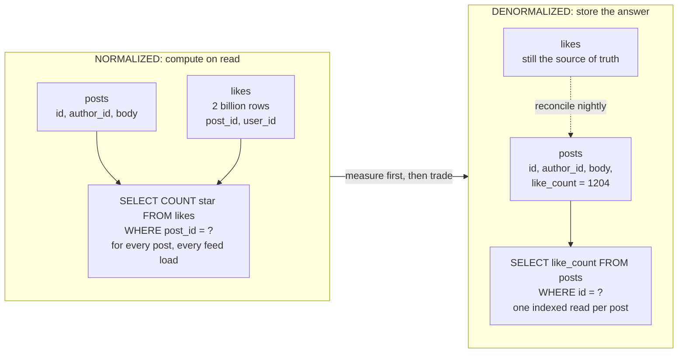
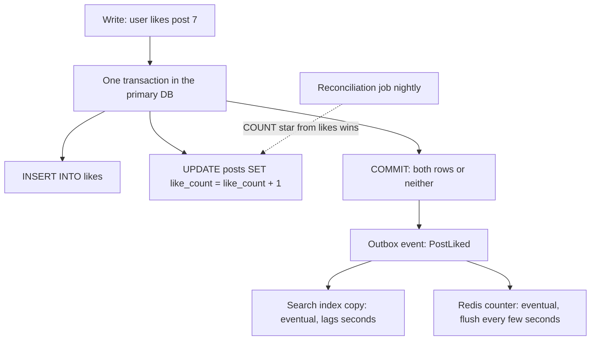
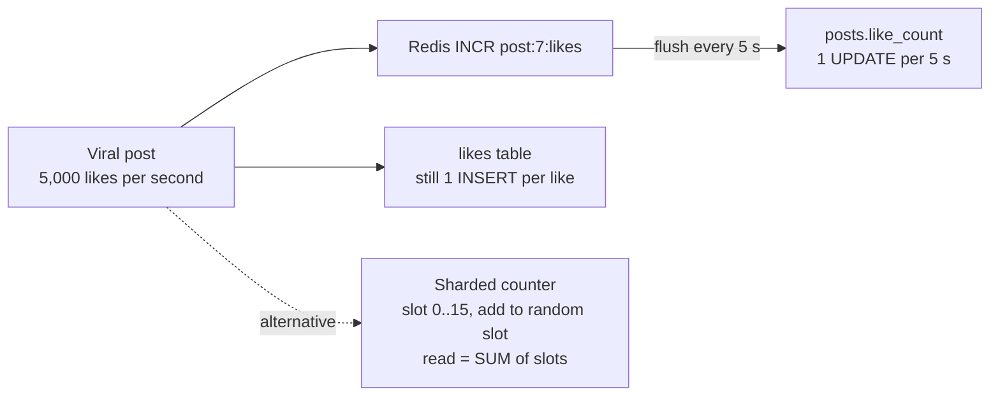

# Lesson 03: Denormalization — Counter Caches, Materialized Views & Consistency

> **Prerequisites:** [Lesson 02: Database Normalization](../02-database-normalization/README.md) (and, transitively, [Lesson 01: Relational Model & SQL Basics](../01-relational-model-sql-basics/README.md)).  
> **Estimated Reading Time:** 30–38 minutes  
> **Target Audience:** Backend engineers whose feed, dashboard, or listing page is slow because of joins and aggregates, and who must add duplicated data without letting it drift.  
> **Free PDF Notes:** [Download SD-E-003.pdf](https://backendroadmap.com/notes/system-design/SD-E-003.pdf)

> [!NOTE]
> **In one line:** Denormalization stores data more than once, or stores precomputed answers, so hot reads get fast; you pay with extra writes, hot rows, and the permanent job of keeping every copy consistent.

> [!TIP]
> **The Golden Rule of Denormalization:** *The normalized table is the source of truth; every copy is a cache that can lie.* Add a copy only for a measured hot read path, update it atomically with the source, and run a reconciliation job that lets the source win.

---

## Words You'll Meet Today

| Word | In Plain Words | Role in a Live Backend System |
| :--- | :--- | :--- |
| **Denormalization** | Deliberately storing a fact twice, or storing a derived value | `posts.like_count` instead of `COUNT(*)` over 2 billion likes |
| **Source of truth** | The one table whose rows are always right | `likes` — the counter is rebuilt from it, never the reverse |
| **Counter cache** | A stored count next to the parent row | `users.follower_count`, `posts.comment_count` |
| **Materialized view** | A query result stored as a table and refreshed on demand | `daily_revenue` for a finance dashboard |
| **Write amplification** | One logical write causes several physical writes | A like writes `likes` **and** `posts` |
| **Hot row** | One row updated so often that writers queue on its lock | The counter of a viral post |
| **Reconciliation** | Recompute truth from the source and overwrite drift | Nightly `COUNT(*)` vs `like_count` diff-and-fix |
| **Eventual consistency** | Copies agree after a short delay | A search index updated from an event, seconds late |

---

## Visual Mental Models & Architecture

### Store the Answer Instead of Recomputing It

Your social app renders a feed of 20 posts, each with a like count. The `likes` table has **2 billion rows**. Running `COUNT(*)` for every post on every feed load is far too slow, so you store the answer once and read it back.



*Figure 1. The `likes` table stays authoritative. The counter on `posts` is a cached answer the feed reads with one indexed lookup. The dotted edge is the safety net.*

### Where Consistency Is Enforced



*Figure 2. Same-database copies are updated in the same transaction. Copies in other systems follow via events and are allowed to lag.*

---

## Core Definition & Taxonomic Comparison

**What it is:** A *deliberate*, measured departure from third normal form that duplicates facts or stores derived values to cut read cost. **What it isn't:** An excuse to skip schema design, a default for new tables, or a replacement for indexes. Lesson 02 told you to store each fact once; this lesson tells you the one situation where you break that rule, and how to pay for it.

| Form | Example | What it saves | What it costs |
| :--- | :--- | :--- | :--- |
| **Counter cache** | `posts.like_count`, `users.follower_count` | A `COUNT(*)` over a huge child table | Extra write per child insert/delete; hot row |
| **Embedded field copy** | `author_name` copied into each post | A join to `users` on every feed read | Rename rewrites every post; staleness |
| **Precomputed aggregate** | `daily_revenue` per product (hand-built table) | A `GROUP BY` over all orders | Incremental maintenance logic |
| **Materialized view** | Database runs a query and stores the result | Re-running an expensive report query | Refresh cost; data as old as last refresh |
| **Point-in-time snapshot** | `order_items.unit_price` | Nothing—this is a *different fact* (see Lesson 02, Q9) | None; this is *not* denormalization |

| Consistency mechanism | Where it works | Guarantee | Trade-off |
| :--- | :--- | :--- | :--- |
| **Same transaction** | Source and copy in one database | Atomic: both commit or neither | Every code path must remember it |
| **Trigger** | Same database | Holds for *any* writer, even ad-hoc SQL | Hidden logic; adds latency to every write |
| **Event + async consumer** | Another service or search index | Eventual (seconds) | Needs idempotent consumers and replay |
| **Buffered counter** (Redis/slots) | Hot counters | Shown count lags a few seconds | Lost increments if buffer is lost before flush |
| **Scheduled refresh** | Materialized views | As fresh as the refresh interval | Stale between refreshes |
| **Reconciliation** | Always | Bounded drift | Needs a cheap way to scan the truth |

---

## Component Breakdown & Anatomy

### The Atomic Like

Keep `like_count` on `posts`. A like inserts the row and adds one in the **same transaction**; an unlike deletes the row and subtracts one.

```sql
BEGIN;
INSERT INTO likes (post_id, user_id) VALUES (7, 42)
  ON CONFLICT (post_id, user_id) DO NOTHING;         -- idempotent: double-tap safe
UPDATE posts SET like_count = like_count + 1 WHERE id = 7;  -- only if the INSERT added a row
COMMIT;
```

The increment must be expressed **in SQL**: `SET like_count = like_count + 1`. Never read the value into your application, add one, and write it back.

| Approach | App A | App B | Final count (10 → ?) |
| :--- | :--- | :--- | :--- |
| Read-add-write in app | read 10 → write 11 | read 10 → write 11 | **11** (one like lost) |
| `like_count = like_count + 1` | row lock, 10 → 11 | waits, then 11 → 12 | **12** |

The database applies each `+1` under the row lock, so concurrent likes always add up.

### Taming the Hot Row

Every update to one row needs that row's lock, so a viral post's counter serializes its writers. Each update also creates a **new row version** under MVCC, leaving a dead tuple behind for `VACUUM`.



*Figure 3. Two ways to tame a hot counter. Buffering accepts that the shown count lags by seconds, which nobody notices on a like button.*

```sql
-- sharded counter: spread one hot row across 16 rows
CREATE TABLE post_like_slots (
  post_id bigint NOT NULL,
  slot    smallint NOT NULL,
  n       bigint NOT NULL DEFAULT 0,
  PRIMARY KEY (post_id, slot)
);
INSERT INTO post_like_slots (post_id, slot, n)
VALUES (7, floor(random()*16)::int, 1)
ON CONFLICT (post_id, slot) DO UPDATE SET n = post_like_slots.n + 1;
SELECT COALESCE(SUM(n), 0) FROM post_like_slots WHERE post_id = 7;
```

### Materialized Views

A materialized view is denormalization **managed by the database**: Postgres runs the query once and stores the result as a table. You refresh it on a schedule. `REFRESH ... CONCURRENTLY` rebuilds it without blocking readers, but needs a **unique index** on the view.

```sql
CREATE MATERIALIZED VIEW daily_revenue AS
  SELECT product_id, date_trunc('day', created_at) AS day, SUM(total) AS revenue
  FROM orders GROUP BY 1, 2;
CREATE UNIQUE INDEX ON daily_revenue (product_id, day);
-- every 5 minutes, from a scheduler:
REFRESH MATERIALIZED VIEW CONCURRENTLY daily_revenue;
```

Great for dashboards and reports where data a few minutes old is fine; a poor fit for a like button, which must change the moment you click.

### Mitigations by Failure Mode

| Failure | Symptom | Mitigation |
| :--- | :--- | :--- |
| Lost update | Count rises by 1 for 2 likes | Atomic SQL increment, never read-add-write |
| Crash between writes | Like exists, count unchanged | Both writes in **one** transaction |
| Forgotten code path | Bulk delete leaves counters too high | Trigger, or route all writes through one module |
| Hot row | Lock waits, p99 spikes, dead tuples | Redis buffer or sharded counter |
| Stale embedded copy | Old author name on old posts | Async batch rewrite from event, or store only `author_id` |
| Silent drift | 0.1% of counters wrong | Nightly reconciliation; alert on diff rate |

### The Observability Gap

| Signal | Captures | Hides |
| :--- | :--- | :--- |
| `pg_stat_activity` with `wait_event_type = 'Lock'` | Writers queued on a hot row | *Which* post is hot, unless you log the `WHERE id` |
| Reconciliation diff count | That drift exists and how much | Which code path caused it |
| `n_dead_tup` on `posts` | Bloat from counter updates | That one single row is responsible |
| Materialized view `last refresh` age | Staleness of reports | Whether the *source* was correct |
| Redis buffer length | Backlog before flush | Increments lost if Redis dies before flushing |

---

## Mathematical Model & Worked Example

**Read cost.** A feed page shows $P = 20$ posts. If the average post has $\bar{\ell} = 1{,}000$ likes, counting costs about $P \times \bar{\ell}$ index entries per page, versus $P$ lookups for a stored counter:

$$C_{\text{count}} = 20 \times 1{,}000 = 20{,}000 \text{ entries} \quad \text{vs} \quad C_{\text{stored}} = 20 \text{ lookups}$$

That is a **1,000×** reduction, and a celebrity post with 5 million likes makes the counting version far worse.

**Hot-row throughput.** If a row update holds its lock for about $t_{\text{lock}} = 1\ \text{ms}$ (including commit), a single row can sustain at most:

$$\lambda_{\max} = \frac{1}{t_{\text{lock}}} = \frac{1}{0.001\ \text{s}} = 1{,}000 \text{ updates/s}$$

A viral post at $\lambda = 5{,}000$ likes/s therefore queues $5{,}000 - 1{,}000 = 4{,}000$ updates **per second** and the backlog grows without bound.

**Mitigation A: Redis buffer, flush every $T = 5$ s.**

$$\text{increment per flush} = \lambda \times T = 5{,}000 \times 5 = 25{,}000$$

The database sees **1** `UPDATE ... SET like_count = like_count + 25000` every 5 s instead of $25{,}000$ lock fights.

**Mitigation B: shard into $S = 16$ slots.**

$$\lambda_{\text{slot}} = \frac{\lambda}{S} = \frac{5{,}000}{16} \approx 312 \text{ updates/s per slot} \;<\; 1{,}000$$

Each slot is well below the single-row ceiling, and a read sums 16 small rows.

**Write amplification.** Without the counter: 1 write per like. With it: 2 rows written (plus index entries). The `likes` table is still written once per like, so it remains the source for reconciliation.

---

## Numbers & Budgets

| Quantity | Typical value | Implication |
| :--- | :--- | :--- |
| Single hot-row update ceiling | ~1,000/s (≈1 ms lock hold) | Above this, shard or buffer |
| Writes per like with counter cache | 2 tables | Budget ~2× write IOPS on that path |
| Redis `INCR` | 100k+ ops/s per node | Absorbs spikes the row cannot |
| Counter flush interval | 1–10 s | Lag is invisible to users; lost-on-crash window equals the interval |
| Slots per hot counter | 8–32 | Read cost = `SUM` of that many rows |
| Matview refresh interval | 1–15 min for dashboards | Report staleness = interval + refresh duration |
| Reconciliation scan | Nightly, batched by `post_id` range | Keep it off the primary at peak (use a replica) |
| Acceptable drift | 0 after reconciliation | Alert if diff rate rises |

**Trade-off in one line:** a join with a good index costs microseconds to milliseconds; a duplicated fact costs *consistency engineering forever*. Pay it only where the measured read saving is large.

---

## Production War Story: The Viral Post That Locked `posts`

- **Severity:** SEV-1 (feed and profile pages timing out for ~25 minutes)
- **Impact:** A celebrity post hit ~8,000 likes/s. Every like ran `UPDATE posts SET like_count = like_count + 1` on the same row. Lock waits piled up, the connection pool filled with waiters, and unrelated queries on `posts` timed out behind them.

```mermaid
sequenceDiagram
    participant U as Users (8,000 likes/s)
    participant API as API pods
    participant DB as Postgres posts row 7
    participant Pool as Connection pool
    U->>API: POST /posts/7/like
    API->>DB: UPDATE like_count = like_count + 1
    Note over DB: One row lock; ~1,000 updates/s max
    DB-->>API: waits 50 ms, 500 ms, 5 s...
    API->>Pool: connections held while waiting
    Pool-->>API: pool exhausted
    API-->>U: 5xx on feed and profile pages
    Note over API,DB: Fix: Redis INCR + flush every 5 s, likes rows still inserted
    API->>DB: INSERT likes (no counter touch)
    API->>DB: every 5 s: like_count = like_count + 40000
```

**Root cause:** Counter cache with no hot-row plan; the blast radius reached unrelated reads because they shared the exhausted pool.

**Fix:** Buffer increments in Redis and flush on a timer; keep inserting `likes` rows; add a nightly reconciliation; alert on `wait_event_type = 'Lock'` durations and on pool saturation.

---

## Multi-Language Production Implementation

An **idempotent** like and unlike: the counter changes only when the `likes` row actually changed, both inside one transaction—Go, TypeScript, Python, C#:

````carousel
```go
package social

import (
	"context"
	"database/sql"
)

func LikePost(ctx context.Context, db *sql.DB, postID, userID int64) error {
	tx, err := db.BeginTx(ctx, nil)
	if err != nil {
		return err
	}
	defer tx.Rollback()

	res, err := tx.ExecContext(ctx, `
		INSERT INTO likes (post_id, user_id) VALUES ($1, $2)
		ON CONFLICT (post_id, user_id) DO NOTHING`, postID, userID)
	if err != nil {
		return err
	}
	if n, _ := res.RowsAffected(); n == 1 { // only count a real new like
		if _, err := tx.ExecContext(ctx,
			`UPDATE posts SET like_count = like_count + 1 WHERE id = $1`, postID); err != nil {
			return err
		}
	}
	return tx.Commit()
}

func UnlikePost(ctx context.Context, db *sql.DB, postID, userID int64) error {
	tx, err := db.BeginTx(ctx, nil)
	if err != nil {
		return err
	}
	defer tx.Rollback()

	res, err := tx.ExecContext(ctx,
		`DELETE FROM likes WHERE post_id = $1 AND user_id = $2`, postID, userID)
	if err != nil {
		return err
	}
	if n, _ := res.RowsAffected(); n == 1 {
		if _, err := tx.ExecContext(ctx,
			`UPDATE posts SET like_count = like_count - 1 WHERE id = $1`, postID); err != nil {
			return err
		}
	}
	return tx.Commit()
}
```
<!-- slide -->
```typescript
import { Pool } from "pg";

export async function likePost(pool: Pool, postId: number, userId: number): Promise<void> {
  const client = await pool.connect();
  try {
    await client.query("BEGIN");
    const ins = await client.query(
      `INSERT INTO likes (post_id, user_id) VALUES ($1, $2)
       ON CONFLICT (post_id, user_id) DO NOTHING`,
      [postId, userId],
    );
    if (ins.rowCount === 1) {
      await client.query(`UPDATE posts SET like_count = like_count + 1 WHERE id = $1`, [postId]);
    }
    await client.query("COMMIT");
  } catch (e) {
    await client.query("ROLLBACK");
    throw e;
  } finally {
    client.release();
  }
}

export async function unlikePost(pool: Pool, postId: number, userId: number): Promise<void> {
  const client = await pool.connect();
  try {
    await client.query("BEGIN");
    const del = await client.query(
      `DELETE FROM likes WHERE post_id = $1 AND user_id = $2`,
      [postId, userId],
    );
    if (del.rowCount === 1) {
      await client.query(`UPDATE posts SET like_count = like_count - 1 WHERE id = $1`, [postId]);
    }
    await client.query("COMMIT");
  } catch (e) {
    await client.query("ROLLBACK");
    throw e;
  } finally {
    client.release();
  }
}
```
<!-- slide -->
```python
import psycopg


def like_post(conn: psycopg.Connection, post_id: int, user_id: int) -> None:
    with conn.transaction():  # commit on success, rollback on exception
        with conn.cursor() as cur:
            cur.execute(
                """INSERT INTO likes (post_id, user_id) VALUES (%s, %s)
                   ON CONFLICT (post_id, user_id) DO NOTHING""",
                (post_id, user_id),
            )
            if cur.rowcount == 1:  # a real new like
                cur.execute(
                    "UPDATE posts SET like_count = like_count + 1 WHERE id = %s",
                    (post_id,),
                )


def unlike_post(conn: psycopg.Connection, post_id: int, user_id: int) -> None:
    with conn.transaction():
        with conn.cursor() as cur:
            cur.execute(
                "DELETE FROM likes WHERE post_id = %s AND user_id = %s",
                (post_id, user_id),
            )
            if cur.rowcount == 1:
                cur.execute(
                    "UPDATE posts SET like_count = like_count - 1 WHERE id = %s",
                    (post_id,),
                )
```
<!-- slide -->
```csharp
using Npgsql;

public static class Social
{
    public static async Task LikePostAsync(NpgsqlDataSource ds, long postId, long userId, CancellationToken ct)
    {
        await using var conn = await ds.OpenConnectionAsync(ct);
        await using var tx = await conn.BeginTransactionAsync(ct);

        await using (var ins = new NpgsqlCommand(
            @"INSERT INTO likes (post_id, user_id) VALUES (@p, @u)
              ON CONFLICT (post_id, user_id) DO NOTHING", conn, tx))
        {
            ins.Parameters.AddWithValue("p", postId);
            ins.Parameters.AddWithValue("u", userId);
            if (await ins.ExecuteNonQueryAsync(ct) == 1)
            {
                await using var upd = new NpgsqlCommand(
                    "UPDATE posts SET like_count = like_count + 1 WHERE id = @p", conn, tx);
                upd.Parameters.AddWithValue("p", postId);
                await upd.ExecuteNonQueryAsync(ct);
            }
        }
        await tx.CommitAsync(ct);
    }

    public static async Task UnlikePostAsync(NpgsqlDataSource ds, long postId, long userId, CancellationToken ct)
    {
        await using var conn = await ds.OpenConnectionAsync(ct);
        await using var tx = await conn.BeginTransactionAsync(ct);

        await using (var del = new NpgsqlCommand(
            "DELETE FROM likes WHERE post_id = @p AND user_id = @u", conn, tx))
        {
            del.Parameters.AddWithValue("p", postId);
            del.Parameters.AddWithValue("u", userId);
            if (await del.ExecuteNonQueryAsync(ct) == 1)
            {
                await using var upd = new NpgsqlCommand(
                    "UPDATE posts SET like_count = like_count - 1 WHERE id = @p", conn, tx);
                upd.Parameters.AddWithValue("p", postId);
                await upd.ExecuteNonQueryAsync(ct);
            }
        }
        await tx.CommitAsync(ct);
    }
}
```
````

---

## Hands-On CLI

```bash
# 1. Find drift: counters that disagree with the source of truth (includes posts with 0 real likes)
psql -c "
SELECT p.id, p.like_count AS stored, COALESCE(c.cnt, 0) AS actual
FROM posts p
LEFT JOIN (SELECT post_id, COUNT(*) AS cnt FROM likes GROUP BY post_id) c ON c.post_id = p.id
WHERE p.like_count <> COALESCE(c.cnt, 0)
LIMIT 50;"

# 2. Repair one batch (source wins). Run on id ranges to keep transactions short.
psql -c "
UPDATE posts p SET like_count = c.cnt
FROM (SELECT post_id, COUNT(*) AS cnt FROM likes WHERE post_id BETWEEN 1 AND 100000 GROUP BY post_id) c
WHERE c.post_id = p.id AND p.id BETWEEN 1 AND 100000 AND p.like_count <> c.cnt;"

# 3. Detect a hot row: sessions waiting on locks
psql -c "SELECT pid, wait_event_type, wait_event, left(query,80) AS q
         FROM pg_stat_activity WHERE wait_event_type = 'Lock';"

# 4. Dead-tuple bloat from counter updates
psql -c "SELECT relname, n_live_tup, n_dead_tup, n_tup_upd FROM pg_stat_user_tables WHERE relname='posts';"

# 5. Buffer a hot counter in Redis, then flush as one UPDATE
redis-cli INCR post:7:likes
redis-cli GETDEL post:7:likes       # atomically read-and-clear the buffered delta (next INCR starts at 1)
# psql -c "UPDATE posts SET like_count = like_count + <delta> WHERE id = 7;"

# 6. Refresh a materialized view without blocking readers
psql -c "REFRESH MATERIALIZED VIEW CONCURRENTLY daily_revenue;"
```

---

## Common Mistakes

1. **Denormalizing before measuring.** Add the copy only when a hot, read-heavy path is proven slow with joins or aggregates.
2. **Read-modify-write in app code** instead of `like_count = like_count + 1`; concurrent requests lose updates.
3. **Updating the copy outside the transaction**, so a crash leaves the like without the count.
4. **No reconciliation job.** Drift is silent and only grows.
5. **Incrementing on a no-op insert.** Without `ON CONFLICT ... DO NOTHING` plus a rows-affected check, a double-tap counts twice.
6. **Using a materialized view for data users expect instantly** (like button, cart count).
7. **Forgetting `CONCURRENTLY` needs a unique index**, so the refresh blocks readers (or fails).

---

## Key Terms Glossary

| Term | Definition |
| :--- | :--- |
| Normalization | Each fact stored once |
| Denormalization | Deliberate duplication or precomputation for reads |
| Counter cache | Stored count on the parent row, e.g. `like_count` |
| Materialized view | Stored, refreshable result of a query |
| Write amplification | One logical write causes several physical writes |
| Hot row | A row updated so often that its lock becomes the bottleneck |
| Sharded counter | One logical counter split across several rows and summed on read |
| Reconciliation | Recompute from the source and overwrite drift |
| Eventual consistency | Copies agree after a short delay |
| Source of truth | The authoritative table every copy is derived from |

---

## Interview Practice Questions

### Basic (Q1–Q4)

<details>
<summary><strong>Q1: When would you denormalize? [BASIC]</strong></summary>

When a hot, read-heavy path is too slow with joins or aggregates **and you have measured it**. Examples: feed like counters, author names embedded in posts, daily report aggregates. Only if you can afford the extra write on every change.

</details>

<details>
<summary><strong>Q2: How do you keep denormalized data consistent? [BASIC]</strong></summary>

Same database: update source and copy in one transaction, or use a trigger. Other services: publish events and accept eventual consistency. Hot counters: buffer in Redis or shard. Reports: refresh materialized views. And always reconcile periodically against the source of truth.

</details>

<details>
<summary><strong>Q3: Why use <code>like_count = like_count + 1</code> instead of computing the new value in code? [BASIC]</strong></summary>

Two requests that both read 10 would both write 11, losing a like. The atomic SQL increment is applied by the database under a row lock, so 2 likes always add 2.

</details>

<details>
<summary><strong>Q4: What is a materialized view and when is it a good fit? [BASIC]</strong></summary>

A query result stored as a table and refreshed on a schedule. Good for dashboards and reports where minutes-old data is fine (`REFRESH MATERIALIZED VIEW CONCURRENTLY` with a unique index keeps readers unblocked). Poor for data that must change the instant a user acts.

</details>

### Scenario (Q5–Q8)

<details>
<summary><strong>Q5: A celebrity post gets 10,000 likes/s and the posts table locks up. What do you do? [SCENARIO]</strong></summary>

Stop updating one row per like. Buffer increments in Redis and flush every few seconds (one `UPDATE` of 50,000 per 5 s), or shard the counter into about 20 rows at ~500 updates/s each and sum on read. Keep writing the `likes` rows so the count can be reconciled.

</details>

<details>
<summary><strong>Q6: You embed <code>author_name</code> in 50 million posts. A user renames themselves. What happens? [SCENARIO]</strong></summary>

Every one of their posts must be rewritten, possibly thousands of rows. Do it asynchronously from a rename event in batches, accept that old posts show the old name for a while, or store only `author_id` and cache the user name instead.

</details>

<details>
<summary><strong>Q7: The finance dashboard runs a 40-second <code>GROUP BY</code> over all orders. Fix it. [SCENARIO]</strong></summary>

Create a materialized view of the aggregate, add a unique index, and `REFRESH MATERIALIZED VIEW CONCURRENTLY` every few minutes. The dashboard reads a small precomputed table in milliseconds; finance accepts data up to a few minutes old.

</details>

<details>
<summary><strong>Q8: A search index holds a copy of product titles. How do you keep it in sync with Postgres? [SCENARIO]</strong></summary>

Write an outbox row in the same transaction as the product change; a relay publishes it; the indexer upserts idempotently and can replay. Expect seconds of lag, and run a periodic reconcile (compare version/updated_at) because events can be missed or reordered.

</details>

### Tricky (Q9–Q12)

<details>
<summary><strong>Q9: You found 0.1% of posts have the wrong <code>like_count</code>. Which value is right? [TRICKY]</strong></summary>

The `likes` table, because it is the source of truth. Recompute `COUNT(*)` for those posts and overwrite the counters, then find the code path that skipped the update: a bulk script, a failed job, or a write outside the transaction.

</details>

<details>
<summary><strong>Q10: Why can a buffered Redis counter lose likes, and how do you bound the loss? [TRICKY]</strong></summary>

If Redis dies before a flush, the increments since the last flush are gone from the counter. The `likes` rows are still written, so reconciliation restores the truth. Bound the loss with a short flush interval and AOF persistence, and treat the shown number as approximate.

</details>

<details>
<summary><strong>Q11: Is a trigger-maintained counter better than application code? [TRICKY]</strong></summary>

A trigger guarantees the counter moves for *every* writer, including ad-hoc SQL and bulk deletes. But it hides logic, adds latency inside every write, and a statement-level bulk delete of a million likes fires a million row triggers. It does not remove the hot-row problem either.

</details>

<details>
<summary><strong>Q12: Why does a counter update create bloat even though it changes one integer? [TRICKY]</strong></summary>

Under MVCC, an `UPDATE` writes a **new row version** and leaves the old one as a dead tuple until `VACUUM`. At 5,000 updates/s on one row that is 5,000 dead tuples/s. Buffering or sharding the counter reduces both lock contention and bloat.

</details>

---

## One-Page Master Cheat Sheet

```text
====================================================================================================
                    DENORMALIZATION — CHEAT SHEET (SD-E-003)
====================================================================================================
RULE: normalized table = source of truth. Every copy is a cache that can drift.
WHEN: only for a MEASURED hot, read-heavy path (join/aggregate too slow)

FORMS   counter cache · embedded field copy · precomputed aggregate · materialized view
        (order_items.unit_price is a different fact, NOT denormalization)

ATOMIC  BEGIN; INSERT likes ... ON CONFLICT DO NOTHING;
               UPDATE posts SET like_count = like_count + 1;   -- never read-add-write
        COMMIT;

HOT ROW ceiling ~1,000 updates/s per row (1 ms lock)
        -> Redis INCR + flush every 5 s  (5,000/s x 5 = 25,000 per UPDATE)
        -> or 16 slots: 5,000/16 ~ 312/s each; read = SUM(slots)

CONSISTENCY  same DB: transaction / trigger | other systems: events (eventual)
             reports: REFRESH MATERIALIZED VIEW CONCURRENTLY (needs unique index)
             always: nightly reconciliation, source wins

ANTI: denormalize early · app-side increment · copy outside txn · no reconcile · matview for like button
====================================================================================================
```

---

## Free PDF notes

[SD-E-003.pdf](https://backendroadmap.com/notes/system-design/SD-E-003.pdf)

---

## Sources

- Kleppmann, M. — *Designing Data-Intensive Applications*, Ch. 1 (derived data) and Ch. 11 (keeping derived data in sync).  
- PostgreSQL docs — [Materialized Views](https://www.postgresql.org/docs/current/rules-materializedviews.html) and [`REFRESH MATERIALIZED VIEW`](https://www.postgresql.org/docs/current/sql-refreshmaterializedview.html).  
- PostgreSQL docs — [`INSERT ... ON CONFLICT`](https://www.postgresql.org/docs/current/sql-insert.html) and [Explicit Locking](https://www.postgresql.org/docs/current/explicit-locking.html).  
- Redis docs — [`INCR`](https://redis.io/docs/latest/commands/incr/) and persistence (AOF).

---

## Next

Next: [Lesson 04: B-Tree Indexes Explained](../04-b-tree-indexes-explained/README.md).
