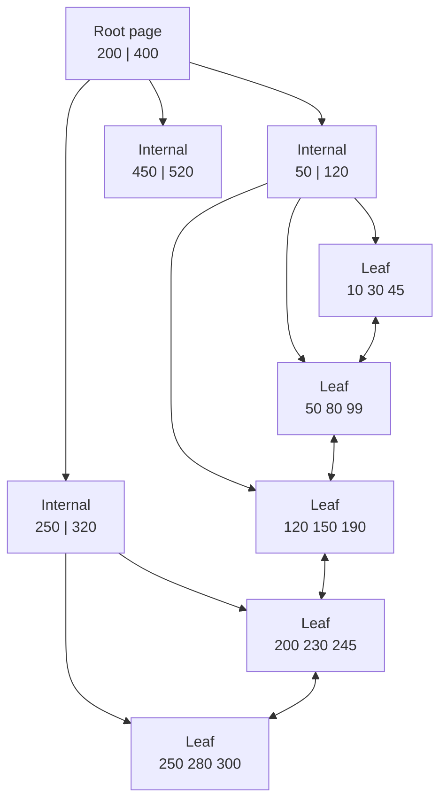
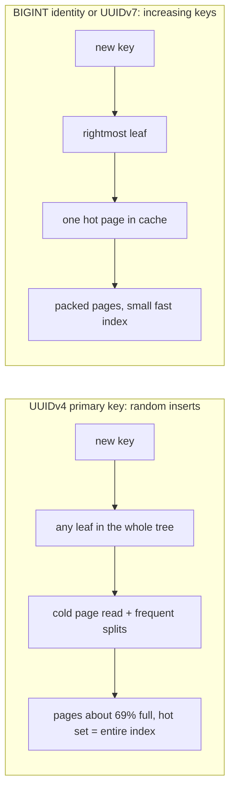
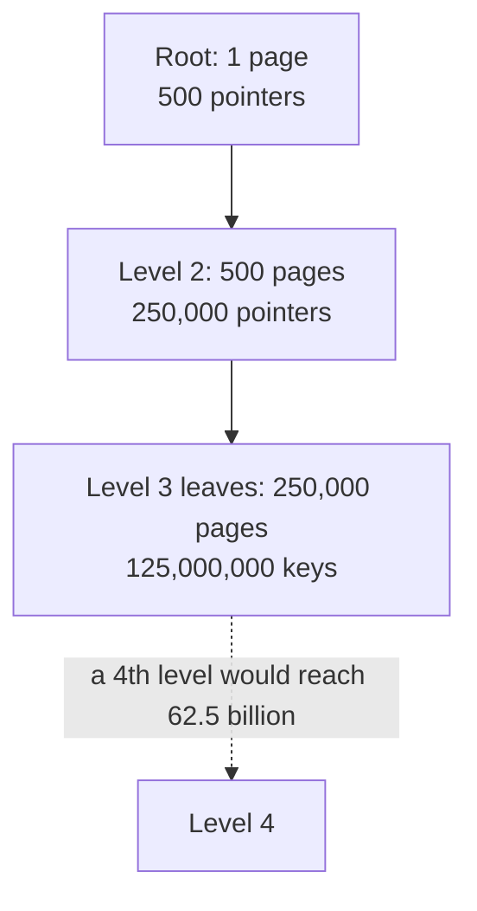
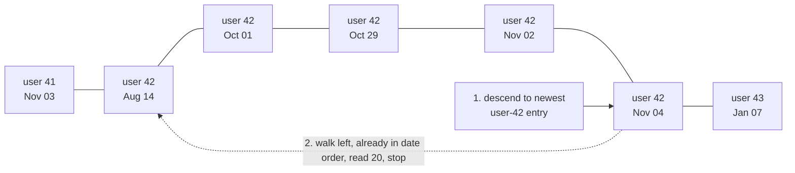
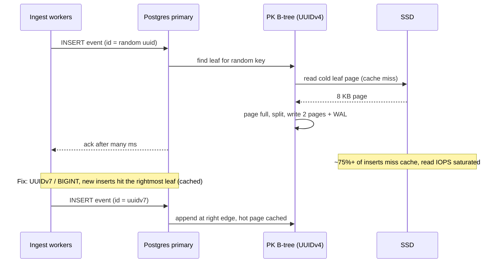

# Lesson 04: B-Tree Indexes Explained — Fan-Out, Range Scans, Write Cost & UUIDv4 Keys

> **Prerequisites:** [Lesson 01: Relational Model & SQL Basics](../01-relational-model-sql-basics/README.md) and [Lesson 03: Denormalization](../03-denormalization/README.md).  
> **Estimated Reading Time:** 30–38 minutes  
> **Target Audience:** Backend engineers who add indexes to fix slow queries and need to understand why they work, what they cost on every write, and why a random primary key slows a growing table.  
> **Free PDF Notes:** [Download SD-E-004.pdf](https://backendroadmap.com/notes/system-design/SD-E-004.pdf)

> [!NOTE]
> **In one line:** A B-tree keeps keys sorted in a shallow, balanced tree of pages with huge fan-out, so a lookup in 100 million rows reads 3–4 pages and linked leaves make range scans cheap; every index makes every write slower.

> [!TIP]
> **The Golden Rule of B-Tree Indexes:** *Index for the queries you actually run, and keep inserts landing on the same few pages.* Depth is nearly free (fan-out is hundreds), but every index taxes every write, and random keys scatter writes across the whole tree.

---

## Words You'll Meet Today

| Word | In Plain Words | Role in a Live Backend System |
| :--- | :--- | :--- |
| **B-tree** | Balanced tree of fixed-size pages; all keys live in linked leaves | The default index in Postgres, MySQL InnoDB, SQL Server, Oracle |
| **Page** | Fixed-size block read/written as a unit (8 KB Postgres, 16 KB InnoDB) | The unit of I/O and of the buffer cache |
| **Fan-out** | Child pointers per internal page, often hundreds | Why 100M rows need only 3–4 levels |
| **Leaf page** | Bottom level: sorted keys, each with a row pointer | Range scans walk these |
| **Range scan** | Find the first key, walk leaves until the range ends | `WHERE created_at >= ...`, `ORDER BY ... LIMIT` |
| **Index-only scan** | Answer from the index, table untouched | Fast reads for covered queries (next lesson) |
| **Page split** | A full page divides in two on insert | Extra I/O and half-empty pages |
| **UUIDv4 / UUIDv7** | Random UUID / time-ordered UUID | v4 scatters inserts; v7 appends at the right edge |

---

## Visual Mental Models & Architecture

### From 100 Million Rows to Four Pages

A user opens **My orders**. The `orders` table has 100 million rows. Without an index, the database reads all of them to find this user's 20 latest orders. With the right index it reads about four pages. That difference is the B-tree.

- **Internal pages** hold keys and pointers to child pages; they only steer the search.
- **Leaf pages** hold *all* keys in sorted order, each with a pointer to its row; leaves are linked to their neighbours.
- The tree is **balanced**: every lookup travels the same distance from root to leaf.



*Figure 1. A small B-tree. To find key 230: root says "200 ≤ key < 400" → internal page says "key < 250" → leaf `200, 230, 245`. Three page reads. Double arrows are the sibling links used by range scans.*

### Why Random Keys Hurt



*Figure 2. Left: random keys spread writes over every leaf. Right: increasing keys fill one page at a time at the right edge.*

---

## Core Definition & Taxonomic Comparison

**What it is:** A balanced, multi-way search tree whose nodes are disk pages; all entries sit in leaves in key order, and internal pages only route. **What it isn't:** A binary tree (fan-out is hundreds, not 2), a hash table (it supports ranges and ordering), or free (each one is rewritten on matching writes).

| Term | Precise Meaning | Production Example |
| :--- | :--- | :--- |
| **Fan-out** | Child pointers per internal page | ≈500 for a bigint key on an 8 KB page (order of magnitude) |
| **Height** | Levels from root to leaf; $\lceil \log_{f} N \rceil$ | 3 levels for 100M rows at $f = 500$ |
| **Equality lookup** | Descend to one leaf entry | `WHERE user_id = 42` |
| **Range scan** | Descend once, then walk linked leaves | `WHERE created_at >= '2026-10-01'` |
| **Ordered read** | Leaf order = sort order, either direction | `ORDER BY created_at DESC LIMIT 20` with no sort step |
| **Prefix match** | Contiguous key range | `LIKE 'tap%'` works; `LIKE '%tap'` does not |
| **Clustered index** | Table rows stored *in* the tree (InnoDB primary key) | A random PK scatters row inserts too |
| **Secondary index** | Separate tree pointing at the row | Postgres: every index is a secondary index to the heap |

| Structure | Point lookup | Range / order | Write cost | Typical use |
| :--- | :--- | :--- | :--- | :--- |
| **B-tree** | $O(\log_f N)$ pages | Excellent | In-place page updates, splits | Default OLTP index |
| **Hash index** | $O(1)$ | None | Cheap | Equality only (rare) |
| **LSM tree** | Check several files | Merge files | Sequential append (Lesson 06) | Write-heavy stores |
| **Seq scan** | Read everything | Read everything | None | Small tables, low selectivity |

---

## Component Breakdown & Anatomy

### The Magic Is Fan-Out

One page holds hundreds of keys, so each level multiplies the reach by hundreds:



*Figure 3. Fan-out of 500: three levels reach 125 million keys. Depth grows with the **logarithm** of row count, so it barely moves as data grows. The root and level 2 total 501 pages (~4 MB at 8 KB) and stay cached, so a lookup costs about one disk read, often zero.*

### Range Scans and Sorted Reads

Because leaves are sorted and linked, a range scan is cheap: find the first key, then walk along leaves until the range ends. A B-tree therefore serves:

- **Equality:** `WHERE user_id = 42`
- **Ranges:** `WHERE created_at >= '2026-10-01'`, `BETWEEN`
- **`ORDER BY`** on the indexed columns with no sort step, in either direction
- **Prefix matches:** `LIKE 'tap%'` (but not `LIKE '%tap'`)

```sql
CREATE INDEX idx_orders_user_time ON orders (user_id, created_at);

SELECT id, total, created_at FROM orders
WHERE user_id = 42
ORDER BY created_at DESC
LIMIT 20;
```



*Figure 4. Inside the composite index, all of user 42's orders sit next to each other in date order. The query is a descent plus a short backward walk: no sort, no table scan.*

### Indexes Are Not Free

| Cost | Mechanism | Effect |
| :--- | :--- | :--- |
| **Write amplification** | Every insert, delete, or update of an indexed column changes each index | 5 indexes ⇒ ~6 writes per insert (1 row + 5 index entries) |
| **Page splits** | A full leaf splits in two | Extra I/O; both halves partly empty |
| **Disk space** | Index is a second copy of the key columns | Often 20–50% of table size per index |
| **Cache pressure** | Indexes compete with table data for the buffer pool | Hot working set grows |
| **Planner choice** | More options, more chance of a wrong plan | Monitor plan regressions |

Index for your real queries, and drop indexes nobody uses. In Postgres, `pg_stat_user_indexes.idx_scan = 0` over weeks is a strong hint.

### Why Random UUIDv4 Keys Hurt

A primary key is itself a B-tree. With **UUIDv4**, every new key is random, so it lands at a random spot in the tree: constant page splits, a hot set equal to the *entire index*, and a bloated index of half-empty pages. **Sequential** keys (`BIGINT` identity) or **time-ordered** IDs (**UUIDv7**: 48-bit millisecond timestamp, then random bits) always append near the right edge: the same few pages stay cached and pages stay full. UUIDv7 keeps global uniqueness without the random-insert penalty (RFC 9562).

### Mitigations Summary

| Problem | Symptom | Mitigation |
| :--- | :--- | :--- |
| Slow "my orders" | Seq scan + sort on 100M rows | Composite index `(user_id, created_at)` |
| Slow inserts as table grows | Random PK, cache misses, bloat | `BIGINT` identity or UUIDv7 |
| Too many indexes | Insert latency up, disk up | Drop `idx_scan = 0` indexes; merge redundant prefixes |
| Bloated index | Index much larger than expected | `REINDEX CONCURRENTLY`, fix key order |
| Index ignored | `LIKE '%x'`, `lower(email)` on plain index | Expression index (Lesson 05), rewrite predicate |
| Low-selectivity index | Planner picks seq scan | Don't index booleans that match 90% of rows |

### The Observability Gap

| Signal | Captures | Hides |
| :--- | :--- | :--- |
| `EXPLAIN (ANALYZE, BUFFERS)` | Pages touched per query | Behaviour under different cache temperature |
| `pg_stat_user_indexes.idx_scan` | Indexes never used | Indexes only used by a rare but critical report |
| `pg_relation_size` per index | Total index size | How much is empty space (use `pgstattuple`/`pgstatindex`) |
| Insert latency percentiles | Slow writes | That the cause is page splits or cold random pages |
| Buffer cache hit ratio | Overall cache health | That *index* pages specifically are missing |

---

## Mathematical Model & Worked Example

**Height.** With $N$ keys and fan-out $f$:

$$h = \lceil \log_f N \rceil = \left\lceil \frac{\log_{10} 10^{8}}{\log_{10} 500} \right\rceil = \left\lceil \frac{8}{2.699} \right\rceil = \lceil 2.96 \rceil = 3$$

**Reach.**

$$f^{h} = 500^{3} = 125{,}000{,}000 \qquad f^{4} = 62{,}500{,}000{,}000$$

**Pages touched by a lookup** (100M rows): root + level 2 + leaf = **3 index pages**, plus 1 heap page to fetch the row: **~4 pages**. Compare with a full scan of a table that might be tens of GB.

**Cache budget.** Leaves at ~70% fill (350 entries per leaf):

$$\text{leaf pages} = \frac{10^{8}}{500 \times 0.7} \approx 285{,}714 \;\;(\approx 2.2\ \text{GB at 8 KB}) \qquad \text{upper levels} \approx 572 + 1 \approx 573 \text{ pages} \approx 4.5\ \text{MB}$$

The 4.5 MB of upper levels fits in cache trivially, so a lookup costs about **one** disk read (the leaf, if it is cold) and often zero.

**Write cost.** For a table with $k = 5$ secondary indexes:

$$W_{\text{insert}} = 1 + k = 6 \text{ writes}, \qquad 10{,}000 \text{ inserts/s} \Rightarrow 60{,}000 \text{ page modifications/s (logical)}$$

**UUIDv4 vs sequential key** (illustrative sizes: UUID entry ≈ 28 B incl. line pointer, bigint entry ≈ 20 B; random inserts settle near $\ln 2 \approx 69\%$ leaf fill, sequential near 90%):

| | Entries per leaf | Leaf pages for 100M | Index size | Pages inserts touch |
| :--- | :--- | :--- | :--- | :--- |
| UUIDv4 | $8192 \times 0.69 / 28 \approx 200$ | $10^8 / 200 = 500{,}000$ | **≈ 4.0 GB** | Any of 500k |
| BIGINT / UUIDv7 | $8192 \times 0.90 / 20 \approx 368$ | $10^8 / 368 \approx 271{,}700$ | **≈ 2.2 GB** | The rightmost few |

With a 1 GB buffer pool and the UUIDv4 index at ~4 GB, the chance an insert's target leaf is cached is about $1/4 = 25\%$. At 5,000 inserts/s that is ~3,750 random cold-page reads/s that a sequential key would not need.

---

## Numbers & Budgets

| Quantity | Typical value | Implication |
| :--- | :--- | :--- |
| Page size | 8 KB (Postgres), 16 KB (InnoDB) | Fan-out ≈ page size ÷ entry size |
| Fan-out | ~200–500+ | 3–4 levels for 100M–10B rows |
| Lookup cost | 3–4 pages, ~1 disk read, often 0 | Index lookup ≈ sub-millisecond when warm |
| Upper levels (100M rows) | ~4.5 MB | Always cached |
| Writes per insert | 1 + number of indexes | Budget indexes like you budget columns |
| Random-key leaf fill | ~69% | Index ~1.3–1.8× bigger than packed |
| Planner crossover | Index loses when a filter keeps roughly >5–20% of rows | Low-selectivity filters get seq scans |
| Range scan cost | 1 descent + (rows ÷ entries per leaf) leaf pages | 20 rows ≈ 1 leaf page |

---

## Production War Story: Insert Throughput Fell Off a Cliff

- **Severity:** SEV-2 (event ingestion lagging by hours)
- **Impact:** An `events` table with a `UUIDv4` primary key ingested 15,000 rows/s at 50 GB, then dropped to 2,500 rows/s at 400 GB, once the PK index (~30 GB) no longer fit in the 16 GB buffer pool. Disk read IOPS pinned at the limit; CPU idle.



**Root cause:** Random primary key ⇒ working set = entire index.

**Fix:** New rows use UUIDv7 (time-ordered); existing keys stay valid; `REINDEX CONCURRENTLY` during a quiet window; add a dashboard for insert latency p99 and index size vs buffer pool.

---

## Multi-Language Production Implementation

The "My orders" query that the `(user_id, created_at)` index serves in ~4 pages, plus a **UUIDv7** generator for write-heavy tables—Go, TypeScript, Python, C#:

````carousel
```go
package orders

import (
	"context"
	"crypto/rand"
	"database/sql"
	"fmt"
	"time"
)

type Order struct {
	ID        int64
	Total     float64
	CreatedAt time.Time
}

// Served by CREATE INDEX ON orders (user_id, created_at): descent + 20-entry backward walk.
func LatestOrders(ctx context.Context, db *sql.DB, userID int64) ([]Order, error) {
	rows, err := db.QueryContext(ctx, `
		SELECT id, total, created_at FROM orders
		WHERE user_id = $1
		ORDER BY created_at DESC
		LIMIT 20`, userID)
	if err != nil {
		return nil, err
	}
	defer rows.Close()
	var out []Order
	for rows.Next() {
		var o Order
		if err := rows.Scan(&o.ID, &o.Total, &o.CreatedAt); err != nil {
			return nil, err
		}
		out = append(out, o)
	}
	return out, rows.Err()
}

// NewUUIDv7: 48-bit ms timestamp + version + random. Time-ordered, so inserts append at the right edge.
func NewUUIDv7() (string, error) {
	var b [16]byte
	ms := uint64(time.Now().UnixMilli())
	b[0], b[1], b[2] = byte(ms>>40), byte(ms>>32), byte(ms>>24)
	b[3], b[4], b[5] = byte(ms>>16), byte(ms>>8), byte(ms)
	if _, err := rand.Read(b[6:]); err != nil {
		return "", err
	}
	b[6] = (b[6] & 0x0f) | 0x70 // version 7
	b[8] = (b[8] & 0x3f) | 0x80 // RFC variant
	return fmt.Sprintf("%x-%x-%x-%x-%x", b[0:4], b[4:6], b[6:8], b[8:10], b[10:]), nil
}
```
<!-- slide -->
```typescript
import { randomBytes } from "node:crypto";
import { Pool } from "pg";

export interface Order {
  id: number;
  total: string;
  created_at: Date;
}

// Served by CREATE INDEX ON orders (user_id, created_at).
export async function latestOrders(pool: Pool, userId: number): Promise<Order[]> {
  const { rows } = await pool.query<Order>(
    `SELECT id, total, created_at FROM orders
     WHERE user_id = $1
     ORDER BY created_at DESC
     LIMIT 20`,
    [userId],
  );
  return rows;
}

// UUIDv7: 48-bit ms timestamp + version + random bits.
export function uuidv7(): string {
  const b = randomBytes(16);
  const ms = BigInt(Date.now());
  for (let i = 0; i < 6; i++) {
    b[i] = Number((ms >> BigInt(8 * (5 - i))) & 0xffn);
  }
  b[6] = (b[6] & 0x0f) | 0x70; // version 7
  b[8] = (b[8] & 0x3f) | 0x80; // RFC variant
  const h = b.toString("hex");
  return `${h.slice(0, 8)}-${h.slice(8, 12)}-${h.slice(12, 16)}-${h.slice(16, 20)}-${h.slice(20)}`;
}
```
<!-- slide -->
```python
import os
import time
import uuid

import psycopg


def latest_orders(conn: psycopg.Connection, user_id: int) -> list[tuple]:
    """Served by CREATE INDEX ON orders (user_id, created_at)."""
    with conn.cursor() as cur:
        cur.execute(
            """SELECT id, total, created_at FROM orders
               WHERE user_id = %s
               ORDER BY created_at DESC
               LIMIT 20""",
            (user_id,),
        )
        return cur.fetchall()


def uuid7() -> uuid.UUID:
    """48-bit ms timestamp + version + random bits: time-ordered primary keys."""
    ms = time.time_ns() // 1_000_000
    b = bytearray(ms.to_bytes(6, "big") + os.urandom(10))
    b[6] = (b[6] & 0x0F) | 0x70  # version 7
    b[8] = (b[8] & 0x3F) | 0x80  # RFC variant
    return uuid.UUID(bytes=bytes(b))
```
<!-- slide -->
```csharp
using Npgsql;

public record Order(long Id, decimal Total, DateTime CreatedAt);

public static class OrderQueries
{
    // Served by CREATE INDEX ON orders (user_id, created_at).
    public static async Task<List<Order>> LatestOrdersAsync(NpgsqlDataSource ds, long userId, CancellationToken ct)
    {
        await using var cmd = ds.CreateCommand(
            @"SELECT id, total, created_at FROM orders
              WHERE user_id = @u
              ORDER BY created_at DESC
              LIMIT 20");
        cmd.Parameters.AddWithValue("u", userId);
        var list = new List<Order>();
        await using var r = await cmd.ExecuteReaderAsync(ct);
        while (await r.ReadAsync(ct))
            list.Add(new Order(r.GetInt64(0), r.GetDecimal(1), r.GetDateTime(2)));
        return list;
    }

    // .NET 9+: time-ordered UUIDv7. Avoid Guid.NewGuid() (v4) as the PK of a high-insert table.
    public static Guid NewKey() => Guid.CreateVersion7();
}
```
````

---

## Hands-On CLI

```bash
# 1. See the plan and the pages touched (look for Index Scan, Buffers: shared hit/read)
psql -c "EXPLAIN (ANALYZE, BUFFERS) SELECT id,total,created_at FROM orders
         WHERE user_id=42 ORDER BY created_at DESC LIMIT 20;"

# 2. Inspect real tree height and size (pageinspect + pgstattuple extensions)
psql -c "CREATE EXTENSION IF NOT EXISTS pageinspect;"
psql -c "SELECT level FROM bt_metap('idx_orders_user_time');"        # root level: 2 means 3 levels
psql -c "SELECT pg_size_pretty(pg_relation_size('idx_orders_user_time'));"

# 3. Leaf density: avg_leaf_density near 90 is packed; near 60-70 suggests random inserts or bloat
psql -c "CREATE EXTENSION IF NOT EXISTS pgstattuple;"
psql -c "SELECT tree_level, leaf_pages, avg_leaf_density FROM pgstatindex('idx_orders_user_time');"

# 4. Find indexes that cost writes but are never read
psql -c "SELECT relname, indexrelname, idx_scan, pg_size_pretty(pg_relation_size(indexrelid))
         FROM pg_stat_user_indexes WHERE idx_scan = 0 ORDER BY pg_relation_size(indexrelid) DESC;"

# 5. Rebuild a bloated index without blocking writes
psql -c "REINDEX INDEX CONCURRENTLY idx_orders_user_time;"

# 6. Compare key types (Postgres 18+ has uuidv7(); older: generate in the app as above)
psql -c "SELECT uuidv7();"
```

---

## Common Mistakes

1. **Indexing every column "just in case":** each one taxes every write.
2. **Random UUIDv4 as the primary key** of a high-insert table (and as the clustered key in InnoDB).
3. **Expecting an index to help `LIKE '%term'`** or a function on the column, such as `WHERE lower(email) = ...` against a plain `email` index.
4. **Indexing a low-selectivity column** (a boolean true for 90% of rows) and expecting the planner to use it.
5. **Never dropping unused indexes** (`idx_scan = 0` for weeks).
6. **Ignoring index size vs memory:** an index larger than the buffer pool turns every random access into disk I/O.
7. **Assuming depth is the cost:** the cost is the *write tax* and *cache footprint*, not extra levels.

---

## Key Terms Glossary

| Term | Definition |
| :--- | :--- |
| B-tree | Balanced tree of pages; all keys in linked leaves |
| Page | Fixed-size block (8 KB or 16 KB) |
| Fan-out | Child pointers per page, often hundreds |
| Range scan | Find first key, walk the leaves |
| Index-only scan | Answered from the index; table untouched |
| Page split | Full page divided in two on insert |
| Write amplification | One row write becomes many page writes |
| Selectivity | Fraction of rows a filter keeps |
| UUIDv7 | Time-ordered UUID; appends at the right edge |
| Clustered index | Table rows physically stored in key order in the tree |

---

## Interview Practice Questions

### Basic (Q1–Q4)

<details>
<summary><strong>Q1: How does a B-tree index speed up queries? [BASIC]</strong></summary>

It keeps keys sorted in a shallow, balanced tree with high fan-out. A lookup in 100 million rows touches only 3–4 pages instead of scanning the table, and range scans walk the linked leaves in order.

</details>

<details>
<summary><strong>Q2: What is the cost of too many indexes? [BASIC]</strong></summary>

Every write must update each index (5 indexes ⇒ ~6 writes per insert), page splits add I/O, and indexes use disk and cache memory. Writes slow down and storage grows.

</details>

<details>
<summary><strong>Q3: Why is a B-tree only 3–4 levels deep even for huge tables? [BASIC]</strong></summary>

Fan-out. With about 500 keys per page, 3 levels reach 500³ ≈ 125 million keys and 4 levels reach 62.5 billion. The top two levels are small enough to stay in memory.

</details>

<details>
<summary><strong>Q4: What kinds of predicates can a B-tree serve? [BASIC]</strong></summary>

Equality, ranges (`<`, `>`, `BETWEEN`), ordering (`ORDER BY` in either direction), and left-anchored prefixes (`LIKE 'tap%'`). Not suffix/contains (`LIKE '%tap'`) and not functions of the column unless you build an expression index.

</details>

### Scenario (Q5–Q8)

<details>
<summary><strong>Q5: "My orders" is slow on a 100M-row table: <code>WHERE user_id = ? ORDER BY created_at DESC LIMIT 20</code>. What index? [SCENARIO]</strong></summary>

A composite index on `(user_id, created_at)`. The database jumps to that user's entries, already in time order, reads 20 and stops: no sort, no scan. Add the selected columns (or `INCLUDE` them) for an index-only scan.

</details>

<details>
<summary><strong>Q6: Insert throughput on an <code>events</code> table dropped as it grew. The PK is UUIDv4. Why, and what do you change? [SCENARIO]</strong></summary>

Random keys insert into random leaf pages, so once the index outgrows memory every insert reads a cold page, splits are frequent and pages run half empty. Switch to a `BIGINT` identity or UUIDv7 so inserts append at the right edge.

</details>

<details>
<summary><strong>Q7: A table has 9 indexes and inserts are slow, but reads are fine. What do you do? [SCENARIO]</strong></summary>

Query `pg_stat_user_indexes` for `idx_scan = 0` over a few weeks and drop those; remove redundant prefixes (`(a)` next to `(a,b)`); check if any index serves only a rare report that could use a replica. Each removal cuts one write per insert.

</details>

<details>
<summary><strong>Q8: You must keep UUID primary keys for client-generated IDs. How do you avoid the random-insert penalty? [SCENARIO]</strong></summary>

Generate UUIDv7 (time-ordered) client-side, or keep a `BIGINT` clustered/surrogate key internally and expose a UUID as a secondary unique column. Both keep inserts at the right edge of the hot index.

</details>

### Tricky (Q9–Q12)

<details>
<summary><strong>Q9: Will an index on <code>created_at</code> help <code>WHERE created_at &gt; now() - interval '5 years'</code>? [TRICKY]</strong></summary>

Probably not, if that matches most of the table. For low-selectivity filters, a sequential scan is cheaper than millions of random index-to-row hops, and the planner will choose it.

</details>

<details>
<summary><strong>Q10: Can a B-tree index on <code>(user_id, created_at)</code> serve <code>ORDER BY created_at DESC</code> for one user? [TRICKY]</strong></summary>

Yes. Leaves are linked both ways, so the database can walk backward from the newest entry. Within one `user_id`, entries are already in `created_at` order, so no sort is needed.

</details>

<details>
<summary><strong>Q11: Why can a "tiny" extra index still slow inserts a lot on a huge table? [TRICKY]</strong></summary>

Each insert must modify a leaf page of every index. If that index has a random access pattern and is larger than memory, each insert adds a cold-page read and possibly a split. The cost is write amplification plus cache misses, not index depth.

</details>

<details>
<summary><strong>Q12: Does an index scan always beat a sequential scan? [TRICKY]</strong></summary>

No. An index scan costs random heap fetches per matching row; a seq scan reads pages sequentially. When a filter keeps a large fraction of rows (roughly 5–20% and up, depending on hardware and correlation), the seq scan is cheaper and the planner picks it. Tiny tables also prefer seq scans.

</details>

---

## One-Page Master Cheat Sheet

```text
====================================================================================================
                    B-TREE INDEXES — CHEAT SHEET (SD-E-004)
====================================================================================================
STRUCTURE  balanced tree of pages (8 KB PG / 16 KB InnoDB); internal = steer, leaves = sorted keys, linked
FAN-OUT    ~500 per page -> 500^3 = 125,000,000 keys in 3 levels; 4 levels = 62.5 billion
LOOKUP     100M rows -> 3 index pages + 1 heap page; upper levels (~4.5 MB) cached -> ~1 disk read
SERVES     equality · ranges · ORDER BY (either direction, no sort) · LIKE 'abc%'
NOT        LIKE '%abc' · lower(col) on plain index · low-selectivity filters (seq scan wins)

WRITE TAX  every index = +1 write per insert  (5 indexes -> 6 writes)  · page splits · disk · cache
UUIDv4 PK  random leaf, cold pages, splits, ~69% fill, index ~1.8x bigger -> use BIGINT / UUIDv7

EXAMPLE    CREATE INDEX ON orders (user_id, created_at);
           WHERE user_id=? ORDER BY created_at DESC LIMIT 20  -> descent + 20-entry backward walk

TOOLS      EXPLAIN (ANALYZE, BUFFERS) · pg_stat_user_indexes · bt_metap · pgstatindex · REINDEX CONCURRENTLY
ANTI       index everything · UUIDv4 PK · index bigger than RAM on random access · never drop unused
====================================================================================================
```

---

## Free PDF notes

[SD-E-004.pdf](https://backendroadmap.com/notes/system-design/SD-E-004.pdf)

---

## Sources

- Bayer, R. & McCreight, E. — *Organization and Maintenance of Large Ordered Indexes* (1972); Comer, D. — *The Ubiquitous B-Tree* (ACM Computing Surveys, 1979).  
- Kleppmann, M. — *Designing Data-Intensive Applications*, Ch. 3 (B-trees).  
- PostgreSQL docs — [Index Types](https://www.postgresql.org/docs/current/indexes-types.html), [B-Tree Implementation](https://www.postgresql.org/docs/current/btree.html), [`pageinspect`](https://www.postgresql.org/docs/current/pageinspect.html), [`pgstattuple`](https://www.postgresql.org/docs/current/pgstattuple.html).  
- IETF RFC 9562 — *Universally Unique IDentifiers (UUIDs)*, including UUIDv7.

---

## Next

Next: [Lesson 05: Composite, Covering & Partial Indexes](../05-composite-covering-partial-indexes/README.md).
