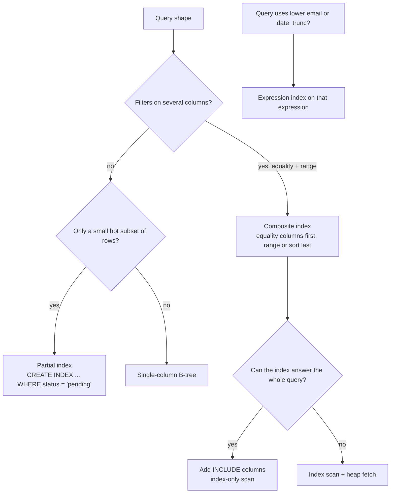
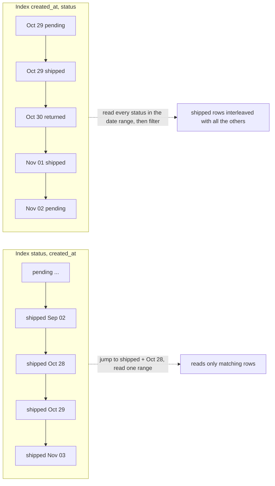
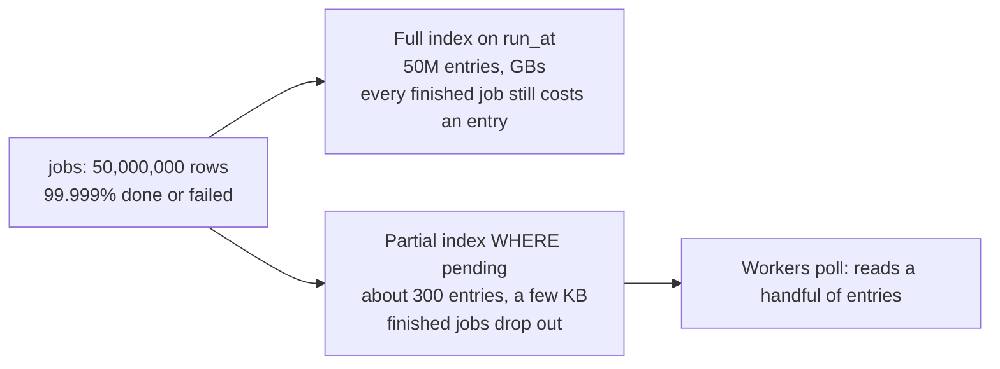
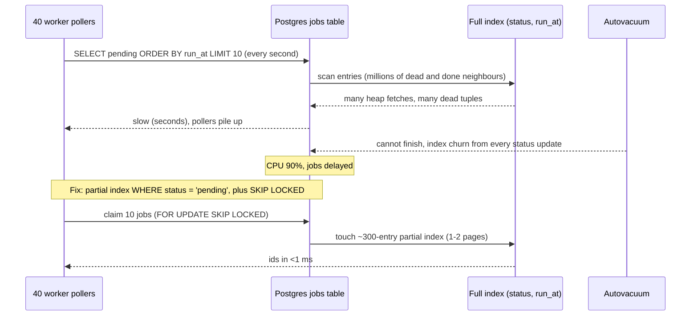

# Lesson 05: Composite, Covering & Partial Indexes — Column Order and Leftmost Prefix

> **Prerequisites:** [Lesson 04: B-Tree Indexes Explained](../04-b-tree-indexes-explained/README.md).  
> **Estimated Reading Time:** 30–38 minutes  
> **Target Audience:** Backend engineers who can add a single-column index and now need to design indexes that fit real query shapes: multi-column filters, index-only reads, and tiny indexes over hot subsets.  
> **Free PDF Notes:** [Download SD-E-005.pdf](https://backendroadmap.com/notes/system-design/SD-E-005.pdf)

> [!NOTE]
> **In one line:** A composite index is sorted column by column, so only a leftmost prefix can drive it (equality columns first, range or sort last); a covering index answers from the index alone; a partial index holds only the rows you query.

> [!TIP]
> **The Golden Rule of Index Design:** *Equality columns first, then the range or sort column; add `INCLUDE` for payload; add a `WHERE` when you only ever query a small slice.* Design from your slowest, most frequent queries, not from the table schema.

---

## Words You'll Meet Today

| Word | In Plain Words | Role in a Live Backend System |
| :--- | :--- | :--- |
| **Composite index** | One index on several columns, sorted left to right | `(status, created_at)` for the reports page |
| **Leftmost prefix** | Only the leading columns can drive the seek | `(a,b,c)` serves `a`, `a,b`, `a,b,c`; not `b` alone |
| **Covering index** | Holds every column the query needs | Index-only scan, no trips to the table |
| **`INCLUDE`** | Payload columns stored in leaves, not in the sort key | `INCLUDE (total)` returns values without widening the key |
| **Index-only scan** | Answered without reading the table | Needs all-visible pages in Postgres |
| **Partial index** | Covers only rows matching a `WHERE` | `WHERE status = 'pending'` over a 50M-row jobs table |
| **Expression index** | Indexes a computed value | `lower(email)`, `date_trunc('day', created_at)` |
| **Selectivity** | Fraction of rows a filter keeps | The more selective the equality filter, the more order matters |

---

## Visual Mental Models & Architecture

### One Table, Different Query Shapes

A **job queue** table has 50 million rows, but only a few hundred are `pending` at any moment, and workers poll for them every second. Meanwhile a **reports page** filters orders by status and date. A plain single-column index is the wrong tool for both. Three index shapes cover most real needs.



*Figure 1. Pick the index shape from the query shape.*

### The Phone-Book Rule

An index on `(last_name, first_name)` is sorted by last name, then first name within each last name.

| Entry # | last_name | first_name |
| :--- | :--- | :--- |
| 1 | Adams | John |
| 2 | Adams | Mary |
| 3 | **Brown** | Ann |
| 4 | **Brown** | John |
| 5 | **Brown** | Zoe |
| 6 | Clark | Ian |
| 7 | Clark | John |

`last_name = 'Brown'` is **one contiguous run** (entries 3–5). `first_name = 'John'` alone is scattered across entries 1, 4, 7—**the index order cannot help**. A phone book finds "Brown" instantly and "Brown, John" even faster, but it cannot find everyone named John.

---

## Core Definition & Taxonomic Comparison

**What it is:** Three ways to shape a B-tree so one structure serves several predicates, returns values without touching the table, or indexes only the rows that matter. **What it isn't:** "One index per query" (redundant prefixes waste writes) or "put every column in the key" (it widens every level).

| Index shape | Key idea | Best for | Cost |
| :--- | :--- | :--- | :--- |
| **Composite** | Sorted by col 1, then col 2 within col 1, … | Multi-column `WHERE` + `ORDER BY` | Only leftmost prefixes drive it |
| **Covering** (`INCLUDE`) | Payload columns live in leaf pages | Hot listing queries | Bigger leaves; visibility map needed |
| **Partial** | `WHERE` on `CREATE INDEX` | Queues, soft-deleted rows, rare statuses | Query must repeat a provably-implying condition |
| **Expression** | Index on `f(col)` | `lower(email)`, truncated dates, JSON fields | Query must use the same expression |

| Query filters on (index is `(a, b, c)`) | Verdict | Why |
| :--- | :--- | :--- |
| `a` | ✅ Yes | Leftmost prefix |
| `a` and `b` | ✅ Yes | Leftmost prefix |
| `a`, `b` and `c` | ✅ Yes | Full key |
| `a` and `c` | ⚠️ Partly | Seeks on `a`, then checks `c` entry by entry |
| `b` alone, or `c` alone | ❌ No | Not a leftmost prefix |
| `a = ? ORDER BY b` | ✅ Yes | The sort is free (`b` is ordered within `a`) |
| `a = ? AND b > ? AND c = ?` | ⚠️ Partly | Seeks on `a` and the `b` range; `c` is only checked while scanning the range |

---

## Component Breakdown & Anatomy

### Column Order: Equality First, Range or Sort Last

For `status = 'shipped' AND created_at > last week`, index `(status, created_at)`. The database jumps to `shipped`, and inside it dates are sorted, so it reads **one contiguous range**. Reverse the order and shipped rows are scattered across the whole date range, mixed with every other status.

```sql
-- good: seek status, then one range
CREATE INDEX idx_orders_status_created ON orders (status, created_at);

SELECT id, total FROM orders
WHERE status = 'shipped' AND created_at > now() - interval '7 days';
```



*Figure 2. Equality column first turns the query into one seek plus one short range. Range column first means reading and discarding the other statuses.*

### Covering Indexes: Answer From the Index Alone

A covering index contains every column the query needs, so the database does an **index-only scan** with no trips to the table. In Postgres 11+ and SQL Server, `INCLUDE` adds payload columns to the leaf pages without making them part of the sort key. MySQL InnoDB has no `INCLUDE`; append the column to the key instead.

```sql
CREATE INDEX idx_orders_cust ON orders (customer_id, created_at) INCLUDE (total);

-- served by an Index Only Scan:
SELECT created_at, total FROM orders
WHERE customer_id = 17 ORDER BY created_at DESC LIMIT 50;
```

| | Plain `(customer_id, created_at)` | `... INCLUDE (total)` |
| :--- | :--- | :--- |
| Leaf entry | key + row pointer | key + `total` + row pointer |
| Getting `total` | One extra random heap read **per row** | Read straight from the leaf |
| Plan | Index Scan | **Index Only Scan** |
| Can filter/sort on `total` using the index order | No | **No** (included columns are not sorted) |

> **Postgres caveat:** the index has no row-visibility info, so an index-only scan also needs the heap page marked **all-visible** in the visibility map, which `VACUUM` maintains. Otherwise you see many `Heap Fetches`.

### Partial and Expression Indexes

A partial index covers only rows matching a condition. For the job queue:

```sql
CREATE INDEX idx_jobs_pending ON jobs (run_at) WHERE status = 'pending';

-- the query must repeat the same condition (as a literal), so the planner can match it:
SELECT id FROM jobs WHERE status = 'pending' AND run_at <= now()
ORDER BY run_at LIMIT 10;
```

Instead of 50 million entries it holds a few hundred: tiny, always in memory, cheap to maintain because finished jobs drop out of it.



*Figure 3. The partial index stores only what workers actually poll for.*

An **expression index** indexes a computed value. If you query `WHERE lower(email) = 'a@b.com'`, a plain index on `email` cannot help:

```sql
CREATE UNIQUE INDEX idx_users_email_lower ON users (lower(email));
CREATE INDEX idx_orders_day ON orders (date_trunc('day', created_at));
CREATE INDEX idx_events_country ON events ((data->>'country'));
```

### Practice Rules

- Start from your slowest and most frequent queries, not from the table schema.
- Read the plan with `EXPLAIN ANALYZE`: sequential scans on large tables and sorts you could avoid.
- Design one index that serves several queries via the leftmost prefix: `(customer_id, created_at)` also serves `WHERE customer_id = ?`, so a separate `(customer_id)` index is redundant.
- Watch the write overhead: every index is updated on every insert.
- Recent Postgres versions (18+) can *skip scan* a leading column with few distinct values, but don't design around it; build the index for the query you have.

### Mitigations by Problem

| Problem | Symptom | Mitigation |
| :--- | :--- | :--- |
| Range column first | Reads and discards other statuses | Reorder: equality first, range last |
| Redundant prefix indexes | Extra write per insert for nothing | Drop `(a)` when `(a,b)` exists |
| Many `Heap Fetches` | Index-only scan still hits the table | `VACUUM` / tune autovacuum |
| Partial index ignored | Seq scan despite index | Repeat the exact predicate as a literal |
| `lower(email)` scans | Plain index unused | Expression index or store normalized |
| Key too wide | Index huge, fan-out low | Move payload to `INCLUDE` |

### The Observability Gap

| Signal | Captures | Hides |
| :--- | :--- | :--- |
| `EXPLAIN (ANALYZE, BUFFERS)` | Index Scan vs Index Only Scan, heap fetches | Plans for other parameter values |
| `pg_stat_user_indexes.idx_scan` | Whether an index is used at all | Whether it is used *efficiently* (e.g. scanning 100k entries to return 10) |
| `Rows Removed by Index Recheck/Filter` | Wasted reads after the seek | Which column order would fix it |
| `pg_class.relallvisible / relpages` | Share of all-visible pages | Per-query heap fetch impact |
| Index size over time | Growth of a full index on a queue | That a partial index would be 1,000,000× smaller |

---

## Mathematical Model & Worked Example

**Orders:** $N = 20{,}000{,}000$ rows, $R = 100{,}000$ from the last week, $80\%$ of all orders `shipped`. The report asks for last week's **shipped** orders.

$$\text{matching rows} = 100{,}000 \times 0.80 = 80{,}000$$

| Index | Entries read | Entries discarded | Notes |
| :--- | :--- | :--- | :--- |
| `(status, created_at)` | 80,000 | 0 | One seek, exactly the matching range |
| `(created_at, status)` | 100,000 | 20,000 | One seek, then filter—**not terrible here** |

Now ask for last week's **returned** orders (1% of recent rows):

$$\text{matching rows} = 100{,}000 \times 0.01 = 1{,}000$$

| Index | Entries read | Work ratio |
| :--- | :--- | :--- |
| `(status, created_at)` | 1,000 | 1× |
| `(created_at, status)` | 100,000 | **100×** more |

$$\text{wasted work factor} = \frac{\text{range size}}{\text{matching rows}} = \frac{100{,}000}{1{,}000} = 100$$

**The more selective the equality filter, the more the order matters.**

**Covering index heap fetches.** Listing 50 orders with a plain index costs 1 index descent + $50$ random heap reads; with `INCLUDE (total)` it costs the descent + a short leaf walk and **0** heap reads (if pages are all-visible).

**`INCLUDE` vs widening the key** (illustrative: key tuple ≈ 28 B with `(bigint, timestamptz)`, adding an 8 B `total` to the key ⇒ ≈ 36 B; 8 KB page at ~90% fill):

$$f_{\text{key}} \approx \frac{8192 \times 0.9}{28} \approx 263 \qquad f_{\text{wide}} \approx \frac{8192 \times 0.9}{36} \approx 204$$

$$263^{3} \approx 18.2\text{M keys} \quad \text{vs} \quad 204^{3} \approx 8.5\text{M keys in 3 levels}$$

`INCLUDE` columns sit only in leaves, so internal pages keep fan-out 263. A key-widening approach halves the reach of the same height.

**Partial index size** (≈ 28 B per entry incl. line pointer): full index on 50M rows ≈ $50{,}000{,}000 \times 28\text{ B} \approx 1.4\text{ GB}$ (before fill-factor slack, ≈ 1.5 GB); partial index with 300 pending rows ≈ $300 \times 28\text{ B} \approx 8.4\text{ KB}$, i.e. **one page**.

---

## Numbers & Budgets

| Quantity | Typical value | Implication |
| :--- | :--- | :--- |
| Index entry (small key) | ~20–40 B | Fan-out ≈ 200–400 per 8 KB page |
| Heap fetch per row (no cover) | 1 random read | 50 rows ⇒ up to 50 random reads |
| Index-only scan | 0 heap reads if all-visible | Needs recent `VACUUM` |
| Partial index vs full | Often 10³–10⁶× smaller | Fits in memory; cheap to maintain |
| Redundant prefix index | +1 write per insert | Drop it |
| Equality-first order win | = range size ÷ matching rows | 100× in the returned-orders example |
| `CREATE INDEX CONCURRENTLY` | Longer build, no write lock | Use on live tables |
| Indexes per hot table | Keep to what plans prove useful | Each costs a write |

---

## Production War Story: The Job Poller That Ate the Database

- **Severity:** SEV-2 (job latency from 1 s to 4 minutes; primary at 90% CPU)
- **Impact:** A 50M-row `jobs` table had a full index on `(status, run_at)`. Workers polled every second with 40 pollers. As `done` rows accumulated, the planner's estimate for `pending` drifted, the index scan walked millions of `done`-adjacent entries and heap-fetched dead rows, and `VACUUM` could not keep up with the update churn on the same index.



**Root cause:** One giant index serving a tiny hot subset; every status flip rewrote entries in the big index.

**Fix:** `CREATE INDEX CONCURRENTLY idx_jobs_pending ON jobs (run_at) WHERE status = 'pending'`, drop the full index, claim jobs with `FOR UPDATE SKIP LOCKED`, and archive old `done` rows.

---

## Multi-Language Production Implementation

Claim up to 10 pending jobs atomically; the literal `status = 'pending'` lets the planner use the partial index and `SKIP LOCKED` lets many workers poll without blocking—Go, TypeScript, Python, C#:

````carousel
```go
package queue

import (
	"context"
	"database/sql"
)

type Job struct {
	ID      int64
	Payload []byte
}

// 'pending' MUST be a literal (not a $n parameter) so the planner proves
// the query implies the partial index predicate.
const claimSQL = `
WITH next AS (
  SELECT id FROM jobs
  WHERE status = 'pending' AND run_at <= now()
  ORDER BY run_at
  LIMIT $1
  FOR UPDATE SKIP LOCKED
)
UPDATE jobs j SET status = 'running', started_at = now()
FROM next WHERE j.id = next.id
RETURNING j.id, j.payload`

func ClaimJobs(ctx context.Context, db *sql.DB, limit int) ([]Job, error) {
	rows, err := db.QueryContext(ctx, claimSQL, limit)
	if err != nil {
		return nil, err
	}
	defer rows.Close()
	var jobs []Job
	for rows.Next() {
		var j Job
		if err := rows.Scan(&j.ID, &j.Payload); err != nil {
			return nil, err
		}
		jobs = append(jobs, j)
	}
	return jobs, rows.Err()
}
```
<!-- slide -->
```typescript
import { Pool } from "pg";

export interface Job {
  id: number;
  payload: Buffer;
}

// 'pending' is a literal so the planner can match the partial index.
const CLAIM_SQL = `
WITH next AS (
  SELECT id FROM jobs
  WHERE status = 'pending' AND run_at <= now()
  ORDER BY run_at
  LIMIT $1
  FOR UPDATE SKIP LOCKED
)
UPDATE jobs j SET status = 'running', started_at = now()
FROM next WHERE j.id = next.id
RETURNING j.id, j.payload`;

export async function claimJobs(pool: Pool, limit = 10): Promise<Job[]> {
  const { rows } = await pool.query<Job>(CLAIM_SQL, [limit]);
  return rows;
}
```
<!-- slide -->
```python
import psycopg

# 'pending' is a literal so the planner can match the partial index.
CLAIM_SQL = """
WITH next AS (
  SELECT id FROM jobs
  WHERE status = 'pending' AND run_at <= now()
  ORDER BY run_at
  LIMIT %s
  FOR UPDATE SKIP LOCKED
)
UPDATE jobs j SET status = 'running', started_at = now()
FROM next WHERE j.id = next.id
RETURNING j.id, j.payload
"""


def claim_jobs(conn: psycopg.Connection, limit: int = 10) -> list[tuple[int, bytes]]:
    with conn.transaction():
        with conn.cursor() as cur:
            cur.execute(CLAIM_SQL, (limit,))
            return cur.fetchall()
```
<!-- slide -->
```csharp
using Npgsql;

public record Job(long Id, byte[] Payload);

public static class JobQueue
{
    // 'pending' is a literal so the planner can match the partial index.
    private const string ClaimSql = @"
WITH next AS (
  SELECT id FROM jobs
  WHERE status = 'pending' AND run_at <= now()
  ORDER BY run_at
  LIMIT @limit
  FOR UPDATE SKIP LOCKED
)
UPDATE jobs j SET status = 'running', started_at = now()
FROM next WHERE j.id = next.id
RETURNING j.id, j.payload";

    public static async Task<List<Job>> ClaimJobsAsync(NpgsqlDataSource ds, int limit, CancellationToken ct)
    {
        await using var cmd = ds.CreateCommand(ClaimSql);
        cmd.Parameters.AddWithValue("limit", limit);
        var jobs = new List<Job>();
        await using var r = await cmd.ExecuteReaderAsync(ct);
        while (await r.ReadAsync(ct))
            jobs.Add(new Job(r.GetInt64(0), (byte[])r["payload"]));
        return jobs;
    }
}
```
````

---

## Hands-On CLI

```bash
# 1. Compare plans: composite order matters. Look at "Index Cond" vs "Filter" and rows read.
psql -c "CREATE INDEX CONCURRENTLY idx_orders_status_created ON orders (status, created_at);"
psql -c "EXPLAIN (ANALYZE, BUFFERS) SELECT id,total FROM orders
         WHERE status='returned' AND created_at > now() - interval '7 days';"

# 2. Covering index: expect 'Index Only Scan' and low 'Heap Fetches'
psql -c "CREATE INDEX CONCURRENTLY idx_orders_cust ON orders (customer_id, created_at) INCLUDE (total);"
psql -c "EXPLAIN (ANALYZE, BUFFERS) SELECT created_at,total FROM orders
         WHERE customer_id=17 ORDER BY created_at DESC LIMIT 50;"
psql -c "VACUUM (ANALYZE) orders;"     # refresh the visibility map, then re-run EXPLAIN

# 3. Visibility map coverage (higher is better for index-only scans)
psql -c "SELECT relname, relallvisible, relpages,
                round(100.0*relallvisible/NULLIF(relpages,0),1) AS pct_visible
         FROM pg_class WHERE relname='orders';"

# 4. Partial index for the job queue (size should be a few KB)
psql -c "CREATE INDEX CONCURRENTLY idx_jobs_pending ON jobs (run_at) WHERE status='pending';"
psql -c "SELECT pg_size_pretty(pg_relation_size('idx_jobs_pending'));"

# 5. Expression index for case-insensitive login
psql -c "CREATE UNIQUE INDEX CONCURRENTLY idx_users_email_lower ON users (lower(email));"
psql -c "EXPLAIN SELECT id FROM users WHERE lower(email)='a@b.com';"

# 6. Find redundant single-column indexes covered by a composite's leftmost prefix
psql -c "SELECT indrelid::regclass AS tbl, indexrelid::regclass AS idx, indkey
         FROM pg_index ORDER BY indrelid, indkey;"
```

---

## Common Mistakes

1. **Putting the range column first:** `(created_at, status)` for an equality-plus-range query.
2. **One index per query,** including redundant prefixes like `(a)` next to `(a, b)`.
3. **A partial index whose condition the query does not repeat:** the planner cannot prove it applies, so it is ignored (including when the value is a bind parameter).
4. **Querying `lower(email)` against a plain index on `email`.**
5. **Widening the key instead of using `INCLUDE`:** bigger internal pages, lower fan-out.
6. **Expecting `INCLUDE` columns to filter or sort:** they only return values.
7. **Never running `VACUUM` on a write-heavy table,** then wondering why index-only scans still hit the heap.

---

## Key Terms Glossary

| Term | Definition |
| :--- | :--- |
| Composite index | Index on several columns, sorted left to right |
| Leftmost prefix | Only leading columns can drive the seek |
| Covering index | Holds every column the query needs |
| `INCLUDE` | Payload columns stored in leaves, not sorted |
| Index-only scan | Answered without reading the table |
| Partial index | Covers only rows matching a `WHERE` |
| Expression index | Indexes a computed value such as `lower(email)` |
| Selectivity | Fraction of rows a filter keeps |
| Visibility map | Per-page flags (all-visible) that let index-only scans skip the heap |
| `SKIP LOCKED` | Lets concurrent workers skip rows locked by others |

---

## Interview Practice Questions

### Basic (Q1–Q4)

<details>
<summary><strong>Q1: Why does column order matter in a composite index? [BASIC]</strong></summary>

The index is sorted by the first column, then the next, so only queries using a leftmost prefix can use it efficiently. Put equality columns first, and range or sort columns last.

</details>

<details>
<summary><strong>Q2: What is a covering index? [BASIC]</strong></summary>

An index that contains every column a query needs, often through `INCLUDE`, so the query is answered with an index-only scan without reading the table.

</details>

<details>
<summary><strong>Q3: An index exists on <code>(a, b, c)</code>. Which of these use it: <code>WHERE b = 1</code>; <code>WHERE a = 1 AND c = 2</code>; <code>WHERE a = 1 ORDER BY b</code>? [BASIC]</strong></summary>

`WHERE b = 1`: no, `b` is not a leftmost prefix. `a = 1 AND c = 2`: partly, it seeks on `a` and then checks `c` entry by entry. `a = 1 ORDER BY b`: yes, fully, and the sort is free because `b` is already ordered within `a`.

</details>

<details>
<summary><strong>Q4: What is a partial index and when do you use it? [BASIC]</strong></summary>

An index with a `WHERE` clause that only contains rows matching it. Use it when queries target a small, stable subset (pending jobs, active rows, non-deleted rows): it is tiny, stays in memory, and finished rows drop out of it.

</details>

### Scenario (Q5–Q8)

<details>
<summary><strong>Q5: Workers poll a 50M-row jobs table every second for pending jobs and the query is slow. What do you add? [SCENARIO]</strong></summary>

A partial index: `CREATE INDEX ON jobs (run_at) WHERE status = 'pending'`. It holds a few hundred entries instead of 50 million, stays in memory, and the polling query (with the same `WHERE`) reads a handful of entries. Claim with `FOR UPDATE SKIP LOCKED`.

</details>

<details>
<summary><strong>Q6: Login does <code>WHERE lower(email) = ?</code> and scans 10M users even though <code>email</code> is indexed. Why, and the fix? [SCENARIO]</strong></summary>

The index stores `email`, not `lower(email)`, so it cannot match the expression. Create an expression index on `(lower(email))`, or store emails normalized to lower case and query the plain column.

</details>

<details>
<summary><strong>Q7: You have separate indexes on <code>customer_id</code> and on <code>(customer_id, created_at)</code>. Keep both? [SCENARIO]</strong></summary>

Drop the single-column one. The composite's leftmost prefix already serves `WHERE customer_id = ?`, and every extra index costs a write on every insert. Verify with `pg_stat_user_indexes` first.

</details>

<details>
<summary><strong>Q8: The orders page filters <code>status = ? AND created_at &gt; ?</code> and sorts by <code>created_at DESC</code>. Design the index. [SCENARIO]</strong></summary>

`(status, created_at)`: equality first, range/sort last. The seek lands on the status, entries are date-ordered, and `ORDER BY created_at DESC` is a backward walk with no sort. Add `INCLUDE` of the displayed columns if the listing must be index-only.

</details>

### Tricky (Q9–Q12)

<details>
<summary><strong>Q9: Why not put every column of a hot query in the key instead of using <code>INCLUDE</code>? [TRICKY]</strong></summary>

Key columns make the index wider at every level and must be kept sorted. `INCLUDE` columns only sit in the leaves, so internal pages stay small and fan-out stays high. They cannot help filtering or sorting, but they still enable an index-only scan.

</details>

<details>
<summary><strong>Q10: <code>EXPLAIN</code> shows Index Only Scan but with many "Heap Fetches". Why? [TRICKY]</strong></summary>

In Postgres the index has no visibility info, so for pages not marked all-visible in the visibility map it still checks the table. Run or tune `VACUUM` on write-heavy tables so more pages are all-visible.

</details>

<details>
<summary><strong>Q11: Why can a partial index be ignored when the query passes <code>status</code> as a bind parameter? [TRICKY]</strong></summary>

For a generic (cached) plan the planner cannot know the parameter equals `'pending'`, so it cannot prove the query implies the index predicate. Use a literal in the SQL text (or force custom plans). This is also why the predicate must be repeated in the query.

</details>

<details>
<summary><strong>Q12: For <code>WHERE a = ? AND b &gt; ? AND c = ?</code> with index <code>(a, b, c)</code>, is <code>c</code> fully used for seeking? [TRICKY]</strong></summary>

No. After a range on `b`, entries are ordered by `c` only within each single `b` value, so the scan reads the whole `b` range and checks `c` as it goes. If `c` is very selective, consider `(a, c, b)` instead: two equalities first, range last.

</details>

---

## One-Page Master Cheat Sheet

```text
====================================================================================================
                    COMPOSITE / COVERING / PARTIAL INDEXES — CHEAT SHEET (SD-E-005)
====================================================================================================
COMPOSITE (a,b,c): sorted by a, then b within a, then c within b  (phone book)
  LEFTMOST PREFIX   a ✔ · a,b ✔ · a,b,c ✔ · a+c ⚠ (seek a, check c) · b alone ✘ · c alone ✘
  ORDER             equality columns FIRST, range or sort column LAST
                    (status, created_at) beats (created_at, status); win = range size / matching rows
  REDUNDANT         (a) next to (a,b) is waste: drop it

COVERING  INCLUDE (payload) -> leaves only, not sorted -> Index Only Scan, 0 heap reads
          Postgres: needs all-visible pages (VACUUM). MySQL: no INCLUDE, append to key.

PARTIAL   CREATE INDEX ON jobs (run_at) WHERE status='pending';   (query repeats literal predicate)
          50M entries -> ~300 entries, a few KB, always cached

EXPRESSION  CREATE INDEX ON users (lower(email));  query must use the same expression

TOOLS     EXPLAIN (ANALYZE, BUFFERS) · pg_stat_user_indexes · relallvisible · CREATE INDEX CONCURRENTLY
ANTI      range first · index per query · partial predicate not repeated · lower(email) on plain index
====================================================================================================
```

---

## Free PDF notes

[SD-E-005.pdf](https://backendroadmap.com/notes/system-design/SD-E-005.pdf)

---

## Sources

- PostgreSQL docs — [Multicolumn Indexes](https://www.postgresql.org/docs/current/indexes-multicolumn.html), [Index-Only Scans and Covering Indexes](https://www.postgresql.org/docs/current/indexes-index-only-scans.html), [Partial Indexes](https://www.postgresql.org/docs/current/indexes-partial.html), [Indexes on Expressions](https://www.postgresql.org/docs/current/indexes-expressional.html).  
- PostgreSQL docs — [`SELECT ... FOR UPDATE SKIP LOCKED`](https://www.postgresql.org/docs/current/sql-select.html#SQL-FOR-UPDATE-SHARE).  
- Winand, M. — *SQL Performance Explained* (use-the-index-luke.com), chapters on concatenated indexes.  
- Microsoft Docs — SQL Server indexes with included columns.

---

## Next

Next: [Lesson 06: LSM Trees & SSTables](../06-lsm-trees-sstables/README.md).
