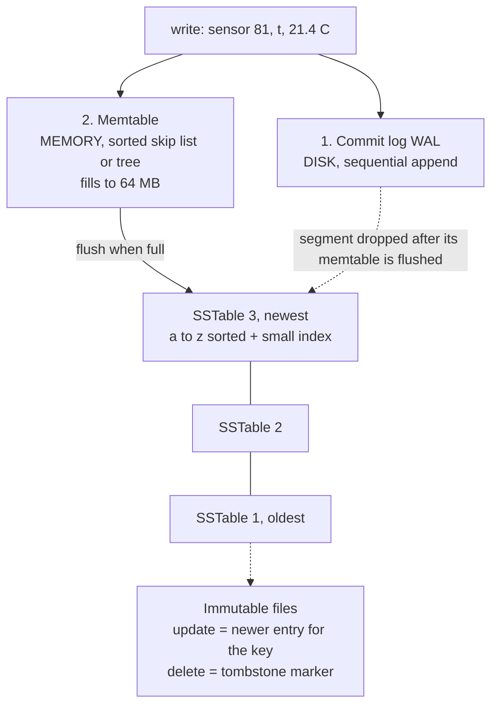
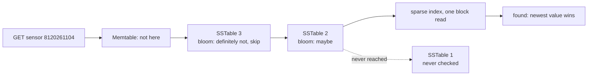
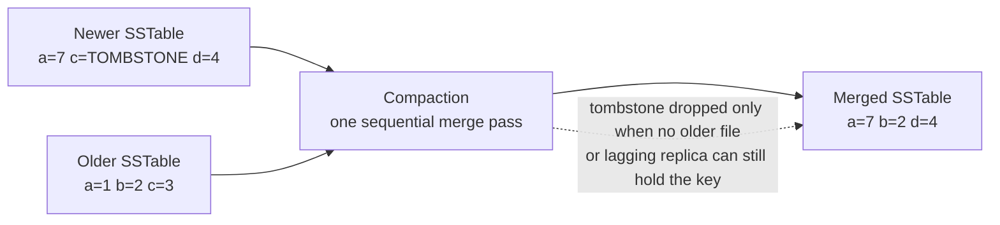

# Lesson 06: LSM Trees & SSTables — Memtable, Compaction, Bloom Filters vs B-Trees

> **Prerequisites:** [Lesson 04: B-Tree Indexes Explained](../04-b-tree-indexes-explained/README.md).  
> **Estimated Reading Time:** 32–40 minutes  
> **Target Audience:** Backend engineers choosing or operating write-heavy stores (Cassandra, ScyllaDB, RocksDB, LevelDB) who need to explain why writes are fast, why reads and deletes get tricky, and when a B-tree is still the better engine.  
> **Free PDF Notes:** [Download SD-E-006.pdf](https://backendroadmap.com/notes/system-design/SD-E-006.pdf)

> [!NOTE]
> **In one line:** An LSM tree turns every write into a log append plus a memory insert, flushes sorted immutable SSTables, and merges them in the background; writes are very fast, and bloom filters keep reads from checking every file.

> [!TIP]
> **The Golden Rule of LSM Trees:** *Never update in place: append, flush, and merge later.* You buy sequential-write speed and pay with read amplification, space amplification, tombstone handling, and background compaction I/O that must be sized and monitored.

---

## Words You'll Meet Today

| Word | In Plain Words | Role in a Live Backend System |
| :--- | :--- | :--- |
| **LSM tree** | Log-structured merge tree: buffer, flush, merge | Storage engine of Cassandra, ScyllaDB, RocksDB, LevelDB |
| **Commit log / WAL** | Append-only log written first, for durability | Replayed after a crash to rebuild the memtable |
| **Memtable** | Sorted in-memory write buffer | Absorbs writes; flushed at ~64 MB |
| **SSTable** | Sorted string table: immutable sorted file + small index | The on-disk unit; never modified in place |
| **Tombstone** | Marker that records a delete | A delete is a *write*; space is freed only at compaction |
| **Bloom filter** | Bit array answering "definitely not" or "maybe" per file | Lets reads skip almost every non-matching SSTable |
| **Compaction** | Background merge of SSTables | Keeps newest value per key, drops dead data |
| **Read / write / space amplification** | Extra files read / bytes written / bytes stored | The three costs the LSM design trades against each other |

---

## Visual Mental Models & Architecture

### A Storage Engine Built for Writes

A million IoT sensors each send a reading every 10 seconds: **100,000 writes per second**, all day, every day. A B-tree database would spend its time updating random pages on disk. Cassandra, RocksDB, and ScyllaDB use a different engine built for exactly this.



*Figure 1. Writes touch only the end of the log and memory. Flushing writes a whole sorted file in one sequential pass.*

### The Read Path: Newest First, Bloom Filters Skip the Rest



*Figure 2. Only one file is actually read from disk. Bloom filters and sparse indexes are small enough to stay in memory. Skipped files cost a memory check, not a disk read.*

---

## Core Definition & Taxonomic Comparison

**What it is:** A write-optimized storage structure that batches writes in memory, persists them as immutable sorted runs, and reconciles runs by background merging. **What it isn't:** A cache, a database by itself, or "B-tree but faster": it moves cost from write time to read time and to background work.

| Term | Precise Meaning | Production Example |
| :--- | :--- | :--- |
| **WAL / commit log** | Durability record of each acknowledged write | Cassandra commit log; RocksDB WAL |
| **Memtable** | Sorted in-memory table | Skip list in RocksDB; flushed at size threshold |
| **SSTable** | Immutable sorted file with block index | `*-Data.db` in Cassandra |
| **Sparse index** | One index entry per block, not per key | Seek to a block, then scan it |
| **Tombstone** | Delete marker with a timestamp | `DELETE FROM t WHERE ...` |
| **Bloom filter** | Probabilistic membership, no false negatives | ~10 bits/key ⇒ ~1% false positives |
| **Compaction** | Merge-sort of SSTables | Drops overwritten values and expired tombstones |

| Compaction strategy | How it works | Good at | Cost |
| :--- | :--- | :--- | :--- |
| **Size-tiered (STCS)** | Merge files of similar size | Cheap writes | More space (up to ~2× during merge); reads check more files |
| **Leveled (LCS)** | Within a level, key ranges never overlap | Reads and space | More write amplification (data rewritten per level) |
| **Time-window (TWCS)** | Group SSTables by time window | Time series with TTL | Bad if old data is updated or deleted out of order |

| | **B-tree** | **LSM tree** |
| :--- | :--- | :--- |
| **Writes** | Update pages in place: random I/O, page splits | Sequential appends: very high throughput |
| **Reads** | Fast and predictable: one place per key | May check several files; bloom filters help |
| **Space** | Half-empty pages after splits | Compresses well; old versions until compaction |
| **Background work** | Little | Compaction I/O can cause latency spikes |
| **Fits** | Read-heavy OLTP: Postgres, MySQL | Write-heavy: Cassandra, RocksDB, ScyllaDB |

---

## Component Breakdown & Anatomy

### The Write Path: One Append, One Memory Write

1. Every write is first **appended to the commit log** on disk, for durability. If the node crashes, the log is replayed.
2. Then it is **inserted into the memtable**, a sorted structure in memory.

That is it: one sequential append and one memory write; no random disk I/O. When the memtable fills (say 64 MB) it is **flushed** as an SSTable, and the corresponding commit-log segment can be discarded. Files are never modified in place: an update is a newer entry for the same key, a delete is a tombstone.

### Compaction: Merging the Files

Over time SSTables pile up, full of old versions and tombstones. Compaction merges them like a merge sort: keep only the newest value per key, drop deleted data.

| Newer SSTable | Older SSTable | Merged result |
| :--- | :--- | :--- |
| `a=7`, `c=TOMBSTONE`, `d=4` | `a=1`, `b=2`, `c=3` | `a=7`, `b=2`, `d=4` (old `a=1` dropped; `c` and its tombstone gone) |



*Figure 3. Inputs are already sorted, so merging is one sequential pass. A tombstone can only be dropped once no older copy of the key could still exist.*

### Why Bloom Filters Work (and Where They Don't)

A bloom filter is a compact bit array per SSTable. `Add(key)` sets $k$ bit positions; `MightContain(key)` checks them. If any bit is 0 the key is **definitely not** in the file (never a false "no"); if all are 1 it is **maybe** (wrong about 1% of the time at ~10 bits/key). They help **point lookups only**: a range scan must still merge every file overlapping the range.

### Mitigations by Failure Mode

| Failure | Symptom | Mitigation |
| :--- | :--- | :--- |
| Tombstone pile-up | Reads slow after bulk delete; `TombstoneOverwhelmingException` | Use TTLs, drop whole partitions/tables, avoid wide-row mass deletes |
| Compaction stall | p99 spikes every few minutes; L0 file backlog | Throttle/add I/O, tune strategy, cap write rate |
| Read amplification | Many SSTables per read | Leveled compaction, bigger bloom filters, caches |
| Space blow-up | Disk 2× during size-tiered merge | Keep ≥50% headroom or use LCS/TWCS |
| Time-window never drops | Old windows retained forever | Don't update/delete old rows; TTL on write |
| Lost delete (zombie data) | Deleted row reappears | Repair within `gc_grace_seconds` |

### The Observability Gap

| Signal | Captures | Hides |
| :--- | :--- | :--- |
| SSTables per read (`tablehistograms`) | Read amplification | Which key patterns cause it |
| Bloom filter false-positive ratio | Filter effectiveness | Whether the read is point or range |
| Pending compactions / L0 file count | Compaction backlog | The write burst that caused it |
| Tombstones per slice | Delete debt readers pay | Who issued the mass delete |
| Disk usage | Space amplification | Temporary compaction space needs |
| Write latency p99 | Healthy writes | Imminent write stalls when L0 fills |

---

## Mathematical Model & Worked Example

**Ingest rate.** $10^{6}$ sensors, one reading per 10 s:

$$\lambda = \frac{10^{6}}{10\ \text{s}} = 100{,}000 \text{ writes/s} \qquad 100{,}000 \times 86{,}400 = 8.64 \times 10^{9} \text{ rows/day}$$

**Per-node load.** 10 nodes, replication factor $RF = 3$:

$$\lambda_{\text{node}} = \frac{100{,}000 \times 3}{10} = 30{,}000 \text{ writes/s, all sequential}$$

**Partition size.** Partition key `(sensor_id, day)`, one reading per 10 s:

$$\frac{86{,}400}{10} = 8{,}640 \text{ readings per partition}$$

**Memtable flush cadence.** At ~100 B per row in memory and 64 MB memtable:

$$t_{\text{flush}} = \frac{64 \times 10^{6}\ \text{B}}{30{,}000 \times 100\ \text{B/s}} \approx 21 \text{ s per flush per node}$$

**Retention footprint** (90 days, ~50 B per row on disk, before compression):

$$8.64\times10^{9} \times 90 = 7.78\times10^{11} \text{ rows} \;\Rightarrow\; 7.78\times10^{11} \times 50\ \text{B} \approx 38.9\ \text{TB} \;\Rightarrow\; \times 3 \div 10 \approx 11.7\ \text{TB/node}$$

**Bloom filter false-positive rate.** With $m$ bits, $n$ keys, $k$ hash functions:

$$\varepsilon \approx \left(1 - e^{-kn/m}\right)^{k}, \qquad k_{\text{opt}} = \frac{m}{n}\ln 2$$

For $m/n = 10$: $k = 7$, $\varepsilon \approx (1 - e^{-0.7})^{7} \approx 0.0082 \approx 0.8\%$. To hit exactly 1%: $m/n = -\ln 0.01/(\ln 2)^2 \approx 9.6$ bits per key.

**Read cost across 10 SSTables** for a key in the oldest file:

$$E_{\text{no bloom}} = 9 \text{ wasted reads} + 1 \qquad E_{\text{bloom}} = 9 \times 0.01 + 1 \approx 1.09 \text{ disk reads}$$

**Bloom memory.** Cassandra filters on partition key: $90 \times 10^{6}$ partitions $\times 3 \div 10 = 2.7 \times 10^{7}$ per node:

$$2.7\times 10^{7} \times 10\ \text{bits} = 2.7\times10^{8}\ \text{bits} \approx 34\ \text{MB per node}$$

**B-tree page write amplification.** Updating a ~100 B row in place rewrites an 8 KB page: $8192/100 \approx 82\times$ at the page level (plus WAL). An LSM write is a ~100 B append plus its share of later compaction.

**Leveled compaction write amplification (rough):** with size ratio $T = 10$ and $L = 4$ levels, each byte may be rewritten up to ~$T$ times per level, so $WA \approx T \times (L-1) \approx 30$ in the worst case, which is why leveled trades write cost for read and space efficiency.

---

## Numbers & Budgets

| Quantity | Typical value | Implication |
| :--- | :--- | :--- |
| Memtable size | 64 MB–a few hundred MB | Flush every ~tens of seconds at 30k writes/s |
| Bloom filter | ~10 bits/key ⇒ ~1% FPR | ~1.25 MB per million keys |
| Reads per point lookup with bloom | ~1–2 disk reads | vs N files without bloom |
| Size-tiered temp space | up to ~2× data | Keep ≥50% disk free |
| Leveled space amplification | ~1.1× | Costs more write amplification |
| `gc_grace_seconds` (Cassandra) | 864,000 s = 10 days | Repair at least that often |
| Tombstone warn / fail threshold | 1,000 / 100,000 per read (defaults) | Reads abort past the failure threshold |
| TWCS TTL drop | Whole SSTable when all rows expired | No per-row delete I/O |
| Write path | 1 sequential append + 1 memory insert | No random disk I/O on the write path; throughput is bounded by sequential bandwidth and compaction |

---

## Production War Story: The Bulk Delete That Made Reads Time Out

- **Severity:** SEV-2 (read timeouts on a profile-events table for ~6 hours)
- **Impact:** A cleanup job ran `DELETE` for ~40 million expired rows in a Cassandra table. Reads over the affected partitions started failing with `TombstoneOverwhelmingException` (>100,000 tombstones per read). p99 read latency went from 8 ms to 4 s.

```mermaid
sequenceDiagram
    participant Job as Cleanup job
    participant C as Cassandra node
    participant MT as Memtable / SSTables
    participant App as API reads
    Job->>C: DELETE x 40,000,000 (each writes a tombstone)
    C->>MT: append tombstones (fast writes, disk grows)
    App->>C: SELECT events WHERE partition = p
    C->>MT: merge SSTables, skip 100k+ tombstones per read
    MT-->>App: TombstoneOverwhelmingException / 4 s latency
    Note over C,MT: tombstones purgeable only after gc_grace_seconds (10 days) and compaction
    Note over Job,C: Fix: TTL on write, TWCS, drop whole partitions; reduce gc_grace after repair
    Job->>C: INSERT ... USING TTL 7776000
    C->>MT: expired SSTables dropped whole at window end
```

**Root cause:** Deletes in an LSM are writes; the "deleted" data and tombstones remain until compaction *and* `gc_grace_seconds` allow purging.

**Fix:** Switch to write-time TTLs with time-window compaction, remove expired data by dropping whole partitions or tables, schedule repairs inside `gc_grace_seconds`, alert on tombstones-per-slice.

---

## Multi-Language Production Implementation

A compact **bloom filter** and the **newest-first read path** that consults it: check the memtable, then each SSTable newest to oldest; skip files the bloom filter rules out; a tombstone ends the search with "deleted"—Go, TypeScript, Python, C#:

````carousel
```go
package lsm

import (
	"crypto/sha256"
	"encoding/binary"
	"math"
)

type Bloom struct {
	bits []uint64
	m    uint64
	k    int
}

// NewBloom sizes the filter for n keys at target false-positive rate fpr.
func NewBloom(n int, fpr float64) *Bloom {
	m := uint64(math.Ceil(-float64(n) * math.Log(fpr) / (math.Ln2 * math.Ln2)))
	k := int(math.Round(float64(m) / float64(n) * math.Ln2))
	if k < 1 {
		k = 1
	}
	return &Bloom{bits: make([]uint64, (m+63)/64), m: m, k: k}
}

func hashes(key []byte) (uint64, uint64) {
	s := sha256.Sum256(key)
	return binary.BigEndian.Uint64(s[0:8]), binary.BigEndian.Uint64(s[8:16]) | 1
}

func (b *Bloom) Add(key []byte) {
	h1, h2 := hashes(key)
	for i := 0; i < b.k; i++ {
		pos := (h1 + uint64(i)*h2) % b.m
		b.bits[pos/64] |= 1 << (pos % 64)
	}
}

// MightContain: false = definitely absent, true = maybe present.
func (b *Bloom) MightContain(key []byte) bool {
	h1, h2 := hashes(key)
	for i := 0; i < b.k; i++ {
		pos := (h1 + uint64(i)*h2) % b.m
		if b.bits[pos/64]&(1<<(pos%64)) == 0 {
			return false
		}
	}
	return true
}

type Entry struct {
	Value     []byte
	Tombstone bool
}

type SSTable struct {
	Bloom  *Bloom
	Lookup func(key []byte) (Entry, bool) // sparse index + one block read
}

// Get checks memtable first, then SSTables newest-first. Returns value, found, diskReads.
func Get(mem func([]byte) (Entry, bool), tables []*SSTable, key []byte) ([]byte, bool, int) {
	if e, ok := mem(key); ok {
		return e.Value, !e.Tombstone, 0
	}
	reads := 0
	for _, t := range tables { // newest first
		if !t.Bloom.MightContain(key) {
			continue // memory check only
		}
		reads++
		if e, ok := t.Lookup(key); ok {
			return e.Value, !e.Tombstone, reads // newest value (or tombstone) wins
		}
	}
	return nil, false, reads
}
```
<!-- slide -->
```typescript
import { createHash } from "node:crypto";

export class Bloom {
  private bits: Uint8Array;
  private m: number;
  private k: number;

  constructor(n: number, fpr: number) {
    this.m = Math.ceil((-n * Math.log(fpr)) / Math.LN2 ** 2);
    this.k = Math.max(1, Math.round((this.m / n) * Math.LN2));
    this.bits = new Uint8Array(Math.ceil(this.m / 8));
  }

  private hashes(key: string): [number, number] {
    const d = createHash("sha256").update(key).digest();
    return [d.readUInt32BE(0), (d.readUInt32BE(4) | 1) >>> 0];
  }

  add(key: string): void {
    const [h1, h2] = this.hashes(key);
    for (let i = 0; i < this.k; i++) {
      const pos = (h1 + i * h2) % this.m;
      this.bits[pos >> 3] |= 1 << (pos & 7);
    }
  }

  /** false = definitely absent, true = maybe present. */
  mightContain(key: string): boolean {
    const [h1, h2] = this.hashes(key);
    for (let i = 0; i < this.k; i++) {
      const pos = (h1 + i * h2) % this.m;
      if ((this.bits[pos >> 3] & (1 << (pos & 7))) === 0) return false;
    }
    return true;
  }
}

export interface Entry {
  value: Buffer | null;
  tombstone: boolean;
}

export interface SSTable {
  bloom: Bloom;
  lookup(key: string): Entry | undefined; // sparse index + one block read
}

/** Memtable first, then SSTables newest-first. Returns [value, diskReads]. */
export function get(
  mem: (key: string) => Entry | undefined,
  tables: SSTable[], // newest first
  key: string,
): { value: Buffer | null; diskReads: number } {
  const m = mem(key);
  if (m) return { value: m.tombstone ? null : m.value, diskReads: 0 };
  let diskReads = 0;
  for (const t of tables) {
    if (!t.bloom.mightContain(key)) continue; // memory check only
    diskReads++;
    const e = t.lookup(key);
    if (e) return { value: e.tombstone ? null : e.value, diskReads }; // newest wins
  }
  return { value: null, diskReads };
}
```
<!-- slide -->
```python
import hashlib
import math
from dataclasses import dataclass
from typing import Callable, Optional


class Bloom:
    def __init__(self, n: int, fpr: float) -> None:
        self.m = math.ceil(-n * math.log(fpr) / (math.log(2) ** 2))
        self.k = max(1, round(self.m / n * math.log(2)))
        self.bits = bytearray((self.m + 7) // 8)

    def _hashes(self, key: bytes) -> tuple[int, int]:
        d = hashlib.sha256(key).digest()
        return int.from_bytes(d[:8], "big"), int.from_bytes(d[8:16], "big") | 1

    def add(self, key: bytes) -> None:
        h1, h2 = self._hashes(key)
        for i in range(self.k):
            pos = (h1 + i * h2) % self.m
            self.bits[pos >> 3] |= 1 << (pos & 7)

    def might_contain(self, key: bytes) -> bool:
        """False = definitely absent, True = maybe present."""
        h1, h2 = self._hashes(key)
        for i in range(self.k):
            pos = (h1 + i * h2) % self.m
            if not self.bits[pos >> 3] & (1 << (pos & 7)):
                return False
        return True


@dataclass
class Entry:
    value: Optional[bytes]
    tombstone: bool = False


@dataclass
class SSTable:
    bloom: Bloom
    lookup: Callable[[bytes], Optional[Entry]]  # sparse index + one block read


def get(mem: Callable[[bytes], Optional[Entry]], tables: list[SSTable], key: bytes):
    """Memtable first, then SSTables newest-first. Returns (value, disk_reads)."""
    e = mem(key)
    if e is not None:
        return (None if e.tombstone else e.value), 0
    disk_reads = 0
    for t in tables:  # newest first
        if not t.bloom.might_contain(key):
            continue  # memory check only
        disk_reads += 1
        e = t.lookup(key)
        if e is not None:
            return (None if e.tombstone else e.value), disk_reads  # newest wins
    return None, disk_reads
```
<!-- slide -->
```csharp
using System.Buffers.Binary;
using System.Security.Cryptography;

public sealed class Bloom
{
    private readonly ulong[] _bits;
    private readonly ulong _m;
    private readonly int _k;

    public Bloom(int n, double fpr)
    {
        _m = (ulong)Math.Ceiling(-n * Math.Log(fpr) / (Math.Log(2) * Math.Log(2)));
        _k = Math.Max(1, (int)Math.Round((double)_m / n * Math.Log(2)));
        _bits = new ulong[(_m + 63) / 64];
    }

    private static (ulong, ulong) Hashes(byte[] key)
    {
        var d = SHA256.HashData(key);
        return (BinaryPrimitives.ReadUInt64BigEndian(d.AsSpan(0, 8)),
                BinaryPrimitives.ReadUInt64BigEndian(d.AsSpan(8, 8)) | 1UL);
    }

    public void Add(byte[] key)
    {
        var (h1, h2) = Hashes(key);
        for (int i = 0; i < _k; i++)
        {
            ulong pos = unchecked(h1 + (ulong)i * h2) % _m;
            _bits[pos / 64] |= 1UL << (int)(pos % 64);
        }
    }

    /// <summary>False = definitely absent, true = maybe present.</summary>
    public bool MightContain(byte[] key)
    {
        var (h1, h2) = Hashes(key);
        for (int i = 0; i < _k; i++)
        {
            ulong pos = unchecked(h1 + (ulong)i * h2) % _m;
            if ((_bits[pos / 64] & (1UL << (int)(pos % 64))) == 0) return false;
        }
        return true;
    }
}

public record Entry(byte[]? Value, bool Tombstone);

public sealed class SSTable
{
    public required Bloom Bloom { get; init; }
    public required Func<byte[], Entry?> Lookup { get; init; } // sparse index + one block read
}

public static class LsmReader
{
    /// <summary>Memtable first, then SSTables newest-first.</summary>
    public static (byte[]? Value, int DiskReads) Get(
        Func<byte[], Entry?> mem, IReadOnlyList<SSTable> tablesNewestFirst, byte[] key)
    {
        var m = mem(key);
        if (m is not null) return (m.Tombstone ? null : m.Value, 0);
        int reads = 0;
        foreach (var t in tablesNewestFirst)
        {
            if (!t.Bloom.MightContain(key)) continue; // memory check only
            reads++;
            var e = t.Lookup(key);
            if (e is not null) return (e.Tombstone ? null : e.Value, reads); // newest wins
        }
        return (null, reads);
    }
}
```
````

---

## Hands-On CLI

```bash
# 1. Cassandra table for IoT telemetry: partition (sensor_id, day), time-window compaction, 90-day TTL
cqlsh -e "
CREATE TABLE IF NOT EXISTS telemetry.readings (
  sensor_id uuid, day date, ts timestamp, value double,
  PRIMARY KEY ((sensor_id, day), ts)
) WITH CLUSTERING ORDER BY (ts DESC)
  AND compaction = {'class':'TimeWindowCompactionStrategy',
                    'compaction_window_unit':'DAYS','compaction_window_size':1}
  AND default_time_to_live = 7776000;"   # 90 days in seconds

# 2. Watch the write path: memtable -> SSTables
nodetool flush telemetry readings                 # force memtable flush to a new SSTable
nodetool tablestats telemetry.readings            # SSTable count, bloom filter false ratio/space, tombstones/slice

# 3. Read amplification: SSTables touched per read, latency percentiles
nodetool tablehistograms telemetry readings

# 4. Compaction backlog and manual run (rarely needed; avoid during peak)
nodetool compactionstats
nodetool compact telemetry readings

# 5. RocksDB: inspect SSTables and LSM levels
sst_dump --file=/data/000123.sst --command=scan --read_num=5
ldb --db=/data/rocks stats                         # level sizes, write stalls, compaction stats

# 6. Trace one read to see how many SSTables were consulted
cqlsh -e "TRACING ON; SELECT * FROM telemetry.readings WHERE sensor_id=... AND day='2026-11-04' LIMIT 10;"
```

---

## Common Mistakes

1. **Picking an LSM store for a read-heavy, update-heavy workload** and fighting read amplification.
2. **Heavy deletes without thinking about tombstones:** reads scan thousands of them until compaction runs.
3. **Time-window compaction on data later updated or deleted out of order:** old windows can never be dropped.
4. **Ignoring compaction when sizing disks:** size-tiered compaction can temporarily need about twice the data size.
5. **Expecting bloom filters to speed up range scans** (they answer exact-key membership only).
6. **Skipping repair within `gc_grace_seconds`,** letting deleted data resurrect.
7. **Not alerting on pending compactions or L0 file counts,** so write stalls arrive as a surprise.

---

## Key Terms Glossary

| Term | Definition |
| :--- | :--- |
| LSM tree | Log-structured merge tree: buffer, flush, merge |
| Commit log / WAL | Append-only log for durability |
| Memtable | Sorted in-memory write buffer |
| SSTable | Immutable sorted file on disk |
| Tombstone | Marker that records a delete |
| Bloom filter | "Definitely not" or "maybe" per file |
| Compaction | Background merge of SSTables |
| Write / read / space amplification | Extra bytes written, files read, space used |
| `gc_grace_seconds` | Minimum time a tombstone is kept so replicas can learn of the delete |
| TWCS | Time-window compaction strategy for TTL'd time series |

---

## Interview Practice Questions

### Basic (Q1–Q4)

<details>
<summary><strong>Q1: Compare B-tree and LSM tree storage engines. [BASIC]</strong></summary>

A B-tree keeps one sorted structure on disk and updates pages in place: fast, predictable reads, costlier random writes. An LSM tree buffers writes in a memtable backed by a WAL, flushes immutable SSTables and merges them by compaction, with bloom filters for reads. Very high write throughput, at the cost of read and space amplification and background compaction.

</details>

<details>
<summary><strong>Q2: Why are LSM writes so fast? [BASIC]</strong></summary>

Each write is one sequential append to the commit log plus an insert into the in-memory memtable. There is no random disk I/O on the write path; flushes and compaction write large sorted files sequentially.

</details>

<details>
<summary><strong>Q3: What does a bloom filter answer, and why does it help? [BASIC]</strong></summary>

Whether a key is "definitely not" in an SSTable or "maybe" in it. It never gives a false no. At a 1% false-positive rate (about 10 bits per key), a lookup across 10 files usually reads just one from disk.

</details>

<details>
<summary><strong>Q4: What are an SSTable and a tombstone? [BASIC]</strong></summary>

An SSTable is an immutable, sorted file of key/value entries with a small index. A tombstone is a delete marker written as a normal entry (with a timestamp) that shadows older values until compaction can safely discard both.

</details>

### Scenario (Q5–Q8)

<details>
<summary><strong>Q5: Design storage for 100,000 sensor writes per second with 90-day retention. [SCENARIO]</strong></summary>

Cassandra or ScyllaDB, partition by `(sensor_id, day)`, cluster by timestamp, time-window compaction with a 90-day TTL so expired SSTables are dropped whole. That is about 8.6 billion rows a day; spread over 10 nodes with RF 3, each node takes about 30,000 sequential writes/s.

</details>

<details>
<summary><strong>Q6: Reads got slow on a Cassandra table after a large bulk delete. Why? [SCENARIO]</strong></summary>

Deletes are tombstones, not removals. Reads must skip every tombstone in the range until compaction purges them, which only happens after `gc_grace_seconds` (10 days by default). Avoid mass deletes; use TTLs or drop whole partitions or tables.

</details>

<details>
<summary><strong>Q7: p99 read latency on RocksDB spikes every few minutes. What is a likely cause? [SCENARIO]</strong></summary>

Compaction competing for disk I/O and CPU, or a write stall when L0 has too many files. Throttle compaction, add I/O capacity, or tune the strategy (leveled for read-heavy workloads).

</details>

<details>
<summary><strong>Q8: You run size-tiered compaction at 70% disk usage and a big compaction fails. What happened and what do you do? [SCENARIO]</strong></summary>

Size-tiered merges can need up to ~2× the input size as temporary space, so the node ran out of room. Free space (add disks or nodes, drop expired data), cap compaction concurrency, and keep ≥50% headroom, or move to leveled/time-window compaction where the workload allows.

</details>

### Tricky (Q9–Q12)

<details>
<summary><strong>Q9: Why can't a tombstone be dropped the moment it is compacted? [TRICKY]</strong></summary>

An older SSTable, or a replica that missed the delete, may still hold the old value. If the tombstone vanished first, that old value would reappear. It must outlive every older copy of the key.

</details>

<details>
<summary><strong>Q10: Do bloom filters help range scans? [TRICKY]</strong></summary>

No. They answer membership of one exact key. A range scan must merge every SSTable whose key range overlaps; leveled compaction limits that to about one file per level.

</details>

<details>
<summary><strong>Q11: If writes are append-only, how does an update "win" at read time? [TRICKY]</strong></summary>

Every entry carries a sequence number or timestamp. Reads check the memtable and SSTables newest first (or merge them) and the highest-versioned entry wins; older versions are discarded during compaction.

</details>

<details>
<summary><strong>Q12: When is a B-tree still the better choice than an LSM tree? [TRICKY]</strong></summary>

Read-heavy, update-in-place OLTP with range scans and strong transactional needs, where predictable read latency matters more than ingest rate, and where you don't want compaction-driven latency spikes or tombstone semantics. Postgres and MySQL B-trees fit these workloads.

</details>

---

## One-Page Master Cheat Sheet

```text
====================================================================================================
                    LSM TREES & SSTABLES — CHEAT SHEET (SD-E-006)
====================================================================================================
WRITE   commit log (sequential append, durable) + memtable (sorted, memory)  ->  flush at ~64 MB
        SSTable = immutable sorted file + small index · update = newer entry · delete = TOMBSTONE
READ    memtable -> SSTables newest-first · bloom filter per file: "definitely not" / "maybe"
        ~10 bits/key => ~1% false positives · helps POINT lookups only, not range scans
COMPACT merge-sort files: keep newest per key, drop dead data (tombstone only after no older copy)
        size-tiered (cheap writes, ~2x space) · leveled (reads+space, write amp ~T x levels) · time-window (TTL)

IoT     1M sensors / 10 s = 100,000 w/s · RF 3, 10 nodes -> 30,000 w/s per node, all sequential
        partition (sensor_id, day) = 8,640 rows · 90-day TTL + TWCS drops whole SSTables

VS B-TREE  LSM: fast sequential writes, read/space amplification, compaction spikes
           B-tree: in-place pages, predictable reads, random writes + splits

ANTI    LSM for read/update-heavy · mass deletes (tombstones) · TWCS on updated data · no disk headroom
====================================================================================================
```

---

## Free PDF notes

[SD-E-006.pdf](https://backendroadmap.com/notes/system-design/SD-E-006.pdf)

---

## Sources

- O'Neil, P. et al. — *The Log-Structured Merge-Tree (LSM-Tree)* (Acta Informatica, 1996).  
- Chang, F. et al. — *Bigtable: A Distributed Storage System for Structured Data* (OSDI 2006).  
- Kleppmann, M. — *Designing Data-Intensive Applications*, Ch. 3 (SSTables and LSM-trees).  
- Bloom, B. H. — *Space/Time Trade-offs in Hash Coding with Allowable Errors* (CACM, 1970).  
- Apache Cassandra docs — Storage engine, compaction strategies, tombstones and `gc_grace_seconds`.  
- RocksDB wiki — [Compaction](https://github.com/facebook/rocksdb/wiki/Compaction) and [Bloom Filter](https://github.com/facebook/rocksdb/wiki/RocksDB-Bloom-Filter).

---

## Next

Next: [Lesson 07: SQL Query Optimization](../07-sql-query-optimization/README.md).
