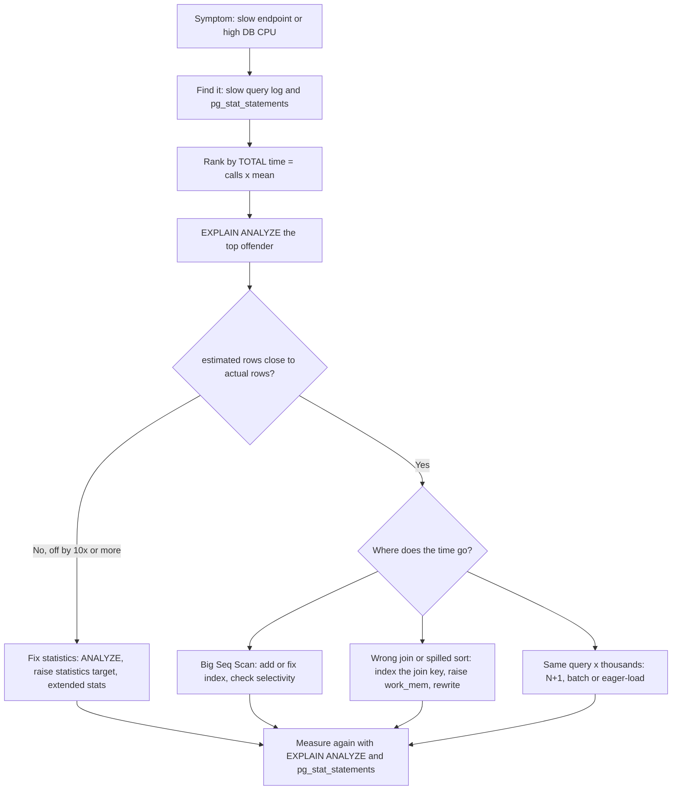
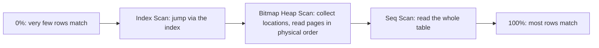
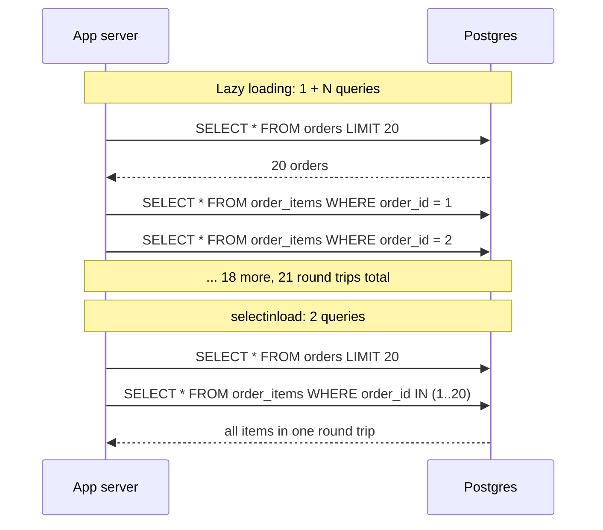
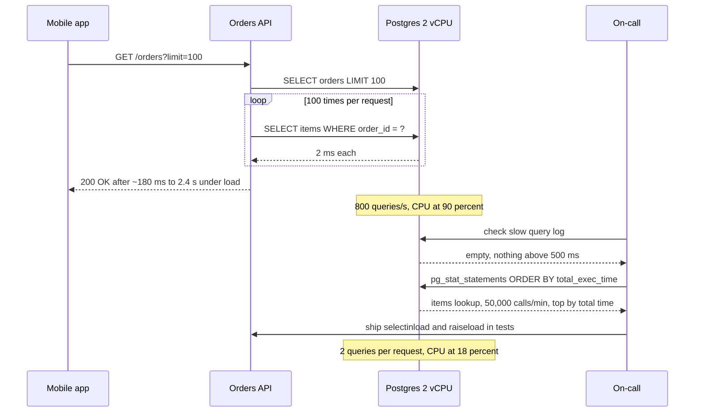

# Lesson 07: SQL Query Optimization — EXPLAIN ANALYZE, Join Algorithms & N+1 Problem

> **Prerequisites:** [Lesson 04: B-Tree Indexes Explained](../04-b-tree-indexes-explained/README.md), [Lesson 05: Composite, Covering & Partial Indexes](../05-composite-covering-partial-indexes/README.md), and [Track: Databases](../README.md) overview.  
> **Estimated Reading Time:** 35–40 minutes  
> **Target Audience:** Backend engineers who own a slow endpoint, read query plans, tune Postgres/MySQL statistics, and keep ORMs from silently turning one page load into hundreds of database round trips.  
> **Free PDF Notes:** [Download SD-E-007.pdf](https://backendroadmap.com/notes/system-design/SD-E-007.pdf)

> [!NOTE]
> **In one line:** Find the slow query, read its plan with `EXPLAIN ANALYZE`, compare estimated rows to actual rows, fix the scan, join, or statistics, and measure again—then kill N+1 with eager loading.

> [!TIP]
> **The Golden Rule of Query Optimization:** **Never tune from a guess.** Rank queries by *total* time (`pg_stat_statements`), read the plan with `EXPLAIN (ANALYZE, BUFFERS)`, and look for the first step where **estimated rows ≠ actual rows**. A plan is only as good as the statistics behind it, and the worst offender is often a *fast* query called 50,000 times a minute.

---

## Words You'll Meet Today

| Word | In Plain Words | Role in a Live Backend System |
| :--- | :--- | :--- |
| **Query plan** | The steps the optimizer chose: scans, joins, sorts | What `EXPLAIN` prints for every query |
| **EXPLAIN / EXPLAIN ANALYZE** | Show the plan / run the query and add real time and rows | Your microscope for a slow endpoint |
| **Selectivity** | Fraction of rows a filter matches | Decides index scan vs sequential scan |
| **Statistics** | Row counts and value distributions the planner keeps | Source of every row estimate (`pg_stats`) |
| **Nested loop / hash / merge join** | The three join algorithms | Chosen by *estimated* input sizes |
| **`pg_stat_statements`** | Postgres extension aggregating each query shape | Finds the fast-but-frequent offender |
| **N+1 problem** | 1 query for a list, then 1 more per item | ORM lazy loading on a list page |
| **Eager loading** | Fetch related rows up front (`selectinload`, `joinedload`) | Turns 501 round trips into 2 |

---

## Visual Mental Models & Architecture

### The Question: Why Did the Page Get Slow When the Code Didn't Change?

Your order-history page suddenly takes 8 seconds. Nobody deployed. The data grew, the statistics went stale, or a loop started querying once per row. Every SQL database turns your query into a **plan**—and the plan is where the answer lives.



*Figure 1. The tuning loop: find, rank by total time, read the plan, fix the first bad step, measure again. Skipping "measure again" is how optimizations become folklore.*

### How Each Table Is Read: Selectivity Decides the Scan



*Figure 2. The planner picks a scan from its estimate of the fraction of rows that match. `status = 'refunded'` (0.5%) loves an index; `status = 'completed'` (90%) is cheaper as one sequential pass. Boundaries are rough and shift with row width, caching, and physical correlation.*

---

## Core Definition & Taxonomic Comparison

**What it is:** SQL query optimization is the loop of locating expensive queries, reading the optimizer's plan, and changing indexes, SQL, statistics, or application access patterns until the real cost drops—verified by measurement. **What it isn't:** "add an index to every column" (indexes slow writes and the planner may ignore them), nor "the ORM handles it" (ORMs are the usual source of N+1).

### The Three Ways a Table Is Read

| Scan | How it works | Best when | Postgres plan node |
| :--- | :--- | :--- | :--- |
| **Sequential scan** | Read every page of the table | Small table, or filter matches most rows | `Seq Scan` |
| **Index scan** | Walk the B-tree, fetch each matching heap row | Highly selective filter (rare value) | `Index Scan` |
| **Index-only scan** | Answer entirely from the index (covering) | All needed columns are in the index and the visibility map is fresh | `Index Only Scan` |
| **Bitmap scan** | Collect row locations from the index, then read pages in physical order | Medium selectivity or combining several indexes | `Bitmap Index Scan` + `Bitmap Heap Scan` |

### The Three Join Algorithms

| Algorithm | How it works | Cost shape | Best when | Weak when |
| :--- | :--- | :--- | :--- | :--- |
| **Nested loop** | For each outer row, probe the inner side (ideally via index) | $\approx N_{\text{outer}} \times \text{probe}$ | Tiny outer side, indexed inner | Outer side is large (or *thought* small and isn't) |
| **Hash join** | Build a hash table on the smaller input, probe with the other | $\approx N_{\text{build}} + N_{\text{probe}}$ | Large inputs, equality joins | Hash table exceeds `work_mem` and spills |
| **Merge join** | Walk two sorted inputs in one pass | $\approx N_a + N_b$ (+ sorts if unsorted) | Both sides already sorted on the key (index order) | Sorting both sides is expensive |

### Three Ways an ORM Loads Related Rows

| Strategy | Queries for 500 orders with items | Row shape | Use for |
| :--- | :--- | :--- | :--- |
| **Lazy loading (default)** | $1 + 500 = 501$ | Narrow, but 501 round trips | Single-object screens only |
| **`selectinload`** | 2 (`WHERE order_id IN (...)`) | 500 order rows + items, no duplication | One-to-many collections |
| **`joinedload`** | 1 (`JOIN`) | Order columns repeated once per item | Many-to-one (item → product) |
| **`raiseload('*')`** | Raises on any lazy access | — | Development/test guardrail |

**Business implication:** An endpoint that is "fast per query" can still be slow per request. Latency lives in *round trips × queries per request*, and database CPU lives in *calls × mean time*.

---

## Component Breakdown & Anatomy

### Reading a Plan: Innermost Step Outwards

```sql
EXPLAIN (ANALYZE, BUFFERS)
SELECT o.id, o.total_cents
FROM orders o
JOIN customers c ON c.id = o.customer_id
WHERE c.country = 'IN' AND o.status = 'refunded';
```

```text
Nested Loop  (cost=0.85..412.10 rows=12 width=16) (actual time=0.09..7912.4 rows=43808 loops=1)
  -> Seq Scan on customers c  (rows=3) (actual rows=21904 loops=1)
        Filter: (country = 'IN')
  -> Index Scan using orders_customer_idx on orders o  (rows=4) (actual rows=2 loops=21904)
        Filter: (status = 'refunded')
Execution Time: 7931.2 ms
```

| What you see | What it means |
| :--- | :--- |
| `cost=0.85..412.10` | Planner's *estimate* in abstract cost units (startup..total), not milliseconds |
| `rows=3` vs `actual rows=21904` | **Estimate vs reality: off by about 7,300×.** The root cause lives here |
| `loops=21904` | The inner index scan ran once per outer row; per-loop times must be multiplied by `loops` |
| `Filter:` (not `Index Cond:`) | Rows were fetched, *then* discarded—wasted work |
| `Execution Time` | Wall-clock time for the real run |

Believing only 3 outer rows, the planner picked a nested loop. With 21,904 outer rows, that means 21,904 index probes. With correct estimates it would pick a hash join and finish in milliseconds.

### Where the Estimates Come From

The planner multiplies statistics: table row count × selectivity of each predicate (from `pg_stats`: most common values, histogram bounds, distinct counts). **Stale statistics** (after a bulk load, migration, or backfill) and **correlated columns** (`country = 'IN' AND state = 'KA'`) both produce bad estimates. Postgres runs autoanalyze, but after a large data change you should run `ANALYZE` yourself.

```sql
ANALYZE customers;                                               -- refresh stats now
ALTER TABLE customers ALTER COLUMN country SET STATISTICS 1000;  -- finer histogram for a skewed column
ANALYZE customers;
CREATE STATISTICS cust_country_state (dependencies) ON country, state FROM customers;  -- correlated columns
```

### N+1: One Query Per Parent



*Figure 3. Lazy loading sends one query per parent. Eager loading sends one query for parents and one for all their children—the same 2 queries for 20 orders or 500.*

```python
from sqlalchemy import select
from sqlalchemy.orm import selectinload, joinedload, raiseload

# N+1: one query, then one per order when .items is touched
orders = session.scalars(select(Order).limit(500)).all()

# Fix: 2 queries total (orders, then items WHERE order_id IN (...))
orders = session.scalars(
    select(Order).options(selectinload(Order.items)).limit(500)).all()

# Many-to-one: a single JOIN
items = session.scalars(select(Item).options(joinedload(Item.product))).all()

# In development: make any lazy load raise, so N+1 never sneaks back
select(Order).options(raiseload("*"))
```

Use `selectinload` for collections and `joinedload` for many-to-one. Joining a collection repeats each order's columns once per item and fights `LIMIT`.

### The Observability Gap: Who Sees a Slow Query?

| Measurement Point | What It Captures | What It Hides |
| :--- | :--- | :--- |
| **Slow query log** (`log_min_duration_statement`, MySQL `long_query_time`) | Any single statement slower than the threshold | **Fast queries called thousands of times** (N+1 never trips it) |
| **`pg_stat_statements`** | Calls, total time, mean time per query *shape* | Which request or user caused it; per-call parameter values |
| **`EXPLAIN` (no ANALYZE)** | Planner's estimate and chosen plan | Real rows and time—a wrong estimate looks perfectly plausible |
| **`EXPLAIN ANALYZE` / `auto_explain`** | Real time and real rows per step | Plans for parameter values you didn't try; adds measurement overhead |
| **APM traces** | Query count per request, N+1 shape | Sampled; cache effects invisible; cost on DB CPU not attributed |

Rank by **total time** (`calls × mean`), not mean time. A query averaging 2 ms never appears in a 500 ms slow log and can still consume the database.

---

## Mathematical Model & Worked Scale

### N+1 Latency: Round Trips Dominate

For $N$ parents with network round trip $R$ and per-child-query time $q$:

$$T_{\text{lazy}} = (1 + N)\,(R + q) \qquad T_{\text{eager}} = 2R + t_{\text{orders}} + t_{\text{IN}}$$

**Worked example.** Order history with $N = 500$, $R = 1$ ms, $q = 0.5$ ms:

$$T_{\text{lazy}} = 501 \times (1 + 0.5) \approx 750\ \text{ms of pure waiting}$$

`selectinload`: 2 queries; the `IN` query for all items takes ~8 ms. Total $\approx 12$ ms, about **60× faster**:

$$\frac{750}{12} \approx 62$$

### Database Time of a "Fast" Query

$$\text{DB time per minute} = \text{calls/min} \times \text{mean}$$

A 2 ms query called 50,000 times a minute costs $50{,}000 \times 2\ \text{ms} = 100\ \text{s}$ of database time per minute—about **1.7 cores** busy continuously. A single 3-second report run once a minute costs 3 s. The cheap query is **33×** more expensive overall.

### Seq Scan vs Index Scan Break-Even

Postgres defaults: `seq_page_cost = 1.0`, `random_page_cost = 4.0`, `cpu_tuple_cost = 0.01`. For a 10-million-row table at ~80 rows per page ($125{,}000$ pages):

$$C_{\text{seq}} \approx 125{,}000 + 10^7 \times 0.01 = 225{,}000$$

An uncorrelated index scan fetching a fraction $s$ of rows does about $s \times 10^7$ random page reads:

$$C_{\text{index}} \approx s \times 10^7 \times 4.0 \;\;\Rightarrow\;\; s^\* \approx \frac{225{,}000}{4 \times 10^7} \approx 0.56\%$$

| Filter | Selectivity $s$ | Rows | Index cost | Winner |
| :--- | :--- | :--- | :--- | :--- |
| `status = 'refunded'` | 0.1% | 10,000 | ~40,000 | Index (or bitmap) |
| `status = 'pending'` | 0.5% | 50,000 | ~200,000 | Roughly a tie |
| `status = 'shipped'` | 10% | 1,000,000 | ~4,000,000 | Seq scan |
| `status = 'completed'` | 90% | 9,000,000 | ~36,000,000 | Seq scan, 160× cheaper |

This ignores caching, bitmap batching, and correlation (which all move the boundary), but explains why the planner is usually right to ignore your index on a low-selectivity column.

### Estimate Error Amplification

The nested loop in the plan above: estimated $3$ outer rows, actual $21{,}904$.

$$\text{error factor} = \frac{21{,}904}{3} \approx 7{,}300\times \qquad \text{inner cost} = 21{,}904 \times 0.36\ \text{ms} \approx 7.9\ \text{s}$$

Join cost grows with the product of errors at each level, so an early misestimate poisons every join above it.

---

## Metrics, Percentiles & Numbers Engineers Must Know

| Metric | Typical value | Why it matters |
| :--- | :--- | :--- |
| App ↔ DB round trip (same AZ) | ~0.3–1 ms | Multiplies by query count in N+1 |
| Round trip across regions | 30–100 ms | 501 queries ≈ 15–50 s |
| Indexed point lookup (warm) | ~0.1–1 ms | Fast alone, deadly × 50,000/min |
| Sequential scan, 1M rows | tens–hundreds ms | Fine for analytics, bad for OLTP hot path |
| `work_mem` default | 4 MB per sort/hash node | Hash join spills to disk beyond it |
| `random_page_cost` default | 4.0 (SSD: often 1.1–1.5) | Over-pessimistic on SSDs → too many seq scans |
| `default_statistics_target` | 100 histogram buckets | Skewed columns may need 500–1000 |
| Autoanalyze trigger | 50 + 10% of rows changed | Large tables go stale for a long time |

| Percentile | Who feels it | Query-optimization meaning |
| :--- | :--- | :--- |
| $p_{50}$ | Typical user | Warm cache, index hit, small customer |
| $p_{95}$ | 1 in 20 requests | Big customer, cold pages, bad parameter value |
| $p_{99}$ | Largest tenants, bots | Skewed values (one country = 40% of rows), spilled hash, plan flip |

**Parameter sensitivity:** the same SQL can take 1 ms for `country = 'NZ'` and 8 s for `country = 'IN'`. Always test the *worst-skew* value.

---

## Hierarchical Budgets & Mitigations

| Layer | Latency budget (example 200 ms API) | What to check |
| :--- | :--- | :--- |
| Gateway / auth | 10–20 ms | Not the database |
| Service logic | 20–40 ms | Query count per request |
| Cache | 1–5 ms | Hot lists, repeated reads |
| **Database** | **30–80 ms** | Plan shape, estimates, round trips |
| Headroom | ~40 ms | Spikes, retries |

**A budget rule:** if one request issues $Q$ queries sequentially, then $Q \times (R + q)$ must fit inside the database slice. At $R + q = 1.5$ ms and a 60 ms slice, $Q \le 40$.

| # | Mitigation | Fixes | Cost / caveat |
| :--- | :--- | :--- | :--- |
| 1 | `ANALYZE` after bulk loads; raise statistics target; `CREATE STATISTICS` | Bad row estimates | Slightly slower `ANALYZE` |
| 2 | Index the real predicate / join key; covering or partial index (Lessons 04–05) | Large seq scans, nested-loop probes | Write cost, bloat |
| 3 | Eager loading (`selectinload`), batch `IN`/`ANY`, DataLoader | N+1 | Slightly bigger single queries |
| 4 | `raiseload`, query-count assertions in tests | N+1 regressions | Test discipline |
| 5 | `pg_stat_statements` ranked by total time + dashboards | Fast-but-frequent queries | Extension overhead is small |
| 6 | Lower `random_page_cost` on SSD; raise `work_mem` per-session for heavy reports | Over-eager seq scans, spills | `work_mem` is per node, per connection |
| 7 | Rewrite: avoid functions on indexed columns, keyset pagination instead of deep `OFFSET`, select only needed columns | Index not used, deep scans | Code change |
| 8 | Read replica / cache for heavy reads | Primary CPU | Replica lag, invalidation |

---

## Production War Story: The Fast Query That Ate the Database

- **Severity:** SEV-2 (checkout and order history degraded for 3 hours)
- **Detection / Resolution:** 40 minutes to realize the slow log was empty; 3 hours to identify and ship the eager-load fix
- **Impact:** Primary at ~90% CPU on a 2-vCPU instance; p99 order-history latency 180 ms → 2.4 s; support tickets for "app is slow"

### What Happened

An ORM minor-version upgrade changed a relationship mapping from `lazy="selectin"` to the library default `lazy="select"`. The order-history endpoint returned 100 orders per page and touched `order.items` while serializing JSON. Each request now issued **101 queries**. The endpoint served ~8 requests/s (≈ 800 queries/s, ≈ 50,000/min), each taking about 2 ms. No single query crossed the 500 ms slow-query threshold, so the slow log stayed silent while the database burned $50{,}000 \times 2\ \text{ms} = 100$ CPU-seconds every minute.



### Root Cause & Fix

1. **Relationship default changed silently** on upgrade; nothing failed, the code just got slower.
2. **Monitoring ranked by max/mean time, not total time**; the slow log is blind to frequent cheap queries.
3. **Local tests used 3 orders per page**, so 4 queries looked fine.
4. **Fix:** `selectinload(Order.items)` on the endpoint query (101 → 2 queries); `raiseload("*")` as the dev/test default; a CI test asserting "≤ 5 queries for `GET /orders`"; a dashboard of the top 10 queries by `total_exec_time`; `auto_explain` for plans over 200 ms.

---

## Multi-Language Production Implementation

Fetch a customer's page of orders **with their items in exactly two queries**, regardless of page size—Go, TypeScript, Python, C#:

````carousel
```go
package orders

import (
	"context"
	"database/sql"

	"github.com/lib/pq"
)

type Item struct {
	ID        int64
	ProductID int64
	Quantity  int
}

type Order struct {
	ID         int64
	TotalCents int64
	Items      []Item
}

// ListOrdersWithItems issues exactly 2 queries for any page size (no N+1).
func ListOrdersWithItems(ctx context.Context, db *sql.DB, customerID int64, limit int) ([]*Order, error) {
	rows, err := db.QueryContext(ctx,
		`SELECT id, total_cents FROM orders
		 WHERE customer_id = $1 ORDER BY id DESC LIMIT $2`, customerID, limit)
	if err != nil {
		return nil, err
	}
	orders := make([]*Order, 0, limit)
	byID := make(map[int64]*Order, limit)
	ids := make([]int64, 0, limit)
	for rows.Next() {
		o := &Order{}
		if err := rows.Scan(&o.ID, &o.TotalCents); err != nil {
			rows.Close()
			return nil, err
		}
		orders = append(orders, o)
		byID[o.ID] = o
		ids = append(ids, o.ID)
	}
	if err := rows.Err(); err != nil {
		return nil, err
	}
	rows.Close()
	if len(ids) == 0 {
		return orders, nil
	}

	itemRows, err := db.QueryContext(ctx,
		`SELECT id, order_id, product_id, quantity
		 FROM order_items WHERE order_id = ANY($1)`, pq.Array(ids))
	if err != nil {
		return nil, err
	}
	defer itemRows.Close()
	for itemRows.Next() {
		var it Item
		var orderID int64
		if err := itemRows.Scan(&it.ID, &orderID, &it.ProductID, &it.Quantity); err != nil {
			return nil, err
		}
		byID[orderID].Items = append(byID[orderID].Items, it)
	}
	return orders, itemRows.Err()
}
```
<!-- slide -->
```typescript
import { Pool } from "pg";

export type Item = { id: string; productId: string; quantity: number };
export type Order = { id: string; totalCents: string; items: Item[] };

// Exactly 2 queries for any page size (no N+1).
export async function listOrdersWithItems(
  pool: Pool,
  customerId: number,
  limit: number,
): Promise<Order[]> {
  const { rows: orderRows } = await pool.query(
    `SELECT id, total_cents FROM orders
     WHERE customer_id = $1 ORDER BY id DESC LIMIT $2`,
    [customerId, limit],
  );
  if (orderRows.length === 0) return [];

  const orders = new Map<string, Order>();
  for (const r of orderRows) {
    orders.set(String(r.id), { id: String(r.id), totalCents: String(r.total_cents), items: [] });
  }

  const { rows: itemRows } = await pool.query(
    `SELECT id, order_id, product_id, quantity
     FROM order_items WHERE order_id = ANY($1::bigint[])`,
    [[...orders.keys()]],
  );
  for (const r of itemRows) {
    orders.get(String(r.order_id))!.items.push({
      id: String(r.id),
      productId: String(r.product_id),
      quantity: r.quantity,
    });
  }
  return [...orders.values()];
}
```
<!-- slide -->
```python
from __future__ import annotations
import psycopg
from psycopg.rows import dict_row


def list_orders_with_items(conn: psycopg.Connection, customer_id: int, limit: int) -> list[dict]:
    """Exactly 2 queries for any page size (no N+1)."""
    with conn.cursor(row_factory=dict_row) as cur:
        cur.execute(
            """SELECT id, total_cents FROM orders
               WHERE customer_id = %s ORDER BY id DESC LIMIT %s""",
            (customer_id, limit),
        )
        orders = cur.fetchall()
        if not orders:
            return []
        by_id = {o["id"]: {**o, "items": []} for o in orders}

        cur.execute(
            """SELECT id, order_id, product_id, quantity
               FROM order_items WHERE order_id = ANY(%s)""",
            (list(by_id.keys()),),
        )
        for it in cur.fetchall():
            by_id[it["order_id"]]["items"].append(it)
    return list(by_id.values())
```
<!-- slide -->
```csharp
using Npgsql;

public record Item(long Id, long ProductId, int Quantity);

public class Order
{
    public long Id { get; init; }
    public long TotalCents { get; init; }
    public List<Item> Items { get; } = new();
}

public static class OrderQueries
{
    // Exactly 2 queries for any page size (no N+1).
    public static async Task<List<Order>> ListOrdersWithItemsAsync(
        NpgsqlDataSource ds, long customerId, int limit, CancellationToken ct)
    {
        await using var conn = await ds.OpenConnectionAsync(ct);
        var orders = new List<Order>(limit);
        var byId = new Dictionary<long, Order>(limit);

        await using (var cmd = new NpgsqlCommand(
            @"SELECT id, total_cents FROM orders
              WHERE customer_id = @c ORDER BY id DESC LIMIT @l", conn))
        {
            cmd.Parameters.AddWithValue("c", customerId);
            cmd.Parameters.AddWithValue("l", limit);
            await using var r = await cmd.ExecuteReaderAsync(ct);
            while (await r.ReadAsync(ct))
            {
                var o = new Order { Id = r.GetInt64(0), TotalCents = r.GetInt64(1) };
                orders.Add(o);
                byId[o.Id] = o;
            }
        }
        if (orders.Count == 0) return orders;

        await using (var cmd = new NpgsqlCommand(
            @"SELECT id, order_id, product_id, quantity
              FROM order_items WHERE order_id = ANY(@ids)", conn))
        {
            cmd.Parameters.AddWithValue("ids", byId.Keys.ToArray());
            await using var r = await cmd.ExecuteReaderAsync(ct);
            while (await r.ReadAsync(ct))
            {
                byId[r.GetInt64(1)].Items.Add(
                    new Item(r.GetInt64(0), r.GetInt64(2), r.GetInt32(3)));
            }
        }
        return orders;
    }
}
```
````

---

## Practical Hands-On CLI Verification

```bash
# 1. Enable the query-shape tracker (needs shared_preload_libraries = 'pg_stat_statements' + restart)
psql -c "CREATE EXTENSION IF NOT EXISTS pg_stat_statements;"

# 2. Top 10 queries by TOTAL time -- finds the fast-but-frequent offender
psql -c "
SELECT calls,
       round(total_exec_time::numeric, 0) AS total_ms,
       round(mean_exec_time::numeric, 2)  AS mean_ms,
       left(query, 80)                    AS query
FROM pg_stat_statements
ORDER BY total_exec_time DESC
LIMIT 10;"

# 3. Read a plan with real rows, buffers, and timing
psql -c "EXPLAIN (ANALYZE, BUFFERS)
SELECT o.id FROM orders o JOIN customers c ON c.id = o.customer_id
WHERE c.country = 'IN' AND o.status = 'refunded';"
```

```bash
# 4. EXPLAIN ANALYZE on a WRITE really executes it: wrap in a rolled-back transaction
psql <<'SQL'
BEGIN;
EXPLAIN (ANALYZE, BUFFERS) UPDATE orders SET status = 'archived' WHERE created_at < now() - interval '2 years';
ROLLBACK;
SQL

# 5. Check statistics freshness and the planner's view of a column
psql -c "SELECT relname, n_live_tup, n_mod_since_analyze, last_autoanalyze
         FROM pg_stat_user_tables WHERE relname IN ('orders','customers');"
psql -c "SELECT attname, n_distinct, most_common_vals, most_common_freqs
         FROM pg_stats WHERE tablename = 'orders' AND attname = 'status';"

# 6. After a bulk load / backfill, refresh statistics yourself
psql -c "ANALYZE orders; ANALYZE customers;"

# 7. Log plans of slow statements automatically (session-level demo)
psql -c "LOAD 'auto_explain'; SET auto_explain.log_min_duration = '200ms'; SET auto_explain.log_analyze = on;"
```

```bash
# Verify the N+1 arithmetic
python3 -c "
r, q, n = 1.0, 0.5, 500
lazy  = (1 + n) * (r + q)
eager = 12.0
print(f'lazy={lazy:.0f} ms  eager={eager:.0f} ms  speedup={lazy/eager:.0f}x')
calls, mean_ms = 50_000, 2.0
print(f'db time/min = {calls*mean_ms/1000:.0f} s  (~{calls*mean_ms/60000:.1f} cores)')
"
```

---

## Common Mistakes to Avoid

1. **Optimizing from `EXPLAIN` estimates alone.** Use `EXPLAIN ANALYZE`; for writes, run it inside `BEGIN … ROLLBACK` (or on a replica) because it really executes.
2. **Forgetting `ANALYZE` after a bulk load or backfill,** then blaming the index.
3. **Hunting only the single slowest query** and missing the fast one called 50,000 times a minute—rank by total time.
4. **Testing with 10 rows locally.** N+1 and sequential scans only hurt at production size; seed realistic data.
5. **Wrapping an indexed column in a function** (`WHERE lower(email) = …`, `WHERE date(created_at) = …`) so the B-tree can't be used; index the expression or rewrite as a range.
6. **Deep `OFFSET` pagination** (`OFFSET 100000`) that reads and discards rows; use keyset pagination (`WHERE id < :last ORDER BY id DESC LIMIT 50`).
7. **`joinedload` on a collection,** multiplying wide parent rows by child count and breaking `LIMIT`.
8. **Adding indexes blindly.** Each one slows every write and vacuum; a low-selectivity index is often ignored.

---

## Key Terms Glossary

| Term | Interview-ready definition |
| :--- | :--- |
| Query plan | Tree of steps (scans, joins, sorts) the optimizer chose to run a query |
| `EXPLAIN ANALYZE` | Runs the query and reports real time and real rows for each plan node |
| Selectivity | Fraction of rows a predicate matches; low fraction = highly selective |
| Statistics | Row counts, distinct counts, histograms, and most-common values used for estimates |
| Nested loop / hash / merge join | Probe-per-row / build-and-probe hash table / zip two sorted inputs |
| `pg_stat_statements` | Postgres extension ranking query shapes by calls and time |
| N+1 problem | One query for a list plus one query per element, usually via ORM lazy loading |
| Eager loading | Fetching related rows up front (`selectinload`, `joinedload`) |
| `work_mem` | Memory per sort/hash node before spilling to disk |
| Covering / index-only scan | Query answered entirely from the index without touching the heap |

---

## Interview Practice Questions

### Basic Conceptual Questions (Q1–Q4)

<details>
<summary><strong>Q1: How do you debug a slow query? [BASIC]</strong></summary>

<strong>What a strong answer covers:</strong>
Find it with the slow query log or `pg_stat_statements`. Run `EXPLAIN ANALYZE`, compare estimated and actual rows, and look for sequential scans on large tables, poor join choices, and expensive sorts. Add the right index, rewrite the query, or refresh statistics, then measure again.

</details>

<details>
<summary><strong>Q2: What is the N+1 problem? [BASIC]</strong></summary>

<strong>What a strong answer covers:</strong>
Running one query for a list and then one more per item, usually from ORM lazy loading. 500 orders means 501 round trips. Each query is fast so none looks bad in the slow log, but together the page is slow. Fix with eager loading (`selectinload`, `joinedload`), a batched `IN`/`ANY` query, or a single join.

</details>

<details>
<summary><strong>Q3: What is the difference between `EXPLAIN` and `EXPLAIN ANALYZE`? [BASIC]</strong></summary>

<strong>What a strong answer covers:</strong>
`EXPLAIN` shows the plan and the planner's *estimated* cost and rows without running the query. `EXPLAIN ANALYZE` actually executes it and adds real timings and row counts per node, so you can compare estimate to reality. Because it executes, wrap `UPDATE`/`DELETE` in a transaction you roll back.

</details>

<details>
<summary><strong>Q4: What is selectivity and why does it decide between an index and a sequential scan? [BASIC]</strong></summary>

<strong>What a strong answer covers:</strong>
Selectivity is the fraction of rows a filter matches. A highly selective filter (0.1%) means few random index hops, so an index scan wins. When a filter matches a large share (about 5–10% or more), thousands of random page reads cost more than one sequential pass, so the planner correctly picks a seq scan.

</details>

### Scenario-Based Architecture Questions (Q5–Q8)

<details>
<summary><strong>Q5: The plan estimates 3 rows but the actual count is 21,904, and a nested loop takes 8 s. What next? [SCENARIO]</strong></summary>

<strong>What a strong answer covers:</strong>
The statistics are stale or the column distribution is skewed. Run `ANALYZE` on the table (raise the statistics target for that column or add extended statistics if columns correlate) and re-check. With correct estimates the planner will likely choose a hash join and finish in milliseconds.

</details>

<details>
<summary><strong>Q6: No query in the slow log is over 100 ms, yet the database is at 90% CPU. How do you find the cause? [SCENARIO]</strong></summary>

<strong>What a strong answer covers:</strong>
Rank `pg_stat_statements` by **total** time, not mean time. Usually it is a cheap query called very often, such as an N+1 lookup at 2 ms × 50,000 calls a minute (100 s of DB time per minute). Batch it, eager-load it, or cache it.

</details>

<details>
<summary><strong>Q7: An index on `status` exists but `WHERE status = 'completed'` uses a sequential scan. Is the planner wrong? [SCENARIO]</strong></summary>

<strong>What a strong answer covers:</strong>
Probably not: if 90% of rows are `completed`, reading the table sequentially is cheaper than 9 million random index hops. The index helps rare values like `'refunded'`; a **partial index** on the rare values is even smaller. Verify with `pg_stats` and `EXPLAIN ANALYZE`.

</details>

<details>
<summary><strong>Q8: After a 50-million-row backfill, an important query went from 20 ms to 40 s. What happened and what do you do? [SCENARIO]</strong></summary>

<strong>What a strong answer covers:</strong>
Statistics describe the old table, so the planner misestimates (often choosing a nested loop or a bad join order). Autoanalyze may not have run yet. Run `ANALYZE` on the affected tables immediately, then compare `EXPLAIN ANALYZE` estimates to actuals. Make `ANALYZE` a step of every bulk load and migration runbook.

</details>

### Advanced & Tricky Interview Questions (Q9–Q12)

<details>
<summary><strong>Q9: When is a hash join better than a nested loop? [TRICKY]</strong></summary>

<strong>What a strong answer covers:</strong>
When both inputs are large and joined on equality. A nested loop does one index probe per outer row—great for 10 outer rows, terrible for 1 million—while a hash join reads each side once. It needs memory for the hash table and spills to disk if it exceeds `work_mem`, so very large builds may favor a merge join on pre-sorted input.

</details>

<details>
<summary><strong>Q10: Why prefer `selectinload` over `joinedload` for a one-to-many collection? [TRICKY]</strong></summary>

<strong>What a strong answer covers:</strong>
A join repeats every order's columns once per item, so 500 orders with 20 items each send 10,000 wide rows. `selectinload` sends 500 order rows plus 10,000 narrow item rows in two queries, and it works cleanly with `LIMIT` on the parent query. Use `joinedload` for many-to-one, where no duplication occurs.

</details>

<details>
<summary><strong>Q11: `WHERE lower(email) = 'a@x.com'` does a sequential scan even though `email` is indexed. Why, and what are the fixes? [TRICKY]</strong></summary>

<strong>What a strong answer covers:</strong>
The B-tree is on `email`, not on `lower(email)`, so the expression can't use it. Create an expression index (`CREATE INDEX ON users (lower(email))`), store a normalized column, or use `citext`. The same trap applies to `date(created_at) = …`; rewrite it as a half-open range on `created_at`.

</details>

<details>
<summary><strong>Q12: Does adding more indexes always make queries faster? [TRICKY]</strong></summary>

<strong>What a strong answer covers:</strong>
No. Every index must be updated on each insert/update/delete (and prevents some HOT updates), consumes memory and disk, and slows vacuum. The planner ignores indexes on low-selectivity columns. Add indexes for measured predicates and join keys, and drop unused ones found via `pg_stat_user_indexes.idx_scan = 0`.

</details>

---

## One-Page Master Cheat Sheet

```text
====================================================================================================
          SQL QUERY OPTIMIZATION — EXPLAIN ANALYZE, JOINS & N+1 — CHEAT SHEET (SD-E-007)
====================================================================================================
LOOP
  find (slow log, pg_stat_statements by TOTAL time) -> EXPLAIN ANALYZE -> compare est vs actual rows
  -> fix scan / join / statistics -> MEASURE AGAIN

READ A PLAN
  innermost step outwards · cost = estimate units · rows= vs actual rows= · multiply by loops
  Estimate off by 10x+ => stale stats / skew / correlated columns => ANALYZE, SET STATISTICS, CREATE STATISTICS

SCANS                          JOINS
  Seq    : most rows match       Nested loop : tiny outer + indexed inner   (N_outer x probe)
  Index  : few rows match        Hash join   : big inputs, equality, work_mem  (N_a + N_b)
  Bitmap : in between            Merge join  : both sides sorted on the key

NUMBERS
  seq vs index break-even ~0.5% selectivity on uncorrelated data (random_page_cost 4.0)
  lazy N+1:  (1+N)(R+q)   500 orders, R=1ms, q=0.5ms -> ~750 ms   vs selectinload ~12 ms (60x)
  DB time = calls x mean:  2 ms x 50,000/min = 100 s/min (~1.7 cores)

N+1 FIXES
  selectinload (collections) · joinedload (many-to-one) · raiseload('*') in dev · query-count test in CI

ANTI-PATTERNS
  x tune from estimates only        x skip ANALYZE after bulk load     x rank by mean time
  x test with 10 rows               x function on indexed column       x deep OFFSET pagination
====================================================================================================
```

---

## Free PDF notes

[SD-E-007.pdf](https://backendroadmap.com/notes/system-design/SD-E-007.pdf)

---

## Sources

- PostgreSQL documentation — Using EXPLAIN; Planner/Optimizer, Statistics Used by the Planner, Planner Cost Constants.  
- PostgreSQL documentation — `pg_stat_statements`, `auto_explain`, `CREATE STATISTICS`.  
- SQLAlchemy documentation — Relationship Loading Techniques (`selectinload`, `joinedload`, `raiseload`).  
- Markus Winand — *Use The Index, Luke* (index and join behaviour).  
- Selinger et al. — Access Path Selection in a Relational Database Management System (1979).

---

## Next

Next: [Lesson 08: ACID Explained](../08-acid-explained/README.md). Track overview: [Databases](../README.md).
