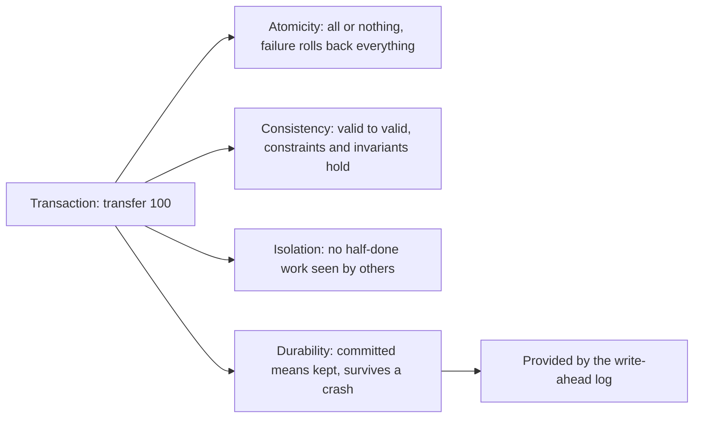
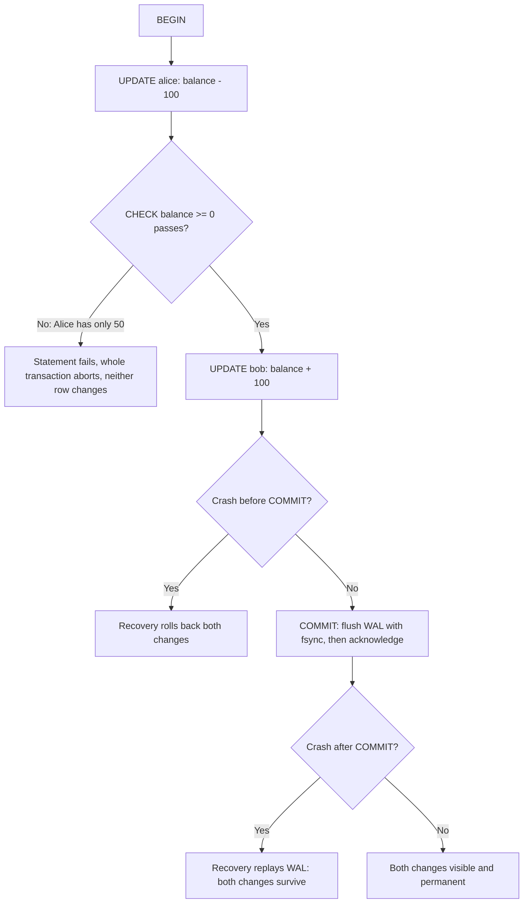
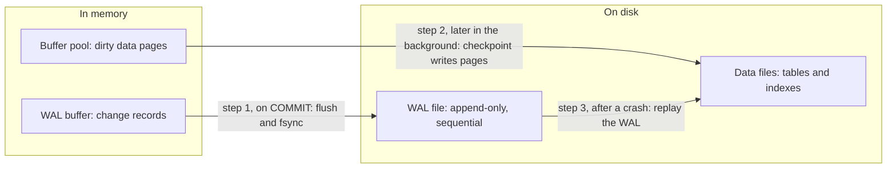
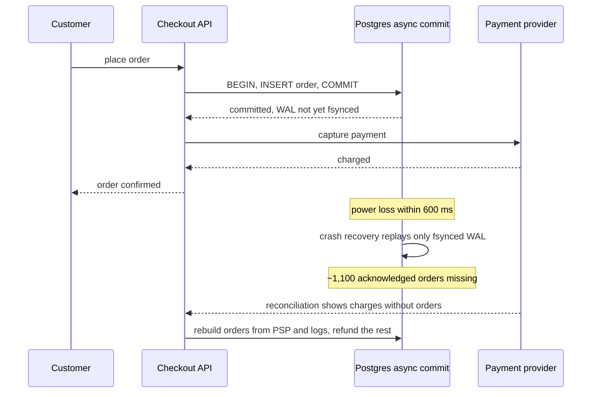

# Lesson 08: ACID Explained — Atomicity, Consistency, Isolation, Durability & the WAL

> **Prerequisites:** [Lesson 01: Relational Model & SQL Basics](../01-relational-model-sql-basics/README.md) and [Track: Databases](../README.md) overview.  
> **Estimated Reading Time:** 35 minutes  
> **Target Audience:** Backend engineers building money- or order-critical write paths who must know exactly what a database promises at `COMMIT`, what it leaves to application code, and what the write-ahead log (WAL) costs.  
> **Free PDF Notes:** [Download SD-E-008.pdf](https://backendroadmap.com/notes/system-design/SD-E-008.pdf)

> [!NOTE]
> **In one line:** ACID is the four promises a transaction makes—all or nothing, valid state to valid state, no peeking at half-done work, and committed means kept—and durability comes from the write-ahead log flushed to disk *before* the commit is acknowledged.

> [!TIP]
> **The Golden Rule of ACID:** The database enforces only the rules **you declare** (`CHECK`, `UNIQUE`, foreign keys) and makes a transaction all-or-nothing; **your code owns the business invariants** (like "total money is unchanged by a transfer"). And "committed" is only as durable as your `synchronous_commit` setting: log first, `fsync`, *then* acknowledge.

---

## Words You'll Meet Today

| Word | In Plain Words | Role in a Live Backend System |
| :--- | :--- | :--- |
| **Transaction** | A group of changes applied as one unit | `BEGIN … COMMIT` around debit + credit |
| **Commit / rollback** | Make every change permanent / undo every change | The only two endings of a transaction |
| **Atomicity** | All or nothing | A crash between debit and credit leaves no trace |
| **Consistency** | Valid state to valid state | `CHECK (balance >= 0)` rejects an overdraft |
| **Isolation** | Concurrent transactions don't see half-done work | Next lesson: levels and anomalies |
| **Durability** | Committed data survives a crash or power cut | Provided by the WAL and `fsync` |
| **WAL (write-ahead log)** | Append-only file of change records written before data pages | Turns random page writes into one sequential flush |
| **Checkpoint** | Writing dirty pages so less log must be replayed | Bounds crash-recovery time |

---

## Visual Mental Models & Architecture

### The Question: What Happens If the Server Dies Between Two Updates?

Alice sends Bob $100. The database must subtract 100 from Alice and add 100 to Bob. If the server crashes between the two statements, the money must not vanish and must not appear from thin air. A **transaction** groups both changes into one unit, and four guarantees—ACID—make that unit safe.



*Figure 1. The four ACID guarantees. Durability is the one the write-ahead log provides; atomicity and isolation come from the transaction machinery (versions, locks); consistency is shared between declared constraints and your code.*

### The Three Outcomes of a Transfer



*Figure 2. A failed constraint or a crash before `COMMIT` leaves no trace; a crash after `COMMIT` loses nothing (with synchronous commit).*

---

## Core Definition & Taxonomic Comparison

**What it is:** A transaction is a sequence of reads and writes that the database executes as a single logical unit, governed by the ACID guarantees. **What it isn't:** a promise that your *business* is correct (the database can't know your invariants), nor a promise that data lives on more than one machine (that needs replication), nor a guarantee across *several* databases or services (that needs two-phase commit or sagas, later in the course).

| Property | Precise Meaning | Who Enforces It | Production Example |
| :--- | :--- | :--- | :--- |
| **Atomicity** | Every change in the transaction applies, or none does | Database (rollback on error/crash) | Debit + credit never half-apply |
| **Consistency** | Declared constraints hold after commit; invariants are preserved | Database for declared rules, **your code** for business invariants | `CHECK (balance >= 0)`; "total money unchanged" |
| **Isolation** | Concurrent transactions don't observe each other's partial work (to a degree set by the isolation level) | Database (MVCC/locks), tuned by you | Report doesn't see a half-finished transfer |
| **Durability** | Once acknowledged, a commit survives crash or power loss | Database (WAL + `fsync`), tuned by `synchronous_commit` | Payment confirmed to the customer stays confirmed |

### ACID Consistency vs CAP Consistency vs BASE

| Term | Meaning | Scope |
| :--- | :--- | :--- |
| **ACID "C"** | Constraints and invariants hold after each transaction | One database, one transaction |
| **CAP "C"** | Every read sees the latest write across replicas (linearizability) | Distributed replicas |
| **BASE** | Basically Available, Soft state, Eventually consistent | Many NoSQL systems trading guarantees for scale |

**Business implication:** For money, orders, and inventory, you want ACID on the system of record. Weaken it (asynchronous commit, eventual consistency) only with a conscious, documented loss budget.

---

## Component Breakdown & Anatomy

### The Transfer as SQL

```sql
CREATE TABLE accounts (
  id      bigint PRIMARY KEY,
  name    text   NOT NULL,
  balance bigint NOT NULL CHECK (balance >= 0)   -- cents
);

BEGIN;
UPDATE accounts SET balance = balance - 10000 WHERE name = 'alice';
UPDATE accounts SET balance = balance + 10000 WHERE name = 'bob';
COMMIT;
```

If Alice has only $50, the first `UPDATE` violates the `CHECK`, the statement errors, and the transaction is aborted—Bob never receives anything (atomicity + consistency working together). In Postgres, after an error you must `ROLLBACK` (or the driver does) before using the connection again.

### How Durability Works: The Write-Ahead Log

Writing every changed data page to disk at commit would be slow: the pages are scattered across the disk (random writes). Instead the database keeps a **write-ahead log**—an append-only file of change records. The rule is in the name: **log first, data later.**



*Figure 3. The WAL turns many random page writes at commit into one sequential log flush. The data files catch up later. After a crash, recovery redoes committed changes that never reached the data files and discards uncommitted ones.*

1. **Before changing a data page,** the database appends a record describing the change to the WAL buffer.
2. **On commit,** it flushes the WAL to disk with `fsync` and *only then* tells the client "committed." Sequential appends are fast.
3. **The changed data pages** stay in memory and are written later in the background (a **checkpoint**).
4. **After a crash,** recovery replays the log from the last checkpoint: redo committed work, ignore uncommitted work.

### Durability Has Knobs

| Setting | What it does | Trade-off |
| :--- | :--- | :--- |
| **Synchronous commit** (`synchronous_commit = on`) | Commit waits for the WAL `fsync` on the primary | Survives a crash of the primary's process or power |
| **Synchronous replication** (`remote_write` / `on` / `remote_apply`, with `synchronous_standby_names`) | Commit also waits for a replica to confirm | Losing a whole server loses nothing; costs a network round trip |
| **Group commit** | Batches many concurrent transactions into one `fsync` | Much higher throughput, same safety |
| **Asynchronous commit** (`synchronous_commit = off`) | Acknowledges before the `fsync` completes | Faster, but a crash can lose the last few hundred milliseconds of commits (never corrupts data) |
| **`fsync = off`** | Skips flushing entirely | Can corrupt the database after a crash—never use in production |

MySQL InnoDB equivalent: `innodb_flush_log_at_trx_commit = 1` (flush + fsync at every commit, the durable default), `2` (flush to OS cache, fsync each second), `0` (once per second); pair with `sync_binlog = 1`.

All of this is about **one database**. Atomicity across several databases or services needs other tools: two-phase commit or sagas.

### The Observability Gap: Who Sees a Lost Commit?

| Measurement Point | What It Captures | What It Hides |
| :--- | :--- | :--- |
| **Client / app logs** | "COMMIT succeeded" | Whether the WAL was actually `fsync`ed (async commit acknowledges early) |
| **`pg_stat_wal`, `pg_current_wal_lsn()`** | WAL volume, write/sync counts and time | Which business rows a lost tail contained |
| **`pg_stat_replication`** (`sent`, `write`, `flush`, `replay` LSN) | How far each replica has durably received WAL | Data lost on an *async* replica after failover is invisible until you diff LSNs |
| **Disk / filesystem** | Write latency, error counts | A drive with a volatile write cache and no power-loss protection can acknowledge `fsync` falsely |
| **Reconciliation with downstream systems** | Payment provider says "charged," DB has no row | Only *after* the fact; the only cure for async-commit loss |

A lost async commit leaves **no error anywhere**: the client was told "OK," the database restarted cleanly. Prevention (the right durability level) beats detection.

---

## Mathematical Model & Worked Scale

### Commit Cost: fsync Dominates

Commit latency on a single node with synchronous replication:

$$L_{\text{commit}} = t_{\text{WAL write}} + t_{\text{fsync}} + \underbrace{(R + t_{\text{replica fsync}})}_{\text{only with sync replication}}$$

With $t_{\text{fsync}} = 1$ ms (typical network-attached SSD), $R = 1$ ms, $t_{\text{replica fsync}} = 1$ ms:

$$L_{\text{commit}} \approx 1 + (1 + 1) = 3\ \text{ms}$$

### Group Commit: One fsync, Many Commits

Without batching, one `fsync` per commit caps throughput at

$$\text{TPS}_{\max} \approx \frac{1}{t_{\text{fsync}}} = \frac{1}{0.001\ \text{s}} = 1{,}000\ \text{commits/s}$$

With group commit, $B$ concurrent commits share one flush:

$$\text{TPS}_{\max} \approx \frac{B}{t_{\text{fsync}}}$$

| Concurrent commits per flush $B$ | $t_{\text{fsync}} = 1$ ms | $t_{\text{fsync}} = 0.2$ ms (NVMe) |
| :--- | :--- | :--- |
| 1 | 1,000 TPS | 5,000 TPS |
| 5 | 5,000 TPS | 25,000 TPS |
| 20 | 20,000 TPS | 100,000 TPS |

This is why more connections can *raise* commit throughput: more commits are waiting to ride the same `fsync`.

### Asynchronous Commit Loss Window

Postgres's WAL writer wakes every `wal_writer_delay = 200 ms`; an async commit can be lost for up to about three times that:

$$\text{loss window} \le 3 \times 200\ \text{ms} = 600\ \text{ms} \qquad \text{commits at risk} \le \text{TPS} \times 0.6\ \text{s}$$

At 5,000 TPS that is up to **3,000 acknowledged commits** gone after a power cut. For a 25 TPS internal tool, it is about 15—perhaps acceptable. For payments, it is never acceptable.

### Why Non-Transactional Multi-Step Writes Eventually Corrupt Data (Little's Law)

A service runs $\lambda = 10^6/86{,}400 \approx 11.6$ transfers/s. Without a transaction, the debit and credit are separate statements with a gap $g = 5$ ms. The expected number of transfers caught in the gap at any instant:

$$L = \lambda g = 11.6 \times 0.005 \approx 0.058$$

If deploys, OOM kills, and node drains kill the process 20 times a day:

$$\text{stranded transfers/day} \approx 20 \times 0.058 \approx 1.2 \qquad \Rightarrow \qquad \approx 420\ \text{per year}$$

Each one is money destroyed or created, found by an auditor months later.

### WAL Volume and Recovery Time (Illustrative)

A transfer writes about 300 bytes of WAL (two row updates + commit record), plus an 8 KB full-page image the first time a page is touched after a checkpoint.

| Quantity | Value |
| :--- | :--- |
| WAL at 5,000 TPS (ignoring full-page images) | $5{,}000 \times 300\ \text{B} = 1.5$ MB/s ≈ 130 GB/day |
| Default `checkpoint_timeout` | 5 min = 300 s |
| WAL since last checkpoint (worst case) | $300 \times 1.5\ \text{MB/s} = 450$ MB |
| Replay at ~50 MB/s (illustrative) | ≈ 9 s of redo before the database accepts connections |

Longer checkpoint intervals reduce write amplification but lengthen crash recovery.

---

## Metrics, Percentiles & Numbers Engineers Must Know

| Operation | Typical latency | Implication |
| :--- | :--- | :--- |
| In-memory row update (buffer pool) | ~microseconds | Not the bottleneck |
| WAL `fsync`, NVMe | ~0.1–0.5 ms | Floor for a durable commit |
| WAL `fsync`, cloud network SSD | ~1–2 ms | Typical managed-DB commit floor |
| WAL `fsync`, spinning disk | ~5–10 ms | ~100–200 TPS without group commit |
| Sync replica, same region | +1–2 ms | Price of zero data loss on server loss |
| Sync replica, cross-region | +30–100 ms | Usually async, accept RPO > 0 |
| Checkpoint interval default | 5 min | Bounds recovery replay |

| Percentile | Who feels it | Commit-path meaning |
| :--- | :--- | :--- |
| $p_{50}$ | Typical write | One group-committed fsync |
| $p_{95}$ | Bad day for 1 in 20 | Waiting for the next flush batch; replica round trip |
| $p_{99}$ | Worst users | Checkpoint I/O storm, full-page writes, fsync stalls, replica hiccup |

| Durability setting | RPO if the primary dies | Commit latency impact |
| :--- | :--- | :--- |
| `synchronous_commit = off` | up to ~600 ms of commits (process/power loss) | Lowest |
| `on`, no sync replica | 0 for process/power loss; **all unreplicated data if the disk/host is destroyed** | +fsync |
| `on` + sync replica | 0 even if the primary host is destroyed | +fsync + replica RTT |

---

## Hierarchical Budgets & Mitigations

| Tier | Latency budget (example 200 ms checkout API) | Role |
| :--- | :--- | :--- |
| Gateway / auth | 10–20 ms | JWT, rate limit |
| Service logic | 20–40 ms | Validation, orchestration |
| Cache | 1–5 ms | Not on the write path |
| **Database transaction** | **30–80 ms** | `BEGIN`, 2–4 statements, `COMMIT` (fsync + optional replica) |
| Headroom | ~40 ms | Retries, spikes |

**Rule:** A durable commit costs ≥ one `fsync` (+ replica RTT). Keep transactions to a few statements; never hold one open across a network call.

| # | Mitigation | Prevents | Caveat |
| :--- | :--- | :--- | :--- |
| 1 | Wrap multi-step changes in one transaction | Half-applied state | Keep it short |
| 2 | Declare `CHECK`, `UNIQUE`, `FOREIGN KEY` | Invalid state from any writer | App must still keep cross-row invariants |
| 3 | Keep `synchronous_commit = on` for money/orders; use `SET LOCAL` per transaction to relax only for low-value writes | Silent loss of acknowledged commits | Slightly higher latency |
| 4 | Synchronous replication for zero-RPO systems | Loss of a destroyed primary | Adds RTT; a dead sync replica can stall commits (use quorum/`ANY`) |
| 5 | Enable data checksums, use power-loss-protected disks | Torn pages, false `fsync` acks | Hardware choice |
| 6 | Use an outbox or saga for cross-system atomicity | Dual-write inconsistency | More moving parts |
| 7 | Reconcile against external ledgers (PSP, bank) | Undetected drift | Process cost |
| 8 | Test crash recovery (`pg_ctl stop -m immediate`) in staging | Untested assumptions | Needs an environment |

---

## Production War Story: Acknowledged Payments That Never Existed

- **Severity:** SEV-1 (customers charged, orders missing)
- **Detection / Resolution:** 2 hours to notice via payment-provider reconciliation; 2 days to rebuild missing orders and refund
- **Impact:** ~1,100 orders acknowledged by the API and charged at the payment provider, but absent from the database after a power event

### What Happened

During performance tuning for a flash sale, an engineer set `synchronous_commit = off` cluster-wide on the orders database: "commit latency dropped from 3 ms to 0.4 ms." At the peak (~1,800 commits/s) the host lost power. The WAL tail that had been acknowledged but not yet `fsync`ed—about 600 ms of commits—vanished. The database recovered cleanly and consistently, with no error, but without ~1,100 orders the API had already confirmed and the payment provider had already charged.



### Root Cause & Fix

1. **Durability was traded for latency globally,** including the money path, with no loss budget agreed.
2. **The API treated "COMMIT returned" as permanent** and performed an irreversible external action (capture payment) after it.
3. **No immediate reconciliation** between provider and database.
4. **Fix:** `synchronous_commit = on` as the default; `SET LOCAL synchronous_commit = off` allowed only for explicitly lossy writes (page-view counters); synchronous replica (quorum) for the orders DB; hourly PSP-vs-DB reconciliation job and alert; a documented RPO per data class.

---

## Multi-Language Production Implementation

A durable, atomic transfer with a declared `CHECK` constraint, translating the constraint failure into a business error—Go, TypeScript, Python, C# (statement order and deadlock avoidance come in Lesson 11):

````carousel
```go
package bank

import (
	"context"
	"errors"

	"github.com/jackc/pgx/v5/pgconn"
	"github.com/jackc/pgx/v5/pgxpool"
)

var (
	ErrInsufficientFunds = errors.New("insufficient funds")
	ErrNoAccount         = errors.New("account not found")
	ErrInvalid           = errors.New("invalid transfer")
)

func Transfer(ctx context.Context, pool *pgxpool.Pool, from, to, cents int64) error {
	if from == to || cents <= 0 {
		return ErrInvalid
	}
	tx, err := pool.Begin(ctx)
	if err != nil {
		return err
	}
	defer tx.Rollback(ctx) // no-op after a successful Commit

	// Money path: never allow asynchronous commit.
	if _, err = tx.Exec(ctx, `SET LOCAL synchronous_commit = on`); err != nil {
		return err
	}

	ct, err := tx.Exec(ctx,
		`UPDATE accounts SET balance = balance - $1 WHERE id = $2`, cents, from)
	if err != nil {
		var pgErr *pgconn.PgError
		if errors.As(err, &pgErr) && pgErr.Code == "23514" { // check_violation
			return ErrInsufficientFunds
		}
		return err
	}
	if ct.RowsAffected() != 1 {
		return ErrNoAccount
	}

	ct, err = tx.Exec(ctx,
		`UPDATE accounts SET balance = balance + $1 WHERE id = $2`, cents, to)
	if err != nil {
		return err
	}
	if ct.RowsAffected() != 1 {
		return ErrNoAccount // rollback undoes the debit
	}

	if _, err = tx.Exec(ctx,
		`INSERT INTO ledger (from_id, to_id, cents) VALUES ($1, $2, $3)`,
		from, to, cents); err != nil {
		return err
	}
	return tx.Commit(ctx)
}
```
<!-- slide -->
```typescript
import { Pool } from "pg";

export class InsufficientFunds extends Error {}
export class NoAccount extends Error {}

export async function transfer(
  pool: Pool,
  from: number,
  to: number,
  cents: number,
): Promise<void> {
  if (from === to || cents <= 0) throw new Error("invalid transfer");
  const client = await pool.connect();
  try {
    await client.query("BEGIN");
    await client.query("SET LOCAL synchronous_commit = on"); // money path

    try {
      const debit = await client.query(
        "UPDATE accounts SET balance = balance - $1 WHERE id = $2",
        [cents, from],
      );
      if (debit.rowCount !== 1) throw new NoAccount();
    } catch (e: any) {
      if (e?.code === "23514") throw new InsufficientFunds(); // check_violation
      throw e;
    }

    const credit = await client.query(
      "UPDATE accounts SET balance = balance + $1 WHERE id = $2",
      [cents, to],
    );
    if (credit.rowCount !== 1) throw new NoAccount(); // rollback undoes the debit

    await client.query(
      "INSERT INTO ledger (from_id, to_id, cents) VALUES ($1, $2, $3)",
      [from, to, cents],
    );
    await client.query("COMMIT");
  } catch (e) {
    await client.query("ROLLBACK");
    throw e;
  } finally {
    client.release();
  }
}
```
<!-- slide -->
```python
from __future__ import annotations
import psycopg
from psycopg import errors


class InsufficientFunds(Exception): ...
class NoAccount(Exception): ...


def transfer(conn: psycopg.Connection, src: int, dst: int, cents: int) -> None:
    if src == dst or cents <= 0:
        raise ValueError("invalid transfer")
    # conn.transaction() commits on success and rolls back on any exception
    with conn.transaction():
        with conn.cursor() as cur:
            cur.execute("SET LOCAL synchronous_commit = on")  # money path
            try:
                cur.execute(
                    "UPDATE accounts SET balance = balance - %s WHERE id = %s",
                    (cents, src),
                )
            except errors.CheckViolation as e:  # SQLSTATE 23514
                raise InsufficientFunds() from e
            if cur.rowcount != 1:
                raise NoAccount()

            cur.execute(
                "UPDATE accounts SET balance = balance + %s WHERE id = %s",
                (cents, dst),
            )
            if cur.rowcount != 1:
                raise NoAccount()  # rollback undoes the debit

            cur.execute(
                "INSERT INTO ledger (from_id, to_id, cents) VALUES (%s, %s, %s)",
                (src, dst, cents),
            )
```
<!-- slide -->
```csharp
using Npgsql;

public class InsufficientFundsException : Exception { }
public class NoAccountException : Exception { }

public static class Bank
{
    public static async Task TransferAsync(
        NpgsqlDataSource ds, long from, long to, long cents, CancellationToken ct)
    {
        if (from == to || cents <= 0) throw new ArgumentException("invalid transfer");
        await using var conn = await ds.OpenConnectionAsync(ct);
        await using var tx = await conn.BeginTransactionAsync(ct);

        await using (var sc = new NpgsqlCommand("SET LOCAL synchronous_commit = on", conn, tx))
            await sc.ExecuteNonQueryAsync(ct); // money path

        try
        {
            await using var debit = new NpgsqlCommand(
                "UPDATE accounts SET balance = balance - @a WHERE id = @id", conn, tx);
            debit.Parameters.AddWithValue("a", cents);
            debit.Parameters.AddWithValue("id", from);
            if (await debit.ExecuteNonQueryAsync(ct) != 1) throw new NoAccountException();
        }
        catch (PostgresException ex) when (ex.SqlState == PostgresErrorCodes.CheckViolation)
        {
            throw new InsufficientFundsException(); // tx disposed => rolled back
        }

        await using (var credit = new NpgsqlCommand(
            "UPDATE accounts SET balance = balance + @a WHERE id = @id", conn, tx))
        {
            credit.Parameters.AddWithValue("a", cents);
            credit.Parameters.AddWithValue("id", to);
            if (await credit.ExecuteNonQueryAsync(ct) != 1) throw new NoAccountException();
        }

        await using (var led = new NpgsqlCommand(
            "INSERT INTO ledger (from_id, to_id, cents) VALUES (@f, @t, @c)", conn, tx))
        {
            led.Parameters.AddWithValue("f", from);
            led.Parameters.AddWithValue("t", to);
            led.Parameters.AddWithValue("c", cents);
            await led.ExecuteNonQueryAsync(ct);
        }
        await tx.CommitAsync(ct);
    }
}
```
````

---

## Practical Hands-On CLI Verification

```bash
# 1. Setup
psql <<'SQL'
CREATE TABLE accounts (id bigint PRIMARY KEY, name text, balance bigint NOT NULL CHECK (balance >= 0));
INSERT INTO accounts VALUES (1,'alice',5000),(2,'bob',0);   -- Alice has $50.00
SQL

# 2. Atomicity + consistency: the overdraft aborts the whole transaction
psql <<'SQL'
BEGIN;
UPDATE accounts SET balance = balance + 10000 WHERE id = 2;   -- credit Bob first
UPDATE accounts SET balance = balance - 10000 WHERE id = 1;   -- ERROR: violates check constraint
COMMIT;                                                       -- reported as ROLLBACK
SELECT * FROM accounts;                                       -- Bob still 0, Alice still 5000
SQL
```

```bash
# 3. Look at the WAL: LSN moves forward on every write
psql <<'SQL'
SELECT pg_current_wal_lsn() AS before \gset
UPDATE accounts SET balance = balance WHERE id = 1;
SELECT pg_wal_lsn_diff(pg_current_wal_lsn(), :'before') AS wal_bytes_written;
SHOW synchronous_commit;   SHOW fsync;   SHOW wal_writer_delay;   SHOW checkpoint_timeout;
SELECT wal_records, wal_bytes FROM pg_stat_wal;   -- Postgres 14+
SQL

# 4. Measure what fsync costs on THIS disk
pg_test_fsync -s 2

# 5. Crash-recovery drill (staging only!): uncommitted work disappears, committed work survives
( echo "BEGIN; UPDATE accounts SET balance = 999999 WHERE id = 1;"; sleep 600 ) | psql &   # open, never committed
pg_ctl -D "$PGDATA" stop -m immediate      # simulates a crash: no checkpoint, no clean shutdown
pg_ctl -D "$PGDATA" start && psql -c "SELECT * FROM accounts;"   # Alice is back to 5000

# 6. Replication durability: how far has each replica flushed?
psql -c "SELECT application_name, sync_state, sent_lsn, flush_lsn, replay_lsn FROM pg_stat_replication;"
```

```bash
python3 -c "
t_fsync_ms = 1.0
for b in (1, 5, 20):
    print(f'B={b:2d}  max commits/s = {b/(t_fsync_ms/1000):,.0f}')
lam, gap = 1e6/86400, 0.005
print(f'in-flight in gap = {lam*gap:.3f};  stranded/day with 20 kills = {20*lam*gap:.2f}')
print(f'async loss window <= {3*0.2:.1f}s  ->  {5000*0.6:,.0f} commits at 5,000 TPS')
"
```

---

## Common Mistakes to Avoid

1. **Assuming the database alone keeps your business rules.** It only enforces the constraints you declare: add `CHECK`, `UNIQUE`, and foreign keys; keep cross-row invariants in transaction logic.
2. **Running a multi-step change in autocommit mode,** so a crash leaves it half done.
3. **Confusing ACID consistency** (constraints hold) **with CAP consistency** (every replica returns the latest write).
4. **Turning on asynchronous commit (or `innodb_flush_log_at_trx_commit=2`) for money or orders,** where losing the last commits is unacceptable.
5. **Doing an irreversible external action** (charging a card, sending an email) *inside* the transaction or before commit is durable; use an outbox.
6. **Holding a transaction open across a network call or user input.** It pins locks and old row versions (Lessons 10–11).
7. **Believing `fsync` is always honest.** Consumer SSDs and some virtualized disks acknowledge flushes from a volatile cache; test with `pg_test_fsync` and use power-loss-protected storage.
8. **Swallowing errors inside a transaction** and continuing: in Postgres, a failed statement aborts the transaction; subsequent statements fail until `ROLLBACK`.

---

## Key Terms Glossary

| Term | Interview-ready definition |
| :--- | :--- |
| Transaction | Group of reads/writes executed as one atomic, isolated, durable unit |
| Commit / rollback | Make every change permanent / undo every change |
| Constraint | Rule the database enforces on every write (`CHECK`, `UNIQUE`, FK) |
| Invariant | Business rule your code must keep (e.g., total money unchanged) |
| WAL | Append-only log of change records written before the data pages |
| `fsync` | Force buffered data onto the physical disk |
| Checkpoint | Writing dirty pages to data files so less log must be replayed |
| Group commit | Many concurrent commits sharing one `fsync` |
| Recovery | Replaying the WAL after a crash: redo committed, discard uncommitted |
| RPO | Recovery point objective: how much committed data you can afford to lose |

---

## Interview Practice Questions

### Basic Conceptual Questions (Q1–Q4)

<details>
<summary><strong>Q1: Explain each letter of ACID. [BASIC]</strong></summary>

<strong>What a strong answer covers:</strong>
Atomicity: all of a transaction's changes happen, or none do. Consistency: transactions keep data valid, respecting constraints and invariants. Isolation: concurrent transactions don't see each other's partial work. Durability: committed data survives crashes.

</details>

<details>
<summary><strong>Q2: How does a database guarantee durability? [BASIC]</strong></summary>

<strong>What a strong answer covers:</strong>
With a write-ahead log. Changes are appended to the log and the log is `fsync`ed before the commit is acknowledged. Data pages are written later. After a crash, the log is replayed: committed changes are redone, uncommitted ones discarded.

</details>

<details>
<summary><strong>Q3: Why not just write the data pages at commit time? [BASIC]</strong></summary>

<strong>What a strong answer covers:</strong>
A transaction may touch pages scattered across the disk; writing them all means many random writes per commit. The WAL needs one sequential append and one `fsync`, and group commit shares that `fsync` across many transactions. Pages are flushed later in bulk by checkpoints.

</details>

<details>
<summary><strong>Q4: What do `BEGIN`, `COMMIT`, and `ROLLBACK` do, and what happens in autocommit mode? [BASIC]</strong></summary>

<strong>What a strong answer covers:</strong>
`BEGIN` starts a transaction; `COMMIT` makes all its changes permanent and visible; `ROLLBACK` discards them. In autocommit mode, each statement is its own transaction, so a multi-statement business operation is *not* atomic—a crash between statements leaves partial state.

</details>

### Scenario-Based Architecture Questions (Q5–Q8)

<details>
<summary><strong>Q5: A transfer of $100 runs, but Alice has only $50. What happens? [SCENARIO]</strong></summary>

<strong>What a strong answer covers:</strong>
Her balance would go to −50, the `CHECK (balance >= 0)` constraint fails, and the whole transaction aborts. Bob's +100 is rolled back too. Neither row changes. The application maps SQLSTATE `23514` to an "insufficient funds" error.

</details>

<details>
<summary><strong>Q6: The server loses power 1 ms after the client saw "committed." Is the data safe? [SCENARIO]</strong></summary>

<strong>What a strong answer covers:</strong>
Yes, with synchronous commit: the WAL was `fsync`ed before the acknowledgement, so recovery replays it. With asynchronous commit, the last few hundred milliseconds of commits (up to ~3 × `wal_writer_delay`) can be lost. Also verify the disk honors `fsync`.

</details>

<details>
<summary><strong>Q7: You need zero data loss even if the whole primary server is destroyed. What do you configure? [SCENARIO]</strong></summary>

<strong>What a strong answer covers:</strong>
Synchronous replication: commit waits until at least one replica has the WAL record too (`synchronous_standby_names`, ideally a quorum like `ANY 1 (a, b)` so one dead replica doesn't stall writes). It adds a network round trip (often 1–2 ms in-region) to every commit; cross-region is usually async with a stated RPO.

</details>

<details>
<summary><strong>Q8: Your service inserts an order in Postgres and then publishes an `OrderCreated` event to Kafka. The process dies between the two. What goes wrong and how do you fix it? [SCENARIO]</strong></summary>

<strong>What a strong answer covers:</strong>
ACID covers only one database; the DB commit and the Kafka publish are two systems, so atomicity is lost (dual write): the order exists but no event is ever sent. Fix with the **transactional outbox**: insert the event into an `outbox` table in the same transaction, then a relay (or CDC) publishes it at-least-once, with idempotent consumers. Sagas/2PC handle multi-service workflows.

</details>

### Advanced & Tricky Interview Questions (Q9–Q12)

<details>
<summary><strong>Q9: Is "consistency" in ACID the same as in CAP? [TRICKY]</strong></summary>

<strong>What a strong answer covers:</strong>
No. ACID consistency means declared constraints and invariants hold after each transaction. CAP consistency means every read sees the latest write across replicas (linearizability). A single-node database can be ACID-consistent with no replicas at all.

</details>

<details>
<summary><strong>Q10: Who keeps the invariant "total money is unchanged by a transfer"? [TRICKY]</strong></summary>

<strong>What a strong answer covers:</strong>
Your code. The database can't know that rule; it only enforces declared constraints. Your transaction must debit and credit the same amount, and atomicity ensures both or neither apply. (Where possible, encode it: double-entry ledger with a deferred constraint that entries sum to zero.)

</details>

<details>
<summary><strong>Q11: If a database calls `fsync` on every commit, can a committed transaction still be lost? [TRICKY]</strong></summary>

<strong>What a strong answer covers:</strong>
Yes, in several cases: the disk or hypervisor acknowledges `fsync` from a volatile write cache without power-loss protection; the host or its disk is destroyed and there is no synchronous replica; asynchronous replication is promoted after failover (replica missed the tail); or the operator ran with `fsync=off`. Durability is a property of the whole stack, not one flag.

</details>

<details>
<summary><strong>Q12: Does rollback require an undo log in every database? [TRICKY]</strong></summary>

<strong>What a strong answer covers:</strong>
No. MySQL InnoDB and Oracle keep undo records and apply them on rollback. Postgres does not undo: an aborted transaction's row versions simply stay invisible (their creating transaction is marked aborted), and `VACUUM` removes them later—so rollback is instant but leaves dead tuples. WAL redo is still used for crash recovery in all of them.

</details>

---

## One-Page Master Cheat Sheet

```text
====================================================================================================
          ACID EXPLAINED — ATOMICITY, CONSISTENCY, ISOLATION, DURABILITY & WAL — CHEAT SHEET (SD-E-008)
====================================================================================================
A  Atomicity    all or nothing          failure/crash before COMMIT -> everything rolled back
C  Consistency  valid -> valid          DB enforces DECLARED rules; YOUR code keeps business invariants
I  Isolation    no half-done work seen  strength set by isolation level (next lesson)
D  Durability   committed = kept        WAL appended + fsync BEFORE the commit is acknowledged

WAL FLOW
  change -> WAL buffer -> COMMIT: flush+fsync -> ack client      (sequential, fast)
  dirty data pages -> written later by checkpoint                (random, batched)
  crash -> replay WAL from last checkpoint: redo committed, discard uncommitted

KNOBS
  synchronous_commit=on  durable on primary     =off  lose up to ~600 ms of commits (no corruption)
  + sync replica         survives host loss     costs +RTT per commit (1-2 ms in-region)
  group commit           B commits / 1 fsync    TPS_max ~ B / t_fsync      (1 ms -> 1k; B=20 -> 20k)

NUMBERS
  fsync: NVMe 0.1-0.5 ms · cloud SSD 1-2 ms · HDD 5-10 ms
  1M transfers/day, 5 ms gap, 20 kills/day -> ~1.2 stranded transfers/day (~420/yr) WITHOUT a transaction

NOT ACID
  ACID C != CAP C · ACID is single-database; cross-service needs outbox / saga / 2PC

ANTI-PATTERNS
  x autocommit multi-step writes     x async commit for money      x rules only in app code
  x external side effect before durable commit     x open transaction across a network call
====================================================================================================
```

---

## Free PDF notes

[SD-E-008.pdf](https://backendroadmap.com/notes/system-design/SD-E-008.pdf)

---

## Sources

- Haerder, T., Reuter, A. — Principles of Transaction-Oriented Database Recovery (1983), origin of the ACID acronym.  
- Mohan et al. — ARIES: A Transaction Recovery Method Supporting Fine-Granularity Locking (1992).  
- PostgreSQL documentation — Reliability and the Write-Ahead Log; Asynchronous Commit; WAL Configuration.  
- MySQL documentation — `innodb_flush_log_at_trx_commit`, InnoDB redo log.  
- Kleppmann, M. — *Designing Data-Intensive Applications*, Chapter 7: Transactions.

---

## Next

Next: [Lesson 09: Isolation Levels & Write Skew](../09-isolation-levels-write-skew/README.md). Track overview: [Databases](../README.md).
