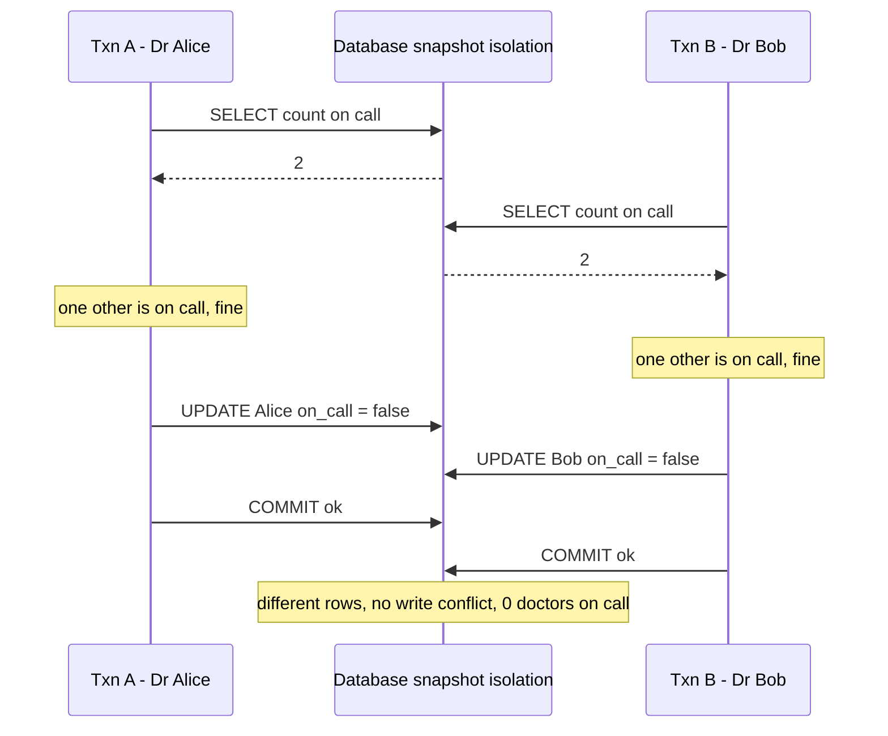
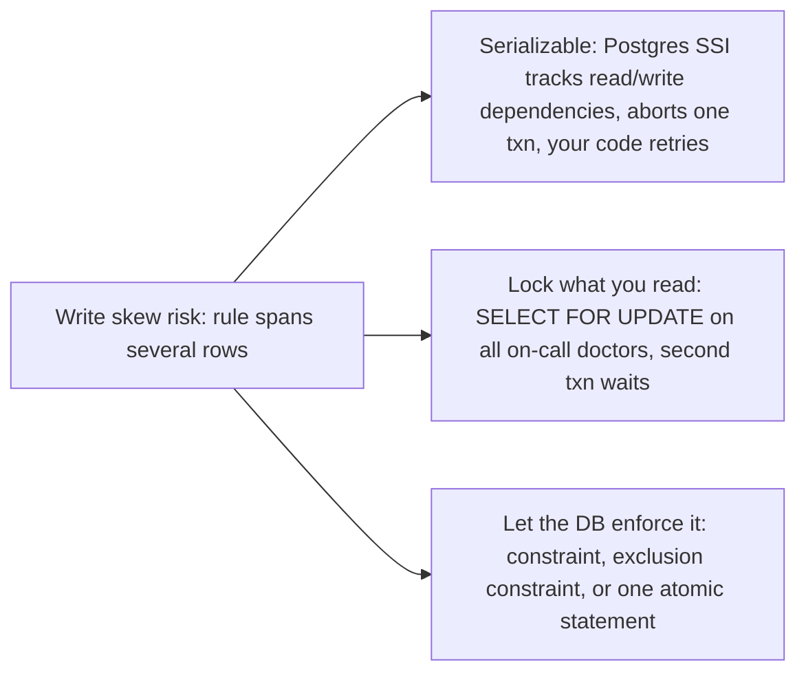
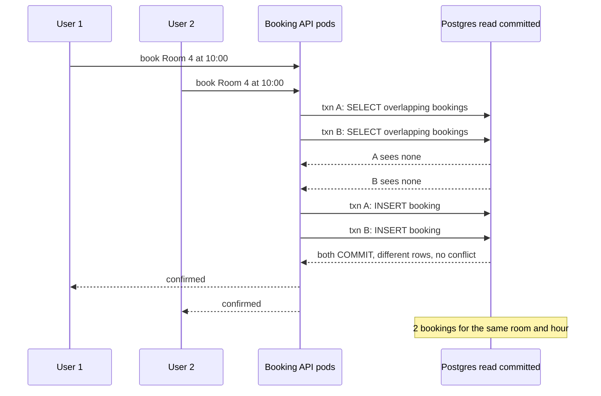

# Lesson 09: Isolation Levels & Write Skew — Snapshot Isolation vs Serializable

> **Prerequisites:** [Lesson 08: ACID Explained](../08-acid-explained/README.md) and [Track: Databases](../README.md) overview.  
> **Estimated Reading Time:** 40 minutes  
> **Target Audience:** Backend engineers who write read-then-write logic (bookings, inventory, on-call rotas, balances), choose isolation levels, and must reason about which concurrency anomalies their database really prevents.  
> **Free PDF Notes:** [Download SD-E-009.pdf](https://backendroadmap.com/notes/system-design/SD-E-009.pdf)

> [!NOTE]
> **In one line:** Isolation levels decide which concurrency anomalies you can see—read committed is the common default, snapshot isolation (repeatable read in Postgres and MySQL) stops most anomalies but still allows write skew, which only serializable or explicit locks and constraints prevent.

> [!TIP]
> **The Golden Rule of Isolation:** **Every row being updated correctly does not mean the data is correct.** If a rule spans several rows ("at least one doctor on call", "no overlapping bookings"), two transactions can each read the same data, each decide "safe," and each write a *different* row. Prevent it with `SERIALIZABLE` **plus a retry loop**, with locks on what you read, or by turning the rule into a constraint the database enforces itself.

---

## Words You'll Meet Today

| Word | In Plain Words | Role in a Live Backend System |
| :--- | :--- | :--- |
| **Isolation level** | How much concurrent work a transaction can see | `READ COMMITTED`, `REPEATABLE READ`, `SERIALIZABLE` |
| **Snapshot** | A consistent view of the database as of one moment | What `REPEATABLE READ` reads from |
| **Snapshot isolation (SI)** | Every read uses the transaction's snapshot; same-row write conflicts abort | Postgres/MySQL "repeatable read" |
| **Dirty / non-repeatable read, phantom** | See uncommitted data / a row change / new rows | Classic read anomalies |
| **Lost update** | Two read-modify-writes overwrite each other | Counter that skips increments |
| **Write skew** | Read shared data, write *different* rows, break a cross-row rule | Both on-call doctors go off call |
| **SSI** | Serializable Snapshot Isolation: detects dangerous read/write patterns | Postgres `SERIALIZABLE` |
| **Serialization failure** | The database aborts a transaction to preserve a serial order (SQLSTATE `40001`) | Normal under serializable: **retry it** |

---

## Visual Mental Models & Architecture

### The Question: Two Doctors, One Rule

Two doctors are on call tonight. The rule: **at least one must stay on call.** Both feel unwell. At the same moment each checks, "is someone else on call?" Yes, one other. So each takes themselves off. Both transactions succeed, and now **nobody** is on call. Every row was updated correctly, nothing crashed, yet the rule is broken.



*Figure 1. Each transaction reads the same data, decides "safe," and writes a different row. No row is written twice, so snapshot isolation sees no conflict.*

### Three Ways to Stop Write Skew



*Figure 2. Serializable is the most general; locks and constraints are targeted and cheaper under contention.*

---

## Core Definition & Taxonomic Comparison

**What it is:** An isolation level is the contract about which interleavings of concurrent transactions the database may expose. Stronger levels hide more anomalies but cost throughput (aborts or waiting). **What it isn't:** a portable guarantee—the *same name* means different things in different databases.

### The Five Anomalies

| Anomaly | What happens | Example |
| :--- | :--- | :--- |
| **Dirty read** | You see another transaction's uncommitted change, which may still be rolled back | See a balance that is later rolled back |
| **Non-repeatable read** | You read a row twice and get different values because someone committed in between | Order total changes mid-report |
| **Phantom** | The same query run twice returns new (or fewer) rows | `COUNT(*)` of bookings differs |
| **Lost update** | Two transactions read, modify, and write the same value; one silently overwrites the other | Two `balance = balance_read + 10` writes → only one applied |
| **Write skew** | Two transactions read the same data, then update *different* rows, breaking a rule that spans both | Both doctors off call |

### The Four Standard Levels and What Databases Really Do

| Level | Standard intent | Postgres | MySQL InnoDB | Oracle | SQL Server |
| :--- | :--- | :--- | :--- | :--- | :--- |
| **Read uncommitted** | Allows dirty reads | Treated as read committed | Allows dirty reads | n/a | Allows dirty reads |
| **Read committed** | No dirty reads | **Default**; each *statement* gets a fresh snapshot | Per-statement snapshot | **Default** | **Default** (locking; snapshot-based if RCSI is on) |
| **Repeatable read** | Rows you read stay stable | Snapshot isolation for the whole transaction; hides phantoms; same-row conflicts abort | **Default**; snapshot for plain reads, latest data for locking reads/updates | n/a | Locking; holds read locks |
| **Serializable** | Equivalent to some one-at-a-time order | SSI: truly serializable, may abort with `40001` | Reads become locking reads | **Actually snapshot isolation**—write skew still possible | Locking; truly serializable |

### Which Anomaly Each Level Allows

| Level | Dirty read | Non-repeatable | Phantom | Lost update | Write skew |
| :--- | :--- | :--- | :--- | :--- | :--- |
| Read uncommitted | possible | possible | possible | possible | possible |
| Read committed | prevented | possible | possible | possible* | possible |
| Repeatable read (SQL standard) | prevented | prevented | possible | not defined | not defined |
| **Snapshot isolation (Postgres RR)** | prevented | prevented | prevented | prevented | **possible** |
| Serializable | prevented | prevented | prevented | prevented | prevented |

\* In Postgres at read committed, a single atomic `UPDATE … SET n = n + 1` is safe; an application-level read-modify-write (SELECT, compute, UPDATE) is not. MySQL's repeatable read is snapshot-based but can still lose an app-level read-modify-write update.

**The row to remember:** *snapshot isolation prevents everything except write skew.*

**Business implication:** "We use repeatable read" is not a statement about correctness. Identify every invariant that spans rows, and choose a protection for each one.

---

## Component Breakdown & Anatomy

### Why Snapshot Isolation Misses Write Skew

Both transactions take a snapshot. Each counts two doctors on call, and each updates only its own row. Snapshot isolation detects conflicts by looking for **two transactions writing the same row**; here no row is written twice, so there is nothing to detect, and both commit.

### Fix 1: Serializable (with Retry)

```sql
BEGIN ISOLATION LEVEL SERIALIZABLE;
SELECT count(*) FROM doctors WHERE shift_id = 7 AND on_call;   -- app: need >= 2 to continue
UPDATE doctors SET on_call = false WHERE id = :me;
COMMIT;   -- the second committer fails: ERROR 40001 could not serialize access
```

Postgres implements serializable as **SSI** (serializable snapshot isolation): it tracks read/write dependencies between concurrent transactions, and when it sees a dangerous pattern (a cycle that couldn't happen in any serial order) it aborts one with SQLSTATE `40001`. The retry re-reads, sees only one doctor on call, and refuses.

### Fix 2: Lock What You Read

```sql
BEGIN;
SELECT id FROM doctors
 WHERE shift_id = 7 AND on_call
 FOR UPDATE;              -- locks every on-call row; the second transaction waits here
-- app: if 2 or more rows, continue; else abort
UPDATE doctors SET on_call = false WHERE id = :me;
COMMIT;
```

The second transaction blocks on the first one's locks, then re-checks after it commits. Postgres does not allow `FOR UPDATE` with `count(*)` (aggregates), so select the rows and count them in code.

### Fix 3: Let the Database Enforce It

Some rules fit a declarative constraint, which holds regardless of isolation level:

```sql
CREATE EXTENSION IF NOT EXISTS btree_gist;
-- A room can't have two overlapping bookings: the second INSERT fails with SQLSTATE 23P01
ALTER TABLE bookings ADD CONSTRAINT no_overlap
  EXCLUDE USING gist (room_id WITH =, tstzrange(starts_at, ends_at) WITH &&);

-- Or: one atomic statement that checks and writes together
UPDATE products SET stock = stock - 1 WHERE id = :p AND stock > 0;   -- check rows affected
```

### Fix 4: Materialize the Conflict

If there's no row to lock (the "phantom" case), lock a **parent row** all contenders must touch: `SELECT … FROM shifts WHERE id = 7 FOR UPDATE`, or maintain a counter row (`on_call_count`) with `CHECK (on_call_count >= 1)`. Now the two transactions *do* write the same row, and snapshot isolation's normal conflict detection catches it.

### The Observability Gap: Who Sees Write Skew?

| Measurement Point | What It Captures | What It Hides |
| :--- | :--- | :--- |
| **App error rate** | `40001`/`40P01` retries and failures | Write skew at weaker levels produces **no error at all** |
| **DB logs** | `could not serialize access…` lines, deadlocks | Anything that committed successfully but violated a rule |
| **`pg_stat_database`** | `xact_commit`, `xact_rollback`, `deadlocks` | No dedicated counter for serialization failures—count SQLSTATE `40001` in the app |
| **Data-quality / invariant checks** | "Shifts with zero on-call," "overlapping bookings" after the fact | The transaction pair that caused it; the time window |
| **Load tests** | Anomalies under real contention | Only if the test generates concurrent conflicting transactions |

Write skew is silent corruption: all rows are individually valid and every transaction reported success. Detect it with invariant queries on a schedule, and prevent it structurally.

---

## Mathematical Model & Worked Scale

### How Often Do Conflicting Transactions Overlap?

If conflicting transactions arrive on the same hot key (a room-slot, a shift, a SKU) as a Poisson process with rate $\lambda$ per second, and each transaction takes $T$ seconds from snapshot to commit, then the probability that at least one other overlaps a given transaction is

$$P_{\text{overlap}} = 1 - e^{-\lambda T}$$

| Arrivals on one hot key $\lambda$ | $T = 10$ ms | $T = 30$ ms | $T = 100$ ms |
| :--- | :--- | :--- | :--- |
| 0.5 / s | 0.5% | 1.5% | 4.9% |
| 2 / s | 2.0% | 5.8% | 18% |
| 10 / s | 9.5% | 26% | 63% |
| 50 / s | 39% | 78% | 99.3% |

At $\lambda = 2$/s and $T = 30$ ms, about 1 in 17 attempts overlaps another. That is an upper bound for write skew (the two must also make conflicting decisions), but it shows why a bug that is "impossible in testing" appears at Monday-9 AM peak, and why **shorter transactions** reduce both skew and aborts.

### The Cost of Serializable: Retries

If each attempt aborts with probability $p$, the chance all $k$ attempts fail and the expected attempts are

$$P_{\text{fail}} = p^{k} \qquad E[\text{attempts}] = \frac{1}{1-p}$$

| Abort rate $p$ | Expected attempts | Fails after 3 tries | Fails after 5 tries |
| :--- | :--- | :--- | :--- |
| 5% | 1.05 | 0.013% | ≈ 0% |
| 20% | 1.25 | 0.8% | 0.032% |
| 50% | 2.0 | 12.5% | 3.1% |

At a 20% abort rate you do 25% more work but virtually never surface an error with 5 attempts. At 50% you are thrashing: shorten transactions, lock the hot row first, or restructure.

### Worked Example: The Doctors, Counted

Two doctors on call, invariant $\text{on\_call} \ge 1$.

| Step | Txn A (Alice) | Txn B (Bob) | State (on call) |
| :--- | :--- | :--- | :--- |
| 1 | `count` → 2 | | 2 |
| 2 | | `count` → 2 | 2 |
| 3 | `UPDATE` Alice off | | 1 (A's view) |
| 4 | | `UPDATE` Bob off | 1 (B's view) |
| 5 | COMMIT ✓ | COMMIT ✓ (snapshot isolation) | **0** ✗ |
| 5′ | COMMIT ✓ | COMMIT ✗ `40001` (serializable) → retry → `count` → 1 → refuses | **1** ✓ |

---

## Metrics, Percentiles & Numbers Engineers Must Know

| Metric | Typical value | Why it matters |
| :--- | :--- | :--- |
| Postgres default level | Read committed | Per-statement snapshot; multi-statement reads can disagree |
| MySQL InnoDB default | Repeatable read | Plain reads use one snapshot; locking reads see latest |
| Healthy serializable abort rate | < 1–5% of transactions | Higher means hot rows or long transactions |
| Retry attempt limit | 3–5 with jittered backoff | Bounded latency; surface error after |
| Typical transaction duration (OLTP) | 1–50 ms | Longer ⇒ more overlap (see $P_{\text{overlap}}$) |
| SSI memory/CPU overhead | A few % to ~20–30% on conflict-heavy loads | Predicate-lock tracking; benchmark your workload |

| Percentile | Who feels it | Isolation meaning |
| :--- | :--- | :--- |
| $p_{50}$ | Typical request | No conflict, no retry |
| $p_{95}$ | 1 in 20 | One retry (extra full transaction + backoff) |
| $p_{99}$ | Worst users | Multiple retries, waiting on `FOR UPDATE` row locks |

| Situation | Use |
| :--- | :--- |
| Most simple reads and writes | Read committed (the usual default) |
| Counters, read-modify-write | Atomic updates (`SET n = n + 1`) or row locks |
| A consistent report across several queries | Repeatable read (one snapshot for all of them), ideally `READ ONLY` |
| Invariants that span multiple rows | Serializable **with retry logic**, or constraint/lock |

---

## Hierarchical Budgets & Mitigations

| Tier | Latency budget (example 200 ms API) | Role |
| :--- | :--- | :--- |
| Gateway / auth | 10–20 ms | JWT, rate limit |
| Service logic | 20–40 ms | Validation, orchestration |
| Cache | 1–5 ms | Not for invariants |
| **Database transaction (incl. retries)** | **30–80 ms** | Typically 1 attempt; budget 1.25× |
| Headroom | ~40 ms | Backoff sleeps, spikes |

| # | Mitigation | Prevents | Caveat |
| :--- | :--- | :--- | :--- |
| 1 | Constraints (`UNIQUE`, `EXCLUDE`, `CHECK`) for rules that can be declared | Write skew & phantoms with no retry | Only expressible rules |
| 2 | `SERIALIZABLE` + retry loop on `40001` (3–5 tries, jitter) | All anomalies incl. write skew | Aborts under contention; body must be safe to re-run |
| 3 | `SELECT … FOR UPDATE` on rows read (or a parent row) | Skew on existing rows | Can't lock rows that don't exist yet |
| 4 | Atomic single-statement updates (`n = n + 1`, `stock > 0`) | Lost updates | Only for simple arithmetic rules |
| 5 | Keep transactions short; no network/user waits inside | Overlap, aborts | Discipline |
| 6 | `REPEATABLE READ READ ONLY` for multi-query reports | Inconsistent reports | Long snapshots hold back `VACUUM` (Lesson 10) |
| 7 | Scheduled invariant checks + alerts | Silent corruption | Detection, not prevention |
| 8 | Concurrency tests that run N parallel conflicting transactions | Untested assumptions | Test infrastructure |

---

## Production War Story: Double-Booked Meeting Rooms

- **Severity:** SEV-2 (customer-visible, trust-damaging; no data loss)
- **Detection / Resolution:** 6 days to detect (customer complaints); 1 day to fix; 2 days of manual rebooking
- **Impact:** 37 double-booked room slots in one week across 6 popular rooms; 11 enterprise customers escalated

### What Happened

The booking service did "check then insert" at the default **read committed** level: `SELECT count(*) FROM bookings WHERE room_id=? AND overlaps(...)`, and if zero, `INSERT`. At Monday 9 AM, teams booked the same popular rooms at ~2 requests/s per room-slot with a ~30 ms transaction—a ~6% chance of overlap per attempt. Each transaction saw "no overlap," each inserted a *different new row*, and both committed. An earlier attempt to fix it with an in-process mutex failed because the service ran 8 pods.



### Root Cause & Fix

1. **Write skew via a phantom**: the checked rows (bookings that don't exist yet) couldn't be locked, and the two inserts didn't touch the same row.
2. **A per-process lock** can't coordinate multiple pods.
3. **Fix:** `EXCLUDE USING gist (room_id WITH =, tstzrange(starts_at, ends_at) WITH &&)`; the API maps SQLSTATE `23P01` to `409 Conflict`. A nightly invariant query alerts on any overlap. Cleanup of existing overlaps preceded adding the constraint.
4. **Lesson:** express the rule as data the database can check; don't rely on read-then-write in the app.

---

## Multi-Language Production Implementation

A reusable **serializable transaction runner with jittered retry**, plus the on-call rule built on it—Go, TypeScript, Python, C#:

````carousel
```go
package oncall

import (
	"context"
	"errors"
	"math/rand"
	"time"

	"github.com/jackc/pgx/v5"
	"github.com/jackc/pgx/v5/pgconn"
	"github.com/jackc/pgx/v5/pgxpool"
)

var ErrLastOnCall = errors.New("cannot go off call: last doctor on shift")

func retryable(err error) bool {
	var pgErr *pgconn.PgError
	return errors.As(err, &pgErr) && (pgErr.Code == "40001" || pgErr.Code == "40P01")
}

func runOnce(ctx context.Context, pool *pgxpool.Pool, fn func(pgx.Tx) error) error {
	tx, err := pool.BeginTx(ctx, pgx.TxOptions{IsoLevel: pgx.Serializable})
	if err != nil {
		return err
	}
	defer tx.Rollback(ctx)
	if err := fn(tx); err != nil {
		return err
	}
	return tx.Commit(ctx) // serialization failures may surface here
}

// WithSerializable retries the WHOLE transaction on 40001/40P01 with jittered backoff.
func WithSerializable(ctx context.Context, pool *pgxpool.Pool, fn func(pgx.Tx) error) error {
	const maxAttempts = 5
	for attempt := 1; ; attempt++ {
		err := runOnce(ctx, pool, fn)
		if err == nil || !retryable(err) || attempt == maxAttempts {
			return err
		}
		backoff := time.Duration(rand.Int63n(int64(10*time.Millisecond) << attempt))
		select {
		case <-time.After(backoff):
		case <-ctx.Done():
			return ctx.Err()
		}
	}
}

func GoOffCall(ctx context.Context, pool *pgxpool.Pool, doctorID, shiftID int64) error {
	return WithSerializable(ctx, pool, func(tx pgx.Tx) error {
		var onCall int
		if err := tx.QueryRow(ctx,
			`SELECT count(*) FROM doctors WHERE shift_id = $1 AND on_call`, shiftID).Scan(&onCall); err != nil {
			return err
		}
		if onCall < 2 {
			return ErrLastOnCall
		}
		_, err := tx.Exec(ctx, `UPDATE doctors SET on_call = false WHERE id = $1`, doctorID)
		return err
	})
}
```
<!-- slide -->
```typescript
import { Pool, PoolClient } from "pg";

export class LastOnCall extends Error {}

const sleep = (ms: number) => new Promise((r) => setTimeout(r, ms));

export async function withSerializable<T>(
  pool: Pool,
  fn: (c: PoolClient) => Promise<T>,
  maxAttempts = 5,
): Promise<T> {
  for (let attempt = 1; ; attempt++) {
    const client = await pool.connect();
    try {
      await client.query("BEGIN ISOLATION LEVEL SERIALIZABLE");
      const result = await fn(client);
      await client.query("COMMIT"); // serialization failures may surface here
      return result;
    } catch (e: any) {
      await client.query("ROLLBACK").catch(() => {});
      const retryable = e?.code === "40001" || e?.code === "40P01";
      if (!retryable || attempt === maxAttempts) throw e;
      await sleep(Math.random() * 10 * 2 ** attempt); // jittered backoff
    } finally {
      client.release();
    }
  }
}

export function goOffCall(pool: Pool, doctorId: number, shiftId: number) {
  return withSerializable(pool, async (c) => {
    const { rows } = await c.query(
      "SELECT count(*)::int AS n FROM doctors WHERE shift_id = $1 AND on_call",
      [shiftId],
    );
    if (rows[0].n < 2) throw new LastOnCall("last doctor on shift");
    await c.query("UPDATE doctors SET on_call = false WHERE id = $1", [doctorId]);
  });
}
```
<!-- slide -->
```python
from __future__ import annotations
import random
import time
from typing import Callable, TypeVar

import psycopg
from psycopg import errors

T = TypeVar("T")


class LastOnCall(Exception): ...


def with_serializable(conn: psycopg.Connection, fn: Callable[[psycopg.Cursor], T],
                      max_attempts: int = 5) -> T:
    """Retry the WHOLE transaction on serialization failure / deadlock."""
    for attempt in range(1, max_attempts + 1):
        try:
            with conn.transaction():          # BEGIN ... COMMIT / ROLLBACK
                with conn.cursor() as cur:
                    cur.execute("SET TRANSACTION ISOLATION LEVEL SERIALIZABLE")
                    return fn(cur)
        except (errors.SerializationFailure, errors.DeadlockDetected):
            if attempt == max_attempts:
                raise
            time.sleep(random.random() * 0.010 * (2 ** attempt))   # jittered backoff
    raise AssertionError("unreachable")


def go_off_call(conn: psycopg.Connection, doctor_id: int, shift_id: int) -> None:
    def body(cur: psycopg.Cursor) -> None:
        cur.execute("SELECT count(*) FROM doctors WHERE shift_id = %s AND on_call", (shift_id,))
        if cur.fetchone()[0] < 2:
            raise LastOnCall("last doctor on shift")
        cur.execute("UPDATE doctors SET on_call = false WHERE id = %s", (doctor_id,))

    with_serializable(conn, body)
```
<!-- slide -->
```csharp
using System.Data;
using Npgsql;

public class LastOnCallException : Exception { }

public static class Serializable
{
    public static async Task RunAsync(
        NpgsqlDataSource ds, Func<NpgsqlConnection, NpgsqlTransaction, Task> body,
        CancellationToken ct, int maxAttempts = 5)
    {
        for (var attempt = 1; ; attempt++)
        {
            await using var conn = await ds.OpenConnectionAsync(ct);
            await using var tx = await conn.BeginTransactionAsync(IsolationLevel.Serializable, ct);
            try
            {
                await body(conn, tx);
                await tx.CommitAsync(ct); // serialization failures may surface here
                return;
            }
            catch (PostgresException ex) when (
                (ex.SqlState == PostgresErrorCodes.SerializationFailure ||
                 ex.SqlState == PostgresErrorCodes.DeadlockDetected) && attempt < maxAttempts)
            {
                await tx.RollbackAsync(ct);
                var backoffMs = Random.Shared.NextDouble() * 10 * Math.Pow(2, attempt);
                await Task.Delay(TimeSpan.FromMilliseconds(backoffMs), ct);
            }
        }
    }

    public static Task GoOffCallAsync(NpgsqlDataSource ds, long doctorId, long shiftId, CancellationToken ct) =>
        RunAsync(ds, async (conn, tx) =>
        {
            await using var count = new NpgsqlCommand(
                "SELECT count(*) FROM doctors WHERE shift_id = @s AND on_call", conn, tx);
            count.Parameters.AddWithValue("s", shiftId);
            var n = (long)(await count.ExecuteScalarAsync(ct))!;
            if (n < 2) throw new LastOnCallException();

            await using var upd = new NpgsqlCommand(
                "UPDATE doctors SET on_call = false WHERE id = @d", conn, tx);
            upd.Parameters.AddWithValue("d", doctorId);
            await upd.ExecuteNonQueryAsync(ct);
        }, ct);
}
```
````

---

## Practical Hands-On CLI Verification

Open **two** `psql` terminals (A and B). Reproduce write skew, then watch serializable stop it.

```bash
# --- Setup (either terminal) ---
psql <<'SQL'
DROP TABLE IF EXISTS doctors;
CREATE TABLE doctors (id int PRIMARY KEY, shift_id int, name text, on_call boolean);
INSERT INTO doctors VALUES (1,7,'alice',true),(2,7,'bob',true);
SQL

# --- Part 1: REPEATABLE READ allows write skew ---
# A: BEGIN ISOLATION LEVEL REPEATABLE READ;  SELECT count(*) FROM doctors WHERE shift_id=7 AND on_call;   -- 2
# B: BEGIN ISOLATION LEVEL REPEATABLE READ;  SELECT count(*) FROM doctors WHERE shift_id=7 AND on_call;   -- 2
# A: UPDATE doctors SET on_call=false WHERE id=1;   COMMIT;
# B: UPDATE doctors SET on_call=false WHERE id=2;   COMMIT;   -- succeeds!
psql -c "SELECT count(*) FROM doctors WHERE shift_id=7 AND on_call;"   # 0  <-- rule broken

# --- Part 2: reset, repeat with SERIALIZABLE ---
psql -c "UPDATE doctors SET on_call = true;"
# Same steps with BEGIN ISOLATION LEVEL SERIALIZABLE
# B's COMMIT:  ERROR:  could not serialize access due to read/write dependencies among transactions
#              SQLSTATE 40001 -> retry: count now returns 1 -> app refuses
```

```bash
# Lost update demo at REPEATABLE READ (same row, so Postgres aborts the loser)
# A: BEGIN ISOLATION LEVEL REPEATABLE READ; SELECT balance FROM accounts WHERE id=1;
# B: BEGIN ISOLATION LEVEL REPEATABLE READ; UPDATE accounts SET balance=balance+10 WHERE id=1; COMMIT;
# A: UPDATE accounts SET balance=balance+10 WHERE id=1;
#    ERROR:  could not serialize access due to concurrent update

# Inspect and change levels
psql -c "SHOW default_transaction_isolation;"
psql -c "SHOW transaction_isolation;"
psql -c "ALTER ROLE app_user SET default_transaction_isolation = 'read committed';"

# Exclusion constraint stops overlapping bookings at any isolation level
psql <<'SQL'
CREATE EXTENSION IF NOT EXISTS btree_gist;
CREATE TABLE bookings (id serial PRIMARY KEY, room_id int, starts_at timestamptz, ends_at timestamptz,
  EXCLUDE USING gist (room_id WITH =, tstzrange(starts_at, ends_at) WITH &&));
INSERT INTO bookings (room_id, starts_at, ends_at) VALUES (4, '2026-12-01 10:00+00', '2026-12-01 11:00+00');
INSERT INTO bookings (room_id, starts_at, ends_at) VALUES (4, '2026-12-01 10:30+00', '2026-12-01 11:30+00');
-- ERROR: conflicting key value violates exclusion constraint
SQL
```

```bash
python3 -c "
import math
for lam in (0.5, 2, 10, 50):
    print(lam, ['%.1f%%' % (100*(1-math.exp(-lam*t))) for t in (0.010, 0.030, 0.100)])
for p in (0.05, 0.2, 0.5):
    print(f'p={p}: E[attempts]={1/(1-p):.2f}  fail@3={p**3:.4%}  fail@5={p**5:.4%}')
"
```

---

## Common Mistakes to Avoid

1. **Assuming "repeatable read" means the same thing everywhere.** Check your database's real behaviour (Postgres/MySQL snapshot vs SQL-standard definition vs Oracle's "serializable").
2. **Turning on `SERIALIZABLE` without a retry loop.** Serialization failures are normal, not bugs; the whole transaction must be re-run.
3. **Believing every row update was correct, so the data must be.** Write skew breaks rules *between* rows.
4. **Using `FOR UPDATE` to guard against rows that don't exist yet.** It locks existing rows only; inserts can still slip in. Use a constraint, a parent-row lock, or serializable.
5. **App-level read-modify-write for counters** (`SELECT n`, compute, `UPDATE`). Use `SET n = n + 1`.
6. **Retrying only the failing statement** instead of the entire transaction, or retrying a body with external side effects (emails, payments).
7. **Long transactions at serializable/repeatable read.** More overlap, more aborts, and old snapshots delay vacuum.
8. **Process-local locks** (mutexes, `synchronized`) to protect database invariants across multiple pods.

---

## Key Terms Glossary

| Term | Interview-ready definition |
| :--- | :--- |
| Isolation level | Setting that controls which concurrent anomalies a transaction may observe |
| Snapshot | Consistent view of committed data as of one moment |
| Snapshot isolation | Reads come from the transaction's snapshot; concurrent writes to the same row conflict and one aborts |
| Dirty read | Reading another transaction's uncommitted data |
| Non-repeatable read | A row read twice returns different committed values |
| Phantom | A repeated predicate query returns a different set of rows |
| Lost update | Concurrent read-modify-write where one write overwrites the other |
| Write skew | Concurrent transactions read shared data and write different rows, violating a multi-row rule |
| SSI | Postgres's serializable implementation that detects dangerous dependency cycles |
| Serialization failure | Abort (`40001`) that preserves serial equivalence; the client retries |

---

## Interview Practice Questions

### Basic Conceptual Questions (Q1–Q4)

<details>
<summary><strong>Q1: What anomaly does repeatable read allow? [BASIC]</strong></summary>

<strong>What a strong answer covers:</strong>
In the SQL standard, phantoms: a repeated query can return new rows. In snapshot-based implementations like Postgres and MySQL, phantoms are hidden from plain reads, but **write skew** is still possible.

</details>

<details>
<summary><strong>Q2: What is write skew? [BASIC]</strong></summary>

<strong>What a strong answer covers:</strong>
Two concurrent transactions read the same data, decide based on it, and update *different* rows. Neither conflicts with the other, but together they break an invariant, like both on-call doctors going off call.

</details>

<details>
<summary><strong>Q3: What is the default isolation level in Postgres and MySQL? [BASIC]</strong></summary>

<strong>What a strong answer covers:</strong>
Postgres (and Oracle, SQL Server): read committed. MySQL InnoDB: repeatable read, implemented with snapshots. Both can be changed per session or per transaction.

</details>

<details>
<summary><strong>Q4: Name the classic concurrency anomalies and what each one is. [BASIC]</strong></summary>

<strong>What a strong answer covers:</strong>
Dirty read (see uncommitted data), non-repeatable read (a row changes between two reads), phantom (the result set of a predicate changes), lost update (two read-modify-writes overwrite each other), and write skew (read shared data, write different rows, break a cross-row rule). Higher levels prevent more of them.

</details>

### Scenario-Based Architecture Questions (Q5–Q8)

<details>
<summary><strong>Q5: A meeting-room app lets two people book the same room for the same hour. Why, and what's the fix? [SCENARIO]</strong></summary>

<strong>What a strong answer covers:</strong>
Each transaction checks "no overlapping booking," finds none, and inserts its own row: write skew via a phantom. `FOR UPDATE` can't lock rows that don't exist yet. Use serializable (with retry), or an exclusion/unique constraint on (room, time slot) so the database rejects the second insert (`23P01`).

</details>

<details>
<summary><strong>Q6: You switch a service to serializable. What must change in the code? [SCENARIO]</strong></summary>

<strong>What a strong answer covers:</strong>
Every transaction needs a retry loop on serialization failure (SQLSTATE `40001`, plus deadlocks `40P01`), with a small limit such as 3–5 attempts and jittered backoff. Keep transactions short to reduce aborts, and make the transaction body safe to re-run (no external side effects before commit).

</details>

<details>
<summary><strong>Q7: A finance report runs 5 queries and the totals don't add up. Why? [SCENARIO]</strong></summary>

<strong>What a strong answer covers:</strong>
At read committed each statement sees a new snapshot, so commits between queries change the numbers. Run the report in one `REPEATABLE READ` (ideally `READ ONLY`) transaction so all 5 queries share one snapshot—or run it on a replica to avoid holding back cleanup on the primary.

</details>

<details>
<summary><strong>Q8: A page-view counter occasionally loses increments. The code does `SELECT n`, adds 1, then `UPDATE`. Fix it. [SCENARIO]</strong></summary>

<strong>What a strong answer covers:</strong>
Classic lost update from application-level read-modify-write at read committed. Use an atomic `UPDATE counters SET n = n + 1 WHERE id = ?`, or `SELECT … FOR UPDATE` before computing, or a higher isolation level with retry. The atomic statement is simplest and fastest.

</details>

### Advanced & Tricky Interview Questions (Q9–Q12)

<details>
<summary><strong>Q9: Does snapshot isolation prevent lost updates? [TRICKY]</strong></summary>

<strong>What a strong answer covers:</strong>
In Postgres, yes: if two repeatable-read transactions update the same row, the second gets "could not serialize access due to concurrent update." At read committed, a read-modify-write in application code can still lose an update. MySQL's repeatable read can still lose an app-level read-modify-write, so verify per database.

</details>

<details>
<summary><strong>Q10: If serializable prevents everything, why isn't it the default? [TRICKY]</strong></summary>

<strong>What a strong answer covers:</strong>
It costs throughput: tracking dependencies or holding locks adds overhead, and conflicting transactions are aborted and must retry, so abort rates rise under contention. It also forces every application path to handle retries. Most workloads are fine with read committed plus targeted locks, atomic updates, and constraints.

</details>

<details>
<summary><strong>Q11: Why can't `SELECT … FOR UPDATE` prevent the double-booking problem? [TRICKY]</strong></summary>

<strong>What a strong answer covers:</strong>
It locks rows that exist. When the invariant is about the *absence* of rows (no overlapping booking), there is nothing to lock, so both transactions proceed and insert. Fixes: lock a parent row (the room) so contenders serialize, use an exclusion constraint, or run serializable (SSI uses predicate tracking to detect the pattern).

</details>

<details>
<summary><strong>Q12: Oracle's `SERIALIZABLE` level and Postgres's `SERIALIZABLE` — same guarantee? [TRICKY]</strong></summary>

<strong>What a strong answer covers:</strong>
No. Postgres's `SERIALIZABLE` (SSI since 9.1) is truly serializable. Oracle's `SERIALIZABLE` is snapshot isolation, so write skew is still possible. SQL Server's and MySQL's serializable are lock-based. Level names are marketing; test the anomaly you care about on your actual database.

</details>

---

## One-Page Master Cheat Sheet

```text
====================================================================================================
          ISOLATION LEVELS & WRITE SKEW — SNAPSHOT ISOLATION VS SERIALIZABLE — CHEAT SHEET (SD-E-009)
====================================================================================================
ANOMALIES   dirty read · non-repeatable read · phantom · lost update · WRITE SKEW

LEVEL                   dirty  non-rep  phantom  lost-upd  write-skew
  Read committed         no      YES      YES     YES*       YES        <- Postgres/Oracle/SQL Server default
  Snapshot / RR (PG)     no      no       no      no         YES        <- MySQL default (snapshot-based)
  Serializable (PG SSI)  no      no       no      no         no         <- needs retry loop on 40001
  * atomic UPDATE n=n+1 is safe; app-level SELECT-compute-UPDATE is not

WRITE SKEW = read shared data -> decide "safe" -> write DIFFERENT rows -> rule broken. No error, no log.

FIXES (pick per invariant)
  1. SERIALIZABLE + retry (3-5 tries, jitter, whole txn, no side effects inside)
  2. SELECT ... FOR UPDATE on rows read (or a parent row; cannot lock rows that don't exist)
  3. Constraint: UNIQUE / EXCLUDE USING gist / CHECK / one atomic statement (stock > 0)

NUMBERS
  P(overlap) = 1 - e^(-lambda*T):  2/s x 30 ms = 5.8%   10/s x 100 ms = 63%
  retries: E[attempts]=1/(1-p), fail = p^k:  p=20%, k=5 -> 0.032%

CHOOSING   simple CRUD: read committed · counters: atomic UPDATE · reports: RR READ ONLY
           cross-row invariants: constraint or serializable+retry

ANTI-PATTERNS
  x serializable without retry     x FOR UPDATE for nonexistent rows     x app-level counters
  x in-process mutex across pods   x trusting the level NAME across databases
====================================================================================================
```

---

## Free PDF notes

[SD-E-009.pdf](https://backendroadmap.com/notes/system-design/SD-E-009.pdf)

---

## Sources

- Berenson et al. — A Critique of ANSI SQL Isolation Levels (1995).  
- Ports, D., Grittner, K. — Serializable Snapshot Isolation in PostgreSQL (VLDB 2012).  
- PostgreSQL documentation — Transaction Isolation; Explicit Locking; Exclusion Constraints.  
- MySQL documentation — InnoDB Transaction Isolation Levels; Consistent Nonlocking Reads.  
- Kleppmann, M. — *Designing Data-Intensive Applications*, Chapter 7: Transactions (write skew and phantoms).

---

## Next

Next: [Lesson 10: MVCC Explained](../10-mvcc-explained/README.md). Track overview: [Databases](../README.md).
