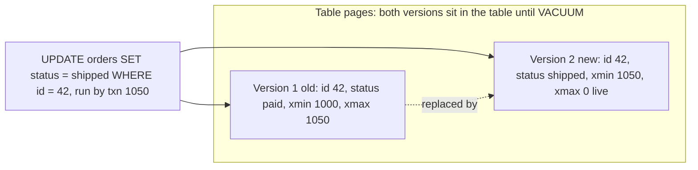
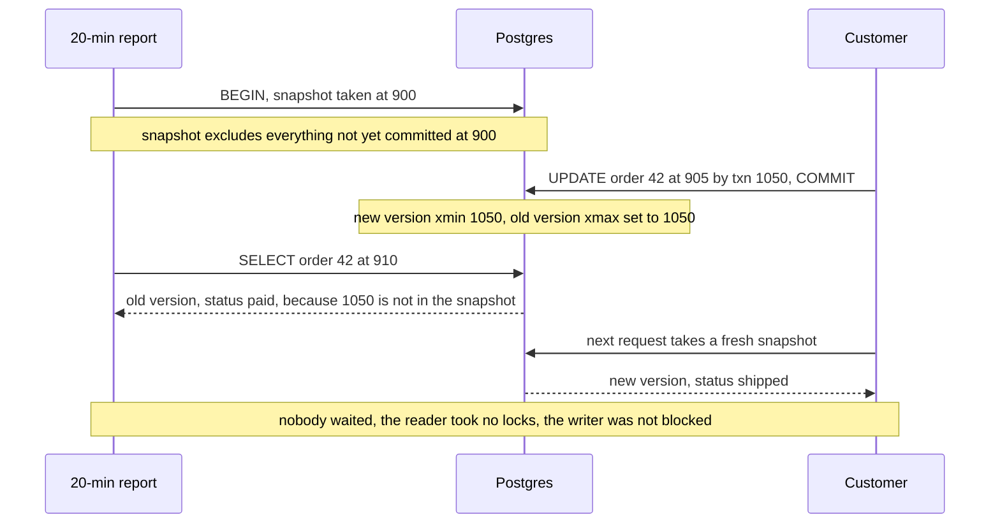
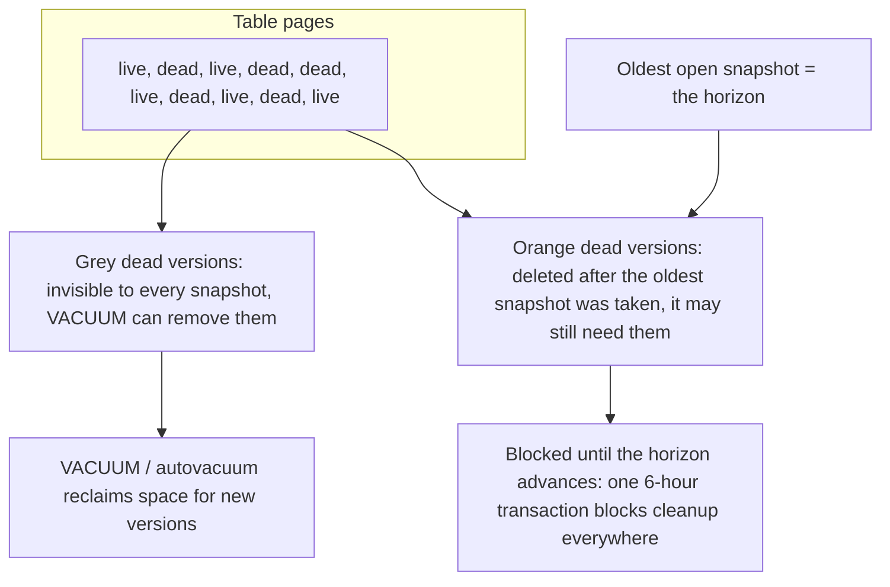
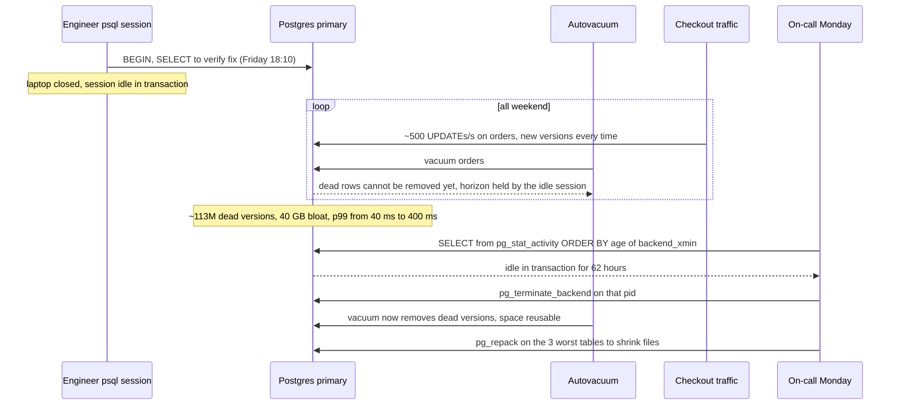

# Lesson 10: MVCC Explained — Row Versions, Snapshots, xmin/xmax & VACUUM

> **Prerequisites:** [Lesson 08: ACID Explained](../08-acid-explained/README.md), [Lesson 09: Isolation Levels & Write Skew](../09-isolation-levels-write-skew/README.md), and [Track: Databases](../README.md) overview.  
> **Estimated Reading Time:** 40 minutes  
> **Target Audience:** Backend engineers and SREs operating Postgres (or MySQL/Oracle) who need to understand why readers don't block writers, why tables bloat, and how one forgotten `BEGIN` can degrade an entire database.  
> **Free PDF Notes:** [Download SD-E-010.pdf](https://backendroadmap.com/notes/system-design/SD-E-010.pdf)

> [!NOTE]
> **In one line:** With multi-version concurrency control every write creates a new row version instead of overwriting, and every reader sees a consistent snapshot—readers never block writers and writers never block readers; the price is dead versions that `VACUUM` must clean up.

> [!TIP]
> **The Golden Rule of MVCC:** **Old versions are garbage only when no snapshot can still see them.** The oldest open transaction (the *horizon*) decides what `VACUUM` may remove—for the *whole database*. Keep transactions short, set `idle_in_transaction_session_timeout`, and watch dead tuples and `backend_xmin` age, or one forgotten `BEGIN` becomes a 40 GB table.

---

## Words You'll Meet Today

| Word | In Plain Words | Role in a Live Backend System |
| :--- | :--- | :--- |
| **MVCC** | Keep many row versions; readers use snapshots | Why a 20-minute report doesn't block checkouts |
| **Tuple** | One physical version of a row | What sits in the table page |
| **`xmin` / `xmax`** | ID of the transaction that created / deleted-or-replaced a version | Hidden columns on every Postgres row |
| **Snapshot** | Which transactions count as committed *for me* | Taken per statement (read committed) or per transaction (repeatable read) |
| **Dead tuple** | A version no snapshot can see | Garbage waiting for `VACUUM` |
| **`VACUUM` / autovacuum** | Removes dead tuples, reclaims space for reuse | Background janitor you must keep healthy |
| **Bloat** | Space wasted by dead versions | Slower scans, bigger indexes, full disks |
| **Idle in transaction** | An open transaction doing nothing | The classic cause of vacuum starvation |
| **Undo log** | Where MySQL/Oracle keep old versions | The alternative to in-table versions |

---

## Visual Mental Models & Architecture

### The Question: How Does a 20-Minute Report Coexist with Live Traffic?

The finance team runs a 20-minute analytics query on production Postgres, scanning every order. Meanwhile thousands of customers are placing new orders. In an old lock-based database, the report would block the writes, or the writes would block the report. In Postgres, **neither waits.** That is MVCC: keep several versions of a row; each reader sees whichever version was current for its snapshot. Readers never block writers, and writers never block readers. Only two writers changing the *same row* wait for each other (row locks, next lesson).

### An UPDATE Creates a New Version



*Figure 1. Step 1: set the old version's `xmax`. Step 2: insert a new version with a new `xmin`. Nothing is overwritten in place. Which version a reader sees depends on its snapshot.*

### Two Readers, Two Different Truths



*Figure 2. The report's snapshot is from 900, so at 910 it still reads the old version of order 42. The customer, with a newer snapshot, sees the new one.*

---

## Core Definition & Taxonomic Comparison

**What it is:** MVCC is a concurrency-control technique in which the database stores multiple versions of each row and serves each transaction the version consistent with its snapshot, so reads need no locks. **What it isn't:** "no locking at all" (two writers on the same row still wait), "free" (old versions cost space, I/O, and vacuum work), or "unbounded history" (versions are removed once no snapshot needs them).

### How Databases Keep Old Versions

| Engine | Where old versions live | How reads find them | Cleanup | Failure mode |
| :--- | :--- | :--- | :--- | :--- |
| **PostgreSQL** | In the table itself (new tuple per update) | Visibility check on `xmin`/`xmax` per tuple | `VACUUM` / autovacuum, page pruning | Table and index **bloat**; XID wraparound if vacuum starves |
| **MySQL InnoDB** | **Undo log**; row updated in place | Rebuild old row from undo records | Purge thread | Long transactions grow the undo history (history list length) |
| **Oracle** | **Undo segments** | Rebuild from undo | Undo retention | `ORA-01555 snapshot too old` |
| **SQL Server (RCSI/SI)** | **Version store in `tempdb`** | Follow version chain | Version cleanup task | `tempdb` growth |
| **Lock-based (classic)** | No versions; readers take shared locks | — | — | Readers and writers block each other |

### Postgres Row Header Fields

| Field | Meaning | You can see it with |
| :--- | :--- | :--- |
| `xmin` | Transaction ID that created this version | `SELECT xmin, * FROM t` |
| `xmax` | Transaction ID that deleted or replaced it (0 while live) | `SELECT xmax, * FROM t` |
| `ctid` | Physical location `(page, offset)` of this version | `SELECT ctid, * FROM t` |
| hint bits | Cached "creator committed/aborted" flags on the tuple | `pageinspect` (`t_infomask`) |

An `UPDATE` is really two steps: set the old version's `xmax`, and insert a new version with a new `xmin`. A `DELETE` only sets `xmax`.

**Business implication:** MVCC is why Postgres can serve OLTP and long reads on the same instance. It is also why "delete 100 million rows" does not free disk space immediately, and why a long-lived transaction is an operational hazard, not just a logical one.

---

## Component Breakdown & Anatomy

### The Visibility Rule

A transaction reads through a **snapshot**: the set of transactions that had committed at the moment it was taken (Postgres records it as `xmin:xmax:xip_list`, visible via `pg_current_snapshot()`). A row version is visible when:

```text
visible = creator (xmin) committed before the snapshot
      AND deleter (xmax) is empty, aborted, or not committed in the snapshot
```

| Version (id 42) | `xmin` | `xmax` | Report snapshot @900 sees? | Fresh snapshot @1060 sees? |
| :--- | :--- | :--- | :--- | :--- |
| v1: status = paid | 1000 (committed) | 1050 (committed after 900) | **Yes** (deleter not in snapshot) | No (deleter committed) |
| v2: status = shipped | 1050 (committed after 900) | 0 | No (creator not in snapshot) | **Yes** |

In Postgres, **read committed** takes a new snapshot for *each statement*; **repeatable read** keeps one snapshot for the *whole transaction* (Lesson 09).

### Worked Timeline

- **900:** the report starts and takes its snapshot.
- **905:** a customer updates order 42. Postgres writes a new version, created by transaction 1050, and sets the old version's `xmax` to 1050.
- **910:** the report reaches order 42. Transaction 1050 is not in its snapshot, so the new version is invisible and the old one is still visible. It reads the old version.
- The customer's next request takes a fresh snapshot, which includes 1050, and sees the new version. **Nobody waited.**

### The Cost: Dead Versions and VACUUM

Old row versions that no running transaction can see any more are garbage. They bloat tables and indexes and slow scans. `VACUUM`, usually run automatically by **autovacuum**, removes them and makes the space reusable (it does **not** normally return space to the OS; `VACUUM FULL` or `pg_repack` rewrite the table).



*Figure 3. Grey dead versions are invisible to all snapshots and can go. Orange ones were deleted after the oldest open snapshot was taken, so that snapshot may still need them.*

The catch: `VACUUM` can remove a version only once **no snapshot could still need it**. A very long transaction, or a session left `idle in transaction`, holds back cleanup for the **whole database**, not just its own tables. The same applies to a replication slot, a lagging `hot_standby_feedback` replica, or an orphaned prepared transaction.

### HOT Updates and Index Write Amplification

Each `UPDATE` writes a new heap tuple, and normally a new entry in **every index** on the table—unless it qualifies as a **HOT** (heap-only tuple) update: no indexed column changed *and* the new version fits on the same page. HOT updates skip index writes and let page pruning reclaim space without a full `VACUUM`. Lower `fillfactor` (e.g., 80–90) leaves room on pages for HOT.

| Update type | Heap writes | Index writes (5 indexes) | Total |
| :--- | :--- | :--- | :--- |
| Non-HOT | 1 | 5 | 6 |
| HOT | 1 | 0 | 1 |
| No-op skipped (`WHERE … IS DISTINCT FROM …`) | 0 | 0 | 0 |

### The Observability Gap: Who Sees Bloat and the Horizon?

| Measurement Point | What It Captures | What It Hides |
| :--- | :--- | :--- |
| **`pg_stat_user_tables`** (`n_dead_tup`, `last_autovacuum`) | Estimated dead tuples and last vacuum time per table | It's an *estimate*; says nothing about index bloat or **why** vacuum can't remove rows |
| **`pg_stat_activity`** (`state`, `xact_start`, `backend_xmin`) | Long and `idle in transaction` sessions | Horizon holders that aren't sessions: replication slots, prepared transactions |
| **`pg_replication_slots`, `pg_prepared_xacts`** | Slot `xmin`/`catalog_xmin`, orphaned 2PC | Their effect on specific tables |
| **`pgstattuple` / `pgstatindex`** | Exact dead-tuple and free-space measurements | Expensive full scans; not for hot paths |
| **`log_autovacuum_min_duration`** logs | How long each vacuum ran and what it removed ("tuples: N dead but not yet removable") | Trends unless shipped to a dashboard |
| **Query latency (p95/p99)** | Symptoms: slower scans | Cause; looks like "the database got slow" |

The key log phrase is **"dead but not yet removable"**: vacuum ran, but the horizon blocked it.

---

## Mathematical Model & Worked Scale

### When Does Autovacuum Trigger?

$$\text{dead tuples} > \text{autovacuum\_vacuum\_threshold} + \text{autovacuum\_vacuum\_scale\_factor} \times \text{reltuples}$$

Defaults: threshold $=50$, scale factor $=0.2$.

| Table size (rows) | Dead tuples before default autovacuum | With `scale_factor = 0.01` |
| :--- | :--- | :--- |
| 1 million | 200,050 | 10,050 |
| 100 million | 20,000,050 (**20% bloat** first) | 1,000,050 |
| 1 billion | 200,000,050 | 10,000,050 |

On large hot tables, set per-table scale factors much lower.

### Worked Example: A 6-Hour Idle Transaction

A 1-million-row `orders` table, row ≈ 128 bytes per tuple including header, updated at $u = 500$ updates/s. While a session holds the horizon for $T = 6\,\text{h} = 21{,}600$ s, no dead version can be reclaimed:

$$\text{dead versions} = u \times T = 500 \times 21{,}600 = 10.8 \times 10^{6}$$

$$\text{bloat} = 10.8\text{M} \times 128\ \text{B} \approx 1.38\ \text{GB} \quad\text{vs live data} = 10^6 \times 128\ \text{B} = 128\ \text{MB}$$

$$\frac{128\ \text{MB} + 1.38\ \text{GB}}{128\ \text{MB}} \approx 11.8\times \text{ the real size}$$

An 8 KB page holds ~63 such tuples, so a scan now reads ≈ 12× more pages: query times scale accordingly, and index scans touch dead entries too.

### Diagnosing "1 Million Rows, 40 GB"

$$\frac{40\ \text{GB}}{128\ \text{B/tuple}} \approx 312\times 10^{6}\ \text{tuple slots} \qquad \text{live fraction} = \frac{10^6}{312\times10^6} \approx 0.3\%$$

Over 99.6% of the table is dead versions or free space: classic bloat from a blocked or starved vacuum.

### Transaction ID Wraparound

Postgres transaction IDs are 32 bits; comparisons are circular, so only about $2^{31}$ IDs are "in the past." Only transactions that **write** consume an ID.

$$t_{\text{wrap}} = \frac{2^{31}}{\text{write txns/s}} = \frac{2.147\times10^9}{5{,}000} \approx 4.3\times10^5\ \text{s} \approx 5\ \text{days}$$

`autovacuum_freeze_max_age` (default 200 million) forces an anti-wraparound vacuum long before that:

$$\frac{2\times10^{8}}{5{,}000} = 40{,}000\ \text{s} \approx 11\ \text{hours}$$

If vacuum is blocked or disabled until the limit, Postgres stops accepting writes to protect data—an outage that only a (long) vacuum fixes.

---

## Metrics, Percentiles & Numbers Engineers Must Know

| Metric | Healthy value | Danger sign |
| :--- | :--- | :--- |
| Longest open transaction | seconds | > 5 minutes (alert), hours (incident) |
| `idle in transaction` sessions older than 1 min | 0 | Any count that grows |
| Dead tuple ratio per table | < 10–20% | > 30–50% and growing |
| `age(backend_xmin)` of oldest session | small, bounded | millions and rising |
| Autovacuum per big table | completes in minutes–hours | never finishes / constantly running, "not yet removable" |
| `age(datfrozenxid)` | < 200M | > 1 billion |
| MySQL history list length | thousands | millions |
| Table size vs live data estimate | ~1–1.5× | > 3× |

| Percentile | Who feels it | MVCC meaning |
| :--- | :--- | :--- |
| $p_{50}$ | Typical query | Pages mostly live, cached |
| $p_{95}$ | Bad day for 1 in 20 | Scans over moderately bloated tables |
| $p_{99}$ | Worst users | Heavily bloated table scans; vacuum I/O competing; autovacuum cost delays |

---

## Hierarchical Budgets & Mitigations

| Tier | Latency budget (example 200 ms API) | Role |
| :--- | :--- | :--- |
| Gateway / auth | 10–20 ms | JWT, rate limit |
| Service logic | 20–40 ms | Orchestration |
| Cache | 1–5 ms | Hot reads |
| **Database** | **30–80 ms** | Needs healthy (non-bloated) pages |
| Headroom | ~40 ms | Vacuum I/O contention, spikes |

| # | Mitigation | Prevents | Caveat |
| :--- | :--- | :--- | :--- |
| 1 | **Keep transactions short;** never hold one while waiting for a user or an external API | Horizon pinned | Needs code discipline |
| 2 | `idle_in_transaction_session_timeout = '5min'` | Forgotten `BEGIN` | Kills sessions; clients must reconnect |
| 3 | `statement_timeout` / `transaction_timeout` (PG 17+) for app roles | Runaway queries and transactions | Tune per workload |
| 4 | Monitor `n_dead_tup`, `last_autovacuum`, `backend_xmin` age, slot lag | Silent bloat | Dashboards and alerts |
| 5 | Per-table autovacuum tuning (`scale_factor`, `cost_limit`) on hot tables | Late/slow vacuum | More vacuum I/O |
| 6 | Run heavy analytics on a **read replica** | Primary I/O and horizon | `hot_standby_feedback` can push the horizon back to the primary |
| 7 | Avoid pointless updates; skip no-ops; avoid per-request "last seen" columns on heavily indexed tables | Version churn and index writes | Query changes |
| 8 | Lower `fillfactor` on update-heavy tables to enable HOT | Index write amplification | Larger table footprint |
| 9 | `pg_repack` (or partition + drop) to reclaim space | Existing bloat | `VACUUM FULL` takes `ACCESS EXCLUSIVE`, so avoid it online |

---

## Production War Story: The Forgotten BEGIN

- **Severity:** SEV-2 (latency regression; disk near full; no data loss)
- **Detection / Resolution:** ~63 hours to detection (disk and p99 alerts on Monday); 4 hours to vacuum catch-up; 2 days of `pg_repack` on the worst tables
- **Impact:** ~40 GB of table and index bloat across 6 hot tables; checkout p99 from 40 ms to 400 ms; storage at 92%

### What Happened

On Friday at 18:10 an engineer connected to the production primary from a bastion, ran `BEGIN; SELECT … ;` to verify a data fix, got paged for something else, and closed the laptop without `COMMIT` or `ROLLBACK`. The session sat **idle in transaction** for the whole weekend. Its snapshot pinned the horizon, so autovacuum ran repeatedly on `orders`, logged "N dead row versions cannot be removed yet," and reclaimed nothing. At ~500 updates/s on `orders` alone, roughly 113 million dead versions (≈ 14 GB) piled up over ~63 hours; other hot tables added the rest.



### Root Cause & Fix

1. **One idle-in-transaction session pinned the cleanup horizon for the entire database.**
2. **No `idle_in_transaction_session_timeout`** and no alert on transaction age; disk and p99 alerts fired only after the damage.
3. **Engineers had write-capable ad-hoc access** to the primary with autocommit off.
4. **Fix:** `idle_in_transaction_session_timeout = '5min'` for all roles; alert when the oldest transaction exceeds 5 minutes; read-only replica role for investigation (`default_transaction_read_only = on`); per-table autovacuum tuning for `orders`; `pg_repack` to shrink bloated files; runbook line "check `backend_xmin` age first whenever vacuum looks ineffective."

---

## Multi-Language Production Implementation

Two production habits: a **stale-transaction probe** (what pins your horizon) and a **no-op-skipping update** (fewer versions)—Go, TypeScript, Python, C#:

````carousel
```go
package mvcc

import (
	"context"
	"database/sql"
)

type StaleTxn struct {
	PID      int
	State    string
	AgeSecs  float64
	App      string
	Query    string
}

// FindStaleTransactions returns sessions whose transaction has been open longer than thresholdSecs.
// These are the sessions that hold back VACUUM for the whole database.
func FindStaleTransactions(ctx context.Context, db *sql.DB, thresholdSecs float64) ([]StaleTxn, error) {
	rows, err := db.QueryContext(ctx, `
		SELECT pid, state, EXTRACT(EPOCH FROM now() - xact_start)::float8 AS age_s,
		       coalesce(application_name, ''), left(query, 80)
		FROM pg_stat_activity
		WHERE xact_start IS NOT NULL
		  AND pid <> pg_backend_pid()
		  AND now() - xact_start > make_interval(secs => $1)
		ORDER BY xact_start
		LIMIT 20`, thresholdSecs)
	if err != nil {
		return nil, err
	}
	defer rows.Close()
	var out []StaleTxn
	for rows.Next() {
		var s StaleTxn
		if err := rows.Scan(&s.PID, &s.State, &s.AgeSecs, &s.App, &s.Query); err != nil {
			return nil, err
		}
		out = append(out, s)
	}
	return out, rows.Err()
}

// MarkShipped skips the write entirely if the status is already 'shipped':
// no new row version, no index entries, no vacuum work.
func MarkShipped(ctx context.Context, db *sql.DB, orderID int64) (bool, error) {
	res, err := db.ExecContext(ctx,
		`UPDATE orders SET status = 'shipped'
		 WHERE id = $1 AND status IS DISTINCT FROM 'shipped'`, orderID)
	if err != nil {
		return false, err
	}
	n, _ := res.RowsAffected()
	return n == 1, nil
}
```
<!-- slide -->
```typescript
import { Pool } from "pg";

export type StaleTxn = { pid: number; state: string; ageSecs: number; app: string; query: string };

// Sessions whose transaction has been open longer than thresholdSecs hold back VACUUM everywhere.
export async function findStaleTransactions(
  pool: Pool,
  thresholdSecs: number,
): Promise<StaleTxn[]> {
  const { rows } = await pool.query(
    `SELECT pid, state, EXTRACT(EPOCH FROM now() - xact_start)::float8 AS age_s,
            coalesce(application_name, '') AS app, left(query, 80) AS query
     FROM pg_stat_activity
     WHERE xact_start IS NOT NULL
       AND pid <> pg_backend_pid()
       AND now() - xact_start > make_interval(secs => $1)
     ORDER BY xact_start
     LIMIT 20`,
    [thresholdSecs],
  );
  return rows.map((r) => ({
    pid: r.pid, state: r.state, ageSecs: r.age_s, app: r.app, query: r.query,
  }));
}

// Skip no-op writes: no new row version, no index entries, no vacuum work.
export async function markShipped(pool: Pool, orderId: number): Promise<boolean> {
  const res = await pool.query(
    `UPDATE orders SET status = 'shipped'
     WHERE id = $1 AND status IS DISTINCT FROM 'shipped'`,
    [orderId],
  );
  return res.rowCount === 1;
}
```
<!-- slide -->
```python
from __future__ import annotations
import psycopg
from psycopg.rows import dict_row


def find_stale_transactions(conn: psycopg.Connection, threshold_secs: float) -> list[dict]:
    """Sessions with transactions open longer than threshold hold back VACUUM everywhere."""
    with conn.cursor(row_factory=dict_row) as cur:
        cur.execute(
            """SELECT pid, state,
                      EXTRACT(EPOCH FROM now() - xact_start)::float8 AS age_s,
                      coalesce(application_name, '') AS app,
                      left(query, 80) AS query
               FROM pg_stat_activity
               WHERE xact_start IS NOT NULL
                 AND pid <> pg_backend_pid()
                 AND now() - xact_start > make_interval(secs => %s)
               ORDER BY xact_start
               LIMIT 20""",
            (threshold_secs,),
        )
        return cur.fetchall()


def mark_shipped(conn: psycopg.Connection, order_id: int) -> bool:
    """Skip no-op writes: no new row version, no index entries, no vacuum work."""
    with conn.transaction():
        with conn.cursor() as cur:
            cur.execute(
                """UPDATE orders SET status = 'shipped'
                   WHERE id = %s AND status IS DISTINCT FROM 'shipped'""",
                (order_id,),
            )
            return cur.rowcount == 1
```
<!-- slide -->
```csharp
using Npgsql;

public record StaleTxn(int Pid, string State, double AgeSecs, string App, string Query);

public static class MvccOps
{
    // Sessions with transactions open longer than thresholdSecs hold back VACUUM everywhere.
    public static async Task<List<StaleTxn>> FindStaleTransactionsAsync(
        NpgsqlDataSource ds, double thresholdSecs, CancellationToken ct)
    {
        await using var cmd = ds.CreateCommand(@"
            SELECT pid, state, EXTRACT(EPOCH FROM now() - xact_start)::float8 AS age_s,
                   coalesce(application_name, ''), left(query, 80)
            FROM pg_stat_activity
            WHERE xact_start IS NOT NULL
              AND pid <> pg_backend_pid()
              AND now() - xact_start > make_interval(secs => @t)
            ORDER BY xact_start
            LIMIT 20");
        cmd.Parameters.AddWithValue("t", thresholdSecs);
        var list = new List<StaleTxn>();
        await using var r = await cmd.ExecuteReaderAsync(ct);
        while (await r.ReadAsync(ct))
        {
            list.Add(new StaleTxn(r.GetInt32(0), r.GetString(1), r.GetDouble(2),
                                  r.GetString(3), r.GetString(4)));
        }
        return list;
    }

    // Skip no-op writes: no new row version, no index entries, no vacuum work.
    public static async Task<bool> MarkShippedAsync(
        NpgsqlDataSource ds, long orderId, CancellationToken ct)
    {
        await using var cmd = ds.CreateCommand(
            @"UPDATE orders SET status = 'shipped'
              WHERE id = @id AND status IS DISTINCT FROM 'shipped'");
        cmd.Parameters.AddWithValue("id", orderId);
        return await cmd.ExecuteNonQueryAsync(ct) == 1;
    }
}
```
````

---

## Practical Hands-On CLI Verification

```bash
# 1. See xmin / xmax / ctid change with an UPDATE: a new physical version appears
psql <<'SQL'
CREATE TABLE orders (id int PRIMARY KEY, status text);
INSERT INTO orders VALUES (42, 'paid');
SELECT xmin, xmax, ctid, * FROM orders WHERE id = 42;   -- e.g. xmin=1000 xmax=0 ctid=(0,1)
UPDATE orders SET status = 'shipped' WHERE id = 42;
SELECT xmin, xmax, ctid, * FROM orders WHERE id = 42;   -- new xmin, new ctid (0,2): a new version
SQL

# 2. Look at BOTH versions on the page (old one is dead but still physically there)
psql <<'SQL'
CREATE EXTENSION IF NOT EXISTS pageinspect;
SELECT lp, t_xmin, t_xmax, t_ctid FROM heap_page_items(get_raw_page('orders', 0));
SQL

# 3. Snapshot demo with two sessions
# A: BEGIN ISOLATION LEVEL REPEATABLE READ;  SELECT status FROM orders WHERE id=42;   -- shipped
# B: UPDATE orders SET status='delivered' WHERE id=42;                                -- no blocking
# A: SELECT status FROM orders WHERE id=42;   -- still 'shipped' (A's snapshot)
# A: SELECT pg_current_snapshot();            -- xmin:xmax:xip_list
# A: COMMIT;  SELECT status FROM orders WHERE id=42;   -- now 'delivered'
```

```bash
# 4. Is something holding the horizon? Oldest transactions first
psql -c "SELECT pid, state, now()-xact_start AS xact_age, age(backend_xmin) AS xmin_age, left(query,60)
         FROM pg_stat_activity WHERE backend_xmin IS NOT NULL OR xact_start IS NOT NULL
         ORDER BY xact_start LIMIT 10;"
psql -c "SELECT slot_name, active, xmin, catalog_xmin FROM pg_replication_slots;"
psql -c "SELECT gid, prepared, owner FROM pg_prepared_xacts;"

# 5. Dead tuples and vacuum history
psql -c "SELECT relname, n_live_tup, n_dead_tup,
                round(100.0*n_dead_tup/greatest(n_live_tup+n_dead_tup,1),1) AS dead_pct,
                last_autovacuum
         FROM pg_stat_user_tables ORDER BY n_dead_tup DESC LIMIT 10;"
psql -c "VACUUM (VERBOSE) orders;"     # look for 'dead but not yet removable'

# 6. Guard rails
psql -c "ALTER SYSTEM SET idle_in_transaction_session_timeout = '5min';"
psql -c "SELECT pg_reload_conf();"
psql -c "ALTER TABLE orders SET (autovacuum_vacuum_scale_factor = 0.01, fillfactor = 85);"

# 7. Emergency: terminate the session pinning the horizon
psql -c "SELECT pg_terminate_backend(12345);"
```

```bash
python3 -c "
u, T, tup = 500, 6*3600, 128
dead = u*T
print(f'dead versions = {dead:,}  bloat = {dead*tup/1e9:.2f} GB  vs live {1e6*tup/1e6:.0f} MB')
print(f'size multiple = {(dead+1e6)/1e6:.1f}x')
print(f'wraparound at 5000 wtx/s: {2**31/5000/86400:.1f} days; freeze_max_age: {2e8/5000/3600:.1f} h')
"
```

---

## Common Mistakes to Avoid

1. **Leaving a transaction open** in a console or a connection pool ("idle in transaction") for hours.
2. **Disabling or starving autovacuum** on busy tables, then wondering why the table is 10× its real size.
3. **Thinking MVCC removes all locking:** two writers on the same row still wait.
4. **Updating a column on every request** (a "last seen" timestamp) on a heavily indexed table, creating a version and index entries per request.
5. **Expecting `DELETE` or plain `VACUUM` to shrink files.** They free space for reuse; shrinking needs `pg_repack` or a table rewrite.
6. **Running `VACUUM FULL` online;** it takes `ACCESS EXCLUSIVE` and blocks all access (Lesson 11).
7. **Running the 20-minute report on the primary** with `hot_standby_feedback` and long replica queries pushing the horizon back anyway.
8. **Ignoring slots and prepared transactions** when hunting the horizon: an abandoned replication slot or orphaned `PREPARE TRANSACTION` pins cleanup like an idle session.

---

## Key Terms Glossary

| Term | Interview-ready definition |
| :--- | :--- |
| MVCC | Keeping multiple row versions so readers use snapshots and don't block writers |
| Tuple | One physical version of a row |
| `xmin` / `xmax` | Creating / deleting-or-replacing transaction ID of a row version |
| Snapshot | The set of transactions considered committed for a given reader |
| Dead tuple | A row version no snapshot can see any more |
| `VACUUM` | Removes dead tuples and makes their space reusable |
| Bloat | Disk space wasted by dead versions and free space in tables/indexes |
| Idle in transaction | An open transaction not currently running a statement |
| Horizon | The oldest snapshot that still needs old versions; limits cleanup |
| Undo log | MySQL/Oracle storage for old row versions, used to rebuild them on read |
| HOT update | Update that creates no new index entries because no indexed column changed |

---

## Interview Practice Questions

### Basic Conceptual Questions (Q1–Q4)

<details>
<summary><strong>Q1: How does MVCC let readers and writers avoid blocking each other? [BASIC]</strong></summary>

<strong>What a strong answer covers:</strong>
Writes never update rows in place; each creates a new version tagged with the IDs of the transactions that created and deleted it. Each transaction reads from a snapshot and sees only versions committed before it. Readers need no locks, and writers don't wait for readers.

</details>

<details>
<summary><strong>Q2: What are `xmin` and `xmax`? [BASIC]</strong></summary>

<strong>What a strong answer covers:</strong>
Hidden Postgres fields on every row version: `xmin` is the transaction that created it, `xmax` the one that deleted or replaced it (0 while live). An `UPDATE` sets the old version's `xmax` and inserts a new version with a new `xmin`; a `DELETE` only sets `xmax`.

</details>

<details>
<summary><strong>Q3: What does VACUUM do, and why is it needed? [BASIC]</strong></summary>

<strong>What a strong answer covers:</strong>
It removes dead row versions that no snapshot can see any more and makes their space reusable. Without it, every update leaves garbage behind and tables and indexes grow without limit (and transaction IDs eventually wrap around). Autovacuum runs it automatically.

</details>

<details>
<summary><strong>Q4: When is a row version visible to a transaction? How do read committed and repeatable read differ? [BASIC]</strong></summary>

<strong>What a strong answer covers:</strong>
Visible when its creator (`xmin`) committed before the snapshot and its deleter (`xmax`) is empty, aborted, or not committed in the snapshot. Read committed takes a **new snapshot per statement**; repeatable read keeps **one snapshot for the whole transaction**, which is why it gives consistent multi-query reports but holds back vacuum for longer.

</details>

### Scenario-Based Architecture Questions (Q5–Q8)

<details>
<summary><strong>Q5: A table with 1 million live rows takes 40 GB on disk and is slow to scan. What's going on? [SCENARIO]</strong></summary>

<strong>What a strong answer covers:</strong>
Bloat: dead versions far outnumber live ones. Check `pg_stat_user_tables` for dead tuples and the last autovacuum time, look for long or idle-in-transaction sessions (and replication slots) holding the horizon back, and tune autovacuum for that table. Reclaim space with `pg_repack` after the cause is fixed.

</details>

<details>
<summary><strong>Q6: Someone left a psql session open with BEGIN for 6 hours. Why does that hurt other tables? [SCENARIO]</strong></summary>

<strong>What a strong answer covers:</strong>
Its snapshot might still need old versions anywhere in the database, so `VACUUM` cannot remove any version deleted after that snapshot was taken. Bloat grows everywhere. Terminate the session, and set `idle_in_transaction_session_timeout`, e.g. 5 minutes, plus an alert on transaction age.

</details>

<details>
<summary><strong>Q7: Where should the 20-minute finance report run? [SCENARIO]</strong></summary>

<strong>What a strong answer covers:</strong>
On a read replica. On the primary it competes for I/O and its long snapshot holds back cleanup. Note: with `hot_standby_feedback` on, a long replica query can still hold back vacuum on the primary; without it, the replica may cancel the query on replay conflicts (`max_standby_streaming_delay`). Choose per workload.

</details>

<details>
<summary><strong>Q8: A `sessions` table has a `last_seen` timestamp updated on every request and 4 indexes. Writes are slow and the table bloats. What do you do? [SCENARIO]</strong></summary>

<strong>What a strong answer covers:</strong>
Each update writes a new tuple and, because no HOT is possible if an indexed column changes or the page is full, up to 4 index entries. Fixes: don't index `last_seen`; lower `fillfactor` so HOT works; throttle updates (only if older than 1 minute); move hot counters to a narrow separate table or Redis; and tune autovacuum for that table.

</details>

### Advanced & Tricky Interview Questions (Q9–Q12)

<details>
<summary><strong>Q9: Do two transactions updating the same row ever wait under MVCC? [TRICKY]</strong></summary>

<strong>What a strong answer covers:</strong>
Yes. MVCC removes reader-writer blocking only. The second writer waits on the first's row lock until it commits or aborts; if the first commits, a repeatable-read writer then fails with a serialization error, while a read-committed writer re-evaluates the row and proceeds.

</details>

<details>
<summary><strong>Q10: How do MySQL and Oracle differ from Postgres here? [TRICKY]</strong></summary>

<strong>What a strong answer covers:</strong>
They update the row in place and keep the old versions in undo logs, building older versions from undo when a snapshot needs them. Postgres keeps old versions in the table itself, hence `VACUUM`. Either way, long transactions make the old-version history grow (undo growth, `ORA-01555`, or bloat).

</details>

<details>
<summary><strong>Q11: You ran `DELETE` on 100 million rows and `VACUUM`, but the table file is still huge. Why, and what do you do? [TRICKY]</strong></summary>

<strong>What a strong answer covers:</strong>
Plain `VACUUM` marks space reusable inside the file; it only truncates empty pages at the very end. The file keeps its size. To shrink, use `pg_repack` (online) or `VACUUM FULL` (rewrites under `ACCESS EXCLUSIVE`, an outage). For recurring bulk deletes, use time-based partitions and `DROP`/`DETACH` old partitions instead.

</details>

<details>
<summary><strong>Q12: What is transaction ID wraparound and how does MVCC cause it? [TRICKY]</strong></summary>

<strong>What a strong answer covers:</strong>
Postgres XIDs are 32-bit and compared circularly, so a row created more than ~2 billion transactions ago would suddenly look "in the future" and vanish. Vacuum **freezes** old tuples to prevent this. If vacuum is blocked (long transaction, slot) or disabled, the database eventually refuses new writes to protect data. At 5,000 write txns/s the limit is ~5 days away; anti-wraparound vacuum starts at 200 million (~11 hours).

</details>

---

## One-Page Master Cheat Sheet

```text
====================================================================================================
          MVCC EXPLAINED — ROW VERSIONS, SNAPSHOTS, xmin/xmax & VACUUM — CHEAT SHEET (SD-E-010)
====================================================================================================
IDEA     writes create NEW versions · readers see a consistent SNAPSHOT
         readers never block writers · writers never block readers · same-row writers still wait

POSTGRES ROW VERSION
  xmin = creator txn · xmax = deleter/replacer txn (0 = live) · ctid = physical position
  UPDATE = set old xmax + insert new tuple (new xmin)   ·   DELETE = set xmax only

VISIBLE = xmin committed before snapshot  AND  xmax empty / aborted / not in snapshot
  read committed: snapshot per STATEMENT   ·   repeatable read: ONE snapshot per transaction

COST
  dead versions -> bloat (tables + indexes) -> VACUUM removes ONLY what no snapshot can see
  oldest open snapshot = HORIZON: one 6-hour idle txn blocks cleanup for the WHOLE database
  6 h x 500 updates/s x 128 B = 10.8M dead tuples = 1.38 GB  (~12x a 128 MB table)

OPERATE
  short transactions · idle_in_transaction_session_timeout='5min' · alert on txn age
  watch n_dead_tup, last_autovacuum, backend_xmin, replication slots, "dead but not yet removable"
  per-table autovacuum scale_factor 0.01 for big hot tables · analytics on replicas
  skip no-op updates · HOT via fillfactor · pg_repack (not VACUUM FULL online)

OTHER ENGINES   MySQL/Oracle: undo logs (in-place update)   ·   SQL Server: tempdb version store

ANTI-PATTERNS
  x idle in transaction     x disabled autovacuum     x 'last seen' on every request
  x VACUUM FULL online      x ignoring slots/prepared xacts     x report on the primary
====================================================================================================
```

---

## Free PDF notes

[SD-E-010.pdf](https://backendroadmap.com/notes/system-design/SD-E-010.pdf)

---

## Sources

- PostgreSQL documentation — Concurrency Control (MVCC); Routine Vacuuming; Database Page Layout; `pageinspect`.  
- Bernstein, P., Goodman, N. — Multiversion Concurrency Control: Theory and Algorithms (1983).  
- MySQL documentation — InnoDB Multi-Versioning; Undo Logs.  
- Oracle documentation — Read Consistency and Undo Segments.  
- Suzuki, H. — *The Internals of PostgreSQL*, Chapter 5: Concurrency Control.

---

## Next

Next: [Lesson 11: Database Locks & Deadlocks](../11-database-locks-deadlocks/README.md). Track overview: [Databases](../README.md).
