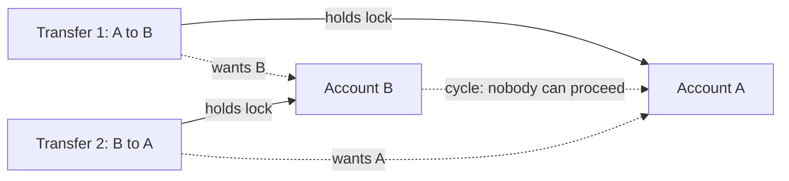
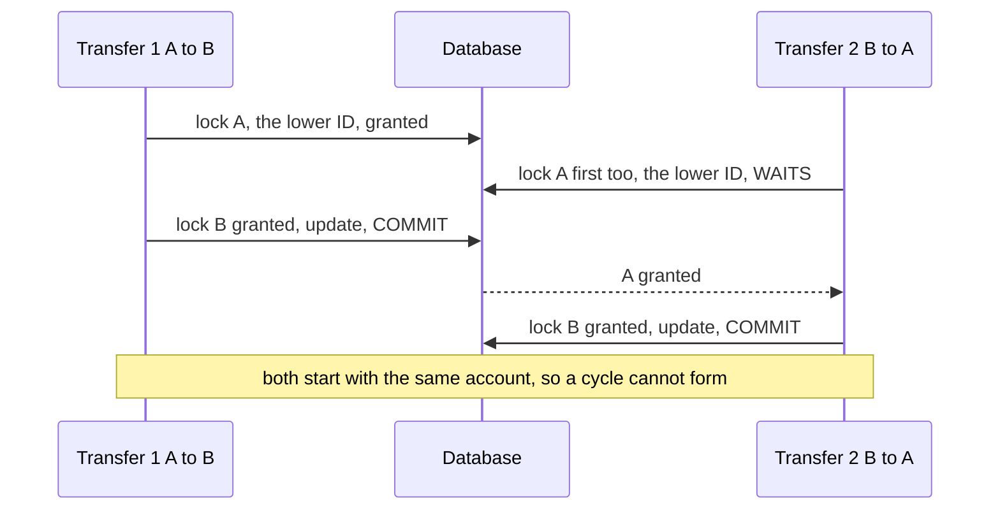
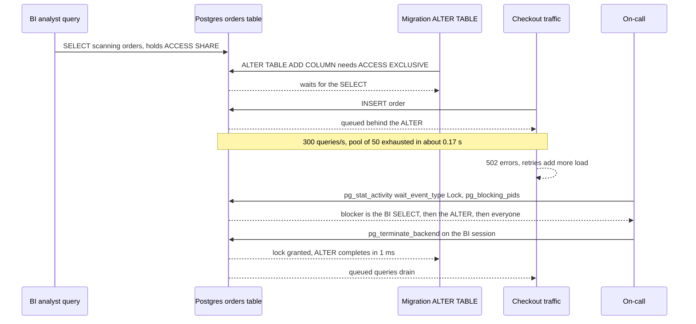

# Lesson 11: Database Locks & Deadlocks — Shared vs Exclusive, Lock Ordering

> **Prerequisites:** [Lesson 09: Isolation Levels & Write Skew](../09-isolation-levels-write-skew/README.md), [Lesson 10: MVCC Explained](../10-mvcc-explained/README.md), and [Track: Databases](../README.md) overview.  
> **Estimated Reading Time:** 35–40 minutes  
> **Target Audience:** Backend engineers writing multi-row transactions (transfers, inventory, job queues), running schema migrations on live tables, and debugging `deadlock detected` and mysterious blocking in production.  
> **Free PDF Notes:** [Download SD-E-011.pdf](https://backendroadmap.com/notes/system-design/SD-E-011.pdf)

> [!NOTE]
> **In one line:** Databases protect concurrent writes with shared and exclusive locks; a deadlock is a cycle of transactions each waiting for a lock the other holds—the database breaks it by aborting one, and you prevent it by always locking in the same order.

> [!TIP]
> **The Golden Rule of Locks:** **Acquire locks in one global order, hold them for as short a time as possible, and never wait on anything slow while holding one.** Treat `deadlock detected` as an *expected, retryable* event (retry the whole transaction), and put a `lock_timeout` on every migration so a queued `ALTER TABLE` can never take the site down.

---

## Words You'll Meet Today

| Word | In Plain Words | Role in a Live Backend System |
| :--- | :--- | :--- |
| **Shared lock (S)** | Many holders at once; for reading; blocks writers | `SELECT … FOR SHARE`, FK checks |
| **Exclusive lock (X)** | One holder; for writing; blocks every other locker | `UPDATE`/`DELETE`, `SELECT … FOR UPDATE` |
| **Row lock / table lock** | Protects one row / the whole table | Row for transfers, table for `ALTER TABLE` |
| **Deadlock** | A cycle of transactions waiting on each other | Two opposite-direction transfers |
| **Lock ordering** | Always acquire locks in one global order | Lock the lower account ID first |
| **Lock escalation** | Many row locks become one table lock | SQL Server at ~5,000 locks; not Postgres |
| **`lock_timeout`** | Give up waiting for a lock after N | Saves you from queued migrations |
| **`SKIP LOCKED`** | Skip rows already locked by others | Multi-worker job queues |
| **`deadlock_timeout`** | Postgres waits this long (1 s) before running the cycle check | Why deadlocks cost at least a second |

---

## Visual Mental Models & Architecture

### The Question: Why Did Two Transfers Freeze Each Other?

Two transfers run at the same moment. **Transfer 1** moves money from account A to B. **Transfer 2** moves money from B to A. Each locks its source account first, then waits for the other's. Forever. That is a deadlock.



*Figure 1. Transfer 1 holds A and wants B; Transfer 2 holds B and wants A. The waits form a cycle; only aborting one transaction breaks it.*

### The Fix: One Global Order



*Figure 2. With a global order (lowest ID first), Transfer 2 waits at step 2 instead of grabbing B. It proceeds as soon as Transfer 1 commits: a few milliseconds of waiting instead of an abort.*

---

## Core Definition & Taxonomic Comparison

**What it is:** A lock is a database-managed permission that serializes conflicting access to a row, page, or table; a deadlock is a circular wait among transactions that no amount of waiting can resolve. **What it isn't:** a bug (deadlocks are normal under concurrency), nor something MVCC removes (writers still wait for writers; plain reads don't lock rows).

### Lock Compatibility (Shared vs Exclusive)

| Lock requested → / held ↓ | Shared (S) | Exclusive (X) |
| :--- | :--- | :--- |
| **S held** | granted | waits |
| **X held** | waits | waits |

Only shared + shared can be held together: many readers can share a lock; one writer excludes everyone else who wants one.

### What Takes What in Postgres

| Statement | Row lock | Notes |
| :--- | :--- | :--- |
| plain `SELECT` | **none** | MVCC: never blocks or is blocked by row writers |
| `UPDATE` (non-key columns) | `FOR NO KEY UPDATE` | Exclusive until commit; allows concurrent FK checks |
| `UPDATE` (key columns) / `DELETE` | `FOR UPDATE` | Exclusive until commit |
| `SELECT … FOR UPDATE` | `FOR UPDATE` | The same lock, taken explicitly |
| `SELECT … FOR SHARE` / `FOR KEY SHARE` | shared | Blocks writers; FK checks use `KEY SHARE` |

### Table-Level Lock Modes You Will Actually Meet

| Mode | Taken by | Conflicts with |
| :--- | :--- | :--- |
| `ACCESS SHARE` | plain `SELECT` | only `ACCESS EXCLUSIVE` |
| `ROW SHARE` | `SELECT … FOR UPDATE/SHARE` | `EXCLUSIVE`, `ACCESS EXCLUSIVE` |
| `ROW EXCLUSIVE` | `INSERT`/`UPDATE`/`DELETE` | `SHARE` and stronger |
| `SHARE UPDATE EXCLUSIVE` | `VACUUM`, `CREATE INDEX CONCURRENTLY` | itself, `SHARE` and stronger |
| `SHARE` | `CREATE INDEX` (non-concurrent) | all writers (`ROW EXCLUSIVE`) and stronger |
| `ACCESS EXCLUSIVE` | most `ALTER TABLE`, `DROP`, `TRUNCATE`, `VACUUM FULL` | **everything, including plain `SELECT`** |

### Two Traps

| Trap | What happens | Who is exposed |
| :--- | :--- | :--- |
| **Lock escalation** | Thousands of row locks held by one transaction are upgraded into one table lock to save memory (SQL Server tries at ~5,000 locks on one table). Cheaper, but suddenly blocks everyone | SQL Server, Db2 (Postgres and Oracle do not escalate) |
| **Queued schema change** | `ALTER TABLE` needs a strong lock and waits behind a long query; **new queries can't jump the waiting exclusive request**, so all traffic queues behind it | Every database; Postgres is the textbook case |

**Business implication:** Lock problems cause outages that look like "the database is down," while CPU is idle and every connection is waiting. Correct ordering, short transactions, and timeouts turn those outages into brief, retried blips.

---

## Component Breakdown & Anatomy

### How Deadlocks Are Detected

A deadlock needs a **cycle** in the waits-for graph. Databases detect it: Postgres checks for cycles after a transaction has waited `deadlock_timeout` (1 second by default), then aborts one transaction with `ERROR: deadlock detected` (SQLSTATE `40P01`). The other continues normally and commits. Your application must catch that error and **retry the whole transaction**. InnoDB detects deadlocks immediately and rolls back the transaction with the fewest changes.

### Deadlock-Free Transfer (Lock Both Up Front, in ID Order)

```sql
BEGIN;
-- lock both accounts up front, always in ID order
SELECT id, balance FROM accounts
 WHERE id IN (:from, :to)
 ORDER BY id
 FOR UPDATE;
UPDATE accounts SET balance = balance - :amt WHERE id = :from;
UPDATE accounts SET balance = balance + :amt WHERE id = :to;
COMMIT;
```

Transfers 1→2 and 2→1 both lock account 1 first. The second waits a few milliseconds, then runs. No cycle, no abort. Locks are acquired in sorted order because `FOR UPDATE` locks rows as they are returned from the sorted result.

### Other Tactics

| Tactic | How | Why it helps |
| :--- | :--- | :--- |
| **Short transactions** | Never wait for user input or an external API while holding locks | Shrinks lock-hold time |
| **Lock up front** | Take all locks at the start instead of adding as you go | Eliminates mid-transaction surprises |
| **Lock timeout** | `SET lock_timeout = '2s'` | A blocked statement fails fast instead of hanging |
| **`SKIP LOCKED`** | `SELECT … FOR UPDATE SKIP LOCKED LIMIT 1` | Each worker takes the next unlocked job |
| **`NOWAIT`** | `SELECT … FOR UPDATE NOWAIT` | Fail immediately if locked |
| **Advisory locks** | `pg_advisory_xact_lock(key)` | Application-defined mutex held by the database |

```sql
-- Job queue: each worker claims a different job without waiting
BEGIN;
SELECT id, payload FROM jobs
 WHERE status = 'queued'
 ORDER BY id
 FOR UPDATE SKIP LOCKED
 LIMIT 1;
UPDATE jobs SET status = 'running', started_at = now() WHERE id = :claimed;
COMMIT;
```

### Schema Changes and the Lock Queue


*Figure 3. A harmless-looking migration stuck behind a long query takes the table offline. Set `lock_timeout` on migrations (for example 2–5 s) and retry.*

### The Observability Gap: Who Sees Lock Waits?

| Measurement Point | What It Captures | What It Hides |
| :--- | :--- | :--- |
| **`pg_stat_activity`** (`wait_event_type = 'Lock'`) | Who is waiting right now | History; waits that ended before you looked |
| **`pg_locks` + `pg_blocking_pids()`** | Who holds and who waits, who blocks whom | Why the blocker is slow (idle in transaction? long query?) |
| **`log_lock_waits = on`** | Logs waits longer than `deadlock_timeout` | Waits shorter than 1 s, which can still add up at high QPS |
| **Deadlock log entries** (`log_min_messages`) | Queries, processes, and rows of each deadlock | Frequency trends unless parsed; `pg_stat_database.deadlocks` only counts |
| **App latency / pool wait time** | "Requests are slow," pool exhausted | That the cause is a lock queue, not CPU or I/O |

During a lock storm, CPU is idle and the connection pool is full of sessions in `wait_event_type = Lock`. If your dashboard shows only CPU, you'll chase the wrong thing.

---

## Mathematical Model & Worked Scale

### How Often Do Opposite-Order Transfers Deadlock?

Take $h$ hot accounts, $\lambda$ transfers/s on them, each picking a random ordered pair, and a window $g$ between taking the first and second lock. A deadlock needs two transfers whose first locks are both held before either takes its second (starts within $\pm g$ of each other) *and* that touch the same pair in opposite directions (probability $1/(h(h-1))$). Counting each pair once:

$$\text{deadlocks/s} \approx \frac{g\,\lambda^{2}}{h(h-1)}$$

With $g = 2$ ms, deadlocks per **day** without lock ordering:

| Arrival rate $\lambda$ | $h = 200$ accounts | $h = 2{,}000$ accounts |
| :--- | :--- | :--- |
| 50 / s | 11 | 0.1 |
| 100 / s | 43 | 0.4 |
| 200 / s | 174 | 1.7 |
| 400 / s | 695 | 6.9 |

Two lessons: deadlocks scale with **the square of load** (doubling TPS quadruples them), and they concentrate on **hot rows**. This is a crude model, but it matches the production pattern "fine at launch, `deadlock detected` weekly at 10× traffic." With lock ordering the opposite-direction cycle probability is **0**.

### What a Deadlock Costs

The cycle is only detected after $\text{deadlock\_timeout} = 1$ s, so each deadlock stalls both transactions for **at least 1 s**, then the victim loses all its work and must retry:

$$T_{\text{victim}} \approx 1\ \text{s} + T_{\text{backoff}} + T_{\text{retry}}$$

At $p_{99}$ targets of 200 ms, a single deadlock is a guaranteed SLO miss for two requests.

### The Queued-ALTER Blast Radius

Application traffic $\lambda = 300$ queries/s hitting the table, connection pool $= 50$:

$$t_{\text{pool exhausted}} = \frac{50}{300} \approx 0.17\ \text{s}$$

$$\text{queued queries after 60 s} = 300 \times 60 = 18{,}000$$

A 10-minute analytic query ahead of the `ALTER` means a 10-minute outage from a 1-ms migration. With `lock_timeout = 2s`:

$$\text{worst-case stall} \approx 2\ \text{s} \qquad \text{queued at most} \approx 600\ \text{queries}$$

### Job Queue Throughput: Naive vs `SKIP LOCKED`

$W = 10$ workers; each claims a job and holds its lock for $h_{\text{job}} = 50$ ms.

$$\text{naive: all workers contend on the first row} \Rightarrow \text{throughput} \approx \frac{1}{0.05\ \text{s}} = 20\ \text{jobs/s}$$

$$\text{SKIP LOCKED: each takes a different row} \Rightarrow \text{throughput} \approx \frac{W}{h_{\text{job}}} = \frac{10}{0.05} = 200\ \text{jobs/s}$$

Adding workers to the naive version adds **nothing**. (In production, claim with a short transaction and use a lease/status column rather than holding the lock for the whole job.)

---

## Metrics, Percentiles & Numbers Engineers Must Know

| Metric | Typical value | Why it matters |
| :--- | :--- | :--- |
| `deadlock_timeout` | 1 s (Postgres default) | Minimum cost of any deadlock |
| `lock_timeout` | 0 = wait forever (default) | **Always set on migrations**; 2–5 s typical |
| `statement_timeout` | 0 = unlimited (default) | Cap analytics/BI roles (e.g., 60 s) |
| Lock escalation threshold | ~5,000 locks (SQL Server) | Surprise table lock |
| Postgres lock table | `max_locks_per_transaction` (64) × connections | Too many locks → "out of shared memory" |
| Healthy deadlock rate | ≈ 0 per day with ordering | Any steady rate means two code paths disagree |
| Lock wait on a hot row | ms to tens of ms | Long waits = long transactions upstream |

| Percentile | Who feels it | Locking meaning |
| :--- | :--- | :--- |
| $p_{50}$ | Typical request | Lock granted immediately |
| $p_{95}$ | 1 in 20 | Brief queue behind another writer on a hot row |
| $p_{99}$ | Worst users | Waits behind slow transactions; deadlock victims (≥ 1 s + retry) |

---

## Hierarchical Budgets & Mitigations

| Tier | Latency budget (example 200 ms API) | Role |
| :--- | :--- | :--- |
| Gateway / auth | 10–20 ms | JWT, rate limit |
| Service logic | 20–40 ms | Orchestration; **no remote calls while holding locks** |
| Cache | 1–5 ms | Not for lock-protected state |
| **Database transaction** | **30–80 ms** | Lock wait + statements; set `lock_timeout` to ≤ 2 s |
| Headroom | ~40 ms | One retry |

| # | Mitigation | Prevents | Caveat |
| :--- | :--- | :--- | :--- |
| 1 | **Global lock order** (lowest ID first, or sorted keys) | Opposite-order deadlocks | Every code path must follow it |
| 2 | Lock everything needed up front (`ORDER BY id FOR UPDATE`) | Mid-transaction lock surprises | Slightly broader locking |
| 3 | Short transactions; no network/user waits inside | Long lock holds, queues | Restructure code (outbox, sagas) |
| 4 | Catch `40P01` / `55P03`, **retry the whole transaction** (≤ 3, jittered) | Deadlock → user-visible error | Body must be safe to re-run |
| 5 | `lock_timeout` on migrations and app roles | Queued-`ALTER` outage, hangs | Migration may need retries |
| 6 | `SKIP LOCKED` for queues, `NOWAIT` for fail-fast | Worker contention | Not for strict FIFO |
| 7 | Atomic single-statement updates (`n = n + 1`) | Read-modify-write races without explicit locks | Simple rules only |
| 8 | Safe DDL: `CREATE INDEX CONCURRENTLY`, `ADD COLUMN` without volatile default, `NOT VALID` then `VALIDATE` | Long `ACCESS EXCLUSIVE` holds | Multi-step migrations |
| 9 | BI/analytics on replicas with `statement_timeout` | Long queries ahead of `ALTER` | Replica lag |
| 10 | Dashboards on `wait_event_type = Lock`, blocked-session count, deadlock log | Late discovery | Alert design |

---

## Production War Story: The One-Millisecond Migration That Took Down the Site for 10 Minutes

- **Severity:** SEV-1 (full read/write outage on the orders table)
- **Detection / Resolution:** 90 seconds to alert (error rate); 10 minutes to find and kill the blocker
- **Impact:** ~180,000 failed requests; checkout unavailable for 10 minutes; CPU on the database stayed near 5% throughout

### What Happened

A routine migration, `ALTER TABLE orders ADD COLUMN gift_note text` (metadata-only, normally done in milliseconds), needed `ACCESS EXCLUSIVE`. A BI analyst's `SELECT … FROM orders` had been running for 9 minutes and held `ACCESS SHARE`. The `ALTER` queued behind it, and because Postgres does not let new requests jump a waiting exclusive lock, **every new `SELECT`/`INSERT`/`UPDATE` queued behind the `ALTER`.** At 300 queries/s and a pool of 50 connections, the pool was exhausted in about 0.17 s. The application timed out while the database sat idle.



### Root Cause & Fix

1. **No `lock_timeout` on the migration:** a 1 ms change was willing to wait forever, blocking all traffic while it waited.
2. **Unbounded analytics query on the primary** (no `statement_timeout`, no replica).
3. **Alerts watched CPU and error rate,** not lock waits, so diagnosis took minutes.
4. **Fix:** migration runner sets `SET lock_timeout = '2s'` and retries with jittered backoff up to N times; BI role gets `statement_timeout = '60s'` and moves to a read replica; pre-flight check refuses to run DDL if any transaction on the table is older than 30 s; dashboard and alert on blocked sessions (`wait_event_type = 'Lock'` > 10 for 15 s).

---

## Multi-Language Production Implementation

A deadlock-free transfer: **lock both accounts up front in ID order, `lock_timeout`, retry the whole transaction on deadlock/lock timeout**—Go, TypeScript, Python, C#:

````carousel
```go
package bank

import (
	"context"
	"errors"
	"math/rand"
	"time"

	"github.com/jackc/pgx/v5/pgconn"
	"github.com/jackc/pgx/v5/pgxpool"
)

var ErrInsufficientFunds = errors.New("insufficient funds")
var ErrNoAccount = errors.New("account not found")

func retryable(err error) bool {
	var pgErr *pgconn.PgError
	if !errors.As(err, &pgErr) {
		return false
	}
	// 40P01 deadlock_detected, 55P03 lock_not_available (lock_timeout), 40001 serialization_failure
	return pgErr.Code == "40P01" || pgErr.Code == "55P03" || pgErr.Code == "40001"
}

func Transfer(ctx context.Context, pool *pgxpool.Pool, from, to, cents int64) error {
	const maxAttempts = 3
	for attempt := 1; ; attempt++ {
		err := transferOnce(ctx, pool, from, to, cents)
		if err == nil || !retryable(err) || attempt == maxAttempts {
			return err
		}
		time.Sleep(time.Duration(rand.Int63n(int64(20*time.Millisecond) << attempt)))
	}
}

func transferOnce(ctx context.Context, pool *pgxpool.Pool, from, to, cents int64) error {
	tx, err := pool.Begin(ctx)
	if err != nil {
		return err
	}
	defer tx.Rollback(ctx)

	if _, err = tx.Exec(ctx, `SET LOCAL lock_timeout = '2s'`); err != nil {
		return err
	}

	// Lock BOTH rows up front, always in ID order (global lock order).
	rows, err := tx.Query(ctx,
		`SELECT id, balance FROM accounts WHERE id = ANY($1) ORDER BY id FOR UPDATE`,
		[]int64{from, to})
	if err != nil {
		return err
	}
	balances := map[int64]int64{}
	for rows.Next() {
		var id, bal int64
		if err := rows.Scan(&id, &bal); err != nil {
			rows.Close()
			return err
		}
		balances[id] = bal
	}
	rows.Close()
	if err := rows.Err(); err != nil {
		return err
	}
	if len(balances) != 2 {
		return ErrNoAccount
	}
	if balances[from] < cents {
		return ErrInsufficientFunds
	}

	if _, err = tx.Exec(ctx, `UPDATE accounts SET balance = balance - $1 WHERE id = $2`, cents, from); err != nil {
		return err
	}
	if _, err = tx.Exec(ctx, `UPDATE accounts SET balance = balance + $1 WHERE id = $2`, cents, to); err != nil {
		return err
	}
	return tx.Commit(ctx)
}
```
<!-- slide -->
```typescript
import { Pool } from "pg";

export class InsufficientFunds extends Error {}
export class NoAccount extends Error {}

const RETRYABLE = new Set(["40P01", "55P03", "40001"]); // deadlock, lock timeout, serialization
const sleep = (ms: number) => new Promise((r) => setTimeout(r, ms));

export async function transfer(pool: Pool, from: number, to: number, cents: number): Promise<void> {
  const maxAttempts = 3;
  for (let attempt = 1; ; attempt++) {
    try {
      return await transferOnce(pool, from, to, cents);
    } catch (e: any) {
      if (!RETRYABLE.has(e?.code) || attempt === maxAttempts) throw e;
      await sleep(Math.random() * 20 * 2 ** attempt); // jittered backoff
    }
  }
}

async function transferOnce(pool: Pool, from: number, to: number, cents: number): Promise<void> {
  const client = await pool.connect();
  try {
    await client.query("BEGIN");
    await client.query("SET LOCAL lock_timeout = '2s'");

    // Lock BOTH rows up front, always in ID order (global lock order).
    const { rows } = await client.query(
      "SELECT id, balance FROM accounts WHERE id = ANY($1::bigint[]) ORDER BY id FOR UPDATE",
      [[from, to]],
    );
    if (rows.length !== 2) throw new NoAccount();
    const fromRow = rows.find((r) => Number(r.id) === from)!;
    if (Number(fromRow.balance) < cents) throw new InsufficientFunds();

    await client.query("UPDATE accounts SET balance = balance - $1 WHERE id = $2", [cents, from]);
    await client.query("UPDATE accounts SET balance = balance + $1 WHERE id = $2", [cents, to]);
    await client.query("COMMIT");
  } catch (e) {
    await client.query("ROLLBACK").catch(() => {});
    throw e;
  } finally {
    client.release();
  }
}
```
<!-- slide -->
```python
from __future__ import annotations
import random
import time

import psycopg
from psycopg import errors


class InsufficientFunds(Exception): ...
class NoAccount(Exception): ...


def transfer(conn: psycopg.Connection, src: int, dst: int, cents: int, max_attempts: int = 3) -> None:
    for attempt in range(1, max_attempts + 1):
        try:
            _transfer_once(conn, src, dst, cents)
            return
        except (errors.DeadlockDetected, errors.LockNotAvailable, errors.SerializationFailure):
            if attempt == max_attempts:
                raise
            time.sleep(random.random() * 0.020 * (2 ** attempt))   # jittered backoff


def _transfer_once(conn: psycopg.Connection, src: int, dst: int, cents: int) -> None:
    with conn.transaction():
        with conn.cursor() as cur:
            cur.execute("SET LOCAL lock_timeout = '2s'")
            # Lock BOTH rows up front, always in ID order (global lock order).
            cur.execute(
                "SELECT id, balance FROM accounts WHERE id = ANY(%s) ORDER BY id FOR UPDATE",
                ([src, dst],),
            )
            balances = dict(cur.fetchall())
            if len(balances) != 2:
                raise NoAccount()
            if balances[src] < cents:
                raise InsufficientFunds()
            cur.execute("UPDATE accounts SET balance = balance - %s WHERE id = %s", (cents, src))
            cur.execute("UPDATE accounts SET balance = balance + %s WHERE id = %s", (cents, dst))
```
<!-- slide -->
```csharp
using Npgsql;

public class InsufficientFundsException : Exception { }
public class NoAccountException : Exception { }

public static class Bank
{
    static bool Retryable(PostgresException e) =>
        e.SqlState is PostgresErrorCodes.DeadlockDetected      // 40P01
                   or PostgresErrorCodes.LockNotAvailable      // 55P03 (lock_timeout)
                   or PostgresErrorCodes.SerializationFailure; // 40001

    public static async Task TransferAsync(
        NpgsqlDataSource ds, long from, long to, long cents, CancellationToken ct)
    {
        const int maxAttempts = 3;
        for (var attempt = 1; ; attempt++)
        {
            try { await TransferOnceAsync(ds, from, to, cents, ct); return; }
            catch (PostgresException e) when (Retryable(e) && attempt < maxAttempts)
            {
                var ms = Random.Shared.NextDouble() * 20 * Math.Pow(2, attempt); // jittered backoff
                await Task.Delay(TimeSpan.FromMilliseconds(ms), ct);
            }
        }
    }

    static async Task TransferOnceAsync(
        NpgsqlDataSource ds, long from, long to, long cents, CancellationToken ct)
    {
        await using var conn = await ds.OpenConnectionAsync(ct);
        await using var tx = await conn.BeginTransactionAsync(ct);

        await using (var lt = new NpgsqlCommand("SET LOCAL lock_timeout = '2s'", conn, tx))
            await lt.ExecuteNonQueryAsync(ct);

        // Lock BOTH rows up front, always in ID order (global lock order).
        var balances = new Dictionary<long, long>();
        await using (var sel = new NpgsqlCommand(
            "SELECT id, balance FROM accounts WHERE id = ANY(@ids) ORDER BY id FOR UPDATE", conn, tx))
        {
            sel.Parameters.AddWithValue("ids", new[] { from, to });
            await using var r = await sel.ExecuteReaderAsync(ct);
            while (await r.ReadAsync(ct)) balances[r.GetInt64(0)] = r.GetInt64(1);
        }
        if (balances.Count != 2) throw new NoAccountException();
        if (balances[from] < cents) throw new InsufficientFundsException();

        foreach (var (id, delta) in new[] { (from, -cents), (to, cents) })
        {
            await using var upd = new NpgsqlCommand(
                "UPDATE accounts SET balance = balance + @d WHERE id = @id", conn, tx);
            upd.Parameters.AddWithValue("d", delta);
            upd.Parameters.AddWithValue("id", id);
            await upd.ExecuteNonQueryAsync(ct);
        }
        await tx.CommitAsync(ct);
    }
}
```
````

---

## Practical Hands-On CLI Verification

Two `psql` sessions (A and B). **Reproduce a deadlock**, then see who blocks whom.

```bash
psql <<'SQL'
DROP TABLE IF EXISTS accounts;
CREATE TABLE accounts (id int PRIMARY KEY, balance bigint);
INSERT INTO accounts VALUES (1, 1000), (2, 1000);
SQL

# --- Deadlock: opposite lock order ---
# A: BEGIN; UPDATE accounts SET balance = balance - 10 WHERE id = 1;     -- A holds row 1
# B: BEGIN; UPDATE accounts SET balance = balance - 10 WHERE id = 2;     -- B holds row 2
# A: UPDATE accounts SET balance = balance + 10 WHERE id = 2;            -- A waits for B
# B: UPDATE accounts SET balance = balance + 10 WHERE id = 1;            -- B waits for A: cycle
#    after ~1 s:  ERROR:  deadlock detected   DETAIL:  Process 1234 waits for ShareLock on transaction ...
#    one session is aborted, the other proceeds. Retry the aborted one.

# --- Same test with ordering: both lock id=1 first -> the second simply waits, no error ---
# A: BEGIN; SELECT * FROM accounts WHERE id IN (1,2) ORDER BY id FOR UPDATE;
# B: BEGIN; SELECT * FROM accounts WHERE id IN (1,2) ORDER BY id FOR UPDATE;   -- blocks until A commits
```

```bash
# Who is blocking whom right now?
psql -c "
SELECT a.pid AS waiting_pid, a.wait_event_type, left(a.query, 50) AS waiting_query,
       pg_blocking_pids(a.pid) AS blocked_by,
       now() - a.query_start AS waiting_for
FROM pg_stat_activity a
WHERE cardinality(pg_blocking_pids(a.pid)) > 0;"

psql -c "SELECT locktype, relation::regclass, mode, granted, pid FROM pg_locks WHERE NOT granted;"

# Enable useful logging
psql -c "ALTER SYSTEM SET log_lock_waits = on;"      # logs waits > deadlock_timeout
psql -c "SELECT pg_reload_conf();"

# Migration with a lock timeout (fails fast instead of queueing everyone)
psql -c "SET lock_timeout = '2s'; ALTER TABLE orders ADD COLUMN gift_note text;"
#   ERROR:  canceling statement due to lock timeout  -> retry later; the site never noticed

# Job queue claim without contention
psql -c "BEGIN; SELECT id FROM jobs WHERE status='queued' ORDER BY id FOR UPDATE SKIP LOCKED LIMIT 1; COMMIT;"

# Deadlock counter
psql -c "SELECT datname, deadlocks FROM pg_stat_database WHERE datname = current_database();"
```

```bash
python3 -c "
g = 0.002
for lam in (50, 100, 200, 400):
    row = [g*lam*lam/(h*(h-1))*86400 for h in (200, 2000)]
    print(f'lambda={lam:3d}/s  deadlocks/day: h=200 -> {row[0]:6.1f}   h=2000 -> {row[1]:5.2f}')
print('pool exhausted in', round(50/300, 2), 's;  queued after 60 s =', 300*60)
print('queue: naive', 1/0.05, 'jobs/s vs SKIP LOCKED', 10/0.05, 'jobs/s')
"
```

---

## Common Mistakes to Avoid

1. **Locking rows in whatever order the request names them** (`from`, `to`) instead of a global order (`ORDER BY id`).
2. **Treating `deadlock detected` as a bug to log and drop.** It is expected under load: retry the whole transaction.
3. **Calling a payment API (or sending email) inside an open transaction** that holds row locks.
4. **Running `ALTER TABLE` on a busy table with no `lock_timeout`.**
5. **Running long BI queries on the primary** with no `statement_timeout`, ahead of every migration.
6. **Using `VACUUM FULL`, `CREATE INDEX` (non-concurrent), or `TRUNCATE` online** and forgetting they block reads or writes.
7. **Adding locks as you go** in a long transaction instead of taking them all up front.
8. **Believing MVCC means no locks:** concurrent writers wait, and even plain `SELECT` takes a weak table lock that conflicts with `ALTER TABLE`.

---

## Key Terms Glossary

| Term | Interview-ready definition |
| :--- | :--- |
| Shared lock (S) | Lock many transactions can hold at once; blocks writers |
| Exclusive lock (X) | Lock one transaction holds; blocks every other lock request |
| Row / table lock | Protects one row / the whole table |
| Deadlock | A cycle of transactions each waiting for a lock another holds |
| Lock ordering | Acquiring locks in one consistent global order to make cycles impossible |
| Lock escalation | Converting many row locks into one table lock (SQL Server) |
| `lock_timeout` | Fails a statement that waits longer than N for a lock |
| `SKIP LOCKED` | Locking read that skips rows already locked by others |
| `deadlock_timeout` | Postgres wait (1 s default) before running the deadlock cycle check |
| Waits-for graph | Graph of "transaction X waits for Y"; a cycle means deadlock |

---

## Interview Practice Questions

### Basic Conceptual Questions (Q1–Q4)

<details>
<summary><strong>Q1: How do deadlocks occur? [BASIC]</strong></summary>

<strong>What a strong answer covers:</strong>
Two or more transactions each hold a lock the other needs, forming a cycle, like two transfers locking accounts in opposite order. The database detects the cycle and aborts one of them.

</details>

<details>
<summary><strong>Q2: How do you prevent deadlocks? [BASIC]</strong></summary>

<strong>What a strong answer covers:</strong>
Acquire locks in a consistent order (e.g., by account ID). Keep transactions short, lock what you need up front, use lock timeouts, and retry transactions that fail with a deadlock error.

</details>

<details>
<summary><strong>Q3: Shared vs exclusive lock? [BASIC]</strong></summary>

<strong>What a strong answer covers:</strong>
Shared: many holders at once, for reading; it blocks writers. Exclusive: one holder, for writing; it blocks every other lock request on that row or table.

</details>

<details>
<summary><strong>Q4: What locks does a plain `UPDATE` take in Postgres, and what does a plain `SELECT` take? [BASIC]</strong></summary>

<strong>What a strong answer covers:</strong>
`UPDATE` takes an exclusive row lock on each changed row (held until commit) and a `ROW EXCLUSIVE` table lock. A plain `SELECT` takes **no row locks** (MVCC) and only a weak `ACCESS SHARE` table lock. So readers don't block writers, but a long `SELECT` can still block an `ALTER TABLE`.

</details>

### Scenario-Based Architecture Questions (Q5–Q8)

<details>
<summary><strong>Q5: Your transfer service logs 20 deadlocks a day. What do you do? [SCENARIO]</strong></summary>

<strong>What a strong answer covers:</strong>
Read the deadlock log entries to see the queries and rows. Typically two code paths lock the same accounts in different orders. Lock both accounts up front with `SELECT … ORDER BY id FOR UPDATE`, and add a retry (up to 3 attempts) on deadlock errors. Check that no other path (batch jobs, admin tools) touches those rows in a different order.

</details>

<details>
<summary><strong>Q6: Ten workers pull jobs from one table and keep blocking each other. Fix it. [SCENARIO]</strong></summary>

<strong>What a strong answer covers:</strong>
Use `SELECT … FOR UPDATE SKIP LOCKED LIMIT 1` so each worker takes the next unlocked job instead of waiting on the same first row. Keep the claim transaction short (mark `running` with a lease timestamp, commit, process, then mark `done`) so locks aren't held for the whole job.

</details>

<details>
<summary><strong>Q7: A 1-second migration took the site down for 10 minutes. How? [SCENARIO]</strong></summary>

<strong>What a strong answer covers:</strong>
The `ALTER TABLE` waited for an exclusive lock behind a long-running query, and every new query queued behind the `ALTER`. Set `lock_timeout` on migrations so they fail fast and retry, kill or avoid long queries first, put analytics on a replica, and use online-safe DDL patterns.

</details>

<details>
<summary><strong>Q8: One "global counter" row is updated by every request and p99 latency spikes under load. What's happening and what do you do? [SCENARIO]</strong></summary>

<strong>What a strong answer covers:</strong>
All writers serialize on one row's exclusive lock, so throughput is capped at $1/t_{\text{hold}}$ and waits pile up. Confirm via `wait_event_type = Lock` and `pg_blocking_pids`. Fixes: shorten the transaction holding the row; shard the counter across N rows and sum on read; batch/aggregate in memory or Redis and flush periodically; or append events and aggregate asynchronously.

</details>

### Advanced & Tricky Interview Questions (Q9–Q12)

<details>
<summary><strong>Q9: Postgres aborted one transaction in a deadlock. Which one, and is the other safe? [TRICKY]</strong></summary>

<strong>What a strong answer covers:</strong>
Usually the transaction whose 1-second wait ran the cycle check; you can't choose. The other proceeds normally and commits. The aborted one lost all its work and must be retried from the start.

</details>

<details>
<summary><strong>Q10: Do plain SELECTs in Postgres take row locks or cause deadlocks with writers? [TRICKY]</strong></summary>

<strong>What a strong answer covers:</strong>
No. Thanks to MVCC, plain reads take no row locks and never block or are blocked by row writers. They do take a weak table lock (`ACCESS SHARE`), which is why they can block `ALTER TABLE`.

</details>

<details>
<summary><strong>Q11: If every code path locks rows in ID order, can deadlocks still happen? [TRICKY]</strong></summary>

<strong>What a strong answer covers:</strong>
Yes. Ordering only covers the locks you take explicitly. Deadlocks can still arise from: locks on *different tables* acquired in different orders; foreign-key checks and triggers taking implicit locks; unique-index insert conflicts (two transactions inserting the same keys in opposite order); lock upgrades (`FOR SHARE` then update); InnoDB gap/next-key locks at repeatable read; and `UPDATE … WHERE` multi-row statements that lock in scan order. Keep a global order across tables too, and always retry on `40P01`.

</details>

<details>
<summary><strong>Q12: What is lock escalation, and why doesn't Postgres have it? [TRICKY]</strong></summary>

<strong>What a strong answer covers:</strong>
Some databases (SQL Server, Db2) convert thousands of fine-grained row locks into one table lock to save lock-manager memory (SQL Server tries at roughly 5,000 locks on one table). It's cheaper, but suddenly blocks everyone else on the table. Postgres stores row-lock state in the tuple header (`xmax`) rather than in a memory table, so row locks cost almost nothing and it never escalates; it can still run out of the shared lock table for *table-level* and advisory locks (`max_locks_per_transaction`).

</details>

---

## One-Page Master Cheat Sheet

```text
====================================================================================================
          DATABASE LOCKS & DEADLOCKS — SHARED VS EXCLUSIVE, LOCK ORDERING — CHEAT SHEET (SD-E-011)
====================================================================================================
LOCKS          S + S = ok · S + X = wait · X + X = wait
  Postgres: plain SELECT = no row lock (MVCC) · UPDATE/DELETE/FOR UPDATE = exclusive row lock until COMMIT
  Table modes: SELECT = ACCESS SHARE · writes = ROW EXCLUSIVE · ALTER/DROP/TRUNCATE = ACCESS EXCLUSIVE

DEADLOCK       cycle of waits: T1 holds A wants B · T2 holds B wants A
  detect: Postgres checks after deadlock_timeout=1 s -> ERROR 40P01 deadlock detected -> victim aborted
  your job: RETRY THE WHOLE TRANSACTION (<=3, jittered)

PREVENT
  1. global lock order (lowest ID first): SELECT ... WHERE id IN (a,b) ORDER BY id FOR UPDATE
  2. lock everything up front   3. short transactions, no API calls inside   4. lock_timeout
  5. SKIP LOCKED for queues     6. atomic updates (n = n + 1)

SCHEMA CHANGES
  ALTER TABLE waits for ACCESS EXCLUSIVE behind a long SELECT -> ALL new queries queue behind it
  SET lock_timeout='2s' + retry · BI on replica with statement_timeout · CREATE INDEX CONCURRENTLY

NUMBERS
  deadlocks/s ~ g*lambda^2 / (h(h-1))  -> quadratic in load, concentrated on hot rows
  300 q/s, pool 50 -> pool exhausted in 0.17 s; 60 s queue = 18,000 queries
  queue: naive 20 jobs/s regardless of workers vs SKIP LOCKED 10 workers = 200 jobs/s

DEBUG   pg_stat_activity (wait_event_type='Lock') · pg_blocking_pids() · pg_locks (granted=false)
        log_lock_waits=on · deadlock log entries show the queries involved

ANTI-PATTERNS
  x lock in request order    x log-and-drop deadlocks    x remote call while holding locks
  x ALTER without lock_timeout    x long BI query on primary    x VACUUM FULL / non-concurrent index online
====================================================================================================
```

---

## Free PDF notes

[SD-E-011.pdf](https://backendroadmap.com/notes/system-design/SD-E-011.pdf)

---

## Sources

- Gray, J., Reuter, A. — *Transaction Processing: Concepts and Techniques* (locking and deadlock chapters); Gray et al. — The Dangers of Replication and a Solution (1996) for deadlock-rate scaling.  
- PostgreSQL documentation — Explicit Locking (table-level and row-level locks); Deadlocks; `lock_timeout`, `deadlock_timeout`, `log_lock_waits`.  
- PostgreSQL documentation — `SELECT … FOR UPDATE SKIP LOCKED`; `pg_locks`; `pg_blocking_pids()`.  
- Microsoft documentation — SQL Server Lock Escalation.  
- MySQL documentation — InnoDB Locking and Deadlocks.

---

## Next

Next: [Lesson 12: Optimistic vs Pessimistic Locking](../12-optimistic-vs-pessimistic-locking/README.md). Track overview: [Databases](../README.md).
