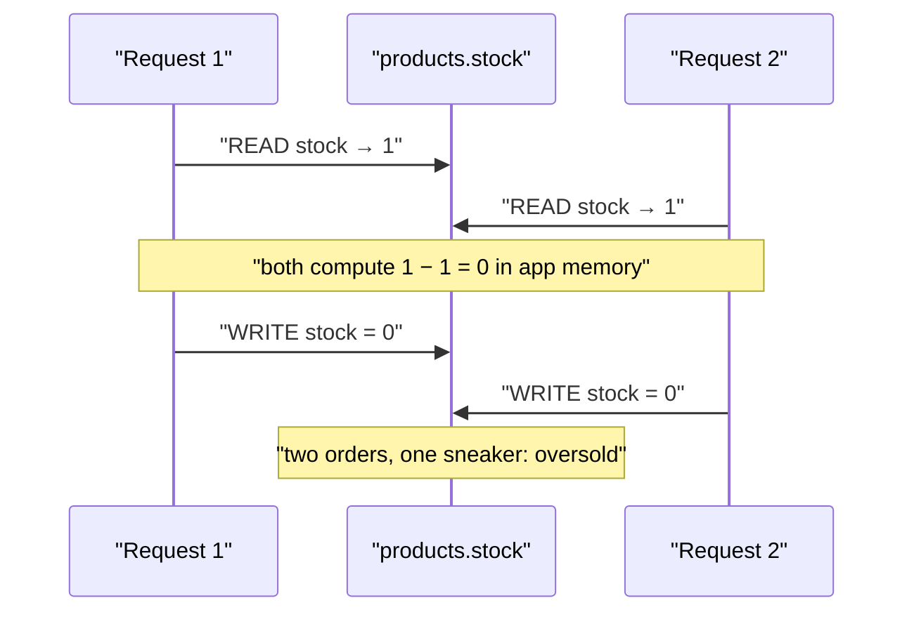
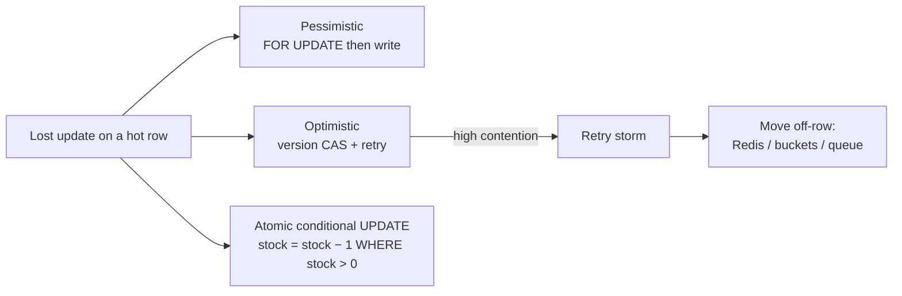
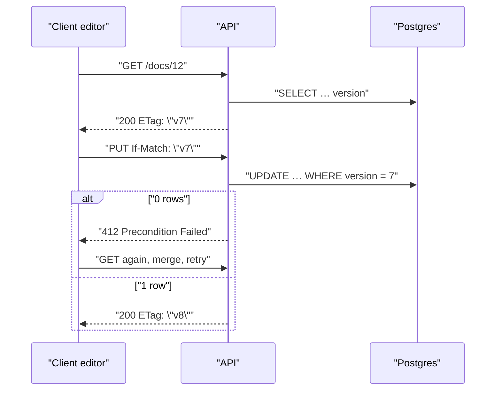
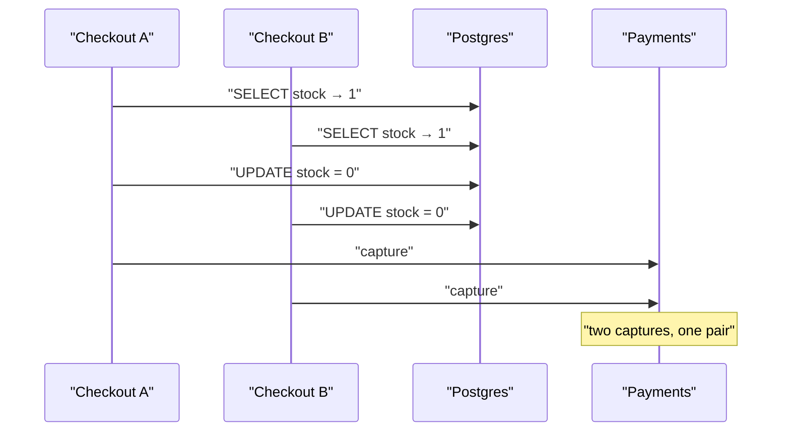

# Lesson 12: Optimistic vs Pessimistic Locking — Version Checks, FOR UPDATE & Atomic Updates

> **Prerequisites:** [Lesson 11: Database Locks & Deadlocks](../11-database-locks-deadlocks/README.md), [Lesson 10: MVCC Explained](../10-mvcc-explained/README.md), and [Track: Databases](../README.md) (Lesson 12 of 33).  
> **Estimated Reading Time:** 30 minutes  
> **Target Audience:** Backend engineers designing flash-sale inventory, concurrent document editors, and ticket workflows who must stop lost updates without turning every hot row into a queueing cliff.  
> **Free PDF Notes:** [Download SD-E-012.pdf](https://backendroadmap.com/notes/system-design/SD-E-012.pdf) · [Phase 2, Databases (PDF)](https://backendroadmap.com/notes/system-design/Phase2_Databases_Notes.pdf)

> [!NOTE]
> **In one line:** Read-modify-write in application code loses updates under concurrency; pessimistic locking locks the row first (`SELECT … FOR UPDATE`), optimistic locking checks a version on write and retries, and for simple counters one atomic conditional `UPDATE` beats both.

> [!TIP]
> **The Golden Rule of Concurrency Control on a Row:** Pick by **contention**. Rare conflicts → optimistic version/`ETag`. Short critical sections that must serialize → `FOR UPDATE` (lock ordered by ID). Pure counters/stock → **one atomic conditional update** (`SET n = n − 1 WHERE n > 0`). Extremely hot items → **leave the row** (Redis `DECR`, inventory buckets, or a queue)—optimistic under heavy contention becomes a **retry storm**.

---

## Words You'll Meet Today

| Word | In Plain Words | Role in a Live Backend System |
| :--- | :--- | :--- |
| **Lost update** | Two writers read the same value; the later write silently erases the earlier one. | Flash sale oversells; two agents overwrite a ticket. |
| **Pessimistic locking** | Lock the row before reading so others wait. | `SELECT … FOR UPDATE` on inventory or bank accounts. |
| **Optimistic locking** | No lock; bump a version and refuse the write if it changed. | Profile/document edits; HTTP `If-Match` / `ETag`. |
| **Version column** | Integer (or hash) incremented on every successful update. | `WHERE id = ? AND version = 7` → `version = 8`. |
| **Compare-and-set (CAS)** | Atomic “write only if still X.” | DB conditional `UPDATE`, Redis `WATCH`/`MULTI`, DynamoDB conditions. |
| **Atomic conditional update** | One statement that decrements/increments only if a predicate holds. | `UPDATE … SET stock = stock − 1 WHERE stock > 0`. |
| **Contention** | How often writers hit the **same** row. | Low → optimistic wins; high → lock or move off-row. |
| **412 Precondition Failed** | HTTP refusal when `If-Match` version no longer matches. | Collaborative editors re-fetch and merge. |

---

## Visual Mental Models & Architecture

### The Question: How Do You Sell Exactly 100 Sneakers to 10,000 Concurrent Buyers?

A flash sale: 100 pairs, 10,000 shoppers clicking buy in the same second. If each request **reads** stock, subtracts one in application memory, and **writes** it back, you will sell far more than 100. That is the **lost update** problem.

### Everyday Picture: Two Cashiers, One Shelf Count

Two cashiers both look at the shelf card that says “1 left,” each sell a pair, and both write “0.” Two orders, one sneaker. The fix is either: (1) put a lock on the card so the second waits, (2) stamp a version on the card and reject the second rewrite, or (3) make the shelf itself do `take one only if count > 0` in a single atomic move.



*Figure 1. Classic lost update: each request computes from a stale read; the second write silently overwrites the first.*

### Three Correct Patterns



*Figure 2. Correctness options. Under extreme contention, leave the row entirely.*

---

## Core Definition & Taxonomic Comparison

**What it is:** Application-level strategies (plus one-statement SQL) that make concurrent read-modify-write safe. **What it isn't:** Isolation levels alone (even `READ COMMITTED` still loses updates if you RMW in app code), distributed locks for every row, or “optimistic = always faster.”

| Term | Precise Meaning | Production Example |
| :--- | :--- | :--- |
| **Lost update** | Concurrent RMW where the later write erases the earlier one's intent. | Stock `1 → 0 → 0` with two successful purchases. |
| **Pessimistic** | Acquire exclusive row lock before business logic. | `SELECT … FOR UPDATE` then debit/credit. |
| **Optimistic** | No lock; conditional write on version/`ETag`. | Document save with `version` column. |
| **Atomic conditional** | Predicate + mutation in one statement (autocommit-friendly). | Flash-sale stock decrement. |
| **HTTP optimistic** | `ETag` + `If-Match` → `412` on conflict. | Support agents editing the same ticket. |

**Business implication:** Overselling and silent edit loss are correctness bugs, not “eventual consistency.” Choose the cheapest mechanism that stays correct at **your** contention level.

---

## Component Breakdown & Anatomy

| # | Stage | Component | What Can Fail |
| :--- | :--- | :--- | :--- |
| 1 | Read current state | App / ORM | Stale snapshot if no lock/version |
| 2 | Business decision | App CPU | Long work while holding a lock |
| 3 | Write path | SQL / HTTP | Forgotten `rows affected` check |
| 4 | Conflict handling | Retry / 412 / sold-out | Unbounded retries → storm |
| 5 | External I/O | Payment / email | Holding `FOR UPDATE` across HTTP |

### The Observability Gap

| Measurement Point | What It Captures | What It Hides |
| :--- | :--- | :--- |
| **App success rate** | HTTP 200 on “buy” | Oversell if RMW without CAS |
| **`rows_affected = 0`** | Version mismatch or sold out | Whether client retried correctly |
| **`lock_wait` / `blocked`** | Pessimistic queueing | Cross-service work holding the lock |
| **Retry counters** | Optimistic conflict rate | That one hot SKU is melting the DB |
| **Inventory audit** | Final stock vs orders | Timing of oversell during the spike |

---

## Mathematical Model: Throughput, Retries & Lock Queues

### 1. Pessimistic: Serial Throughput of One Hot Row

If each purchase holds the row lock for $T$ seconds:

$$\lambda_{\max} \approx \frac{1}{T}$$

| Hold time $T$ | Max purchases/s on that row |
| :--- | :--- |
| `1 ms` | `~1,000` |
| `5 ms` | `~200` |
| `20 ms` | `~50` |
| `100 ms` (includes payment call!) | `~10` |

### 2. Optimistic: Expected Attempts Under Contention

If $c$ concurrent writers race on the same version, roughly one wins per round; losers retry:

$$\text{Attempts per successful sale} \approx 1 + \frac{c-1}{2}\ \text{(order-of-magnitude)}$$

Under a flash sale, $c$ can be thousands → **retry storm** that burns CPU and saturates connections while still serializing on the version row.

### 3. Atomic Conditional Update

The database holds the row lock only for the statement. Exactly $S$ callers (stock) see `rows_affected = 1`; the rest see `0` and get “sold out”—no oversell, no retry loop for correctness.

### Utilization vs Perceived Latency (lock wait)

| Lock utilization $\rho$ | Queueing multiplier $\approx 1/(1-\rho)$ | Feel |
| :--- | :--- | :--- |
| `50%` | `2×` | Fine |
| `70%` | `~3.3×` | Noticeable |
| `90%` | `10×` | Bad |
| `95%` | `20×` | Cliff |
| `99%` | `100×` | Collapse |

**Headroom rule:** keep hot-row lock occupancy under ~60–70% or move the counter off-row.

---

## Metrics, Percentiles & Statistical Distributions

| Percentile | Who it describes | Locking implication |
| :--- | :--- | :--- |
| $p_{50}$ | Typical edit / buy | Optimistic looks “free” |
| $p_{95}$ | Contended users | `FOR UPDATE` wait or first retry |
| $p_{99}$ | Hot SKU / popular doc | Retry storms or lock queue |
| $p_{99.9}$ | Flash-sale spike | Need Redis/buckets/queue |

**Worked average lie:** 90 requests at 5 ms, 9 at 80 ms (one retry), 1 at 2,000 ms (lock wait) → average ≈ 32 ms, but $p_{99}$ is 2 s. Averages hide contention.

---

## Compounding Effects & System Scale

If each of $N$ independent resources has a 1% chance of conflict/retry on a page:

$$P(\text{at least one conflict}) = 1 - 0.99^{N}$$

| $N$ resources | $P(\text{conflict})$ |
| :--- | ---: |
| 1 | 1% |
| 5 | ~5% |
| 10 | ~10% |
| 20 | ~18% |
| 50 | ~39% |
| 100 | ~63% |

Carts that touch many line items amplify optimistic conflicts; prefer per-line CAS or short pessimistic scopes.

---

## Numbers Every Backend Engineer Must Know

| Operation | Typical cost | Implication |
| :--- | :--- | :--- |
| In-DC SQL RTT | `0.2–1 ms` | Fine inside a short txn |
| Cross-AZ RTT | `1–3 ms` | Sync lock wait adds up |
| Cross-region RTT | `30–100 ms` | Never hold `FOR UPDATE` across regions |
| Redis `DECR` | `~0.1–0.5 ms` | Hot counters belong here |
| Payment HTTP | `200–2,000 ms` | **Never** hold DB locks across it |
| Flash sale click fan-in | `10^3–10^5 /s` | One Postgres row cannot absorb it |

---

## Protocol & Deep Dive: SQL vs HTTP Optimistic Control



*Figure 3. HTTP optimistic locking mirrors the version column: `If-Match` is the CAS token; `412` means re-fetch and merge.*

---

## Hierarchical Budgets & Capacity Sizing

| Tier | Budget (example flash-sale buy) | Notes |
| :--- | :--- | :--- |
| Gateway / auth | `20 ms` | Stateless |
| Inventory decision | `5–15 ms` | Atomic SQL or Redis |
| Payment | `500–2,000 ms` | **After** inventory reserved |
| Headroom | `≥30%` | Spikes |

**Derived rule:** reserve/decrement inventory **before** calling payment; never `FOR UPDATE` across the payment provider.

For a row with $T = 5$ ms hold: $\lambda_{\max} \approx 200$/s. If peak buy attempts are 5,000/s, you need off-row inventory (Redis) or sharded buckets, not optimistic retries.

---

## Top Engineering Mitigation Techniques

1. **Atomic conditional `UPDATE`** for counters and stock.
2. **Optimistic version / `ETag`** for rare-conflict edits.
3. **`SELECT … FOR UPDATE`** (ordered by ID) for multi-row integrity (transfers).
4. **Off-row hot counters:** Redis `DECR`, 10 bucket rows, or a purchase queue.
5. **Bounded retries** with jitter; surface conflict to the UI instead of looping forever.
6. **Always check `rows_affected`** (or catch `ConditionalCheckFailed`).

---

## Production War Story (SEV-1 Post-Mortem)

**Severity & Impact:** SEV-1 · Flash sale · ~12 minutes · Oversold ~1,400 units of a hero SKU; payment captures succeeded on phantom inventory; ~$180k reverse-logistics + goodwill.

**What Happened:** Checkout used ORM read → mutate → `save()` with no version column. Under load both pods read `stock = 1` and both wrote `0`.

```go
// BAD: classic lost update
stock, _ := db.GetStock(ctx, sku)
if stock < 1 { return ErrSoldOut }
_ = db.SetStock(ctx, sku, stock-1) // races
```



**Root Cause:** Application RMW without CAS/lock; success metric counted HTTP 200, not inventory invariant.

**The Fix & Hardening:**
1. Ship `UPDATE … SET stock = stock − 1 WHERE id = $1 AND stock > 0` and require `rows_affected = 1`.
2. For hero SKUs, move remaining stock to Redis `DECR` with DB reconciliation.
3. Alert on `orders_created − stock_decremented` divergence; load-test one hot SKU to 5k RPS.

---

## Multi-Language Production Code Tabs

````carousel
```go
// Go: atomic conditional stock decrement (preferred for counters)
func Buy(ctx context.Context, db *sql.DB, productID int64) error {
    res, err := db.ExecContext(ctx, `
        UPDATE products
           SET stock = stock - 1
         WHERE id = $1 AND stock > 0`, productID)
    if err != nil {
        return err
    }
    n, _ := res.RowsAffected()
    if n == 0 {
        return ErrSoldOut
    }
    return nil
}

// Optimistic document update with bounded retries
func SaveDoc(ctx context.Context, db *sql.DB, id int64, body string, ver int) (int, error) {
    for attempt := 0; attempt < 3; attempt++ {
        res, err := db.ExecContext(ctx, `
            UPDATE docs SET body = $1, version = version + 1
             WHERE id = $2 AND version = $3`, body, id, ver)
        if err != nil {
            return ver, err
        }
        if n, _ := res.RowsAffected(); n == 1 {
            return ver + 1, nil
        }
        _ = db.QueryRowContext(ctx, `SELECT body, version FROM docs WHERE id = $1`, id).
            Scan(&body, &ver) // re-read; caller may merge
    }
    return ver, ErrConflict
}
```

<!-- slide -->

```ts
// TypeScript: atomic stock + HTTP ETag optimistic update
import { Pool } from "pg";

export async function buy(pool: Pool, productId: number): Promise<void> {
  const r = await pool.query(
    `UPDATE products SET stock = stock - 1
      WHERE id = $1 AND stock > 0`,
    [productId],
  );
  if (r.rowCount === 0) throw new Error("sold_out");
}

export async function putDoc(
  pool: Pool,
  id: number,
  body: string,
  ifMatch: string, // e.g. "v7"
): Promise<string> {
  const ver = Number(ifMatch.replace(/^v/, ""));
  const r = await pool.query(
    `UPDATE docs SET body = $1, version = version + 1
      WHERE id = $2 AND version = $3
      RETURNING version`,
    [body, id, ver],
  );
  if (r.rowCount === 0) {
    const err = new Error("precondition_failed");
    (err as any).status = 412;
    throw err;
  }
  return `v${r.rows[0].version}`;
}
```

<!-- slide -->

```python
# Python: FOR UPDATE transfer (pessimistic, lock ordered by id)
import asyncpg

async def transfer(conn: asyncpg.Connection, a: int, b: int, amount: int) -> None:
    ids = sorted([a, b])
    async with conn.transaction():
        rows = await conn.fetch(
            """
            SELECT id, balance FROM accounts
             WHERE id = ANY($1::bigint[])
             ORDER BY id
             FOR UPDATE
            """,
            ids,
        )
        bal = {r["id"]: r["balance"] for r in rows}
        if bal[a] < amount:
            raise ValueError("insufficient")
        await conn.execute(
            "UPDATE accounts SET balance = balance - $1 WHERE id = $2", amount, a
        )
        await conn.execute(
            "UPDATE accounts SET balance = balance + $1 WHERE id = $2", amount, b
        )
```

<!-- slide -->

```csharp
// C#: optimistic update with version column
public async Task SaveTicketAsync(NpgsqlConnection conn, long id, string body, int version)
{
    await using var cmd = new NpgsqlCommand(@"
        UPDATE tickets
           SET body = @body, version = version + 1
         WHERE id = @id AND version = @version", conn);
    cmd.Parameters.AddWithValue("body", body);
    cmd.Parameters.AddWithValue("id", id);
    cmd.Parameters.AddWithValue("version", version);
    var n = await cmd.ExecuteNonQueryAsync();
    if (n == 0)
        throw new DbUpdateConcurrencyException("ticket changed; re-fetch and retry");
}
```
````

---

## Hands-On CLI Verification Workflows

```bash
# 1) Prove lost update without protection (two shells, same DB)
psql "$DATABASE_URL" -c "UPDATE products SET stock = 1 WHERE id = 9;"

# Shell A and B simultaneously:
psql "$DATABASE_URL" -c "
  SELECT stock FROM products WHERE id = 9;
  -- pretend app does stock-1 locally, then:
  UPDATE products SET stock = 0 WHERE id = 9;
"

# 2) Atomic conditional: exactly one winner when stock=1
psql "$DATABASE_URL" -c "UPDATE products SET stock = 1 WHERE id = 9;"
# run twice in parallel:
psql "$DATABASE_URL" -c "UPDATE products SET stock = stock - 1 WHERE id = 9 AND stock > 0; SELECT stock FROM products WHERE id = 9;"

# 3) Optimistic version demo
python3 -c "print('0 rows updated means someone else won the CAS — retry with a limit')"
```

---

## Common Mistakes to Avoid

- Reading, mutating in app memory, writing back with no lock/version/CAS.
- Optimistic locking on one ultra-hot row → retry storm.
- Ignoring `rows_affected` / treating conflict as success.
- Holding `FOR UPDATE` while calling payment, email, or S3.
- Unbounded retries without jitter or a hard cap.
- Using averages instead of $p_{99}$ conflict/lock-wait metrics.
- “Optimistic is always faster” (only when conflicts are rare).

---

## Key Terms Glossary

| Term | Interview-ready definition |
| :--- | :--- |
| Lost update | Concurrent RMW where a later write erases an earlier write’s effect. |
| Pessimistic locking | Lock first (`FOR UPDATE`); others wait. |
| Optimistic locking | Version/ETag CAS on write; losers retry. |
| Compare-and-set | Atomic write-if-unchanged. |
| Atomic conditional update | Single SQL that mutates only if a predicate holds. |
| Contention | Rate of concurrent writers on the same key/row. |
| ETag / If-Match | HTTP optimistic concurrency tokens. |
| 412 | Precondition Failed — version no longer matches. |

---

## Complete 12 System Design Interview Q&As

### Basic Conceptual Questions (Q1–Q4)

<details>
<summary><strong>Q1: When would you use optimistic locking? [BASIC]</strong></summary>

<strong>What a strong answer covers:</strong>
When conflicts are **rare**—profile edits, documents, tickets. Hold no locks, check a version on write, retry (bounded) if `rows_affected = 0`. Under high contention it becomes a retry storm; switch to atomic updates, locks, or off-row counters.

</details>

<details>
<summary><strong>Q2: How do you avoid overselling stock? [BASIC]</strong></summary>

<strong>What a strong answer covers:</strong>
Prefer `UPDATE … SET stock = stock − 1 WHERE id = ? AND stock > 0` and require one row updated. Alternatives: `SELECT FOR UPDATE`, or version CAS. For extreme hot spots: Redis `DECR`, inventory buckets, or a purchase queue.

</details>

<details>
<summary><strong>Q3: What does “0 rows updated” mean with a version check? [BASIC]</strong></summary>

<strong>What a strong answer covers:</strong>
Someone changed the row after you read it; your write was refused. Re-read, re-apply the business change, retry with a small limit (e.g. 3). Never treat 0 rows as success.

</details>

<details>
<summary><strong>Q4: Pessimistic vs optimistic in one sentence each? [BASIC]</strong></summary>

<strong>What a strong answer covers:</strong>
**Pessimistic:** assume conflict—lock before read. **Optimistic:** assume rare conflict—CAS version on write. **Atomic conditional:** skip the separate read for counters. Choice follows measured contention, not dogma.

</details>

### Scenario-Based Architecture Questions (Q5–Q8)

<details>
<summary><strong>Q5: Two support agents edit the same ticket in a web UI. How do you avoid lost edits? [SCENARIO]</strong></summary>

<strong>What a strong answer covers:</strong>
Return an `ETag` (version) on `GET`. Require `If-Match` on `PUT`/`PATCH`. On mismatch return `412 Precondition Failed`; UI re-fetches and shows the other agent’s changes before saving (or offers a merge).

</details>

<details>
<summary><strong>Q6: A flash sale’s one product row gets 5,000 buy attempts per second. Which approach? [SCENARIO]</strong></summary>

<strong>What a strong answer covers:</strong>
Not optimistic (retry storm). Atomic conditional `UPDATE` is the simplest correct DB approach (~200/s if each statement is 5 ms). For 5k RPS, move the counter to Redis, split stock across bucket rows, or funnel purchases through a queue; reconcile to Postgres asynchronously.

</details>

<details>
<summary><strong>Q7: Your bank transfer must check two balances before writing. Optimistic or pessimistic? [SCENARIO]</strong></summary>

<strong>What a strong answer covers:</strong>
Pessimistic is simpler: `SELECT … FROM accounts WHERE id IN (…) ORDER BY id FOR UPDATE`, check, update, commit. Locking in ID order avoids deadlocks; keep the transaction short—no external calls inside.

</details>

<details>
<summary><strong>Q8: Checkout holds FOR UPDATE, then calls Stripe, then commits. What goes wrong? [SCENARIO]</strong></summary>

<strong>What a strong answer covers:</strong>
The row lock is held for hundreds of milliseconds to seconds, collapsing hot-SKU throughput and blocking unrelated buyers. Reserve/decrement with a short txn (or Redis), release the lock, call payment, then confirm or release the reservation in a second step.

</details>

### Advanced & Tricky Interview Questions (Q9–Q12)

<details>
<summary><strong>Q9: Is optimistic locking always faster because it takes no locks? [TRICKY]</strong></summary>

<strong>What a strong answer covers:</strong>
No. Under high contention most attempts fail and retry, wasting work and adding latency/load. It wins only when conflicts are rare. The `UPDATE` still takes a brief row lock for the statement itself.

</details>

<details>
<summary><strong>Q10: Does the atomic UPDATE take any lock? [TRICKY]</strong></summary>

<strong>What a strong answer covers:</strong>
Yes—a row lock for the length of that statement (and its transaction). Concurrent decrements still serialize, but each hold is tiny with no application RTT inside the lock. That is why it beats app-level RMW and long `FOR UPDATE` sections.

</details>

<details>
<summary><strong>Q11: How is this different from isolation levels / MVCC? [TRICKY]</strong></summary>

<strong>What a strong answer covers:</strong>
MVCC/isolation decide what **reads** see; they do not automatically make application RMW safe. You still need locks, CAS, or atomic SQL to preserve invariants like “never negative stock.” Serializable can abort conflicting txns, but you must still retry correctly—and cost is higher.

</details>

<details>
<summary><strong>Q12: Design inventory for a hero SKU at 50k attempts/s with exactly-once allocation. [TRICKY]</strong></summary>

<strong>What a strong answer covers:</strong>
Do not put 50k CAS attempts on one Postgres row. Shard inventory into $N$ buckets (or Redis shards), allocate with atomic decrement, use idempotency keys on the order, and asynchronously reconcile. Postgres remains source of truth for settled orders, not the hot counter path.

</details>

---

## One-Page Master Cheat Sheet

```text
====================================================================================================
     OPTIMISTIC vs PESSIMISTIC LOCKING — VERSION CHECKS, FOR UPDATE, ATOMIC UPDATES (SD-E-012)
====================================================================================================
PROBLEM
  App read → modify → write  =>  lost updates (two buyers, one sneaker)

CHOOSE BY CONTENTION
  Rare conflicts ........ optimistic version / ETag + If-Match → 412 + retry
  Multi-row integrity ... SELECT … FOR UPDATE (ORDER BY id), short txn
  Counters / stock ...... UPDATE SET n=n-1 WHERE n>0; check rows_affected
  Extreme hot row ....... Redis DECR | inventory buckets | purchase queue

MATH
  Pessimistic λ_max ≈ 1/T_hold          T=5ms → ~200/s on that row
  Optimistic under load → retry storm   lock utilization 95% → ~20× latency
  Never hold FOR UPDATE across payment / HTTP

HTTP
  GET returns ETag:"v7" · PUT If-Match:"v7" · mismatch → 412 Precondition Failed

ANTI-PATTERNS
  x ORM save() RMW with no version     x ignore rows_affected
  x optimistic on flash-sale SKU       x FOR UPDATE during Stripe call
  x unbounded retries                  x trusting averages over p99 conflict rate
====================================================================================================
```

---

## Free PDF notes

Download these notes as a printable PDF, with the flash-sale diagrams, CAS patterns, and interview answers: [SD-E-012.pdf](https://backendroadmap.com/notes/system-design/SD-E-012.pdf).

---

## Sources

- [PostgreSQL: Explicit Locking — FOR UPDATE](https://www.postgresql.org/docs/current/explicit-locking.html)
- [RFC 9110: HTTP Semantics — Conditional Requests / If-Match](https://www.rfc-editor.org/rfc/rfc9110#name-if-match)
- [Martin Kleppmann — Designing Data-Intensive Applications, Ch. 7 (Transactions)](https://dataintensive.net/)

---

## Next

Next up: [Lesson 13: NoSQL Explained — 4 Families, BASE vs ACID](../13-nosql-explained/README.md).
