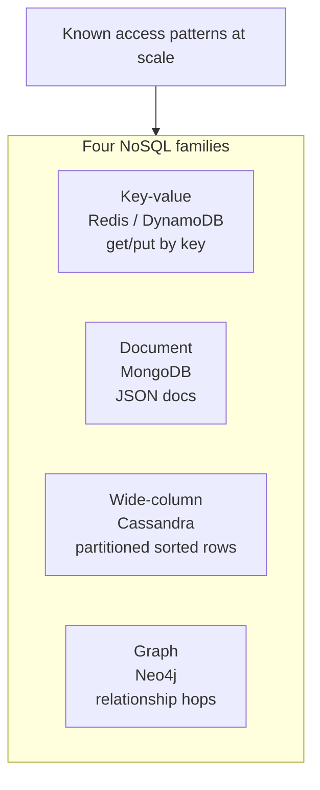
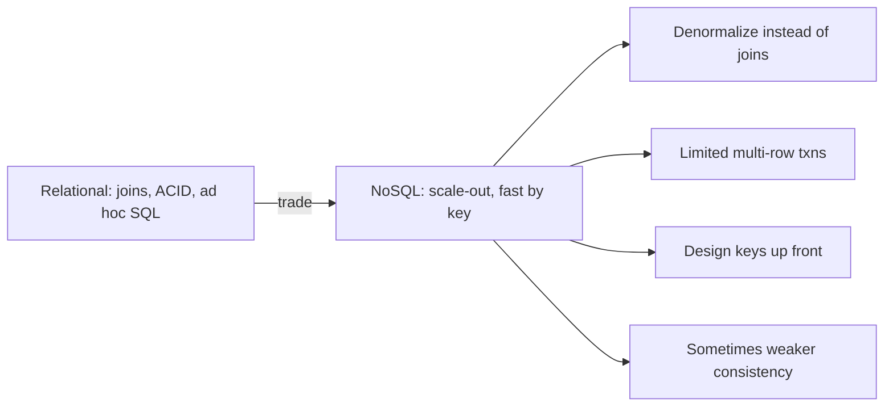
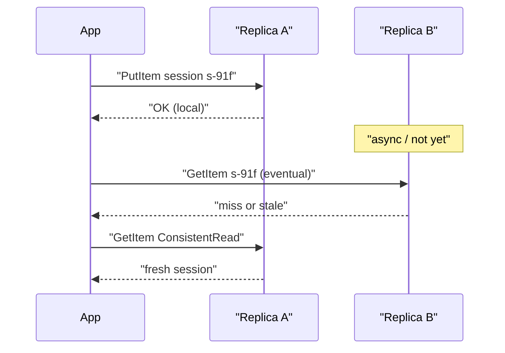
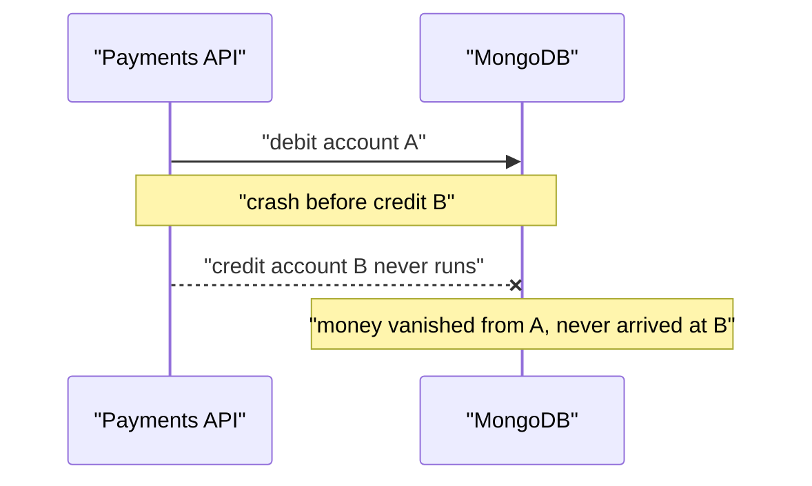

# Lesson 13: NoSQL Explained — 4 Families, BASE vs ACID & When Not to Use It

> **Prerequisites:** [Lesson 12: Optimistic vs Pessimistic Locking](../12-optimistic-vs-pessimistic-locking/README.md), [Lesson 08: ACID Explained](../08-acid-explained/README.md), and [Track: Databases](../README.md) (Lesson 13 of 33).  
> **Estimated Reading Time:** 32 minutes  
> **Target Audience:** Backend engineers choosing stores for sessions, catalogs, chat, and fraud graphs who must know what NoSQL actually trades away—and when Postgres is still enough.  
> **Free PDF Notes:** [Download SD-E-013.pdf](https://backendroadmap.com/notes/system-design/SD-E-013.pdf) · [Phase 2, Databases (PDF)](https://backendroadmap.com/notes/system-design/Phase2_Databases_Notes.pdf)

> [!NOTE]
> **In one line:** NoSQL databases trade joins, rich multi-row transactions, and ad hoc queries for scale-out and very fast known access patterns—pick one when you have one simple access pattern at huge volume, and stay relational when data is relational or the scale fits one Postgres primary.

> [!TIP]
> **The Golden Rule of NoSQL:** List the **access patterns first**, then pick a family and design keys around those queries. NoSQL is not “flexible SQL without schemas”—it is **denormalize + partition for known reads**. If you need many-to-many joins, ad hoc reporting, or multi-row ACID, keep (or return to) a relational primary and copy heavy analytics to a warehouse.

---

## Words You'll Meet Today

| Word | In Plain Words | Role in a Live Backend System |
| :--- | :--- | :--- |
| **NoSQL** | Non-relational stores built to scale out for known patterns. | Sessions, chat, catalogs, graphs—not one product. |
| **Four families** | Key-value, document, wide-column, graph. | Next four lessons deep-dive each. |
| **Partition key** | Value that hashes to the node holding a record. | Even traffic vs hot partitions. |
| **Denormalize** | Copy data into the shape each query needs. | One read answers the page; writes touch many places. |
| **Access pattern** | A query the app will run, known up front. | Keys and tables are designed from this list. |
| **ACID** | Atomic, Consistent, Isolated, Durable transactions. | Ledgers, payments, inventory constraints. |
| **BASE** | Basically Available, Soft state, Eventually consistent. | Prefer availability during failures; replicas may lag. |
| **Tunable consistency** | Choose strength per request/query. | DynamoDB strong reads; Cassandra `QUORUM`. |
| **TTL** | Automatic expiry of a record. | Sessions die without a cleanup job. |

---

## Visual Mental Models & Architecture

### Why NoSQL Exists

Your app stores sessions in Postgres at 100,000 simple lookups/s by session ID—no joins, no reports. You pay for features you never use, and one primary struggles. That workload shaped late-2000s NoSQL from Amazon/Google: **scale beyond one machine**, **flexible shapes**, **specific access patterns served extremely fast**.



*Figure 1. “NoSQL” is four families shaped for different data—not one technology.*

### What You Give Up



*Figure 2. Scale and speed for known queries, paid for with features SQL gives you for free.*

---

## Core Definition & Taxonomic Comparison

**What it is:** A family of stores optimized for partition-friendly, pattern-shaped workloads. **What it isn't:** A free upgrade, a synonym for “eventually consistent,” or a replacement for every Postgres use case.

| Term | Precise Meaning | Production Example |
| :--- | :--- | :--- |
| **Key-value** | Opaque value under a key; O(1) get/put. | Sessions, carts, rate limits. |
| **Document** | JSON-like docs with secondary indexes. | Product catalogs, CMS. |
| **Wide-column** | Partition key + clustering key; query-per-table. | Chat messages, event logs. |
| **Graph** | Nodes + edges; index-free adjacency. | Friend-of-friend, fraud rings. |
| **BASE** | Prefer availability; soft state; eventual agreement. | Many early Dynamo-style systems. |
| **ACID** | Correctness-first transactions. | Payments ledger in Postgres. |

**Business implication:** Wrong store choice becomes “rebuilding joins in the app” or “outgrowing a cool database we didn’t need.”

---

## Component Breakdown & Anatomy

| # | Piece | Role | Failure mode |
| :--- | :--- | :--- | :--- |
| 1 | Access-pattern list | Drives key design | New PM question → new table |
| 2 | Partition key | Places data on nodes | Hot key melts one partition |
| 3 | Denormalized tables | One read per page | Dual-write inconsistency |
| 4 | Consistency knob | Strong vs eventual | Stale reads after write |
| 5 | TTL / compaction | Lifecycle | Expired items linger (DynamoDB) |

### The Observability Gap

| Point | Sees | Hides |
| :--- | :--- | :--- |
| App latency | End-to-end | Hot partition vs cold |
| DynamoDB `ConsumedCapacity` | Throttles | Which key is hot |
| Cassandra `CL` metrics | Quorum success | Which replica was stale |
| Postgres CPU | “DB is slow” | That the workload is KV-shaped |

---

## Mathematical Model: Partition Load & Session Example

### Sessions in DynamoDB

$$ops/s_{partition} \approx \frac{\lambda_{total}}{N_{partitions}}$$

At $\lambda = 100{,}000$ ops/s over $N = 200$ partitions → **500 ops/s each**, under DynamoDB’s ~3,000 read / ~1,000 write unit guidance per partition. Random session IDs spread evenly; a celebrity key does not.

### BASE vs ACID as a Spectrum

| Mode | Write ack | Read freshness | Typical use |
| :--- | :--- | :--- | :--- |
| ACID primary | After local commit | Always latest on primary | Money |
| Quorum ($W+R>N$) | After $W$ replicas | Usually latest | Cassandra |
| Async replica | After leader | May lag | Read scale |
| Eventual | Fast local | Stale until repair | Caches, some KV |

---

## Metrics, Percentiles & Statistical Distributions

| Percentile | Meaning for NoSQL |
| :--- | :--- |
| $p_{50}$ get | Single-digit ms on DynamoDB/Redis |
| $p_{99}$ | Hot partition / GC / quorum wait |
| Throttle rate | Partition capacity exceeded |
| Conflict / stale-read rate | Consistency setting too weak |

**Average lie:** Mean 3 ms with 1% of keys at 50 ms throttling → “fine” until that 1% is your flash-sale SKU.

---

## Compounding Effects & System Scale

App code that “joins” $N$ NoSQL gets in series:

$$T_{page} \approx \sum_{i=1}^{N} T_i \quad\text{or}\quad \max_i T_i\ \text{if parallel}$$

| Fan-out $N$ | If each get $p_{99}=10$ ms sequential | Parallel |
| :--- | ---: | ---: |
| 1 | 10 ms | 10 ms |
| 5 | 50 ms | ~10 ms + jitter |
| 20 | 200 ms | ~10–30 ms |

Denormalize to cut $N$, or parallelize carefully with budgets.

---

## Numbers Every Backend Engineer Must Know

| Fact | Number | Implication |
| :--- | :--- | :--- |
| DynamoDB partition soft limit | ~3k RCU / 1k WCU | Spread keys |
| One well-tuned Postgres primary | Tens of k QPS | Most apps fit |
| Redis GET | Sub-ms in-DC | Cache/session king |
| Cross-partition txn | Slower / limited | Design single-partition ops |
| Session TTL | 30 min typical | Prefer native TTL |

---

## Protocol & Deep Dive: BASE vs ACID



*Figure 3. Eventual vs strong read on the same store—tunable, not a binary religion.*

---

## Hierarchical Budgets & Capacity Sizing

| Tier | Budget | Notes |
| :--- | :--- | :--- |
| Session get/put | `≤5–10 ms p99` | DynamoDB/Redis |
| User/order path | Postgres ACID | Keep relational |
| Analytics | Warehouse / OLAP | Don’t ask NoSQL ad hoc |
| Headroom | 30% partition capacity | Avoid throttle cliffs |

---

## Top Engineering Mitigation Techniques

1. **Access-pattern spreadsheet** before table design.
2. **Polyglot:** sessions in DynamoDB/Redis; money in Postgres.
3. **TTL** for ephemeral data.
4. **Tunable consistency** only where UX requires it.
5. **Don’t migrate for “flexibility”**—migrate for measured scale/patterns.
6. **Warehouse for new reporting questions.**

---

## Production War Story (SEV-1 Post-Mortem)

**Severity & Impact:** SEV-1 · 45 minutes · Payments service moved to MongoDB “for flexibility”; dual-write debit/credit across documents caused ~2,100 unbalanced ledger rows; finance freeze.

**What Happened:** Team replaced Postgres ledger with two document updates without multi-doc txn discipline; under partition failover, one side applied.



**Root Cause:** Relational integrity workload forced into a document store for fashion, not access patterns.

**Fix:** Restore Postgres ledger with ACID transfers; keep Mongo only for product catalog; add invariant monitors (sum of balances).

---

## Multi-Language Production Code Tabs

````carousel
```go
// Go: DynamoDB session get/put with TTL attribute
func PutSession(ctx context.Context, svc *dynamodb.Client, table, id string, data []byte, ttlSec int64) error {
    exp := time.Now().Unix() + ttlSec
    _, err := svc.PutItem(ctx, &dynamodb.PutItemInput{
        TableName: &table,
        Item: map[string]types.AttributeValue{
            "session_id": &types.AttributeValueMemberS{Value: id},
            "data":       &types.AttributeValueMemberB{Value: data},
            "expires_at": &types.AttributeValueMemberN{Value: strconv.FormatInt(exp, 10)},
        },
    })
    return err
}
```

<!-- slide -->

```ts
// TypeScript: choose store by access pattern
type AccessPattern = { name: string; key: string; qps: number; needsTxn: boolean };

export function pickStore(p: AccessPattern): "postgres" | "dynamodb" | "redis" | "neo4j" {
  if (p.needsTxn) return "postgres";
  if (p.name.includes("friend") || p.name.includes("fraud")) return "neo4j";
  if (p.qps > 50_000 && p.key.endsWith("_id")) return "dynamodb";
  if (p.qps > 10_000 && p.name.includes("cache")) return "redis";
  return "postgres"; // default: stay relational until proven otherwise
}
```

<!-- slide -->

```python
# Python: BASE-style eventual read vs strong read (boto3 sketch)
def get_session(table, session_id: str, strong: bool = False):
    return table.get_item(
        Key={"session_id": session_id},
        ConsistentRead=strong,
    ).get("Item")
```

<!-- slide -->

```csharp
// C#: polyglot — sessions in Redis, orders in Postgres
public async Task<Session?> GetSessionAsync(IConnectionMultiplexer mux, string id)
{
    var db = mux.GetDatabase();
    var json = await db.StringGetAsync($"sess:{id}");
    return json.HasValue ? JsonSerializer.Deserialize<Session>(json!) : null;
}
```
````

---

## Hands-On CLI Verification Workflows

```bash
# Estimate partition load
python3 -c "print(100_000/200)  # 500 ops/s per partition"

# Remind yourself when NOT to use NoSQL
python3 -c "print('ledger/payments/unknown reports → Postgres (+ warehouse)')"
```

---

## Common Mistakes to Avoid

- Picking NoSQL for “flexibility” on relational data, then joining in app code.
- Designing tables before listing queries.
- Assuming NoSQL ⇒ no consistency (many offer strong/tunable).
- Moving for scale you do not have yet.
- Using one family for every workload (graph ≠ KV ≠ document).

---

## Key Terms Glossary

| Term | Definition |
| :--- | :--- |
| NoSQL | Non-relational, usually partition-first stores. |
| Partition key | Routes a record to a node/partition. |
| Denormalize | Duplicate data for query shape. |
| Access pattern | Known query the schema must serve. |
| ACID / BASE | Correctness-first vs availability-first philosophies. |
| Eventual consistency | Replicas agree once writes stop. |
| Tunable consistency | Per-request strength. |
| TTL | Auto-expiry. |

---

## Complete 12 System Design Interview Q&As

### Basic Conceptual Questions (Q1–Q4)

<details>
<summary><strong>Q1: What is BASE, and how does it differ from ACID? [BASIC]</strong></summary>

<strong>What a strong answer covers:</strong>
Basically Available, Soft state, Eventually consistent—favours answering during failures over immediate agreement. ACID makes each transaction atomic/isolated and every read correct, possibly at availability cost. Real systems sit on a spectrum (quorums, strong reads).

</details>

<details>
<summary><strong>Q2: Name the four NoSQL families and one use for each. [BASIC]</strong></summary>

<strong>What a strong answer covers:</strong>
Key-value (Redis/DynamoDB): sessions/caches. Document (MongoDB): catalogs. Wide-column (Cassandra): chat/event logs. Graph (Neo4j): recommendations/fraud rings.

</details>

<details>
<summary><strong>Q3: What do you usually give up with NoSQL? [BASIC]</strong></summary>

<strong>What a strong answer covers:</strong>
Joins (denormalize), multi-row transactions (limited), ad hoc queries (keys designed up front), and sometimes strong consistency.

</details>

<details>
<summary><strong>Q4: When is Postgres still the right default? [BASIC]</strong></summary>

<strong>What a strong answer covers:</strong>
Relational data, multi-row integrity, unknown/reporting queries, or scale that still fits one primary + replicas. Move a *workload* to NoSQL when one simple pattern outgrows that—not the whole company database.

</details>

### Scenario-Based Architecture Questions (Q5–Q8)

<details>
<summary><strong>Q5: Sessions in Postgres at 100k simple lookups/s, no joins. Move them? [SCENARIO]</strong></summary>

<strong>What a strong answer covers:</strong>
Yes for that workload: DynamoDB with `session_id` PK + TTL, or Redis. Keep users/orders in Postgres (polyglot).

</details>

<details>
<summary><strong>Q6: Team wants MongoDB for a payments ledger “for flexibility.” Advice? [SCENARIO]</strong></summary>

<strong>What a strong answer covers:</strong>
Keep it relational. Ledgers need multi-row transactions, constraints, and audit/ad hoc queries. One Postgres primary handles thousands of payments/s.

</details>

<details>
<summary><strong>Q7: PM keeps asking new reporting questions. Push to NoSQL? [SCENARIO]</strong></summary>

<strong>What a strong answer covers:</strong>
No—the other way. Unknown queries suit SQL; NoSQL needs new tables/indexes per question. Heavy reports → warehouse/ELT.

</details>

<details>
<summary><strong>Q8: Design polyglot persistence for a marketplace. [SCENARIO]</strong></summary>

<strong>What a strong answer covers:</strong>
Postgres: users, orders, payments. Redis/DynamoDB: sessions/carts. OpenSearch: product search. Warehouse: analytics. Graph only if fraud/FoF is core.

</details>

### Advanced & Tricky Interview Questions (Q9–Q12)

<details>
<summary><strong>Q9: Is NoSQL always eventually consistent? [TRICKY]</strong></summary>

<strong>What a strong answer covers:</strong>
No. DynamoDB strong reads, Cassandra `QUORUM`, MongoDB primary reads. Consistency is tunable.

</details>

<details>
<summary><strong>Q10: At what point does a relational DB stop being enough? [TRICKY]</strong></summary>

<strong>What a strong answer covers:</strong>
Later than people think—tens of k QPS and TBs are routine on one tuned primary + replicas. Move when a *simple* access pattern outgrows that, or write path saturates despite replicas (then shard or specialized store).

</details>

<details>
<summary><strong>Q11: Why do NoSQL interviews obsess over access patterns? [TRICKY]</strong></summary>

<strong>What a strong answer covers:</strong>
Without joins/ad hoc query planners doing magic, the partition key *is* the query API. Wrong key ⇒ scatter-gather or hot partitions.

</details>

<details>
<summary><strong>Q12: How do you migrate off a mistaken NoSQL choice? [TRICKY]</strong></summary>

<strong>What a strong answer covers:</strong>
Strangler: dual-write or CDC to Postgres for integrity paths; move reads gradually; keep NoSQL only where patterns fit; never big-bang rewrite without invariant tests.

</details>

---

## One-Page Master Cheat Sheet

```text
====================================================================================================
                    NoSQL EXPLAINED — 4 FAMILIES, BASE vs ACID (SD-E-013)
====================================================================================================
PICK NoSQL WHEN
  one simple access pattern · huge volume · scale-out needed · known keys

STAY RELATIONAL WHEN
  joins / multi-row ACID / ad hoc reports / scale still fits one Postgres primary

FAMILIES
  KV ........ Redis, DynamoDB ...... sessions, carts, flags
  Document .. MongoDB .............. catalogs, CMS
  Wide-col .. Cassandra/Scylla ..... chat, events, IoT
  Graph ..... Neo4j/Neptune ........ FoF, fraud rings

TRADE-OFFS
  give up joins, rich txns, ad hoc SQL; denormalize; design keys from queries
  BASE ≠ always eventual — tunable/strong options exist

ANTI-PATTERNS
  x NoSQL for "flexibility" on ledgers     x tables before access patterns
  x migrate for scale you don't have       x one store for every workload
====================================================================================================
```

---

## Free PDF notes

[SD-E-013.pdf](https://backendroadmap.com/notes/system-design/SD-E-013.pdf)

---

## Sources

- [Amazon Dynamo paper](https://www.allthingsdistributed.com/files/amazon-dynamo-sosp2007.pdf)
- [Martin Kleppmann — DDIA, Ch. 2 (Data Models)](https://dataintensive.net/)

---

## Next

Next up: [Lesson 14: Key-Value Stores Explained](../14-key-value-stores-explained/README.md).
