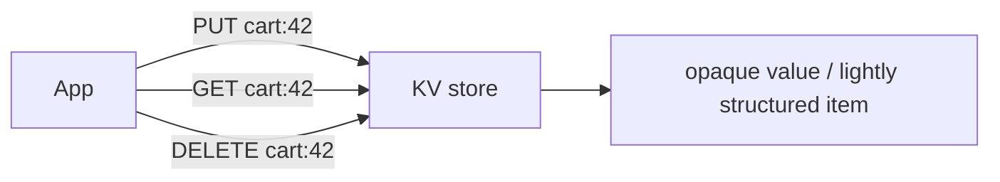
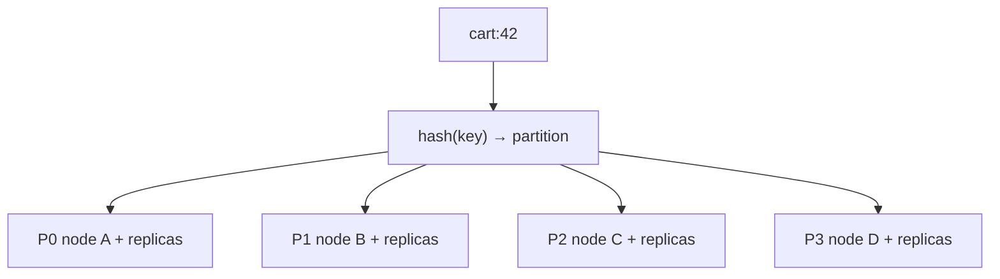
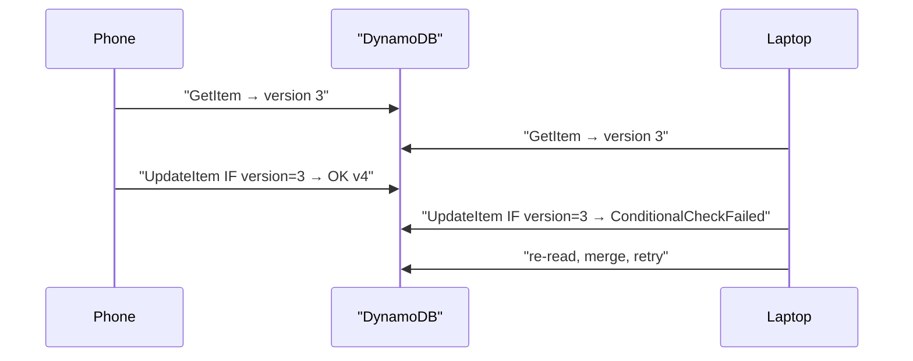
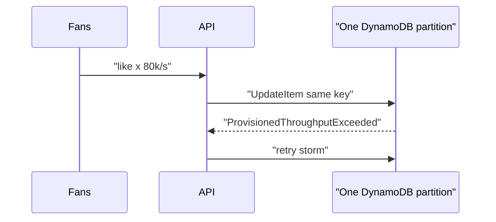

# Lesson 14: Key-Value Stores Explained — Redis vs DynamoDB vs etcd

> **Prerequisites:** [Lesson 13: NoSQL Explained](../13-nosql-explained/README.md) and [Track: Databases](../README.md) (Lesson 14 of 33).  
> **Estimated Reading Time:** 30 minutes  
> **Target Audience:** Backend engineers building carts, sessions, rate limits, feature flags, and service-discovery metadata who must pick among Redis, DynamoDB, and etcd without turning a hot key into a SEV-1.  
> **Free PDF Notes:** [Download SD-E-014.pdf](https://backendroadmap.com/notes/system-design/SD-E-014.pdf) · [Phase 2, Databases (PDF)](https://backendroadmap.com/notes/system-design/Phase2_Databases_Notes.pdf)

> [!NOTE]
> **In one line:** A key-value store is a giant distributed dictionary—put, get, delete by key in constant time; use it when you always know the key; pick Redis for in-memory speed, DynamoDB for durable managed scale, and etcd for small, strongly consistent config.

> [!TIP]
> **The Golden Rule of Key-Value Stores:** If every request already has the key, KV wins. If you need “find all carts containing SKU X,” you need a secondary index, another table, or a different database. Guard against **hot keys** (split/shard the counter) and never treat Redis without persistence as the only copy of money-critical data.

---

## Words You'll Meet Today

| Word | In Plain Words | Role in a Live System |
| :--- | :--- | :--- |
| **Key-value store** | Distributed dictionary: put/get/delete. | Carts, sessions, idempotency keys. |
| **Opaque value** | Store doesn’t interpret the blob. | App owns schema inside JSON/protobuf. |
| **Hash partitioning** | `hash(key)` picks the partition/node. | Even spread; range scans are hard. |
| **Consistent hashing** | Adding a node moves ~1/N keys. | Avoids remapping almost everything. |
| **Hot key** | One key gets disproportionate traffic. | Celebrity counter melts one partition. |
| **TTL** | Auto-delete after expiry. | Sessions/carts/rate windows. |
| **Conditional write** | Write only if version/predicate holds. | Multi-device cart CAS. |
| **Raft** | Consensus log behind etcd. | Strong config / leader election. |

---

## Visual Mental Models & Architecture

### The Simplest Data Model

Shopping cart for user 42: no joins, no reports—just get/put the cart. Three ops cover almost everything: `PUT`, `GET`, `DELETE`.



*Figure 1. The store finds by key; it usually does not query inside the value.*

### How It Scales: Hash Partitioning



*Figure 2. Hash spreads keys; each partition is replicated. A single hot key still lands on one partition.*

---

## Core Definition & Taxonomic Comparison

**What it is:** O(1) access by primary key at massive scale. **What it isn't:** A query engine, a replacement for etcd’s consensus use-cases at petabyte scale, or safe RMW without conditions.

| System | Storage | Speed | Consistency | Best for |
| :--- | :--- | :--- | :--- | :--- |
| **Redis** | Memory (+ optional persistence) | µs | Async replicas typical | Cache, sessions, leaderboards, rate limits |
| **DynamoDB** | Managed, durable | Single-digit ms | Eventual or strong reads | Carts, profiles, durable KV at scale |
| **etcd** | Small replicated disk log (Raft) | ms (consensus writes) | Strong | Config, service discovery, leader election |

---

## Component Breakdown & Anatomy

| Stage | Component | Failure |
| :--- | :--- | :--- |
| Key design | Naming (`cart:42`) | Collisions / missing tenant prefix |
| Partitioning | Hash / virtual nodes | Hot key; `mod N` rebalance pain |
| Write path | Put / conditional update | Lost update without version |
| Expiry | TTL | DynamoDB lazy delete → filter on read |
| Ops | Memory / WCU | OOM or throttle |

### The Observability Gap

| Point | Sees | Hides |
| :--- | :--- | :--- |
| Redis `INFO` | Memory, ops/s | Which key is hot |
| DynamoDB throttle metrics | Table-level | Single partition fire |
| etcd size | DB size | That you stored blobs too big |
| App timeouts | “KV slow” | Hot key vs network |

---

## Mathematical Model: Sizing & Hot Keys

### Cart store sizing (from PDF)

$$5\times10^6\ \text{carts} \times 2\ \text{KB} = 10\ \text{GB}$$

Traffic: 20k reads/s + 4k writes/s with random user IDs → spread across partitions (each ~3k R / 1k W soft cap).

### Why not `hash(key) mod N`?

When $N: 10 \to 11$, about $1 - 10/11 \approx 91\%$ of keys remapping. Prefer consistent hashing or fixed virtual partitions (e.g. 1024) mapped to nodes → move ~$1/N$.

### Hot-key split

Write to `like:123#0 … #9` randomly; sum on read → ~10× write fan-out capacity on that logical counter.

---

## Metrics, Percentiles & Distributions

| Metric | Healthy | Alarm |
| :--- | :--- | :--- |
| Redis p99 GET | `<1 ms` in-DC | `>5 ms` or eviction storms |
| DynamoDB throttle | `~0` | Rising with one partition |
| etcd DB size | Few GB | Approaching design limits |
| Conditional fail rate | Low | Cart conflict storm |

**Average lie:** Table-level 2 ms mean while one celebrity key throttles at 50 ms.

---

## Compounding Effects & System Scale

Idempotency keys + rate limits + session gets per request:

$$T \approx T_{\text{session}} + T_{\text{rate}} + T_{\text{idem}}$$

Keep each sub-ms–few-ms; don’t chain 20 serial Redis calls on the hot path.

| Serial KV calls | If 1 ms each | Budget risk |
| ---: | ---: | :--- |
| 1 | 1 ms | Fine |
| 5 | 5 ms | OK |
| 20 | 20 ms | Eats API budget |
| 50 | 50 ms | Redesign |

---

## Numbers Every Backend Engineer Must Know

| Item | Number |
| :--- | :--- |
| DynamoDB item max | 400 KB |
| DynamoDB partition soft cap | ~3k RCU / 1k WCU |
| Redis leaderboard | `ZINCRBY` / `ZREVRANGE` $O(\log N)$ |
| etcd design target | Small metadata (K8s state), not big data |
| Cart TTL example | 30 days |
| Session TTL example | 30 minutes |

---

## Protocol & Deep Dive: Conditional Cart Update



*Figure 3. Multi-device cart: version condition prevents silent overwrite.*

---

## Hierarchical Budgets & Capacity Sizing

| Workload | Store | Budget |
| :--- | :--- | :--- |
| Session get | Redis/DynamoDB | `≤5 ms p99` |
| Durable cart write | DynamoDB conditional | `≤15 ms p99` |
| Leader election | etcd lease | Strong correctness > raw speed |
| Leaderboard read top-100 | Redis ZSET | `≤2 ms` |

---

## Top Engineering Mitigation Techniques

1. **Always know the key** before choosing KV.
2. **TTL** for ephemeral data; filter expiry on DynamoDB reads.
3. **Conditional writes / versions** for concurrent mutators.
4. **Hot-key splitting** or Redis side counters.
5. **GSI / side table** when a new query appears.
6. **etcd only for small critical metadata.**

---

## Production War Story (SEV-1 Post-Mortem)

**Severity & Impact:** SEV-1 · 18 minutes · Celebrity livestream like-counter on one DynamoDB key; partition throttling cascaded to 35% error rate on engagement API.

**What Happened:** `like:creator_9` received ~80k WPS; one partition hit WCU limit; SDK retries amplified load.



**Fix:** Shard counter keys `#0..#63`; aggregate async to a display value; cache reads; load-test hot creators.

---

## Multi-Language Production Code Tabs

````carousel
```go
// Go: Redis rate limit sliding window counter with TTL
func Allow(ctx context.Context, rdb *redis.Client, ip string, limit int64) (bool, error) {
    key := "rate:ip:" + ip
    n, err := rdb.Incr(ctx, key).Result()
    if err != nil {
        return false, err
    }
    if n == 1 {
        _ = rdb.Expire(ctx, key, time.Minute).Err()
    }
    return n <= limit, nil
}
```

<!-- slide -->

```ts
// TypeScript: DynamoDB conditional cart line update
import { UpdateCommand } from "@aws-sdk/lib-dynamodb";

export function updateCartLine(doc: any, userId: string, sku: string, line: object, expectedVersion: number) {
  return new UpdateCommand({
    TableName: "carts",
    Key: { user_id: userId },
    UpdateExpression: "SET lines.#sku = :line, version = version + :one, expires_at = :exp",
    ConditionExpression: "version = :expected",
    ExpressionAttributeNames: { "#sku": sku },
    ExpressionAttributeValues: {
      ":line": line,
      ":one": 1,
      ":expected": expectedVersion,
      ":exp": Math.floor(Date.now() / 1000) + 30 * 86400,
    },
  });
}
```

<!-- slide -->

```python
# Python: etcd lease for leader election (etcd3)
import etcd3

def campaign(name: str, ttl: int = 10) -> bool:
    client = etcd3.client()
    lease = client.lease(ttl)
    return client.put_if_not_exists(f"/leaders/{name}", "me", lease=lease)
```

<!-- slide -->

```csharp
// C#: Redis sorted set leaderboard
public async Task IncrScoreAsync(IDatabase db, string player, double delta)
{
    await db.SortedSetIncrementAsync("lb:global", player, delta);
}

public async Task<string[]> TopAsync(IDatabase db, long n = 100)
    => (await db.SortedSetRangeByRankAsync("lb:global", 0, n - 1, Order.Descending))
       .Select(x => (string)x!).ToArray();
```
````

---

## Hands-On CLI Verification Workflows

```bash
redis-cli SET cart:42 '{"lines":[]}' EX 60
redis-cli GET cart:42
redis-cli TTL cart:42

python3 -c "print('mod 10→11 remaps ~90% of keys; use consistent hashing / vnodes')"
```

---

## Common Mistakes to Avoid

- Storing data you’ll later need to search by non-key attributes.
- RMW without version/condition.
- Redis as sole durable store with persistence off.
- Large/high-volume data in etcd.
- Ignoring hot keys; assuming more nodes fix one key.

---

## Key Terms Glossary

| Term | Definition |
| :--- | :--- |
| Key-value store | Distributed dictionary API. |
| Opaque value | Store doesn’t inspect contents. |
| Hash partitioning | Key hash → partition. |
| Consistent hashing | Minimal key movement on scale-out. |
| Hot key | Disproportionate traffic on one key. |
| TTL | Automatic expiry. |
| Conditional write | CAS / predicate write. |
| Raft | Consensus protocol (etcd). |

---

## Complete 12 System Design Interview Q&As

### Basic Conceptual Questions (Q1–Q4)

<details>
<summary><strong>Q1: What workloads fit a key-value store? [BASIC]</strong></summary>

<strong>What a strong answer covers:</strong>
High-volume lookups by a known key: sessions, carts, caches, preferences, feature flags, rate limits, idempotency keys—often with TTL.

</details>

<details>
<summary><strong>Q2: Why are KV stores easy to scale? [BASIC]</strong></summary>

<strong>What a strong answer covers:</strong>
Every op names one key; hashing picks one partition; nodes don’t coordinate for a simple get. Add nodes and move a small share of keys (consistent hashing / virtual partitions).

</details>

<details>
<summary><strong>Q3: Redis, DynamoDB, or etcd for service discovery / leader election? [BASIC]</strong></summary>

<strong>What a strong answer covers:</strong>
**etcd**—Raft-strong consistency, watches, leases; built for small critical metadata, not big data.

</details>

<details>
<summary><strong>Q4: What is a hot key and why don’t more nodes fix it? [BASIC]</strong></summary>

<strong>What a strong answer covers:</strong>
One key always hashes to one partition. Scale-out doesn’t split that key unless you manually shard the keyspace or move the counter (e.g. Redis).

</details>

### Scenario-Based Architecture Questions (Q5–Q8)

<details>
<summary><strong>Q5: Two devices add cart items at once. Stop lost updates? [SCENARIO]</strong></summary>

<strong>What a strong answer covers:</strong>
Store a version; `UpdateItem` with `version = :expected`; loser retries. Or per-line `SET lines.#sku` so different SKUs don’t conflict.

</details>

<details>
<summary><strong>Q6: Global leaderboard, 10M players, 50k updates/s. [SCENARIO]</strong></summary>

<strong>What a strong answer covers:</strong>
Redis sorted set (`ZINCRBY`, `ZREVRANGE`). Keep durable history elsewhere; Redis serves ranking.

</details>

<details>
<summary><strong>Q7: Product wants “all carts containing item X.” [SCENARIO]</strong></summary>

<strong>What a strong answer covers:</strong>
KV can’t answer cheaply (would scan). Add GSI/side table `item_id → carts`, or stream to a queryable store.

</details>

<details>
<summary><strong>Q8: Size a DynamoDB cart table: 5M carts × 2 KB, 20k reads/s. [SCENARIO]</strong></summary>

<strong>What a strong answer covers:</strong>
~10 GB data (fine; under 400 KB/item). Random user IDs spread load; on-demand or provisioned with headroom; 30-day TTL for abandoned carts.

</details>

### Advanced & Tricky Interview Questions (Q9–Q12)

<details>
<summary><strong>Q9: Adding nodes doesn’t help a celebrity like-counter. What helps? [TRICKY]</strong></summary>

<strong>What a strong answer covers:</strong>
Split writes across `like:id#0..#k`, sum on read; or count in Redis and flush periodically.

</details>

<details>
<summary><strong>Q10: Why not `hash(key) mod N` for placement? [TRICKY]</strong></summary>

<strong>What a strong answer covers:</strong>
Changing $N$ remaps most keys. Consistent hashing or fixed virtual partitions move ~$1/N$.

</details>

<details>
<summary><strong>Q11: Is Redis persistence enough for the source of truth? [TRICKY]</strong></summary>

<strong>What a strong answer covers:</strong>
Depends: AOF/RDB reduce loss but async replicas and rewrite windows still risk data. For money, prefer durable stores or accept explicit risk with sync replication and backups.

</details>

<details>
<summary><strong>Q12: When does etcd become the wrong tool? [TRICKY]</strong></summary>

<strong>What a strong answer covers:</strong>
Large values, high write volume, or treating it as a general database. It’s a consensus metadata store—keep it small.

</details>

---

## One-Page Master Cheat Sheet

```text
====================================================================================================
              KEY-VALUE STORES — Redis vs DynamoDB vs etcd (SD-E-014)
====================================================================================================
API: PUT / GET / DELETE by key · O(1) · value often opaque

PICK
  Redis ...... µs, data structures, cache/sessions/ZSET/rate limits
  DynamoDB ... durable managed scale, conditional writes, TTL
  etcd ....... Raft-strong config, discovery, leader election (small!)

SCALE
  hash(key) → partition · consistent hashing / vnodes for rebalance
  HOT KEY: split keyspace or side counter — more nodes won't help one key

SAFETY
  conditional version writes for concurrent carts
  TTL for sessions/carts/windows · DynamoDB: also check expiry on read

ANTI-PATTERNS
  x query-by-non-key without GSI     x Redis sole copy of critical data (no persist)
  x big data in etcd                 x hash mod N without virtual shards
====================================================================================================
```

---

## Free PDF notes

[SD-E-014.pdf](https://backendroadmap.com/notes/system-design/SD-E-014.pdf)

---

## Sources

- [Redis data types](https://redis.io/docs/data-types/)
- [DynamoDB conditional updates](https://docs.aws.amazon.com/amazondynamodb/latest/developerguide/Expressions.ConditionExpressions.html)
- [etcd documentation](https://etcd.io/docs/)

---

## Next

Next up: [Lesson 15: Document Databases Explained](../15-document-databases-explained/README.md).
