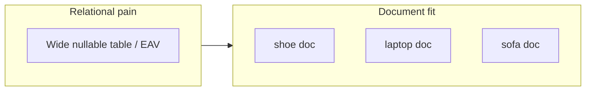
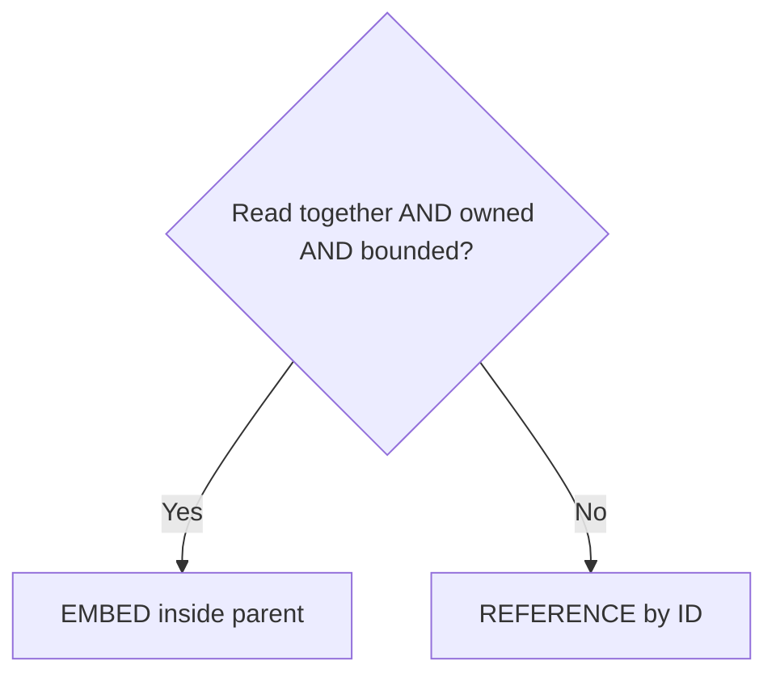
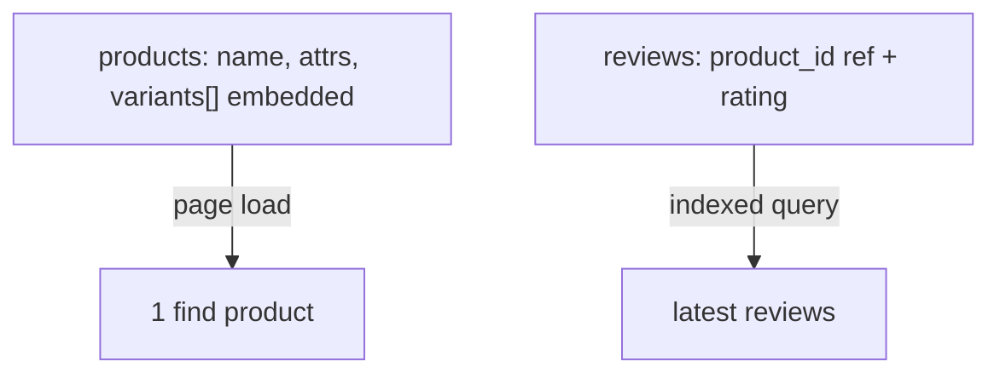
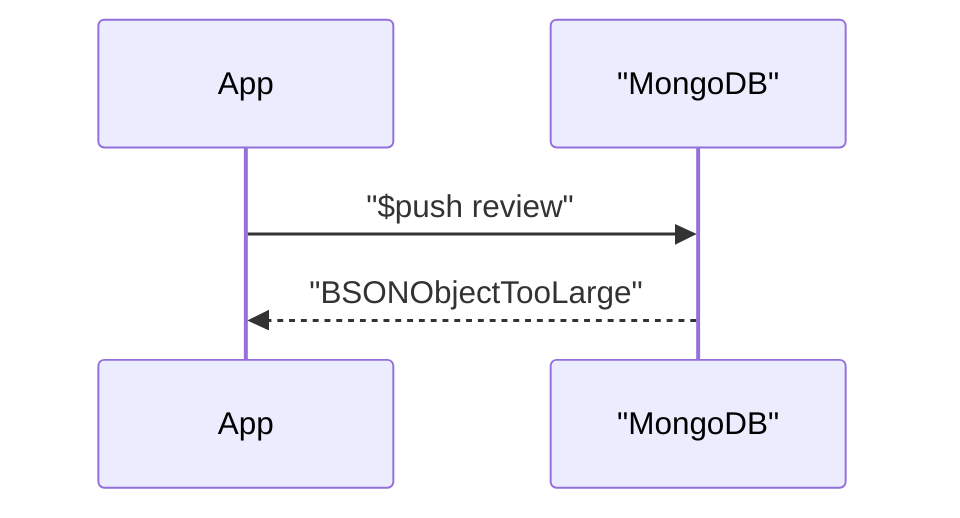

# Lesson 15: Document Databases Explained — Embed vs Reference & MongoDB Limits

> **Prerequisites:** [Lesson 13: NoSQL Explained](../13-nosql-explained/README.md), [Lesson 14: Key-Value Stores](../14-key-value-stores-explained/README.md), and [Track: Databases](../README.md) (Lesson 15 of 33).  
> **Estimated Reading Time:** 30 minutes  
> **Target Audience:** Backend engineers modeling catalogs, blogs, and profiles in MongoDB/Cosmos DB who must choose embed vs reference before hitting 16 MB / 2 MB ceilings.  
> **Free PDF Notes:** [Download SD-E-015.pdf](https://backendroadmap.com/notes/system-design/SD-E-015.pdf) · [Phase 2, Databases (PDF)](https://backendroadmap.com/notes/system-design/Phase2_Databases_Notes.pdf)

> [!NOTE]
> **In one line:** A document database stores each entity as one JSON-like document with its own shape—embed data that is read together, owned, and bounded; reference data that is shared, large, unbounded, or changes independently; keep documents well under the size limit.

> [!TIP]
> **The Golden Rule of Document Modeling:** Ask three questions—**read together? owned by parent? bounded size?** Yes to all three → **embed**. Any no → **reference by ID**. Prefer single-document atomic writes; treat multi-document transactions as exceptions. Remember MongoDB **16 MB** / Cosmos DB **2 MB** hard caps.

---

## Words You'll Meet Today

| Word | In Plain Words | Role |
| :--- | :--- | :--- |
| **Document** | JSON-like record with its own shape. | One product, one order. |
| **Collection** | Group of documents (~table). | `products`, `reviews`. |
| **BSON** | MongoDB binary JSON + richer types. | Dates, int64, etc. |
| **Embed** | Nest related data inside the parent. | Variants, order lines. |
| **Reference** | Store related ID; second query. | Reviews, customers. |
| **Multikey index** | Index every array element. | Filter by `tags`. |
| **Aggregation pipeline** | Staged `$match/$group/$sort`. | Avg rating by category. |
| **JSONB** | Postgres binary JSON column. | Middle ground with SQL. |

---

## Visual Mental Models & Architecture

### Products That Don’t Share a Shape

Shoes have sizes/colors; laptops have CPU/RAM; sofas have fabric. One relational table means ~100 sparse columns or an awkward EAV attributes table. Documents carry only the fields they need.



*Figure 1. Variable shape is a natural document fit.*

### Embed vs Reference



*Figure 2. Three yeses → embed; any no → reference.*

---

## Core Definition & Taxonomic Comparison

**What it is:** Collections of self-describing documents with secondary indexes and aggregations. **What it isn't:** Schemaless chaos (schema lives in the app), free unbounded arrays, or a free substitute for multi-row ACID ledgers.

| Pattern | When | Example |
| :--- | :--- | :--- |
| Embed | Together, owned, bounded | Order line items (≤100) |
| Reference | Shared / unbounded / independent | Reviews, customer master |
| Hybrid | Preview + full set | Embed latest 5 reviews + count; rest referenced |
| Postgres JSONB | Need joins + flexible attrs | Catalog attrs + orders/payments |

---

## Component Breakdown & Anatomy

| Piece | Role | Failure |
| :--- | :--- | :--- |
| Document shape | App schema | Drift without validation |
| Indexes | Filter/sort | Collection scan |
| Embed arrays | One-read pages | Size cap / rewrite cost |
| `$lookup` / app join | References | N+1 or slow join |
| Multi-doc txn | Rare cross-doc | Slow especially cross-shard |

### The Observability Gap

| Point | Sees | Hides |
| :--- | :--- | :--- |
| Query ms | Latency | Working set document size |
| `docsExamined` | Collscans | Missing index |
| Update time growth | Slow writes | Document bloat |
| Txn abort rate | Conflicts | Wrong model (should be one doc) |

---

## Mathematical Model: Size Caps & Embed Limits

MongoDB max document $= 16\ \text{MB}$. Cosmos item $= 2\ \text{MB}$.

If each review ≈ 1 KB:

$$N_{\max}^{\text{Cosmos}} \approx \frac{2\times10^6}{10^3} = 2{,}000,\quad N_{\max}^{\text{Mongo}} \approx 16{,}000$$

50,000 reviews × 1 KB = 50 MB → **3× MongoDB’s cap**—must reference.

Order lines: 100 × 300 B = 30 KB → safe embed.

---

## Metrics, Percentiles & Distributions

| Metric | Healthy | Smell |
| :--- | :--- | :--- |
| p50 product read | few ms | — |
| p99 as docs grow | stable | climbs with MB-sized docs |
| `docsExamined/n` | ~1 with index | ≫1 collscan |
| Avg doc size | << limit | approaching 16/2 MB |

**Average lie:** Mean update 5 ms while 1% of bloated product docs take 200 ms rewrites.

---

## Compounding Effects & System Scale

Embedded display names in 2M comments: one rename → 2M updates.

$$Cost_{rename} = N_{comments}$$

Reference `user_id` instead (or accept stale names + async backfill).

| Fan-out updates | Feels like |
| ---: | :--- |
| 1 | Fine |
| 10³ | Batch job |
| 10⁶+ | Outage risk |

---

## Numbers Every Backend Engineer Must Know

| Limit | Value |
| :--- | :--- |
| MongoDB doc | 16 MB |
| Cosmos DB item | 2 MB |
| Prefer single-doc atomicity | Always when possible |
| Multikey index | One entry per array element |
| JSONB + GIN | Strong Postgres alternative |

---

## Protocol & Deep Dive: Catalog Shape



*Figure 3. Product page = one product read + indexed reviews query.*

```javascript
db.products.createIndex({ category: 1, "attributes.color": 1 })
db.products.find({ category: "shoes", "attributes.color": "red" })
```

---

## Hierarchical Budgets & Capacity Sizing

| Operation | Budget | Design |
| :--- | :--- | :--- |
| Product page | `≤50 ms` | Embed variants; ref reviews |
| Add review | `≤30 ms` | Insert review doc + `$inc` count |
| Rename user | Avoid sync fan-out | Reference, don’t embed name everywhere |

---

## Top Engineering Mitigation Techniques

1. Embed/reference checklist (3 questions).
2. Index every filter/sort field (incl. nested).
3. Cap arrays; paginate referenced children.
4. `$jsonSchema` / versioned shapes.
5. Prefer single-document updates.
6. Consider Postgres JSONB when orders/payments join the catalog.

---

## Production War Story (SEV-1 Post-Mortem)

**Severity & Impact:** SEV-1 · Popular SKU hit MongoDB 16 MB after embedding all reviews; product page 500s; writes failing.

**What Happened:** `reviews: []` grew unbounded (~1 KB × 17k).



**Fix:** Move reviews to collection; embed only latest 5 + `reviewCount`; backfill; alert on doc size > 1 MB.

---

## Multi-Language Production Code Tabs

````carousel
```go
// Go: insert review as reference + increment count on product
func AddReview(ctx context.Context, products, reviews *mongo.Collection, productID, text string, rating int) error {
    _, err := reviews.InsertOne(ctx, bson.M{
        "product_id": productID, "rating": rating, "text": text, "created": time.Now(),
    })
    if err != nil {
        return err
    }
    _, err = products.UpdateByID(ctx, productID, bson.M{"$inc": bson.M{"reviewCount": 1}})
    return err
}
```

<!-- slide -->

```ts
// TypeScript: embed vs reference decision helper
export function shouldEmbed(opts: { readTogether: boolean; owned: boolean; bounded: boolean }) {
  return opts.readTogether && opts.owned && opts.bounded;
}
```

<!-- slide -->

```python
# Python: aggregation average rating (category denormalized onto review)
pipeline = [
    {"$match": {"created": {"$gte": datetime(2026, 1, 1)}}},
    {"$group": {"_id": "$category", "avgRating": {"$avg": "$rating"}}},
    {"$sort": {"avgRating": -1}},
]
list(db.reviews.aggregate(pipeline))
```

<!-- slide -->

```csharp
// C#: MongoDB update with array filter on embedded variant stock
var filter = Builders<Product>.Filter.Eq(p => p.Id, id)
    & Builders<Product>.Filter.ElemMatch(p => p.Variants, v => v.Sku == sku);
var update = Builders<Product>.Update.Inc("variants.$.stock", -1);
await products.UpdateOneAsync(filter, update);
```
````

---

## Hands-On CLI Verification Workflows

```bash
# Rough embed limit check
python3 -c "print(16_000_000/1000, 'reviews @1KB → Mongo cap'); print(2_000_000/1000, '→ Cosmos')"
```

---

## Common Mistakes to Avoid

- Embedding unbounded arrays (reviews/events).
- Querying unindexed fields (collection scans).
- Modeling like normalized tables then joining every page.
- Relying on multi-doc txns for the common path.
- Believing “schemaless” means no schema discipline.

---

## Key Terms Glossary

| Term | Definition |
| :--- | :--- |
| Document / collection | JSON-like record / table-like group. |
| Embed / reference | Nest vs point by ID. |
| Multikey index | Index array elements. |
| Aggregation pipeline | Staged analytics. |
| 16 MB / 2 MB | Mongo / Cosmos size caps. |
| JSONB | Postgres flexible JSON. |

---

## Complete 12 System Design Interview Q&As

### Basic Conceptual Questions (Q1–Q4)

<details>
<summary><strong>Q1: When do you embed vs reference? [BASIC]</strong></summary>

<strong>What a strong answer covers:</strong>
Embed if read together, owned, bounded (variants, line items). Reference if shared, large/unbounded, or independently updated (reviews, customers).

</details>

<details>
<summary><strong>Q2: What if you query a field with no index? [BASIC]</strong></summary>

<strong>What a strong answer covers:</strong>
Full collection scan—milliseconds become seconds at 10M docs. Index filter/sort fields including nested paths.

</details>

<details>
<summary><strong>Q3: Why prefer single-document writes? [BASIC]</strong></summary>

<strong>What a strong answer covers:</strong>
Always atomic, no txn coordination. Multi-doc txns work but are slower (worse cross-shard).

</details>

<details>
<summary><strong>Q4: Are document DBs schemaless? [BASIC]</strong></summary>

<strong>What a strong answer covers:</strong>
No—schema moves to the app. Use validation (`$jsonSchema`) and versioned shapes.

</details>

### Scenario-Based Architecture Questions (Q5–Q8)

<details>
<summary><strong>Q5: Blog posts with up to 20,000 comments. [SCENARIO]</strong></summary>

<strong>What a strong answer covers:</strong>
Posts collection + comments collection indexed `(post_id, created)`. Optionally embed latest 3 comments + count on the post.

</details>

<details>
<summary><strong>Q6: Display name embedded in 2M comments; users rename. [SCENARIO]</strong></summary>

<strong>What a strong answer covers:</strong>
Problem: 2M updates. Reference `user_id` (lookup/cache), or accept stale names + async backfill. Embed only rarely changing data.

</details>

<details>
<summary><strong>Q7: Postgres JSONB vs MongoDB for catalog + orders/payments? [SCENARIO]</strong></summary>

<strong>What a strong answer covers:</strong>
Postgres JSONB often wins: flexible attrs + relational orders/payments with real txns/joins. Mongo if catalog dominates, needs sharding, rarely joins.

</details>

<details>
<summary><strong>Q8: Design shoe product with variants and reviews. [SCENARIO]</strong></summary>

<strong>What a strong answer covers:</strong>
Embed `variants[]` (bounded). Attributes object for sizes/colors. Reviews in separate collection by `product_id`.

</details>

### Advanced & Tricky Interview Questions (Q9–Q12)

<details>
<summary><strong>Q9: Updates slow as documents grow despite indexes. Why? [TRICKY]</strong></summary>

<strong>What a strong answer covers:</strong>
Updates rewrite large docs; reads ship more bytes. Split growing parts (history/reviews) out.

</details>

<details>
<summary><strong>Q10: How do size caps interact with “embed for speed”? [TRICKY]</strong></summary>

<strong>What a strong answer covers:</strong>
Embed until boundedness breaks—measure growth. Hybrid: embed preview, reference full history.

</details>

<details>
<summary><strong>Q11: Multikey indexes—cost? [TRICKY]</strong></summary>

<strong>What a strong answer covers:</strong>
One index entry per array element → write amp and storage. Huge arrays make indexes fat; another reason not to embed unbounded lists.

</details>

<details>
<summary><strong>Q12: When do multi-document transactions still make sense? [TRICKY]</strong></summary>

<strong>What a strong answer covers:</strong>
Rare cross-entity invariants you can’t reshape into one document—accept latency, keep them short, avoid cross-shard when possible.

</details>

---

## One-Page Master Cheat Sheet

```text
====================================================================================================
         DOCUMENT DATABASES — EMBED vs REFERENCE, MongoDB LIMITS (SD-E-015)
====================================================================================================
MODEL
  Embed if: read together + owned + bounded
  Reference if: shared OR unbounded OR independently updated
  Prefer single-document atomic writes

LIMITS
  MongoDB 16 MB/doc · Cosmos 2 MB/item
  ~1KB reviews → ~2k Cosmos / ~16k Mongo before hard fail

INDEXES
  Index filters/sorts (nested OK) · else collection scan
  Multikey: one entry per array element

ANTI-PATTERNS
  x unbounded embedded arrays     x unindexed queries
  x normalize then join every page x "schemaless" = no validation
====================================================================================================
```

---

## Free PDF notes

[SD-E-015.pdf](https://backendroadmap.com/notes/system-design/SD-E-015.pdf)

---

## Sources

- [MongoDB Data Model Design](https://www.mongodb.com/docs/manual/core/data-model-design/)
- [MongoDB BSON size limit](https://www.mongodb.com/docs/manual/reference/limits/)

---

## Next

Next up: [Lesson 16: Wide-Column Stores](../16-wide-column-stores/README.md).
