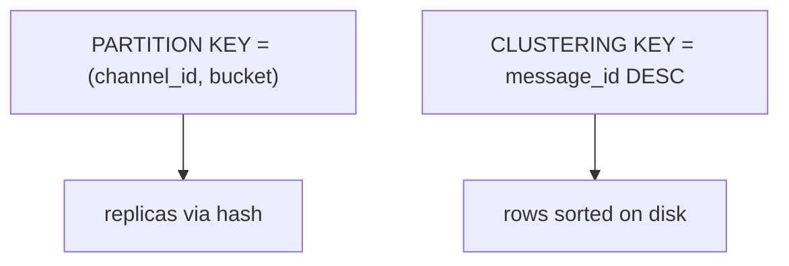
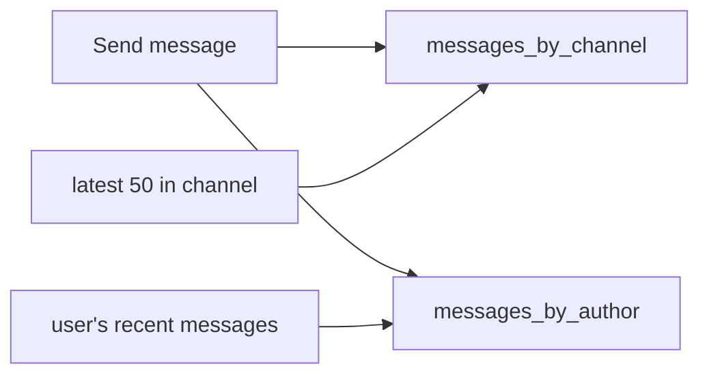
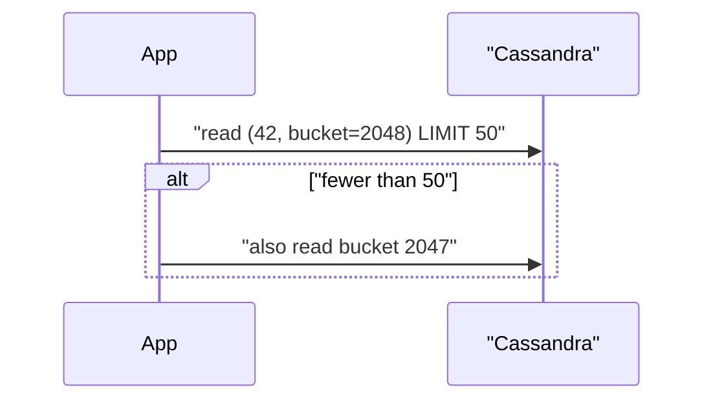
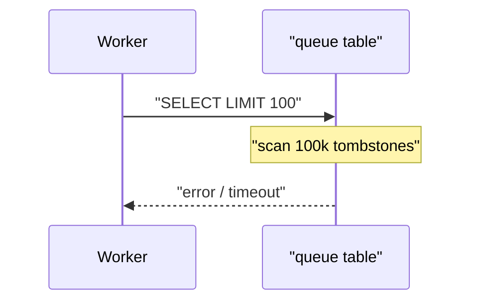

# Lesson 16: Wide-Column Stores — Cassandra Table Design for a Chat App

> **Prerequisites:** [Lesson 13: NoSQL Explained](../13-nosql-explained/README.md), [Lesson 06: LSM Trees & SSTables](../06-lsm-trees-sstables/README.md), and [Track: Databases](../README.md) (Lesson 16 of 33).  
> **Estimated Reading Time:** 32 minutes  
> **Target Audience:** Backend engineers designing chat, feeds, and event logs on Cassandra/Scylla who must keep partitions under ~100 MB and avoid tombstone death.  
> **Free PDF Notes:** [Download SD-E-016.pdf](https://backendroadmap.com/notes/system-design/SD-E-016.pdf) · [Phase 2, Databases (PDF)](https://backendroadmap.com/notes/system-design/Phase2_Databases_Notes.pdf)

> [!NOTE]
> **In one line:** A wide-column store keeps rows in partitions chosen by a partition key and sorted by a clustering key—design one table per query so each read hits one partition, and bucket the partition key so no partition grows without limit.

> [!TIP]
> **The Golden Rule of Wide-Column Design:** **Queries first, tables second.** Every efficient read must supply the partition key. Duplicate writes across query tables (writes are cheap on LSM). **Bucket** busy keys (e.g. 10-day windows) to keep partitions **≪ 100 MB**. Never use Cassandra as a work queue—**tombstones** will kill you.

---

## Words You'll Meet Today

| Word | Meaning | Role |
| :--- | :--- | :--- |
| **Partition key** | Hashed to pick replica set. | Must appear in every efficient query. |
| **Clustering key** | Sort order inside partition. | “Latest 50” = sequential slice. |
| **Wide row** | Partition with many clustered rows. | Thousands of messages. |
| **Bucket** | Time slice added to partition key. | Caps partition size. |
| **Snowflake ID** | Time-sortable 64-bit ID. | Clustering without random UUIDs. |
| **Tombstone** | Delete marker in LSM. | Purged after `gc_grace_seconds`. |
| **CQL** | Cassandra Query Language. | SQL-like, not relational. |
| **ALLOW FILTERING** | Cluster-wide filter smell. | Usually wrong model. |

---

## Visual Mental Models & Architecture

### Billions of Chat Messages

Open a channel → latest 50 messages instantly while millions write/minute. Discord-style wide-column design.



*Figure 1. Partition key places data; clustering key orders it for range reads.*

### One Table Per Query



*Figure 2. Denormalize: same message written twice; each read is one partition.*

---

## Core Definition & Taxonomic Comparison

**What it is:** Partitions of sorted rows for write-heavy, known-query workloads (Cassandra, ScyllaDB, Bigtable/HBase). **What it isn't:** Columnar analytics (BigQuery/Redshift)—those store columns for scans, not wide partitions for key lookups.

| Term | Meaning | Example |
| :--- | :--- | :--- |
| Wide-column OLTP | Partition + clustering | Chat messages |
| Columnar OLAP | Column compression/scans | Warehouse aggregates |
| Partition key | Placement | `(channel_id, bucket)` |
| Clustering key | On-disk order | `message_id DESC` |

---

## Component Breakdown & Anatomy

| Stage | Component | Failure |
| :--- | :--- | :--- |
| Query list | Product access patterns | Missing table → `ALLOW FILTERING` |
| Partition key | Hash placement | Hot/unbounded partition |
| Clustering | Sorted slice | Random UUID kills time order |
| Write path | Memtable + commitlog | Dual-write drift (app must write both tables) |
| Delete path | Tombstones | Queue anti-pattern |

### The Observability Gap

| Point | Sees | Hides |
| :--- | :--- | :--- |
| Read latency | p99 | Tombstone scans |
| Partition size metrics | Large partitions | Which channel |
| Compaction stats | Backlog | Delete-heavy workload |
| App errors | Timeouts | 100k tombstone hard fail |

---

## Mathematical Model: Bucket Sizing

Busy channel: $20{,}000$ msgs/day × $300$ B = $6$ MB/day.

| Strategy | Size | Verdict |
| :--- | :--- | :--- |
| No bucket, 3 years | $20k \times 1095 \times 300$ B ≈ **6.6 GB** | Hot spot, repair pain |
| 10-day bucket | $6 \times 10 = 60$ MB | Under ~100 MB guideline |
| 200k msgs/day | 60 MB/day → **1-day** buckets | Still ~60 MB |

Guideline: keep partitions **well under 100 MB**.

---

## Metrics, Percentiles & Distributions

| Metric | Target |
| :--- | :--- |
| Partition size | ≪ 100 MB |
| Tombstones warned | 1,000 scanned |
| Tombstones fail | 100,000 |
| `gc_grace_seconds` default | 10 days |
| Channel open p99 | single-digit–tens ms for one partition read |

---

## Compounding Effects & System Scale

Without buckets, partition size grows linearly with time:

$$S(t) = \lambda_{\text{msg/day}} \times b \times t$$

Buckets bound $t$ to window $W$: $S = \lambda \times b \times W$.

| Channels × unbounded | Cluster effect |
| :--- | :--- |
| Few busy channels | Hot replicas |
| Many quiet | Fine |
| Queue delete pattern | Tombstone cliffs |

---

## Numbers Every Backend Engineer Must Know

| Fact | Number |
| :--- | :--- |
| Partition size guideline | ≪ 100 MB |
| Tombstone warn / fail | 1k / 100k |
| Default `gc_grace_seconds` | 10 days |
| Snowflake | time-sortable clustering |
| ScyllaDB | C++ Cassandra-compatible (Discord 2023 move) |

---

## Protocol & Deep Dive: messages Table

```cql
CREATE TABLE messages (
  channel_id bigint,
  bucket     int,      -- message time in days / 10
  message_id bigint,   -- Snowflake ID
  author_id  bigint,
  content    text,
  PRIMARY KEY ((channel_id, bucket), message_id)
) WITH CLUSTERING ORDER BY (message_id DESC);

SELECT * FROM messages
 WHERE channel_id = 42 AND bucket = 2048
 LIMIT 50;
```



*Figure 3. Newest bucket first; spill into previous bucket for quiet channels.*

---

## Hierarchical Budgets & Capacity Sizing

| Op | Budget | Design |
| :--- | :--- | :--- |
| Open channel | `≤30 ms` | One partition (+ maybe prev bucket) |
| Send message | `≤20 ms` | Dual write to query tables |
| Author history | `≤30 ms` | `messages_by_author` table |

---

## Top Engineering Mitigation Techniques

1. Query → table mapping spreadsheet.
2. Time buckets on hot partition keys.
3. Time-sortable IDs for clustering.
4. Dual-write (or CDC) to denormalized tables.
5. Kafka/SQS/Redis for queues—not Cassandra.
6. Monitor partition size & tombstone warnings.

---

## Production War Story (SEV-1 Post-Mortem)

**Severity & Impact:** SEV-1 · Job queue in Cassandra · reads timed out after tombstones hit 100k; batch pipeline stalled 2 hours.

**What Happened:** Insert job → process → delete. Deletes wrote tombstones retained for 10 days; head-of-line scans paid for every delete.



**Fix:** Move queue to Kafka; set alerts on tombstone warnings; never delete-heavy patterns on wide-column tables.

---

## Multi-Language Production Code Tabs

````carousel
```go
// Go: write message to channel + author tables (gocql)
func Send(session *gocql.Session, channel, author, msgID int64, bucket int, content string) error {
    if err := session.Query(`INSERT INTO messages (channel_id,bucket,message_id,author_id,content)
        VALUES (?,?,?,?,?)`, channel, bucket, msgID, author, content).Exec(); err != nil {
        return err
    }
    return session.Query(`INSERT INTO messages_by_author (author_id,bucket,message_id,channel_id,content)
        VALUES (?,?,?,?,?)`, author, bucket, msgID, channel, content).Exec()
}
```

<!-- slide -->

```ts
// TypeScript: bucket from timestamp (10-day windows)
export function bucketFromMs(ms: number, daysPerBucket = 10): number {
  const day = Math.floor(ms / 86_400_000);
  return Math.floor(day / daysPerBucket);
}
```

<!-- slide -->

```python
# Python: read latest 50 with bucket fallback
def latest_messages(session, channel_id: int, bucket: int, limit: int = 50):
    rows = list(session.execute(
        "SELECT * FROM messages WHERE channel_id=%s AND bucket=%s LIMIT %s",
        (channel_id, bucket, limit),
    ))
    if len(rows) < limit and bucket > 0:
        rows += list(session.execute(
            "SELECT * FROM messages WHERE channel_id=%s AND bucket=%s LIMIT %s",
            (channel_id, bucket - 1, limit - len(rows)),
        ))
    return rows
```

<!-- slide -->

```csharp
// C#: CQL partition key reminder in API
public sealed record MessageKey(long ChannelId, int Bucket, long MessageId);
// PRIMARY KEY ((ChannelId, Bucket), MessageId) — queries must include both PK parts
```
````

---

## Hands-On CLI Verification Workflows

```bash
python3 -c "msgs=20000; b=300; days=10; print(msgs*b*days/1e6, 'MB per 10-day bucket')"
python3 -c "print(20000*1095*300/1e9, 'GB if unbucketed for 3 years')"
```

---

## Common Mistakes to Avoid

- Designing from entities → `ALLOW FILTERING`.
- Partition by channel alone → multi-GB partitions.
- Using table as queue (insert/delete churn).
- Random UUIDs as clustering keys.
- Confusing wide-column with columnar warehouses.

---

## Key Terms Glossary

| Term | Definition |
| :--- | :--- |
| Partition / clustering key | Placement vs sort order. |
| Wide row | Many clustered rows in one partition. |
| Bucket | Time slice in the partition key. |
| Tombstone | LSM delete marker. |
| gc_grace_seconds | Wait before purging tombstones. |
| CQL | Cassandra’s query language. |

---

## Complete 12 System Design Interview Q&As

### Basic Conceptual Questions (Q1–Q4)

<details>
<summary><strong>Q1: How do you design a Cassandra table for chat? [BASIC]</strong></summary>

<strong>What a strong answer covers:</strong>
Start from the query. `PRIMARY KEY ((channel_id, bucket), message_id)` with `CLUSTERING ORDER BY (message_id DESC)` using Snowflake IDs. Load channel = newest bucket’s first 50 rows.

</details>

<details>
<summary><strong>Q2: Partition key vs clustering key? [BASIC]</strong></summary>

<strong>What a strong answer covers:</strong>
Partition key → which nodes. Clustering key → order inside partition for range/“latest N” sequential reads. Efficient queries must provide the partition key.

</details>

<details>
<summary><strong>Q3: Why avoid large partitions? [BASIC]</strong></summary>

<strong>What a strong answer covers:</strong>
One replica set owns them → hot spots, slow reads, painful compaction/repair. Keep ≪ 100 MB via bucketing.

</details>

<details>
<summary><strong>Q4: Wide-column vs columnar analytics? [BASIC]</strong></summary>

<strong>What a strong answer covers:</strong>
Cassandra: rows in partitions for key lookups/writes. BigQuery-style: columns for scanning/aggregating billions of rows.

</details>

### Scenario-Based Architecture Questions (Q5–Q8)

<details>
<summary><strong>Q5: Also need “messages by user 7, newest first.” [SCENARIO]</strong></summary>

<strong>What a strong answer covers:</strong>
Second table `messages_by_author` with `PRIMARY KEY ((author_id, bucket), message_id) DESC`; write both. Don’t filter the channel table by author.

</details>

<details>
<summary><strong>Q6: Bucket size for up to 200k msgs/day at 300 B? [SCENARIO]</strong></summary>

<strong>What a strong answer covers:</strong>
60 MB/day → 1-day buckets (~60 MB). Quiet channels span many buckets—read back until 50 messages.

</details>

<details>
<summary><strong>Q7: Team uses Cassandra as a job queue; reads slow. Why? [SCENARIO]</strong></summary>

<strong>What a strong answer covers:</strong>
Deletes → tombstones retained ~10 days; head scans hit warn/fail thresholds. Use Kafka/SQS/Redis for queues.

</details>

<details>
<summary><strong>Q8: Why Snowflake IDs instead of UUIDv4 for clustering? [SCENARIO]</strong></summary>

<strong>What a strong answer covers:</strong>
Need time order on disk for “latest N.” Random UUIDs scatter and destroy sequential reads.

</details>

### Advanced & Tricky Interview Questions (Q9–Q12)

<details>
<summary><strong>Q9: Why can’t you delete data immediately without tombstones? [TRICKY]</strong></summary>

<strong>What a strong answer covers:</strong>
SSTables are immutable; a replica that missed the delete could resurrect data on repair. Tombstones win until every replica has seen the delete (grace period).

</details>

<details>
<summary><strong>Q10: How does dual-write denormalization fail? [TRICKY]</strong></summary>

<strong>What a strong answer covers:</strong>
One insert succeeds, the other fails → inconsistency. Mitigate with retries, idempotent upserts, or CDC/batch repair.

</details>

<details>
<summary><strong>Q11: Leaderless Cassandra vs leader-follower—why for chat? [TRICKY]</strong></summary>

<strong>What a strong answer covers:</strong>
Any replica can take writes; tunable consistency; high write availability. Chat tolerates careful CL choices; modeling still dominates.

</details>

<details>
<summary><strong>Q12: What if one channel is 100× busier overnight? [TRICKY]</strong></summary>

<strong>What a strong answer covers:</strong>
Shrink bucket window for that workload class, or add another bucket dimension (shard salt) so one channel maps to multiple partitions.

</details>

---

## One-Page Master Cheat Sheet

```text
====================================================================================================
           WIDE-COLUMN STORES — Cassandra chat design (SD-E-016)
====================================================================================================
DESIGN
  queries first → one table per query · denormalize writes (LSM writes are cheap)
  PRIMARY KEY ((partition...), clustering...) · clustering gives sorted slices

CHAT
  ((channel_id, bucket), message_id DESC) · Snowflake IDs · LIMIT 50 · prev bucket fallback

SIZE
  keep partitions << 100 MB · bucket from busiest channel math
  20k msg/day * 300B * 10d ≈ 60 MB

TOMBSTONES
  deletes are markers · gc_grace ~10d · warn 1k / fail 100k · NOT a queue

ANTI-PATTERNS
  x entity tables + ALLOW FILTERING   x unbucketed hot channels
  x UUID clustering                   x Cassandra as work queue
====================================================================================================
```

---

## Free PDF notes

[SD-E-016.pdf](https://backendroadmap.com/notes/system-design/SD-E-016.pdf)

---

## Sources

- [Cassandra Data Modeling](https://cassandra.apache.org/doc/latest/cassandra/data_modeling/index.html)
- [Discord — Why Discord is switching from Go to Rust (Scylla context)](https://discord.com/blog/why-discord-is-switching-from-go-to-rust)

---

## Next

Next up: [Lesson 17: Graph Databases Explained](../17-graph-databases-explained/README.md).
