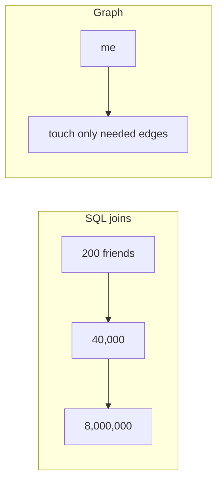
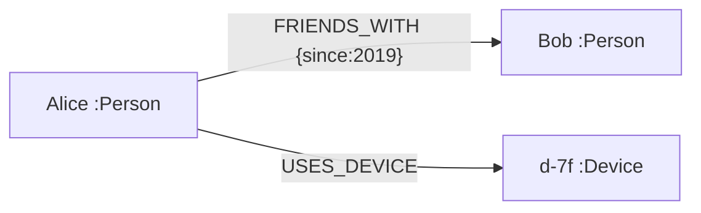
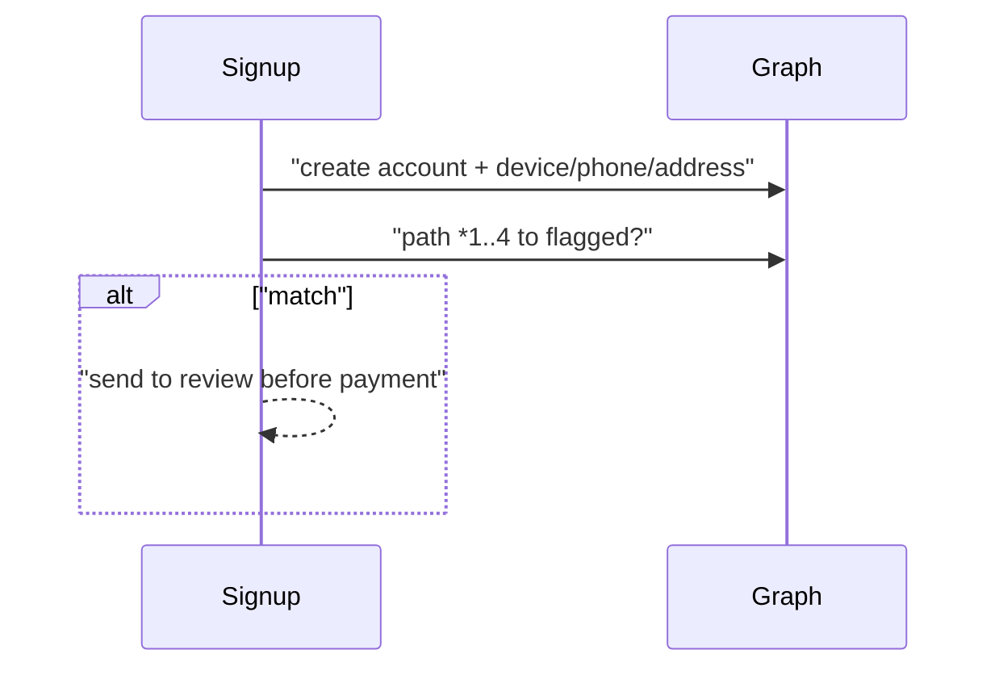
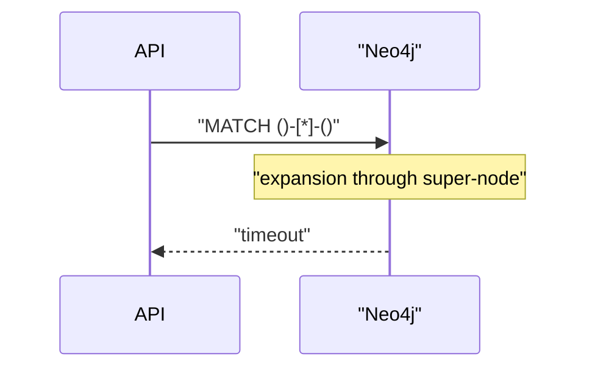

# Lesson 17: Graph Databases Explained — Friend-of-Friend, Fraud Rings & Cypher

> **Prerequisites:** [Lesson 13: NoSQL Explained](../13-nosql-explained/README.md) and [Track: Databases](../README.md) (Lesson 17 of 33).  
> **Estimated Reading Time:** 30 minutes  
> **Target Audience:** Backend engineers building recommendations, fraud detection, and dependency graphs who need index-free adjacency—and know when `WITH RECURSIVE` in Postgres is enough.  
> **Free PDF Notes:** [Download SD-E-017.pdf](https://backendroadmap.com/notes/system-design/SD-E-017.pdf) · [Phase 2, Databases (PDF)](https://backendroadmap.com/notes/system-design/Phase2_Databases_Notes.pdf)

> [!NOTE]
> **In one line:** A graph database stores nodes and relationships and follows edges as pointer hops, so a query costs what it touches—not the size of the database; choose it when key queries traverse relationships many hops deep or to a variable depth.

> [!TIP]
> **The Golden Rule of Graphs:** Use a graph when **relationships are the product** (FoF, fraud rings, blast-radius deps). Cap variable-length paths (`*1..4`), index start nodes, and plan for **super-nodes**. For a 20k-employee org chart, Postgres `WITH RECURSIVE` is usually enough—don’t pay graph complexity for shallow trees.

---

## Words You'll Meet Today

| Word | Meaning | Role |
| :--- | :--- | :--- |
| **Node** | Entity + labels + properties. | `:Person`, `:Account`. |
| **Relationship** | Typed, directed edge + props. | `FRIENDS_WITH`, `USES_DEVICE`. |
| **Property graph** | Nodes + rels + properties. | Neo4j model. |
| **Traversal** | Walk edges hop by hop. | FoF, fraud path. |
| **Index-free adjacency** | Node points directly to edges. | Cost ∝ touched subgraph. |
| **Cypher / GQL** | Pattern query languages. | Whiteboard-shaped queries. |
| **Variable-length path** | `*1..4` hops. | Must be bounded. |
| **Super-node** | Huge degree node. | Celebrity fan-out bomb. |

---

## Visual Mental Models & Architecture

### People You May Know

SQL: self-join friendships twice (three hops = three joins); rows multiply each hop. Graph: follow pointers.



*Figure 1. SQL work grows with hops × index depth on huge tables; graph work grows with edges touched.*

### Property Graph



*Figure 2. Labels, typed directed relationships, properties on both.*

---

## Core Definition & Taxonomic Comparison

**What it is:** Native graph storage with index-free adjacency (Neo4j, Neptune, GQL). **What it isn't:** A general OLTP/OLAP replacement; hard to shard because traversals cross cuts.

| Approach | Best for | Weak for |
| :--- | :--- | :--- |
| Graph DB | Multi-hop / variable depth | Big aggregations, simple KV |
| SQL recursive CTE | Modest hierarchies | Dense social/fraud at scale |
| Wide-column | Time-ordered messages | Relationship explosion queries |

---

## Component Breakdown & Anatomy

| Piece | Role | Failure |
| :--- | :--- | :--- |
| Start-node index | Find entry | Full label scan |
| Edge pointers | Traversal | Super-node explosion |
| Path bound | Cap depth | Unbounded `*` meltdown |
| Properties | Filters | Unindexed property lookup |

### The Observability Gap

| Point | Sees | Hides |
| :--- | :--- | :--- |
| Query time | Slow FoF | Super-node on path |
| DB size | Large graph | Touched subgraph size |
| Page cache | Hits | Expansion fan-out |

---

## Mathematical Model: Hop Explosion

Degree $d = 200$:

| Hops | Paths ~ $d^{h}$ |
| ---: | ---: |
| 1 | 200 |
| 2 | 40,000 |
| 3 | 8,000,000 |

In SQL each row is an index probe into a huge `friendships` table. In a graph, a 2-hop query visits ~40k edges whether the DB has 1M or 1B users—**cost ∝ touched**, not total size (idealized index-free adjacency).

---

## Metrics, Percentiles & Distributions

| Metric | Meaning |
| :--- | :--- |
| p50 FoF | Precomputed/cached users |
| p99 FoF | Live traversal / denser ego nets |
| Max degree | Super-node risk |
| Expansion rate | Rows touched per hop |

**Average lie:** Mean FoF 30 ms while celebrity-adjacent users timeout.

---

## Compounding Effects & System Scale

Unbounded path `*`:

$$|V_{\text{reached}}| \lesssim \min\left(N, \sum_{h=1}^{D} d^{h}\right)$$

Without $D$ cap on dense graphs → query explodes.

| Depth cap | Typical fraud use |
| ---: | :--- |
| 2 | Direct shared device |
| 4 | Common bank setting |
| ∞ | Outage |

---

## Numbers Every Backend Engineer Must Know

| Fact | Number |
| :--- | :--- |
| FoF 200 friends 2 hops | ~40k paths |
| Org chart 20k rows | Postgres recursive OK |
| Path queries | Always bound depth |
| GQL | ISO standard (2024) |
| Sharding graphs | Traversals become RPCs |

---

## Protocol & Deep Dive: Cypher FoF & Fraud

```cypher
MATCH (me:Person {id: $userId})-[:FRIENDS_WITH]-(f:Person)-[:FRIENDS_WITH]-(fof:Person)
WHERE fof <> me AND NOT (me)-[:FRIENDS_WITH]-(fof)
RETURN fof.name, count(DISTINCT f) AS mutual
ORDER BY mutual DESC LIMIT 10;
```

```cypher
MATCH (bad:Account {flagged: true})-[:USES_DEVICE|HAS_PHONE|SHIPS_TO*1..4]-(a:Account)
WHERE a <> bad
RETURN DISTINCT a.id;
```



*Figure 3. Fraud check at signup before money moves.*

---

## Hierarchical Budgets & Capacity Sizing

| Query | Budget | Tactic |
| :--- | :--- | :--- |
| FoF top-10 | `≤100 ms` interactive | Precompute nightly + cache; live for new users |
| Fraud *1..4 | `≤50 ms` at signup | Bound depth; skip known super-nodes |
| Org “under VP” | `≤20 ms` | Prefer SQL recursive at 20k scale |

---

## Top Engineering Mitigation Techniques

1. Cap path depth always.
2. Index start lookup properties.
3. Precompute/cache FoF for heavy users.
4. Detect/skip/sample super-nodes.
5. Keep records/aggregations in relational/warehouse.
6. Home-region / careful placement if multi-DC (sharding is hard).

---

## Production War Story (SEV-1 Post-Mortem)

**Severity & Impact:** SEV-1 · Unbounded `[*]` fraud query · graph CPU pegged; signup p99 > 30s for 25 minutes.

**What Happened:** Query used `*`(no max) from a seed account that touched a telecom super-node.



**Fix:** Enforce `*1..4`, degree guards, query governor, and deny-list unbounded patterns in code review.

---

## Multi-Language Production Code Tabs

````carousel
```go
// Go: Neo4j FoF via neo4j-go-driver
func PeopleYouMayKnow(ctx context.Context, driver neo4j.DriverWithContext, userID string) ([]string, error) {
    sess := driver.NewSession(ctx, neo4j.SessionConfig{AccessMode: neo4j.AccessModeRead})
    defer sess.Close(ctx)
    result, err := sess.Run(ctx, `
      MATCH (me:Person {id:$id})-[:FRIENDS_WITH]-(f)-[:FRIENDS_WITH]-(fof)
      WHERE fof <> me AND NOT (me)-[:FRIENDS_WITH]-(fof)
      RETURN fof.name AS name, count(DISTINCT f) AS mutual
      ORDER BY mutual DESC LIMIT 10`, map[string]any{"id": userID})
    if err != nil { return nil, err }
    var names []string
    for result.Next(ctx) { names = append(names, result.Record().Values[0].(string)) }
    return names, result.Err()
}
```

<!-- slide -->

```ts
// TypeScript: bound fraud path depth
export const FRAUD_PATH = `
MATCH (a:Account {id: $id})-[:USES_DEVICE|HAS_PHONE|SHIPS_TO*1..4]-(b:Account {flagged: true})
RETURN count(b) AS hits`;
```

<!-- slide -->

```python
# Python: when NOT to use a graph — small org chart in Postgres
SQL = """
WITH RECURSIVE subtree AS (
  SELECT id FROM employees WHERE id = %s
  UNION ALL
  SELECT e.id FROM employees e JOIN subtree s ON e.manager_id = s.id
)
SELECT id FROM subtree;
"""
```

<!-- slide -->

```csharp
// C#: reject unbounded Cypher patterns in a safety lint
public static void AssertBounded(string cypher)
{
    if (System.Text.RegularExpressions.Regex.IsMatch(cypher, @"\[\s*\*\s*\]"))
        throw new InvalidOperationException("Unbounded variable-length path forbidden");
}
```
````

---

## Hands-On CLI Verification Workflows

```bash
python3 -c "d=200; print(d, d**2, d**3)"
```

---

## Common Mistakes to Avoid

- Graph as main store for simple CRUD/reports.
- Unbounded `*` paths on dense graphs.
- No index on start-node lookup property.
- Ignoring super-nodes.
- Choosing graph for 20k-row trees.

---

## Key Terms Glossary

| Term | Definition |
| :--- | :--- |
| Index-free adjacency | Direct edge pointers from nodes. |
| Traversal | Walking relationships. |
| Variable-length path | Bounded hop range pattern. |
| Super-node | Extremely high-degree node. |
| Cypher / GQL | Graph pattern languages. |

---

## Complete 12 System Design Interview Q&As

### Basic Conceptual Questions (Q1–Q4)

<details>
<summary><strong>Q1: When would you choose a graph database? [BASIC]</strong></summary>

<strong>What a strong answer covers:</strong>
When key queries traverse many hops or variable depth (FoF, fraud, deps). Keep relational for simple records/aggregations.

</details>

<details>
<summary><strong>Q2: What is index-free adjacency? [BASIC]</strong></summary>

<strong>What a strong answer covers:</strong>
Each node stores pointers to its relationships; following an edge is a pointer hop, not an index lookup into a giant edge table. Cost tracks touched subgraph size.

</details>

<details>
<summary><strong>Q3: Parts of the property graph model? [BASIC]</strong></summary>

<strong>What a strong answer covers:</strong>
Nodes with labels, relationships with type+direction, properties on both.

</details>

<details>
<summary><strong>Q4: Why bound variable-length paths? [BASIC]</strong></summary>

<strong>What a strong answer covers:</strong>
Dense graphs explode combinatorially; always set max depth (e.g. `*1..4`).

</details>

### Scenario-Based Architecture Questions (Q5–Q8)

<details>
<summary><strong>Q5: FoF for 500M users ~200 friends each. [SCENARIO]</strong></summary>

<strong>What a strong answer covers:</strong>
`FRIENDS_WITH` edges; 2-hop (~40k paths); exclude self/friends; count mutual; top 10. Precompute nightly + cache; live for new users.

</details>

<details>
<summary><strong>Q6: New account shares phone with flagged fraud last month. [SCENARIO]</strong></summary>

<strong>What a strong answer covers:</strong>
On signup write account+device/phone/address; run bounded `*1..4` to flagged accounts; match → review before first payment.

</details>

<details>
<summary><strong>Q7: Org chart 20k employees—“everyone under this VP.” Graph? [SCENARIO]</strong></summary>

<strong>What a strong answer covers:</strong>
Probably not—Postgres `WITH RECURSIVE` is enough. Graphs pay off on large dense variable-depth data.

</details>

<details>
<summary><strong>Q8: Recommendations + user profiles store? [SCENARIO]</strong></summary>

<strong>What a strong answer covers:</strong>
Profiles/orders in Postgres; FoF/similarity edges in graph or precomputed online store; don’t force all CRUD through Neo4j.

</details>

### Advanced & Tricky Interview Questions (Q9–Q12)

<details>
<summary><strong>Q9: Why are graph DBs hard to shard? [TRICKY]</strong></summary>

<strong>What a strong answer covers:</strong>
Traversals follow edges across any cut → many hops become network calls, killing pointer-hop advantage. Social graphs lack clean partitions.

</details>

<details>
<summary><strong>Q10: FoF fast for most users, timeouts for some. Why? [TRICKY]</strong></summary>

<strong>What a strong answer covers:</strong>
Super-nodes: high-degree users fan out to huge path counts. Cap fan-out, sample, skip super-nodes, or precompute.

</details>

<details>
<summary><strong>Q11: Is Neo4j ACID? Does that replace modeling care? [TRICKY]</strong></summary>

<strong>What a strong answer covers:</strong>
Single-instance Neo4j offers strong transactional guarantees for graph updates, but query shape/super-nodes still dominate latency and you still shouldn’t store unrelated tabular workloads only there.

</details>

<details>
<summary><strong>Q12: Gremlin vs Cypher vs GQL—what matters in an interview? [TRICKY]</strong></summary>

<strong>What a strong answer covers:</strong>
Pattern thinking + bounded traversals + when to use graph vs SQL. Language choice is secondary to data model and depth control.

</details>

---

## One-Page Master Cheat Sheet

```text
====================================================================================================
        GRAPH DATABASES — FoF, FRAUD RINGS, Cypher (SD-E-017)
====================================================================================================
USE WHEN relationships ARE the query (multi-hop / variable depth)
COST   index-free adjacency → ∝ edges touched, not DB size
MATH   degree 200 → 2 hops ~40k, 3 hops ~8M

CYPHER FoF: 2-hop, exclude friends/self, count mutual, LIMIT 10
FRAUD:      bounded *1..4 over shared device/phone/address

ALWAYS
  index start nodes · cap depth · plan for super-nodes · precompute heavy FoF

NOT FOR
  simple CRUD/reports · small org charts (use SQL recursive) · unbounded *

SHARDING: hard — traversals cross partitions
====================================================================================================
```

---

## Free PDF notes

[SD-E-017.pdf](https://backendroadmap.com/notes/system-design/SD-E-017.pdf)

---

## Sources

- [Neo4j Cypher Manual](https://neo4j.com/docs/cypher-manual/current/)
- [ISO GQL](https://www.iso.org/standard/76120.html)

---

## Next

Next up: [Lesson 18: Time-Series Databases](../18-time-series-databases/README.md).
