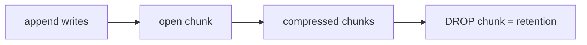
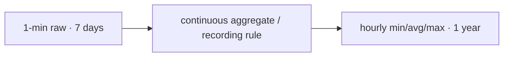
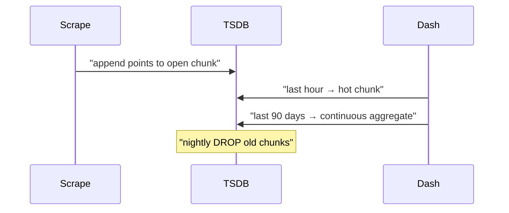
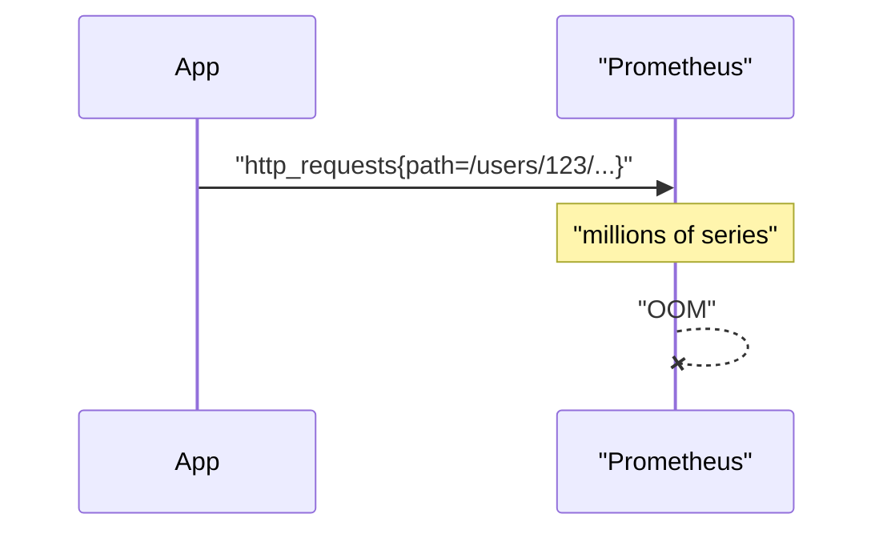

# Lesson 18: Time-Series Databases — Downsampling, Retention & Cardinality

> **Prerequisites:** [Lesson 13: NoSQL Explained](../13-nosql-explained/README.md) and [Track: Databases](../README.md) (Lesson 18 of 33).  
> **Estimated Reading Time:** 30 minutes  
> **Target Audience:** Backend and SRE engineers storing metrics, sensors, and events who must control cardinality before Prometheus memory doubles overnight.  
> **Free PDF Notes:** [Download SD-E-018.pdf](https://backendroadmap.com/notes/system-design/SD-E-018.pdf) · [Phase 2, Databases (PDF)](https://backendroadmap.com/notes/system-design/Phase2_Databases_Notes.pdf)

> [!NOTE]
> **In one line:** A time-series database is built for append-heavy, timestamped data—it splits data into time chunks, compresses columns hard, rolls old points into summaries, and deletes old data by dropping whole chunks; the one thing that breaks it is high-cardinality labels.

> [!TIP]
> **The Golden Rule of TSDBs:** Keep labels **bounded** (host, region, status, endpoint)—never `user_id` / `request_id` / raw URLs as metric labels. Keep **raw** briefly, **downsample** (min/avg/max, not avg-only), and expire by **dropping chunks**, not `DELETE`ing billions of rows.

---

## Words You'll Meet Today

| Word | Meaning | Role |
| :--- | :--- | :--- |
| **Time series** | Values over time for one label set. | `cpu{host,region}` |
| **Hypertable** | Timescale table auto-chunked by time. | Transparent SQL |
| **Chunk** | One time range file/partition. | Hot vs cold |
| **Downsampling** | Coarser summaries from raw points. | 1m → 1h |
| **Continuous aggregate** | Auto-maintained rollup. | Timescale |
| **Recording rule** | Prometheus precomputed series. | Same idea |
| **Retention** | How long data lives. | Drop chunks |
| **Cardinality** | Count of unique series. | Memory killer |

---

## Visual Mental Models & Architecture

### Billions of Tiny Rows

10k servers × 1 metric/min = 14.4M rows/day ≈ 5.3B/year. Postgres indexes groan; deletes vacuum-storm.



*Figure 1. Time chunks: write hot, compress old, drop whole files for retention.*

### Downsampling



*Figure 2. ~60× fewer rows for history; keep min/max so spikes survive.*

---

## Core Definition & Taxonomic Comparison

**What it is:** Storage optimized for append-only timestamped points + time-range aggregates (TimescaleDB, InfluxDB, Prometheus TSDB). **What it isn't:** A substitute for traces/logs (high-cardinality IDs belong there).

| System | Nature | Good for |
| :--- | :--- | :--- |
| TimescaleDB | Postgres extension | Metrics beside business SQL |
| InfluxDB | Purpose-built TSDB | IoT / high ingest events |
| Prometheus TSDB | Local pull store + PromQL | Infra monitoring (~15d default) |

---

## Component Breakdown & Anatomy

| Piece | Role | Failure |
| :--- | :--- | :--- |
| Time chunking | Prune scans | Query without time filter |
| Column compression | ~1–2 B/sample | Raw rows forever |
| Rollups | Cheap history | Avg-only hides spikes |
| Label index | Series identity | Cardinality bomb |
| Retention job | Drop chunks | Row `DELETE` bloat |

### The Observability Gap

| Point | Sees | Hides |
| :--- | :--- | :--- |
| Dashboard latency | Slow 90d view | Querying raw not rollup |
| Prometheus RSS | Memory up | Which label exploded |
| Disk growth | Capacity | Missing retention policy |

---

## Mathematical Model: Storage & Cardinality

### Points

$$14.4\times10^6 \text{ points/day} \times 7 \approx 101\times10^6 \text{ raw/week}$$

Hourly for a year: $10{,}000 \times 24 \times 365 \approx 88\times10^6$ summary rows.

Compressed raw year: $5.3\times10^9 \times 1.5\ \text{B} \approx 8\ \text{GB}$ vs hundreds of GB as fat SQL rows.

### Cardinality multiply

| Labels | Series |
| :--- | ---: |
| host (10k) | 10,000 |
| + endpoint (50) | 500,000 |
| + user_id (1M) | millions overnight |

### Ingest example

$$10{,}000 \times 20\ \text{metrics} \times 8{,}640 \approx 1.7\times10^9 \text{ points/day}$$

---

## Metrics, Percentiles & Distributions

| Metric | Healthy |
| :--- | :--- |
| Active series | Stable / planned growth |
| p99 dashboard query | Hits rollups for long ranges |
| Compaction/compression ratio | Often >90% |
| Chunk drop lag | Retention on schedule |

**Average lie:** Avg CPU 10% hides a 5-minute 100% spike if you only stored hourly averages.

---

## Compounding Effects & System Scale

Each new unbounded label multiplies series. Memory ≈ $c \times N_{\text{series}}$.

| Extra label cardinality | Effect |
| ---: | :--- |
| ×50 endpoints | Planned growth |
| ×1e6 user ids | SEV memory |

---

## Numbers Every Backend Engineer Must Know

| Fact | Number |
| :--- | :--- |
| Compression | often >90% / ~1–2 B/sample |
| Raw window example | 7 days |
| Rollup window example | 1 year hourly |
| Prometheus default retention | ~15 days |
| Avg-only downsample | hides spikes |

---

## Protocol & Deep Dive: Timescale Query

```sql
SELECT create_hypertable('cpu', 'time');
SELECT time_bucket('5 minutes', time) AS bucket, host,
       avg(usage) AS avg_cpu, max(usage) AS max_cpu
  FROM cpu
 WHERE time > now() - INTERVAL '1 hour'
 GROUP BY bucket, host
 ORDER BY bucket;
SELECT add_retention_policy('cpu', INTERVAL '7 days');
```



---

## Hierarchical Budgets & Capacity Sizing

| Tier | Policy |
| :--- | :--- |
| Raw | 7 days, 1-min |
| Hourly cagg | 1 year min/avg/max |
| Long-term | Optional colder storage |
| Labels | Bounded only |

---

## Top Engineering Mitigation Techniques

1. Bound label sets; put IDs in logs/traces.
2. Continuous aggregates / recording rules.
3. Retention via chunk drop.
4. Keep min/max/histograms with averages.
5. Always time-filter queries.
6. Alert on active series count.

---

## Production War Story (SEV-1 Post-Mortem)

**Severity & Impact:** SEV-1 · Prometheus OOM after deploy · paging storm 40 minutes.

**What Happened:** New metric labeled with raw `path` including user IDs → series cardinality exploded.



**Fix:** Bucket paths (`/users/:id`), drop high-card labels, cardinality governor in CI, alert on series delta.

---

## Multi-Language Production Code Tabs

````carousel
```go
// Go: Prometheus counter with bounded labels only
var reqs = prometheus.NewCounterVec(prometheus.CounterOpts{
    Name: "http_requests_total",
}, []string{"route", "code"}) // route = templated /users/:id — NOT raw URL
```

<!-- slide -->

```ts
// TypeScript: refuse high-cardinality label keys
const FORBIDDEN = new Set(["user_id", "request_id", "email", "url"]);
export function assertLabels(labels: Record<string, string>) {
  for (const k of Object.keys(labels)) {
    if (FORBIDDEN.has(k)) throw new Error(`high-cardinality label: ${k}`);
  }
}
```

<!-- slide -->

```python
# Python: estimate points/day
hosts, metrics, interval_s = 10_000, 20, 10
points_per_day = hosts * metrics * (86_400 // interval_s)
print(points_per_day, "points/day", points_per_day * 1.5 / 1e9, "GB/day @1.5B/sample")
```

<!-- slide -->

```csharp
// C#: downsample keep min/max/avg — never avg alone
public readonly record struct HourlyCpu(double Min, double Avg, double Max);
```
````

---

## Hands-On CLI Verification Workflows

```bash
python3 -c "print(10000*1440)  # points/day one metric"
python3 -c "print(10000*20*(86400//10))"  # 10s scrape, 20 metrics
```

---

## Common Mistakes to Avoid

- `user_id` / `request_id` / full URLs as labels.
- Keeping raw forever.
- `DELETE` billions of rows in plain Postgres.
- Downsample to average only.
- Long-range dashboards on raw points.

---

## Key Terms Glossary

| Term | Definition |
| :--- | :--- |
| Hypertable / chunk | Time-partitioned storage. |
| Downsampling | Coarser summaries. |
| Cardinality | Unique series count. |
| Retention | Drop policy for old chunks. |
| Recording rule / cagg | Precomputed rollups. |

---

## Complete 12 System Design Interview Q&As

### Basic Conceptual Questions (Q1–Q4)

<details>
<summary><strong>Q1: Why a TSDB instead of Postgres for metrics? [BASIC]</strong></summary>

<strong>What a strong answer covers:</strong>
Time chunks, heavy compression, cheap chunk drops, downsampling, fast range aggregates. Postgres works small; Timescale adds TSDB features on SQL.

</details>

<details>
<summary><strong>Q2: What is downsampling? [BASIC]</strong></summary>

<strong>What a strong answer covers:</strong>
Roll raw points into coarser summaries (1-min → hourly min/avg/max). Raw short window, summaries long window (~60× fewer history rows).

</details>

<details>
<summary><strong>Q3: Why is deleting old data cheap in a TSDB? [BASIC]</strong></summary>

<strong>What a strong answer covers:</strong>
Drop whole time chunks (file op). Plain Postgres `DELETE` + bloat + vacuum over billions of rows.

</details>

<details>
<summary><strong>Q4: What is cardinality and why fear it? [BASIC]</strong></summary>

<strong>What a strong answer covers:</strong>
Unique label combinations = series; each costs memory/index. Unbounded labels → OOM.

</details>

### Scenario-Based Architecture Questions (Q5–Q8)

<details>
<summary><strong>Q5: 10k servers, 20 metrics every 10s — points/day? [SCENARIO]</strong></summary>

<strong>What a strong answer covers:</strong>
≈1.7B points/day; ~2.6 GB/day compressed at 1.5 B/sample—fine for TSDB, painful as fat rows.

</details>

<details>
<summary><strong>Q6: Prometheus memory doubled after deploy. Check first? [SCENARIO]</strong></summary>

<strong>What a strong answer covers:</strong>
Active series + which metric/labels grew. Unbounded label is usual; drop/bucket; put IDs in logs.

</details>

<details>
<summary><strong>Q7: 90-day dashboards slow. Fix? [SCENARIO]</strong></summary>

<strong>What a strong answer covers:</strong>
Query continuous aggregate/hourly rollup; keep raw ~7 days; compress older chunks.

</details>

<details>
<summary><strong>Q8: Design retention for infra CPU metrics. [SCENARIO]</strong></summary>

<strong>What a strong answer covers:</strong>
Raw 7d; hourly min/avg/max 1y; optional daily longer; alert on series count.

</details>

### Advanced & Tricky Interview Questions (Q9–Q12)

<details>
<summary><strong>Q9: Fine to downsample to hourly average only? [TRICKY]</strong></summary>

<strong>What a strong answer covers:</strong>
No—averages hide spikes (5 min at 100% in idle hour ≈ 8–10%). Keep min/max or histograms.

</details>

<details>
<summary><strong>Q10: Why not add more labels to make metrics “more useful”? [TRICKY]</strong></summary>

<strong>What a strong answer covers:</strong>
Labels multiply series; 10k×50=500k already; +1M-value label → millions. Bounded labels only.

</details>

<details>
<summary><strong>Q11: Timescale vs Prometheus vs Influx—how to choose? [TRICKY]</strong></summary>

<strong>What a strong answer covers:</strong>
Prometheus for pull infra metrics; Timescale when you want SQL/joins with app data; Influx for purpose-built high-ingest IoT. Cardinality rules apply to all.

</details>

<details>
<summary><strong>Q12: Can you use a TSDB as an event log for every user action? [TRICKY]</strong></summary>

<strong>What a strong answer covers:</strong>
Usually no if each event has unique IDs as labels/tags—that’s cardinality death. Use an event store/log system; metrics stay aggregated.

</details>

---

## One-Page Master Cheat Sheet

```text
====================================================================================================
         TIME-SERIES DBs — DOWNSAMPLE, RETENTION, CARDINALITY (SD-E-018)
====================================================================================================
SHAPE: append-heavy · timestamp + bounded labels + value · range aggregates

STORAGE: time chunks · column compression (~1-2B/sample, >90%) · DROP chunks for retention
ROLLUPS: raw 7d → hourly min/avg/max 1y (~60×) · never avg-only

CARDINALITY
  series = unique label sets · memory killer
  OK: host, region, code, route template
  BAD: user_id, request_id, raw URL

MATH: 10k hosts * 1440 = 14.4M points/day/metric
ANTI: DELETE billions in Postgres · unbounded labels · long-range raw queries
====================================================================================================
```

---

## Free PDF notes

[SD-E-018.pdf](https://backendroadmap.com/notes/system-design/SD-E-018.pdf)

---

## Sources

- [TimescaleDB hypertables](https://docs.timescale.com/use-timescale/latest/hypertables/)
- [Prometheus best practices — metric/label names](https://prometheus.io/docs/practices/naming/)

---

## Next

Next up: [Lesson 19: Leader-Follower Replication](../19-leader-follower-replication/README.md).
