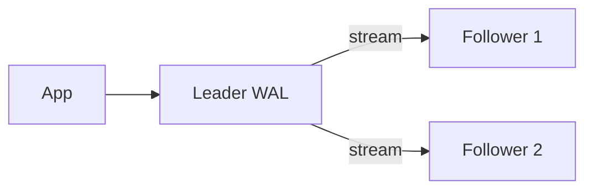
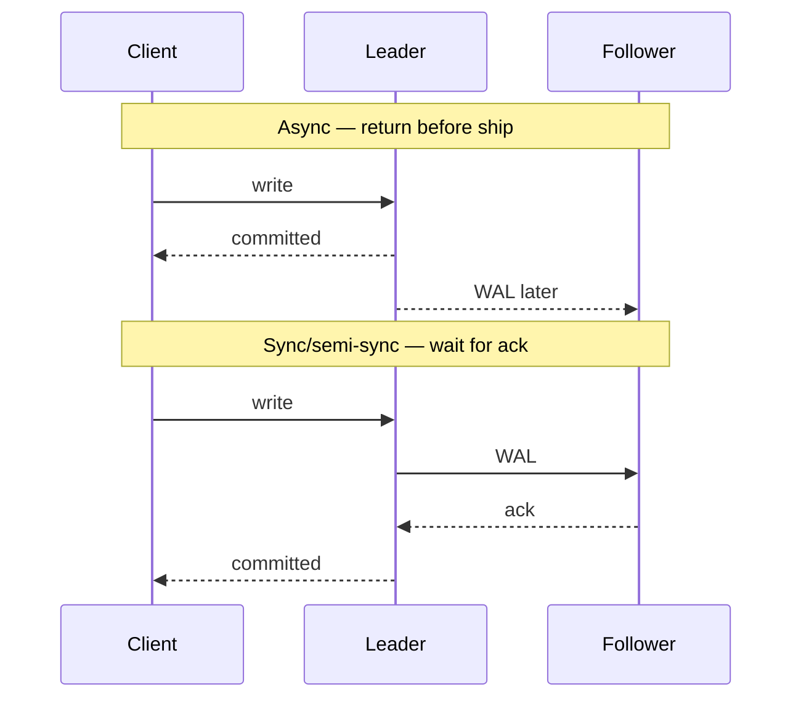
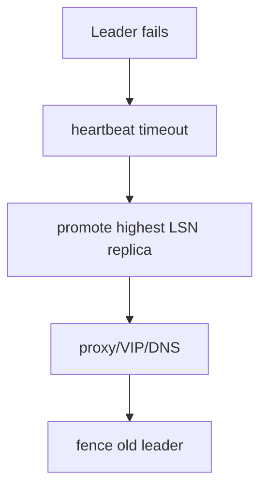
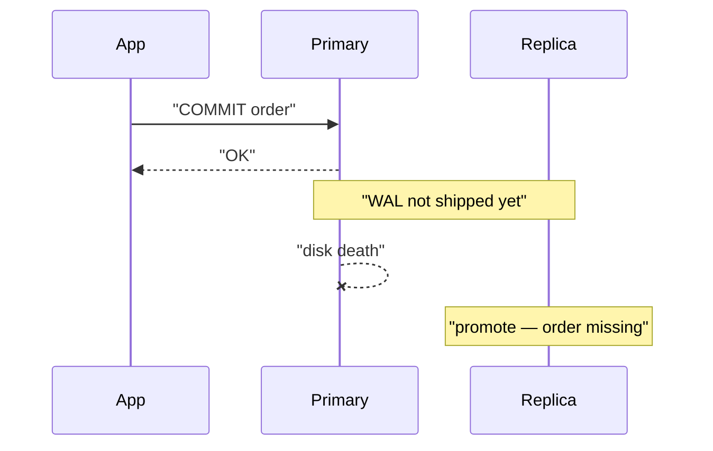

# Lesson 19: Leader-Follower Replication — Sync vs Async, Lag & Failover

> **Prerequisites:** [Lesson 08: ACID Explained](../08-acid-explained/README.md) and [Track: Databases](../README.md) (Lesson 19 of 33).  
> **Estimated Reading Time:** 30 minutes  
> **Target Audience:** Backend and platform engineers running Postgres/MySQL primaries with replicas who must choose sync/async/semi-sync and survive failover without silent order loss.  
> **Free PDF Notes:** [Download SD-E-019.pdf](https://backendroadmap.com/notes/system-design/SD-E-019.pdf) · [Phase 2, Databases (PDF)](https://backendroadmap.com/notes/system-design/Phase2_Databases_Notes.pdf)

> [!NOTE]
> **In one line:** One leader takes every write and streams its WAL to followers—whether a commit waits for a follower (sync), for nobody (async), or for any one of several (semi-sync) decides how much data a failover can lose.

> [!TIP]
> **The Golden Rule of Leader-Follower Replication:** **Async is fast but can lose the lag window on failover.** For payments/orders use **semi-sync** (`ANY 1 of N` standbys)—zero loss of *acknowledged* writes without stalling when a single replica dies. Always **fence** the old leader to prevent split brain, and **monitor `replay_lag`** so you know your loss budget.

---

## Words You'll Meet Today

| Word | Meaning | Role |
| :--- | :--- | :--- |
| **Leader / primary** | Sole writer. | All `INSERT/UPDATE/DELETE`. |
| **Follower / replica** | Replays leader WAL. | Reads + failover candidate. |
| **WAL** | Ordered change log. | Replication stream. |
| **Sync / async / semi-sync** | When commit returns. | Durability vs latency. |
| **Replication lag** | How far behind a replica is. | Loss window + stale reads. |
| **Failover** | Promote a follower. | Detect → promote → redirect. |
| **Split brain** | Two writers. | Must fence old leader. |
| **LSN** | Log sequence number. | “Most up-to-date” replica. |

---

## Visual Mental Models & Architecture

### Confirmed Orders That Vanish

Primary disk dies; last 200 ms of orders never reached a replica; promote → orders gone.



*Figure 1. Single write order on the leader; followers replay the same log.*

### When Does Commit Return?



*Figure 2. Only the commit-return moment changes; everything after it is at risk if the leader dies.*

---

## Core Definition & Taxonomic Comparison

**What it is:** Single-primary replication used by Postgres, MySQL, SQL Server, MongoDB replica sets, Redis. **What it isn't:** Multi-leader (next lessons) or a guarantee of zero data loss under async.

| Mode | Commit waits for | Durability | Risk |
| :--- | :--- | :--- | :--- |
| Async | Nobody | Lag window can be lost | Fast |
| Sync (one named) | That replica | No loss | Stalls if that replica down |
| Semi-sync ANY 1 | Any of a set | No loss of acked writes | Best common middle ground |

---

## Component Breakdown & Anatomy

| Stage | Component | Failure |
| :--- | :--- | :--- |
| Write | Leader WAL | Disk death |
| Ship | Streaming replication | Network lag |
| Replay | Follower apply | Long queries stall apply |
| Detect | Heartbeats | Timeout too aggressive |
| Promote | Highest LSN | Wrong candidate |
| Redirect | Proxy/VIP/DNS | Clients stick to old |
| Fence | STONITH / revoke | Split brain |

### The Observability Gap

| Point | Sees | Hides |
| :--- | :--- | :--- |
| App “commit OK” | Local durability | Not on replica yet (async) |
| `pg_stat_replication.replay_lag` | Lag | Business loss estimate unless you multiply by write rate |
| Failover success | New primary up | Silent ID reuse / cache collisions |

---

## Mathematical Model: Loss Window & Sync Cost

### Async loss estimate

$$\text{Lost writes} \approx \lambda_{\text{writes}} \times L_{\text{lag}}$$

Example: $500$ orders/s × $0.2$ s lag → **~100 confirmed orders** lost.

### Sync latency add

In-region RTT ≈ 1 ms; cross-region tens of ms per commit.

### Failover false-positive rate

Too-short timeout $T$ on blip-prone networks → needless failovers, each with async loss.

---

## Metrics, Percentiles & Distributions

| Metric | Alert idea |
| :--- | :--- |
| `replay_lag` | > few seconds |
| Write RTT with semi-sync | Regression vs baseline |
| Failover count/week | Too many → timeout tuning |
| Lag p99 under batch | Window for read-your-writes (next lesson) |

---

## Compounding Effects & System Scale

With $R$ independent async replicas, lag differs; promoting the wrong one maximizes loss. Always pick **max replayed LSN**.

| Write rate | 100 ms lag | 1 s lag |
| ---: | ---: | ---: |
| 100/s | 10 | 100 |
| 500/s | 50 | 500 |
| 5,000/s | 500 | 5,000 |

---

## Numbers Every Backend Engineer Must Know

| Fact | Number |
| :--- | :--- |
| In-DC sync cost | ~1 ms RTT |
| Cross-region sync | tens of ms |
| Heartbeat timeout | often 10–30 s (not 3 s) |
| Semi-sync | `ANY 1 (r1,r2)` |
| Async default | many managed DBs |

---

## Protocol & Deep Dive: Postgres Semi-Sync

```ini
# postgresql.conf
synchronous_commit = on
synchronous_standby_names = 'ANY 1 (replica1, replica2)'
```



*Figure 3. Failover steps and the split-brain trap.*

---

## Hierarchical Budgets & Capacity Sizing

| Data class | Mode | Rationale |
| :--- | :--- | :--- |
| Payments / orders | Semi-sync ANY 1 | No loss of acked commits |
| Clickstream | Async | Speed; loss OK |
| Cross-region DR | Async + RPO budget | Sync too expensive |

---

## Top Engineering Mitigation Techniques

1. Semi-sync for critical commits.
2. Monitor lag; page on growth.
3. Automate failover (Patroni / RDS Multi-AZ) with fencing.
4. Advance sequences / prefer UUIDs after failover.
5. Invalidate caches on promote.
6. Tune timeouts to avoid flapping.

---

## Production War Story (SEV-1 Post-Mortem)

**Severity & Impact:** SEV-1 · Primary disk failure · ~100 orders vanished · 14 minutes customer chaos.

**What Happened:** Async replication with ~200 ms lag at 500 orders/s; replica promoted; customers had confirmation emails for missing rows.



**Fix:** Semi-sync ANY 1; lag alerts tied to $\lambda \times L$; runbooks for fencing + cache bust.

---

## Multi-Language Production Code Tabs

````carousel
```go
// Go: read replication lag from Postgres
func ReplayLag(ctx context.Context, db *sql.DB) (time.Duration, error) {
    var lag sql.NullFloat64
    err := db.QueryRowContext(ctx, `
      SELECT EXTRACT(EPOCH FROM replay_lag) FROM pg_stat_replication LIMIT 1`).Scan(&lag)
    if err != nil || !lag.Valid { return 0, err }
    return time.Duration(lag.Float64 * float64(time.Second)), nil
}
```

<!-- slide -->

```ts
// TypeScript: estimate async loss budget
export function lostWrites(writesPerSec: number, lagSec: number) {
  return Math.ceil(writesPerSec * lagSec);
}
```

<!-- slide -->

```python
# Python: prefer semi-sync config snippet generation
def standby_names(replicas: list[str]) -> str:
    return f"ANY 1 ({', '.join(replicas)})"
```

<!-- slide -->

```csharp
// C#: after failover, bump sequence past old max to reduce ID reuse
// ALTER SEQUENCE orders_id_seq RESTART WITH <max_seen+1000>;
public static long NextSafeStart(long maxSeenOnSurvivingReplica) => maxSeenOnSurvivingReplica + 1000;
```
````

---

## Hands-On CLI Verification Workflows

```bash
psql -c "SELECT application_name, state, replay_lag FROM pg_stat_replication;"
python3 -c "print(500*0.2, 'orders lost at 500/s with 200ms lag')"
```

---

## Common Mistakes to Avoid

- Assuming replicas ⇒ no data loss (async!).
- Sync to a single replica (its outage stalls writes).
- Failover without fencing.
- Ignoring lag metrics.
- 3 s failover timeouts on noisy networks.

---

## Key Terms Glossary

| Term | Definition |
| :--- | :--- |
| WAL | Write-ahead log streamed to replicas. |
| Sync/async/semi-sync | Commit durability modes. |
| Lag | Replica delay behind primary. |
| Failover | Promote + redirect + fence. |
| Split brain | Two primaries accepting writes. |

---

## Complete 12 System Design Interview Q&As

### Basic Conceptual Questions (Q1–Q4)

<details>
<summary><strong>Q1: What happens to unreplicated writes during failover? [BASIC]</strong></summary>

<strong>What a strong answer covers:</strong>
Async: acknowledged writes not yet on the promoted replica are lost; old primary’s extras usually discarded. Prevent with sync/semi-sync, promote highest LSN, fence old leader.

</details>

<details>
<summary><strong>Q2: Sync vs async trade-off? [BASIC]</strong></summary>

<strong>What a strong answer covers:</strong>
Sync: no loss, +RTT, stalls if required replica down. Async: fast, lag window can be lost.

</details>

<details>
<summary><strong>Q3: How do you monitor lag in Postgres? [BASIC]</strong></summary>

<strong>What a strong answer covers:</strong>
`pg_stat_replication.replay_lag` on primary; on replica `now() - pg_last_xact_replay_timestamp()`. Alert at seconds thresholds.

</details>

<details>
<summary><strong>Q4: What is split brain and fencing? [BASIC]</strong></summary>

<strong>What a strong answer covers:</strong>
Old leader returns still writable → divergent histories. Fence via STONITH, revoked access, or stale term rejection; then rewind/rejoin as follower.

</details>

### Scenario-Based Architecture Questions (Q5–Q8)

<details>
<summary><strong>Q5: Payments DB async with 2 replicas; no confirmed payment may be lost. [SCENARIO]</strong></summary>

<strong>What a strong answer covers:</strong>
Semi-sync `ANY 1 (r1,r2)`; ~1 ms in-region; one replica can die; promote most up-to-date.

</details>

<details>
<summary><strong>Q6: Failover timeout 3 s; several failovers/week, no real outage. [SCENARIO]</strong></summary>

<strong>What a strong answer covers:</strong>
Blips/GC exceed 3 s. Raise to 10–30 s, require multiple missed heartbeats, use Patroni-style consensus.

</details>

<details>
<summary><strong>Q7: After failover, order IDs point to wrong customers in cache. [SCENARIO]</strong></summary>

<strong>What a strong answer covers:</strong>
Old leader issued IDs that never replicated; new leader reused them. Invalidate caches; UUID/Snowflake or advance sequences past old max.

</details>

<details>
<summary><strong>Q8: Estimate loss: 2k writes/s, p99 lag 800 ms async. [SCENARIO]</strong></summary>

<strong>What a strong answer covers:</strong>
≈1600 writes RPO. Decide if business accepts; if not, semi-sync or reduce lag causes.

</details>

### Advanced & Tricky Interview Questions (Q9–Q12)

<details>
<summary><strong>Q9: Does sync to one replica guarantee zero downtime? [TRICKY]</strong></summary>

<strong>What a strong answer covers:</strong>
No—guarantees durability, but that replica’s outage stalls writes. Use ANY 1 of several.

</details>

<details>
<summary><strong>Q10: Old leader comes back—what must happen? [TRICKY]</strong></summary>

<strong>What a strong answer covers:</strong>
Fence first; rejoin as follower; rewind divergent WAL (`pg_rewind`).

</details>

<details>
<summary><strong>Q11: Why promote highest LSN not “any healthy replica”? [TRICKY]</strong></summary>

<strong>What a strong answer covers:</strong>
Minimizes lost WAL; a laggard maximize data loss under async.

</details>

<details>
<summary><strong>Q12: Is Redis async replication safe for inventory counters? [TRICKY]</strong></summary>

<strong>What a strong answer covers:</strong>
Often no for sole truth—failover can lose increments. Use durable store/semi-sync patterns or accept explicit RPO.

</details>

---

## One-Page Master Cheat Sheet

```text
====================================================================================================
       LEADER-FOLLOWER REPLICATION — SYNC/ASYNC/SEMI-SYNC (SD-E-019)
====================================================================================================
MODEL: 1 writer streams WAL → followers replay in order

COMMIT MODES
  async ........ fast · lose ≈ λ × lag on failover
  sync ......... no loss · +RTT · stalls if that replica down
  semi-sync .... ANY 1 of N · common sweet spot for orders/payments

FAILOVER: detect → promote max LSN → redirect → FENCE old leader
MONITOR: pg_stat_replication.replay_lag · alert on seconds
MATH: 500 orders/s × 200ms lag ≈ 100 lost orders (async)

ANTI: async for money · sync to single replica · no fencing · ignore lag
====================================================================================================
```

---

## Free PDF notes

[SD-E-019.pdf](https://backendroadmap.com/notes/system-design/SD-E-019.pdf)

---

## Sources

- [PostgreSQL high availability / streaming replication](https://www.postgresql.org/docs/current/high-availability.html)
- [Patroni documentation](https://patroni.readthedocs.io/)

---

## Next

Next up: [Lesson 20: Read Replicas & Replication Lag](../20-read-replicas-replication-lag/README.md).
