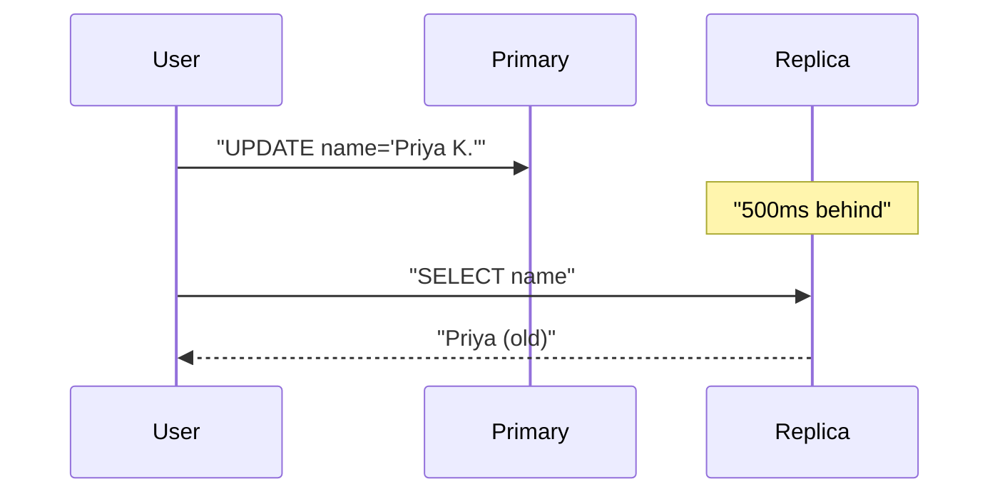
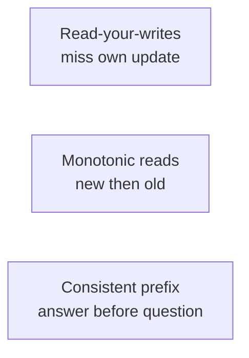
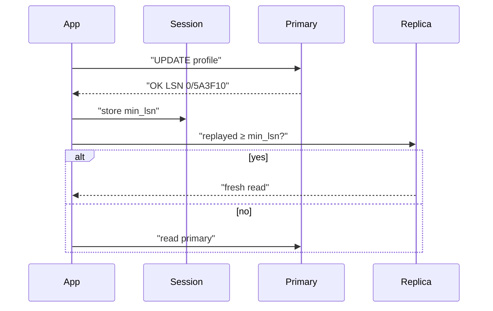
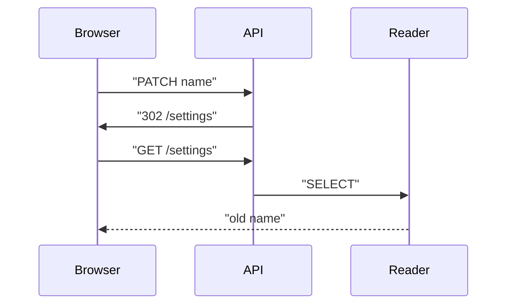

# Lesson 20: Read Replicas & Replication Lag — Fixing Stale Reads After Writes

> **Prerequisites:** [Lesson 19: Leader-Follower Replication](../19-leader-follower-replication/README.md) and [Track: Databases](../README.md) (Lesson 20 of 33).  
> **Estimated Reading Time:** 28 minutes  
> **Target Audience:** Backend engineers scaling reads with RDS reader endpoints who must stop “I saved it—why the old name?” without pinning every query to the primary.  
> **Free PDF Notes:** [Download SD-E-020.pdf](https://backendroadmap.com/notes/system-design/SD-E-020.pdf) · [Phase 2, Databases (PDF)](https://backendroadmap.com/notes/system-design/Phase2_Databases_Notes.pdf)

> [!NOTE]
> **In one line:** Read replicas scale reads, but with async replication they lag—so a user can miss their own write; route a user’s fresh data to the primary (always, for a short window, or until a replica has replayed the write’s LSN), and pin users to one replica so time never goes backwards.

> [!TIP]
> **The Golden Rule of Read Replicas:** Replicas **do not increase write throughput**—every replica applies every write. Use them for read scale, then fix **read-your-writes**, **monotonic reads**, and **consistent prefix** with primary routing, **LSN/GTID tracking**, and **sticky replicas**. Size primary-read windows from **p99 lag**, not the average.

---

## Words You'll Meet Today

| Word | Meaning | Role |
| :--- | :--- | :--- |
| **Read replica** | Follower serving SELECTs. | Scale reads. |
| **Reader endpoint** | One DNS across replicas. | Easy load spread. |
| **Replication lag** | Replica behind primary. | Stale reads. |
| **Read-your-writes** | See your own updates. | Profile after save. |
| **Monotonic reads** | Time never goes backwards. | Sticky replica. |
| **Consistent prefix** | Causal order preserved. | Co-locate related writes. |
| **LSN / GTID** | Log positions. | Wait-until-replayed. |
| **Sticky replica** | User pinned to one replica. | Monotonicity. |

---

## Visual Mental Models & Architecture

### “I Saved It—Why the Old Name?”



*Figure 1. Write succeeded; next read hit a lagging replica.*

### Three Classic Lag Anomalies



*Figure 2. Same root cause: replicas at different log positions.*

---

## Core Definition & Taxonomic Comparison

**What it is:** Routing SELECTs to followers while writes stay on primary. **What it isn't:** A write-scaling strategy or strong consistency by default.

| Fix | Mechanism | Cost |
| :--- | :--- | :--- |
| Always primary for “my” data | Simple | Extra primary load |
| Time window after write | Session flag ~5s+ | Needs ≥ p99 lag |
| LSN/GTID gate | Read only caught-up replicas | Precise |
| Sticky replica | Hash(user) → replica | Monotonic; one hop on fail |

---

## Component Breakdown & Anatomy

| Stage | Component | Failure |
| :--- | :--- | :--- |
| Write | Primary | OK |
| Ship/replay | Async WAL | Lag spikes |
| Router | App/proxy/reader endpoint | Round-robin after write |
| Session | min_lsn / sticky id | Lost on failover |
| Fallback | Primary | Overused “to be safe” |

### The Observability Gap

| Point | Sees | Hides |
| :--- | :--- | :--- |
| Reader endpoint latency | Fine averages | One replica 30s behind |
| User tickets “bug” | Product bug | Lag anomaly |
| Primary CPU | High | All reads forced primary |

---

## Mathematical Model: Replica Sizing

App: 10k QPS, 90% reads → 9k reads / 3 replicas = 3k each; primary keeps 1k writes (+ intentional primary reads).

$$N_{\text{replicas}} \approx \left\lceil \frac{R}{r_{\text{per}}} \right\rceil + \text{spare}$$

Example: 20k reads/s, 6k/replica → ⌈3.3⌉=4 + spare ⇒ **5**; each must also apply 2k writes/s without lagging.

Lost freshness if window $W <$ lag $L$: stale after write with probability rising as $L$ grows.

---

## Metrics, Percentiles & Distributions

| Metric | Use |
| :--- | :--- |
| Lag p50/p99 | Size primary-read window |
| % reads on primary | Should stay small (often <10%) |
| Sticky remap rate | Failover monotonic blips |

**Average lie:** Mean lag 50 ms, p99 30 s during nightly batch—5 s window fails.

---

## Compounding Effects & System Scale

Round-robin across $N$ replicas with different lag → monotonic anomalies ≈ common for multi-request sessions.

| Strategy | Scales reads | Fixes RYW | Fixes monotonic |
| :--- | :---: | :---: | :---: |
| Blind reader endpoint | ✓ | ✗ | ✗ |
| Primary window | ✓ | ✓ | partial |
| LSN gate | ✓ | ✓ | with care |
| Sticky + primary for self | ✓ | ✓ | ✓ |

---

## Numbers Every Backend Engineer Must Know

| Fact | Number |
| :--- | :--- |
| Typical lag | ms → seconds under load |
| Window heuristic | \> p99 lag (often ≥5s; measure!) |
| Replicas help | reads only |
| Postgres | `pg_current_wal_lsn` / `pg_last_wal_replay_lsn` |
| MySQL | `WAIT_FOR_EXECUTED_GTID_SET` |

---

## Protocol & Deep Dive: LSN Session Gate



*Figure 3. Only the user’s fresh path hits primary when needed.*

---

## Hierarchical Budgets & Capacity Sizing

| Traffic | Route |
| :--- | :--- |
| Own profile/settings after write | Primary or LSN-gated |
| Public feeds | Sticky replicas |
| Admin reports | Primary or warehouse |

---

## Top Engineering Mitigation Techniques

1. Primary for own freshly written data.
2. Session LSN/GTID tracking.
3. Sticky replica by user id hash.
4. Shed traffic from replicas over lag SLA.
5. Don’t expect replicas to fix write bottlenecks (shard later).
6. Combine: sticky + primary/LSN for self.

---

## Production War Story (SEV-1 Post-Mortem)

**Severity & Impact:** SEV-2/1 edge · Settings page · viral “save doesn’t work” tweets · 35 minutes.

**What Happened:** After write, redirect GET hit reader endpoint; lag 500 ms–2 s; users double-saved.



**Fix:** Session flag 10s ( > measured p99 lag) + LSN check; exclude `/me` routes from pure round-robin.

---

## Multi-Language Production Code Tabs

````carousel
```go
// Go: choose replica only if caught up
func ReadName(ctx context.Context, primary, replica *sql.DB, minLSN string) (string, error) {
    var replayed string
    if err := replica.QueryRowContext(ctx, `SELECT pg_last_wal_replay_lsn()::text`).Scan(&replayed); err == nil {
        // simplistic string compare only OK for demo — use pg_wal_lsn_diff in production
        if replayed >= minLSN {
            return scanName(ctx, replica)
        }
    }
    return scanName(ctx, primary)
}
```

<!-- slide -->

```ts
// TypeScript: sticky replica + primary window
export function pickReader(userId: string, replicas: string[], forcePrimary: boolean, primary: string) {
  if (forcePrimary) return primary;
  const i = [...userId].reduce((a, c) => a + c.charCodeAt(0), 0) % replicas.length;
  return replicas[i];
}
```

<!-- slide -->

```python
# Python: size replica count
import math
def replicas_needed(reads_per_s: float, per_replica: float, spare: int = 1) -> int:
    return math.ceil(reads_per_s / per_replica) + spare
```

<!-- slide -->

```csharp
// C#: after write, set session freshness deadline from p99 lag
public void MarkFresh(ISession s, TimeSpan p99Lag)
    => s.SetString("read_primary_until", DateTime.UtcNow.Add(p99Lag * 1.5).ToString("O"));
```
````

---

## Hands-On CLI Verification Workflows

```bash
psql -c "SELECT client_addr, replay_lag FROM pg_stat_replication;"
python3 -c "import math; print(math.ceil(20000/6000)+1)"
```

---

## Common Mistakes to Avoid

- Round-robin including the read right after a write.
- Sending all reads to primary “to be safe.”
- Primary window shorter than p99 lag.
- Expecting replicas to fix write bottlenecks.
- Sticky failover without LSN guard (one backward jump).

---

## Key Terms Glossary

| Term | Definition |
| :--- | :--- |
| Reader endpoint | Load-balanced replica address. |
| Read-your-writes | See own writes. |
| Monotonic reads | Never go backward in time. |
| LSN/GTID | Positions for catch-up waits. |
| Sticky replica | Affinity for one replica. |

---

## Complete 12 System Design Interview Q&As

### Basic Conceptual Questions (Q1–Q4)

<details>
<summary><strong>Q1: How do you avoid stale reads after a write? [BASIC]</strong></summary>

<strong>What a strong answer covers:</strong>
Route own recently changed data to primary (always or short window), or track write LSN/GTID and read only caught-up replicas. Pin users for monotonic reads.

</details>

<details>
<summary><strong>Q2: Do read replicas increase write throughput? [BASIC]</strong></summary>

<strong>What a strong answer covers:</strong>
No—every replica applies every write. They scale reads only; writes need a bigger primary, sharding, or different store.

</details>

<details>
<summary><strong>Q3: What is the monotonic reads anomaly? [BASIC]</strong></summary>

<strong>What a strong answer covers:</strong>
Two reads hit differently lagged replicas so the second is older (comment appears then vanishes). Fix: sticky replica.

</details>

<details>
<summary><strong>Q4: What is consistent prefix? [BASIC]</strong></summary>

<strong>What a strong answer covers:</strong>
Seeing effects out of causal order (answer before question)—common when related data is on different partitions with different lag. Co-locate causally related writes.

</details>

### Scenario-Based Architecture Questions (Q5–Q8)

<details>
<summary><strong>Q5: Just-placed order missing from “My orders” ~1s. [SCENARIO]</strong></summary>

<strong>What a strong answer covers:</strong>
Read-your-writes. Store LSN/flag after write; serve list from replica only if caught up else primary.

</details>

<details>
<summary><strong>Q6: 20k reads/s, 2k writes/s, replica handles ~6k reads. How many replicas? [SCENARIO]</strong></summary>

<strong>What a strong answer covers:</strong>
⌈20k/6k⌉≈4 + spare ⇒ 5; verify each applies 2k writes/s without lagging.

</details>

<details>
<summary><strong>Q7: Nightly batch → 30s lag; 5s primary window. [SCENARIO]</strong></summary>

<strong>What a strong answer covers:</strong>
Window too short; use LSN tracking; throttle batch; stop routing to over-lagged replicas.

</details>

<details>
<summary><strong>Q8: Design routing for social feed + profile edit. [SCENARIO]</strong></summary>

<strong>What a strong answer covers:</strong>
Profile self-reads: primary/LSN. Feed: sticky replicas. Don’t put both on blind round-robin.

</details>

### Advanced & Tricky Interview Questions (Q9–Q12)

<details>
<summary><strong>Q9: Why not send all reads to the primary? [TRICKY]</strong></summary>

<strong>What a strong answer covers:</strong>
Replicas become failover-only; primary carries full read load—the original problem. Only freshness-critical own reads need primary (often <10%).

</details>

<details>
<summary><strong>Q10: Sticky user remaps from B→A after failure—time backwards? [TRICKY]</strong></summary>

<strong>What a strong answer covers:</strong>
Yes if A is behind B. Store last-seen LSN; only switch to replicas ≥ that LSN (or primary briefly).

</details>

<details>
<summary><strong>Q11: Reader endpoint vs app-side routing? [TRICKY]</strong></summary>

<strong>What a strong answer covers:</strong>
Endpoints are easy but dumb about RYW. App/proxy policy aware of session LSN/sticky is required for correctness UX.

</details>

<details>
<summary><strong>Q12: Can sync replication eliminate these anomalies? [TRICKY]</strong></summary>

<strong>What a strong answer covers:</strong>
Sync reduces loss on failover and can tighten lag, but async read replicas (common) still lag unless you read sync standbys or primary. Cost is write latency.

</details>

---

## One-Page Master Cheat Sheet

```text
====================================================================================================
     READ REPLICAS & LAG — READ-YOUR-WRITES / MONOTONIC / LSN (SD-E-020)
====================================================================================================
REPLICAS SCALE READS ONLY · every replica applies every write

ANOMALIES: read-your-writes · monotonic (time backwards) · consistent prefix

FIXES
  primary for own fresh data (always / window > p99 lag)
  store write LSN/GTID · read replica only if replayed ≥ min
  sticky replica = hash(user) · on fail, LSN-guard remap

SIZING: N ≈ ceil(reads / per_replica) + spare · check apply rate = write rate

ANTI: blind round-robin after writes · all reads on primary · window < p99 lag
====================================================================================================
```

---

## Free PDF notes

[SD-E-020.pdf](https://backendroadmap.com/notes/system-design/SD-E-020.pdf)

---

## Sources

- [PostgreSQL WAL functions](https://www.postgresql.org/docs/current/functions-admin.html#FUNCTIONS-ADMIN-BACKUP)
- [MySQL GTID waiting](https://dev.mysql.com/doc/refman/8.0/en/gtid-functions.html)

---

## Next

Next up: [Lesson 21: Multi-Leader & Leaderless Replication](../21-multi-leader-leaderless-replication/README.md).
