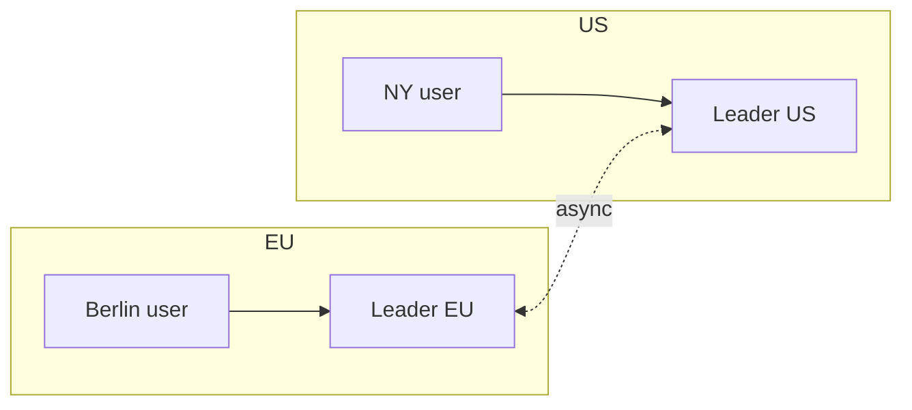
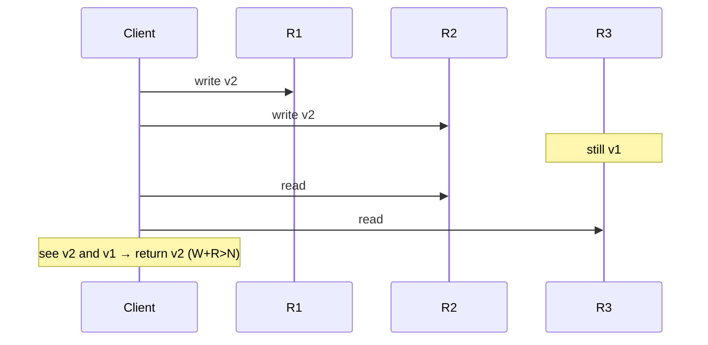
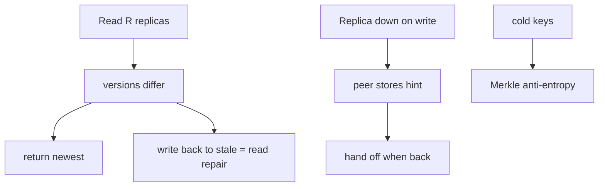
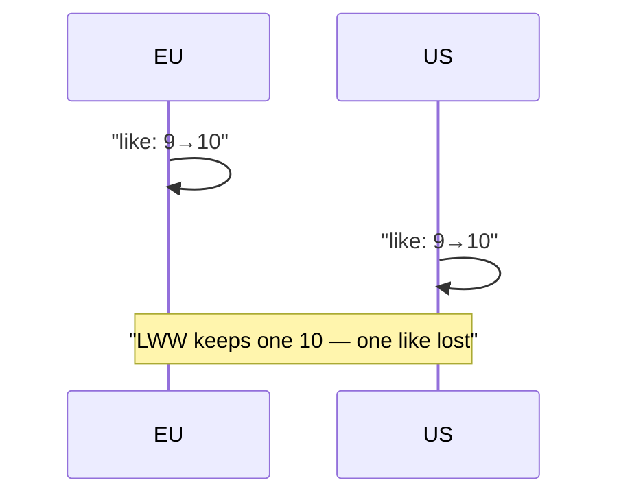

# Lesson 21: Multi-Leader & Leaderless Replication — Conflicts, CRDTs & Quorums

> **Prerequisites:** [Lesson 19: Leader-Follower Replication](../19-leader-follower-replication/README.md), [Lesson 20: Read Replicas & Replication Lag](../20-read-replicas-replication-lag/README.md), and [Track: Databases](../README.md) (Lesson 21 of 33).  
> **Estimated Reading Time:** 32 minutes  
> **Target Audience:** Backend engineers designing multi-region writes (collab notes, global sessions) who must reason about conflicts, CRDTs, and $W+R>N$ quorums without hand-waving.  
> **Free PDF Notes:** [Download SD-E-021.pdf](https://backendroadmap.com/notes/system-design/SD-E-021.pdf) · [Phase 2, Databases (PDF)](https://backendroadmap.com/notes/system-design/Phase2_Databases_Notes.pdf)

> [!NOTE]
> **In one line:** Multi-leader lets several regions accept writes at the price of write conflicts; leaderless (Dynamo-style) sends each write to $N$ replicas and needs $W+R>N$ to read a latest value, with read repair and hinted handoff cleaning up replicas that missed it.

> [!TIP]
> **The Golden Rule of Multi-Writer Replication:** If two regions can write the same item, you **must** have a conflict policy—**LWW silently drops data**, merge/ask preserves intent, **CRDTs converge**. For leaderless stores, pick $W,R$ with $W+R>N$ (classic $N=3,W=2,R=2$), and never treat a **sloppy quorum** as linearizability.

---

## Words You'll Meet Today

| Word | Meaning | Role |
| :--- | :--- | :--- |
| **Multi-leader** | Several writable primaries. | Low multi-region write latency. |
| **Write conflict** | Concurrent updates to same item. | Must resolve. |
| **LWW** | Last write wins by timestamp. | Silent loss + clock skew. |
| **CRDT** | Mergeable data type. | Counters/sets/text. |
| **Leaderless** | Client/coordinator writes $N$ replicas. | Cassandra/Riak/Dynamo. |
| **Quorum W/R** | Acks to write / replies to read. | Freshness if $W+R>N$. |
| **Read repair** | Fix stale replica on read. | Repair path. |
| **Hinted handoff** | Store write for down replica. | Sloppy availability. |
| **Anti-entropy** | Background Merkle sync. | Rarely read keys. |

---

## Visual Mental Models & Architecture

### One Leader, Two Continents

Berlin keystroke → Virginia leader ≈ 90 ms RTT; Virginia down → no writes. Multi-leader: local writes, async between regions—**conflicts appear**.



*Figure 1. Both rename note 7 concurrently → conflict.*

### Leaderless Quorum



*Figure 2. $N=3,W=2,R=2$: any 2 readers overlap the 2 writers.*

---

## Core Definition & Taxonomic Comparison

| Mode | Writers | Main cost | Typical systems |
| :--- | :--- | :--- | :--- |
| Single leader | 1 | Cross-region latency / SPOF writes | Postgres primary |
| Multi-leader | Many | Conflicts, constraints hard | Some geo PG, collab apps |
| Leaderless | Quorum of $N$ | Stale replicas, tuning $W/R$ | Cassandra, DynamoDB under the hood ideas |

| Conflict policy | Behavior |
| :--- | :--- |
| LWW | Drop older timestamp—lossy |
| Merge/ask | Preserve both / user chooses |
| CRDT | Automatic convergent merge |

---

## Component Breakdown & Anatomy

| Piece | Role | Failure |
| :--- | :--- | :--- |
| Home region | Reduce conflicts | Mis-routed writes |
| Conflict resolver | LWW/merge/CRDT | Silent loss |
| Quorum coordinator | Collect W/R | Partial failure |
| Read repair | Heal on read | Rarely-read cold keys |
| Merkle anti-entropy | Background heal | Bandwidth |
| Hinted handoff | Availability | Sloppy ≠ strict quorum |

### The Observability Gap

| Point | Sees | Hides |
| :--- | :--- | :--- |
| Write success | Local leader OK | Conflict later on merge |
| Cassandra CL ONE | Fast | Stale reads ($W+R\not>N$) |
| Version vectors | Concurrency | Clock-only LWW lies |

---

## Mathematical Model: Quorums & CRDT Counters

### Fresh reads

$$W + R > N$$

| Setting ($N=3$) | Effect |
| :--- | :--- |
| W=2,R=2 | Survive 1 down for both |
| W=3,R=1 | Fast reads; write needs all |
| W=1,R=3 | Fast writes; read needs all |
| W=1,R=1 | Fast; **not** fresh |

### CRDT counter

Regions keep per-region counts; value = sum; merge = max per region → concurrent +2 and +1 from 8 → 11, not LWW 9 or 10.

---

## Metrics, Percentiles & Distributions

| Metric | Meaning |
| :--- | :--- |
| Conflict rate | Multi-leader pain |
| Read repair rate | How often replicas diverge |
| CL timeout rate | Quorum not met |
| Hint backlog | Down replica debt |

---

## Compounding Effects & System Scale

Unique constraints & auto-increment **break** across leaders (two regions create `priya` or id 1001). Prefer UUIDs + home-region uniqueness.

| Concurrent editors | LWW risk |
| ---: | :--- |
| Low | Rare loss |
| High collab | Use CRDT |

---

## Numbers Every Backend Engineer Must Know

| Fact | Number |
| :--- | :--- |
| Classic quorum | N=3,W=2,R=2 |
| Transatlantic RTT | ~90 ms |
| Clock skew | can bias LWW |
| CRDT libs | Yjs, Automerge |

---

## Protocol & Deep Dive: Repair Paths



*Figure 3. Read repair, hinted handoff, anti-entropy.*

---

## Hierarchical Budgets & Capacity Sizing

| Workload | Approach |
| :--- | :--- |
| Most notes | Home-region single writer |
| Live co-edit | CRDT text |
| Global KV | Leaderless W=2,R=2 |
| Strict linearizability | Not this lesson’s tools—use consensus |

---

## Top Engineering Mitigation Techniques

1. Home region per document when possible.
2. CRDTs for true concurrent edits/counters.
3. $W+R>N$ for freshness needs.
4. Read repair + anti-entropy.
5. Avoid LWW for valuable data.
6. UUIDs; don’t rely on global auto-increment.

---

## Production War Story (SEV-1 Post-Mortem)

**Severity & Impact:** SEV-1 · Multi-region likes with LWW · ~8% likes lost during campaign · brand trust hit.

**What Happened:** EU and US both read 9, wrote 10; LWW dropped one.



**Fix:** CRDT g-counter (per-region); or single home region for increments.

---

## Multi-Language Production Code Tabs

````carousel
```go
// Go: check quorum inequality
func FreshReads(n, w, r int) bool { return w+r > n }
```

<!-- slide -->

```ts
// TypeScript: G-counter merge (CRDT sketch)
export type GCounter = Record<string, number>;
export function merge(a: GCounter, b: GCounter): GCounter {
  const out: GCounter = { ...a };
  for (const [k, v] of Object.entries(b)) out[k] = Math.max(out[k] ?? 0, v);
  return out;
}
export const value = (c: GCounter) => Object.values(c).reduce((x, y) => x + y, 0);
```

<!-- slide -->

```python
# Python: simulate W+R>N overlap guarantee (illustrative)
def overlaps(n=3, w=2, r=2) -> bool:
    return w + r > n
```

<!-- slide -->

```csharp
// C#: refuse LWW for monetary fields
public enum ConflictPolicy { Lww, Merge, Crdt }
public static void AssertSafe(string field, ConflictPolicy p)
{
    if (field is "balance" or "inventory" && p == ConflictPolicy.Lww)
        throw new InvalidOperationException("LWW forbidden for " + field);
}
```
````

---

## Hands-On CLI Verification Workflows

```bash
python3 -c "print([(w,r) for w in range(1,4) for r in range(1,4) if w+r>3])"
```

---

## Common Mistakes to Avoid

- Multi-leader for latency without conflict plan.
- LWW on data that matters.
- $W+R \le N$ while expecting fresh reads.
- Treating sloppy quorum as strict.
- Wall-clock ordering across regions.

---

## Key Terms Glossary

| Term | Definition |
| :--- | :--- |
| Multi-leader | Multiple writable replicas/regions. |
| CRDT | Convergent mergeable type. |
| Quorum | W/R thresholds over N. |
| Read repair | Heal on read path. |
| Hinted handoff | Temporary write holder for down node. |

---

## Complete 12 System Design Interview Q&As

### Basic Conceptual Questions (Q1–Q4)

<details>
<summary><strong>Q1: Risks of multi-leader replication? [BASIC]</strong></summary>

<strong>What a strong answer covers:</strong>
Conflicts; LWW silent loss; unique constraints/auto-increment break; hard reasoning.

</details>

<details>
<summary><strong>Q2: How does read repair work? [BASIC]</strong></summary>

<strong>What a strong answer covers:</strong>
Read several replicas, detect stale versions, return newest, write it back to stale replicas.

</details>

<details>
<summary><strong>Q3: Why does W+R>N give fresh reads? [BASIC]</strong></summary>

<strong>What a strong answer covers:</strong>
Write set size W and read set size R must intersect when W+R>N, so at least one replica has the latest write (under ideal quorum semantics).

</details>

<details>
<summary><strong>Q4: What is a CRDT? [BASIC]</strong></summary>

<strong>What a strong answer covers:</strong>
Data type designed so concurrent updates merge to the same result on all replicas (counters, sets, text sequences)—Yjs/Automerge examples.

</details>

### Scenario-Based Architecture Questions (Q5–Q8)

<details>
<summary><strong>Q5: N=3,W=2,R=2; one replica down—read/write? [SCENARIO]</strong></summary>

<strong>What a strong answer covers:</strong>
Yes—two up suffice. Two down → fail (unless sloppy hints accept writes elsewhere).

</details>

<details>
<summary><strong>Q6: Notes app EU+US with occasional co-editing. [SCENARIO]</strong></summary>

<strong>What a strong answer covers:</strong>
Home region per note for normal writes; CRDT text for live co-edit.

</details>

<details>
<summary><strong>Q7: Two regions increment likes with LWW—what breaks? Fix? [SCENARIO]</strong></summary>

<strong>What a strong answer covers:</strong>
Lost increments. Use CRDT counter or single home region for increments.

</details>

<details>
<summary><strong>Q8: Pick W/R for user profile KV: prefer write availability. [SCENARIO]</strong></summary>

<strong>What a strong answer covers:</strong>
e.g. W=1,R=3 if reads can pay; or W=2,R=2 balanced. State the freshness trade-off explicitly.

</details>

### Advanced & Tricky Interview Questions (Q9–Q12)

<details>
<summary><strong>Q9: Does W+R>N always mean latest value? [TRICKY]</strong></summary>

<strong>What a strong answer covers:</strong>
Not strictly—sloppy quorums, concurrent writes, partial failures, clock LWW can still yield older data. Strong practical guarantee ≠ linearizability.

</details>

<details>
<summary><strong>Q10: Why not wall-clock timestamps across regions? [TRICKY]</strong></summary>

<strong>What a strong answer covers:</strong>
Clock skew: fast clock wins races. Prefer version vectors to detect concurrency or CRDTs to merge.

</details>

<details>
<summary><strong>Q11: Hinted handoff vs strict quorum? [TRICKY]</strong></summary>

<strong>What a strong answer covers:</strong>
Hints keep writes available when a target is down but weaken overlap guarantees until handoff completes—don’t market as strict W.

</details>

<details>
<summary><strong>Q12: When is single-leader still better for global apps? [TRICKY]</strong></summary>

<strong>What a strong answer covers:</strong>
When conflict handling cost > latency pain; or strong invariants (ledger). Use regional read replicas + single writer, or home-region sticky writes.

</details>

---

## One-Page Master Cheat Sheet

```text
====================================================================================================
   MULTI-LEADER & LEADERLESS — CONFLICTS, CRDTs, QUORUMS (SD-E-021)
====================================================================================================
MULTI-LEADER: local writes · async sync · CONFLICTS
  resolve: LWW (lossy) | merge/ask | CRDT (converge)
  tip: home-region per doc; CRDT only where true concurrency

LEADERLESS: write N, need W acks; read R
  freshness: W+R > N · classic 3/2/2
  repair: read repair · Merkle anti-entropy · hinted handoff (sloppy)

ANTI: LWW for money · W+R≤N expecting fresh · trust wall clocks · ignore unique-id breakage
====================================================================================================
```

---

## Free PDF notes

[SD-E-021.pdf](https://backendroadmap.com/notes/system-design/SD-E-021.pdf)

---

## Sources

- [Amazon Dynamo paper](https://www.allthingsdistributed.com/files/amazon-dynamo-sosp2007.pdf)
- [CRDTs overview](https://crdt.tech/)

---

## Next

Next up: [Lesson 22: Database Sharding Fundamentals](../22-database-sharding-fundamentals/README.md).
