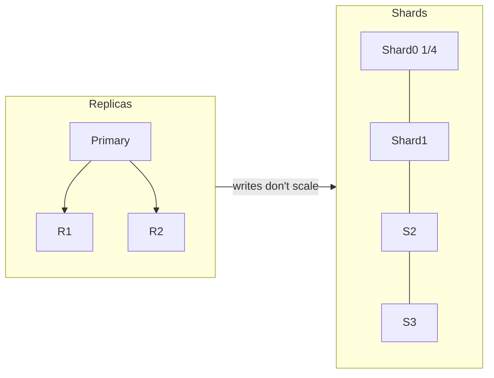
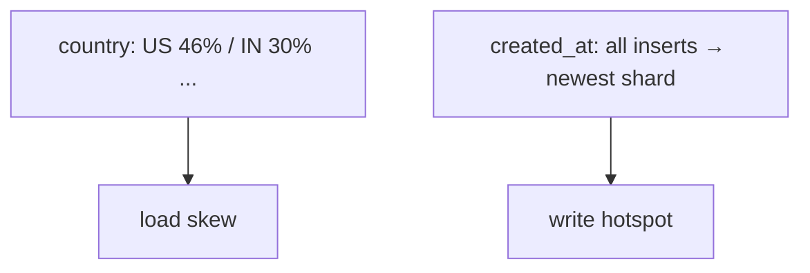
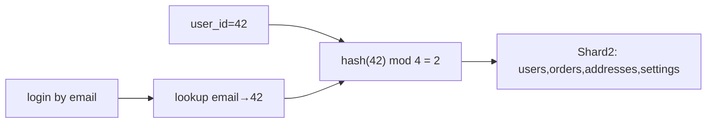
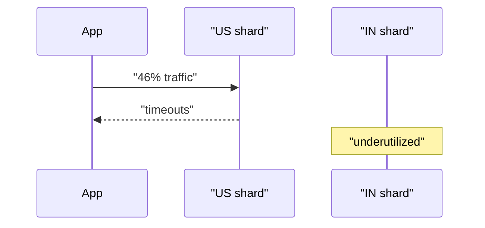

# Lesson 22: Database Sharding Fundamentals — Choosing a Shard Key & Pitfalls

> **Prerequisites:** [Lesson 19: Leader-Follower Replication](../19-leader-follower-replication/README.md), [Lesson 20: Read Replicas & Replication Lag](../20-read-replicas-replication-lag/README.md), and [Track: Databases](../README.md) (Lesson 22 of 33).  
> **Estimated Reading Time:** 30 minutes  
> **Target Audience:** Backend engineers whose primary is write-bound at multi-TB scale and who must pick a shard key without creating hotspots, scatter-gather, or auto-increment collisions.  
> **Free PDF Notes:** [Download SD-E-022.pdf](https://backendroadmap.com/notes/system-design/SD-E-022.pdf) · [Phase 2, Databases (PDF)](https://backendroadmap.com/notes/system-design/Phase2_Databases_Notes.pdf)

> [!NOTE]
> **In one line:** Sharding splits rows across many databases so writes and storage scale—not just reads; everything depends on the shard key (high cardinality, even spread, present in most queries), and it brings real costs, so **shard last, not first**.

> [!TIP]
> **The Golden Rule of Sharding:** Exhaust indexes, caching, read replicas, vertical scale, in-DB partitioning, and archival **before** sharding. When you must, choose a key with **high cardinality**, **even load**, and **presence in primary queries**; co-locate related rows; plan **virtual shards / consistent hashing** so `mod N` rebalances don’t move ~80% of data.

---

## Words You'll Meet Today

| Word | Meaning | Role |
| :--- | :--- | :--- |
| **Shard** | One DB holding a row subset. | Scale writes/storage. |
| **Shard key** | Column choosing the shard. | Destiny of the design. |
| **Cardinality** | Distinct key values. | Split fineness. |
| **Hotspot** | One shard overloaded. | Country / time keys. |
| **Co-location** | Related rows same shard. | Local txns. |
| **Scatter-gather** | Query every shard. | Email lookup without map. |
| **Lookup table** | Secondary → shard key. | email→user_id. |
| **Snowflake ID** | Time+machine+seq ID. | Global uniqueness. |
| **Rebalancing** | Moving data between shards. | Operational hard mode. |

---

## Visual Mental Models & Architecture

### One Machine Is Not Enough

2B rows, 40 TB, disks at write limit. Replicas don’t help writes—each applies every write. Time to shard.



*Figure 1. Replicas copy everything; shards split writes and storage.*

### Bad Keys



*Figure 2. Low cardinality skew; monotonic keys hotspot the newest shard.*

---

## Core Definition & Taxonomic Comparison

**What it is:** Horizontal partitioning across machines (each usually replicated). **What it isn't:** Read replicas, vertical scale, or Postgres table partitioning alone (same machine).

| Key choice | Verdict |
| :--- | :--- |
| `user_id` (user-centric app) | Classic good |
| `country` | Skew |
| `created_at` | Write hotspot |
| `order_id` only | Scatters “my orders” |

---

## Component Breakdown & Anatomy

| Piece | Role | Failure |
| :--- | :--- | :--- |
| Shard key | Placement | Hotspot / scatter |
| Router | App / Vitess / Citus / directory | Wrong shard |
| Co-location | Same key on related tables | Cross-shard joins |
| IDs | UUID/Snowflake | Auto-inc collisions |
| Rebalance | Move ranges/vnodes | Long migrations |

### The Observability Gap

| Point | Sees | Hides |
| :--- | :--- | :--- |
| Cluster QPS | Fine | One hot shard redlining |
| App p99 | Slow | Scatter-gather fan-out |
| “Unique violation” | App bug | Cross-shard ID collision |

---

## Mathematical Model: Split & Remap

4 shards: $2\text{B}/4 = 500\text{M}$ rows, $40\text{TB}/4 = 10\text{TB}$ each.

Going $4\to5$ with `hash mod N` remaps about $1-4/5=80\%$ of keys. Virtual shards (e.g. 1024) mapped to 4 machines → grow to 5 moves ~$1/5$ of vnodes.

$$N_{\text{IPs move fraction}} \approx \frac{1}{N_{\text{new}}}\ \text{(consistent hashing / vnodes)}$$

---

## Metrics, Percentiles & Distributions

| Metric | Watch |
| :--- | :--- |
| Per-shard CPU/disk/QPS | Hotspot |
| Scatter-gather fan-out | Missing shard key in query |
| Rebalance bytes/s | Migration pain |
| Cross-shard txn rate | Model smell |

---

## Compounding Effects & System Scale

Query without shard key → latency ≈ slowest of $N$ shards; load ×$N$.

| Shards | Scatter cost |
| ---: | :--- |
| 4 | 4× fan-out |
| 64 | brutal without lookup |

---

## Numbers Every Backend Engineer Must Know

| Fact | Number |
| :--- | :--- |
| Remap mod 4→5 | ~80% keys move |
| Good key properties | high card, even, in queries |
| Shard last | after replicas/cache/index/partition |
| Global IDs | UUID / Snowflake |

---

## Protocol & Deep Dive: User-ID Sharding + Email Lookup



*Figure 3. Co-locate user data; secondary access via lookup—not scatter-gather.*

Routing options: app library, proxy (Vitess), coordinator (Citus), directory service, or distributed SQL (Spanner/Cockroach) that shards for you.

---

## Hierarchical Budgets & Capacity Sizing

| Before shard | Try |
| :--- | :--- |
| Slow queries | Indexes / rewrite |
| Read heavy | Replicas + cache |
| Big table same box | Native partitioning + archive |
| Still write-bound multi-TB | Shard |

---

## Top Engineering Mitigation Techniques

1. Shard last.
2. `user_id`-style keys for user-centric apps.
3. Co-locate related tables on same key.
4. Lookup tables for secondary access paths.
5. Virtual shards / consistent hashing.
6. Snowflake/UUID for global IDs; sagas/2PC sparingly.

---

## Production War Story (SEV-1 Post-Mortem)

**Severity & Impact:** SEV-1 · Sharded by `country` · US shard CPU 100% · EU idle · checkout errors 22 minutes.

**What Happened:** Traffic followed population skew; US shard melted.



**Fix:** Reshard by `hash(user_id)` with vnode plan; dual-write migration; kill country as shard key.

---

## Multi-Language Production Code Tabs

````carousel
```go
// Go: virtual shard placement
func ShardFor(userID uint64, vnodeCount, physical int) int {
    vnode := int(userID % uint64(vnodeCount)) // prefer real hash in prod
    return vnode % physical
}
```

<!-- slide -->

```ts
// TypeScript: refuse dangerous shard keys
const BAD = new Set(["country", "created_at", "status"]);
export function assertShardKey(col: string) {
  if (BAD.has(col)) throw new Error(`bad shard key: ${col}`);
}
```

<!-- slide -->

```python
# Python: estimate remap fraction for hash mod N → N+1
def remap_frac(n: int) -> float:
    return 1 - n / (n + 1)
print(remap_frac(4))  # 0.8
```

<!-- slide -->

```csharp
// C#: email → user_id lookup then single-shard get
public async Task<User?> FindByEmailAsync(string email)
{
    var userId = await _lookup.GetUserIdByEmailAsync(email); // sharded by email or KV
    if (userId is null) return null;
    return await _users.GetAsync(userId.Value); // routed by hash(userId)
}
```
````

---

## Hands-On CLI Verification Workflows

```bash
python3 -c "print(2_000_000_000/4, 40/4)"
python3 -c "print(1-4/5)"
```

---

## Common Mistakes to Avoid

- Sharding before exhausting simpler levers.
- Low-cardinality or time-based shard keys.
- Related tables on different keys.
- Auto-increment PKs across shards.
- `hash mod N` without vnode plan.

---

## Key Terms Glossary

| Term | Definition |
| :--- | :--- |
| Shard / shard key | Sub-database / placement column. |
| Hotspot | Overloaded shard. |
| Co-location | Related rows together. |
| Scatter-gather | Query all shards. |
| Rebalancing | Moving data after topology change. |

---

## Complete 12 System Design Interview Q&As

### Basic Conceptual Questions (Q1–Q4)

<details>
<summary><strong>Q1: How do you choose a shard key? [BASIC]</strong></summary>

<strong>What a strong answer covers:</strong>
High cardinality, even spread, not monotonic, present in main queries so most hits are single-shard. `user_id` classic for user-centric apps.

</details>

<details>
<summary><strong>Q2: What problems does sharding introduce? [BASIC]</strong></summary>

<strong>What a strong answer covers:</strong>
Cross-shard queries/joins, distributed txns (2PC/sagas), global uniqueness/IDs, rebalancing, operational complexity.

</details>

<details>
<summary><strong>Q3: Why don’t read replicas solve a write bottleneck? [BASIC]</strong></summary>

<strong>What a strong answer covers:</strong>
Every replica applies every write. Sharding splits writes—4 shards ⇒ ~¼ writes each.

</details>

<details>
<summary><strong>Q4: What is scatter-gather? [BASIC]</strong></summary>

<strong>What a strong answer covers:</strong>
Query without shard key fans out to all shards; latency = slowest; load ×N. Fix with lookup table to shard key.

</details>

### Scenario-Based Architecture Questions (Q5–Q8)

<details>
<summary><strong>Q5: Shard orders by order_id, user_id, or created_at? [SCENARIO]</strong></summary>

<strong>What a strong answer covers:</strong>
`user_id` if “my orders” dominates—single shard + co-location. `created_at` hotspots newest. `order_id` spreads writes but scatters per-user reads.

</details>

<details>
<summary><strong>Q6: Login by email while sharded by user_id. [SCENARIO]</strong></summary>

<strong>What a strong answer covers:</strong>
Lookup `email→user_id` (KV or table sharded by email); then single-shard user fetch—two cheap lookups, not scatter-gather.

</details>

<details>
<summary><strong>Q7: 2 TB DB near disk write limit—shard now? [SCENARIO]</strong></summary>

<strong>What a strong answer covers:</strong>
Probably not yet—indexes, batching, bigger instance/faster disks, partition/archive. 2 TB often fits one machine; shard when those are exhausted.

</details>

<details>
<summary><strong>Q8: Design sharding for a multi-tenant SaaS. [SCENARIO]</strong></summary>

<strong>What a strong answer covers:</strong>
Often `tenant_id` if tenants aren’t hugely skewed; isolate whales; directory for tenant→shard; watch hot tenants.

</details>

### Advanced & Tricky Interview Questions (Q9–Q12)

<details>
<summary><strong>Q9: hash(user_id) mod 4, need 5 shards—what happens? [TRICKY]</strong></summary>

<strong>What a strong answer covers:</strong>
~80% keys remap. Plan vnodes (1024) or consistent hashing so only a small share moves.

</details>

<details>
<summary><strong>Q10: Why can’t you keep auto-increment PKs after sharding? [TRICKY]</strong></summary>

<strong>What a strong answer covers:</strong>
Each shard’s counter collides (both mint 1001). Use UUIDs, Snowflake (time+machine+seq), or per-shard ranges/offsets.

</details>

<details>
<summary><strong>Q11: Cross-shard transaction strategies? [TRICKY]</strong></summary>

<strong>What a strong answer covers:</strong>
Avoid via co-location; else sagas/outbox for business flows; 2PC when required and supported—accept latency/failure modes.

</details>

<details>
<summary><strong>Q12: How do distributed SQL databases change this interview answer? [TRICKY]</strong></summary>

<strong>What a strong answer covers:</strong>
Spanner/Cockroach still shard underneath; they automate placement/rebalance and offer distributed SQL, but key design and hotspots still matter—you’re not free of physics.

</details>

---

## One-Page Master Cheat Sheet

```text
====================================================================================================
        DATABASE SHARDING FUNDAMENTALS — KEYS & PITFALLS (SD-E-022)
====================================================================================================
SHARD LAST: indexes → cache → replicas → vertical → partition/archive → then shard

GOOD KEY: high cardinality · even spread · not monotonic · in most queries
  user_id classic · co-locate orders/settings on same key

BAD KEY: country (skew) · created_at (hot newest shard)

COSTS: scatter-gather · cross-shard txns/joins · global IDs · rebalance complexity
FIX secondary access: lookup email→user_id

REBALANCE: hash mod N remaps ~1-N_old/N_new (4→5 ≈80%) · use vnodes / consistent hashing
IDS: UUID / Snowflake — not naive auto-increment

ANTI: shard early · skew keys · split related tables · ignore hot shard metrics
====================================================================================================
```

---

## Free PDF notes

[SD-E-022.pdf](https://backendroadmap.com/notes/system-design/SD-E-022.pdf)

---

## Sources

- [Vitess sharding](https://vitess.io/docs/user-guides/configuration-basic/sharding/)
- [Citus distributed tables](https://docs.citusdata.com/en/stable/develop/api_udf.html)

---

## Next

Next up: [Lesson 23: Range vs Hash Partitioning](../23-range-vs-hash-partitioning/README.md).
