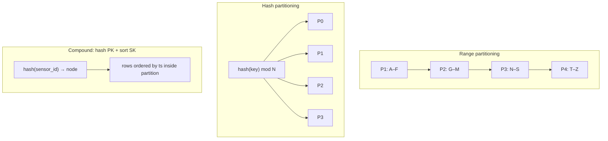
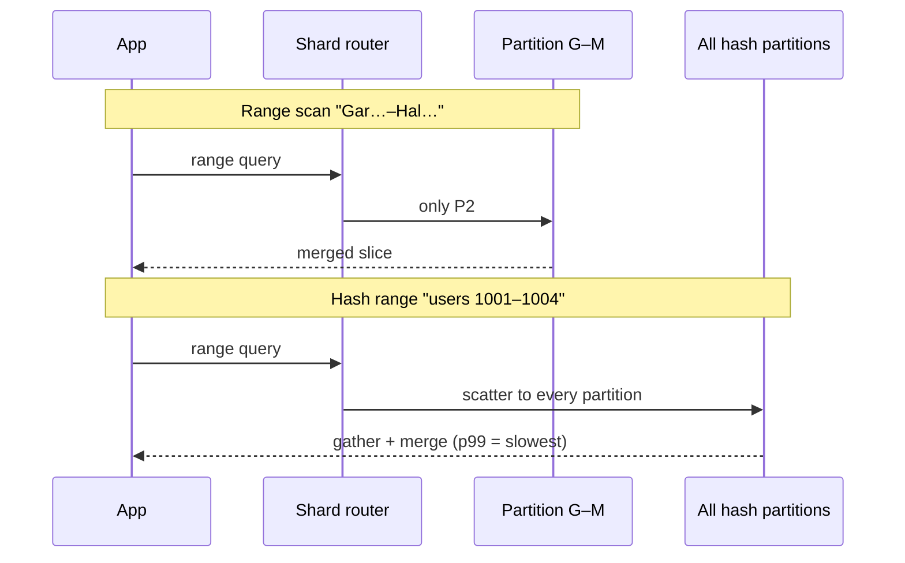
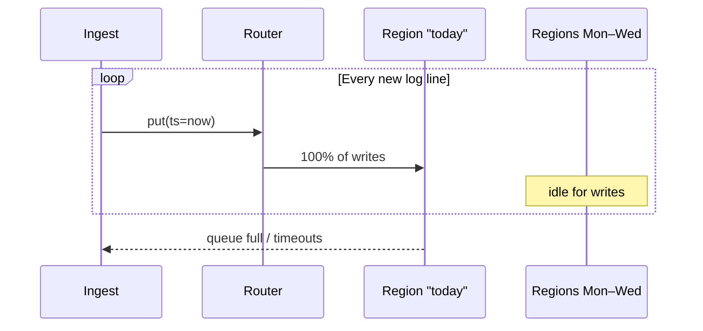

# Lesson 23: Range vs Hash Partitioning — Scans, Hot Spots & Compound Keys

> **Prerequisites:** [Lesson 22: Database Sharding Fundamentals](../22-database-sharding-fundamentals/README.md).  
> **Estimated Reading Time:** 28–35 minutes  
> **Target Audience:** Backend engineers designing shard keys for logs, user stores, IoT readings, and chat — and explaining the range-vs-hash trade-off in interviews.  
> **Free PDF Notes:** [Download SD-E-023.pdf](https://backendroadmap.com/notes/system-design/SD-E-023.pdf) · [Phase 2, Notes (PDF)](https://backendroadmap.com/notes/system-design/Phase2_Notes.pdf)

> [!NOTE]
> **In one line:** range partitioning keeps keys sorted in contiguous chunks, so range scans are cheap but sequential keys create write hot spots; hash partitioning spreads keys evenly but makes range queries fan out; compound keys hash one part and sort by the other to get some of both.

> [!TIP]
> **The Golden Rule of Partitioning:** Choose the scheme from the **queries you actually run**, not from the shape of the data. Point lookups → hash. Time/ID range scans → range (plus a small hash prefix if writes are sequential). “Last N messages in this conversation” → compound `(partition_key, sort_key)`.

---

## Words You'll Meet Today

| Word | In Plain Words | Role in a Live Backend System |
| :--- | :--- | :--- |
| **Partition (shard)** | A subset of rows held by one node (or one unit of placement). | The unit you scale, rebalance, and back up. |
| **Range partitioning** | Contiguous key ranges per partition (dictionary pages, one day per partition). | Cheap range scans; dangerous with sequential keys. |
| **Hash partitioning** | `hash(key)` picks the partition. | Even write spread; range queries become scatter-gather. |
| **Hot spot** | One partition gets most of the load. | Pins one node at 100% CPU while peers idle. |
| **Scatter-gather** | Ask every partition, then merge answers. | Latency follows the **slowest** partition. |
| **Partition key** | The part of the key that chooses the partition. | Must match how you look data up most often. |
| **Clustering / sort key** | Orders rows **inside** one partition. | Enables “last hour for this sensor” without a fan-out. |
| **Compound key** | Partition key + sort key (Cassandra / DynamoDB style). | Even spread across entities + cheap ranges within one entity. |
| **Hash prefix** | Small bucket (`hash(source) % 8`) under a time range. | Spreads sequential writes without full-cluster fan-out on reads. |

---

## Visual Mental Models & Architecture

### The Question: Should Logs and Users Share One Partitioning Scheme?

You run two systems that are both too big for one machine:

1. A **logging platform** — engineers ask for “the last hour of logs.”
2. A **user service** — every request looks up **one user by ID**.

Both need partitions. Using the **same** scheme for both is a classic interview (and production) mistake.

### An Everyday Picture First: A Dictionary vs. a Lottery Machine

- **Range** is a **dictionary**: A–F on one shelf, G–M on the next. Looking up every word from “Gar…” to “Hal…” walks **one shelf**. But if every new word starts with “Z” today, that last shelf melts.
- **Hash** is a **lottery hopper**: sequential tickets 1001, 1002, 1003 land in random bins. Point lookup is still one bin; “tickets 1001–1004” means opening **every** bin and merging.

### Anatomy: Range, Hash, and Compound



*Figure 1. Range keeps neighbors together; hash scatters them; compound hashes the entity and sorts time within it.*



*Figure 2. Range scans stay local; hash range queries pay full-cluster scatter-gather.*

---

## Systematic Reference & Comparison Grid

| Capability | Range | Hash | Compound (hash + sort) |
| :--- | :--- | :--- | :--- |
| **Point lookup** | One partition | One partition | One partition |
| **Range scan on key** | One or a few partitions | **All** partitions | One partition **within one partition key** |
| **Write spread** | Hot spots with sequential keys | Even | Even across partition keys |
| **Examples** | HBase, Bigtable, Spanner, Mongo ranged | DynamoDB, Cassandra, Mongo hashed | Cassandra / DynamoDB partition + sort key |

### Cassandra Compound Key (CQL)

```sql
CREATE TABLE readings (
  sensor_id text,
  ts        timestamp,
  value     double,
  PRIMARY KEY ((sensor_id), ts)   -- hash sensor_id, sort by ts
);

SELECT * FROM readings
 WHERE sensor_id = 's-42'
   AND ts >= '2026-11-04 09:00' AND ts < '2026-11-04 10:00';
-- one partition, one sorted slice: fast
```

---

## Core Definition & Taxonomic Comparison

**Partitioning** places rows onto independent storage units so a cluster can hold more data and absorb more load than one machine. **Range vs hash** is *how* the key maps to those units — not whether you shard.

| Term | Precise Meaning | Production Example |
| :--- | :--- | :--- |
| **Range** vs **hash** | Contiguous key intervals vs hash-bucket placement. | Logs by day (range) vs users by `user_id` (hash). |
| **Sharding** vs **table partitioning** | Across servers vs child tables on **one** Postgres. | Cassandra shards vs Postgres `PARTITION BY RANGE` ([lesson 26](../26-postgres-table-partitioning/README.md)). |
| **Hot partition** vs **hot key** | Uneven key space / ranges vs one celebrity key. | Today’s time partition vs one viral `post_id` ([lesson 24](../24-rebalancing-hot-partitions/README.md)). |
| **Partition key** vs **sort key** | Chooses node vs orders rows inside it. | `conversation_id` hashed; `ts` clustered. |

**Business impact.** Wrong scheme = either write cliffs (range on timestamps) or read cliffs (hash on time-range dashboards). Both look like “the database is slow” while 19 of 20 nodes idle.

---

## Component Anatomy & The Observability Gap

### Anatomy of a Partitioned Write/Read Path

```text
 client key
   |-- extract partition key (and optional sort key)
   |-- map: range bounds  OR  hash(key) % N  OR  consistent-hash slot
   |-- route to owning node / tablet / hash slot
   |-- local B-tree / LSM for that partition
   +-- range query without PK? → coordinator scatter-gather + merge
```

### The Observability Gap: Where Hot Spots Hide

| Vantage Point | What It Captures | What It Hides |
| :--- | :--- | :--- |
| **Cluster CPU average** | Looks fine at 40%. | One partition at 100%, nineteen at 5%. |
| **Per-partition QPS / size** | True skew and last-partition write cliffs. | Application “average latency” still looks OK. |
| **Coordinator p99** | Scatter-gather tax. | Which child partition was slow. |
| **Metrics to add** | Per-partition write/read QPS, size, CPU; fan-out count; merge latency. | A single “DB latency” chart. |

**Operational rule:** alert on **max partition utilization / p99**, not cluster mean.

---

## Mathematical Model of Skew, Fan-Out & Prefix Trade-Offs

### 1. Sequential Key Hot Spot Under Range

With $N$ range partitions and a monotonically increasing key (timestamp / auto-increment), the newest key always lands in the **last** range:

$$P(\text{write hits last partition}) = 1 \quad\Rightarrow\quad \text{write share} = 100\% \text{ on } 1 \text{ of } N \text{ nodes}$$

| $N$ nodes | Idle for writes | Write share on hot node |
| :--- | :--- | :--- |
| 4 | 3 | 100% |
| 10 | 9 | 100% |
| 50 | 49 | 100% |

### 2. Scatter-Gather Tail Compounding

If each of $N$ partitions is independently slow with probability $p$:

$$P(\text{query hits ≥1 slow partition}) = 1 - (1 - p)^N$$

| $N$ | $p = 0.01$ | Approx. slow-query rate |
| :--- | :--- | :--- |
| 1 | $1\%$ | Rare |
| 10 | $\approx 9.6\%$ | Noticeable |
| 50 | $\approx 39.5\%$ | Dashboard feels broken |
| 100 | $\approx 63.4\%$ | Almost always waits on a straggler |

### 3. Hash Prefix Trade-Off

Salt today’s writes into $B$ buckets (`hash(source) % B`). Write hot spot shrinks by $\approx B$, but each time-range read must fetch $B$ slices:

$$\text{read fan-out} = B, \qquad \text{write peak per bucket} \approx \frac{\lambda_{\text{today}}}{B}$$

Keep $B$ small (e.g. 8): last-hour reads 8 slices, not the whole cluster.

### 4. Numbers Every Backend Engineer Must Know

| Operation | Typical cost | Implication |
| :--- | :--- | :--- |
| Point get by partition key | 1 RPC | Always design the hot path this way |
| Range within one partition key | 1 RPC + local scan | Chat / sensor time travel |
| Hash range across keys | $N$ RPCs + merge | Avoid for dashboards |
| Time-range with prefix $B=8$ | 8 RPCs | Acceptable middle ground |

### 5. Hierarchical Decision Budget

| Workload | Scheme | Why |
| :--- | :--- | :--- |
| User / order ID lookup | Hash by ID | Even load; no range need |
| Last-hour logs | Range by time + optional hash prefix | Few partitions on read |
| Chat messages | `((conversation_id), ts)` | One conversation = one sorted slice |
| Global “all users named A–C” | Often wrong question | Prefer search index / secondary design ([lesson 25](../25-secondary-indexes-in-partitioned-data/README.md)) |

### 6. Top Engineering Mitigations

1. **Match scheme to query** — never copy another team’s shard key.
2. **Hash prefix under time ranges** — small $B$, not hundreds.
3. **Compound keys** for entity + time access patterns.
4. **Per-partition metrics** before “add more nodes.”
5. **Avoid auto-increment as a ranged shard key** without salting.

---

## Production War Story Post-Mortem: Monday Log Ingest Cliff

- **Severity & Impact:** SEV-1 for 47 minutes. Ingest lag hit 18 minutes; on-call paged; 1 of 20 HBase region servers at 100% CPU write queue depth.
- **Detection:** Cluster CPU looked “fine” (~35% average). Per-region metrics showed today’s region alone absorbing 100% of puts.

### What Happened

```python
# Anti-pattern: ranged by event_time with no prefix
region = pick_range_partition(event_time)  # all "now" → last region
hbase.put(region, rowkey=f"{event_time}:{uuid}", value=payload)
```

New log lines are always “now,” so every write landed in Thursday’s (today’s) region while Mon–Wed only served historical reads.



### Root Cause Analysis

Range partitioning by time is correct for **reads** (“last hour”) but, without a write-spreading prefix, creates a **structural last-partition hot spot**. Adding nodes does not help: the key space still maps “now” to one range.

### The Fix & Architectural Hardening

1. Row key became `{day}|{hash(source)%8}|{ts}|{uuid}` — eight write buckets per day.
2. Last-hour queries fan out to 8 slices (still ≪ 20).
3. Alerts on **max region write QPS / CPU**, not cluster mean.
4. Documented: users stay **hash(user_id)**; logs stay **time + prefix**.

---

## Multi-Language Production Implementation

````carousel
```go
package partition

import (
	"hash/fnv"
	"time"
)

const writeBuckets = 8

func HashPartition(key string, n int) int {
	h := fnv.New64a()
	_, _ = h.Write([]byte(key))
	return int(h.Sum64() % uint64(n))
}

// LogRowKey spreads sequential writes across B buckets inside one day.
func LogRowKey(source string, ts time.Time) string {
	day := ts.UTC().Format("2006-01-02")
	bucket := HashPartition(source, writeBuckets)
	return day + "|" + itoa(bucket) + "|" + ts.UTC().Format(time.RFC3339Nano) + "|" + source
}

func itoa(n int) string {
	return string(rune('0' + n)) // demo only for 0–9; use strconv in prod
}

// SensorCompound models Cassandra PRIMARY KEY ((sensor_id), ts).
type SensorReading struct {
	SensorID string
	TS       time.Time
	Value    float64
}

func PartitionForSensor(sensorID string, n int) int {
	return HashPartition(sensorID, n)
}
```
<!-- slide -->
```typescript
const WRITE_BUCKETS = 8;

export function hashPartition(key: string, n: number): number {
  let h = 2166136261 >>> 0;
  for (let i = 0; i < key.length; i++) {
    h ^= key.charCodeAt(i);
    h = Math.imul(h, 16777619);
  }
  return (h >>> 0) % n;
}

/** Time-range friendly key with hash prefix to avoid last-partition write cliffs. */
export function logRowKey(source: string, ts: Date): string {
  const day = ts.toISOString().slice(0, 10);
  const bucket = hashPartition(source, WRITE_BUCKETS);
  return `${day}|${bucket}|${ts.toISOString()}|${source}`;
}

/** Compound access: one partition key, sorted by time inside it. */
export function chatMessageKey(conversationId: string, ts: Date, messageId: string) {
  return {
    partitionKey: conversationId, // hashed by the store
    sortKey: `${ts.toISOString()}#${messageId}`,
  };
}

export function partitionsForLastHourQuery(now = new Date()): number[] {
  // With hash prefix, last-hour must read all B buckets for "today" (and maybe yesterday).
  return Array.from({ length: WRITE_BUCKETS }, (_, i) => i);
}
```
<!-- slide -->
```python
import hashlib
from datetime import datetime, timezone

WRITE_BUCKETS = 8


def hash_partition(key: str, n: int) -> int:
    digest = hashlib.md5(key.encode("utf-8")).hexdigest()
    return int(digest, 16) % n


def log_row_key(source: str, ts: datetime) -> str:
    ts = ts.astimezone(timezone.utc)
    day = ts.strftime("%Y-%m-%d")
    bucket = hash_partition(source, WRITE_BUCKETS)
    return f"{day}|{bucket}|{ts.isoformat()}|{source}"


def record_like_unsalted(db, post_id: str) -> None:
    # Anti-pattern under range-by-id or single-key hot posts — see lesson 24 for salting.
    db.incr(f"likes:{post_id}")


def users_scheme(user_id: str, n: int) -> int:
    """Point-lookup workload: hash by user ID; range scans are not required."""
    return hash_partition(user_id, n)
```
<!-- slide -->
```csharp
using System;
using System.Security.Cryptography;
using System.Text;

public static class Partitioning
{
    public const int WriteBuckets = 8;

    public static int HashPartition(string key, int n)
    {
        var hash = MD5.HashData(Encoding.UTF8.GetBytes(key));
        var value = BitConverter.ToUInt32(hash, 0);
        return (int)(value % (uint)n);
    }

    public static string LogRowKey(string source, DateTimeOffset ts)
    {
        var utc = ts.ToUniversalTime();
        var day = utc.ToString("yyyy-MM-dd");
        var bucket = HashPartition(source, WriteBuckets);
        return $"{day}|{bucket}|{utc:O}|{source}";
    }

    public readonly record struct ChatKey(string PartitionKey, string SortKey);

    public static ChatKey ForMessage(string conversationId, DateTimeOffset ts, string messageId) =>
        new(conversationId, $"{ts:O}#{messageId}");
}
```
````

---

## Practical Hands-On Verification CLI Workflows

### 1. Show Hash Scatter vs Sequential Keys

```bash
python3 -c "
import hashlib
keys=list(range(1001,1021))
print('key -> bucket (n=4)')
for k in keys:
  b=int(hashlib.md5(str(k).encode()).hexdigest(),16)%4
  print(k, '->', b)
"
```

**Expected:** consecutive IDs land in mixed buckets — neighbors are not co-located.

### 2. Simulate Last-Partition Hot Spot

```bash
python3 -c "
N=10
# sequential inserts into sorted ranges of width 1000
writes=list(range(9000,10000))  # all fall in last range [9000,10000)
print('hot partition write share', sum(1 for w in writes if w>=9000)/len(writes))
"
```

### 3. Fan-Out Probability

```bash
python3 -c "
p=0.01
for N in (1,10,50,100):
  print(N, 1-(1-p)**N)
"
```

---

## Pause and Think

> [!exercise] Design partitioning for (a) a user profile service with only `GET /users/:id`, and (b) a chat app where users open a conversation and scroll older messages. Which schemes, and why?

<details><summary>Answer</summary>

(a) **Hash by `user_id`** — every request is a point lookup; losing range scans costs nothing.  
(b) **Compound:** partition key = `conversation_id` (hashed), sort key = message time / time-ordered ID — last 50 messages are one partition, one sorted slice.

</details>

---

## Common Mistakes & Troubleshooting

### What Goes Wrong

- Range on timestamp / auto-increment with **no** hash prefix → one hot write partition.
- Hash-partitioning a table whose main query is a **time-range scan** → every query hits every node.
- Choosing the scheme from **data shape** instead of **query shape**.
- Compound partition key so coarse (`country`) that one partition grows huge.

### Common Myths

| Myth | Reality |
| :--- | :--- |
| “Hash makes range queries impossible.” | Possible but expensive: full fan-out + merge. |
| “More nodes fix a hot time partition.” | Key still maps “now” to one range. |
| “Hash prefix is free.” | Writes spread; reads pay $B$-way fan-out. |

---

## Recap in Three Lines

1. Range = cheap scans, sequential write cliffs; hash = even writes, expensive ranges.
2. Compound keys hash the entity and sort by time inside it — the chat/sensor default.
3. Always pick from access patterns; measure **per-partition** load, not cluster averages.

---

## Interview Practice Questions

### Basic Conceptual Questions (Q1–Q4)

<details><summary><strong>Q1: Compare range and hash partitioning. [BASIC]</strong></summary>

Range keeps keys sorted in contiguous chunks, so range scans touch one or a few partitions, but sequential keys (timestamps, auto-increment) send all writes to the last partition. Hash spreads keys evenly and avoids that hot spot, but a range query must fan out to every partition and merge.

</details>

<details><summary><strong>Q2: Why does an auto-increment key cause a hot spot under range partitioning? [BASIC]</strong></summary>

Each new ID is larger than the last, so every insert falls in the highest range. With 10 nodes, one node takes 100% of writes and nine take none.

</details>

<details><summary><strong>Q3: What is a compound key in Cassandra? [BASIC]</strong></summary>

`PRIMARY KEY ((sensor_id), ts)`: `sensor_id` is hashed to pick the partition (and node); `ts` orders rows inside it. One sensor’s time range is one sorted slice on one partition.

</details>

<details><summary><strong>Q4: What is scatter-gather, and how does it affect p99? [BASIC]</strong></summary>

The coordinator asks all partitions and merges results. Latency follows the slowest partition. If each of 50 partitions is slow 1% of the time, about $1 - 0.99^{50} \approx 40\%$ of queries wait on a slow partition.

</details>

### Scenario-Based Architecture Questions (Q5–Q8)

<details><summary><strong>Q5: Design partitioning for a log store queried by “last hour.” [SCENARIO]</strong></summary>

Range by time (per hour or day) so recent queries hit few partitions and old data drops cheaply. Add a prefix such as `hash(source) % 8` inside each period so writes spread over 8 buckets; the query reads those 8 buckets.

</details>

<details><summary><strong>Q6: A user service only does lookups by user ID. Which scheme? [SCENARIO]</strong></summary>

Hash by user ID. Every request is a point lookup to one partition, load is even, and no one needs ID ranges.

</details>

<details><summary><strong>Q7: Your chat app stores messages. Users open a conversation and scroll back in time. [SCENARIO]</strong></summary>

Partition key = `conversation_id` (hashed, even spread), sort key = message time or a time-ordered message ID. Loading the last 50 messages is one partition, one sorted slice.

</details>

<details><summary><strong>Q8: IoT platform: millions of sensors, dashboards show one sensor’s last 24h. [SCENARIO]</strong></summary>

Compound: `PRIMARY KEY ((sensor_id), ts)`. Sensors spread evenly; each sensor’s readings stay sorted. A cross-sensor global time range still fans out — serve that from a rollup/OLAP path, not the hot OLTP table.

</details>

### Advanced & Tricky Interview Questions (Q9–Q12)

<details><summary><strong>Q9: With hash partitioning, is a range query impossible? [TRICKY]</strong></summary>

No, just expensive: it goes to every partition and results are merged, so latency follows the slowest partition. With 50 partitions, one slow node slows every range query.

</details>

<details><summary><strong>Q10: Does a hash prefix fix the hot spot for free? [TRICKY]</strong></summary>

No. Writes spread over $N$ buckets, but every read for a time range now reads $N$ buckets and merges them. Keep $N$ small (e.g. 8) and add it only where the write rate needs it.

</details>

<details><summary><strong>Q11: Why can a coarse compound key like `country` still hot-spot? [TRICKY]</strong></summary>

Hashing spreads *distinct* partition-key values, not rows inside one value. If 40% of traffic is `country=US`, that one partition still owns 40% of load. Choose a higher-cardinality entity key or add bucketing.

</details>

<details><summary><strong>Q12: When would you deliberately choose range over hash even knowing about hot spots? [TRICKY]</strong></summary>

When the dominant query is a contiguous key/time scan and retention is by dropping whole ranges (Bigtable/HBase/Spanner time series, Mongo ranged chunks). Mitigate writes with prefixes, dynamic splits, or salting — don’t give up pruning and cheap drops.

</details>

---

## One-Page Master Cheat Sheet

```text
┌─ Range vs Hash Partitioning (SD-E-023) ─────────────────────────┐
│ Range: sorted chunks → cheap scans; sequential keys → hot last  │
│ Hash:  even writes; range query = scatter-gather to all N       │
│ Compound: hash(PK) + sort(SK) → chat/sensors default            │
│                                                                 │
│ Math: P(slow) = 1-(1-p)^N   |  prefix B: writes/B, reads×B      │
│ Logs: time range + hash(source)%8                               │
│ Users: hash(user_id)                                            │
│ Chat:  ((conversation_id), ts)                                  │
│                                                                 │
│ Anti-patterns: ranged autoincrement; hash for time dashboards;  │
│                coarse PK (country); ignore per-partition metrics│
└─────────────────────────────────────────────────────────────────┘
```

---

## Free PDF notes

[SD-E-023.pdf](https://backendroadmap.com/notes/system-design/SD-E-023.pdf) · [Phase 2 notes](https://backendroadmap.com/notes/system-design/Phase2_Notes.pdf)

## Sources

- Kleppmann, *Designing Data-Intensive Applications*, Ch. 6 (Partitioning)
- Apache Cassandra documentation — partition keys & clustering columns
- Google Bigtable / Spanner papers — tablet/range placement

## Next

[Lesson 24: Rebalancing & Hot Partitions — Consistent Hashing and Key Salting](../24-rebalancing-hot-partitions/README.md)
