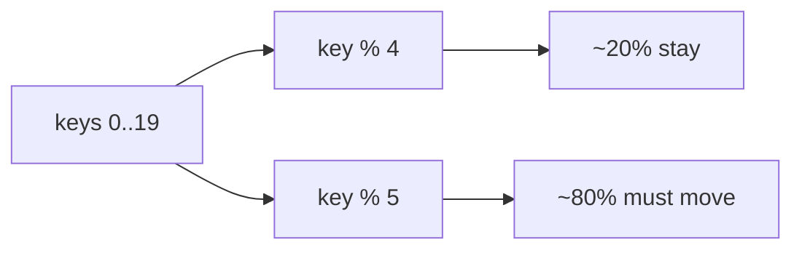
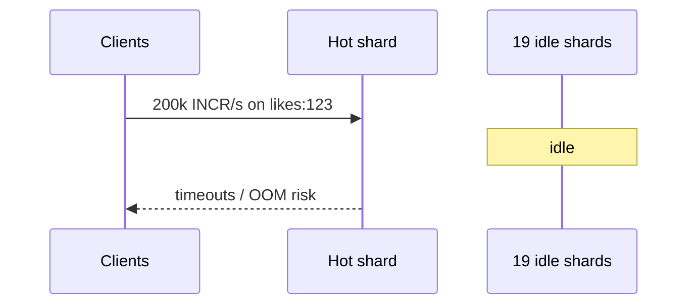

# Lesson 24: Rebalancing & Hot Partitions — Consistent Hashing and Key Salting

> **Prerequisites:** [Lesson 23: Range vs Hash Partitioning](../23-range-vs-hash-partitioning/README.md).  
> **Estimated Reading Time:** 28–35 minutes  
> **Target Audience:** Backend engineers growing clusters without reshuffling everything, and fixing celebrity / hot-key overload that “add nodes” cannot cure.  
> **Free PDF Notes:** [Download SD-E-024.pdf](https://backendroadmap.com/notes/system-design/SD-E-024.pdf) · [Phase 2, Notes (PDF)](https://backendroadmap.com/notes/system-design/Phase2_Notes.pdf)

> [!NOTE]
> **In one line:** rebalance with many fixed partitions, dynamic splitting, or consistent hashing so only a small fraction of keys move (never `hash mod N`); a single hot key is a different problem, fixed by salting it across sub-keys and merging on read.

> [!TIP]
> **The Golden Rule of Rebalancing vs Hot Keys:** **Rebalancing** moves *partitions between nodes* as the cluster changes. A **hot key** always maps to one partition — adding nodes never helps. Detect per-key traffic, salt only known hot keys, and cache merged reads.

---

## Words You'll Meet Today

| Word | In Plain Words | Role in a Live Backend System |
| :--- | :--- | :--- |
| **Rebalancing** | Moving partitions between nodes as capacity changes. | Must stay available and move as little data as possible. |
| **`hash % N`** | Naive placement keyed to current node count. | Changing $N$ reshuffles most keys (disaster). |
| **Fixed partitions / hash slots** | Many more partitions than nodes; keys stick to a slot. | Redis Cluster: 16,384 slots; only slot→node mapping moves. |
| **Dynamic splitting** | Split an oversized partition; move one half. | HBase regions, Mongo chunks, DynamoDB. |
| **Consistent hashing** | Hash ring; key belongs to next node clockwise. | ~$1/N$ of keys move when a node joins. |
| **Virtual node (vnode)** | Many ring positions per physical server. | Smooths load; Cassandra-style. |
| **Hot key** | One key with far more traffic than others. | Celebrity post likes; cannot be fixed by rebalancing alone. |
| **Salting** | Random suffix spreads one logical key across sub-keys. | Writes fan out; reads merge (and should be cached). |

---

## Visual Mental Models & Architecture

### The Celebrity Problem

A celebrity with 50 million followers posts a photo. Millions of likes hit the same `post_id` on one partition. That shard pins at 100% CPU while the other 19 sit idle. **Adding nodes will not help** — the key still maps to one partition.

Two separate problems:

1. **Rebalancing** — move data when nodes join/leave.
2. **Hot keys** — one key exceeds what any single partition can serve.

### An Everyday Picture First: Moving Apartments vs. One Famous Doorbell

- **Rebalancing** is redistributing **apartments** (partitions) across **buildings** (nodes) when you open a new building — move whole apartments, don’t renumber every resident.
- **Hot key** is one doorbell that every visitor rings. Building a new tower next door does nothing; you need **ten doorbells** (salts) and a receptionist who sums the counts.

### Why `hash % N` Fails

Going from 4 nodes to 5 changes `key % N` for about **80%** of keys ($N/(N+1)$). Almost all data must move at once.



*Figure 1. Changing modulus reshuffles nearly everything.*

```mermaid
sequenceDiagram
  participant Cluster
  participant NodeA
  participant NodeB
  participant NodeC
  participant NodeD

  Note over Cluster: Fixed partitions p0–p11 on A,B,C
  Cluster->>NodeD: join
  NodeA-->>NodeD: steal p3
  NodeB-->>NodeD: steal p7
  NodeC-->>NodeD: steal p11
  Note over Cluster: 3/12 = 25% move; keys keep their partition
```

*Figure 2. Fixed partitions: only whole partitions move; keys never change partition ID.*

---

## Systematic Reference & Comparison Grid

| Approach | When a node joins | Used by |
| :--- | :--- | :--- |
| **`hash % N`** | ~$N/(N+1)$ of keys move | Avoid for stored data |
| **Fixed partitions** | Whole partitions move; keys keep partition | Redis Cluster (16,384 slots), Elasticsearch |
| **Dynamic splitting** | Big partitions split; halves move | HBase, MongoDB, DynamoDB |
| **Consistent hashing + vnodes** | ~$1/N$ of keys move, from many nodes | Cassandra |

---

## Core Definition & Taxonomic Comparison

**Rebalancing** redistributes ownership so load and data stay even as membership changes. **Hot-key mitigation** changes the *key itself* (or isolates it) because placement algorithms cannot split one key.

| Term | Precise Meaning | Production Example |
| :--- | :--- | :--- |
| **Rebalance** vs **reshard** | Move existing partitions vs redefine partition count/key. | Steal Redis slots vs recreate index with more shards. |
| **Hot partition** vs **hot key** | Uneven partition load vs one key dominating. | Fat region vs viral `post_id`. |
| **Salt** vs **hash prefix** | Spread one hot key vs spread sequential writes in a range. | `likes:post#0..9` vs `day\|bucket\|ts`. |
| **Slot** vs **vnode** | Fixed hash bucket vs virtual ring position. | Redis slot vs Cassandra vnode. |

---

## Component Anatomy & The Observability Gap

```text
 key
  |-- map to partition / slot / ring position   (stable under good designs)
  |-- look up partition → node assignment      (changes during rebalance)
  |-- if single key QPS >> partition capacity → salt or isolate
  +-- reads of salted key: multi-get + merge (+ cache)
```

| Vantage Point | Captures | Hides |
| :--- | :--- | :--- |
| **Node CPU** | Which machine is hot | Whether cause is many keys or one key |
| **Per-key top-N QPS** | Celebrity keys | Needs sampling / hot-key tracker |
| **Migration bytes/s** | Rebalance cost | Application errors during moves |
| **Metrics to add** | Top keys, slot imbalance, migrate lag, salted read fan-out | Cluster-average CPU only |

---

## Mathematical Model of Movement Fraction & Salting

### 1. `hash % N` Movement Fraction

When growing from $N$ to $N+1$ nodes:

$$f_{\text{move}} \approx \frac{N}{N+1}$$

| $N \to N+1$ | Approx. keys moved |
| :--- | :--- |
| 4 → 5 | 80% |
| 10 → 11 | ~91% |
| 100 → 101 | ~99% |

### 2. Ideal Minimum Move When Adding One Node

To equalize $P$ partitions over $N+1$ nodes, move about:

$$f_{\text{min}} \approx \frac{1}{N+1}$$

Example: 12 partitions, 3→4 nodes → move $3/12 = 25\%$.

### 3. Consistent Hashing With Vnodes

Expected fraction moved ≈ $1/(N+1)$, spread across many donors — not one neighbor dumping half its data.

### 4. Hot Key Capacity Math

Peak likes $\lambda = 200{,}000$/s; one partition capacity $C = 25{,}000$/s:

$$\text{overload} = \frac{\lambda}{C} = 8\times$$

With $S = 10$ salts: $\lambda/S = 20{,}000$/s per bucket $< C$.

Reads cost $S$ fetches; cache total for $T=2$s:

$$\text{merge reads/s} \approx \frac{\text{page views/s}}{T} \quad\text{(instead of every view)}$$

### 5. Numbers to Know

| System | Fixed unit | Note |
| :--- | :--- | :--- |
| Redis Cluster | 16,384 hash slots | Keys never change slot |
| Elasticsearch | Primary shards per index | Choose shard count for growth |
| Cassandra | Vnodes on ring | ~$1/N$ moves |

### 6. Top Mitigations

1. Never store with `hash % N`.
2. Create **many** fixed partitions up front (e.g. 1,000 for 10 nodes).
3. Salt **only** detected hot keys; cache merged reads.
4. Split fat partitions when the *partition* is hot, not one key.
5. Isolate extreme celebrities on dedicated capacity if needed.

---

## Production War Story Post-Mortem: Celebrity Post Meltdown

- **Severity & Impact:** SEV-1, 22 minutes. Like API p99 > 5s; one Redis shard CPU 100%; feed fan-out delayed.
- **Detection:** Shard heatmap; top-key tracker showed `post:123` at 180k INCR/s.

### What Happened

```python
db.incr(f"likes:{post_id}")  # one key → one slot → one node
```



### Root Cause Analysis

Placement was fine; **one key exceeded partition write capacity**. Cluster scale-out moved other slots but not the celebrity key.

### The Fix & Hardening

```python
SALTS = 10
def record_like(post_id):
    salt = random.randint(0, SALTS - 1)
    db.incr(f"likes:{post_id}#{salt}")

def total_likes(post_id):
    keys = [f"likes:{post_id}#{s}" for s in range(SALTS)]
    return sum(db.mget(keys))
```

Cache summed count for 2s; auto-salt keys above a QPS threshold; alert on top-key share > 5% of shard QPS.

---

## Multi-Language Production Implementation

````carousel
```go
package hotkey

import (
	"fmt"
	"math/rand"
	"strconv"
	"sync/atomic"
)

const Salts = 10

type CounterStore interface {
	Incr(key string) error
	MGet(keys []string) ([]int64, error)
}

func RecordLike(db CounterStore, postID string) error {
	salt := rand.Intn(Salts)
	return db.Incr(fmt.Sprintf("likes:%s#%d", postID, salt))
}

func TotalLikes(db CounterStore, postID string) (int64, error) {
	keys := make([]string, Salts)
	for i := 0; i < Salts; i++ {
		keys[i] = fmt.Sprintf("likes:%s#%d", postID, i)
	}
	vals, err := db.MGet(keys)
	if err != nil {
		return 0, err
	}
	var sum int64
	for _, v := range vals {
		sum += v
	}
	return sum, nil
}

// FixedSlots models Redis-style stable slot IDs.
func SlotForKey(key string, slots uint16) uint16 {
	var h uint32 = 2166136261
	for i := 0; i < len(key); i++ {
		h ^= uint32(key[i])
		h *= 16777619
	}
	return uint16(h % uint32(slots))
}

var _ = atomic.AddInt64 // keep sync/atomic imported for production counters
var _ = strconv.Itoa
```
<!-- slide -->
```typescript
const SALTS = 10;

export async function recordLike(
  incr: (key: string) => Promise<void>,
  postId: string
): Promise<void> {
  const salt = Math.floor(Math.random() * SALTS);
  await incr(`likes:${postId}#${salt}`);
}

export async function totalLikes(
  mget: (keys: string[]) => Promise<number[]>,
  postId: string
): Promise<number> {
  const keys = Array.from({ length: SALTS }, (_, s) => `likes:${postId}#${s}`);
  const vals = await mget(keys);
  return vals.reduce((a, b) => a + (b || 0), 0);
}

/** CRC-ish slot placement: keys keep slot when node membership changes. */
export function redisStyleSlot(key: string, slots = 16384): number {
  let h = 0;
  for (let i = 0; i < key.length; i++) h = ((h << 5) - h + key.charCodeAt(i)) | 0;
  return (h >>> 0) % slots;
}

export function moveFractionModN(n: number): number {
  return n / (n + 1);
}
```
<!-- slide -->
```python
import random
from typing import Callable, List

SALTS = 10


def record_like(db_incr: Callable[[str], None], post_id: str) -> None:
    salt = random.randint(0, SALTS - 1)
    db_incr(f"likes:{post_id}#{salt}")


def total_likes(db_mget: Callable[[List[str]], List[int]], post_id: str) -> int:
    keys = [f"likes:{post_id}#{s}" for s in range(SALTS)]
    return sum(db_mget(keys))


def hash_mod_move_fraction(n: int) -> float:
    """Fraction of keys that change node when growing n → n+1 with key % n."""
    return n / (n + 1)


def fixed_partition_move_count(partitions: int, old_nodes: int, new_nodes: int) -> int:
    """Approx partitions stolen to equalize (idealized)."""
    per = partitions // new_nodes
    return partitions - per * old_nodes
```
<!-- slide -->
```csharp
using System;
using System.Linq;
using System.Threading.Tasks;

public static class HotKeySalting
{
    public const int Salts = 10;

    public static Task RecordLikeAsync(Func<string, Task> incr, string postId)
    {
        var salt = Random.Shared.Next(Salts);
        return incr($"likes:{postId}#{salt}");
    }

    public static async Task<long> TotalLikesAsync(Func<string[], Task<long[]>> mget, string postId)
    {
        var keys = Enumerable.Range(0, Salts).Select(s => $"likes:{postId}#{s}").ToArray();
        var vals = await mget(keys);
        return vals.Sum();
    }

    public static double HashModMoveFraction(int n) => n / (double)(n + 1);

    public static int SlotForKey(string key, int slots = 16384)
    {
        unchecked
        {
            uint h = 2166136261;
            foreach (var c in key)
            {
                h ^= c;
                h *= 16777619;
            }
            return (int)(h % (uint)slots);
        }
    }
}
```
````

---

## Practical Hands-On Verification CLI Workflows

### 1. Prove `hash % N` Reshuffle

```bash
python3 -c "
def owner(k,n): return k%n
moved=sum(1 for k in range(10000) if owner(k,4)!=owner(k,5))
print(moved/10000)
"
```

**Expected:** ≈ `0.8`.

### 2. Ideal Fixed-Partition Move

```bash
python3 -c "print(3/12)  # 12 partitions, add 4th node"
```

### 3. Salt Capacity Check

```bash
python3 -c "lam,C,S=200_000,25_000,10; print(lam/C, lam/S, lam/S<C)"
```

---

## Pause and Think

> [!exercise] One shard is at 100% CPU, 19 idle. Do you add nodes first? What do you check?

<details><summary>Answer</summary>

Check **per-key** metrics first. If one key is hot, adding nodes won’t help — salt, cache, or isolate. If the partition is large/hot overall, **split** and move half. Only then consider capacity adds for cluster-wide load.

</details>

---

## Common Mistakes & Troubleshooting

- Placing data with `hash % N`, then discovering one new node moves nearly everything.
- Adding nodes to fix a hot key.
- Salting **every** key (every read becomes a fan-out).
- Too few fixed partitions (e.g. 8) — cannot grow past 8 nodes without re-partitioning.
- Consistent hashing **without** vnodes → uneven load and neighbor dump on join.

---

## Recap in Three Lines

1. Never `hash % N` for durable placement — use fixed slots, splits, or consistent hashing + vnodes.
2. Rebalancing ≠ hot-key fix; salts + cached merges fix celebrities.
3. Provision many more partitions than today’s node count.

---

## Interview Practice Questions

### Basic Conceptual Questions (Q1–Q4)

<details><summary><strong>Q1: How do you rebalance shards with minimal data movement? [BASIC]</strong></summary>

Avoid `hash % N`. Use many fixed partitions that move whole between nodes, dynamic splitting, or consistent hashing with virtual nodes, so only a small fraction of keys (about $1/N$) moves.

</details>

<details><summary><strong>Q2: Why is `hash % N` bad for rebalancing? [BASIC]</strong></summary>

Changing $N$ changes almost every key’s result. From 4 to 5 nodes about 80% of keys move; from 10 to 11, about 91%. That means a cluster-wide migration for one new node.

</details>

<details><summary><strong>Q3: How does Redis Cluster place keys? [BASIC]</strong></summary>

`CRC16(key) mod 16,384` picks a hash slot; slots are assigned to nodes. Adding a node moves whole slots to it; keys never change slot.

</details>

<details><summary><strong>Q4: What problem do virtual nodes solve on a hash ring? [BASIC]</strong></summary>

Without vnodes, a new node takes a large contiguous arc from one neighbor and load can be uneven. Many vnodes per server steal small slices from many nodes (~$1/N$ total, well spread).

</details>

### Scenario-Based Architecture Questions (Q5–Q8)

<details><summary><strong>Q5: One shard sits at 100% CPU while 19 are idle. Diagnose and fix. [SCENARIO]</strong></summary>

Check per-key metrics. If one key is hot, salt it across e.g. 10 sub-keys and merge on read, cache reads, or isolate it. If the partition is large/hot overall, split and move half.

</details>

<details><summary><strong>Q6: You salt a like counter into 10 buckets. What does a read cost? [SCENARIO]</strong></summary>

Ten key reads and a sum, instead of one read. Batch them in one multi-get and cache the total for a second or two.

</details>

<details><summary><strong>Q7: How many fixed partitions for a cluster of 10 nodes today? [SCENARIO]</strong></summary>

Many more than nodes, e.g. 1,000 (100 per node). Allows growth to hundreds of nodes without re-partitioning, while keeping per-partition overhead small.

</details>

<details><summary><strong>Q8: Elasticsearch index created with 5 primary shards; traffic 10× later. Issue? [SCENARIO]</strong></summary>

Primary shard count is fixed at index creation. You cannot efficiently use >>5 nodes for that index without reindexing into more shards. Plan shard count for growth (or use newer split APIs / rollover patterns).

</details>

### Advanced & Tricky Interview Questions (Q9–Q12)

<details><summary><strong>Q9: Does consistent hashing alone fix hot spots? [TRICKY]</strong></summary>

No. It limits how many keys move when nodes change. Without vnodes, load can still be uneven; and no placement scheme spreads one hot key, which always maps to one node.

</details>

<details><summary><strong>Q10: Why not salt every key to be safe? [TRICKY]</strong></summary>

Every read becomes a fan-out to all buckets: $10\times$ read work and a merge step, plus tail latency from the slowest bucket. Salt only keys you detect as hot.

</details>

<details><summary><strong>Q11: Why is moving whole partitions better than remapping keys? [TRICKY]</strong></summary>

Partition identity stays stable — clients/caches keep the same partition ID; only ownership metadata changes. Remapping keys invalidates locality, inflates network copy volume, and couples membership changes to every key’s address.

</details>

<details><summary><strong>Q12: Can you salt a hot key and still use strongly consistent single-row reads? [TRICKY]</strong></summary>

The logical counter becomes a **distributed aggregate**. Strong consistency requires reading all salts (or a singleleader aggregator). Often you accept brief cache staleness for reads; if you need atomic compare-and-swap on the total, salting alone is the wrong tool — use a dedicated service or sharded adder with careful merge semantics.

</details>

---

## One-Page Master Cheat Sheet

```text
┌─ Rebalancing & Hot Partitions (SD-E-024) ───────────────────────┐
│ Avoid hash%N: move ≈ N/(N+1) keys                               │
│ Fixed slots / dynamic split / CH + vnodes → ~1/N moves          │
│ Redis: 16384 slots · ES: fixed primaries · Cassandra: vnodes    │
│ Hot key ≠ rebalance problem → salt S ways, MGET+sum, cache      │
│ Provision partitions ≫ nodes · alert on top-key QPS             │
└─────────────────────────────────────────────────────────────────┘
```

---

## Free PDF notes

[SD-E-024.pdf](https://backendroadmap.com/notes/system-design/SD-E-024.pdf)

## Sources

- Kleppmann, DDIA — Ch. 6 (Rebalancing)
- Redis Cluster specification — hash slots
- Dynamo / Cassandra papers — consistent hashing & vnodes

## Next

[Lesson 25: Secondary Indexes in Partitioned Data — Local vs Global (GSI)](../25-secondary-indexes-in-partitioned-data/README.md)
