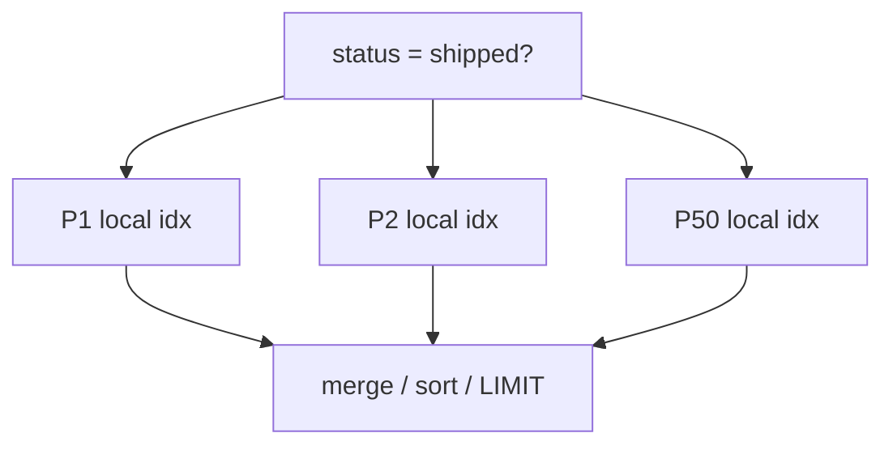
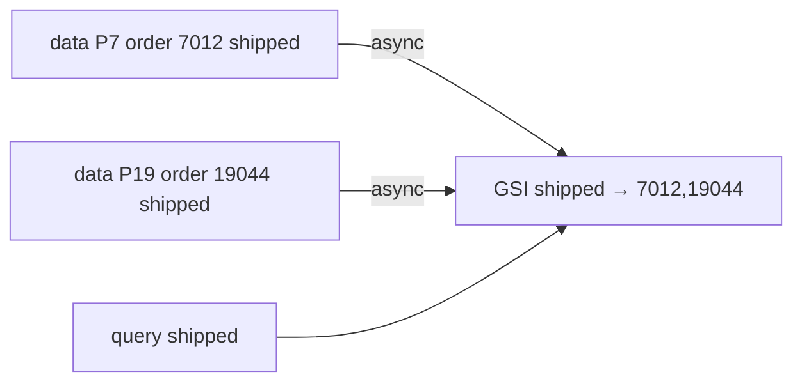
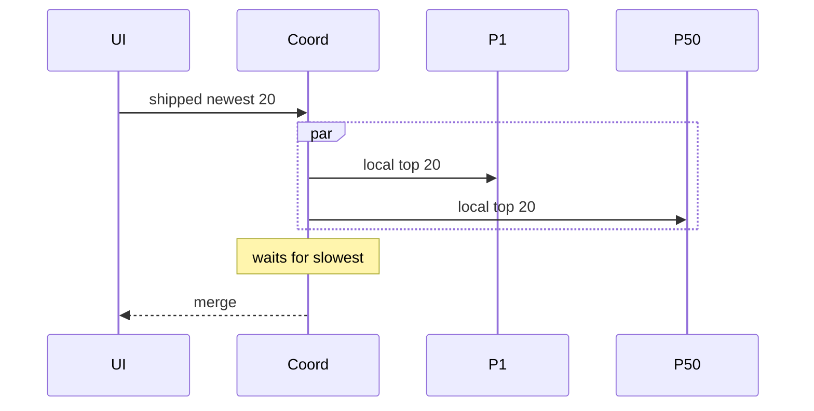

# Lesson 25: Secondary Indexes in Partitioned Data — Local vs Global (GSI)

> **Prerequisites:** [Lesson 23: Range vs Hash Partitioning](../23-range-vs-hash-partitioning/README.md), [Lesson 24: Rebalancing & Hot Partitions](../24-rebalancing-hot-partitions/README.md).  
> **Estimated Reading Time:** 30–35 minutes  
> **Target Audience:** Backend engineers querying non-partition-key attributes on sharded stores (DynamoDB LSI/GSI, Cassandra, Mongo) without melting p99.  
> **Free PDF Notes:** [Download SD-E-025.pdf](https://backendroadmap.com/notes/system-design/SD-E-025.pdf) · [Phase 2, Notes (PDF)](https://backendroadmap.com/notes/system-design/Phase2_Notes.pdf)

> [!NOTE]
> **In one line:** a local index lives on each partition, so writes stay local but queries scatter to every partition and gather; a global index is partitioned by the indexed value, so queries hit one partition but writes touch several and are usually applied asynchronously (eventually consistent).

> [!TIP]
> **The Golden Rule of Secondary Indexes on Shards:** If the query **already includes the partition key**, prefer a **local** index. If you need “all rows with `status=shipped`” across the cluster, use a **global** index (GSI) — accept eventual consistency, watch low-cardinality hot partitions, and **never** expect read-your-writes on the GSI path.

---

## Words You'll Meet Today

| Word | In Plain Words | Role in a Live Backend System |
| :--- | :--- | :--- |
| **Secondary index** | Index on a non-partition-key column. | Answers warehouse / email / status queries. |
| **Local index (document-partitioned)** | Per data partition; covers only its rows. | Consistent writes; scatter-gather reads. |
| **Global index (term-partitioned)** | Partitioned by the indexed value. | Targeted reads; async / multi-partition writes. |
| **LSI / GSI** | DynamoDB local / global secondary index. | LSI = same PK; GSI = any PK, eventual only. |
| **Scatter-gather** | Query every partition, merge. | p99 tracks the slowest child. |
| **Cardinality** | Number of distinct values. | Low cardinality → hot index partitions. |
| **Sparse index** | Only items that have the attribute. | Keeps GSIs small (e.g. only `pending`). |
| **Bucket suffix** | `shipped#3` from `hash(id)%10`. | Spreads low-cardinality GSI keys. |

---

## Visual Mental Models & Architecture

### The Question the Partition Key Can’t Answer

Orders are partitioned by `order_id` across 50 partitions. Lookup by ID is one hop. Then warehouse asks: **every order with `status=shipped`**. Status is not the partition key — so which partition? All fifty? A secondary index answers that, two ways.

### Everyday Picture: Library Card Catalogs

- **Local index:** each floor has a catalog of **its own shelves only**. Updating a book is easy (same floor). Finding every “shipped” book means visiting **every floor**.
- **Global index:** one catalog wing organized by **status**. Finding “shipped” is one wing — but when a book’s status changes, you must update a **different wing** (often a bit later).



*Figure 1. Local index: scatter-gather; as slow as the slowest of 50.*



*Figure 2. Global index: one read partition; write path is multi-partition and usually async.*

---

## Systematic Reference & Comparison Grid

### DynamoDB LSI vs GSI

| | **LSI** | **GSI** |
| :--- | :--- | :--- |
| Partition key | Same as table; different sort key | Any attribute |
| Created | Only at table creation | Any time |
| Read consistency | Strongly consistent supported | Eventually consistent only |
| Updated | With the item, same partition | Asynchronously |
| Capacity | Shares table’s | Its own |

### Local vs Global Trade-Off

| | Local | Global |
| :--- | :--- | :--- |
| Write | Local, consistent | Multi-partition, often async |
| Read by indexed value | Fan-out to all data partitions | One (or few bucketed) index partitions |
| Examples | Mongo, Cassandra, ES local; Dynamo LSI | Dynamo GSI; term-partitioned designs |

---

## Core Definition & Taxonomic Comparison

A **secondary index** is a derived access path on attributes that are not the primary partition key. In a partitioned database you must choose **where that derived path lives**.

| Term | Precise Meaning | Production Example |
| :--- | :--- | :--- |
| **Document- vs term-partitioned** | Index co-located with row vs by term value. | Local status index vs GSI on `status`. |
| **Strong vs eventual on index** | Same transaction as row vs async projector. | LSI vs GSI read-after-write. |
| **Sparse vs dense** | Only rows with attribute vs all rows. | `pending_since` only while pending. |

---

## Component Anatomy & The Observability Gap

```text
 write order row on data partition Pd
   |-- local index: update index on Pd (same op)
   +-- global index: enqueue/async write to index partition Pi(term)
        (may also delete old term partition if value changed)

 read by secondary attribute
   |-- local: scatter to all Pd, merge
   +-- global: query Pi(term) [+ buckets], optionally fetch base rows
```

| Vantage Point | Captures | Hides |
| :--- | :--- | :--- |
| **App “update OK”** | Base row committed | GSI lag — login-by-email 404 |
| **Coordinator p99** | Scatter-gather tax | Which partition straggled |
| **GSI throttle / hot partition** | Low-cardinality cliff | Looks like “Dynamo is down” |
| **Metrics** | Fan-out, GSI lag, per-index-partition QPS | Single table latency only |

---

## Mathematical Model of Scatter-Gather & Write Amplification

### 1. Scatter-Gather Tail Probability

$$P(\text{slow}) = 1 - (1 - p)^N$$

For $N=50$, $p=0.01$: $1 - 0.99^{50} \approx 0.395$ → **~40%** of dashboard refreshes wait on a 200 ms straggler even if median child is 5 ms.

### 2. LIMIT Merge Cost

Top-$K$ with local indexes: each of $N$ partitions returns $K$ rows → coordinator merges $N \cdot K$ rows (e.g. $50 \times 20 = 1{,}000$).

### 3. GSI Write Amplification

Status change `pending → shipped` may touch: data partition + old index partition + new index partition ⇒ up to **3** partition writes (async).

Every extra GSI multiplies write cost roughly by $(1 + \#\text{GSIs touched})$.

### 4. Bucketed Low-Cardinality Keys

With $B$ buckets on `status`:

$$\text{write to } 1 \text{ of } B, \qquad \text{read fan-out } = B$$

### 5. Top Mitigations

1. Local index when partition key is in the query.
2. GSI for cross-partition filters; accept lag.
3. Bucket low-cardinality GSI keys; prefer sparse indexes.
4. Read-your-writes via primary key, not GSI.
5. Unique email: transactional item keyed by email, not “hope the GSI caught up.”

---

## Production War Story Post-Mortem: Warehouse Dashboard Meltdown

- **Severity & Impact:** SEV-2 lasting all afternoon. Warehouse UI p99 2.5s; 50-partition local index scatter.
- **Detection:** Fan-out span showed 50 child calls; one cold partition at 200 ms.

### What Happened

Every refresh queried `status=shipped` via **local** secondary indexes.



### Root Cause Analysis

Local indexes made writes easy but turned a frequent global filter into $N$-way scatter-gather. Tail compounding made “usually fast” children feel always slow.

### The Fix & Hardening

GSI with `PK = status#bucket` (`hash(order_id)%10`), `SK = created_at`. Refresh queries 10 buckets, merges top 20. Documented: “did my order ship?” reads the order by primary key. Alert on GSI partition throttling.

---

## Multi-Language Production Implementation

````carousel
```go
package gsi

import (
	"fmt"
	"hash/fnv"
)

const Buckets = 10

func StatusBucket(orderID, status string) string {
	h := fnv.New32a()
	_, _ = h.Write([]byte(orderID))
	b := h.Sum32() % Buckets
	return fmt.Sprintf("%s#%d", status, b)
}

// Pseudo Dynamo Query for newest shipped across buckets.
func ShippedKeys(orderID string) []string {
	out := make([]string, Buckets)
	for i := 0; i < Buckets; i++ {
		out[i] = fmt.Sprintf("shipped#%d", i)
	}
	return out
}
```
<!-- slide -->
```typescript
const BUCKETS = 10;

export function statusBucket(orderId: string, status: string): string {
  let h = 0;
  for (let i = 0; i < orderId.length; i++) h = (h * 31 + orderId.charCodeAt(i)) >>> 0;
  return `${status}#${h % BUCKETS}`;
}

/** Dynamo-shaped query args for one GSI bucket. */
export function shippedQuery(bucket: number, limit = 20) {
  return {
    IndexName: "status-created_at",
    KeyConditionExpression: "#st = :s",
    ExpressionAttributeNames: { "#st": "status" },
    ExpressionAttributeValues: { ":s": `shipped#${bucket}` },
    ScanIndexForward: false,
    Limit: limit,
  };
}
```
<!-- slide -->
```python
import hashlib
from typing import List, Tuple

BUCKETS = 10


def status_bucket(order_id: str, status: str) -> str:
    digest = hashlib.md5(order_id.encode()).hexdigest()
    b = int(digest, 16) % BUCKETS
    return f"{status}#{b}"


def merge_top_k(bucket_rows: List[List[Tuple[str, str]]], k: int):
    """Each bucket returns (created_at, order_id) newest-first; merge globally."""
    import heapq
    heap = []
    for rows in bucket_rows:
        for ts, oid in rows[:k]:
            heapq.heappush(heap, (ts, oid))
            if len(heap) > k:
                heapq.heappop(heap)
    return sorted(heap, reverse=True)
```
<!-- slide -->
```csharp
using System;
using System.Security.Cryptography;
using System.Text;

public static class GlobalIndexBucketing
{
    public const int Buckets = 10;

    public static string StatusBucket(string orderId, string status)
    {
        var hash = MD5.HashData(Encoding.UTF8.GetBytes(orderId));
        var b = BitConverter.ToUInt32(hash, 0) % Buckets;
        return $"{status}#{b}";
    }
}
```
````

---

## Practical Hands-On Verification CLI Workflows

### 1. Scatter-Gather Probability

```bash
python3 -c "p=0.01
for N in (1,10,50,100):
 print(N, round(1-(1-p)**N,4))"
```

### 2. Merge Volume

```bash
python3 -c "print(50*20)"
```

### 3. Mental GSI Lag Demo

```bash
python3 -c "
print('base row committed; GSI projector delayed 200ms')
print('login-by-email via GSI → not found until projector catches up')
"
```

---

## Pause and Think

> [!exercise] User updates email, then immediately logs in by email through a GSI and gets “not found.” Why? Fixes?

<details><summary>Answer</summary>

GSI is updated asynchronously. Fix: brief retry, look up by primary key when possible, or enforce uniqueness with a separate item keyed by email written in a transaction.

</details>

---

## Common Mistakes & Troubleshooting

- Frequent queries on local indexes — p99 grows as you add partitions.
- Read-your-writes via GSI right after write.
- GSI on boolean / status / country without buckets.
- Forgetting each GSI multiplies write cost.
- Using local index for cross-partition warehouse dashboards.

---

## Recap in Three Lines

1. Local = easy consistent writes, expensive global reads.
2. Global = cheap targeted reads, async multi-partition writes.
3. Bucket low-cardinality keys; sparse indexes; PK for read-your-writes.

---

## Interview Practice Questions

### Basic Conceptual Questions (Q1–Q4)

<details><summary><strong>Q1: Explain local versus global secondary indexes. [BASIC]</strong></summary>

A local index lives on each partition and covers only that partition’s rows: writes stay local and consistent, but queries scatter to all partitions and gather. A global index is partitioned by the indexed value: queries hit one partition, but a write may update several partitions, usually asynchronously, so it is eventually consistent.

</details>

<details><summary><strong>Q2: Why does scatter-gather hurt tail latency? [BASIC]</strong></summary>

The answer waits for the slowest partition. If each of 50 partitions is slow 1% of the time, about 40% of queries hit at least one slow partition.

</details>

<details><summary><strong>Q3: Main differences between DynamoDB LSI and GSI? [BASIC]</strong></summary>

LSI: same partition key, different sort key, defined at table creation, strongly consistent reads supported, shares table capacity. GSI: any partition key, can be added later, eventually consistent only, its own capacity.

</details>

<details><summary><strong>Q4: What is a sparse secondary index? [BASIC]</strong></summary>

An index that only contains items that possess the indexed attribute (e.g. only pending orders with `pending_since`). Items drop out when the attribute is removed — keeping the index small and reducing hot traffic on rare states.

</details>

### Scenario-Based Architecture Questions (Q5–Q8)

<details><summary><strong>Q5: Orders by order_id; warehouse queries “shipped, newest first” every few seconds. Design it. [SCENARIO]</strong></summary>

GSI with PK = status (with bucket suffix `shipped#0..9`) and SK = `created_at`. Each query reads 10 buckets descending and merges top N. Accept short lag for new statuses.

</details>

<details><summary><strong>Q6: Email update then immediate GSI login fails. Why? [SCENARIO]</strong></summary>

Async GSI. Retry briefly, use primary key, or transactional unique email item.

</details>

<details><summary><strong>Q7: When is a local index the better choice? [SCENARIO]</strong></summary>

When the query already includes the partition key, e.g. “this customer’s orders by date” on a table partitioned by `customer_id`: one partition, consistent reads, cheap writes.

</details>

<details><summary><strong>Q8: You need uniqueness on email across a Dynamo table partitioned by user_id. [SCENARIO]</strong></summary>

Don’t rely on a GSI for uniqueness. Write a separate item `PK=EMAIL#addr` in a transaction / condition check with the user profile so conflicts fail atomically.

</details>

### Advanced & Tricky Interview Questions (Q9–Q12)

<details><summary><strong>Q9: Why not update a global index synchronously? [TRICKY]</strong></summary>

Row and index entries live on different partitions, so synchronous update needs a distributed transaction on every write: slower, and a write fails if any index partition is unavailable.

</details>

<details><summary><strong>Q10: Why is a GSI on a boolean like `is_active` a bad idea? [TRICKY]</strong></summary>

Only two values ⇒ at most two index partitions; if 90% are active, one partition takes 90% of index traffic. Add a bucket suffix, or use a sparse index holding only the rare value.

</details>

<details><summary><strong>Q11: Does adding partitions always help local-index query latency? [TRICKY]</strong></summary>

No for global filters — more partitions means **more** scatter-gather children and worse tail compounding. Scaling out can make the dashboard slower unless you move to a GSI.

</details>

<details><summary><strong>Q12: How do you bound GSI cost on a write-heavy table? [TRICKY]</strong></summary>

Minimize GSI count; project only needed attributes; use sparse indexes; bucket hot terms; isolate GSI capacity; avoid indexing rapidly changing low-value attributes; prefer query redesign (include PK) when possible.

</details>

---

## One-Page Master Cheat Sheet

```text
┌─ Secondary Indexes on Partitions (SD-E-025) ────────────────────┐
│ Local: write local/consistent · read = scatter-gather all N     │
│ Global: read 1 partition · write multi + usually async (eventual)│
│ Dynamo: LSI vs GSI (table above)                                │
│ P(slow)=1-(1-p)^N · bucket low-cardinality · sparse pending     │
│ Read-your-writes → primary key, not GSI                         │
└─────────────────────────────────────────────────────────────────┘
```

---

## Free PDF notes

[SD-E-025.pdf](https://backendroadmap.com/notes/system-design/SD-E-025.pdf)

## Sources

- Kleppmann, DDIA — Ch. 6 (Secondary indexes)
- Amazon DynamoDB Developer Guide — LSI / GSI
- Cassandra secondary index documentation

## Next

[Lesson 26: Postgres Table Partitioning — Pruning, Retention & No Sharding](../26-postgres-table-partitioning/README.md)
