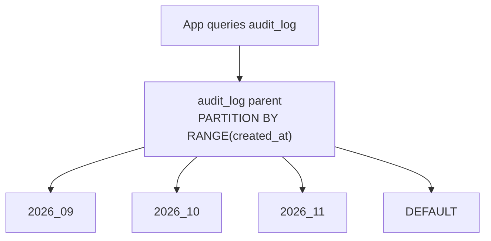
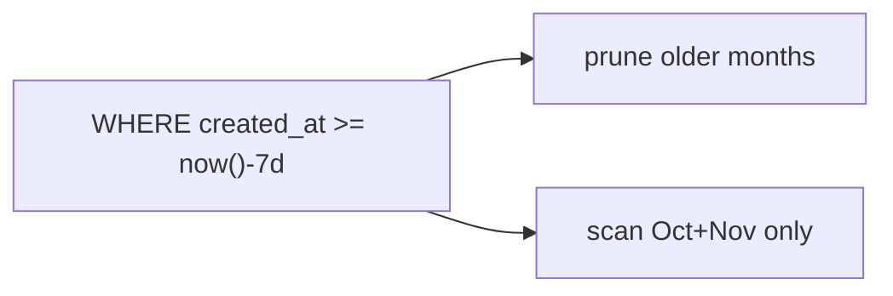
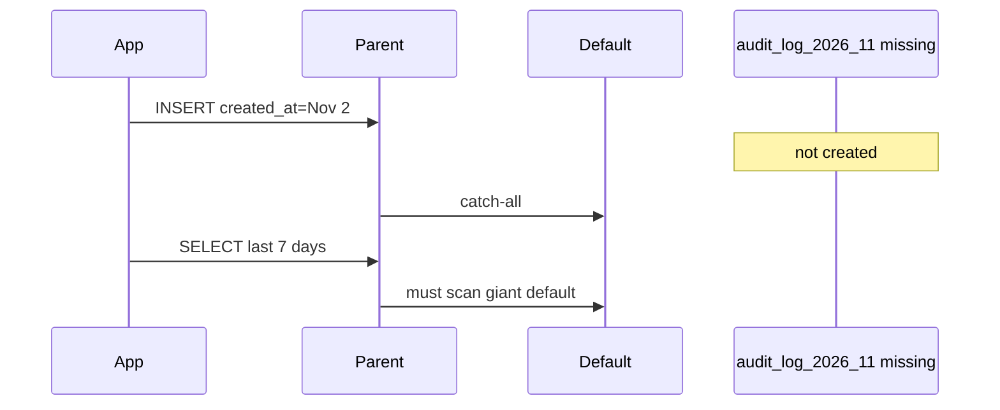

# Lesson 26: Postgres Table Partitioning — Pruning, Retention & No Sharding

> **Prerequisites:** [Lesson 23: Range vs Hash Partitioning](../23-range-vs-hash-partitioning/README.md).  
> **Estimated Reading Time:** 28–35 minutes  
> **Target Audience:** Backend engineers with huge single-node tables (audit logs, events) who need pruning and cheap retention without introducing a sharded cluster.  
> **Free PDF Notes:** [Download SD-E-026.pdf](https://backendroadmap.com/notes/system-design/SD-E-026.pdf) · [Phase 2, Notes (PDF)](https://backendroadmap.com/notes/system-design/Phase2_Notes.pdf)

> [!NOTE]
> **In one line:** when one table is huge but the whole database still fits on one server, split that table into partitions inside Postgres: queries that filter on the partition key skip the rest (pruning), indexes stay small, and old data is removed by dropping a partition instead of a giant `DELETE`.

> [!TIP]
> **The Golden Rule of Postgres Partitioning:** Partition only when most queries **filter on the partition key** (usually time). Automate future partitions (`pg_partman`), include the partition key in primary/unique keys, prefer **DETACH + DROP** for retention, and never confuse this with **sharding** — it is still one server, one WAL, one disk.

---

## Words You'll Meet Today

| Word | In Plain Words | Role in a Live Backend System |
| :--- | :--- | :--- |
| **Table partitioning** | One logical table → child tables on one server. | Pruning, smaller indexes, cheap drops. |
| **Parent table** | What the app queries; holds no rows itself. | Stable API for the application. |
| **Partition** | Child table with a slice of rows. | Real table with its own indexes. |
| **Range / list / hash** | Three Postgres strategies. | Time vs region/tier vs even split. |
| **Default partition** | Catches rows no range matches. | Safety net — don’t let it become a junk drawer. |
| **Partition pruning** | Planner skips impossible partitions. | Last-7-days scans 1–2 months, not years. |
| **DETACH PARTITION** | Turns a partition into a normal table. | Archive then drop in seconds. |
| **pg_partman** | Extension that creates/drops partitions. | Avoids “forgot next month” outages. |
| **Sharding** | Splitting across servers. | **Not** this lesson — adds capacity. |

---

## Visual Mental Models & Architecture

### The Three-Billion-Row Audit Log

`audit_log` has 3B rows, +10M/day. Last-week queries crawl; indexes no longer fit in memory; deleting old rows takes hours and bloats the table. You don’t need more servers — you need to split **this table** inside the same database.

### Everyday Picture: Filing Cabinets by Month

The office still has **one address** (one Postgres). Instead of one endless drawer, you have a cabinet per month. Looking up “this week” opens one or two drawers. Throwing away 2024 means **wheeling out a cabinet**, not shredding 300M pages one by one.



*Figure 1. Application only knows `audit_log`; Postgres stores monthly children.*



*Figure 2. Pruning turns a 3B-row scan into one or two monthly partitions.*

---

## Systematic Reference & Comparison Grid

| Strategy | How | Best for |
| :--- | :--- | :--- |
| **RANGE** | Date/number ranges | Logs, events, orders (most common) |
| **LIST** | Explicit values | Region, tenant tier, status |
| **HASH** | `hash(key) % N` | Even split without natural range |

### Declarative DDL Pattern

```sql
CREATE TABLE audit_log (
  id          bigint GENERATED ALWAYS AS IDENTITY,
  created_at  timestamptz NOT NULL,
  actor_id    bigint,
  action      text,
  PRIMARY KEY (id, created_at)          -- must include the partition key
) PARTITION BY RANGE (created_at);

CREATE TABLE audit_log_2026_10 PARTITION OF audit_log
  FOR VALUES FROM ('2026-10-01') TO ('2026-11-01');

CREATE TABLE audit_log_default PARTITION OF audit_log DEFAULT;

CREATE INDEX ON audit_log (actor_id, created_at);  -- created on every partition
```

Ranges are **inclusive at the start, exclusive at the end**.

---

## Core Definition & Taxonomic Comparison

**Postgres table partitioning** is physical decomposition of one logical relation into child relations **on a single instance**. It optimizes planning, caching, and retention — it does **not** multiply CPU/disk beyond one machine.

| Term | Precise Meaning | Production Example |
| :--- | :--- | :--- |
| **Partitioning** vs **sharding** | One server children vs multi-server. | Monthly audit_log vs Citus/Vitess. |
| **Pruning** vs **index-only scan** | Skip partitions vs skip heap via index. | `EXPLAIN` shows one child table. |
| **DROP partition** vs **DELETE** | Metadata + file unlink vs row-by-row WAL. | 300M rows in seconds vs hours. |

---

## Component Anatomy & The Observability Gap

```text
 INSERT → route by partition key → child table + child indexes
 SELECT with key filter → planner prune → scan matching children
 SELECT without key → append/plan all children (can be slower)
 Retention → DETACH → optional archive → DROP
```

| Vantage Point | Captures | Hides |
| :--- | :--- | :--- |
| **`EXPLAIN`** | Which partitions survive pruning | App forgetting `created_at` filter |
| **Default partition size** | Forgotten future partitions | Looks like “partitioning works” until one blob |
| **Planning time** | Too many partitions | Shows up before executor time |
| **Metrics** | Per-partition size, default growth, prune ratio | Single table size only |

---

## Mathematical Model of Retention & Partition Count

### 1. DELETE vs DROP Cost

At 10M rows/day, one month ≈ 300M rows.

- `DELETE`: marks 300M dead, floods WAL, vacuum for hours, bloat remains.
- `DETACH + DROP`: metadata operation — seconds, independent of row count.

### 2. Pruning Selectivity

Keeping 12 monthly partitions for a year: last-7-days on Nov 4 touches **2** partitions → scan fraction ≈ $2/12 \approx 17\%$ of partitions (and far less than 3B rows if older years dropped).

### 3. Partition Count Ceiling

Daily partitions for 10 years ≈ 3,650 children — planning/overhead pain. Prefer **monthly** (~120/year of retention) unless retention window is short.

### 4. Numbers

| Item | Value |
| :--- | :--- |
| Example ingest | 10M rows/day |
| Month size | ~300M rows |
| Good partition count | tens–low hundreds |
| PK rule | must include partition column |

### 5. Mitigations

1. Filter on partition key in hot queries.
2. `pg_partman` / cron for future partitions.
3. DETACH+DROP retention; archive first if needed.
4. Don’t expect write throughput miracles — still one server.
5. Keep partition count sane.

---

## Production War Story Post-Mortem: Forgotten November Partition

- **Severity & Impact:** SEV-2. Inserts succeeded into `DEFAULT`; last-week queries scanned a multi-hundred-million-row default blob; disk + vacuum pain.
- **Detection:** Default partition size alert; `EXPLAIN` showed unexpected child.



### Root Cause Analysis

Ranges must exist before data arrives. Default silently absorbed November, defeating pruning.

### The Fix

Create next 3 months ahead via `pg_partman`; alert if default > 1% of table; migrate default rows into proper partitions; document PK `(id, created_at)`.

---

## Multi-Language Production Implementation

````carousel
```go
package partman

import (
	"context"
	"fmt"
	"time"

	"github.com/jackc/pgx/v5/pgxpool"
)

func EnsureMonthPartition(ctx context.Context, pool *pgxpool.Pool, month time.Time) error {
	start := time.Date(month.Year(), month.Month(), 1, 0, 0, 0, 0, time.UTC)
	end := start.AddDate(0, 1, 0)
	name := fmt.Sprintf("audit_log_%s", start.Format("2006_01"))
	sql := fmt.Sprintf(`
CREATE TABLE IF NOT EXISTS %s PARTITION OF audit_log
 FOR VALUES FROM ('%s') TO ('%s')`, name, start.Format("2006-01-02"), end.Format("2006-01-02"))
	_, err := pool.Exec(ctx, sql)
	return err
}
```
<!-- slide -->
```typescript
export function monthBounds(d: Date): { start: string; end: string; name: string } {
  const start = new Date(Date.UTC(d.getUTCFullYear(), d.getUTCMonth(), 1));
  const end = new Date(Date.UTC(d.getUTCFullYear(), d.getUTCMonth() + 1, 1));
  const name = `audit_log_${start.toISOString().slice(0, 7).replace("-", "_")}`;
  return {
    name,
    start: start.toISOString().slice(0, 10),
    end: end.toISOString().slice(0, 10),
  };
}

export function createPartitionSql(d: Date): string {
  const { name, start, end } = monthBounds(d);
  return `CREATE TABLE IF NOT EXISTS ${name} PARTITION OF audit_log
 FOR VALUES FROM ('${start}') TO ('${end}');`;
}
```
<!-- slide -->
```python
from datetime import date
from dateutil.relativedelta import relativedelta


def ensure_month_partition_sql(month: date) -> str:
    start = month.replace(day=1)
    end = start + relativedelta(months=1)
    name = f"audit_log_{start.strftime('%Y_%m')}"
    return f"""
CREATE TABLE IF NOT EXISTS {name} PARTITION OF audit_log
 FOR VALUES FROM ('{start.isoformat()}') TO ('{end.isoformat()}');
"""


def detach_drop_sql(name: str) -> str:
    return f"""
ALTER TABLE audit_log DETACH PARTITION {name};
DROP TABLE {name};
"""
```
<!-- slide -->
```csharp
using System;

public static class PgPartitionSql
{
    public static string EnsureMonth(DateOnly month)
    {
        var start = new DateOnly(month.Year, month.Month, 1);
        var end = start.AddMonths(1);
        var name = $"audit_log_{start:yyyy_MM}";
        return $@"
CREATE TABLE IF NOT EXISTS {name} PARTITION OF audit_log
 FOR VALUES FROM ('{start:yyyy-MM-dd}') TO ('{end:yyyy-MM-dd}');";
    }

    public static string DetachDrop(string name) =>
        $"ALTER TABLE audit_log DETACH PARTITION {name}; DROP TABLE {name};";
}
```
````

---

## Practical Hands-On Verification CLI Workflows

### 1. Prove pruning in EXPLAIN

```sql
EXPLAIN SELECT * FROM audit_log
 WHERE created_at >= '2026-11-01' AND actor_id = 42;
```

**Expect:** only `audit_log_2026_11` (or matching children) in the plan.

### 2. Count partitions

```sql
SELECT inhrelid::regclass AS partition
FROM pg_inherits
WHERE inhparent = 'audit_log'::regclass;
```

### 3. Retention dry-run

```sql
-- ALTER TABLE audit_log DETACH PARTITION audit_log_2025_10;
-- DROP TABLE audit_log_2025_10;
SELECT pg_size_pretty(pg_total_relation_size('audit_log_2025_10'));
```

---

## Pause and Think

> [!exercise] After partitioning, a dashboard got slower. Why?

<details><summary>Answer</summary>

It likely doesn’t filter on the partition key, so it visits every partition (and plans for each). Add a `created_at` filter, or ensure each partition has a usable index for the query.

</details>

---

## Common Mistakes & Troubleshooting

- Partitioning when queries don’t filter on the key.
- Forgetting next month’s partition (default bloat or insert failures).
- Confusing partitioning with sharding for write scale.
- Still `DELETE`ing old rows instead of dropping partitions.
- Thousands of partitions (hourly for a decade).
- `PRIMARY KEY (id)` without partition column.

---

## Recap in Three Lines

1. Partition huge tables on one server for pruning + cheap retention.
2. PK/unique must include the partition key; automate future partitions.
3. Drop partitions, don’t DELETE billions of rows.

---

## Interview Practice Questions

### Basic Conceptual Questions (Q1–Q4)

<details><summary><strong>Q1: When would you partition a table without sharding? [BASIC]</strong></summary>

When one table is huge but total data and load still fit on one server, and most queries filter by a key like time. You get pruning, smaller indexes and cheap retention, without sharding complexity.

</details>

<details><summary><strong>Q2: What is partition pruning? [BASIC]</strong></summary>

The planner uses the `WHERE` clause on the partition key to skip partitions that can’t contain matching rows. A last-7-days query on monthly partitions scans one or two partitions, not all of them.

</details>

<details><summary><strong>Q3: Name the three partitioning strategies in Postgres. [BASIC]</strong></summary>

Range (dates, numbers; most common), list (explicit values like EU, US, APAC), and hash (hash of the key modulo a fixed number of partitions).

</details>

<details><summary><strong>Q4: What does a DEFAULT partition do? [BASIC]</strong></summary>

It catches rows that match no defined range so inserts don’t fail when a future partition is missing — but rows piling up there lose pruning benefits, so treat growth as an incident.

</details>

### Scenario-Based Architecture Questions (Q5–Q8)

<details><summary><strong>Q5: Events keep 1 year at 10M rows/day. Retention design? [SCENARIO]</strong></summary>

Range-partition by month. Each month, detach and drop (or archive, then drop) the partition older than 12 months — ~300M rows in seconds, no DELETE bloat.

</details>

<details><summary><strong>Q6: Dashboard slower after partitioning. Why? [SCENARIO]</strong></summary>

Missing partition-key filter → visits every partition. Add `created_at` predicate and proper per-partition indexes.

</details>

<details><summary><strong>Q7: Why reject `PRIMARY KEY (id)` on `PARTITION BY created_at`? [SCENARIO]</strong></summary>

Uniqueness is enforced per partition, so Postgres can only guarantee it if the key includes the partition column. Use `PRIMARY KEY (id, created_at)`.

</details>

<details><summary><strong>Q8: How do you archive a month before drop? [SCENARIO]</strong></summary>

`DETACH PARTITION`, `pg_dump -t` that table (or copy to object storage), verify, then `DROP TABLE`. App never notices if parent queries exclude that range.

</details>

### Advanced & Tricky Interview Questions (Q9–Q12)

<details><summary><strong>Q9: Does partitioning help write throughput? [TRICKY]</strong></summary>

Not much. Still one server, one WAL, one disk. It helps by keeping the hot partition’s indexes small and in memory; scaling writes beyond one machine needs sharding.

</details>

<details><summary><strong>Q10: Why not daily partitions for 10 years of data? [TRICKY]</strong></summary>

~3,650 partitions — planning time and overhead grow; queries without a tight time filter touch thousands of tables. Monthly (~120) fits better; daily only if you keep a few months.

</details>

<details><summary><strong>Q11: Can unique constraints span all partitions without the partition key? [TRICKY]</strong></summary>

No — indexes are local to each partition. Global uniqueness needs the partition key in the constraint, or an external uniqueness mechanism.

</details>

<details><summary><strong>Q12: When is LIST partitioning better than RANGE? [TRICKY]</strong></summary>

When slices are categorical (region, tenant tier) and queries almost always filter that dimension — not time. Retention-by-drop is less natural unless you list time buckets explicitly.

</details>

---

## One-Page Master Cheat Sheet

```text
┌─ Postgres Table Partitioning (SD-E-026) ────────────────────────┐
│ One server · RANGE/LIST/HASH · parent + children                │
│ Pruning iff WHERE on partition key · EXPLAIN to verify          │
│ PK must include partition column · automate future partitions   │
│ Retention: DETACH + DROP (not DELETE) · watch DEFAULT size      │
│ ≠ sharding — won't multiply CPU/disk                            │
└─────────────────────────────────────────────────────────────────┘
```

---

## Free PDF notes

[SD-E-026.pdf](https://backendroadmap.com/notes/system-design/SD-E-026.pdf)

## Sources

- PostgreSQL docs — Table Partitioning
- `pg_partman` documentation
- Kleppmann, DDIA — partitioning concepts (contrast with sharding)

## Next

[Lesson 27: Distributed ID Generation — Snowflake, UUID v7 vs UUID v4, ULID](../27-distributed-id-generation/README.md)
