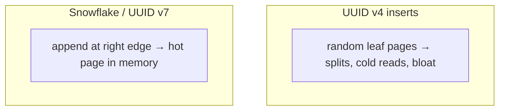
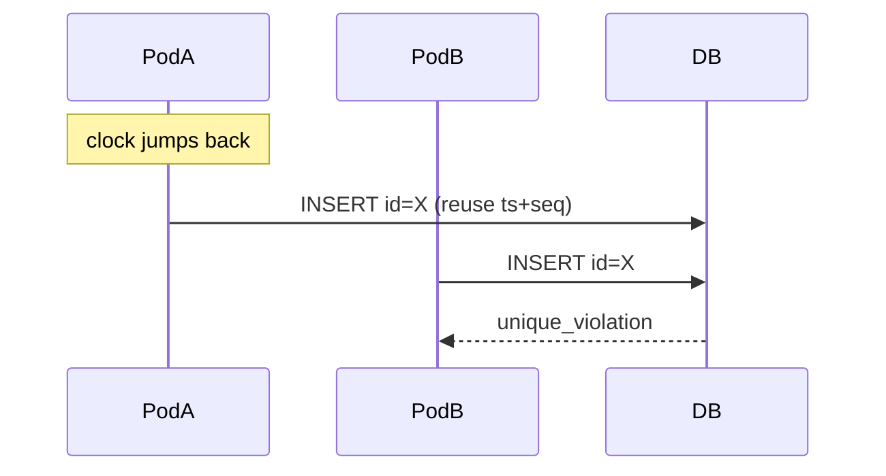

# Lesson 27: Distributed ID Generation — Snowflake, UUID v7 vs UUID v4, ULID

> **Prerequisites:** [Lesson 04: B-Tree Indexes Explained](../04-b-tree-indexes-explained/README.md) (conceptual), [Lesson 22: Database Sharding Fundamentals](../22-database-sharding-fundamentals/README.md).  
> **Estimated Reading Time:** 28–35 minutes  
> **Target Audience:** Backend engineers minting unique IDs across many service instances without a central auto-increment bottleneck — and keeping B-tree indexes healthy.  
> **Free PDF Notes:** [Download SD-E-027.pdf](https://backendroadmap.com/notes/system-design/SD-E-027.pdf) · [Phase 2, Notes (PDF)](https://backendroadmap.com/notes/system-design/Phase2_Notes.pdf)

> [!NOTE]
> **In one line:** generate IDs locally with no coordination but keep them time-ordered: a Snowflake-style 64-bit ID (timestamp + worker ID + sequence) or a UUID v7; random UUID v4 keys scatter B-tree inserts, and auto-increment needs one central database.

> [!TIP]
> **The Golden Rule of Distributed IDs:** Prefer **time-ordered** IDs (`Snowflake` / `UUID v7` / `ULID`) for clustered primary keys. Never share a worker ID across live instances; handle **clock rollback**; expose a separate **opaque public ID** so internal keys don’t leak volume or creation time in URLs.

---

## Words You'll Meet Today

| Word | In Plain Words | Role in a Live Backend System |
| :--- | :--- | :--- |
| **Auto-increment** | DB-assigned counter; central. | Simple but bottleneck; leaks counts. |
| **UUID v4** | 122 random bits; no order. | Easy uniqueness; hurts B-tree inserts. |
| **UUID v7** | 48-bit ms timestamp + random (RFC 9562). | Time-ordered 128-bit standard. |
| **ULID** | 48-bit time + 80 random; 26-char Crockford. | Readable time-ordered string IDs. |
| **Snowflake** | 41 time + 10 worker + 12 sequence bits. | Fits `BIGINT`; needs unique worker IDs. |
| **Worker ID** | Unique number per generator instance. | Must never collide while both live. |
| **Page split** | Full B-tree leaf splits on insert. | Random keys → splits + bloat. |
| **Ticket server** | Central DB that only issues numbers. | Flickr-style; network hop / batch. |
| **Opaque public ID** | Random external ID. | Hides internal keys in URLs. |

---

## Visual Mental Models & Architecture

### Fifty Instances, One ID Space

Fifty order-service instances need unique IDs **now**, without asking a central DB first — and ideally newer orders get bigger IDs so inserts stay index-friendly.

### Everyday Picture: Ticket Stub Printers

- **Auto-increment:** one shared stamp machine at HQ — everyone queues.
- **UUID v4:** everyone rolls dice — unique, but filing cabinets (B-trees) get random jabs.
- **Snowflake / UUID v7:** each desk has a printer with a **desk number** and a clock — stubs sort by time, no HQ trip.



*Figure 1. Random vs time-ordered primary keys.*


*Figure 2. Snowflake 64-bit layout (fits signed BIGINT).*

---

## Systematic Reference & Comparison Grid

| Scheme | Size | Time-sorted | Coordination | Watch out for |
| :--- | :--- | :--- | :--- | :--- |
| Auto-increment | 8 B | yes | one database | bottleneck, no shards, leaks counts |
| UUID v4 | 16 B | no | none | B-tree page splits, bloat |
| UUID v7 / ULID | 16 B | yes (ms) | none | reveals creation time |
| Snowflake | 8 B | yes (ms) | unique worker ID | clock going backwards |
| Ticket server | 8 B | roughly | call per ID/batch | extra hop, availability |

---

## Core Definition & Taxonomic Comparison

**Distributed ID generation** produces unique identifiers without a single auto-increment authority, while controlling sort order and size for storage engines.

| Term | Precise Meaning | Production Example |
| :--- | :--- | :--- |
| **Coordination-free** vs **leased worker** | Pure random/time vs assigned worker bits. | UUID v7 vs Snowflake. |
| **Clustered PK order** | Physical insert locality. | Right-edge append vs random. |
| **Public vs internal ID** | External opaque vs internal sortable. | `ord_7f3a…` vs Snowflake BIGINT. |

---

## Component Anatomy & The Observability Gap

```text
 next_id():
   read clock ms
   if clock < last_ms → wait or refuse
   if same ms → bump 12-bit seq (wait next ms if overflow)
   else reset seq
   pack (ts - epoch) | worker | seq
```

| Vantage Point | Captures | Hides |
| :--- | :--- | :--- |
| **Duplicate key errors** | Worker ID collision or clock bug | May appear as “flaky unique violation” |
| **Index bloat / insert p99** | UUID v4 scatter | Blamed on “disk” |
| **Metrics** | IDs/ms, clock-rollback waits, worker lease renewals | — |

---

## Mathematical Model of Capacity & Layout

### 1. Snowflake Field Capacities

$$2^{41}\ \text{ms} \approx 69.7\ \text{years}, \quad 2^{10}=1024\ \text{workers}, \quad 2^{12}=4096\ \text{IDs/ms/worker}$$

Per worker ≈ **4M IDs/s** peak.

### 2. Worked Example: 200k orders/s, 50 instances

Per instance ≈ 4,000/s ≈ **4/ms**. Sequence headroom ≈ $4096/4 \approx 1000\times$. Workers used 50/1024 ≈ room to scale ~20×. From a 2026 epoch, 41 bits last until ~2095.

### 3. UUID v4 Collision (practical)

122 random bits → collisions negligible at planetary scale; the pain is **index locality**, not uniqueness.

### 4. Storage Multiplier

UUID PK (16 B) vs BIGINT (8 B) doubles PK width and fattens every secondary index / FK that stores it.

### 5. Mitigations

1. Snowflake or UUID v7 for PKs.
2. Lease worker IDs (etcd / StatefulSet ordinal).
3. Wait/refuse on clock rollback.
4. Opaque public IDs for URLs.
5. Avoid UUID v4 as clustered PK on insert-heavy tables.

---

## Production War Story Post-Mortem: Duplicate Orders After NTP Step

- **Severity & Impact:** SEV-1. Duplicate primary keys on orders after a VM clock stepped backward 800 ms; failover retries collided.
- **Detection:** Spike in unique violations; two pods logged identical worker IDs after a bad config clone.



### Root Cause Analysis

Shared worker ID from copied config **and** missing clock-rollback guard.

### The Fix

etcd lease for worker IDs; refuse/wait if `now < last_ms`; alert on rollback wait > 50 ms; separate public opaque IDs.

---

## Multi-Language Production Implementation

````carousel
```go
package snowflake

import (
	"errors"
	"sync"
	"time"
)

const (
	EpochMs   = 1288834974657 // Twitter epoch; pick your own
	WorkerBits = 10
	SeqBits    = 12
	MaxSeq     = (1 << SeqBits) - 1
)

var ErrClockMovedBack = errors.New("clock moved backwards")

type Generator struct {
	mu       sync.Mutex
	workerID int64
	lastMs   int64
	seq      int64
}

func New(workerID int64) *Generator {
	return &Generator{workerID: workerID & ((1 << WorkerBits) - 1)}
}

func (g *Generator) Next() (int64, error) {
	g.mu.Lock()
	defer g.mu.Unlock()
	now := time.Now().UnixMilli()
	if now < g.lastMs {
		return 0, ErrClockMovedBack
	}
	if now == g.lastMs {
		g.seq = (g.seq + 1) & MaxSeq
		if g.seq == 0 {
			for now <= g.lastMs {
				now = time.Now().UnixMilli()
			}
		}
	} else {
		g.seq = 0
	}
	g.lastMs = now
	return ((now - EpochMs) << (WorkerBits + SeqBits)) | (g.workerID << SeqBits) | g.seq, nil
}
```
<!-- slide -->
```typescript
const EPOCH = 1288834974657n;
const WORKER_BITS = 10n;
const SEQ_BITS = 12n;
const MAX_SEQ = (1n << SEQ_BITS) - 1n;

export class Snowflake {
  private lastMs = 0n;
  private seq = 0n;
  constructor(private workerId: bigint) {
    this.workerId &= (1n << WORKER_BITS) - 1n;
  }
  next(): bigint {
    let now = BigInt(Date.now());
    if (now < this.lastMs) throw new Error("clock moved backwards");
    if (now === this.lastMs) {
      this.seq = (this.seq + 1n) & MAX_SEQ;
      if (this.seq === 0n) {
        while (now <= this.lastMs) now = BigInt(Date.now());
      }
    } else this.seq = 0n;
    this.lastMs = now;
    return ((now - EPOCH) << (WORKER_BITS + SEQ_BITS)) | (this.workerId << SEQ_BITS) | this.seq;
  }
}
```
<!-- slide -->
```python
import threading
import time

EPOCH = 1288834974657
WORKER_BITS = 10
SEQ_BITS = 12
MAX_SEQ = (1 << SEQ_BITS) - 1


class ClockMovedBack(Exception):
    pass


class Snowflake:
    def __init__(self, worker_id: int) -> None:
        self.worker_id = worker_id & ((1 << WORKER_BITS) - 1)
        self.last_ms = 0
        self.seq = 0
        self._lock = threading.Lock()

    def next_id(self) -> int:
        with self._lock:
            now = int(time.time() * 1000)
            if now < self.last_ms:
                raise ClockMovedBack()
            if now == self.last_ms:
                self.seq = (self.seq + 1) & MAX_SEQ
                if self.seq == 0:
                    while now <= self.last_ms:
                        now = int(time.time() * 1000)
            else:
                self.seq = 0
            self.last_ms = now
            return ((now - EPOCH) << (WORKER_BITS + SEQ_BITS)) | (self.worker_id << SEQ_BITS) | self.seq
```
<!-- slide -->
```csharp
using System;
using System.Threading;

public sealed class Snowflake
{
    private const long Epoch = 1288834974657L;
    private const int WorkerBits = 10;
    private const int SeqBits = 12;
    private const long MaxSeq = (1L << SeqBits) - 1;

    private readonly long _workerId;
    private long _lastMs;
    private long _seq;
    private readonly object _gate = new();

    public Snowflake(long workerId) => _workerId = workerId & ((1 << WorkerBits) - 1);

    public long Next()
    {
        lock (_gate)
        {
            long now = DateTimeOffset.UtcNow.ToUnixTimeMilliseconds();
            if (now < _lastMs) throw new InvalidOperationException("clock moved backwards");
            if (now == _lastMs)
            {
                _seq = (_seq + 1) & MaxSeq;
                if (_seq == 0)
                {
                    while (now <= _lastMs)
                        now = DateTimeOffset.UtcNow.ToUnixTimeMilliseconds();
                }
            }
            else _seq = 0;
            _lastMs = now;
            return ((now - Epoch) << (WorkerBits + SeqBits)) | (_workerId << SeqBits) | _seq;
        }
    }
}
```
````

---

## Practical Hands-On Verification CLI Workflows

### 1. Show time-ordering of Snowflake-shaped packs

```bash
python3 -c "
EPOCH=1288834974657
def pack(ms,w,s): return ((ms-EPOCH)<<22)|(w<<12)|s
a=pack(1_700_000_000_000,1,0); b=pack(1_700_000_000_001,1,0)
print(a<b)
"
```

### 2. Sequence headroom

```bash
python3 -c "print(4096/(200_000/50/1000))"
```

### 3. UUID v4 vs sortable demo

```bash
python3 -c "import uuid; print(uuid.uuid4()); print('v7 needs uuid6/uuid7 lib or DB gen_random_uuid≠v7')"
```

---

## Pause and Think

> [!exercise] NTP moves a server’s clock back 200 ms. What should the generator do?

<details><summary>Answer</summary>

Never issue IDs for a timestamp already used. Wait until the clock passes the last timestamp (fine for 200 ms), or refuse and alert for large jumps.

</details>

---

## Common Mistakes & Troubleshooting

- UUID v4 as clustered PK on huge insert-heavy tables.
- Two instances with the same worker ID.
- Ignoring clock skew / NTP steps.
- Exposing sequential IDs in URLs (enumeration + volume leak).
- Assuming Snowflake is strictly ordered across all machines.

---

## Recap in Three Lines

1. Time-ordered IDs keep B-trees happy; UUID v4 scatters inserts.
2. Snowflake = 64-bit with worker+seq; UUID v7 = standard 128-bit, no workers.
3. Guard clocks, unique workers, opaque public IDs.

---

## Interview Practice Questions

### Basic Conceptual Questions (Q1–Q4)

<details><summary><strong>Q1: Design a distributed ID generator. [BASIC]</strong></summary>

Snowflake-style 64-bit ID: 41-bit millisecond timestamp, 10-bit unique worker ID, 12-bit per-ms sequence. Generated locally, sortable by time, 4,096 IDs/ms per worker. Handle clock skew by waiting or refusing. Or use UUID v7.

</details>

<details><summary><strong>Q2: Why is UUID v4 bad for B-tree inserts? [BASIC]</strong></summary>

Randomness scatters inserts across the index: page splits, half-full pages (bloat), poor caching. Time-ordered keys append at the right edge instead.

</details>

<details><summary><strong>Q3: What does the 41-bit timestamp in Snowflake give you? [BASIC]</strong></summary>

$2^{41}$ milliseconds ≈ 69 years from the chosen epoch, and IDs that sort by creation time (to the millisecond).

</details>

<details><summary><strong>Q4: UUID v7 vs ULID in one sentence each? [BASIC]</strong></summary>

UUID v7: RFC 9562 128-bit, ms timestamp prefix + random, binary/UUID type friendly. ULID: same time-ordering idea as a 26-character Crockford base32 string, convenient in APIs/logs.

</details>

### Scenario-Based Architecture Questions (Q5–Q8)

<details><summary><strong>Q5: Assign worker IDs to 50 auto-scaled instances. [SCENARIO]</strong></summary>

Lease from etcd/ZooKeeper (TTL key renewed while alive), or derive from a stable ordinal like a Kubernetes StatefulSet index. Never let two live instances hold the same ID.

</details>

<details><summary><strong>Q6: NTP moves clock back 200 ms. [SCENARIO]</strong></summary>

Wait until clock passes last timestamp, or refuse/alert for large jumps — never reissue.

</details>

<details><summary><strong>Q7: Public order number that doesn’t reveal sales volume. [SCENARIO]</strong></summary>

Keep internal Snowflake/UUID v7; expose a separate random opaque ID (or UUID v4) in URLs/emails with a unique index.

</details>

<details><summary><strong>Q8: Is 12 bits of sequence enough at 200k orders/s on 50 nodes? [SCENARIO]</strong></summary>

Yes: ~4/ms per worker vs 4,096/ms capacity (~1000× headroom). On overflow, wait for next millisecond.

</details>

### Advanced & Tricky Interview Questions (Q9–Q12)

<details><summary><strong>Q9: Are Snowflake IDs strictly ordered across all machines? [TRICKY]</strong></summary>

No, only roughly. Ordered within one worker; across workers, same-ms IDs order by worker ID; clock skew can reorder by a few milliseconds.

</details>

<details><summary><strong>Q10: UUID v7 or Snowflake? [TRICKY]</strong></summary>

UUID v7 needs no worker IDs and is a standard type, but costs 16 bytes. Snowflake fits in 8 bytes (smaller indexes/FKs) but needs unique worker assignment.

</details>

<details><summary><strong>Q11: Why can time-ordered IDs still create write hot spots on ranged shards? [TRICKY]</strong></summary>

New IDs concentrate in the latest range (same as auto-increment). Prefer hash partitioning by ID for placement, or add write prefixes — time-order helps **indexes**, not necessarily **range shard** balance.

</details>

<details><summary><strong>Q12: Can ticket servers replace Snowflake? [TRICKY]</strong></summary>

Yes for simplicity (especially batched ranges), but you reintroduce a network dependency and availability story. Odd/even dual ticket DBs help HA; still not coordination-free per ID without batching.

</details>

---

## One-Page Master Cheat Sheet

```text
┌─ Distributed ID Generation (SD-E-027) ──────────────────────────┐
│ Snowflake: 1+41+10+12 · 69y · 1024 workers · 4096/ms/worker     │
│ UUID v7 / ULID: time-ordered 128-bit · no worker ids            │
│ UUID v4: unique but random → B-tree splits/bloat                │
│ Guard: unique worker lease · clock rollback wait/refuse         │
│ Public URLs: opaque random id ≠ internal sortable PK            │
└─────────────────────────────────────────────────────────────────┘
```

---

## Free PDF notes

[SD-E-027.pdf](https://backendroadmap.com/notes/system-design/SD-E-027.pdf)

## Sources

- Twitter Snowflake / Sonyflake designs
- RFC 9562 — UUID versions
- ULID specification

## Next

[Lesson 28: Zero-Downtime Database Migrations — Expand-Contract & Backfills](../28-zero-downtime-database-migrations/README.md)
