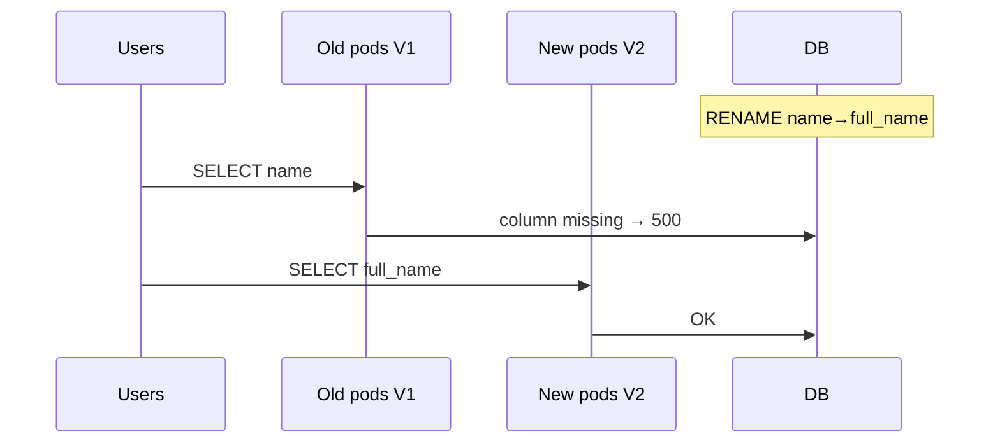
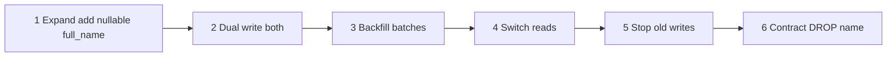
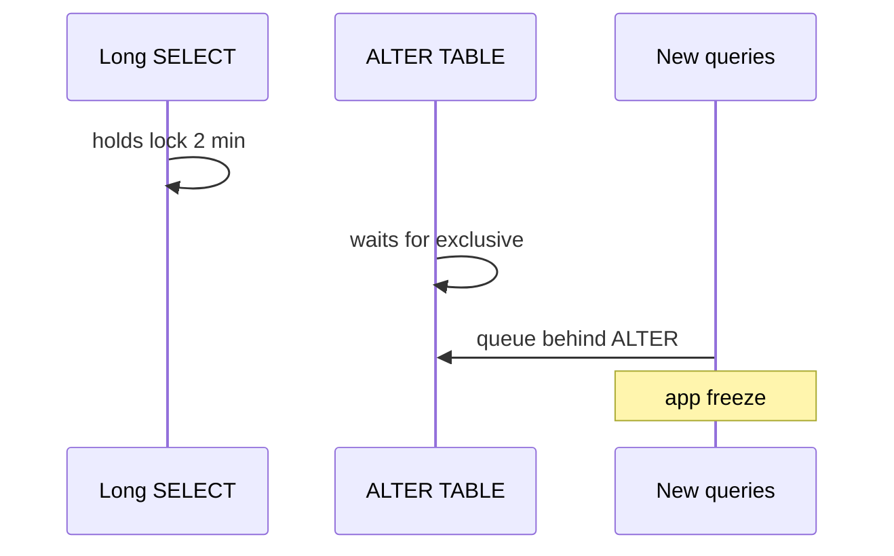

# Lesson 28: Zero-Downtime Database Migrations — Expand-Contract & Backfills

> **Prerequisites:** [Lesson 08: ACID Explained](../08-acid-explained/README.md) (conceptual).  
> **Estimated Reading Time:** 30–35 minutes  
> **Target Audience:** Backend engineers shipping schema changes under rolling deploys without locking out checkout or racing migrations across 50 pods.  
> **Free PDF Notes:** [Download SD-E-028.pdf](https://backendroadmap.com/notes/system-design/SD-E-028.pdf) · [Phase 2, Notes (PDF)](https://backendroadmap.com/notes/system-design/Phase2_Notes.pdf)

> [!NOTE]
> **In one line:** version every schema change with a migration tool, avoid long locks (`lock_timeout`, `CREATE INDEX CONCURRENTLY`), and split breaking changes into expand → dual write → backfill → switch reads → contract, so old and new code always work together.

> [!TIP]
> **The Golden Rule of Zero-Downtime Migrations:** Schema and code change on **different clocks** (instant DDL vs rolling pods). Every step must be **backward compatible** with both app versions. Fail locks fast, build indexes concurrently, backfill in **resumable batches**, never run migrations on app startup.

---

## Words You'll Meet Today

| Word | In Plain Words | Role in a Live Backend System |
| :--- | :--- | :--- |
| **Migration** | Numbered, versioned schema change file. | Same steps in every environment. |
| **Alembic / Flyway** | Python / Java migration tools. | Track applied versions in-DB. |
| **Rolling deploy** | Replace servers a few at a time. | Old+new code coexist for minutes. |
| **Lock timeout** | Max wait for a lock, then fail. | Turns freezes into retryable errors. |
| **CONCURRENTLY** | Build index without blocking writes. | Slower; not in a transaction. |
| **Expand / contract** | Add new, migrate, remove old. | Parallel / expand-contract change. |
| **Dual write** | App writes old and new columns. | Keeps both versions correct. |
| **Backfill** | Copy existing data in batches. | Resumable, low lock time. |
| **NOT VALID** | Constraint checked later by VALIDATE. | Add NOT NULL safely. |

---

## Visual Mental Models & Architecture

### Why a Simple Rename Causes an Outage

`ALTER TABLE … RENAME COLUMN name TO full_name` then deploy. During the rolling deploy, old pods still `SELECT name` → 500s → checkout broken ~10 minutes.

### Everyday Picture: Renaming a Street Mid-Delivery

Half the couriers still have the old map. You don’t rename the street in one night — you add a second sign (expand), update GPS (dual write / switch), then remove the old sign (contract).



*Figure 1. Instant schema + gradual code = outage window.*



*Figure 2. Six reversible deploys beat one big bang.*

---

## Systematic Reference & Comparison Grid

| Hazard | Symptom | Mitigation |
| :--- | :--- | :--- |
| Exclusive lock wait | App freezes while ALTER waits | `SET lock_timeout = '3s'` |
| `CREATE INDEX` | Blocks writes for minutes | `CREATE INDEX CONCURRENTLY` |
| Startup migrations | 50 pods race | One pipeline job |
| Giant `UPDATE` | Replica lag, long locks | Batches ~10k + pause |
| Instant rename/drop | Old pods break | Expand-contract |

```sql
SET lock_timeout = '3s';
ALTER TABLE users ADD COLUMN full_name text;  -- nullable: instant
CREATE INDEX CONCURRENTLY idx_users_full_name ON users (full_name);
```

---

## Core Definition & Taxonomic Comparison

**Zero-downtime migration** means every intermediate state serves production traffic with mixed app versions and without multi-minute exclusive locks.

| Term | Precise Meaning | Production Example |
| :--- | :--- | :--- |
| **Expand** vs **contract** | Add dual structure vs remove legacy. | Add `full_name` then drop `name`. |
| **Blocking** vs **concurrent** index | Locks writes vs allows writes. | Plain `CREATE INDEX` vs `CONCURRENTLY`. |
| **VALID** vs **NOT VALID** constraint | Full scan now vs validate later. | Safe NOT NULL path. |

---

## Component Anatomy & The Observability Gap

```text
 migration job (once) → DDL with lock_timeout
 app Vn / Vn+1 coexist → dual write / dual read windows
 backfill worker → batched UPDATE … WHERE new IS NULL
 validate constraint → weaker locks
 contract DDL → drop only after reads switched
```

| Vantage Point | Captures | Hides |
| :--- | :--- | :--- |
| **App error rate during deploy** | Rename disasters | Lock queue freezes (looks like “DB hung”) |
| **`pg_stat_activity` / blocking** | ALTER waiting behind long SELECT | Need lock_timeout |
| **Replica lag** | Giant backfill WAL | Batch size too large |
| **Metrics** | Migration duration, lock failures, backfill progress %, invalid indexes | — |

---

## Mathematical Model of Locks & Backfills

### 1. Lock Queue Amplification

Without timeout: long `SELECT` holds lock → `ALTER` waits → **all new queries queue behind ALTER** → freeze even though ALTER itself is milliseconds.

### 2. Backfill Time

50M rows, batch 10k → 5,000 batches. At 50 ms work + 100 ms pause = 0.15 s/batch:

$$T \approx 5000 \times 0.15\,\text{s} = 750\,\text{s} \approx 12.5\,\text{min}$$

Each lock lasts ~50 ms; `full_name IS NULL` makes restarts resumable.

### 3. Safe NOT NULL Path

1. Add nullable column (instant).  
2. Dual-write + backfill.  
3. `CHECK (col IS NOT NULL) NOT VALID` (instant for new rows).  
4. `VALIDATE CONSTRAINT` (scans, doesn’t block writes like a blunt `SET NOT NULL`).  
5. Optional `SET NOT NULL` (PG12+ can skip scan if proven).

### 4. Mitigations

1. Versioned migrations; one runner.  
2. Expand-contract for renames/types/splits.  
3. `lock_timeout` + `CREATE INDEX CONCURRENTLY`.  
4. Batched, idempotent backfills.  
5. Each step independently rollbackable.

---

## Production War Story Post-Mortem: ALTER Behind a Report Query

- **Severity & Impact:** SEV-1, 2 minutes of total API freeze during a “1 ms” column add.
- **Detection:** Spike in wait events; `ALTER` blocked behind analytics `SELECT`.



### The Fix

`lock_timeout=3s`; retry loop; kill idle-in-transaction; move report to replica/warehouse ([lesson 30](../30-oltp-vs-olap/README.md)).

---

## Multi-Language Production Implementation

````carousel
```go
package backfill

import (
	"context"
	"time"

	"github.com/jackc/pgx/v5/pgxpool"
)

func BackfillFullName(ctx context.Context, pool *pgxpool.Pool, batch int64) error {
	var lastID int64
	for {
		tag, err := pool.Exec(ctx, `
UPDATE users SET full_name = name
 WHERE id > $1 AND full_name IS NULL
 ORDER BY id
 LIMIT $2`, lastID, batch)
		if err != nil {
			return err
		}
		if tag.RowsAffected() == 0 {
			return nil
		}
		// advance cursor via max(id) in batch — simplified:
		_ = pool.QueryRow(ctx, `SELECT COALESCE(MAX(id),$1) FROM users WHERE id > $1 AND full_name IS NOT NULL`, lastID).Scan(&lastID)
		time.Sleep(100 * time.Millisecond)
	}
}
```
<!-- slide -->
```typescript
export async function backfillFullName(
  query: (sql: string, params: unknown[]) => Promise<{ rowCount: number; maxId?: number }>,
  batch = 10_000
): Promise<void> {
  let lastId = 0;
  for (;;) {
    const res = await query(
      `UPDATE users SET full_name = name
       WHERE id > $1 AND full_name IS NULL
       AND id <= $1 + $2`,
      [lastId, batch]
    );
    if (!res.rowCount) return;
    lastId += batch;
    await new Promise((r) => setTimeout(r, 100));
  }
}
```
<!-- slide -->
```python
import time
from typing import Protocol


class Db(Protocol):
    def execute(self, sql: str, params: tuple) -> int: ...


def backfill_full_name(db: Db, batch: int = 10_000) -> None:
    lo = 0
    while True:
        # id-range batches; filter keeps job idempotent/resumable
        updated = db.execute(
            """
            UPDATE users SET full_name = name
             WHERE id BETWEEN %s AND %s AND full_name IS NULL
            """,
            (lo + 1, lo + batch),
        )
        if updated == 0 and lo > 0:
            # continue scanning until a high-water sweep returns nothing repeatedly
            pass
        lo += batch
        if updated == 0 and lo > 50_000_000:
            return
        time.sleep(0.1)
```
<!-- slide -->
```csharp
using System.Threading;
using System.Threading.Tasks;
using Npgsql;

public static class Backfill
{
    public static async Task FullNameAsync(NpgsqlDataSource ds, int batch = 10_000, CancellationToken ct = default)
    {
        long lo = 0;
        while (true)
        {
            await using var cmd = ds.CreateCommand(
                @"UPDATE users SET full_name = name
                  WHERE id BETWEEN @lo AND @hi AND full_name IS NULL");
            cmd.Parameters.AddWithValue("lo", lo + 1);
            cmd.Parameters.AddWithValue("hi", lo + batch);
            var n = await cmd.ExecuteNonQueryAsync(ct);
            lo += batch;
            if (n == 0 && lo > 50_000_000) return;
            await Task.Delay(100, ct);
        }
    }
}
```
````

---

## Practical Hands-On Verification CLI Workflows

### 1. Set lock timeout in a session

```sql
SET lock_timeout = '3s';
SHOW lock_timeout;
```

### 2. Concurrent index reminder

```sql
-- cannot run inside a transaction block
CREATE INDEX CONCURRENTLY IF NOT EXISTS idx_users_full_name ON users (full_name);
```

### 3. Find invalid indexes after failed concurrently build

```sql
SELECT indexrelid::regclass, indisvalid FROM pg_index WHERE NOT indisvalid;
```

---

## Pause and Think

> [!exercise] Halfway through expand-contract, the new read path has a bug. What now?

<details><summary>Answer</summary>

Roll back only the read-switch deploy. Both columns are still written and the old column is intact. Fix and redeploy; nothing has been dropped.

</details>

---

## Common Mistakes & Troubleshooting

- Rename/drop in the same deploy as the code change.
- `ALTER` with no lock timeout on a busy table.
- Plain `CREATE INDEX` on large prod tables; or `CONCURRENTLY` inside a transaction.
- Migrations in app startup (pod race).
- One giant `UPDATE` backfill.
- Dropping the old column before all readers switched.

---

## Recap in Three Lines

1. Mixed versions demand expand-contract, not instant renames.
2. Short lock timeouts + concurrent indexes keep the app alive.
3. Batch backfills; migrate once in CI/CD, not on boot.

---

## Interview Practice Questions

### Basic Conceptual Questions (Q1–Q4)

<details><summary><strong>Q1: How do you run a schema migration with zero downtime? [BASIC]</strong></summary>

Version it with Alembic/Flyway. Expand-contract: add new structure, dual write, backfill in batches, switch reads, stop old writes, drop old. Separate deploys; lock timeouts; `CREATE INDEX CONCURRENTLY`.

</details>

<details><summary><strong>Q2: Why can’t you just rename a column? [BASIC]</strong></summary>

During a rolling deploy, old and new code run together. Old code still reads the old name and fails the instant the rename lands.

</details>

<details><summary><strong>Q3: What does `CREATE INDEX CONCURRENTLY` change? [BASIC]</strong></summary>

Builds without blocking writes. Slower; cannot run inside a transaction; on failure leaves an invalid index you must drop and retry.

</details>

<details><summary><strong>Q4: What is dual write? [BASIC]</strong></summary>

Application writes both old and new columns (or tables) during the transition so either app version remains correct and backfill only fills historical gaps.

</details>

### Scenario-Based Architecture Questions (Q5–Q8)

<details><summary><strong>Q5: ALTER froze the app 2 minutes though it should take ms. Why? [SCENARIO]</strong></summary>

Waited for exclusive lock behind a long query; new queries queued behind the ALTER. Set `lock_timeout`, retry later, hunt long queries / idle-in-transaction.

</details>

<details><summary><strong>Q6: Add NOT NULL to a 200M-row table safely. [SCENARIO]</strong></summary>

Add nullable → always write → batch backfill → `CHECK (…) NOT VALID` → `VALIDATE` → optional `SET NOT NULL`.

</details>

<details><summary><strong>Q7: Bug after read switch mid expand-contract. [SCENARIO]</strong></summary>

Roll back only that deploy; dual-write still on; old column intact.

</details>

<details><summary><strong>Q8: Flyway migration wraps steps in a transaction; need concurrent index. [SCENARIO]</strong></summary>

Run that step outside the transactional migration (Flyway `canExecuteInTransaction=false` / separate script). Concurrent index builds cannot run in a transaction block.

</details>

### Advanced & Tricky Interview Questions (Q9–Q12)

<details><summary><strong>Q9: Why not run migrations at application startup? [TRICKY]</strong></summary>

With 50 pods starting together, 50 processes race to apply the same migration; startup becomes slow and fragile. Run once as a pipeline step/job.

</details>

<details><summary><strong>Q10: One UPDATE over all rows for backfill — what goes wrong? [TRICKY]</strong></summary>

Huge transaction, long locks, bloat, unreusmable after crash, WAL burst → replica lag. Batch ~10k, commit, pause, filter `IS NULL`.

</details>

<details><summary><strong>Q11: Is expand-contract only for renames? [TRICKY]</strong></summary>

No — type changes, splitting/merging columns, table splits, even some constraint tightenings. Any change that old code cannot tolerate instantly.

</details>

<details><summary><strong>Q12: How do you dual-write without double-penalty forever? [TRICKY]</strong></summary>

Time-box the window with metrics (null residual count → 0), then stop old writes in a dedicated deploy before contract. Leaving dual-write forever doubles write cost and confusion.

</details>

---

## One-Page Master Cheat Sheet

```text
┌─ Zero-Downtime Migrations (SD-E-028) ───────────────────────────┐
│ Versioned migrations · never on app startup                     │
│ Expand → dual write → backfill → switch reads → contract        │
│ lock_timeout · CREATE INDEX CONCURRENTLY · NOT VALID→VALIDATE   │
│ Backfill ~10k rows, pause, resumable IS NULL                    │
│ Each step backward compatible + independently rollbackable      │
└─────────────────────────────────────────────────────────────────┘
```

---

## Free PDF notes

[SD-E-028.pdf](https://backendroadmap.com/notes/system-design/SD-E-028.pdf)

## Sources

- PostgreSQL docs — Explicit Locking, `CREATE INDEX CONCURRENTLY`
- Expand-Contract / Parallel Change pattern (MariaDB/Thoughtworks discussions)
- Alembic / Flyway documentation

## Next

[Lesson 29: Database Connection Pooling — PgBouncer & Sizing Your Pools](../29-database-connection-pooling/README.md)
