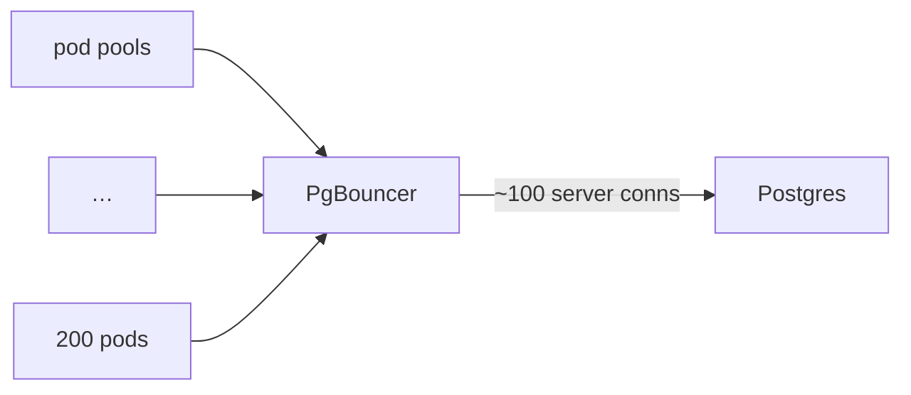
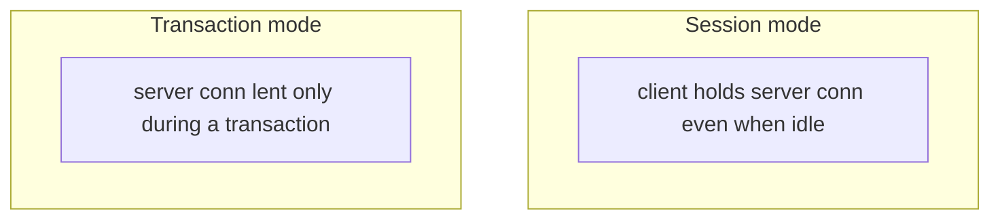
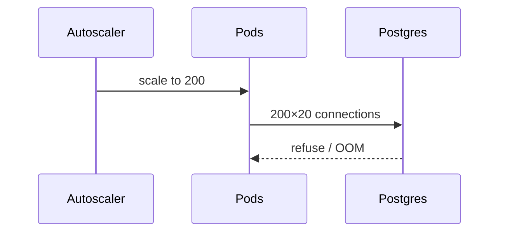

# Lesson 29: Database Connection Pooling — PgBouncer & Sizing Your Pools

> **Prerequisites:** [Lesson 28: Zero-Downtime Database Migrations](../28-zero-downtime-database-migrations/README.md) (same track ops themes).  
> **Estimated Reading Time:** 28–35 minutes  
> **Target Audience:** Backend engineers sizing SQLAlchemy/pgx pools under Kubernetes autoscaling and protecting Postgres from connection storms with PgBouncer / RDS Proxy.  
> **Free PDF Notes:** [Download SD-E-029.pdf](https://backendroadmap.com/notes/system-design/SD-E-029.pdf) · [Phase 2, Notes (PDF)](https://backendroadmap.com/notes/system-design/Phase2_Notes.pdf)

> [!NOTE]
> **In one line:** database connections are expensive, so apps reuse them in pools; every pod has its own pool, so put an external pooler like PgBouncer in front of the database, keep pools small (about 2 per database core to start) and keep the total below `max_connections`.

> [!TIP]
> **The Golden Rule of Pool Sizing:** **Pool size is per process/pod** — multiply by max replicas (and workers). Start near **2 connections per DB CPU core**, put **PgBouncer (transaction mode)** in front for fan-in, leave headroom for admins/replicas, and remember more connections past saturation **raise** p99.

---

## Words You'll Meet Today

| Word | In Plain Words | Role in a Live Backend System |
| :--- | :--- | :--- |
| **Connection pool** | Reused open connections, borrowed per request. | Avoids TCP/TLS/auth per query. |
| **`max_connections`** | Postgres hard cap (default 100). | Each connection ≈ separate process + MB RAM. |
| **Overflow** | Extra temporary connections in a burst. | SQLAlchemy `max_overflow`. |
| **PgBouncer** | Lightweight external Postgres pooler. | Thousands of clients → few server conns. |
| **Multiplexing** | Many clients over few server connections. | Transaction mode efficiency. |
| **Session / transaction / statement mode** | How long a server conn is held. | Session safest; transaction most efficient. |
| **RDS Proxy** | AWS managed pooler. | Especially for Lambda/serverless. |

---

## Visual Mental Models & Architecture

### Black Friday Math

200 pods × 20 pool connections = **4,000** connections at a Postgres with `max_connections=500` → refused connections, memory exhaustion, outage — even if every query is fast.

### Everyday Picture: A Tiny Kitchen Pass

Postgres is a kitchen with 16 chefs (cores). Handing 4,000 waiters each a permanent frying pan doesn’t cook faster — it causes stampedes. PgBouncer is the pass: many waiters, few pans in flight.



*Figure 1. Apps talk to PgBouncer; Postgres only sees a bounded server pool.*



*Figure 2. Transaction mode multiplexes; session state does not stick.*

---

## Systematic Reference & Comparison Grid

| PgBouncer mode | Holds server conn | Use when | Breaks |
| :--- | :--- | :--- | :--- |
| **Session** | Whole client session | Need session features | Saves little if clients idle |
| **Transaction** | One transaction | Default efficient choice | `SET`, advisory locks, `LISTEN`, temps (prep stmts historically) |
| **Statement** | One statement | Rare | Multi-statement transactions |

### SQLAlchemy Defaults Trap

```python
engine = create_engine(DB_URL,
    pool_size=5,
    max_overflow=10,   # up to 15 per process
    pool_timeout=30,
    pool_pre_ping=True)
```

50 pods × 15 = 750 (>500). ×4 workers/pod → 3,000.

---

## Core Definition & Taxonomic Comparison

**Connection pooling** amortizes expensive connection setup and bounds concurrency into the database. **External poolers** bound concurrency **across** an autoscaled fleet.

| Term | Precise Meaning | Production Example |
| :--- | :--- | :--- |
| **App pool** vs **external pooler** | Per process vs fleet multiplexer. | SQLAlchemy vs PgBouncer. |
| **Busy connections** vs **open connections** | Executing queries vs held idle. | Little’s Law sizing. |
| **Saturation** | Cores busy; extra conns queue/contend. | Doubling pool worsens p99. |

---

## Component Anatomy & The Observability Gap

```text
 request → borrow from app pool (pool_timeout)
        → (optional) PgBouncer assigns server conn
        → query on Postgres backend process
        → return conn to pooler/app pool
```

| Vantage Point | Captures | Hides |
| :--- | :--- | :--- |
| **App pool wait** | App-side exhaustion | Still multiplying toward DB |
| **`pg_stat_activity` count** | Real backends | Who holds idle sessions |
| **PgBouncer `SHOW POOLS`** | Client vs server cl_active/sv_active | App leaks |
| **Metrics** | Waiting clients, server conn use, `max_connections` headroom | “CPU low but timeouts” |

---

## Mathematical Model of Sizing (Little’s Law)

### 1. Average Busy Connections

$$L = \lambda W$$

Example: $\lambda = 4{,}000$ qps, $W = 5$ ms $= 0.005$ s → $L = 20$ busy on average. Start ~**32** (2×16 cores) for burst headroom.

### 2. Fleet Multiplication

$$\text{total} = \text{pods} \times \text{workers/pod} \times (\text{pool_size} + \text{overflow})$$

Must stay $< \texttt{max\_connections}$ minus admin/replica reserve.

### 3. Throughput vs Pool Size Curve

Throughput rises until ~2× cores, then **falls** from context switching and lock/cache contention.

### 4. Mitigations

1. External pooler in transaction mode.  
2. Tiny app pools behind it (especially serverless: 1–2).  
3. Cap concurrency (K8s / Lambda reserved concurrency).  
4. `pool_pre_ping`; always return connections.  
5. Session-mode pool only for features that need it.

---

## Production War Story Post-Mortem: Black Friday Connection Storm

- **Severity & Impact:** SEV-1. Postgres OOM / `FATAL: too many connections`; checkout down 19 minutes.
- **Detection:** `max_connections` saturation; 200 pods autoscaled.



### The Fix

PgBouncer transaction mode with 100 server connections; app `pool_size=5`; alert when `sum(pool) * max_pods` approaches limit; load-test scale-out.

---

## Multi-Language Production Implementation

````carousel
```go
package dbpool

import (
	"context"
	"time"

	"github.com/jackc/pgx/v5/pgxpool"
)

func NewPool(ctx context.Context, url string, maxConns int32) (*pgxpool.Pool, error) {
	cfg, err := pgxpool.ParseConfig(url) // point at PgBouncer
	if err != nil {
		return nil, err
	}
	cfg.MaxConns = maxConns // small behind pooler, e.g. 5
	cfg.MinConns = 1
	cfg.MaxConnIdleTime = 5 * time.Minute
	cfg.HealthCheckPeriod = 30 * time.Second
	return pgxpool.NewWithConfig(ctx, cfg)
}

// FleetBudget returns whether pods*perPod stays under maxConnections-reserve.
func FleetBudget(pods, perPod, maxConnections, reserve int) bool {
	return pods*perPod <= maxConnections-reserve
}
```
<!-- slide -->
```typescript
import { Pool } from "pg";

/** App pool stays small; DATABASE_URL should target PgBouncer. */
export function createPool(connectionString: string) {
  return new Pool({
    connectionString,
    max: 5,
    idleTimeoutMillis: 30_000,
    connectionTimeoutMillis: 2_000,
    allowExitOnIdle: true,
  });
}

export function fleetConnections(pods: number, perPod: number) {
  return pods * perPod;
}
```
<!-- slide -->
```python
from sqlalchemy import create_engine


def make_engine(db_url: str):
    # db_url → PgBouncer; keep per-process pool tiny
    return create_engine(
        db_url,
        pool_size=5,
        max_overflow=0,      # prefer queue in app over surprising overflow storms
        pool_timeout=30,
        pool_pre_ping=True,
    )


def littles_busy(qps: float, latency_s: float) -> float:
    return qps * latency_s
```
<!-- slide -->
```csharp
using Npgsql;

public static class PgPooling
{
    public static NpgsqlDataSource Create(string connectionString, int maxPoolSize = 5)
    {
        var b = new NpgsqlDataSourceBuilder(connectionString); // → PgBouncer
        // Max pool size is configured via connection string Pooling/Maximum Pool Size
        var cs = new NpgsqlConnectionStringBuilder(connectionString)
        {
            MaxPoolSize = maxPoolSize,
            Timeout = 15,
            KeepAlive = 30
        };
        return new NpgsqlDataSourceBuilder(cs.ConnectionString).Build();
    }

    public static bool Fits(int pods, int perPod, int maxConnections, int reserve = 20)
        => pods * perPod <= maxConnections - reserve;
}
```
````

---

## Practical Hands-On Verification CLI Workflows

### 1. Little’s Law check

```bash
python3 -c "print(4000*0.005)"
```

### 2. Fleet math

```bash
python3 -c "print(50*(5+10), 50*4*15)"
```

### 3. Inspect Postgres connection usage (when you have access)

```sql
SHOW max_connections;
SELECT count(*) FROM pg_stat_activity;
```

---

## Pause and Think

> [!exercise] Doubling a pool from 50 to 100 made p99 worse. Why?

<details><summary>Answer</summary>

DB already saturated on CPU/I/O. Extra concurrent queries add context switching and lock contention, so each query slows. Smaller pools with a short app-side wait often win.

</details>

---

## Common Mistakes & Troubleshooting

- Sizing per-pod pools without × max pods.
- “More connections = more throughput.”
- Session features through transaction-mode PgBouncer.
- No spare connections for admins/migrations/replication.
- Leaking connections (unclosed sessions).
- Serverless without a pooler.

---

## Recap in Three Lines

1. Connections are expensive processes — bound them.
2. Autoscaling multiplies app pools; use PgBouncer.
3. Start ~2× cores; measure; don’t drown the primary.

---

## Interview Practice Questions

### Basic Conceptual Questions (Q1–Q4)

<details><summary><strong>Q1: How do you size a database connection pool? [BASIC]</strong></summary>

Start small, around 2 connections per DB CPU core (32 for 16 cores), measure throughput/wait, ensure fleet total stays below `max_connections` with admin/replica headroom.

</details>

<details><summary><strong>Q2: Why are database connections expensive? [BASIC]</strong></summary>

TCP, often TLS, and authentication take tens of ms; in Postgres each connection is its own process using several MB. Hundreds mean gigabytes of RAM and scheduling overhead.

</details>

<details><summary><strong>Q3: Why use PgBouncer? [BASIC]</strong></summary>

It multiplexes thousands of client connections onto a few server connections (especially transaction mode), protecting the DB from autoscaling/serverless connection storms.

</details>

<details><summary><strong>Q4: Session vs transaction pooling? [BASIC]</strong></summary>

Session holds a server connection for the whole client session (safe, less efficient). Transaction lends only for one transaction (efficient) but session state doesn’t carry across.

</details>

### Scenario-Based Architecture Questions (Q5–Q8)

<details><summary><strong>Q5: 50 pods, SQLAlchemy defaults, max_connections=500. Safe? [SCENARIO]</strong></summary>

No: 50×15=750 peak; with 4 workers/pod → 3,000. Shrink pools or put PgBouncer in front.

</details>

<details><summary><strong>Q6: Lambda API exhausts Postgres on a spike. Fix? [SCENARIO]</strong></summary>

RDS Proxy or PgBouncer; per-instance pool 1–2; cap function concurrency.

</details>

<details><summary><strong>Q7: After transaction-mode PgBouncer, advisory locks break. Why? [SCENARIO]</strong></summary>

Next transaction may run on a different server connection; session-level locks/`SET`/`LISTEN` are lost. Use transaction-scoped locks or a session-mode pool for that path.

</details>

<details><summary><strong>Q8: How many server connections for a 16-core DB at 4k qps, 5 ms? [SCENARIO]</strong></summary>

Little’s Law ≈ 20 busy; start ~32–100 via PgBouncer with headroom; keep total ≪ 500 `max_connections`.

</details>

### Advanced & Tricky Interview Questions (Q9–Q12)

<details><summary><strong>Q9: Doubling pool 50→100 worsened p99. Why? [TRICKY]</strong></summary>

Already saturated; more concurrency adds contention. Smaller pools + queueing often improve latency.

</details>

<details><summary><strong>Q10: Does a read replica solve a connection storm? [TRICKY]</strong></summary>

Only partly — spreads reads; each replica has its own cap; writes still hit primary. Real fix is bounding connections with a pooler.

</details>

<details><summary><strong>Q11: Why can idle connections still hurt? [TRICKY]</strong></summary>

Postgres backends still consume memory and slots toward `max_connections` even when idle in session mode / leaked app sessions — starving real work and admins.

</details>

<details><summary><strong>Q12: App pool vs PgBouncer — do you still need both? [TRICKY]</strong></summary>

Yes commonly: small app pools limit threads waiting on the network and provide local timeouts; PgBouncer protects the database from fleet multiplication. Either alone is usually insufficient at scale.

</details>

---

## One-Page Master Cheat Sheet

```text
┌─ DB Connection Pooling (SD-E-029) ──────────────────────────────┐
│ total = pods × workers × (pool+overflow) < max_connections      │
│ Start ~2 conns per DB core · L=λW for busy estimate             │
│ PgBouncer txn mode · session features need session pool         │
│ Serverless: proxy + tiny pools + concurrency caps               │
│ More conns past saturation → worse p99                          │
└─────────────────────────────────────────────────────────────────┘
```

---

## Free PDF notes

[SD-E-029.pdf](https://backendroadmap.com/notes/system-design/SD-E-029.pdf)

## Sources

- PgBouncer documentation — pool modes
- PostgreSQL `max_connections` / process model
- Little’s Law capacity discussions for pools

## Next

[Lesson 30: OLTP vs OLAP — Row vs Column Stores, Warehouses, ETL vs ELT](../30-oltp-vs-olap/README.md)
