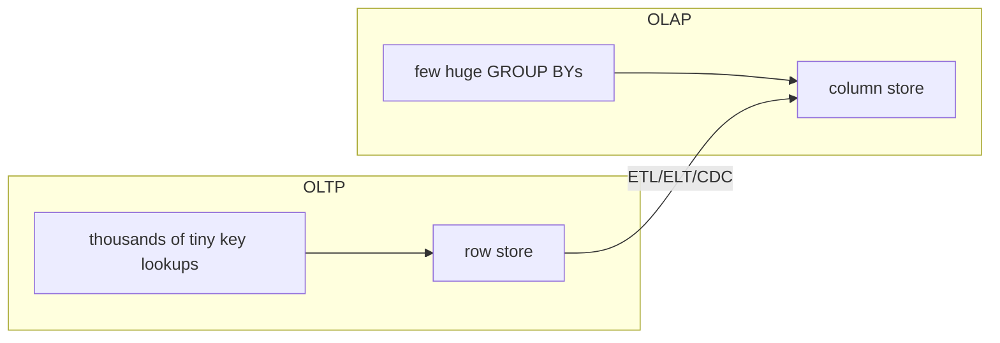
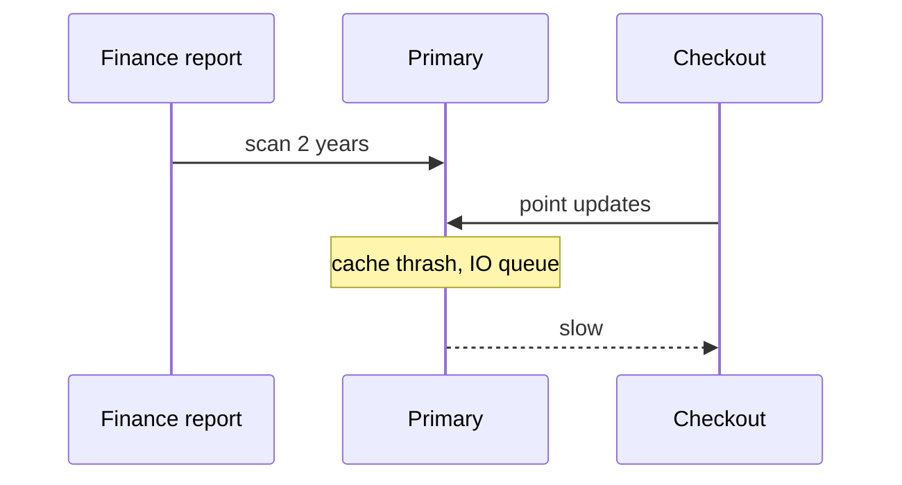

# Lesson 30: OLTP vs OLAP — Row vs Column Stores, Warehouses, ETL vs ELT

> **Prerequisites:** [Lesson 01: Relational Model & SQL Basics](../01-relational-model-sql-basics/README.md) (conceptual).  
> **Estimated Reading Time:** 28–35 minutes  
> **Target Audience:** Backend engineers stopping Monday-morning report queries from killing checkout, and designing the path into a columnar warehouse.  
> **Free PDF Notes:** [Download SD-E-030.pdf](https://backendroadmap.com/notes/system-design/SD-E-030.pdf) · [Phase 2, Notes (PDF)](https://backendroadmap.com/notes/system-design/Phase2_Notes.pdf)

> [!NOTE]
> **In one line:** OLTP is many small transactions on a few rows; OLAP is a few huge scans and aggregations. Keep them apart: run the app on a row store, and copy data (ETL or ELT) into a columnar warehouse for analytics.

> [!TIP]
> **The Golden Rule of OLTP vs OLAP:** Never run heavy BI on the production primary. Short term: replica / off-peak. Long term: **CDC or batch → columnar warehouse** (BigQuery/Snowflake/Redshift) with a star schema + dbt. Row stores win point lookups; column stores win aggregates.

---

## Words You'll Meet Today

| Word | In Plain Words | Role in a Live Backend System |
| :--- | :--- | :--- |
| **OLTP** | Many small transactions on few rows. | Checkout, get-user, place-order. |
| **OLAP** | Few large scans and aggregations. | Revenue by month/country. |
| **Row store** | Each row stored together. | Postgres, MySQL. |
| **Column store** | Each column stored together. | Warehouses; great compression. |
| **Vectorized execution** | CPU batches many values. | Columnar engine speedup. |
| **Data warehouse** | Columnar store for analytics. | Snowflake, BigQuery, Redshift, Synapse. |
| **Star schema** | Fact table + dimension tables. | `fact_orders` + dims. |
| **ETL / ELT** | Transform before vs after load. | ELT + dbt is common modern path. |

---

## Visual Mental Models & Architecture

### The Monday-Morning Slowdown

Finance runs a 2-year revenue scan on production at 09:00 Monday. Checkout crawls. The report is fine — it’s in the **wrong place**.

### Everyday Picture: Cash Register vs Warehouse Inventory Count

- **OLTP:** ringing up one cart — grab the whole ticket (row).
- **OLAP:** counting every item’s price across the warehouse — walk only the **price aisle** (column), not every full pallet.



*Figure 1. Same business data; different engines.*

---

## Systematic Reference & Comparison Grid

| | OLTP | OLAP |
| :--- | :--- | :--- |
| Pattern | Many small txns | Few large scans |
| Latency | ms | seconds–minutes |
| Engine | Row store | Column store |
| Examples | Postgres, MySQL | Snowflake, BigQuery, Redshift |

### Worked I/O Example

1B rows × 20 columns ≈ 200 B/row → **200 GB**.  
`SUM(amount)` on row store reads ~200 GB.  
Column store reads `amount` only: 1B × 8 B = 8 GB; ~5× compression → **~1.6 GB** → >100× less I/O before parallelism.

---

## Core Definition & Taxonomic Comparison

| Term | Precise Meaning | Production Example |
| :--- | :--- | :--- |
| **ETL** vs **ELT** | Clean before load vs load raw then SQL transform. | Legacy Informatica vs dbt in Snowflake. |
| **Replica** vs **warehouse** | Same row engine, off primary vs columnar analytics. | Read replica ≠ warehouse. |
| **Fact** vs **dimension** | Events/measures vs descriptive attributes. | `fact_orders` / `dim_date`. |

---

## Component Anatomy & The Observability Gap

```text
 OLTP primary (row) 
   |-- optional read replica (still row)
   +-- CDC/batch → warehouse (column) → dbt models → BI
```

| Vantage Point | Captures | Hides |
| :--- | :--- | :--- |
| **Primary CPU at 09:00** | Report collision | “App regression” misdiagnosis |
| **Vacuum age / bloat** | Long OLAP on OLTP holds dead tuples | — |
| **Warehouse bytes scanned** | `SELECT *` tax in columnar | — |

Why not analytics on OLTP?

1. Resource fight (CPU/disk/cache).  
2. Bloat (long queries delay vacuum).  
3. Wrong shape (normalized for writes).  
4. Missing history.

---

## Mathematical Model of Columnar Advantage

### 1. Bytes Read

$$B_{\text{row}} \approx N \cdot W_{\text{row}}, \quad B_{\text{col}} \approx N \cdot W_{\text{col}} / C$$

With $N=10^9$, $W_{\text{row}}=200$, $W_{\text{col}}=8$, $C=5$: $B_{\text{row}}=200\text{GB}$, $B_{\text{col}}=1.6\text{GB}$.

### 2. Freshness Choice

| Need | Path |
| :--- | :--- |
| ≤5 minutes | CDC stream ([lesson 31](../31-change-data-capture/README.md)) |
| Daily OK | Nightly batch ELT |

### 3. Mitigations

1. Separate warehouses.  
2. Star schemas for BI.  
3. ELT + dbt; keep raw.  
4. Avoid `SELECT *` in columnar.  
5. Replica only as a stopgap.

---

## Production War Story Post-Mortem: Monday Finance Job

- **Severity & Impact:** Weekly SEV-2. Checkout p95 8× for 40 minutes.
- **Detection:** `pg_stat_activity` showed `GROUP BY` scan on `orders`.



### The Fix

Short term: replica + off-peak. Long term: CDC → BigQuery, dbt revenue model, BI pointed at warehouse.

---

## Multi-Language Production Implementation

````carousel
```go
package oltp

// Illustrative: app stays on OLTP; analytics query runs in warehouse SQL only.
const WarehouseRevenueSQL = `
SELECT d.month, s.country, SUM(f.amount) AS revenue
  FROM fact_orders f
  JOIN dim_date  d ON d.date_key  = f.date_key
  JOIN dim_store s ON s.store_key = f.store_key
 WHERE d.year IN (2025, 2026)
 GROUP BY d.month, s.country;`
```
<!-- slide -->
```typescript
/** Do not run this against the OLTP primary. */
export const revenueByMonthCountry = `
SELECT d.month, s.country, SUM(f.amount) AS revenue
  FROM fact_orders f
  JOIN dim_date  d ON d.date_key  = f.date_key
  JOIN dim_store s ON s.store_key = f.store_key
 WHERE d.year IN (2025, 2026)
 GROUP BY d.month, s.country;`;

export type Pipeline = "etl" | "elt";
export function preferModern(): Pipeline {
  return "elt"; // load raw, transform with dbt in warehouse
}
```
<!-- slide -->
```python
ROW_BYTES = 200
COLS = 20
AMOUNT_BYTES = 8
N = 1_000_000_000
COMPRESSION = 5


def row_scan_gb() -> float:
    return N * ROW_BYTES / 1e9


def col_sum_gb() -> float:
    return N * AMOUNT_BYTES / COMPRESSION / 1e9


if __name__ == "__main__":
    print(row_scan_gb(), col_sum_gb())
```
<!-- slide -->
```csharp
public static class OlapIoMath
{
    public static double RowScanGb(long n = 1_000_000_000, int rowBytes = 200)
        => n * rowBytes / 1e9;

    public static double ColSumGb(long n = 1_000_000_000, int amountBytes = 8, int compression = 5)
        => n * amountBytes / (double)compression / 1e9;
}
```
````

---

## Practical Hands-On Verification CLI Workflows

### 1. I/O ratio

```bash
python3 -c "N=10**9; print(N*200/1e9, N*8/5/1e9)"
```

### 2. Remind yourself replicas are still row stores

```bash
echo "read replica ≠ columnar warehouse"
```

### 3. Sketch star schema

```text
fact_orders(amount, qty, date_key, store_key, product_key)
dim_date / dim_store / dim_product
```

---

## Pause and Think

> [!exercise] Dashboard needs ≤5 minutes freshness. Nightly batch or CDC?

<details><summary>Answer</summary>

CDC — continuous commit stream; warehouse lag seconds–minutes. Nightly batch can be up to 24h stale.

</details>

---

## Common Mistakes & Troubleshooting

- Heavy reports on production primary.
- Treating a read replica as a warehouse.
- Column store for app point lookups / single-row updates.
- `SELECT *` in columnar warehouses.
- Choosing ETL vs ELT by fashion without ops constraints.

---

## Recap in Three Lines

1. OLTP row vs OLAP column — separate them.
2. Warehouses + star schemas + ELT/dbt.
3. CDC for freshness; never starve checkout for BI.

---

## Interview Practice Questions

### Basic Conceptual Questions (Q1–Q4)

<details><summary><strong>Q1: Why not run analytics on the OLTP database? [BASIC]</strong></summary>

Large scans compete with transactions for CPU/I/O/cache, slow users, delay vacuum/bloat, and a normalized row store is inefficient for aggregating few columns over billions of rows. Move to a columnar warehouse via ETL/ELT.

</details>

<details><summary><strong>Q2: Why are column stores faster for analytics? [BASIC]</strong></summary>

Read only needed columns; similar values compress 5–10×; vectorized batches. `SUM` over 1 of 20 columns reads ~1/20 of data, less after compression.

</details>

<details><summary><strong>Q3: ETL vs ELT? [BASIC]</strong></summary>

ETL transforms before load. ELT loads raw then transforms in-warehouse (e.g. dbt). ELT is common because warehouse compute is elastic and raw data stays re-transformable.

</details>

<details><summary><strong>Q4: What is a star schema? [BASIC]</strong></summary>

A large fact table of events/measures surrounded by dimension tables (date, store, product) that describe them — join + `GROUP BY` for reports.

</details>

### Scenario-Based Architecture Questions (Q5–Q8)

<details><summary><strong>Q5: Finance report slows checkout every Monday 9am. Fix short and long term. [SCENARIO]</strong></summary>

Short: replica or off-peak. Long: CDC/batch into BigQuery/Snowflake, dbt revenue table, point report there.

</details>

<details><summary><strong>Q6: Schema for revenue by month, country, product category. [SCENARIO]</strong></summary>

`fact_orders` + `dim_date`, `dim_store` (country), `dim_product` (category); join and group.

</details>

<details><summary><strong>Q7: ≤5 minutes freshness — batch or CDC? [SCENARIO]</strong></summary>

CDC.

</details>

<details><summary><strong>Q8: When is a read replica enough? [SCENARIO]</strong></summary>

Light reporting that tolerates row-store scan cost and limited history — as a **first step**, not a warehouse substitute.

</details>

### Advanced & Tricky Interview Questions (Q9–Q12)

<details><summary><strong>Q9: Why not use a column store for the app itself? [TRICKY]</strong></summary>

Fetching/updating one order touches many column files; single-row updates are slow on large compressed blocks. Row stores win point reads/writes.

</details>

<details><summary><strong>Q10: Is a read replica enough for analytics? [TRICKY]</strong></summary>

Isolates primary CPU but still row storage; scans slow; long queries may cancel/cause lag; limited history. Fine as a stopgap, not a warehouse.

</details>

<details><summary><strong>Q11: Why does `SELECT *` hurt more in columnar warehouses? [TRICKY]</strong></summary>

Billing/performance track bytes/columns scanned — pulling unused columns multiplies I/O and cost deliberately avoided by columnar layout.

</details>

<details><summary><strong>Q12: Can materialized views on OLTP replace a warehouse? [TRICKY]</strong></summary>

They can accelerate specific aggregates but still share OLTP resources, rarely match elastic columnar scale, and don’t solve multi-source history/BI ecosystems. Useful tactically, not strategically.

</details>

---

## One-Page Master Cheat Sheet

```text
┌─ OLTP vs OLAP (SD-E-030) ───────────────────────────────────────┐
│ OLTP: many tiny row ops · OLAP: few huge aggregates             │
│ Row store ↔ point lookups · Column store ↔ scans + compression  │
│ 1B×20 cols: ~200GB row scan vs ~1.6GB compressed col SUM        │
│ Warehouse + star schema · ELT/dbt · CDC for freshness           │
│ Never BI on primary · replica ≠ warehouse                       │
└─────────────────────────────────────────────────────────────────┘
```

---

## Free PDF notes

[SD-E-030.pdf](https://backendroadmap.com/notes/system-design/SD-E-030.pdf)

## Sources

- Kimball — dimensional modeling / star schemas
- BigQuery / Snowflake architecture overviews
- dbt documentation — ELT

## Next

[Lesson 31: Change Data Capture (CDC) — Debezium, Kafka & the Dual-Write Problem](../31-change-data-capture/README.md)
