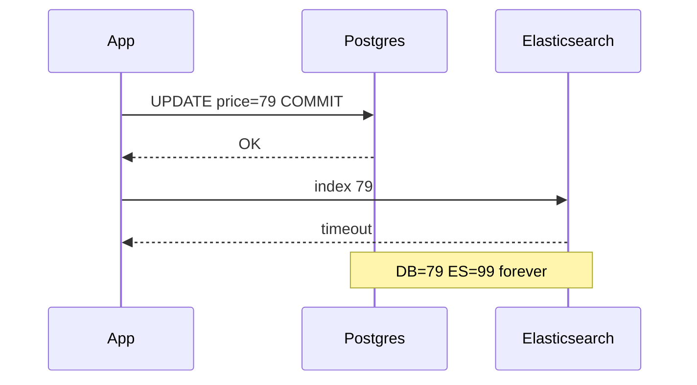
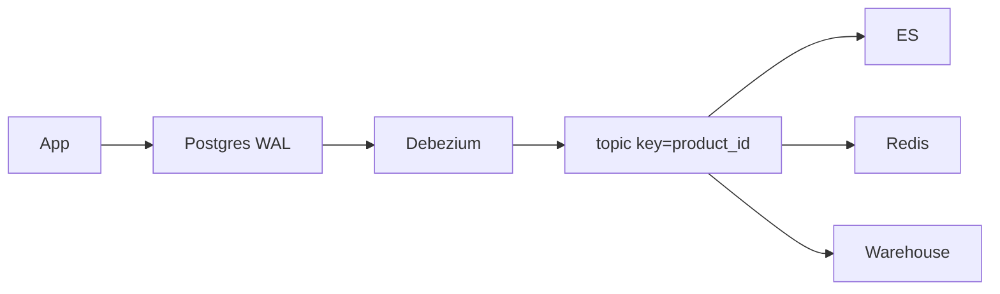
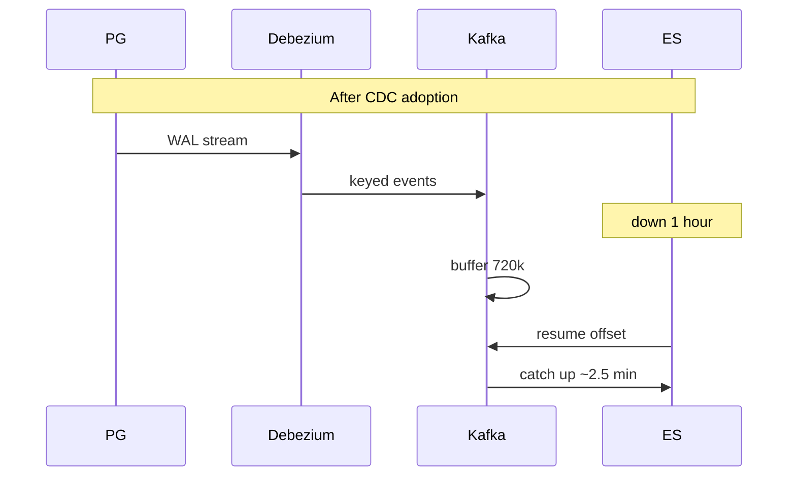

# Lesson 31: Change Data Capture (CDC) — Debezium, Kafka & the Dual-Write Problem

> **Prerequisites:** [Lesson 30: OLTP vs OLAP](../30-oltp-vs-olap/README.md).  
> **Estimated Reading Time:** 28–35 minutes  
> **Target Audience:** Backend engineers syncing search, cache, and warehouses from Postgres/MySQL without dual-write drift.  
> **Free PDF Notes:** [Download SD-E-031.pdf](https://backendroadmap.com/notes/system-design/SD-E-031.pdf) · [Phase 2, Notes (PDF)](https://backendroadmap.com/notes/system-design/Phase2_Notes.pdf)

> [!NOTE]
> **In one line:** writing to two systems from the app (dual write) can silently leave them out of sync; with CDC the app writes only to the database, and a tool like Debezium streams every committed change from the database log, in commit order, to Kafka and on to search, caches and warehouses.

> [!TIP]
> **The Golden Rule of CDC:** One **source of truth** (the DB). Derive search/cache/warehouse from the **WAL/binlog**. Key Kafka by entity ID for per-key order, make consumers **idempotent** (at-least-once), monitor **replication slot lag**, and use an **outbox** when you need business events — not raw rows.

---

## Words You'll Meet Today

| Word | In Plain Words | Role in a Live Backend System |
| :--- | :--- | :--- |
| **Dual write** | App writes two systems, no shared txn. | Silent permanent drift. |
| **CDC** | Stream committed changes from the DB log. | Single write path, many readers. |
| **WAL / binlog** | Postgres / MySQL change log. | Source Debezium reads. |
| **Debezium** | CDC connectors on Kafka Connect. | Snapshot + streaming. |
| **Replication slot** | Keeps WAL until consumed. | Lag can fill disk. |
| **Snapshot** | Initial copy of existing rows. | Bootstrap before stream. |
| **Sink connector** | Writes a topic into a target. | ES / warehouse / Redis. |
| **Outbox** | Event row in the same transaction. | Business events iff change commits. |
| **Idempotent** | Safe to apply twice. | Required for at-least-once. |

---

## Visual Mental Models & Architecture

### The Bug: A Price That Never Updates

App updates Postgres price, then indexes Elasticsearch. ES call times out after commit → search shows old price forever; nothing retries.

### Everyday Picture: Notarized Ledger vs Two Sticky Notes

Dual write = two sticky notes — either can fail. CDC = photocopy every notarized ledger line (commit) to subscribers in order.



*Figure 1. Dual-write failure after commit.*



*Figure 2. One write path; consumers track their own offsets.*

---

## Systematic Reference & Comparison Grid

| Approach | Atomic with DB? | Ordering | Failure mode |
| :--- | :--- | :--- | :--- |
| Dual write in app | No | Can diverge | Silent drift |
| “DB then Kafka” in app | No | Still dual write | Lost events on crash |
| CDC from WAL | Yes (committed only) | Commit order | Slot lag / consumer bugs |
| Outbox + CDC | Yes | Commit order | Best for business events |

### Example Debezium Event Shape

```json
{
  "op": "u",
  "before": { "id": 42, "price": 99 },
  "after":  { "id": 42, "price": 79 },
  "source": { "table": "products", "lsn": 23854104 },
  "ts_ms": 1767225600000
}
```

---

## Core Definition & Taxonomic Comparison

**CDC** derives change events from the database’s durable commit log so downstream systems converge without sharing a distributed transaction with the app.

| Term | Precise Meaning | Production Example |
| :--- | :--- | :--- |
| **At-least-once** vs **exactly-once** | May replay vs end-to-end once. | Idempotent upserts. |
| **Row events** vs **domain events** | Table diffs vs `OrderPlaced`. | Outbox for domain. |
| **Slot lag** | WAL retained for slow consumer. | Disk fill incident. |

---

## Component Anatomy & The Observability Gap

```text
 app txn commit → WAL
 Debezium replication slot → snapshot then stream
 Kafka partition by key → ordered per entity
 sinks upsert / invalidate / load
```

| Vantage Point | Captures | Hides |
| :--- | :--- | :--- |
| **App success** | DB write OK | Downstream lag |
| **Kafka consumer lag** | ES outage backlog | — |
| **`pg_replication_slots`** | Slot retained bytes | Forgotten connector |
| **Metrics** | Slot lag, consumer lag, redelivery rate | Dual-write “looks fine” |

---

## Mathematical Model of Backlog & Catch-Up

### 1. Outage Backlog

$200$ changes/s × $3600$ s = **720,000** events (~1 KB → <1 GB). Sink at 5,000/s → catch-up ≈ $720000/5000 = 144$ s ≈ **2.4 minutes**.

### 2. Ordering Rule

Kafka orders **within a partition**. Key = `product_id` ⇒ all changes for one product stay ordered.

### 3. Concurrent Dual-Write Reorder Risk

Even if both writes succeed, concurrent updates can apply in different orders on DB vs ES → divergent finals with **no error**.

### 4. Mitigations

1. CDC, not dual write.  
2. Key by entity ID.  
3. Idempotent consumers (version/LSN).  
4. Alert on slot lag.  
5. Outbox for domain events; schema registry for evolution.

---

## Production War Story Post-Mortem: Silent Search Drift

- **Severity & Impact:** SEV-2 discovered after 3 weeks. Wrong prices in search; revenue leakage.
- **Detection:** Manual price audit; no retry trail for failed ES calls.



### The Fix

Debezium → Kafka → ES sink; idempotent upserts; slot-lag alerts; ban dual writes in code review.

---

## Multi-Language Production Implementation

````carousel
```go
package outbox

import (
	"context"
	"encoding/json"

	"github.com/jackc/pgx/v5"
)

type PriceChanged struct {
	ProductID int64 `json:"product_id"`
	Price     int64 `json:"price_cents"`
}

func UpdatePriceWithOutbox(ctx context.Context, tx pgx.Tx, id, price int64) error {
	if _, err := tx.Exec(ctx, `UPDATE products SET price=$1 WHERE id=$2`, price, id); err != nil {
		return err
	}
	payload, _ := json.Marshal(PriceChanged{ProductID: id, Price: price})
	_, err := tx.Exec(ctx, `INSERT INTO outbox(aggregate_id, event_type, payload) VALUES ($1,'PriceChanged',$2)`, id, payload)
	return err
}
```
<!-- slide -->
```typescript
export type CdcEvent = {
  op: "c" | "u" | "d" | "r";
  after?: { id: string; price: number; version: number };
};

/** At-least-once safe apply: ignore older versions. */
export function applyPrice(doc: { version: number; price: number } | null, ev: CdcEvent) {
  if (!ev.after) return doc;
  if (doc && ev.after.version <= doc.version) return doc;
  return { price: ev.after.price, version: ev.after.version };
}
```
<!-- slide -->
```python
import json
from typing import Any, Dict


def outbox_row(product_id: int, price: int) -> Dict[str, Any]:
    return {
        "aggregate_id": product_id,
        "event_type": "PriceChanged",
        "payload": json.dumps({"product_id": product_id, "price": price}),
    }


def backlog_catchup_seconds(rate_in: float, downtime_s: float, rate_out: float) -> float:
    return (rate_in * downtime_s) / rate_out
```
<!-- slide -->
```csharp
using System.Text.Json;

public record PriceChanged(long ProductId, long PriceCents);

public static class Outbox
{
    public static (string Sql, object[] Args) Insert(long productId, long priceCents)
    {
        var payload = JsonSerializer.Serialize(new PriceChanged(productId, priceCents));
        return (
            "INSERT INTO outbox(aggregate_id, event_type, payload) VALUES (@id,'PriceChanged',@payload::jsonb)",
            new object[] { productId, payload }
        );
    }

    public static double CatchUpSeconds(double rateIn, double downtimeS, double rateOut)
        => rateIn * downtimeS / rateOut;
}
```
````

---

## Practical Hands-On Verification CLI Workflows

### 1. Catch-up math

```bash
python3 -c "print(200*3600/5000)"
```

### 2. Mentally ban dual write

```bash
echo "DB then Kafka in app code == still dual write"
```

### 3. Slot lag awareness (ops)

```sql
-- SELECT slot_name, pg_wal_lsn_diff(pg_current_wal_lsn(), restart_lsn) AS retained
-- FROM pg_replication_slots;
SELECT 'monitor replication slots';
```

---

## Pause and Think

> [!exercise] Why not just retry the Elasticsearch write in the app?

<details><summary>Answer</summary>

The app can crash between commit and retry, and retries can still reorder concurrent updates. CDC derives everything from the committed log — durable and ordered.

</details>

---

## Common Mistakes & Troubleshooting

- “Write DB then Kafka” in app code (still dual write).
- Non-idempotent consumers → double counts on replay.
- Random Kafka keys → per-entity reordering.
- No alert on replication-slot lag until disk full.
- Treating CDC row events as public domain events without an outbox/ACL layer.

---

## Recap in Three Lines

1. Dual writes drift; CDC reads the commit log.
2. Key by entity; idempotent sinks; watch slots.
3. Outbox for business events in the same transaction.

---

## Interview Practice Questions

### Basic Conceptual Questions (Q1–Q4)

<details><summary><strong>Q1: How does CDC avoid dual writes? [BASIC]</strong></summary>

App writes only the database. CDC reads committed changes from the DB log and publishes them in commit order to Kafka; search/caches/warehouses update from there. A down consumer resumes from its offset.

</details>

<details><summary><strong>Q2: What is the dual-write problem? [BASIC]</strong></summary>

Writing two systems with no shared transaction. One write can fail after the other succeeds, or concurrent updates land in different orders — permanent inconsistency.

</details>

<details><summary><strong>Q3: Why key the Kafka topic by product ID? [BASIC]</strong></summary>

Kafka orders only within a partition; the key chooses the partition. Same key ⇒ same partition ⇒ per-product commit order preserved.

</details>

<details><summary><strong>Q4: What is a replication slot? [BASIC]</strong></summary>

Postgres mechanism that retains WAL until a logical consumer (e.g. Debezium) acknowledges it. A stuck consumer can retain WAL until disk fills — must be monitored.

</details>

### Scenario-Based Architecture Questions (Q5–Q8)

<details><summary><strong>Q5: Elasticsearch down one hour — what happens with CDC? [SCENARIO]</strong></summary>

Events accumulate in Kafka (e.g. 720k at 200/s). When ES returns, sink resumes from offset and catches up; idempotent upserts make replays harmless.

</details>

<details><summary><strong>Q6: Need OrderPlaced event, not raw rows. How? [SCENARIO]</strong></summary>

Outbox: in the same transaction as the order insert, insert an outbox row. Debezium publishes outbox ⇒ event iff order committed.

</details>

<details><summary><strong>Q7: Postgres disk filling; `pg_wal` huge. Likely cause? [SCENARIO]</strong></summary>

Replication slot whose consumer is stuck/gone. Fix or drop the slot; alert on lag.

</details>

<details><summary><strong>Q8: Cache invalidation design with CDC? [SCENARIO]</strong></summary>

Consume product updates; delete/update Redis keys by product ID. Idempotent; lag means brief stale cache — acceptable vs dual-write misses.

</details>

### Advanced & Tricky Interview Questions (Q9–Q12)

<details><summary><strong>Q9: CDC delivers at least once. How do consumers stay correct? [TRICKY]</strong></summary>

Idempotent apply: upsert by key with version/LSN; ignore older events. Replays become no-ops.

</details>

<details><summary><strong>Q10: Why not just retry ES in the app? [TRICKY]</strong></summary>

Crash windows and reorderings remain. CDC uses the durable ordered log as the source of propagation.

</details>

<details><summary><strong>Q11: Is “transactional outbox polled by app” still dual write? [TRICKY]</strong></summary>

Polling the outbox in-process can work if the outbox insert is in the same DB transaction; publishing is derived from committed outbox rows (similar guarantee to CDC). Publishing to Kafka in the request path *beside* the DB write without outbox is dual write.

</details>

<details><summary><strong>Q12: How do schema changes interact with CDC? [TRICKY]</strong></summary>

They flow to every consumer. Use a schema registry, expand-contract on payloads, and make consumers tolerant of new fields — coordinate with [lesson 28](../28-zero-downtime-database-migrations/README.md).

</details>

---

## One-Page Master Cheat Sheet

```text
┌─ Change Data Capture (SD-E-031) ────────────────────────────────┐
│ Dual write → silent drift · CDC = WAL/binlog → Kafka            │
│ Debezium: snapshot + stream · key by entity id                  │
│ At-least-once → idempotent sinks · monitor slot lag             │
│ Outbox for domain events in same txn                            │
│ 200/s × 1h = 720k · catch-up ≈ backlog/sink_rate                │
└─────────────────────────────────────────────────────────────────┘
```

---

## Free PDF notes

[SD-E-031.pdf](https://backendroadmap.com/notes/system-design/SD-E-031.pdf)

## Sources

- Debezium documentation
- Kleppmann — “Turning the database inside-out” / DDIA change streams
- Transactional outbox pattern

## Next

[Lesson 32: Distributed SQL Explained — Spanner, CockroachDB, Raft & TrueTime](../32-distributed-sql-explained/README.md)
