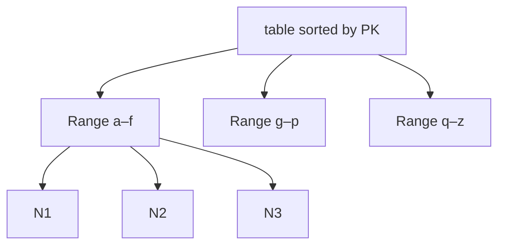
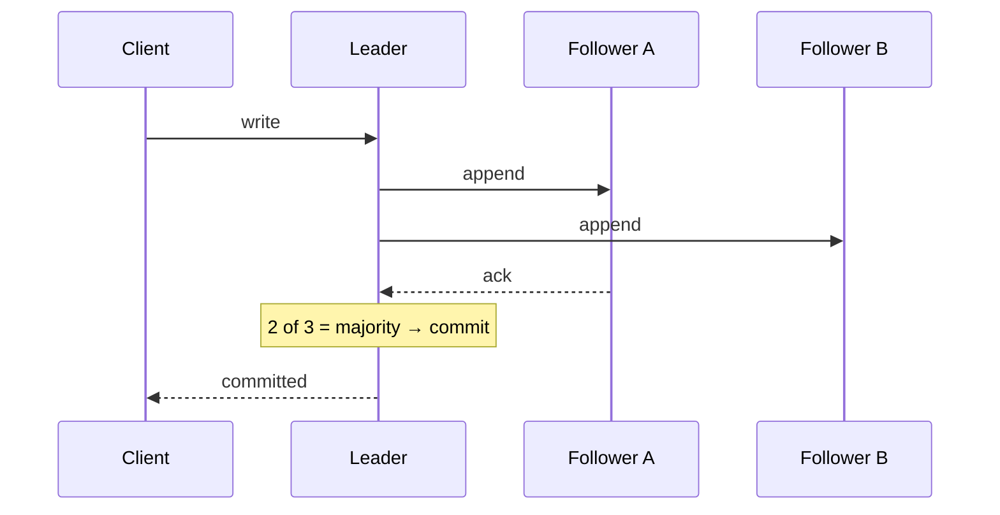
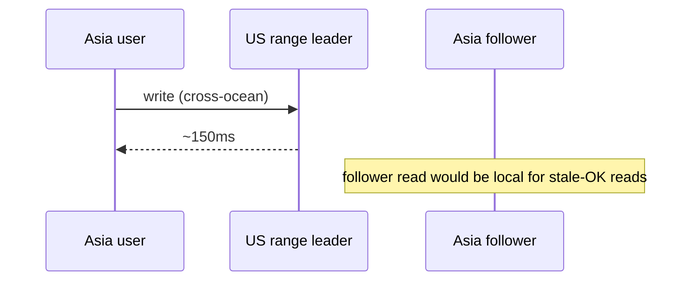

# Lesson 32: Distributed SQL Explained — Spanner, CockroachDB, Raft & TrueTime

> **Prerequisites:** [Lesson 08: ACID Explained](../08-acid-explained/README.md), [Lesson 22: Database Sharding Fundamentals](../22-database-sharding-fundamentals/README.md) (conceptual).  
> **Estimated Reading Time:** 30–35 minutes  
> **Target Audience:** Backend engineers evaluating Spanner/CockroachDB/Yugabyte for multi-region ACID ledgers — and explaining Raft + clock uncertainty in interviews.  
> **Free PDF Notes:** [Download SD-E-032.pdf](https://backendroadmap.com/notes/system-design/SD-E-032.pdf) · [Phase 2, Notes (PDF)](https://backendroadmap.com/notes/system-design/Phase2_Notes.pdf)

> [!NOTE]
> **In one line:** distributed SQL (NewSQL) gives you SQL and serializable ACID transactions across many nodes and regions: data is split into ranges, each replicated with Raft, and clocks (TrueTime or hybrid logical clocks) order transactions; the price is higher write latency, so design for locality.

> [!TIP]
> **The Golden Rule of Distributed SQL:** Use it when you need **cross-shard ACID + automatic rebalancing + region survival** you don’t want to build. Accept **consensus RTT** on writes; place data **regional by row**; use **follower reads** when staleness is OK. If one Postgres primary fits, don’t pay the tax.

---

## Words You'll Meet Today

| Word | In Plain Words | Role in a Live Backend System |
| :--- | :--- | :--- |
| **Distributed SQL / NewSQL** | SQL + ACID scaled across nodes. | Spanner, CockroachDB, YugabyteDB. |
| **Range** | Chunk of sorted keys; unit of replication. | Splits/moves as data grows. |
| **Raft** | Consensus: commit on a majority. | Survives minority failures. |
| **Leader** | Replica that orders a range’s writes. | Followers replicate log. |
| **TrueTime** | Spanner clock API with bounded uncertainty. | GPS + atomic clocks. |
| **Commit wait** | Wait out uncertainty before visible commit. | Preserves real-time order. |
| **HLC** | Hybrid logical clock (physical + counter). | CockroachDB ordering. |
| **Regional by row** | Each row homed in its region. | Local write latency. |
| **Follower read** | Slightly stale read from nearby replica. | Fast global reads. |

---

## Visual Mental Models & Architecture

### Global Payments Ledger

Every transfer must be real ACID — no double spend — across EU/US/Asia, surviving a whole region loss. One Postgres can’t; hand-sharded Postgres leaves cross-shard txn, rebalance, and failover to you.

### Everyday Picture: Notaries in Three Cities

A transfer is notarized when a **majority of city notaries** stamp it (Raft). Clocks disagree slightly, so Spanner’s watches come with an **error bar** (TrueTime) — wait until even the earliest possible “now” is past the stamp before showing it.



*Figure 1. Ranges replicated across nodes; each range has a leader.*



*Figure 2. Raft commit on majority; slow follower catches up later.*

---

## Systematic Reference & Comparison Grid

| Choose distributed SQL when… | Stay with Postgres when… |
| :--- | :--- |
| Cross-shard txns + strong consistency | One primary (+ replicas) handles load |
| Automatic sharding/rebalancing | Simple single-key sharding enough |
| Survive zone/region loss without data loss | Lowest write latency matters most |
| Don’t want to build the control plane | Need Postgres extensions/ecosystem |

### Latency Floors (illustrative)

| Placement | Write RTT ballpark |
| :--- | :--- |
| Same region, 3 zones | few ms |
| Neighbouring regions | ~10–30 ms |
| Cross-continent | ~100 ms+ |

---

## Core Definition & Taxonomic Comparison

**Distributed SQL** presents a single logical SQL database while internally partitioning into consensus-replicated ranges with global transaction ordering.

| Term | Precise Meaning | Production Example |
| :--- | :--- | :--- |
| **Majority** | $\lfloor R/2\rfloor+1$ of $R$ replicas. | 2 of 3; 3 of 5. |
| **TrueTime** vs **HLC** | Bounded interval wait vs uncertainty restart. | Spanner vs Cockroach. |
| **Serializability** | Transactions appear one-at-a-time. | Ledger correctness. |

---

## Component Anatomy & The Observability Gap

```text
 SQL txn
  |-- touch one or more ranges (leaders)
  |-- Raft replicate each range write to majority
  |-- commit protocol across leaders if multi-range
  |-- assign commit timestamp (TrueTime wait / HLC)
  +-- serve reads from leader or follower (stale OK?)
```

| Vantage Point | Captures | Hides |
| :--- | :--- | :--- |
| **Client write latency** | Cross-region tax | Mis-homed rows |
| **Range hotspot metrics** | Sequential PK heat | “Need more nodes” misdiagnosis |
| **Metrics** | Raft commit latency, restarts, follower read age | — |

---

## Mathematical Model of Quorums & Clocks

### 1. Failure Tolerance

With $R=2f+1$ replicas, survive $f$ failures. $R=3 \Rightarrow f=1$; $R=5 \Rightarrow f=2$.

Region survival: replicas in ≥3 regions so losing one leaves a majority.

### 2. TrueTime Commit Wait

TrueTime returns $[earliest, latest]$ with uncertainty $\varepsilon$. Pick commit timestamp $s = latest$, then wait until $earliest > s$ before making commit visible.

### 3. Write Latency Floor

$$T_{\text{write}} \gtrsim RTT_{\text{to majority}} + T_{\text{multi-range coord}}$$

### 4. Mitigations

1. Regional by row / locality config.  
2. Follower reads for stale-OK paths.  
3. Avoid sequential PKs (hot ranges) — UUID/hash.  
4. Don’t choose NewSQL “for scale” if Postgres fits.  
5. Measure cross-region txn fraction.

---

## Production War Story Post-Mortem: Asia Writes Hitting US Leaders

- **Severity & Impact:** SEV-2. Asia users saw ~150 ms writes; support tickets on “slow checkout.”
- **Detection:** Traces showed Raft round-trips to US leaders for Asia rows.



### The Fix

`REGIONAL BY ROW` / homing; local transfers ms; cross-region transfers pay RTT; follower reads for product pages with 5s staleness OK.

---

## Multi-Language Production Implementation

````carousel
```go
package ledger

// Illustrative CockroachSQL — run against CRDB, not as Go string exec in prod without driver.
const Schema = `
ALTER DATABASE ledger SURVIVE REGION FAILURE;
ALTER TABLE accounts SET LOCALITY REGIONAL BY ROW;
`

const Transfer = `
BEGIN;
UPDATE accounts SET balance = balance - $1 WHERE id = $2;
UPDATE accounts SET balance = balance + $1 WHERE id = $3;
COMMIT;`
```
<!-- slide -->
```typescript
/** Multi-region transfer: expect higher latency when accounts are in different regions. */
export const transferSql = `
BEGIN;
UPDATE accounts SET balance = balance - $1 WHERE id = $2;
UPDATE accounts SET balance = balance + $1 WHERE id = $3;
COMMIT;`;

export function majority(replicas: number): number {
  return Math.floor(replicas / 2) + 1;
}
```
<!-- slide -->
```python
def majority(replicas: int) -> int:
    return replicas // 2 + 1


def survive_region_failures(regions: int, replicas_per_region: int = 1) -> bool:
    """Naive: one replica per region; need regions >= 3 for one region loss."""
    total = regions * replicas_per_region
    return majority(total) <= total - replicas_per_region
```
<!-- slide -->
```csharp
public static class Quorum
{
    public static int Majority(int replicas) => replicas / 2 + 1;

    public static bool SurvivesOneRegionLoss(int regions, int replicasPerRegion = 1)
    {
        var total = regions * replicasPerRegion;
        return Majority(total) <= total - replicasPerRegion;
    }
}
```
````

---

## Practical Hands-On Verification CLI Workflows

### 1. Majority math

```bash
python3 -c "print(3//2+1, 5//2+1)"
```

### 2. Region survival intuition

```bash
python3 -c "print('3 regions ×1 replica: lose 1 → 2 left ≥ majority 2')"
```

### 3. Latency expectation

```bash
echo "cross-continent write >= ~100ms consensus RTT"
```

---

## Pause and Think

> [!exercise] Product page needs fast reads worldwide, tolerates 5s staleness. Pattern?

<details><summary>Answer</summary>

Follower reads from the nearest replica at a slightly old timestamp — no trip to the leader. Writes still go to the leader.

</details>

---

## Common Mistakes & Troubleshooting

- Expecting single-node Postgres latency multi-region.
- Ignoring locality → every txn crosses an ocean.
- Sequential PKs → hot ranges.
- Choosing NewSQL only “for scale.”
- Using NTP wall clocks alone to order distributed txns.

---

## Recap in Three Lines

1. Ranges + Raft majority + clock discipline = distributed ACID SQL.
2. Write latency follows replica distance; design locality.
3. Postgres wins when one primary is enough.

---

## Interview Practice Questions

### Basic Conceptual Questions (Q1–Q4)

<details><summary><strong>Q1: When choose distributed SQL over sharded Postgres? [BASIC]</strong></summary>

Need SQL/ACID across many nodes/regions, strong consistency, HA via consensus, automatic sharding — and you’d rather not build it. Accept higher write latency; design for locality.

</details>

<details><summary><strong>Q2: How does it survive a node failure? [BASIC]</strong></summary>

Each range replicated (typically 3×) with Raft. Write commits on majority (2 of 3); losing one node leaves committed data; new leader elected quickly.

</details>

<details><summary><strong>Q3: What is TrueTime? [BASIC]</strong></summary>

Spanner’s clock API (GPS + atomic clocks) returning time as an interval with known uncertainty of a few ms. Spanner waits out uncertainty so timestamps match real-time order.

</details>

<details><summary><strong>Q4: What is a range in this context? [BASIC]</strong></summary>

A contiguous chunk of the sorted primary-key space that is the unit of replication, splitting, and movement across nodes.

</details>

### Scenario-Based Architecture Questions (Q5–Q8)

<details><summary><strong>Q5: Asia users see 150 ms writes; leaders in US. Fix? [SCENARIO]</strong></summary>

Regional by row / partition by region so each user’s rows have leaders nearby. Local writes few ms; only cross-region txns pay long RTT.

</details>

<details><summary><strong>Q6: How many replicas to survive a full region outage? [SCENARIO]</strong></summary>

Replicas in ≥3 regions so losing one leaves a majority (2 of 3). With 5 replicas over 3 regions (2+2+1), losing any one region still leaves ≥3 of 5.

</details>

<details><summary><strong>Q7: Fast global reads, 5s staleness OK. [SCENARIO]</strong></summary>

Follower reads from nearest replica.

</details>

<details><summary><strong>Q8: Paris→Paris vs Paris→NY transfer latency? [SCENARIO]</strong></summary>

Same-region: few ms. Cross-region: ~100 ms+ for multi-range consensus coordination.

</details>

### Advanced & Tricky Interview Questions (Q9–Q12)

<details><summary><strong>Q9: Why not NTP timestamps to order transactions? [TRICKY]</strong></summary>

NTP can be off tens of ms+ with no guaranteed bound — later txn could get earlier timestamp and break serializability. Spanner bounds error (TrueTime); CRDB uses HLC + max offset + uncertainty restarts.

</details>

<details><summary><strong>Q10: Is distributed SQL always better than Postgres? [TRICKY]</strong></summary>

No. Single-row writes slower (consensus), ops more complex, some Postgres features missing. If one primary fits, Postgres is simpler and faster.

</details>

<details><summary><strong>Q11: Why do sequential primary keys hurt? [TRICKY]</strong></summary>

All inserts hit the rightmost range → hotspot like ranged sharding on autoincrement. Prefer UUIDs or hashed keys for insert spread.

</details>

<details><summary><strong>Q12: Commit wait vs uncertainty restart — trade-off? [TRICKY]</strong></summary>

Spanner delays visibility by ~ε on every commit (predictable wait). CRDB may restart reads that see uncertainty (latency variance on contention) instead of waiting on every commit. Both aim for serializable real-time order without unbounded clock faith.

</details>

---

## One-Page Master Cheat Sheet

```text
┌─ Distributed SQL (SD-E-032) ────────────────────────────────────┐
│ Ranges × Raft majority × clocks (TrueTime / HLC)                │
│ Writes ≥ RTT to majority · design regional locality             │
│ Follower reads for stale-OK · avoid sequential PK hotspots      │
│ 3 replicas → survive 1; multi-region for region loss            │
│ Use when cross-shard ACID needed; else Postgres                 │
└─────────────────────────────────────────────────────────────────┘
```

---

## Free PDF notes

[SD-E-032.pdf](https://backendroadmap.com/notes/system-design/SD-E-032.pdf)

## Sources

- Google Spanner paper — TrueTime
- CockroachDB / Yugabyte architecture docs
- Raft (Ongaro / Ousterhout)

## Next

[Lesson 33: How to Choose a Database — Access Patterns & Polyglot Persistence](../33-how-to-choose-a-database/README.md)
